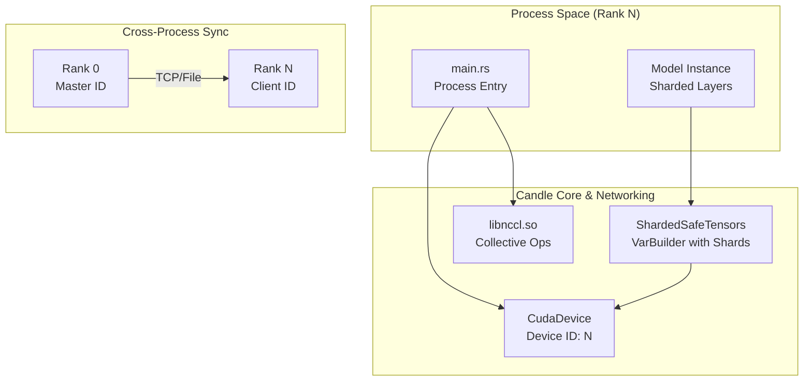
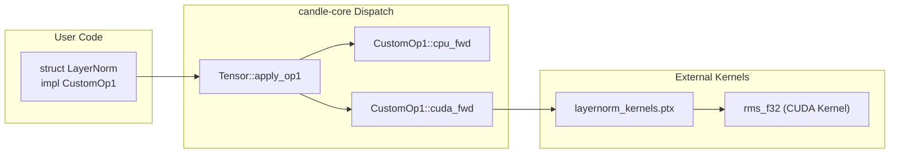

<!-- source: DeepWiki mcp.deepwiki.com · repo huggingface/candle · page 8 Advanced Topics · fetched 2026-10-26 -->

# Advanced Topics

Relevant source files

The following files were used as context for generating this wiki page:

- [candle-core/src/custom_op.rs](candle-core/src/custom_op.rs)
- [candle-core/src/error.rs](candle-core/src/error.rs)
- [candle-core/src/lib.rs](candle-core/src/lib.rs)
- [candle-core/tests/custom_op_tests.rs](candle-core/tests/custom_op_tests.rs)
- [candle-examples/build.rs](candle-examples/build.rs)
- [candle-examples/buildtime_downloader.rs](candle-examples/buildtime_downloader.rs)
- [candle-examples/examples/custom-ops/cuda_kernels.rs](candle-examples/examples/custom-ops/cuda_kernels.rs)
- [candle-examples/examples/custom-ops/kernels/layernorm_kernels.cu](candle-examples/examples/custom-ops/kernels/layernorm_kernels.cu)
- [candle-examples/examples/custom-ops/kernels/reduction_utils.cuh](candle-examples/examples/custom-ops/kernels/reduction_utils.cuh)
- [candle-examples/examples/custom-ops/main.rs](candle-examples/examples/custom-ops/main.rs)
- [candle-flash-attn/build.rs](candle-flash-attn/build.rs)
- [candle-kernels/README.md](candle-kernels/README.md)
- [candle-kernels/build.rs](candle-kernels/build.rs)
- [candle-kernels/src/lib.rs](candle-kernels/src/lib.rs)
- [candle-kernels/src/moe/moe_wmma.cu](candle-kernels/src/moe/moe_wmma.cu)

This page covers advanced usage patterns and optimization techniques for Candle. Topics include distributed multi-GPU execution, implementing custom operations to extend the framework, deploying models to WebAssembly for browser-based inference, and performance optimization strategies.

---

## Multi-GPU and Distributed Execution

Candle supports distributed computing and multi-GPU setups primarily through NCCL (NVIDIA Collective Communications Library) integration. This allows for both data parallelism and tensor parallelism in large-scale model inference and training.

### Distributed Architecture

The distributed system relies on process-level parallelism where each GPU is managed by a separate process. These processes communicate using NCCL primitives. In multi-GPU environments, weights are often sharded across devices to fit large models into memory.

**Distributed Execution Flow**:

### Key Components for Distributed Execution
*   **`ShardedSafeTensors`**: Part of the `VarBuilder` system, it allows loading only specific slices of model weights into each GPU's memory based on the process rank and the number of shards.
*   **`candle-hub`**: A utility for downloading models and managing revisions from the Hugging Face Hub, often used in build scripts to prepare distributed environments via `download_model` [candle-examples/buildtime_downloader.rs:4-31]().
*   **`CudaDevice`**: The core handle for GPU operations, which identifies the specific device index for the current process [candle-core/src/lib.rs:119-119]().

For implementation details on tensor parallelism and NCCL setup, see [Distributed and Multi-GPU Execution](#8.2).

Sources: [candle-examples/buildtime_downloader.rs:1-31](), [candle-examples/build.rs:43-50](), [candle-core/src/lib.rs:21-21]()

---

## Custom Operations and Extensions

Candle is designed to be extensible through a suite of `CustomOp` traits. These allow users to define new mathematical operations or integrate hand-optimized kernels (CUDA/Metal) into the computation graph.

### Custom Operation Traits
The framework provides several traits depending on the number of inputs and whether the operation is in-place:

| Trait | Purpose | Inputs | File Reference |
|-------|---------|--------|----------------|
| `CustomOp1/2/3` | Standard operations with autograd support | 1, 2, or 3 | [candle-core/src/custom_op.rs:8-153]() |
| `InplaceOp1/2/3`| Memory-efficient in-place mutation | 1, 2, or 3 | [candle-core/src/lib.rs:98-98]() |
| `UgIOp1` | Unified kernel generation (via `candle-ug`) | 1 | [candle-core/src/custom_op.rs:97-97]() |

Sources: [candle-core/src/custom_op.rs:8-153](), [candle-core/src/lib.rs:96-98](), [candle-core/tests/custom_op_tests.rs:116-133]()

### Custom Kernel Integration
Users can implement custom CUDA kernels by writing `.cu` files and using a `build.rs` script with `cudaforge::KernelBuilder` to compile them into PTX [candle-examples/build.rs:33-40]() or static libraries [candle-kernels/build.rs:14-20](). These kernels are then loaded at runtime using `get_or_load_custom_func` [candle-examples/examples/custom-ops/main.rs:74-75]().

**Custom Op Integration Logic**:

For a deep dive into implementing these traits and custom CUDA kernels, see [Custom Operations and Extensions](#8.1).

Sources: [candle-examples/examples/custom-ops/main.rs:31-90](), [candle-kernels/build.rs:1-23](), [candle-core/tests/custom_op_tests.rs:15-33]()

---

## WebAssembly and Browser Deployment

Candle enables running high-performance ML models directly in the browser by compiling to WebAssembly (WASM). This leverages the CPU backend, which can be optimized with SIMD for supported browsers.

### Browser Integration
*   **`wasm-bindgen`**: Used to expose Rust structures and functions to JavaScript.
*   **Web Workers**: Essential for running inference without blocking the main UI thread.
*   **Examples**: Candle provides extensive browser-based examples including Whisper for speech recognition, YOLO for object detection, and LLaMA2-C for text generation.

For a guide on setting up `wasm-pack`, using `yew`, and handling browser-specific limitations, see [WASM and Browser Deployment](#8.3).

---

## Performance Optimization

Optimization in Candle involves choosing the right backend, leveraging specialized kernels, and efficient memory usage.

### Optimization Strategies
*   **Flash Attention**: Candle supports Flash Attention v1, v2, and v3 (Hopper-specific). The `candle-flash-attn` crates manage the complex build process, including CUTLASS integration [candle-flash-attn/build.rs:132-132]().
*   **Quantization**: Utilizing low-bit types (GGUF, K-Quants) to reduce memory bandwidth bottlenecks. Optimized kernels for MoE (Mixture of Experts) and GGUF matmuls are available in `candle-kernels` [candle-kernels/build.rs:24-41]().
*   **WMMA Kernels**: For Ampere and newer GPUs, Candle uses Warp-level Matrix Multiply-Accumulate (WMMA) for high-performance MoE execution [candle-kernels/src/moe/moe_wmma.cu:49-77]().

### Backend and Kernel Management
Candle organizes its CUDA kernels into modules (e.g., Unary, Binary, Reduce, Sort) which are compiled to PTX and indexed for efficient dispatch [candle-kernels/src/lib.rs:5-32]().

| Optimization | Target Architecture | Implementation |
|--------------|---------------------|----------------|
| Flash Attention | CUDA (SM80+) | `candle-flash-attn` |
| MoE WMMA | CUDA (Ampere+) | `moe_gemm_grouped_kernel` |
| GGUF Quantization| CPU/CUDA/Metal | `mmq_gguf.cu` |

For detailed optimization techniques and profiling guides, see [Performance Optimization](#8.4).

Sources: [candle-flash-attn/build.rs:8-62](), [candle-kernels/src/lib.rs:70-80](), [candle-kernels/src/moe/moe_wmma.cu:65-77]()

---

