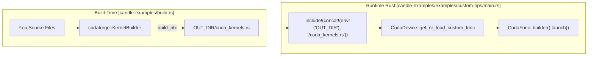
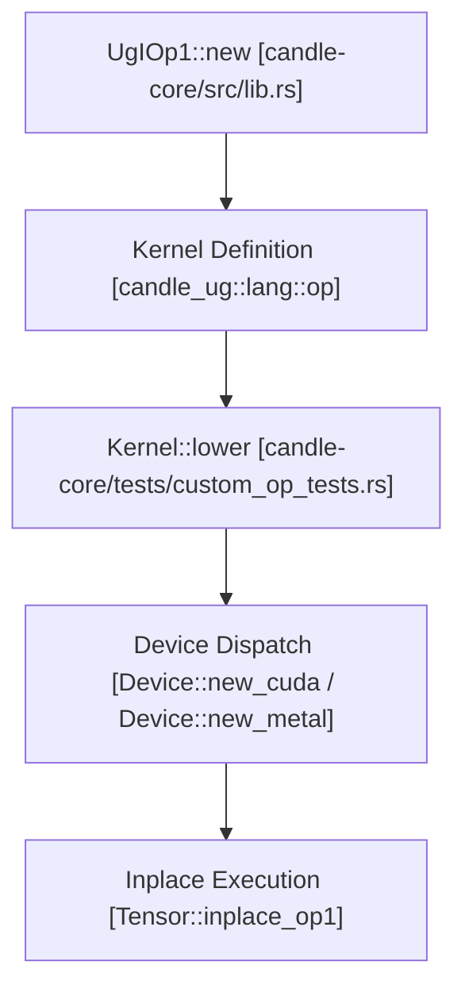

<!-- source: DeepWiki mcp.deepwiki.com · repo huggingface/candle · page 8.1 Custom Operations and Extensions · fetched 2026-10-26 -->

# Custom Operations and Extensions

Relevant source files

The following files were used as context for generating this wiki page:

- [candle-core/src/custom_op.rs](candle-core/src/custom_op.rs)
- [candle-core/src/error.rs](candle-core/src/error.rs)
- [candle-core/src/lib.rs](candle-core/src/lib.rs)
- [candle-core/tests/custom_op_tests.rs](candle-core/tests/custom_op_tests.rs)
- [candle-examples/build.rs](candle-examples/build.rs)
- [candle-examples/buildtime_downloader.rs](candle-examples/buildtime_downloader.rs)
- [candle-examples/examples/custom-ops/cuda_kernels.rs](candle-examples/examples/custom-ops/cuda_kernels.rs)
- [candle-examples/examples/custom-ops/kernels/layernorm_kernels.cu](candle-examples/examples/custom-ops/kernels/layernorm_kernels.cu)
- [candle-examples/examples/custom-ops/kernels/reduction_utils.cuh](candle-examples/examples/custom-ops/kernels/reduction_utils.cuh)
- [candle-examples/examples/custom-ops/main.rs](candle-examples/examples/custom-ops/main.rs)
- [candle-flash-attn/build.rs](candle-flash-attn/build.rs)
- [candle-kernels/README.md](candle-kernels/README.md)
- [candle-kernels/build.rs](candle-kernels/build.rs)
- [candle-kernels/src/lib.rs](candle-kernels/src/lib.rs)
- [candle-kernels/src/moe/moe_wmma.cu](candle-kernels/src/moe/moe_wmma.cu)

This page documents how to extend Candle with custom operations that can be executed across different hardware backends (CPU, CUDA, Metal). Custom operations allow you to implement specialized kernels or integrate external libraries while maintaining Candle's automatic differentiation and multi-backend architecture.

---

## Overview

Candle provides several trait-based extension points for adding custom operations:

- **`CustomOp1/2/3`**: Traits for unary, binary, and ternary operations with full autograd support. [candle-core/src/custom_op.rs:8-153]()
- **`InplaceOp1/2/3`**: Traits for operations that modify tensor data in-place (no autograd). [candle-core/src/lib.rs:98-98]()
- **`UgIOp1`**: A specialized trait for unified kernel generation via the `candle-ug` SSA (Static Single Assignment) kernel language. [candle-core/src/lib.rs:97-97]()

---

## Custom Operation Architecture

```mermaid
graph TB
    subgraph "Tensor API Space [candle-core/src/custom_op.rs]"
        apply_op1["Tensor::apply_op1(c: impl CustomOp1)"]
        apply_op1_no_bwd["Tensor::apply_op1_no_bwd()"]
        inplace_op1["Tensor::inplace_op1(c: impl InplaceOp1)"]
        apply_op2["Tensor::apply_op2(rhs, c: impl CustomOp2)"]
        apply_op2_no_bwd["Tensor::apply_op2_no_bwd()"]
        inplace_op2["Tensor::inplace_op2(rhs, c: impl InplaceOp2)"]
        apply_op3["Tensor::apply_op3(t2, t3, c: impl CustomOp3)"]
        apply_op3_no_bwd["Tensor::apply_op3_no_bwd()"]
    end
    
    subgraph "Core Dispatch Logic [candle-core/src/storage.rs]"
        storage_apply1["Storage::apply_op1(layout, custom_op)"]
        storage_apply2["Storage::apply_op2(l1, s2, l2, custom_op)"]
        storage_apply3["Storage::apply_op3(l1, s2, l2, s3, l3, custom_op)"]
        dispatch_match{"match Storage"}
    end
    
    subgraph "Backend Trait Implementations [candle-core/src/custom_op.rs]"
        cpu_fwd1["CustomOp1::cpu_fwd"]
        cuda_fwd1["CustomOp1::cuda_fwd"]
        metal_fwd1["CustomOp1::metal_fwd"]
        cpu_fwd2["CustomOp2::cpu_fwd"]
        cuda_fwd2["CustomOp2::cuda_fwd"]
        metal_fwd2["CustomOp2::metal_fwd"]
        cpu_fwd3["CustomOp3::cpu_fwd"]
        cuda_fwd3["CustomOp3::cuda_fwd"]
        metal_fwd3["CustomOp3::metal_fwd"]
    end
    
    subgraph "Autograd Integration [candle-core/src/op.rs]"
        backprop_op1["BackpropOp::new1"]
        op_enum1["Op::CustomOp1(Tensor, Arc<Box<dyn CustomOp1>>)"]
        backprop_op2["BackpropOp::new2"]
        op_enum2["Op::CustomOp2(Tensor, Tensor, Arc<Box<dyn CustomOp2>>)"]
        backprop_op3["BackpropOp::new3"]
        op_enum3["Op::CustomOp3(Tensor, Tensor, Tensor, Arc<Box<dyn CustomOp3>>)"]
    end

    apply_op1 --> storage_apply1
    apply_op1_no_bwd --> storage_apply1
    inplace_op1 --> storage_apply1
    apply_op2 --> storage_apply2
    apply_op2_no_bwd --> storage_apply2
    inplace_op2 --> storage_apply2
    apply_op3 --> storage_apply3
    apply_op3_no_bwd --> storage_apply3
    
    storage_apply1 --> dispatch_match
    storage_apply2 --> dispatch_match
    storage_apply3 --> dispatch_match

    dispatch_match -->|CpuStorage| cpu_fwd1
    dispatch_match -->|CudaStorage| cuda_fwd1
    dispatch_match -->|MetalStorage| metal_fwd1
    dispatch_match -->|CpuStorage| cpu_fwd2
    dispatch_match -->|CudaStorage| cuda_fwd2
    dispatch_match -->|MetalStorage| metal_fwd2
    dispatch_match -->|CpuStorage| cpu_fwd3
    dispatch_match -->|CudaStorage| cuda_fwd3
    dispatch_match -->|MetalStorage| metal_fwd3
    
    apply_op1 --> backprop_op1
    backprop_op1 --> op_enum1
    apply_op2 --> backprop_op2
    backprop_op2 --> op_enum2
    apply_op3 --> backprop_op3
    backprop_op3 --> op_enum3
```

**Diagram: Custom Operation Dispatch and Autograd Integration**

The dispatch flows from the `Tensor` level through `Storage::apply_opN`, which routes to the appropriate backend-specific forward pass defined in the `CustomOp` trait. If the operation is not "no_bwd", it wraps the result in an `Op` variant to track gradients. [candle-core/src/custom_op.rs:157-187]()

Sources: [candle-core/src/custom_op.rs:1-187](), [candle-core/src/lib.rs:98-111]()

---

## CustomOp Traits and Autograd

The `CustomOp` traits (`CustomOp1`, `CustomOp2`, `CustomOp3`) require implementations for backend forward passes and an optional backward pass.

| Method | Purpose | Source |
| :--- | :--- | :--- |
| `name()` | Returns a unique string identifier for the operation. | [candle-core/src/custom_op.rs:10-10]() |
| `cpu_fwd()` | Implementation for CPU (required). | [candle-core/src/custom_op.rs:14-14]() |
| `cuda_fwd()` | Implementation for CUDA (optional, defaults to error). | [candle-core/src/custom_op.rs:18-22]() |
| `metal_fwd()` | Implementation for Metal (optional, defaults to error). | [candle-core/src/custom_op.rs:26-34]() |
| `bwd()` | Gradient calculation (optional, defaults to error). | [candle-core/src/custom_op.rs:39-41]() |

### Autograd Flow
When `Tensor::backward()` is called, the framework traverses the graph. For custom ops, it invokes the `bwd` method, passing the original arguments, the result, and the gradient of the result. For example, `CustomOp1::bwd` returns `Result<Option<Tensor>>`. [candle-core/src/custom_op.rs:39-41]()

Sources: [candle-core/src/custom_op.rs:8-153](), [candle-core/tests/custom_op_tests.rs:95-100]()

---

## Custom CUDA Kernels with build.rs

Implementing custom CUDA kernels involves writing `.cu` files and using a build script to compile them into PTX or a static library.

### The Build Process
Candle uses `cudaforge` in `build.rs` to automate kernel compilation.

1. **PTX Generation**: Compiles `.cu` files into PTX strings that are embedded in the Rust binary via generated code. [candle-examples/build.rs:33-40]()
2. **Static Library**: Compiles complex kernels (like MoE or GGUF matmuls) into a `.a` library linked at build time. [candle-kernels/build.rs:24-67]()

**Diagram: CUDA Kernel Build and Loading Pipeline**

Sources: [candle-examples/build.rs:23-40](), [candle-kernels/build.rs:14-22](), [candle-examples/examples/custom-ops/main.rs:74-85]()

---

## Unified Kernel Generation (candle-ug)

The `UgIOp1` trait enables a "write once, run anywhere" approach for GPU kernels using the `candle-ug` SSA language.

### UgIOp1 Mechanism
1. **Kernel Definition**: Define the operation using `candle_ug::lang::op` primitives like `op::load`, `op::unary`, and `op::store`. [candle-core/tests/custom_op_tests.rs:153-160]()
2. **Lowering**: The kernel is lowered to a representation compatible with the target backend. [candle-core/tests/custom_op_tests.rs:162-162]()
3. **Execution**: The `UgIOp1` struct wraps the lowered kernel and can be applied to tensors. [candle-core/tests/custom_op_tests.rs:171-173]()

**Diagram: UgIOp1 Unified Kernel Generation and Execution**

Sources: [candle-core/tests/custom_op_tests.rs:151-182](), [candle-core/src/lib.rs:96-97]()

---

## Example: Custom Operations

The `custom-ops` example demonstrates a full implementation of a custom `LayerNorm` operation.

### Implementation Steps
1. **Build Configuration**: The `build.rs` script in `candle-examples` scans for `layernorm_kernels.cu` and generates Rust bindings. [candle-examples/build.rs:10-13]()
2. **CPU Forward**: Implements the logic using standard Rust, iterating over slices extracted from `CpuStorage`. [candle-examples/examples/custom-ops/main.rs:36-52]()
3. **CUDA Forward**:
    - Retrieves the PTX kernel string from the build-generated bindings. [candle-examples/examples/custom-ops/main.rs:74-75]()
    - Loads the function via `get_or_load_custom_func`. [candle-examples/examples/custom-ops/main.rs:75-75]()
    - Configures `LaunchConfig` and launches the kernel via `builder.launch()`. [candle-examples/examples/custom-ops/main.rs:76-85]()

Sources: [candle-examples/build.rs:5-40](), [candle-examples/examples/custom-ops/main.rs:27-90](), [candle-core/src/custom_op.rs:55-89]()

---

## In-place Operations

`InplaceOp1`, `InplaceOp2`, and `InplaceOp3` are used for performance-critical modifications where creating a new tensor is unnecessary. These traits do not support automatic differentiation and directly mutate the underlying `Storage`.

| Trait | Target | Source |
| :--- | :--- | :--- |
| `InplaceOp1` | Unary mutation (e.g., `x.inplace_op1(&op)`) | [candle-core/src/lib.rs:98-98]() |
| `InplaceOp2` | Binary mutation (e.g., `x.inplace_op2(&y, &op)`) | [candle-core/src/lib.rs:98-98]() |
| `InplaceOp3` | Ternary mutation | [candle-core/src/lib.rs:98-98]() |

Sources: [candle-core/src/lib.rs:98-98](), [candle-core/tests/custom_op_tests.rs:116-146](), [candle-core/tests/custom_op_tests.rs:184-210]()

---

