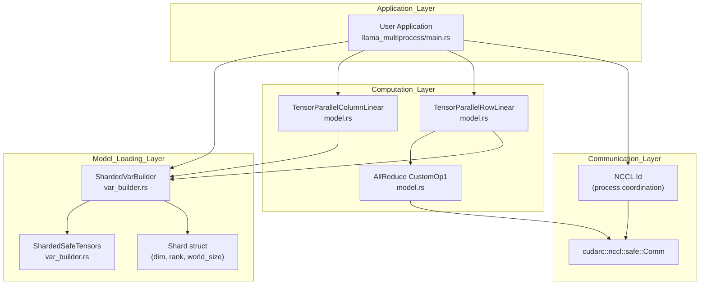
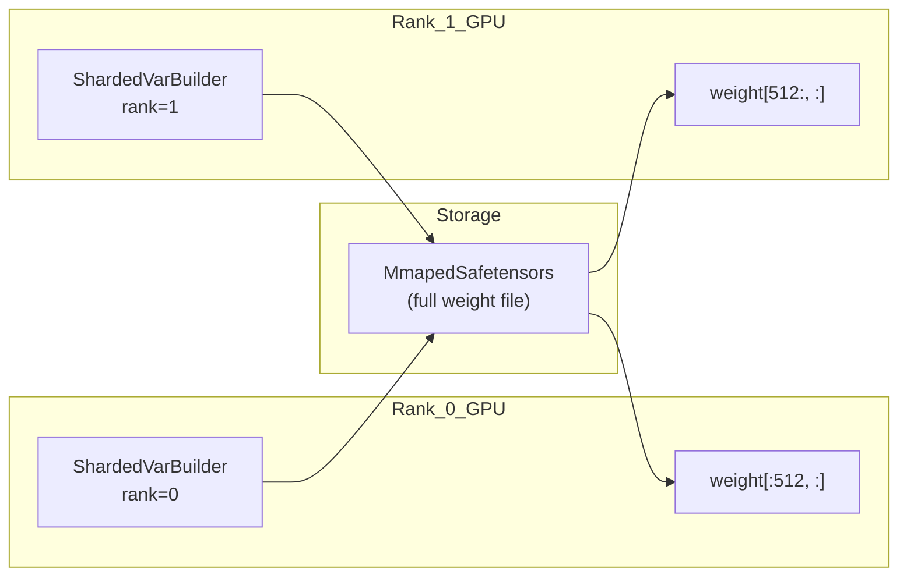
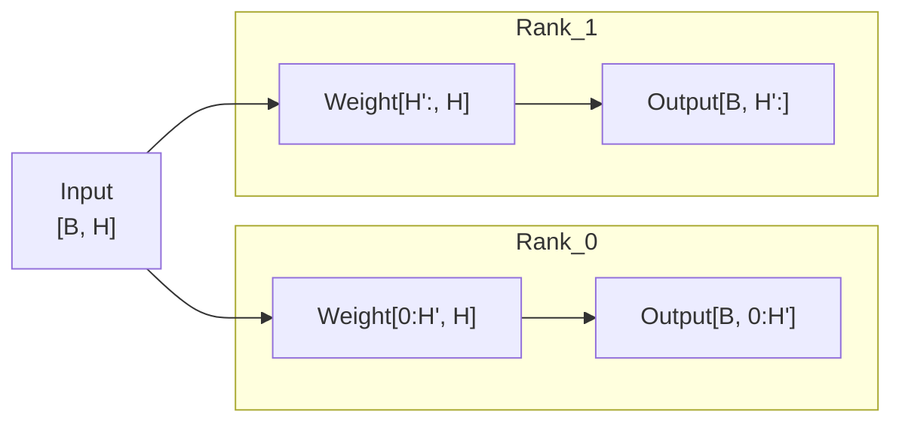
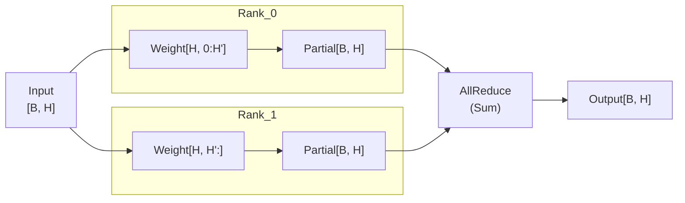
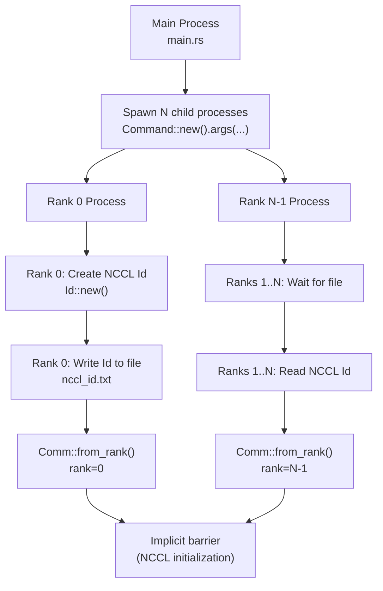

<!-- source: DeepWiki mcp.deepwiki.com · repo huggingface/candle · page 8.2 Distributed and Multi-GPU Execution · fetched 2026-10-26 -->

# Distributed and Multi-GPU Execution

<details>
<summary>Relevant source files</summary>

The following files were used as context for generating this wiki page:

- [candle-core/Cargo.toml](candle-core/Cargo.toml)
- [candle-core/src/safetensors.rs](candle-core/src/safetensors.rs)
- [candle-datasets/Cargo.toml](candle-datasets/Cargo.toml)
- [candle-examples/Cargo.toml](candle-examples/Cargo.toml)
- [candle-examples/examples/llama_multiprocess/main.rs](candle-examples/examples/llama_multiprocess/main.rs)
- [candle-examples/examples/llama_multiprocess/model.rs](candle-examples/examples/llama_multiprocess/model.rs)
- [candle-nn/Cargo.toml](candle-nn/Cargo.toml)
- [candle-nn/src/var_builder.rs](candle-nn/src/var_builder.rs)
- [candle-pyo3/Cargo.toml](candle-pyo3/Cargo.toml)
- [candle-transformers/Cargo.toml](candle-transformers/Cargo.toml)
- [candle-wasm-examples/llama2-c/Cargo.toml](candle-wasm-examples/llama2-c/Cargo.toml)
- [candle-wasm-examples/llama2-c/src/model.rs](candle-wasm-examples/llama2-c/src/model.rs)
- [candle-wasm-examples/whisper/Cargo.toml](candle-wasm-examples/whisper/Cargo.toml)
- [candle-wasm-examples/yolo/Cargo.toml](candle-wasm-examples/yolo/Cargo.toml)

</details>


## Purpose and Scope

This page documents Candle's support for distributed execution and multi-GPU inference, focusing on **tensor parallelism** for large language models. The system enables splitting model weights across multiple GPUs using NCCL collective communication primitives. The primary mechanisms covered are:

- **Sharded model loading** via `ShardedSafeTensors` and `ShardedVarBuilder`.
- **NCCL integration** for GPU-to-GPU communication via `cudarc`.
- **Tensor parallel linear layers** that partition weights across devices.
- **Multi-process coordination** for spawning and synchronizing GPU workers.
- **Model Hub integration** for downloading sharded weights via `hf-hub`.

For single-GPU execution and device abstraction, see [Device Abstraction and Backends](). For quantization techniques that reduce memory usage, see [Quantization System]().

## Architecture Overview

Candle's distributed execution model uses **tensor parallelism** with NCCL for collective communication. The architecture separates concerns into three layers:



**Figure 1: Distributed Execution Architecture**

The system coordinates multiple processes, each owning a single GPU. Model weights are **sharded at load time** (not runtime), and **AllReduce** synchronizes activations across devices during the forward pass.

Sources: [candle-nn/src/var_builder.rs:734-855](), [candle-examples/examples/llama_multiprocess/model.rs:13-100](), [candle-examples/examples/llama_multiprocess/main.rs:148-186]()

## Sharded Model Loading

### ShardedSafeTensors and ShardedVarBuilder

The `ShardedSafeTensors` backend extends the standard safetensors loading mechanism to support **automatic tensor partitioning** based on a `Shard` specification. Instead of loading entire tensors into each GPU's memory, each process loads only its assigned slice.



**Figure 2: Sharded Weight Loading**

**Key Types:**

| Type | Purpose | File Location |
|------|---------|---------------|
| `ShardedSafeTensors` | Backend that implements sharded tensor retrieval | [candle-nn/src/var_builder.rs:734-754]() |
| `ShardedVarBuilder` | Type alias for `VarBuilderArgs<'a, ShardedSafeTensors>` | [candle-nn/src/var_builder.rs:736]() |
| `Shard` | Struct specifying `(dim, rank, world_size)` for partitioning | [candle-nn/src/var_builder.rs:756-771]() |

### Shard Structure

The `Shard` struct defines how to partition a tensor:

```rust
pub struct Shard {
    pub dim: usize,        // Dimension to split along (0 or 1)
    pub rank: usize,       // Current process rank
    pub world_size: usize, // Total number of processes
}
```

**Partitioning Logic:**
- If `world_size == 1`: Load the entire tensor (no sharding).
- Otherwise: Compute `block_size = shape[dim] / world_size` and load slice `[rank * block_size : (rank+1) * block_size]`.

The implementation in `candle-nn/src/var_builder.rs` performs the slicing using safetensors' zero-copy slice operations, extracting only the required bytes for each rank [candle-nn/src/var_builder.rs:784-846]().

Sources: [candle-nn/src/var_builder.rs:734-855]()

## Tensor Parallelism Patterns

Tensor parallelism splits weight matrices across devices. Two patterns are used depending on matrix multiplication semantics:

### TensorParallelColumnLinear

Partitions weights **along dimension 0** (rows). Each GPU computes a partial matrix multiplication with its weight shard. No communication is needed during the forward pass.



**Figure 3: Column-Parallel Linear Layer**

Used for: QKV projections and MLP up/gate projections where outputs can be independently computed.

Implementation: [candle-examples/examples/llama_multiprocess/model.rs:13-24](), [candle-examples/examples/llama_multiprocess/model.rs:110-128]()

### TensorParallelRowLinear

Partitions weights **along dimension 1** (columns). Each GPU computes a partial result, then performs **AllReduce** to sum results across devices.



**Figure 4: Row-Parallel Linear Layer**

Used for: Output projections and MLP down projections where partial results must be summed to restore the full activation.

Implementation: [candle-examples/examples/llama_multiprocess/model.rs:26-30](), [candle-examples/examples/llama_multiprocess/model.rs:92-100]()

Sources: [candle-examples/examples/llama_multiprocess/model.rs:13-137]()

## NCCL AllReduce Custom Operation

The `AllReduce` operation is implemented as a `CustomOp1` that wraps NCCL's collective communication primitives provided by `cudarc`.

### AllReduce Structure

```rust
struct AllReduce {
    comm: Rc<Comm>,  // NCCL communicator
}
```

The operation [candle-examples/examples/llama_multiprocess/model.rs:40-90]():
1. Extracts a contiguous CUDA slice from the input tensor using `as_cuda_slice<T>()`.
2. Allocates a destination buffer on the same device using `dev.alloc<T>(elem_count)`.
3. Calls `self.comm.all_reduce(s, &mut dst, &ReduceOp::Sum)` to sum values across all GPUs.
4. Returns the result as a new `CudaStorage`.

**Supported DTypes:** `BF16`, `F16` (matches common LLM inference dtypes) [candle-examples/examples/llama_multiprocess/model.rs:61-87]().

**Safety Note:** The implementation marks `AllReduce` as `Send + Sync` despite NCCL's threading restrictions [candle-examples/examples/llama_multiprocess/model.rs:35-38](). This is acceptable for the single-threaded per-process execution model used in the `llama_multiprocess` example.

Sources: [candle-examples/examples/llama_multiprocess/model.rs:31-100]()

## Multi-Process Coordination

The `llama_multiprocess` example demonstrates a complete distributed inference pipeline using **process-level parallelism** (one process per GPU).

### Process Spawning and NCCL Initialization



**Figure 5: Multi-Process NCCL Coordination**

**Key Steps:**

1. **Parent Process** (no rank): Spawns child processes using `std::process::Command` with the `--rank` argument [candle-examples/examples/llama_multiprocess/main.rs:126-142]().
2. **Rank 0 Process**: 
   - Creates a unique NCCL `Id` via `Id::new()` [candle-examples/examples/llama_multiprocess/main.rs:149]().
   - Writes the 128-byte ID to a coordination file (e.g., `nccl_id.txt`) [candle-examples/examples/llama_multiprocess/main.rs:150-154]().
3. **Other Ranks**:
   - Poll for the coordination file existence [candle-examples/examples/llama_multiprocess/main.rs:156]().
   - Read the ID bytes and reconstruct the `Id` via `Id::uninit(internal)` [candle-examples/examples/llama_multiprocess/main.rs:159-167]().
4. **All Ranks**:
   - Initialize the communicator: `Comm::from_rank(device, rank, num_shards, id)` [candle-examples/examples/llama_multiprocess/main.rs:170-173]().

Sources: [candle-examples/examples/llama_multiprocess/main.rs:126-177]()

## Hub Integration and Loading

Distributed models often use sharded weight files. Candle integrates with `hf-hub` to download and locate these shards.

### Weight Discovery
The `candle_examples::hub_load_safetensors` utility is used to fetch the weight index (`model.safetensors.index.json`) and all referenced shard files [candle-examples/examples/llama_multiprocess/main.rs:124]().

### Sharded Loading
Once NCCL is initialized and files are downloaded, each process initializes its `ShardedSafeTensors` backend:

```rust
let vb = unsafe {
    candle_nn::var_builder::ShardedSafeTensors::var_builder(&filenames, dtype, &device)?
};
```

This creates a `ShardedVarBuilder` [candle-examples/examples/llama_multiprocess/main.rs:183-185](). When model layers request weights, they use the `shard` helper to specify partitioning [candle-examples/examples/llama_multiprocess/model.rs:102-108]():

```rust
fn shard(dim: usize, rank: usize, world_size: usize) -> candle_nn::var_builder::Shard {
    candle_nn::var_builder::Shard { dim, rank, world_size }
}
```

Sources: [candle-examples/examples/llama_multiprocess/main.rs:108-125](), [candle-examples/examples/llama_multiprocess/main.rs:183-186](), [candle-examples/examples/llama_multiprocess/model.rs:102-108]()

## Inference Execution

### Forward Pass Synchronization
In a distributed forward pass, all ranks receive the same input tokens [candle-examples/examples/llama_multiprocess/main.rs:189-194](). Communication only occurs during the `AllReduce` operation within `TensorParallelRowLinear` layers.

### Attention Mechanism
The attention mechanism shards across the **head dimension**. Each GPU processes a subset of the total heads:
- `num_attention_heads = cfg.num_attention_heads / comm.world_size()` [candle-examples/examples/llama_multiprocess/model.rs:286]().
- `num_key_value_heads = cfg.num_key_value_heads() / comm.world_size()` [candle-examples/examples/llama_multiprocess/model.rs:287]().

Sources: [candle-examples/examples/llama_multiprocess/main.rs:207-250](), [candle-examples/examples/llama_multiprocess/model.rs:186-292]()

## Summary of Distributed Components

| Component | Code Entity | Purpose |
|-----------|-------------|---------|
| **Loading** | `ShardedSafeTensors` | Backend for sharded weight retrieval |
| **Builder** | `ShardedVarBuilder` | VarBuilder for multi-GPU weight distribution |
| **Communication** | `cudarc::nccl::safe::Comm` | Handle for NCCL collective operations |
| **Coordination** | `cudarc::nccl::safe::Id` | Unique ID for bootstrapping the NCCL cluster |
| **Linear Layer** | `TensorParallelColumnLinear` | Column-parallel weight distribution (no sync) |
| **Linear Layer** | `TensorParallelRowLinear` | Row-parallel weight distribution (with AllReduce) |

Sources: [candle-nn/src/var_builder.rs:734-754](), [candle-examples/examples/llama_multiprocess/model.rs:13-33](), [candle-examples/examples/llama_multiprocess/main.rs:18-19]()

---

