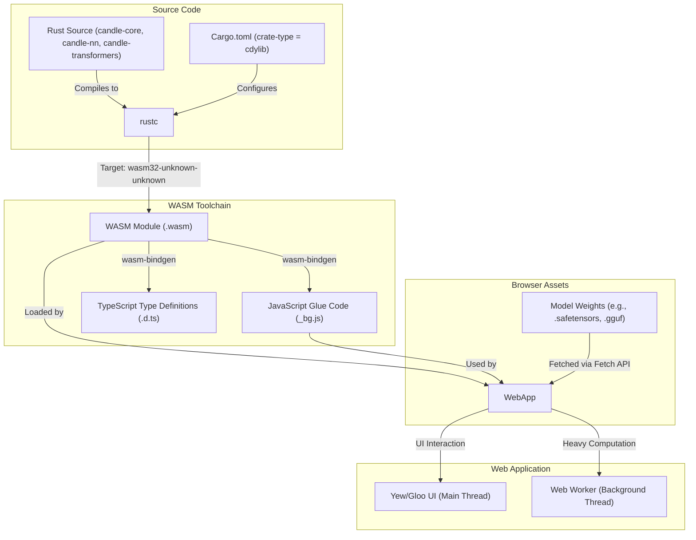
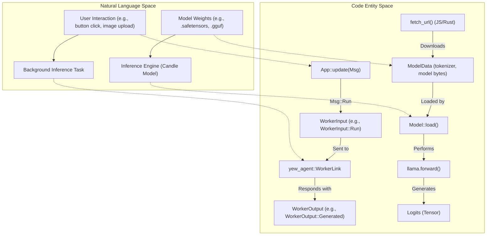
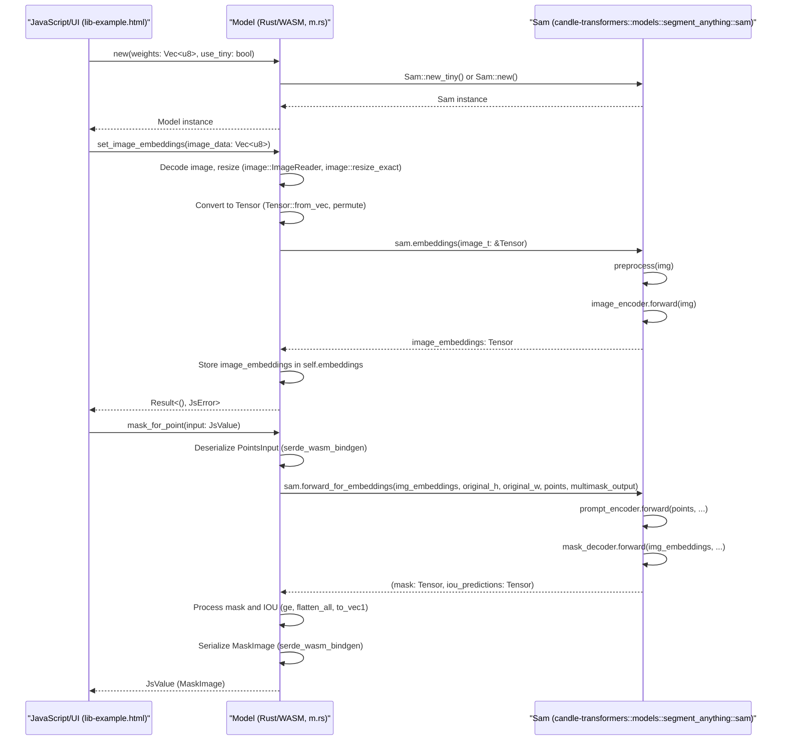

<!-- source: DeepWiki mcp.deepwiki.com · repo huggingface/candle · page 8.3 WASM and Browser Deployment · fetched 2026-10-26 -->

# WASM and Browser Deployment

<details>
<summary>Relevant source files</summary>

The following files were used as context for generating this wiki page:

- [.gitignore](.gitignore)
- [candle-examples/examples/segment-anything/README.md](candle-examples/examples/segment-anything/README.md)
- [candle-examples/examples/segment-anything/assets/sam_merged.jpg](candle-examples/examples/segment-anything/assets/sam_merged.jpg)
- [candle-examples/examples/segment-anything/assets/single_pt_prompt.jpg](candle-examples/examples/segment-anything/assets/single_pt_prompt.jpg)
- [candle-examples/examples/segment-anything/assets/two_pt_prompt.jpg](candle-examples/examples/segment-anything/assets/two_pt_prompt.jpg)
- [candle-examples/examples/segment-anything/main.rs](candle-examples/examples/segment-anything/main.rs)
- [candle-examples/examples/yolo-v8/model.rs](candle-examples/examples/yolo-v8/model.rs)
- [candle-transformers/src/models/segment_anything/sam.rs](candle-transformers/src/models/segment_anything/sam.rs)
- [candle-wasm-examples/bert/src/bin/m.rs](candle-wasm-examples/bert/src/bin/m.rs)
- [candle-wasm-examples/llama2-c/index.html](candle-wasm-examples/llama2-c/index.html)
- [candle-wasm-examples/llama2-c/lib-example.html](candle-wasm-examples/llama2-c/lib-example.html)
- [candle-wasm-examples/llama2-c/llama2cWorker.js](candle-wasm-examples/llama2-c/llama2cWorker.js)
- [candle-wasm-examples/llama2-c/src/app.rs](candle-wasm-examples/llama2-c/src/app.rs)
- [candle-wasm-examples/llama2-c/src/bin/m.rs](candle-wasm-examples/llama2-c/src/bin/m.rs)
- [candle-wasm-examples/llama2-c/src/lib.rs](candle-wasm-examples/llama2-c/src/lib.rs)
- [candle-wasm-examples/llama2-c/src/worker.rs](candle-wasm-examples/llama2-c/src/worker.rs)
- [candle-wasm-examples/phi/README.md](candle-wasm-examples/phi/README.md)
- [candle-wasm-examples/phi/build-lib.sh](candle-wasm-examples/phi/build-lib.sh)
- [candle-wasm-examples/phi/index.html](candle-wasm-examples/phi/index.html)
- [candle-wasm-examples/phi/phiWorker.js](candle-wasm-examples/phi/phiWorker.js)
- [candle-wasm-examples/phi/src/bin/m.rs](candle-wasm-examples/phi/src/bin/m.rs)
- [candle-wasm-examples/phi/src/lib.rs](candle-wasm-examples/phi/src/lib.rs)
- [candle-wasm-examples/segment-anything/README.md](candle-wasm-examples/segment-anything/README.md)
- [candle-wasm-examples/segment-anything/lib-example.html](candle-wasm-examples/segment-anything/lib-example.html)
- [candle-wasm-examples/segment-anything/samWorker.js](candle-wasm-examples/segment-anything/samWorker.js)
- [candle-wasm-examples/segment-anything/src/bin/m.rs](candle-wasm-examples/segment-anything/src/bin/m.rs)
- [candle-wasm-examples/t5/README.md](candle-wasm-examples/t5/README.md)
- [candle-wasm-examples/t5/T5ModelConditionalGeneration.js](candle-wasm-examples/t5/T5ModelConditionalGeneration.js)
- [candle-wasm-examples/t5/T5ModelEncoderWorker.js](candle-wasm-examples/t5/T5ModelEncoderWorker.js)
- [candle-wasm-examples/t5/build-lib.sh](candle-wasm-examples/t5/build-lib.sh)
- [candle-wasm-examples/t5/index.html](candle-wasm-examples/t5/index.html)
- [candle-wasm-examples/t5/src/bin/m-quantized.rs](candle-wasm-examples/t5/src/bin/m-quantized.rs)
- [candle-wasm-examples/t5/src/bin/m.rs](candle-wasm-examples/t5/src/bin/m.rs)
- [candle-wasm-examples/t5/src/lib.rs](candle-wasm-examples/t5/src/lib.rs)
- [candle-wasm-examples/t5/utils.js](candle-wasm-examples/t5/utils.js)
- [candle-wasm-examples/whisper/README.md](candle-wasm-examples/whisper/README.md)
- [candle-wasm-examples/whisper/index.html](candle-wasm-examples/whisper/index.html)
- [candle-wasm-examples/whisper/lib-example.html](candle-wasm-examples/whisper/lib-example.html)
- [candle-wasm-examples/whisper/src/app.rs](candle-wasm-examples/whisper/src/app.rs)
- [candle-wasm-examples/whisper/src/bin/m.rs](candle-wasm-examples/whisper/src/bin/m.rs)
- [candle-wasm-examples/whisper/src/lib.rs](candle-wasm-examples/whisper/src/lib.rs)
- [candle-wasm-examples/whisper/src/worker.rs](candle-wasm-examples/whisper/src/worker.rs)
- [candle-wasm-examples/whisper/whisperWorker.js](candle-wasm-examples/whisper/whisperWorker.js)
- [candle-wasm-examples/yolo/README.md](candle-wasm-examples/yolo/README.md)
- [candle-wasm-examples/yolo/build-lib.sh](candle-wasm-examples/yolo/build-lib.sh)
- [candle-wasm-examples/yolo/index.html](candle-wasm-examples/yolo/index.html)
- [candle-wasm-examples/yolo/lib-example.html](candle-wasm-examples/yolo/lib-example.html)
- [candle-wasm-examples/yolo/src/app.rs](candle-wasm-examples/yolo/src/app.rs)
- [candle-wasm-examples/yolo/src/bin/m.rs](candle-wasm-examples/yolo/src/bin/m.rs)
- [candle-wasm-examples/yolo/src/lib.rs](candle-wasm-examples/yolo/src/lib.rs)
- [candle-wasm-examples/yolo/src/model.rs](candle-wasm-examples/yolo/src/model.rs)
- [candle-wasm-examples/yolo/src/worker.rs](candle-wasm-examples/yolo/src/worker.rs)
- [candle-wasm-examples/yolo/yoloWorker.js](candle-wasm-examples/yolo/yoloWorker.js)

</details>


This document describes how to compile and deploy Candle models to WebAssembly (WASM) for execution in web browsers. It covers the build configuration, integration with `wasm-bindgen`, UI frameworks like Yew, background inference using Web Workers, and specific browser examples including Whisper, LLaMA2-C, Segment Anything, YOLO, T5, and others.

For distributed training and multi-GPU execution, see [8.2 Distributed and Multi-GPU Execution](). For native deployment with full hardware acceleration, see [3. Device Abstraction and Backends]().

---

## Overview

Candle supports compiling models to WebAssembly (WASM) for browser-based inference. This deployment target enables running ML models directly in web browsers without server-side computation. The framework provides a dedicated suite of examples in `candle-wasm-examples` [candle-wasm-examples/whisper/src/lib.rs:1-1]() demonstrating speech recognition, language models, and computer vision.

The WASM deployment is primarily CPU-only [candle-wasm-examples/segment-anything/src/bin/m.rs:25-25](). While it lacks CUDA or Metal support, it leverages SIMD128 acceleration via specific Rust compiler flags and optimized kernels for CPU backends.

**Sources:** [candle-wasm-examples/whisper/src/worker.rs:1-9](), [candle-wasm-examples/llama2-c/src/bin/m.rs:1-12](), [candle-wasm-examples/segment-anything/src/bin/m.rs:25-25]()

---

## Build Architecture

### Compilation Pipeline

The WASM build process transforms Rust code into WebAssembly modules suitable for browser execution. The configuration is managed to enable SIMD features for the `wasm32-unknown-unknown` target.


**Diagram: WASM Build Pipeline and Asset Flow**

The build process relies on `wasm-bindgen` to bridge the gap between Rust's memory model and the JavaScript environment [candle-wasm-examples/segment-anything/src/bin/m.rs:4-4](). For performance, the `wasm32-unknown-unknown` target is typically configured with `+simd128`.

**Sources:** [candle-wasm-examples/llama2-c/src/lib.rs:1-5](), [candle-wasm-examples/segment-anything/src/bin/m.rs:4-4]()

---

## Browser Example Applications

Candle provides several sophisticated examples for browser deployment.

| Example | Model | Implementation Strategy | Key File |
|---------|-------|-------------------------|----------|
| **Whisper** | Speech-to-Text | `yew-agent` Worker for decoding | [candle-wasm-examples/whisper/src/worker.rs]() |
| **LLaMA2-C** | LLM (Stories) | Autoregressive generation loop | [candle-wasm-examples/llama2-c/src/worker.rs]() |
| **SAM** | Segment Anything | `wasm-bindgen` Model struct | [candle-wasm-examples/segment-anything/src/bin/m.rs]() |
| **YOLO** | Object Detection | DarkNet architecture in WASM | [candle-wasm-examples/yolo/src/model.rs]() |
| **T5** | Text-to-Text | Quantized & Normal variants | [candle-wasm-examples/t5/src/bin/m.rs]() |

### Application Architecture: Natural Language to Code

The following diagram maps high-level browser concepts to the specific code entities used in the Candle WASM examples.


**Diagram: Mapping Browser Concepts to Code Entities**

**Sources:** [candle-wasm-examples/llama2-c/src/app.rs:30-37](), [candle-wasm-examples/llama2-c/src/app.rs:115-132](), [candle-wasm-examples/llama2-c/src/bin/m.rs:19-19](), [candle-wasm-examples/llama2-c/src/app.rs:55-60](), [candle-wasm-examples/llama2-c/src/worker.rs:29-32]()

---

## Implementation Details

### Web Workers and Background Inference

To prevent blocking the UI main thread during heavy computation, Candle examples use Web Workers via `yew-agent`. The `App` struct manages a `Bridge` to the worker [candle-wasm-examples/llama2-c/src/app.rs:52-52]().

In `llama2-c`, the `App` sends `WorkerInput::Run` [candle-wasm-examples/llama2-c/src/app.rs:130-130]() and handles `WorkerOutput::Generated(token)` to update the UI [candle-wasm-examples/llama2-c/src/app.rs:156-159]().

**Sources:** [candle-wasm-examples/llama2-c/src/app.rs:52-52](), [candle-wasm-examples/llama2-c/src/app.rs:130-130](), [candle-wasm-examples/llama2-c/src/app.rs:156-159]()

### Model Loading and VarBuilder

Weights are typically fetched as `Vec<u8>` using the browser's Fetch API [candle-wasm-examples/llama2-c/src/app.rs:9-28]() and then loaded into a `VarBuilder`.

```rust
// Example from Segment Anything (SAM)
#[wasm_bindgen(constructor)]
pub fn new(weights: Vec<u8>, use_tiny: bool) -> Result<Model, JsError> {
    console_error_panic_hook::set_once();
    let dev = &Device::Cpu;
    let vb = VarBuilder::from_buffered_safetensors(weights, DType::F32, dev)?;
    let sam = if use_tiny {
        sam::Sam::new_tiny(vb)? 
    } else {
        sam::Sam::new(768, 12, 12, &[2, 5, 8, 11], vb)?
    };
    Ok(Self { sam, embeddings: None })
}
```

**Sources:** [candle-wasm-examples/segment-anything/src/bin/m.rs:22-36](), [candle-wasm-examples/llama2-c/src/app.rs:9-28]()

### Segment Anything (SAM) Flow

The SAM implementation demonstrates complex data flow involving image preprocessing, embedding generation, and point-based masking. The `sam::Sam` struct [candle-transformers/src/models/segment_anything/sam.rs:34-40]() encapsulates the image encoder, prompt encoder, and mask decoder.


**Diagram: SAM Inference Sequence**

**Sources:** [candle-wasm-examples/segment-anything/src/bin/m.rs:22-36](), [candle-wasm-examples/segment-anything/src/bin/m.rs:38-74](), [candle-wasm-examples/segment-anything/src/bin/m.rs:76-119](), [candle-transformers/src/models/segment_anything/sam.rs:125-128](), [candle-transformers/src/models/segment_anything/sam.rs:158-197]()

---

## Example Overviews

### Whisper (Speech Recognition)
Whisper in the browser uses a `Model` enum [candle-wasm-examples/whisper/src/worker.rs:29-32]() to dispatch between `Normal` (f32) and `Quantized` variants.
- **Key Function**: `Decoder::decode` [candle-wasm-examples/whisper/src/worker.rs:159-207]() handles the autoregressive loop, calling `model.encoder_forward` once and `model.decoder_forward` for each token.
- **Probabilities**: Extracts `no_speech_prob` on the first iteration via `softmax` [candle-wasm-examples/whisper/src/worker.rs:201-206] (implied logic).

**Sources:** [candle-wasm-examples/whisper/src/worker.rs:29-32](), [candle-wasm-examples/whisper/src/worker.rs:159-207]()

### LLaMA2-C (Language Modeling)
This example implements the Llama architecture using a custom cache for keys and values.
- **Sampling**: Uses `LogitsProcessor` [candle-wasm-examples/llama2-c/src/bin/m.rs:2-2]() with temperature and top-p sampling [candle-wasm-examples/llama2-c/src/bin/m.rs:83-88]().
- **Repeat Penalty**: Applies `apply_repeat_penalty` to the logits before sampling [candle-wasm-examples/llama2-c/src/bin/m.rs:25-30]().

**Sources:** [candle-wasm-examples/llama2-c/src/bin/m.rs:2-2](), [candle-wasm-examples/llama2-c/src/bin/m.rs:83-88](), [candle-wasm-examples/llama2-c/src/bin/m.rs:25-30]()

### YOLO (Object Detection)
YOLOv8 is implemented for real-time object detection in the browser.
- **Architecture**: Implements `DarkNet` [candle-wasm-examples/yolo/src/model.rs:243-243](), `C2f` [candle-wasm-examples/yolo/src/model.rs:146-150](), and `Sppf` [candle-wasm-examples/yolo/src/model.rs:183-187]() blocks.
- **Post-processing**: Includes a `Dfl` (Distribution Focal Loss) layer [candle-wasm-examples/yolo/src/model.rs:219-222]() for bounding box refinement.

**Sources:** [candle-wasm-examples/yolo/src/model.rs:146-243]()

---

## Limitations vs. Native

While WASM deployment offers high portability, it has significant technical constraints compared to native execution:

1.  **Device Support**: WASM is restricted to `Device::Cpu` [candle-wasm-examples/segment-anything/src/bin/m.rs:25-25](). CUDA and Metal backends are not available.
2.  **Performance**: Native CPU execution can use AVX/NEON instructions; WASM is limited to the `simd128` feature.
3.  **Memory**: Browser environments typically limit WASM memory (often to 4GB), making large model loading challenging.
4.  **Multi-threading**: While Web Workers allow background tasks, true multi-threaded tensor operations require specific cross-origin isolation headers and `SharedArrayBuffer` support.

**Sources:** [candle-wasm-examples/segment-anything/src/bin/m.rs:25-25](), [candle-wasm-examples/llama2-c/src/worker.rs:68-68]()

---

