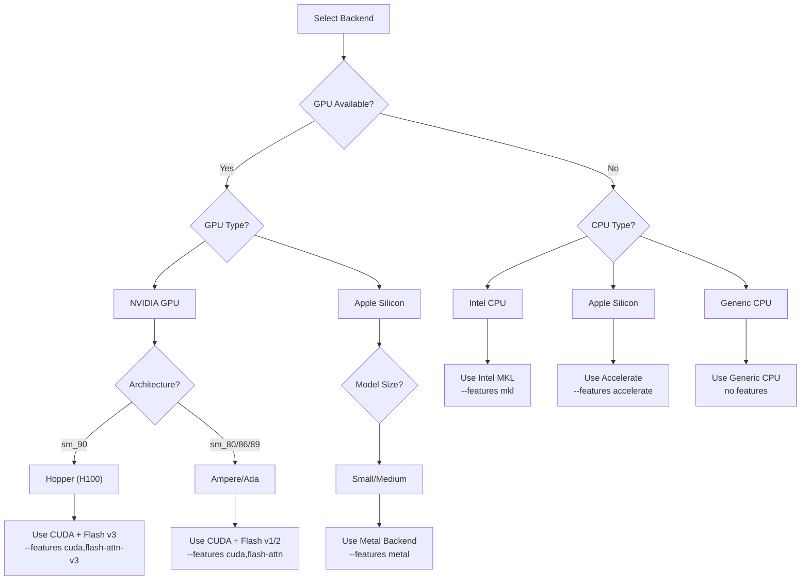
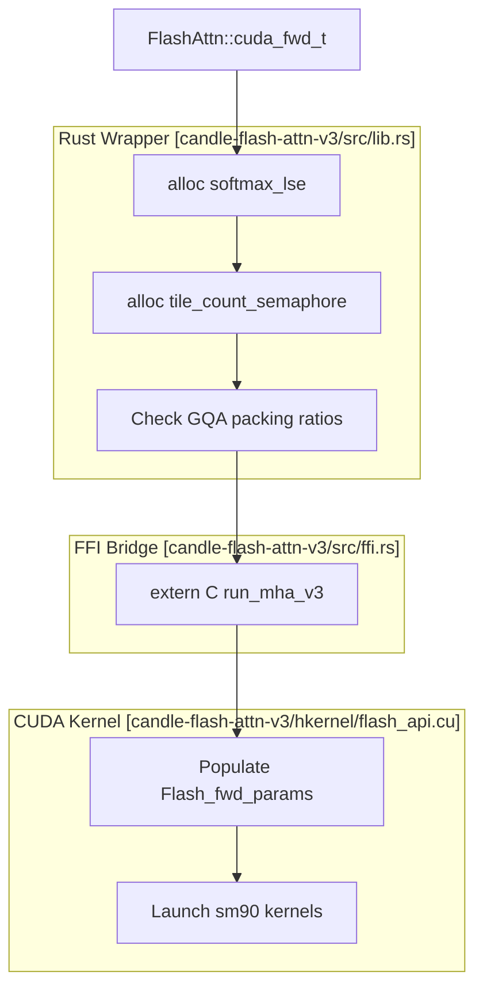
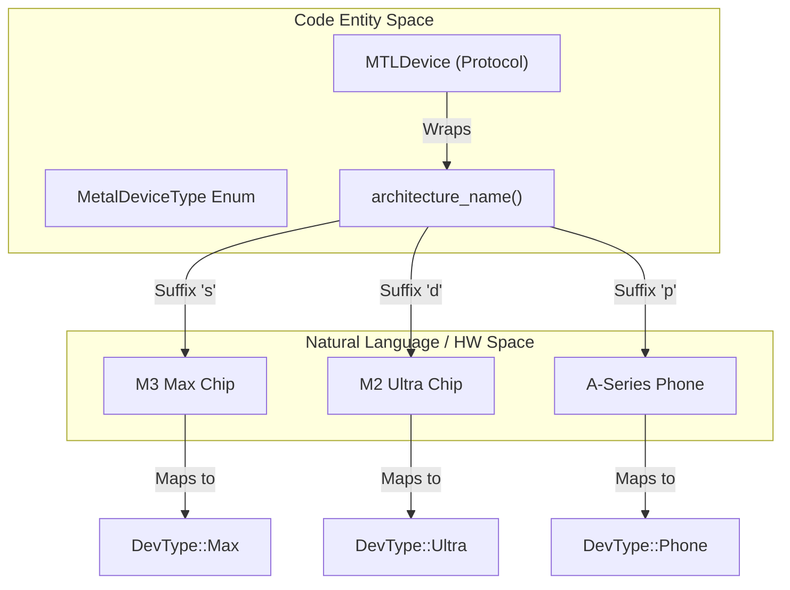

<!-- source: DeepWiki mcp.deepwiki.com · repo huggingface/candle · page 8.4 Performance Optimization · fetched 2026-10-26 -->

# Performance Optimization

Relevant source files

The following files were used as context for generating this wiki page:

- [candle-core/benches/bench_main.rs](candle-core/benches/bench_main.rs)
- [candle-core/benches/benchmarks/matmul.rs](candle-core/benches/benchmarks/matmul.rs)
- [candle-core/benches/benchmarks/mod.rs](candle-core/benches/benchmarks/mod.rs)
- [candle-core/benches/benchmarks/vec_dot.rs](candle-core/benches/benchmarks/vec_dot.rs)
- [candle-core/src/cpu/avx.rs](candle-core/src/cpu/avx.rs)
- [candle-core/src/cpu/kernels.rs](candle-core/src/cpu/kernels.rs)
- [candle-core/src/cpu/mod.rs](candle-core/src/cpu/mod.rs)
- [candle-core/src/cpu/neon.rs](candle-core/src/cpu/neon.rs)
- [candle-core/src/cpu/simd128.rs](candle-core/src/cpu/simd128.rs)
- [candle-flash-attn-v3/build.rs](candle-flash-attn-v3/build.rs)
- [candle-flash-attn-v3/hkernel/flash_api.cu](candle-flash-attn-v3/hkernel/flash_api.cu)
- [candle-flash-attn-v3/src/ffi.rs](candle-flash-attn-v3/src/ffi.rs)
- [candle-flash-attn-v3/src/lib.rs](candle-flash-attn-v3/src/lib.rs)
- [candle-flash-attn/kernels/flash.h](candle-flash-attn/kernels/flash.h)
- [candle-flash-attn/kernels/flash_api.cu](candle-flash-attn/kernels/flash_api.cu)
- [candle-flash-attn/kernels/flash_fwd_hdim32_fp16_sm80.cu](candle-flash-attn/kernels/flash_fwd_hdim32_fp16_sm80.cu)
- [candle-flash-attn/kernels/flash_fwd_kernel.h](candle-flash-attn/kernels/flash_fwd_kernel.h)
- [candle-flash-attn/kernels/mask.h](candle-flash-attn/kernels/mask.h)
- [candle-flash-attn/src/ffi.rs](candle-flash-attn/src/ffi.rs)
- [candle-flash-attn/src/lib.rs](candle-flash-attn/src/lib.rs)
- [candle-flash-attn/tests/flash_attn_tests.rs](candle-flash-attn/tests/flash_attn_tests.rs)
- [candle-metal-kernels/src/err.rs](candle-metal-kernels/src/err.rs)
- [candle-metal-kernels/src/kernels/mlx_gemm.rs](candle-metal-kernels/src/kernels/mlx_gemm.rs)
- [candle-metal-kernels/src/kernels/reduce.rs](candle-metal-kernels/src/kernels/reduce.rs)
- [candle-metal-kernels/src/metal/device.rs](candle-metal-kernels/src/metal/device.rs)
- [candle-metal-kernels/src/metal_src/mlx_gemm.metal](candle-metal-kernels/src/metal_src/mlx_gemm.metal)
- [candle-metal-kernels/src/metal_src/reduce.metal](candle-metal-kernels/src/metal_src/reduce.metal)
- [candle-nn/benches/bench_main.rs](candle-nn/benches/bench_main.rs)
- [candle-nn/benches/benchmarks/mod.rs](candle-nn/benches/benchmarks/mod.rs)
- [candle-nn/benches/benchmarks/norm.rs](candle-nn/benches/benchmarks/norm.rs)

This page documents optimization strategies for Candle-based applications, covering backend selection, Flash Attention acceleration, quantization trade-offs, kernel optimizations, and profiling techniques. These strategies enable efficient inference and training across diverse hardware configurations from CPUs to high-end GPUs.

For device-specific backend implementations, see [Device Abstraction and Backends](). For quantization system details, see [Quantization System]().

## Backend Selection Strategy

Candle supports three hardware backends, each with distinct performance characteristics. Selecting the optimal backend depends on available hardware, workload characteristics, and model size.

### Backend Compilation and Feature Flags

Backends are enabled via Cargo feature flags. The framework compiles only the backends specified, minimizing binary size.

| Feature Flag | Backend | Requirements | Primary Use Case |
|-------------|---------|--------------|------------------|
| `accelerate` | CPU (Apple Accelerate) | macOS | Optimized CPU inference on Apple Silicon |
| `mkl` | CPU (Intel MKL) | Intel CPUs | Optimized CPU inference on x86 |
| `cuda` | CUDA | NVIDIA GPUs | Training and inference on NVIDIA hardware |
| `metal` | Metal | Apple GPUs | Inference on Apple Silicon GPUs |
| `flash-attn` | Flash Attention v1/v2 | NVIDIA Ampere+ | Accelerated attention for transformers (requires `cuda`) |
| `flash-attn-v3` | Flash Attention v3 | NVIDIA Hopper+ | SOTA attention for H100/H200 (requires `cuda`) |

**Backend Decision Matrix**

**Sources:** [candle-core/benches/benchmarks/mod.rs:46-61](), [candle-flash-attn-v3/build.rs:163-164]()

### Performance Characteristics by Backend

The `BenchDevice` trait provides a unified interface for benchmarking across backends, including synchronization via `sync()` to ensure accurate timing of asynchronous GPU operations [candle-core/benches/benchmarks/mod.rs:18-22]().

| Backend | Synchronization Method | Benchmark Name Prefix |
|---------|-----------------------|-----------------------|
| **CPU** | No-op (Synchronous) | `cpu_`, `mkl_`, or `accelerate_` |
| **CUDA** | `device.synchronize()` | `cuda_` |
| **Metal** | `device.wait_until_completed()` | `metal_` |

**Sources:** [candle-core/benches/benchmarks/mod.rs:24-61]()

## Flash Attention Acceleration

Flash Attention is a memory-efficient attention implementation that significantly accelerates transformer inference on NVIDIA GPUs.

### Flash Attention v1/v2 vs v3 Trade-offs

| Feature | `candle-flash-attn` (v1/v2) | `candle-flash-attn-v3` |
|---------|-----------------------------|------------------------|
| **Hardware** | Ampere, Ada, Hopper | Hopper (sm_90) exclusively [candle-flash-attn-v3/build.rs:163-164]() |
| **Integration** | CUTLASS / Custom C++ | CUTLASS 3.x [candle-flash-attn-v3/build.rs:140]() |
| **GQA Support** | Standard dispatch | Optimized `use_gqa_packing` [candle-flash-attn-v3/src/lib.rs:105-108]() |
| **Head Sizes** | Multiples of 8 up to 512 [candle-flash-attn/src/lib.rs:79-85]() | Fixed 64, 128, 256, 512 [candle-flash-attn-v3/src/lib.rs:91-97]() |

### Implementation and Data Flow

Both versions utilize a similar FFI bridge to launch CUDA kernels. The `FlashAttn` struct manages parameters like `softmax_scale` and `alibi_slopes` [candle-flash-attn/src/lib.rs:8-14](), [candle-flash-attn-v3/src/lib.rs:21-27]().

**Flash Attention v3 Data Flow**

**Sources:** [candle-flash-attn-v3/src/lib.rs:29-171](), [candle-flash-attn-v3/src/ffi.rs:12-67](), [candle-flash-attn-v3/hkernel/flash_api.cu:58-143]()

## Quantization Impact

Quantization is the primary method for increasing throughput and reducing memory footprint.

### CPU Vectorized Operations
For CPU backends, performance is driven by SIMD implementations in `candle-core/src/cpu/`.
- **AVX2/NEON**: Specialized `vec_dot_f32`, `vec_dot_f16`, and `vec_dot_bf16` functions provide hardware acceleration [candle-core/src/cpu/mod.rs:91-214]().
- **Quantized MatMul**: The `qmatmul` benchmark measures the impact of block-based quantization on different devices [candle-core/benches/benchmarks/mod.rs:9]().

**Sources:** [candle-core/src/cpu/mod.rs:91-113](), [candle-core/src/cpu/kernels.rs:101-109]()

## Profiling and Benchmarking

Candle includes a robust benchmarking suite using the `criterion` crate, located in `candle-core/benches` and `candle-nn/benches`.

### Benchmark Modules
Benchmarks cover critical path operations:
- **Core Ops**: `vec_dot`, `matmul`, `qmatmul`, `conv_transpose2d`, `reduce`, `unary` [candle-core/benches/bench_main.rs:6-19]().
- **NN Ops**: `norm`, `softmax` [candle-nn/benches/benchmarks/mod.rs:1-3]().

**Sources:** [candle-core/benches/benchmarks/mod.rs:1-14](), [candle-core/benches/bench_main.rs:1-20]()

## Metal vs CUDA Performance Characteristics

### Metal (Apple Silicon)
- **Architecture Detection**: Metal classifies devices into `Phone`, `BasePro`, `Max`, and `Ultra` based on architecture name suffixes ('p', 'g', 's', 'd') [candle-metal-kernels/src/metal/device.rs:19-30]().
- **Memory Management**: Uses `recommended_max_working_set_size` to optimize buffer allocations [candle-metal-kernels/src/metal/device.rs:134-136]().
- **Kernel Efficiency**: MSL kernels like `reduce.metal` use `simd_shuffle_down` for intra-warp communication [candle-metal-kernels/src/metal_src/reduce.metal:224-229]().

**Metal Device to Code Mapping**

**Sources:** [candle-metal-kernels/src/metal/device.rs:9-30](), [candle-metal-kernels/src/metal/device.rs:150-175]()

### CUDA (NVIDIA)
- **Kernel Compilation**: `candle-flash-attn-v3` uses `cudaforge::KernelBuilder` to manage NVCC flags and CUTLASS integration [candle-flash-attn-v3/build.rs:137-157]().
- **Throughput**: Optimized for high-batch scenarios using specialized GQA packing [candle-flash-attn-v3/src/lib.rs:105-108]().

## Single-File Binary Builder

For deployment optimization, Candle supports a "single-file binary" pattern, typically used in examples like `bert_single_file_binary`.

- **Efficiency**: Reduces startup latency by embedding model weights directly into the executable.
- **Implementation**: Uses `include_bytes!` to load SafeTensors at compile time, which are then accessed via `VarBuilder`.

**Sources:** [candle-flash-attn-v3/src/lib.rs:14-15](), [candle-core/benches/benchmarks/mod.rs:71-80]()

---

