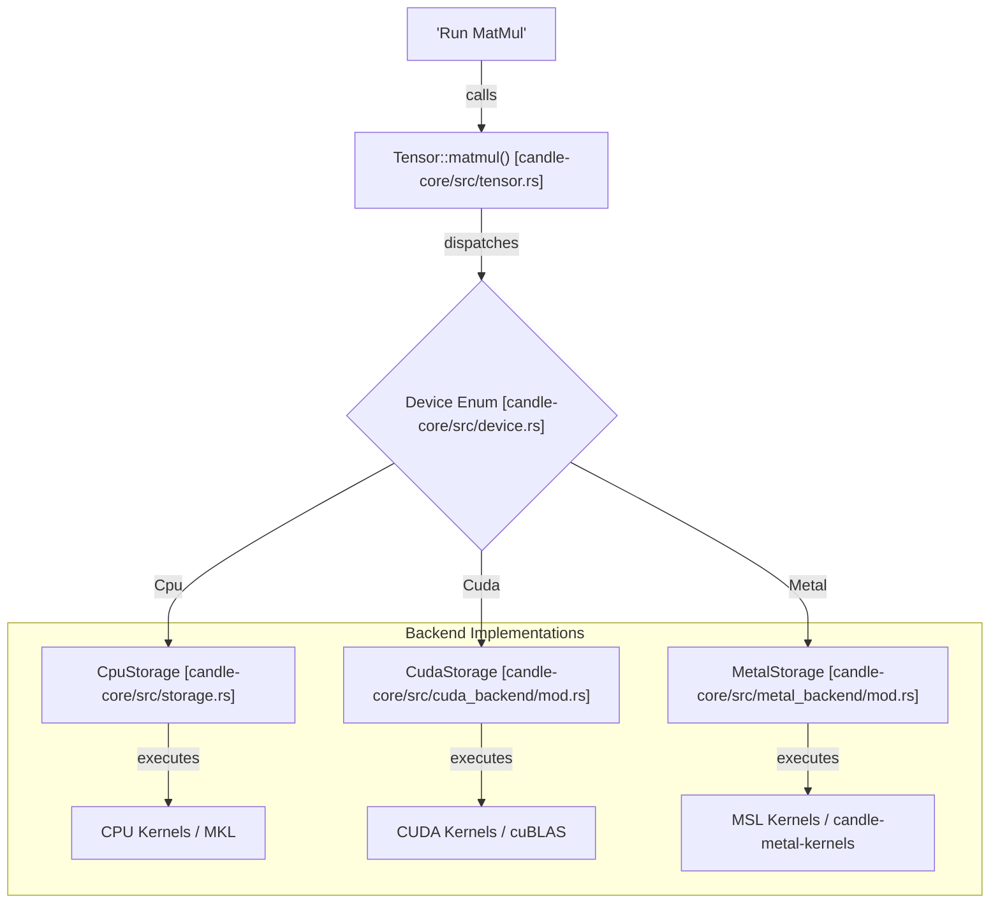
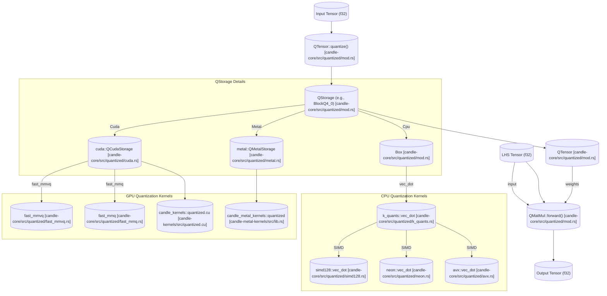
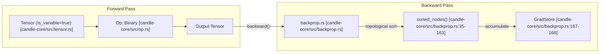

<!-- source: DeepWiki mcp.deepwiki.com · repo huggingface/candle · page 9 Glossary · fetched 2026-10-26 -->

# Glossary

Relevant source files

The following files were used as context for generating this wiki page:

- [README.md](README.md)
- [candle-core/src/backend.rs](candle-core/src/backend.rs)
- [candle-core/src/backprop.rs](candle-core/src/backprop.rs)
- [candle-core/src/cuda_backend/cudnn.rs](candle-core/src/cuda_backend/cudnn.rs)
- [candle-core/src/cuda_backend/device.rs](candle-core/src/cuda_backend/device.rs)
- [candle-core/src/cuda_backend/mod.rs](candle-core/src/cuda_backend/mod.rs)
- [candle-core/src/device.rs](candle-core/src/device.rs)
- [candle-core/src/dummy_cuda_backend.rs](candle-core/src/dummy_cuda_backend.rs)
- [candle-core/src/dummy_metal_backend.rs](candle-core/src/dummy_metal_backend.rs)
- [candle-core/src/metal_backend/device.rs](candle-core/src/metal_backend/device.rs)
- [candle-core/src/metal_backend/mod.rs](candle-core/src/metal_backend/mod.rs)
- [candle-core/src/op.rs](candle-core/src/op.rs)
- [candle-core/src/quantized/avx.rs](candle-core/src/quantized/avx.rs)
- [candle-core/src/quantized/cuda.rs](candle-core/src/quantized/cuda.rs)
- [candle-core/src/quantized/dummy_cuda.rs](candle-core/src/quantized/dummy_cuda.rs)
- [candle-core/src/quantized/dummy_metal.rs](candle-core/src/quantized/dummy_metal.rs)
- [candle-core/src/quantized/ggml_file.rs](candle-core/src/quantized/ggml_file.rs)
- [candle-core/src/quantized/gguf_file.rs](candle-core/src/quantized/gguf_file.rs)
- [candle-core/src/quantized/k_quants.rs](candle-core/src/quantized/k_quants.rs)
- [candle-core/src/quantized/metal.rs](candle-core/src/quantized/metal.rs)
- [candle-core/src/quantized/mod.rs](candle-core/src/quantized/mod.rs)
- [candle-core/src/quantized/neon.rs](candle-core/src/quantized/neon.rs)
- [candle-core/src/quantized/simd128.rs](candle-core/src/quantized/simd128.rs)
- [candle-core/src/quantized/utils.rs](candle-core/src/quantized/utils.rs)
- [candle-core/src/safetensors.rs](candle-core/src/safetensors.rs)
- [candle-core/src/storage.rs](candle-core/src/storage.rs)
- [candle-core/src/tensor.rs](candle-core/src/tensor.rs)
- [candle-core/src/test_utils.rs](candle-core/src/test_utils.rs)
- [candle-core/src/utils.rs](candle-core/src/utils.rs)
- [candle-core/tests/gguf_tests.rs](candle-core/tests/gguf_tests.rs)
- [candle-core/tests/grad_tests.rs](candle-core/tests/grad_tests.rs)
- [candle-core/tests/matmul_tests.rs](candle-core/tests/matmul_tests.rs)
- [candle-core/tests/quantized_tests.rs](candle-core/tests/quantized_tests.rs)
- [candle-core/tests/tensor_tests.rs](candle-core/tests/tensor_tests.rs)
- [candle-examples/examples/llama_multiprocess/main.rs](candle-examples/examples/llama_multiprocess/main.rs)
- [candle-examples/examples/llama_multiprocess/model.rs](candle-examples/examples/llama_multiprocess/model.rs)
- [candle-examples/examples/rwkv/README.md](candle-examples/examples/rwkv/README.md)
- [candle-examples/examples/rwkv/main.rs](candle-examples/examples/rwkv/main.rs)
- [candle-kernels/src/quantized.cu](candle-kernels/src/quantized.cu)
- [candle-metal-kernels/src/kernel.rs](candle-metal-kernels/src/kernel.rs)
- [candle-metal-kernels/src/kernels/mod.rs](candle-metal-kernels/src/kernels/mod.rs)
- [candle-metal-kernels/src/kernels/quantized.rs](candle-metal-kernels/src/kernels/quantized.rs)
- [candle-metal-kernels/src/lib.rs](candle-metal-kernels/src/lib.rs)
- [candle-metal-kernels/src/metal/compute_pipeline.rs](candle-metal-kernels/src/metal/compute_pipeline.rs)
- [candle-metal-kernels/src/metal/library.rs](candle-metal-kernels/src/metal/library.rs)
- [candle-metal-kernels/src/tests.rs](candle-metal-kernels/src/tests.rs)
- [candle-metal-kernels/src/utils.rs](candle-metal-kernels/src/utils.rs)
- [candle-nn/examples/cpu_benchmarks.rs](candle-nn/examples/cpu_benchmarks.rs)
- [candle-nn/src/var_builder.rs](candle-nn/src/var_builder.rs)
- [candle-transformers/src/models/mod.rs](candle-transformers/src/models/mod.rs)
- [candle-transformers/src/models/quantized_rwkv_v6.rs](candle-transformers/src/models/quantized_rwkv_v6.rs)
- [candle-transformers/src/models/rwkv_v6.rs](candle-transformers/src/models/rwkv_v6.rs)
- [candle-transformers/src/models/rwkv_v7.rs](candle-transformers/src/models/rwkv_v7.rs)
- [candle-wasm-examples/llama2-c/src/model.rs](candle-wasm-examples/llama2-c/src/model.rs)
- [candle-wasm-tests/tests/quantized_tests.rs](candle-wasm-tests/tests/quantized_tests.rs)

This glossary defines technical terms, architectural components, and domain-specific jargon used within the Candle framework. It serves as a reference for engineers to map conceptual terminology to specific code entities.

## Core Tensor Concepts

### Tensor & Tensor_
In Candle, a `Tensor` is a reference-counted wrapper (`Arc`) around a `Tensor_` struct. This design ensures that cloning a `Tensor` is a cheap operation, only incrementing a reference count rather than copying underlying data [candle-core/src/tensor.rs:53-70]().

*   **`Tensor`**: The public-facing handle [candle-core/src/tensor.rs:70]().
*   **`Tensor_`**: The internal structure containing the `id`, `storage`, `layout`, `op`, `dtype`, and `device` [candle-core/src/tensor.rs:25-45]().

### Storage
The physical memory buffer containing tensor data. It is abstracted via the `Storage` enum, which dispatches to backend-specific implementations (Cpu, Cuda, or Metal) [candle-core/src/storage.rs:1-20]().

### Layout
Defines how the N-dimensional logical shape of a tensor maps onto the 1D flat `Storage`. It includes the `shape`, `stride`, and `start_offset`. This allows for zero-copy operations like `transpose` or `narrow` by simply modifying the strides and offset [candle-core/src/tensor.rs:40-40](), [candle-core/src/tensor.rs:53-56]().

### DType
The data type of the elements stored in a tensor. Candle supports standard types (F32, F16, BF16, U8, U32, I64) and specialized low-bit types for quantization (F8E4M3, F6E2M3, F6E3M2, F4, F8E8M0) [candle-core/src/tensor.rs:43-43](), [candle-core/tests/tensor_tests.rs:1-83]().

---

## Backend Abstractions

### Device
An enum representing the hardware where tensor computations occur: `Cpu`, `Cuda(CudaDevice)`, or `Metal(MetalDevice)` [candle-core/src/tensor.rs:44-44](), [README.md:27-45]().

### BackendStorage & BackendDevice
Traits that hardware backends must implement to provide low-level operations like memory allocation, kernel dispatch, and data transfer [candle-core/src/backend.rs:1-50](), [candle-core/src/metal_backend/mod.rs:89-91]().

**Natural Language to Code Entity Mapping: Device Dispatch**

*Sources: [candle-core/src/tensor.rs:62-65](), [candle-core/src/tensor.rs:44-44](), [candle-core/src/metal_backend/mod.rs:78-87](), [candle-core/src/cuda_backend/mod.rs:1-50]()*

---

## Quantization Terminology

### GGUF / GGML
Formats for storing quantized model weights, popularized by the llama.cpp ecosystem. Candle provides parsers and specialized logic for these formats [candle-core/src/quantized/gguf_file.rs:1-50](), [candle-core/src/quantized/ggml_file.rs:1-50](), [README.md:92-96]().

### K-Quants
A specific quantization scheme that uses different block sizes and bit-widths (e.g., Q2K, Q3K, Q4K, Q5K, Q6K, Q8K) to optimize the trade-off between model size and perplexity [candle-core/src/quantized/k_quants.rs:132-190](). These are defined as `BlockQ*K` structs.

### QMatMul
A specialized implementation for Matrix Multiplication where the weights are quantized. It avoids dequantizing the entire weight matrix into memory, instead performing the operation block-by-block using optimized SIMD or GPU kernels [candle-core/tests/quantized_tests.rs:41-42](), [candle-core/src/quantized/mod.rs:120-121](). The `GgmlType` trait defines the `vec_dot` method for these operations [candle-core/src/quantized/k_quants.rs:22-50]().

### BlockQ4_0 / BlockQ6K
Structs representing a "block" of quantized values. For example, `BlockQ4_0` stores 32 values using 4 bits each, plus a 16-bit scale factor (`d`) [candle-core/src/quantized/k_quants.rs:79-82](). `BlockQ6K` uses a structure with `ql`, `qh`, `scales`, and a scale factor `d` [candle-core/src/quantized/k_quants.rs:175-180]().

**Quantization Data Flow**

*Sources: [candle-core/src/quantized/mod.rs:59-133](), [candle-core/src/quantized/k_quants.rs:22-50](), [candle-core/src/quantized/k_quants.rs:79-181](), [candle-core/src/quantized/cuda.rs:1-50](), [candle-metal-kernels/src/lib.rs:10-14]()*

---

## Autograd & Training

### BackpropOp
An internal struct used to track the operation that created a tensor, forming the computational graph required for reverse-mode automatic differentiation. It contains the `Op` enum and references to parent tensors [candle-core/src/tensor.rs:41-41](), [candle-core/src/op.rs:76-190]().

### Variable (Var)
A concept denoting a `Tensor` that marks it as a leaf node in the computational graph whose gradients should be tracked and updated during training [candle-core/src/tensor.rs:42-42](), [candle-core/src/backprop.rs:47-50]().

### GradStore
A container (essentially a `HashMap<TensorId, Tensor>`) that stores the gradients computed during the `.backward()` pass [candle-core/src/backprop.rs:165-168]().

**Autograd Data Flow**

*Sources: [candle-core/src/backprop.rs:35-168](), [candle-core/src/tensor.rs:25-45](), [candle-core/src/op.rs:76-190]()*

---

## Neural Network Building Blocks

### VarBuilder
A stateless helper used to retrieve or initialize tensors (weights/biases) for a model. It can load weights from `SafeTensors` files or other formats [candle-nn/src/var_builder.rs:1-50]().

### VarMap
A mutable container that holds variables (trainable parameters) of a model, typically used to save/load checkpoints or provide parameters to an optimizer.

---

## Technical Jargon & Abbreviations

| Term | Definition | Code Pointer |
| :--- | :--- | :--- |
| **BF16** | Bfloat16 floating point format, providing same dynamic range as F32 but with lower precision. | [candle-core/src/op.rs:196-196](), [candle-metal-kernels/src/lib.rs:30-30]() |
| **MSL** | Metal Shading Language; used for writing kernels in the Metal backend. | [candle-metal-kernels/src/lib.rs:1-20]() |
| **SIMD** | Single Instruction, Multiple Data. Candle uses this for CPU optimizations (AVX, NEON, SIMD128). | [candle-core/src/quantized/avx.rs:1-8](), [candle-core/src/quantized/neon.rs:1-35](), [candle-core/src/quantized/simd128.rs:1-37]() |
| **Stride** | The number of elements to skip in physical memory to move to the next element in a specific dimension. | [candle-core/src/tensor.rs:53-56]() |
| **Contiguous** | A tensor layout where data is stored in memory in the same order as the logical dimensions, with no gaps. | [candle-core/src/tensor.rs:172-172]() |
| **Broadcast** | Automatically expanding a tensor's dimensions to match another tensor's shape for element-wise operations. | [candle-core/src/tensor.rs:139-158]() |
| **F8E4M3** | A low-precision floating-point format (8-bit, 4 exponent bits, 3 mantissa bits) used for quantization. | [candle-core/src/op.rs:5-5](), [candle-core/tests/tensor_tests.rs:2-2]() |
| **F6E2M3 / F6E3M2** | Other low-precision floating-point formats (6-bit) used for quantization. | [candle-core/src/metal_backend/mod.rs:116-116]() |
| **F4** | A 4-bit floating-point format for quantization. | [candle-core/src/metal_backend/mod.rs:116-116]() |
| **F8E8M0** | An 8-bit floating-point format with 8 exponent bits and 0 mantissa bits. | [candle-core/src/metal_backend/mod.rs:116-116]() |

*Sources: [candle-core/src/tensor.rs:1-179](), [candle-core/src/quantized/k_quants.rs:1-190](), [candle-nn/src/var_builder.rs:1-50](), [candle-core/src/op.rs:1-269](), [candle-core/tests/tensor_tests.rs:1-150]()*