# Page: Introduction to Candle

# Introduction to Candle

<details>
<summary>Relevant source files</summary>

The following files were used as context for generating this wiki page:

- [CHANGELOG.md](CHANGELOG.md)
- [Cargo.toml](Cargo.toml)
- [README.md](README.md)
- [candle-core/Cargo.toml](candle-core/Cargo.toml)
- [candle-datasets/Cargo.toml](candle-datasets/Cargo.toml)
- [candle-examples/Cargo.toml](candle-examples/Cargo.toml)
- [candle-examples/examples/rwkv/README.md](candle-examples/examples/rwkv/README.md)
- [candle-examples/examples/rwkv/main.rs](candle-examples/examples/rwkv/main.rs)
- [candle-flash-attn-v3/Cargo.toml](candle-flash-attn-v3/Cargo.toml)
- [candle-flash-attn/Cargo.toml](candle-flash-attn/Cargo.toml)
- [candle-kernels/Cargo.toml](candle-kernels/Cargo.toml)
- [candle-metal-kernels/Cargo.toml](candle-metal-kernels/Cargo.toml)
- [candle-nn/Cargo.toml](candle-nn/Cargo.toml)
- [candle-onnx/Cargo.toml](candle-onnx/Cargo.toml)
- [candle-pyo3/Cargo.toml](candle-pyo3/Cargo.toml)
- [candle-transformers/Cargo.toml](candle-transformers/Cargo.toml)
- [candle-transformers/src/models/mod.rs](candle-transformers/src/models/mod.rs)
- [candle-transformers/src/models/quantized_rwkv_v6.rs](candle-transformers/src/models/quantized_rwkv_v6.rs)
- [candle-transformers/src/models/rwkv_v6.rs](candle-transformers/src/models/rwkv_v6.rs)
- [candle-transformers/src/models/rwkv_v7.rs](candle-transformers/src/models/rwkv_v7.rs)
- [candle-wasm-examples/llama2-c/Cargo.toml](candle-wasm-examples/llama2-c/Cargo.toml)
- [candle-wasm-examples/quant-qwen3/Cargo.toml](candle-wasm-examples/quant-qwen3/Cargo.toml)
- [candle-wasm-examples/whisper/Cargo.toml](candle-wasm-examples/whisper/Cargo.toml)
- [candle-wasm-examples/yolo/Cargo.toml](candle-wasm-examples/yolo/Cargo.toml)

</details>


## Purpose and Scope

This document provides an introduction to Candle, a minimalist machine learning framework for Rust. It covers the project's design philosophy, workspace organization, core architectural concepts, and entry points for users. For detailed information about specific subsystems, see:

*   **Project Structure and Crates**: Detailed breakdown of the workspace and crate dependencies. [Project Structure and Crates](#1.1)
*   **Build System and Feature Flags**: Hardware backend configuration and kernel compilation. [Build System and Feature Flags](#1.2)
*   **Core Tensor System**: Tensor abstraction, operations, and autograd. [Core Tensor System](#2)
*   **Device Abstraction and Backends**: CPU, CUDA, and Metal implementations. [Device Abstraction and Backends](#3)
*   **Neural Network Building Blocks**: Layers, optimizers, and variable management. [Neural Network Building Blocks](#5)
*   **Model Implementations**: Large Language Models (LLMs), Whisper, and Vision models. [Model Implementations and Examples](#6)

**Sources:** [README.md:1-40](), [Cargo.toml:24-31]()

## Design Philosophy and Goals

Candle is designed as a minimalist ML framework with three primary goals:

1.  **Serverless Inference**: Enable lightweight binary deployments by avoiding the large runtime overhead of frameworks like PyTorch. Full ML frameworks can be hundreds of megabytes, making serverless cold starts slow.
2.  **Python-Free Production**: Remove Python from production workloads to eliminate Global Interpreter Lock (GIL) contention and interpreter overhead, enabling better performance and simpler deployment pipelines.
3.  **Performance with Simplicity**: Provide GPU acceleration (CUDA, Metal) and optimized CPU execution (MKL, Accelerate) while maintaining a simple, PyTorch-like API that Rust developers can understand.

The framework achieves these goals through a modular crate structure, compile-time feature flags for optional dependencies, and a clear separation between core tensor operations and higher-level abstractions.

**Sources:** [README.md:8-15](), [Cargo.toml:26-27]()

## Workspace Organization

Candle is organized as a Cargo workspace with multiple specialized crates. The following diagram shows the workspace structure and inter-crate dependencies:

**Candle Workspace Structure**

```mermaid
graph TB
    subgraph "CoreFoundation" ["Core Foundation"]
        ["candle-core"]
    end
    
    subgraph "HardwareBackends" ["Hardware Backends"]
        ["candle-kernels<br/>(CUDA PTX)"]
        ["candle-metal-kernels<br/>(Metal MSL)"]
        ["candle-flash-attn<br/>(v1/v2)"]
        ["candle-flash-attn-v3<br/>(v3)"]
    end
    
    subgraph "HighLevelAbstractions" ["High-Level Abstractions"]
        ["candle-nn<br/>(layers, optimizers)"]
        ["candle-transformers<br/>(50+ models)"]
        ["candle-datasets<br/>(data loaders)"]
        ["candle-ug<br/>(Unified Kernel Gen)"]
    end
    
    subgraph "ExternalInterfaces" ["External Interfaces"]
        ["candle-pyo3<br/>(Python)"]
        ["candle-onnx<br/>(ONNX)"]
        ["candle-wasm-examples/*<br/>(browser)"]
    end
    
    subgraph "Applications" ["Applications"]
        ["candle-examples<br/>(CLI)"]
        ["tensor-tools<br/>(CLI)"]
    end
    
    ["candle-nn"] --> ["candle-core"]
    ["candle-transformers"] --> ["candle-core"]
    ["candle-transformers"] --> ["candle-nn"]
    ["candle-datasets"] --> ["candle-core"]
    
    ["candle-pyo3"] --> ["candle-core"]
    ["candle-pyo3"] --> ["candle-nn"]
    ["candle-onnx"] --> ["candle-core"]
    ["candle-onnx"] --> ["candle-nn"]
    
    ["candle-examples"] --> ["candle-core"]
    ["candle-examples"] --> ["candle-nn"]
    ["candle-examples"] --> ["candle-transformers"]
    
    ["candle-wasm-examples/*"] --> ["candle-core"]
    ["candle-wasm-examples/*"] --> ["candle-transformers"]
    
    ["candle-core"] -.optional.-> ["candle-kernels"]
    ["candle-core"] -.optional.-> ["candle-metal-kernels"]
    ["candle-transformers"] -.optional.-> ["candle-flash-attn"]
    ["candle-transformers"] -.optional.-> ["candle-flash-attn-v3"]
```

The workspace members fall into distinct categories:

| Crate | Purpose | Key Dependencies |
| :--- | :--- | :--- |
| `candle-core` | Tensor operations, autograd, device abstraction | `rayon`, `safetensors`, `gemm`, `half` |
| `candle-nn` | Neural network layers (Linear, Conv2d, RmsNorm, etc.) | `candle-core`, `safetensors` |
| `candle-transformers` | Pre-implemented models (Llama, Whisper, YOLO, etc.) | `candle-core`, `candle-nn` |
| `candle-kernels` | Custom CUDA kernels (PTX) | `cudaforge` |
| `candle-metal-kernels` | Metal compute shaders | `objc2-metal` |
| `candle-flash-attn` | Flash Attention v1/v2 integration | `candle-core`, `cudaforge` |
| `candle-flash-attn-v3` | Flash Attention v3 (Hopper) integration | `candle-core`, `cudaforge` |
| `candle-pyo3` | Python API via PyO3 | `candle-core`, `pyo3` |
| `candle-onnx` | ONNX model execution | `candle-core`, `prost` |
| `candle-ug` | Unified kernel generation for CPU/CUDA/Metal | `ug`, `ug-cuda`, `ug-metal` |

For a deep dive into the crate relationships and project layout, see **[Project Structure and Crates](#1.1)**.

**Sources:** [Cargo.toml:1-21](), [candle-flash-attn/Cargo.toml:14-18](), [candle-onnx/Cargo.toml:13-18](), [Cargo.toml:47-101]()

## Core Architecture Layers

Candle's architecture consists of five distinct layers, bridging high-level model code to low-level hardware kernels:

**Candle Five-Layer Architecture**

```mermaid
graph TB
    subgraph ApplicationLayer ["Application Layer"]
        ["candle-examples/*<br/>main.rs"]
        ["candle-pyo3<br/>lib.rs"]
        ["candle-wasm-examples/*<br/>lib.rs"]
    end
    
    subgraph ModelLayer ["Model & Algorithm Layer"]
        ["candle_transformers::models<br/>llama.rs, whisper.rs, etc."]
        ["candle_nn<br/>linear.rs, conv.rs, norm.rs"]
        ["candle_datasets<br/>mnist.rs"]
    end
    
    subgraph CoreLayer ["Core Computation Layer"]
        ["candle_core::Tensor"]
        ["candle_core::Device"]
        ["candle_nn::VarBuilder"]
        ["candle_core::quantized::QTensor"]
    end
    
    subgraph BackendLayer ["Hardware Acceleration Layer"]
        ["candle_core::backend::BackendDevice::Cpu"]
        ["candle_core::backend::BackendDevice::Cuda"]
        ["candle_core::backend::BackendDevice::Metal"]
    end
    
    subgraph KernelLayer ["Kernel Layer"]
        ["CPU: Rayon / MKL / Accelerate"]
        ["CUDA: candle-kernels / cuBLAS / cuDNN"]
        ["Metal: candle-metal-kernels"]
        ["Flash: candle-flash-attn-v3"]
    end
    
    ApplicationLayer --> ModelLayer
    ModelLayer --> CoreLayer
    CoreLayer --> BackendLayer
    BackendLayer --> KernelLayer
```

### Layer Responsibilities

*   **Core Computation Layer**: Defines the `Tensor` struct (shape, `DType`, storage) and the `Device` enum which routes operations [README.md:24-35]().
*   **Hardware Acceleration Layer**: Implements the `BackendDevice` and `BackendStorage` traits for specific hardware (CPU, CUDA, Metal).
*   **Model & Algorithm Layer**: Provides `candle_nn` for reusable layers and `candle_transformers` for state-of-the-art model architectures like `Llama`, `Phi3`, and `Whisper` [candle-transformers/src/models/mod.rs:1-15]().
*   **Kernel Layer**: Contains the actual compute code, ranging from Rust parallel iterators to hand-written CUDA PTX and Metal MSL [candle-kernels/Cargo.toml:6-7]().

**Sources:** [candle-transformers/src/models/mod.rs:1-15](), [README.md:24-35](), [candle-kernels/Cargo.toml:6-7]()

## Quick Start Example

The following demonstrates the minimal API for tensor operations and device selection:

```rust
use candle_core::{Device, Tensor};

fn main() -> Result<(), Box<dyn std::error::Error>> {
    // Device selection: CPU or GPU
    let device = Device::Cpu;
    // let device = Device::new_cuda(0)?;  // For CUDA GPU
    
    // Tensor creation
    let a = Tensor::randn(0f32, 1., (2, 3), &device)?;
    let b = Tensor::randn(0f32, 1., (3, 4), &device)?;
    
    // Matrix multiplication
    let c = a.matmul(&b)?;
    println!("{c}");  // Prints: Tensor[[2, 4], f32]
    Ok(())
}
```

**Sources:** [README.md:21-46]()

## Build System and Feature Flags

Candle uses Cargo feature flags to control backend inclusion and optimization levels. This allows developers to build specialized binaries for specific hardware.

| Feature | Crate | Effect |
| :--- | :--- | :--- |
| `cuda` | `candle-core` | Enables CUDA backend and `cudarc` integration [candle-core/Cargo.toml:51](). |
| `metal` | `candle-core` | Enables Metal backend for macOS/iOS [candle-core/Cargo.toml:56-61](). |
| `mkl` | `candle-core` | Links Intel MKL for optimized CPU linear algebra [candle-core/Cargo.toml:54](). |
| `accelerate` | `candle-core` | Links Apple's Accelerate framework [candle-core/Cargo.toml:55](). |
| `flash-attn` | `candle-transformers` | Enables Flash Attention v2 kernels [candle-transformers/Cargo.toml:33](). |

For a comprehensive guide on configuring the build environment and managing GPU kernels, see **[Build System and Feature Flags](#1.2)**.

**Sources:** [candle-core/Cargo.toml:51-61](), [candle-transformers/Cargo.toml:33](), [Cargo.toml:35-79]()

## Model Ecosystem

Candle provides production-ready implementations of a wide range of models in `candle-transformers`:

*   **LLMs**: `Llama` (v1-v3), `Mistral`, `Mixtral`, `Phi-3`, `Qwen` (v2, v3, MoE), `Gemma` (v1-v4), `RWKV` (v5-v7) [candle-transformers/src/models/mod.rs:17-138]().
*   **Audio**: `Whisper` (speech-to-text), `MetaVoice` (TTS), `EnCodec`, `Mimi`, `SNAC`, `Parler-TTS` [candle-transformers/src/models/mod.rs:9-10]().
*   **Vision**: `YOLO` (v3/v8), `DINOv2`, `Segment Anything` (SAM), `DepthAnythingV2` [candle-transformers/src/models/mod.rs:34-35]().
*   **Multimodal**: `Stable Diffusion` (v1.5, v2.1, XL, SD3/Flux), `BLIP`, `Moondream`, `PaliGemma`, `Pixtral`, `Qwen3-VL` [candle-transformers/src/models/mod.rs:125-136]().

**Sources:** [candle-transformers/src/models/mod.rs:1-138](), [candle-transformers/src/models/rwkv_v5.rs:1-14](), [candle-transformers/src/models/rwkv_v7.rs:1-20]()

---

# Page: Project Structure and Crates

# Project Structure and Crates

<details>
<summary>Relevant source files</summary>

The following files were used as context for generating this wiki page:

- [Cargo.toml](Cargo.toml)
- [candle-core/Cargo.toml](candle-core/Cargo.toml)
- [candle-datasets/Cargo.toml](candle-datasets/Cargo.toml)
- [candle-examples/Cargo.toml](candle-examples/Cargo.toml)
- [candle-examples/examples/quantized-t5/README.md](candle-examples/examples/quantized-t5/README.md)
- [candle-examples/examples/quantized-t5/main.rs](candle-examples/examples/quantized-t5/main.rs)
- [candle-examples/examples/t5/README.md](candle-examples/examples/t5/README.md)
- [candle-examples/examples/t5/main.rs](candle-examples/examples/t5/main.rs)
- [candle-flash-attn-v3/Cargo.toml](candle-flash-attn-v3/Cargo.toml)
- [candle-flash-attn/Cargo.toml](candle-flash-attn/Cargo.toml)
- [candle-kernels/Cargo.toml](candle-kernels/Cargo.toml)
- [candle-metal-kernels/Cargo.toml](candle-metal-kernels/Cargo.toml)
- [candle-nn/Cargo.toml](candle-nn/Cargo.toml)
- [candle-nn/src/conv.rs](candle-nn/src/conv.rs)
- [candle-nn/src/embedding.rs](candle-nn/src/embedding.rs)
- [candle-nn/src/group_norm.rs](candle-nn/src/group_norm.rs)
- [candle-nn/src/layer_norm.rs](candle-nn/src/layer_norm.rs)
- [candle-nn/src/lib.rs](candle-nn/src/lib.rs)
- [candle-nn/src/linear.rs](candle-nn/src/linear.rs)
- [candle-nn/tests/layer_norm.rs](candle-nn/tests/layer_norm.rs)
- [candle-onnx/Cargo.toml](candle-onnx/Cargo.toml)
- [candle-pyo3/Cargo.toml](candle-pyo3/Cargo.toml)
- [candle-transformers/Cargo.toml](candle-transformers/Cargo.toml)
- [candle-transformers/src/lib.rs](candle-transformers/src/lib.rs)
- [candle-transformers/src/models/quantized_t5.rs](candle-transformers/src/models/quantized_t5.rs)
- [candle-transformers/src/models/t5.rs](candle-transformers/src/models/t5.rs)
- [candle-transformers/src/quantized_var_builder.rs](candle-transformers/src/quantized_var_builder.rs)
- [candle-wasm-examples/llama2-c/Cargo.toml](candle-wasm-examples/llama2-c/Cargo.toml)
- [candle-wasm-examples/quant-qwen3/Cargo.toml](candle-wasm-examples/quant-qwen3/Cargo.toml)
- [candle-wasm-examples/whisper/Cargo.toml](candle-wasm-examples/whisper/Cargo.toml)
- [candle-wasm-examples/yolo/Cargo.toml](candle-wasm-examples/yolo/Cargo.toml)
- [tensor-tools/Cargo.toml](tensor-tools/Cargo.toml)

</details>


This page documents the organization of the Candle workspace, describing the purpose of each crate, their dependencies, and how they fit together. For details on the build system and feature flags, see [Build System and Feature Flags](#1.2). For backend-specific implementations, see sections on [CPU Backend](#3.2), [CUDA Backend](#3.3), and [Metal Backend](#3.4).

## Workspace Organization

The Candle project is organized as a Cargo workspace containing multiple member crates plus several excluded crates that require specialized build handling (often involving non-Rust compilers like `nvcc` or `xcrun`). The workspace structure separates concerns into layers: core tensor operations, neural network primitives, model implementations, and application examples.

**Workspace Structure**

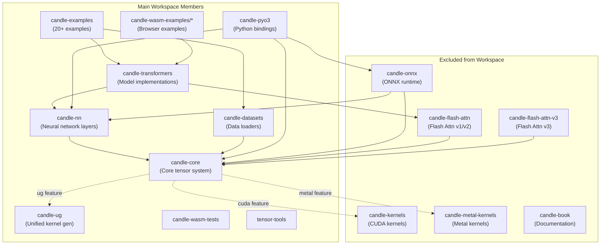

Sources: [Cargo.toml:1-22]()

The workspace uses a resolver version 2 and shares common metadata across all crates including version (0.11.0), edition (2021), and license (MIT OR Apache-2.0).

Sources: [Cargo.toml:22-32]()

## Core Framework Crates

### candle-core

The foundational crate providing tensor operations, automatic differentiation, and device abstraction. This is the only required dependency for all other Candle crates.

**Key components**:
- `Device`: Enum for dispatching to `Cpu`, `Cuda`, or `Metal` backends.
- `Tensor`: The primary data structure for multi-dimensional arrays.
- `DType`: Data type system supporting `F32`, `F16`, `BF16`, and low-bit quantization types like `F8E4M3`. [candle-core/Cargo.toml:21-22]()
- `Storage`: Backend-specific memory management.

**Dependencies**:
- Core numeric: `gemm`, `half`, `float8`, `num-traits`, `libm`.
- Parallelization: `rayon`, `num_cpus`.
- Serialization: `safetensors`, `memmap2`, `zip`, `tokenizers`.
- CUDA (optional): `cudarc`, `candle-kernels`.
- Metal (optional): `objc2-metal`, `objc2-foundation`, `candle-metal-kernels`.
- CPU acceleration (optional): `intel-mkl-src`, `accelerate-src`.
- Unified kernels (optional): `candle-ug`.

Sources: [candle-core/Cargo.toml:12-41]()

**Feature flags**:
- `cuda`: Enable CUDA backend and kernels. [candle-core/Cargo.toml:51]()
- `cudnn`: Enable cuDNN integration (requires `cuda`). [candle-core/Cargo.toml:52]()
- `nccl`: Enable NCCL for multi-GPU (requires `cuda`). [candle-core/Cargo.toml:53]()
- `metal`: Enable Metal backend and kernels. [candle-core/Cargo.toml:56-61]()
- `mkl`: Enable Intel MKL for CPU acceleration. [candle-core/Cargo.toml:54]()
- `accelerate`: Enable Apple Accelerate framework. [candle-core/Cargo.toml:55]()
- `ug`: Enable unified kernel generation system via `candle-ug`. [candle-core/Cargo.toml:63]()

### candle-nn

Neural network building blocks including layers, activations, normalization, and the `VarBuilder` weight management system.

**Key components**:
- Layer types: `Linear`, `Embedding`, `Conv1d`, `Conv2d`, `LayerNorm`, `RmsNorm`, `BatchNorm`, `GroupNorm`. [candle-nn/src/lib.rs:46-60]()
- `VarBuilder`: Abstraction for loading weights from `SafeTensors` or memory-mapped files. [candle-nn/src/lib.rs:65](), [candle-examples/examples/t5/main.rs:174-185]()
- `Module` trait: Standard forward pass interface. [candle-nn/src/lib.rs:68](), [candle-transformers/src/models/t5.rs:81-92]()
- `Optimizers`: Implementations for `SGD` and `AdamW`. [candle-nn/src/lib.rs:62]()

The crate depends on `candle-core` and inherits its feature flags for backend selection.

Sources: [candle-nn/Cargo.toml:1-44](), [candle-nn/src/lib.rs:1-68]()

### candle-transformers

High-level model implementations including LLMs, vision models, and audio models. This crate provides production-ready architectures built on top of `candle-nn`.

**Supported Models**:
- **LLMs**: T5, LLaMA, Mistral, Phi, Qwen, Gemma, Falcon, Granite, Mamba. [candle-transformers/src/models/t5.rs:1-17]()
- **Audio**: Whisper, EnCodec, Mimi, SNAC, Parler-TTS. [candle-examples/examples/t5/main.rs:137-146]()
- **Vision**: YOLO (v3/v8), DINOv2, Segment Anything (SAM), DepthAnythingV2. [candle-examples/Cargo.toml:149-150]()
- **Multimodal**: BLIP, Moondream, PaliGemma, Voxtral. [candle-examples/Cargo.toml:161-162]()

Sources: [candle-transformers/Cargo.toml:1-36](), [candle-transformers/src/models/t5.rs:1-199]()

### candle-datasets

Dataset loaders for common benchmarks and training data including MNIST, CIFAR, and utilities for working with Hugging Face Hub datasets.

Sources: [candle-datasets/Cargo.toml:1-23](), [candle-examples/Cargo.toml:129-134]()

## GPU Kernel and Specialized Crates

### candle-kernels

Custom CUDA kernels compiled from `.cu` files using the `cudaforge` build tool. These kernels provide optimized implementations for operations that benefit from custom GPU code.

Sources: [candle-kernels/Cargo.toml:1-15]()

### candle-metal-kernels

Metal compute shaders for Apple Silicon GPUs. The crate compiles Metal Shading Language (MSL) kernels at build time and provides a registry for runtime access via `objc2-metal`.

Sources: [candle-metal-kernels/Cargo.toml:1-31]()

### candle-flash-attn and candle-flash-attn-v3

Optimized attention layers for CUDA.
- `candle-flash-attn`: Implements Flash Attention v1 and v2. [candle-flash-attn/Cargo.toml:6]()
- `candle-flash-attn-v3`: Implements Flash Attention v3 for Hopper (SM90+) GPUs. [candle-flash-attn-v3/Cargo.toml:6]()

Sources: [candle-flash-attn/Cargo.toml:1-27](), [candle-flash-attn-v3/Cargo.toml:1-20]()

### candle-onnx

ONNX (Open Neural Network Exchange) runtime integration. It allows loading and evaluating ONNX models using Candle's backend via a `prost`-based parser.

Sources: [candle-onnx/Cargo.toml:1-22]()

## Integration and Tooling Crates

### candle-pyo3

Python bindings exposing Candle's API to Python via PyO3. The crate builds as a `cdylib` for Python import under the name `candle`. [candle-pyo3/Cargo.toml:13-14]()

Sources: [candle-pyo3/Cargo.toml:1-34]()

### candle-wasm-examples

Multiple browser-based examples compiled to WebAssembly. Each subdirectory (e.g., `whisper`, `llama2-c`, `yolo`) is a separate crate. These allow running models like Whisper or LLaMA2 directly in the browser using `wasm-bindgen`.

Sources: [Cargo.toml:10](), [candle-wasm-examples/whisper/Cargo.toml:1-20]()

### tensor-tools

A CLI utility for inspecting and converting tensor files (e.g., between SafeTensors and GGUF).

Sources: [Cargo.toml:12](), [tensor-tools/Cargo.toml:1-16]()

### candle-ug

A crate for Unified Kernel Generation, enabling SSA-based kernel language support. It provides backends for both CUDA and Metal to generate kernels dynamically. [candle-core/Cargo.toml:51, 60]()

Sources: [Cargo.toml:47](), [Cargo.toml:100-102]()

## Dependency Flow and Entity Mapping

The following diagrams bridge the natural language concepts of the framework to the specific code entities and crates.

**Model Execution Dependency Flow**

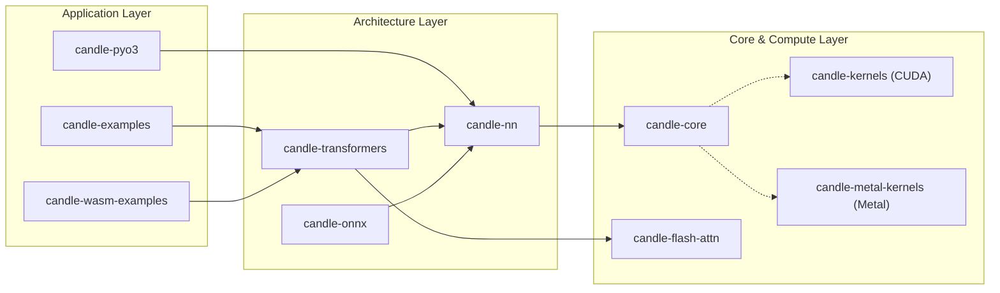
Sources: [Cargo.toml:1-21](), [candle-examples/Cargo.toml:14-19]()

**Code Entity Mapping: Model Loading**

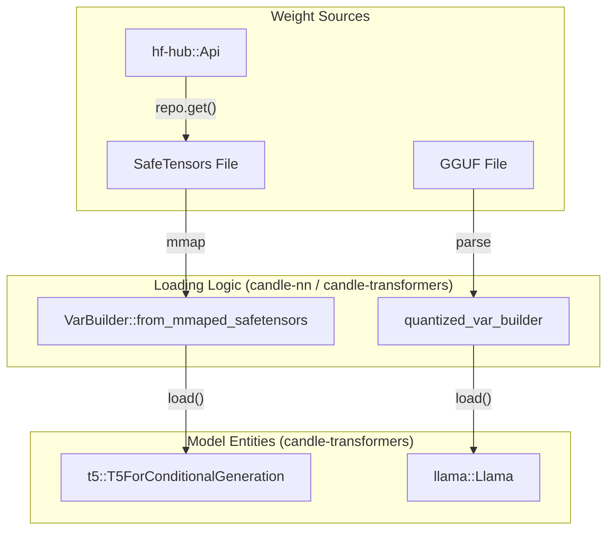
Sources: [candle-examples/examples/t5/main.rs:127-185](), [candle-transformers/src/models/t5.rs:64]()

## Workspace-Level Dependencies

Shared dependencies defined in `[workspace.dependencies]` at [Cargo.toml:33-105]():

| Dependency | Purpose | Code Reference |
|------------|---------|----------------|
| `half`, `float8` | Low-precision floating point types | [Cargo.toml:65, 71]() |
| `safetensors` | Zero-copy tensor serialization | [Cargo.toml:91]() |
| `cudarc` | Safe wrapper for CUDA APIs | [Cargo.toml:50]() |
| `gemm` | Pure Rust matrix multiplication (WASM SIMD support) | [Cargo.toml:63]() |
| `hf-hub` | Access to Hugging Face Hub | [Cargo.toml:64]() |
| `tokenizers` | Fast tokenization for LLMs | [Cargo.toml:96]() |

Sources: [Cargo.toml:33-105]()

---

# Page: Build System and Feature Flags

# Build System and Feature Flags

<details>
<summary>Relevant source files</summary>

The following files were used as context for generating this wiki page:

- [.github/workflows/ci_cuda.yaml](.github/workflows/ci_cuda.yaml)
- [.github/workflows/maturin.yml](.github/workflows/maturin.yml)
- [.github/workflows/python.yml](.github/workflows/python.yml)
- [.github/workflows/rust-ci.yml](.github/workflows/rust-ci.yml)
- [.github/workflows/trufflehog.yml](.github/workflows/trufflehog.yml)
- [candle-book/CONTRIBUTING.md](candle-book/CONTRIBUTING.md)
- [candle-book/Cargo.toml](candle-book/Cargo.toml)
- [candle-book/book.toml](candle-book/book.toml)
- [candle-book/src/README.md](candle-book/src/README.md)
- [candle-book/src/SUMMARY.md](candle-book/src/SUMMARY.md)
- [candle-book/src/guide/hello_world.md](candle-book/src/guide/hello_world.md)
- [candle-book/src/guide/installation.md](candle-book/src/guide/installation.md)
- [candle-book/src/guide/mnist/intro.md](candle-book/src/guide/mnist/intro.md)
- [candle-book/src/guide/mnist/modeling.md](candle-book/src/guide/mnist/modeling.md)
- [candle-book/src/guide/mnist/saving_loading.md](candle-book/src/guide/mnist/saving_loading.md)
- [candle-book/src/guide/mnist/training.md](candle-book/src/guide/mnist/training.md)
- [candle-book/src/inference/inference.md](candle-book/src/inference/inference.md)
- [candle-book/src/lib.rs](candle-book/src/lib.rs)
- [candle-book/src/simplified.rs](candle-book/src/simplified.rs)
- [candle-book/src/tracing.md](candle-book/src/tracing.md)
- [candle-book/src/training/simplified.md](candle-book/src/training/simplified.md)
- [candle-book/src/training/training.md](candle-book/src/training/training.md)
- [candle-core/benches/benchmarks/reduce.rs](candle-core/benches/benchmarks/reduce.rs)
- [candle-core/benches/benchmarks/where_cond.rs](candle-core/benches/benchmarks/where_cond.rs)
- [candle-examples/build.rs](candle-examples/build.rs)
- [candle-examples/buildtime_downloader.rs](candle-examples/buildtime_downloader.rs)
- [candle-examples/examples/custom-ops/cuda_kernels.rs](candle-examples/examples/custom-ops/cuda_kernels.rs)
- [candle-examples/examples/custom-ops/kernels/layernorm_kernels.cu](candle-examples/examples/custom-ops/kernels/layernorm_kernels.cu)
- [candle-examples/examples/custom-ops/kernels/reduction_utils.cuh](candle-examples/examples/custom-ops/kernels/reduction_utils.cuh)
- [candle-examples/examples/custom-ops/main.rs](candle-examples/examples/custom-ops/main.rs)
- [candle-flash-attn/build.rs](candle-flash-attn/build.rs)
- [candle-kernels/README.md](candle-kernels/README.md)
- [candle-kernels/build.rs](candle-kernels/build.rs)
- [candle-kernels/src/lib.rs](candle-kernels/src/lib.rs)
- [candle-kernels/src/moe/moe_wmma.cu](candle-kernels/src/moe/moe_wmma.cu)
- [candle-nn/benches/benchmarks/softmax.rs](candle-nn/benches/benchmarks/softmax.rs)
- [candle-onnx/build.rs](candle-onnx/build.rs)
- [candle-onnx/src/onnx.proto3](candle-onnx/src/onnx.proto3)

</details>


## Purpose and Scope

This document describes the Candle framework's build system, Cargo workspace structure, and feature flag system. It explains how optional hardware backends (CUDA, Metal, MKL, Accelerate) and performance optimizations (Flash Attention) are enabled through Cargo features, and how custom GPU kernels are compiled during the build process.

## Cargo Workspace Structure

The Candle repository is organized as a Cargo workspace. The structure separates core functionality, neural network primitives, model implementations, examples, and deployment targets.

**Workspace Members**:

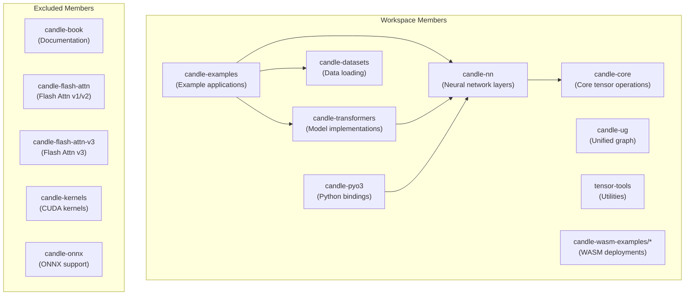

**Why Certain Crates Are Excluded**
The `candle-flash-attn`, `candle-flash-attn-v3`, `candle-kernels`, and `candle-onnx` crates are often excluded from the primary workspace default members or handled separately because:
1. They require specialized build processes (CUDA kernel compilation via `nvcc`).
2. They have platform-specific dependencies (CUDA toolkit).
3. They are optional dependencies activated only when specific features are enabled.

## Feature Flags Overview

Candle uses Cargo feature flags to enable optional backends and optimizations.

### Core Backend Features

| Feature | Purpose | Available In | Dependencies |
|---------|---------|--------------|--------------|
| `cuda` | Enable NVIDIA CUDA backend | core, nn, transformers, examples | Requires CUDA toolkit, `cudarc` |
| `metal` | Enable Apple Metal backend | core, nn, transformers, examples | macOS only |
| `mkl` | Enable Intel MKL for CPU | core, nn, transformers, examples | `intel-mkl-src` [candle-book/Cargo.toml:23]() |
| `accelerate` | Enable Apple Accelerate | core, nn, transformers, examples | `accelerate-src` [candle-book/Cargo.toml:13]() |

### Performance Optimization Features

| Feature | Purpose | Available In | Dependencies |
|---------|---------|--------------|--------------|
| `flash-attn` | Enable Flash Attention v1/v2 | transformers, examples | Requires `cuda`, `candle-flash-attn` [candle-book/Cargo.toml:18]() |

**Sources:** [candle-book/Cargo.toml:12-27](), [candle-book/src/guide/installation.md:18-60]()

## Build Scripts and Kernel Compilation

Candle uses `build.rs` scripts to compile GPU kernels at build time. This approach allows platform-specific optimizations while maintaining a unified Rust API.

### Build Script Responsibilities

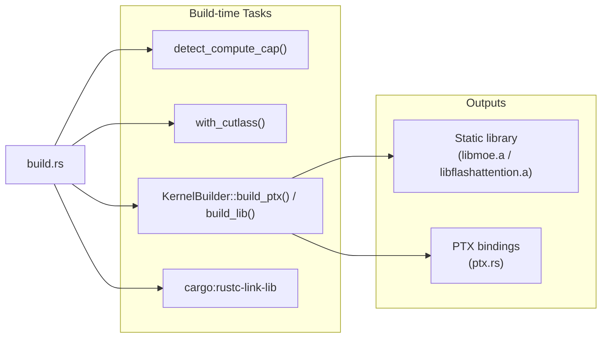

### CUDA Kernel Compilation with cudaforge

The `cudaforge` crate provides a builder API for compiling CUDA kernels. It handles source file compilation with `nvcc`, include path management, and static library generation.

**Example: candle-kernels Build Process**
The `candle-kernels` build script performs two distinct types of compilation:
1.  **PTX Generation**: Scans `src/` for `.cu` files and compiles them to PTX, excluding specific MoE and GGUF kernels [candle-kernels/build.rs:14-20]().
2.  **Static Library (MoE/MMQ)**: Compiles specific Mixture-of-Experts (MoE) and quantized matrix multiplication (MMQ/MMVQ) kernels into a static library `libmoe.a` [candle-kernels/build.rs:24-67]().
3.  **Compute Capability Detection**: Uses `cudaforge::detect_compute_cap()` to disable `bf16` WMMA kernels on hardware older than Ampere (sm_80) via `-DNO_BF16_KERNEL` [candle-kernels/build.rs:48-53]().

**Example: candle-flash-attn Build Process**
Flash Attention v1/v2 compilation:
1.  **Kernel Files**: Defines over 50 CUDA source files covering different head dimensions and causal masking variants [candle-flash-attn/build.rs:8-62]().
2.  **CUTLASS Integration**: Uses `.with_cutlass(Some(CUTLASS_COMMIT))` to automatically fetch and include the CUTLASS header-only library from GitHub [candle-flash-attn/build.rs:132]().
3.  **Build Caching**: Supports `CANDLE_FLASH_ATTN_BUILD_DIR` environment variable to cache compiled artifacts and avoid long re-compilation times [candle-flash-attn/build.rs:111-125]().
4.  **Linking**: Links the resulting `libflashattention.a` and `cudart` [candle-flash-attn/build.rs:161-163]().

### Custom Operations Compilation
The `candle-examples` crate demonstrates how to compile user-defined CUDA kernels for custom operations:
1.  **Kernel Discovery**: Uses a glob pattern (e.g., `examples/custom-ops/kernels/*.cu`) to find source files [candle-examples/build.rs:10-13]().
2.  **PTX Binding Generation**: Uses `KernelBuilder::new().build_ptx()` to generate Rust bindings in the `$OUT_DIR` [candle-examples/build.rs:33-36]().
3.  **Usage in Code**: The generated file is included via the `include!` macro [candle-examples/examples/custom-ops/main.rs:10-13]().

**Sources:** [candle-kernels/build.rs:5-75](), [candle-flash-attn/build.rs:1-168](), [candle-examples/build.rs:1-50](), [candle-examples/examples/custom-ops/main.rs:10-13]()

## CI/CD Workflows

The Candle project uses GitHub Actions to validate the build system across different platforms and feature sets.

**Main Rust CI** ([.github/workflows/rust-ci.yml]()):
- **Matrix Testing**: Runs on `ubuntu-latest`, `windows-latest`, `macOS-latest`, and `ubuntu-24.04-arm` [.github/workflows/rust-ci.yml:16]().
- **Metal Validation**: Checks the workspace with the `metal` feature on macOS [.github/workflows/rust-ci.yml:27-29]().
- **SIMD Features**: Validates `avx2` on Linux x86 and `neon` on Linux ARM [.github/workflows/rust-ci.yml:35-46]().

**CUDA CI** ([.github/workflows/ci_cuda.yaml]()):
- **Hardware**: Runs on AWS G5 instances (`aws-g5-4xlarge-cache`) which provide NVIDIA A10G GPUs [.github/workflows/ci_cuda.yaml:13]().
- **Environment**: Uses the `nvidia/cuda:13.0.2-cudnn-devel-ubuntu24.04` container [.github/workflows/ci_cuda.yaml:15]().
- **Compute Cap**: Explicitly sets `CUDA_COMPUTE_CAP: 86` for the test run [.github/workflows/ci_cuda.yaml:25]().

**Python Bindings CI** ([.github/workflows/maturin.yml]()):
- **Maturin**: Uses `PyO3/maturin-action` to build wheels for Linux, Windows, and macOS across multiple architectures (x86_64, aarch64, etc.) [.github/workflows/maturin.yml:29, 53, 82]().

**Sources:** [.github/workflows/rust-ci.yml:1-101](), [.github/workflows/ci_cuda.yaml:1-35](), [.github/workflows/maturin.yml:1-126]()

## candle-book Documentation Structure

The `candle-book` is a separate crate that serves as the source for the mdBook documentation.

- **Content Organization**: Defined in `SUMMARY.md`, covering Installation, Tutorials (MNIST), and Reference Guides [candle-book/src/SUMMARY.md:1-32]().
- **Code Anchors**: The book uses `ANCHOR` tags to pull live code snippets into the documentation, ensuring examples like the `hf-hub` integration remain up-to-date [candle-book/src/lib.rs:14-25, 33-47, 55-106]().
- **Build-time Downloads**: The `candle-examples` build script can optionally download models from Hugging Face Hub at build time using `CANDLE_BUILDTIME_MODEL_REVISION` [candle-examples/build.rs:47-49]().

**Sources:** [candle-book/src/SUMMARY.md:1-32](), [candle-book/src/lib.rs:1-189](), [candle-examples/build.rs:43-50]()

---

# Page: Core Tensor System

# Core Tensor System

<details>
<summary>Relevant source files</summary>

The following files were used as context for generating this wiki page:

- [candle-core/src/backend.rs](candle-core/src/backend.rs)
- [candle-core/src/backprop.rs](candle-core/src/backprop.rs)
- [candle-core/src/custom_op.rs](candle-core/src/custom_op.rs)
- [candle-core/src/device.rs](candle-core/src/device.rs)
- [candle-core/src/dummy_cuda_backend.rs](candle-core/src/dummy_cuda_backend.rs)
- [candle-core/src/dummy_metal_backend.rs](candle-core/src/dummy_metal_backend.rs)
- [candle-core/src/error.rs](candle-core/src/error.rs)
- [candle-core/src/lib.rs](candle-core/src/lib.rs)
- [candle-core/src/op.rs](candle-core/src/op.rs)
- [candle-core/src/storage.rs](candle-core/src/storage.rs)
- [candle-core/src/tensor.rs](candle-core/src/tensor.rs)
- [candle-core/src/test_utils.rs](candle-core/src/test_utils.rs)
- [candle-core/tests/custom_op_tests.rs](candle-core/tests/custom_op_tests.rs)
- [candle-core/tests/grad_tests.rs](candle-core/tests/grad_tests.rs)
- [candle-core/tests/matmul_tests.rs](candle-core/tests/matmul_tests.rs)
- [candle-core/tests/tensor_tests.rs](candle-core/tests/tensor_tests.rs)

</details>


## Purpose and Scope

This page documents the core tensor abstraction in Candle, which is the fundamental data structure for representing multi-dimensional arrays and enabling automatic differentiation. The tensor system provides:

- Multi-dimensional array representation with arbitrary shapes.
- Efficient memory management through reference counting and layout abstraction.
- Backend-agnostic storage supporting CPU, CUDA, and Metal devices.
- Computation graph construction for automatic differentiation.
- Type-safe operations across multiple data types, including low-bit quantization formats.

For details on specific tensor operations (arithmetic, reduction, indexing), see [Tensor Operations](#2.2). For the automatic differentiation mechanism, see [Automatic Differentiation](#2.3). For memory layout and shape broadcasting, see [Shape, Layout, and Memory Management](#2.4).

---

## Tensor Architecture

The tensor system uses a two-level structure: `Tensor` is a lightweight `Arc` wrapper around `Tensor_`, which contains the actual tensor state.

### Tensor Wrapper and Internal Structure

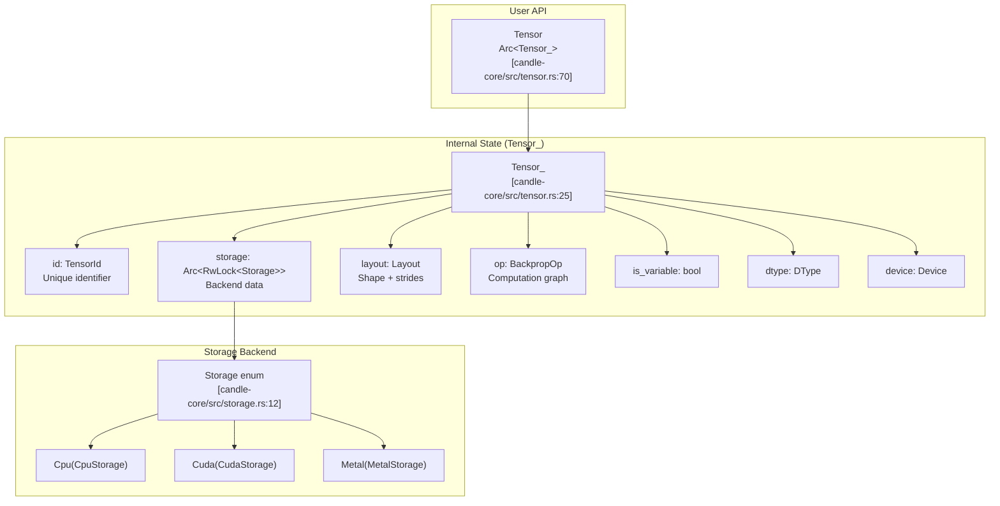

**Sources:** [candle-core/src/tensor.rs:25-45](), [candle-core/src/tensor.rs:53-70](), [candle-core/src/storage.rs:12-16]()

The `Tensor` type is defined as:

```rust
pub struct Tensor(Arc<Tensor_>);
```

This Arc-based wrapper enables cheap cloning [candle-core/src/tensor.rs:53-56](), which is essential for building computation graphs where the same tensor may be referenced multiple times. The inner `Tensor_` struct at [candle-core/src/tensor.rs:25-45]() contains:

| Field | Type | Purpose |
|-------|------|---------|
| `id` | `TensorId` | Unique identifier for the tensor instance [candle-core/src/tensor.rs:13-23]() |
| `storage` | `Arc<RwLock<Storage>>` | Backend-specific data storage with interior mutability [candle-core/src/tensor.rs:39]() |
| `layout` | `Layout` | Shape, strides, and start offset defining memory organization [candle-core/src/tensor.rs:40]() |
| `op` | `BackpropOp` | Parent tensors and operation for autodiff graph [candle-core/src/tensor.rs:41]() |
| `is_variable` | `bool` | Whether this is a trainable parameter [candle-core/src/tensor.rs:42]() |
| `dtype` | `DType` | Element data type [candle-core/src/tensor.rs:43]() |
| `device` | `Device` | Computation device (CPU/CUDA/Metal) [candle-core/src/tensor.rs:44]() |

---

## Storage Abstraction

The `Storage` enum provides backend-agnostic data storage, dispatching to device-specific implementations.

### Storage Dispatch

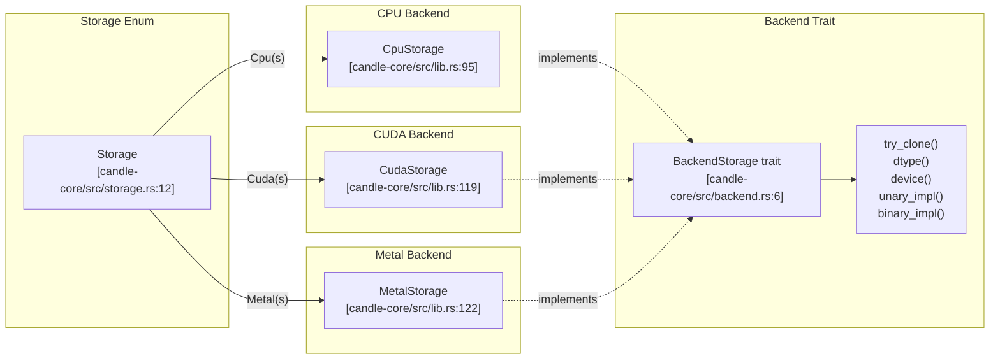

**Sources:** [candle-core/src/storage.rs:12-16](), [candle-core/src/backend.rs:6-139](), [candle-core/src/lib.rs:95-122]()

Each backend storage type implements the `BackendStorage` trait [candle-core/src/backend.rs:6-139](), which defines operations like element-wise operations, reductions, and linear algebra. Operations on `Storage` dispatch to the appropriate backend implementation [candle-core/src/storage.rs:21-191]().

---

## Data Type System

Candle supports a comprehensive set of numerical data types through the `DType` enum, including new low-bit formats for quantization and MX formats.

### Supported Data Types

| DType | Size | Description |
|-------|------|-------------|
| `U8`, `U32` | 1, 4 bytes | Unsigned integers [candle-core/src/lib.rs:100]() |
| `I16`, `I32`, `I64` | 2, 4, 8 bytes | Signed integers [candle-core/src/lib.rs:100]() |
| `F16`, `BF16` | 2 bytes | Half-precision floats [candle-core/src/lib.rs:100]() |
| `F32`, `F64` | 4, 8 bytes | Single and double precision [candle-core/src/lib.rs:100]() |
| `F8E4M3` | 1 byte | 8-bit float (4-bit exp, 3-bit mantissa) [candle-core/tests/tensor_tests.rs:2]() |
| `F6E2M3`, `F6E3M2` | 6 bits | 6-bit float MX formats [candle-core/src/lib.rs:101]() |
| `F4` | 4 bits | 4-bit float MX format [candle-core/src/lib.rs:101]() |
| `F8E8M0` | 1 byte | 8-bit float with 8 exponent bits [candle-core/src/lib.rs:101]() |

**Sources:** [candle-core/src/lib.rs:100-101](), [candle-core/tests/tensor_tests.rs:2-83]()

---

## Layout and Memory Organization

The `Layout` struct defines how tensor elements are organized in memory, independent of the underlying storage.

### Layout Components

A `Layout` consists of:
1. **Shape**: The dimensions of the tensor [candle-core/src/lib.rs:106]().
2. **Stride**: Number of elements to skip in each dimension to reach the next element.
3. **Start offset**: Position of the first element in the underlying storage.

**Sources:** [candle-core/src/lib.rs:104-106](), [candle-core/src/tensor.rs:40]()

---

## Tensor Creation and Initialization

Tensors can be created through various factory methods defined in `candle-core/src/tensor.rs`.

### Creation Methods
- **Constant Fills**: `zeros`, `ones`, `full` [candle-core/tests/tensor_tests.rs:4-112]().
- **Random**: `rand`, `randn` (defined via backend device methods) [candle-core/src/backend.rs:165-167]().
- **Sequences**: `arange`, `arange_step` [candle-core/tests/tensor_tests.rs:114-150]().
- **From Data**: `new` (multi-dim arrays), `from_vec`, `from_slice` [candle-core/src/device.rs:22-104]().

All creation methods ultimately call `from_storage()` at [candle-core/src/tensor.rs:161-179](), which constructs a `Tensor_` with a contiguous layout [candle-core/src/tensor.rs:172]().

---

## Computation Graph Construction

Every tensor operation records its inputs and operation type in a `BackpropOp`, building a computation graph for automatic differentiation.

### Operation Flow

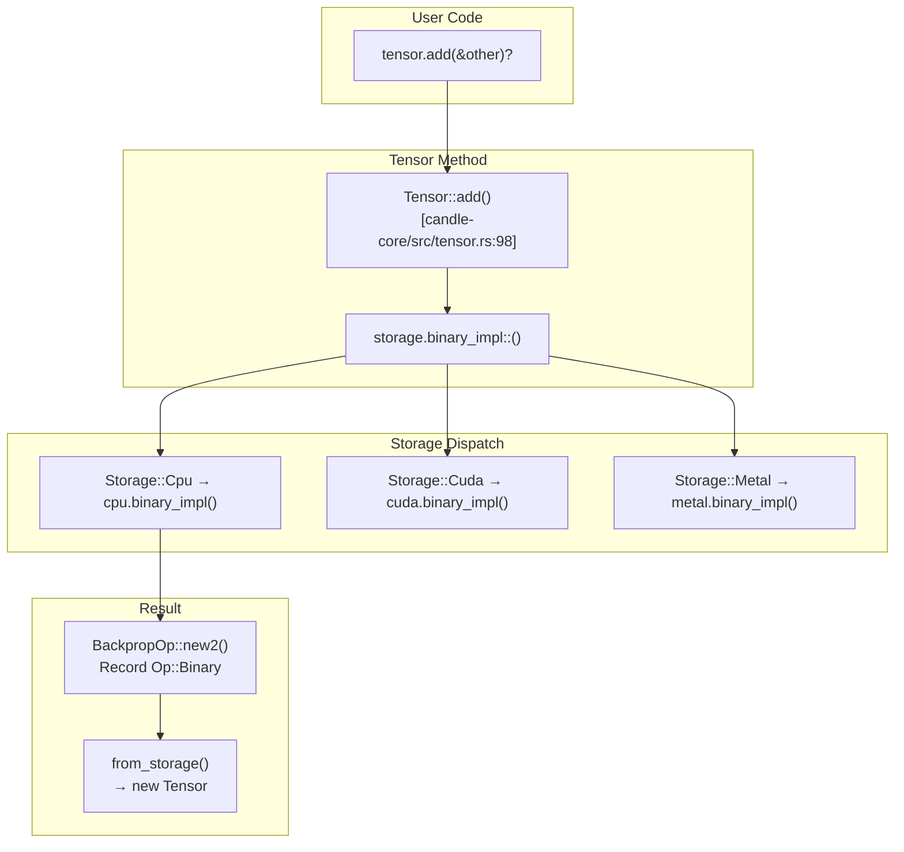

**Sources:** [candle-core/src/tensor.rs:96-112](), [candle-core/src/op.rs:76-190](), [candle-core/src/backprop.rs:165-168]()

The `Op` enum at [candle-core/src/op.rs:76-190]() captures the specific operation (e.g., `Matmul`, `Conv2D`, `Reduce`) and its parent tensors. The `backward()` method at [candle-core/src/backprop.rs:165]() uses this graph to perform the backward pass by traversing `sorted_nodes()` [candle-core/src/backprop.rs:35-163]().

---

## Device Abstraction

The `Device` enum abstracts over CPU, CUDA, and Metal backends.

| Device Variant | Backend Implementation |
|----------------|------------------------|
| `Device::Cpu` | `CpuDevice` [candle-core/src/device.rs:17]() |
| `Device::Cuda` | `CudaDevice` [candle-core/src/device.rs:18]() |
| `Device::Metal` | `MetalDevice` [candle-core/src/device.rs:19]() |

**Sources:** [candle-core/src/device.rs:15-20](), [candle-core/src/lib.rs:99-125]()

Device methods create backend-specific storage, ensuring that computations stay on the correct hardware. The `DeviceLocation` enum at [candle-core/src/device.rs:7-12]() distinguishes physical hardware identifiers.

---

## Summary

The Candle tensor system provides a layered architecture:
1. **Tensor wrapper**: Lightweight `Arc<Tensor_>` for cheap cloning [candle-core/src/tensor.rs:70]().
2. **Tensor_ state**: Metadata including `Shape`, `Layout`, and `DType` [candle-core/src/tensor.rs:25]().
3. **Storage backend**: Enum dispatching to hardware-specific implementations [candle-core/src/storage.rs:12]().
4. **Autograd**: Computation graph tracking via `Op` [candle-core/src/op.rs:76]() and `BackpropOp`.

For operation details, see [Tensor Operations](#2.2). For gradient computation, see [Automatic Differentiation](#2.3). For memory layout specifics, see [Shape, Layout, and Memory Management](#2.4).

**Sources:** [candle-core/src/tensor.rs:1-179](), [candle-core/src/storage.rs:1-50](), [candle-core/src/op.rs:76-190](), [candle-core/src/lib.rs:95-111]()

---

# Page: Tensor Architecture and Design

# Tensor Architecture and Design

<details>
<summary>Relevant source files</summary>

The following files were used as context for generating this wiki page:

- [Makefile](Makefile)
- [candle-core/src/backend.rs](candle-core/src/backend.rs)
- [candle-core/src/backprop.rs](candle-core/src/backprop.rs)
- [candle-core/src/custom_op.rs](candle-core/src/custom_op.rs)
- [candle-core/src/device.rs](candle-core/src/device.rs)
- [candle-core/src/dtype.rs](candle-core/src/dtype.rs)
- [candle-core/src/dummy_cuda_backend.rs](candle-core/src/dummy_cuda_backend.rs)
- [candle-core/src/dummy_metal_backend.rs](candle-core/src/dummy_metal_backend.rs)
- [candle-core/src/error.rs](candle-core/src/error.rs)
- [candle-core/src/lib.rs](candle-core/src/lib.rs)
- [candle-core/src/op.rs](candle-core/src/op.rs)
- [candle-core/src/storage.rs](candle-core/src/storage.rs)
- [candle-core/src/tensor.rs](candle-core/src/tensor.rs)
- [candle-core/src/test_utils.rs](candle-core/src/test_utils.rs)
- [candle-core/tests/custom_op_tests.rs](candle-core/tests/custom_op_tests.rs)
- [candle-core/tests/grad_tests.rs](candle-core/tests/grad_tests.rs)
- [candle-core/tests/matmul_tests.rs](candle-core/tests/matmul_tests.rs)
- [candle-core/tests/tensor_tests.rs](candle-core/tests/tensor_tests.rs)
- [candle-pyo3/README.md](candle-pyo3/README.md)
- [candle-pyo3/build.rs](candle-pyo3/build.rs)
- [candle-pyo3/py_src/candle/__init__.py](candle-pyo3/py_src/candle/__init__.py)
- [candle-pyo3/py_src/candle/nn/__init__.pyi](candle-pyo3/py_src/candle/nn/__init__.pyi)
- [candle-pyo3/py_src/candle/utils/__init__.py](candle-pyo3/py_src/candle/utils/__init__.py)
- [candle-pyo3/quant-llama.py](candle-pyo3/quant-llama.py)
- [candle-pyo3/src/lib.rs](candle-pyo3/src/lib.rs)
- [candle-pyo3/test.py](candle-pyo3/test.py)

</details>


This document explains Candle's tensor architecture, focusing on the core design decisions that enable efficient memory management, cheap cloning, and hardware abstraction. For tensor operations, see page 2.2. For automatic differentiation details, see page 2.3. For shape and layout management, see page 2.4.

## The Tensor/Tensor_ Split

Candle's tensor system uses a two-level structure to separate the user-facing API from internal implementation details.

**Tensor Structure Hierarchy**

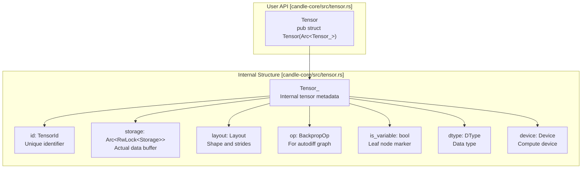

### The Tensor Wrapper

The `Tensor` struct is a simple newtype wrapper around `Arc<Tensor_>` [candle-core/src/tensor.rs:70](). This design provides several benefits:
- **Cheap cloning**: Cloning a `Tensor` only increments the `Arc` reference count [candle-core/src/tensor.rs:53-56]().
- **Deref coercion**: The `Tensor` implements `Deref` to provide direct access to `Tensor_` methods [candle-core/src/tensor.rs:72-78]().
- **Type safety**: Users cannot accidentally create invalid tensor states.
- **Memory safety**: Data is automatically freed when the last reference is dropped.

### The Tensor_ Internal Structure

The `Tensor_` struct contains all tensor metadata and data references [candle-core/src/tensor.rs:25-45]():

```rust
pub struct Tensor_ {
    id: TensorId,
    storage: Arc<RwLock<Storage>>,
    layout: Layout,
    op: BackpropOp,
    is_variable: bool,
    dtype: DType,
    device: Device,
}
```

**Field Purposes**

| Field | Type | Purpose |
|-------|------|---------|
| `id` | `TensorId` | Unique identifier for graph operations and caching [candle-core/src/tensor.rs:26]() |
| `storage` | `Arc<RwLock<Storage>>` | Reference-counted access to data buffer [candle-core/src/tensor.rs:39]() |
| `layout` | `Layout` | Shape, strides, and memory layout information [candle-core/src/tensor.rs:40]() |
| `op` | `BackpropOp` | Parent operations for gradient computation [candle-core/src/tensor.rs:41]() |
| `is_variable` | `bool` | Marks tensor as a trainable parameter [candle-core/src/tensor.rs:42]() |
| `dtype` | `DType` | Element data type (f32, f64, etc.) [candle-core/src/tensor.rs:43]() |
| `device` | `Device` | Where the data is stored (CPU/CUDA/Metal) [candle-core/src/tensor.rs:44]() |

The use of `Arc<RwLock<Storage>>` provides interior mutability for in-place operations while maintaining reference-counted lifetime management [candle-core/src/tensor.rs:27-39]().

Sources: [candle-core/src/tensor.rs:25-78]()

## Arc-Based Cloning System

Candle's tensor cloning mechanism is designed for efficiency in computation graph construction, where tensors are frequently used as inputs to multiple operations.

**Cloning Mechanism**

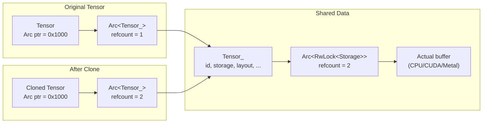

### Clone Implementation

The `Tensor` struct derives `Clone`, which automatically implements cloning via `Arc::clone()` [candle-core/src/tensor.rs:56](). This makes cloning extremely cheap - it's just an atomic reference count increment, regardless of tensor size [candle-core/src/tensor.rs:69-70]().

### Storage Reference Counting

The storage is separately reference-counted via its own `Arc`: `storage: Arc<RwLock<Storage>>` [candle-core/src/tensor.rs:39](). This enables multiple tensors to share the same storage with different layouts (e.g., after transpose or narrow) without copying data [candle-core/src/tensor.rs:53-55]().

Sources: [candle-core/src/tensor.rs:25-78](), [candle-core/src/tensor.rs:161-179]()

## TensorId and Uniqueness

Each `Tensor_` is assigned a unique `TensorId` upon creation, which is used for graph traversal and gradient accumulation [candle-core/src/tensor.rs:170]().

The `TensorId` implementation uses an atomic counter to generate globally unique identifiers [candle-core/src/tensor.rs:12-23]():

```rust
pub struct TensorId(usize);

impl TensorId {
    fn new() -> Self {
        use std::sync::atomic;
        static COUNTER: atomic::AtomicUsize = atomic::AtomicUsize::new(1);
        Self(COUNTER.fetch_add(1, atomic::Ordering::Relaxed))
    }
}
```

This provides a hashable key for `HashMap` used in gradient storage during backpropagation [candle-core/src/backprop.rs:4-45]().

Sources: [candle-core/src/tensor.rs:12-23](), [candle-core/src/backprop.rs:35-168]()

## Storage Abstraction

The `Storage` enum provides a unified interface for tensor data across different hardware backends [candle-core/src/storage.rs:11-16]().

**Storage Type Hierarchy**

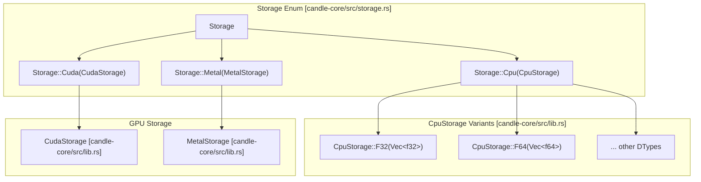

### Backend Dispatch Mechanism

The `Storage` enum implements operations by dispatching to the appropriate backend implementation [candle-core/src/storage.rs:21-192](). For example, the `device` and `dtype` methods match on the storage variant to return metadata [candle-core/src/storage.rs:36-50]().

### Device Enum Dispatch

The `Device` enum identifies where the data is physically located and handles allocation [candle-core/src/device.rs:15-20]().

```rust
pub enum Device {
    Cpu,
    Cuda(crate::CudaDevice),
    Metal(crate::MetalDevice),
}
```

It acts as a factory for creating storages, such as `new_cuda` [candle-core/src/device.rs:234-235]().

Sources: [candle-core/src/storage.rs:11-192](), [candle-core/src/device.rs:15-20](), [candle-core/src/backend.rs:1-100]()

## DType System

The `DType` enum defines the element types supported by Candle, including standard numeric types and specialized low-bit formats [candle-core/src/dtype.rs:7-38]().

**DType Enum and Size Mapping**

| Category | DType Variants | Byte Size |
|----------|----------------|-----------|
| Integers | `U8`, `U32`, `I16`, `I32`, `I64` | 1, 4, 2, 4, 8 [candle-core/src/dtype.rs:98-102]() |
| Standard Floats | `BF16`, `F16`, `F32`, `F64` | 2, 2, 4, 8 [candle-core/src/dtype.rs:103-106]() |
| Low-bit Floats | `F8E4M3`, `F8E8M0` | 1 [candle-core/src/dtype.rs:107-111]() |
| MX Formats | `F6E2M3`, `F6E3M2`, `F4` | 0 (packed/bit-level) [candle-core/src/dtype.rs:108-110]() |

### MX and Low-Bit Types
Candle supports several low-bit types for optimized inference [candle-core/src/dtype.rs:28-37]():
- **F8E4M3**: 8-bit float with 4-bit exponent and 3-bit mantissa.
- **F6E2M3 / F6E3M2**: 6-bit MX formats.
- **F4**: 4-bit MX format.
- **F8E8M0**: 8-bit exponent-only format.

These types are often handled via the `dummy_dtype` module when full backend support is not yet available for a specific device [candle-core/src/lib.rs:101]().

Sources: [candle-core/src/dtype.rs:7-144](), [candle-core/src/lib.rs:100-101]()

## Operation Macro System

Candle uses macros to generate element-wise operations, ensuring consistent behavior across all backends [candle-core/src/tensor.rs:80-158]().

- **unary_op!**: Generates methods like `exp()`, `log()`, `sin()` [candle-core/src/tensor.rs:80-94]().
- **binary_op!**: Generates same-shape operations like `add()`, `mul()` [candle-core/src/tensor.rs:96-112]().
- **broadcast_binary_op!**: Handles shape broadcasting before calling the inner operation [candle-core/src/tensor.rs:139-158]().

**Unary Operation Execution Flow**

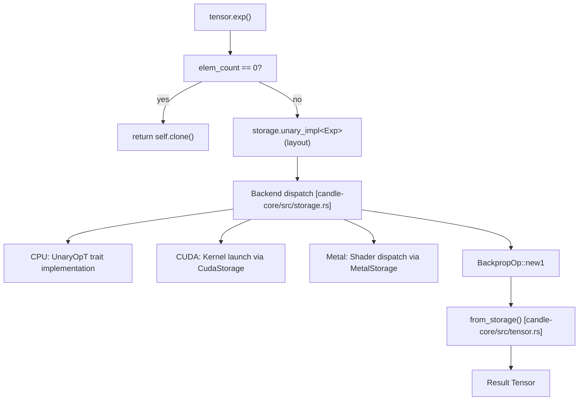

Sources: [candle-core/src/tensor.rs:80-158](), [candle-core/src/op.rs:192-269]()

## Custom Operations and Unified Kernels

Candle provides a trait-based system for extending the framework with custom operations that work across backends [candle-core/src/custom_op.rs]().

### CustomOp Traits
- **CustomOp1/2/3**: Traits for implementing operations with 1, 2, or 3 input tensors [candle-core/src/lib.rs:98]().
- **InplaceOp1/2/3**: Traits for operations that modify storage in-place, reducing memory allocations [candle-core/src/lib.rs:98]().

### Unified Kernel Generation (UgIOp1)
For backends like CUDA and Metal, Candle can use `UgIOp1` to dispatch kernels generated from a unified SSA representation via the `candle-ug` crate [candle-core/src/lib.rs:97](). This allows writing a kernel once and having it lowered to either PTX (CUDA) or MSL (Metal).

Sources: [candle-core/src/lib.rs:97-98](), [candle-core/src/custom_op.rs:1-100]()

---

# Page: Tensor Operations

# Tensor Operations

<details>
<summary>Relevant source files</summary>

The following files were used as context for generating this wiki page:

- [candle-book/src/apps/desktop.md](candle-book/src/apps/desktop.md)
- [candle-core/benches/benchmarks/broadcast.rs](candle-core/benches/benchmarks/broadcast.rs)
- [candle-core/benches/benchmarks/cat.rs](candle-core/benches/benchmarks/cat.rs)
- [candle-core/benches/benchmarks/contiguous.rs](candle-core/benches/benchmarks/contiguous.rs)
- [candle-core/src/backend.rs](candle-core/src/backend.rs)
- [candle-core/src/backprop.rs](candle-core/src/backprop.rs)
- [candle-core/src/convert.rs](candle-core/src/convert.rs)
- [candle-core/src/cpu_backend/mod.rs](candle-core/src/cpu_backend/mod.rs)
- [candle-core/src/cpu_backend/utils.rs](candle-core/src/cpu_backend/utils.rs)
- [candle-core/src/device.rs](candle-core/src/device.rs)
- [candle-core/src/display.rs](candle-core/src/display.rs)
- [candle-core/src/dummy_cuda_backend.rs](candle-core/src/dummy_cuda_backend.rs)
- [candle-core/src/dummy_metal_backend.rs](candle-core/src/dummy_metal_backend.rs)
- [candle-core/src/indexer.rs](candle-core/src/indexer.rs)
- [candle-core/src/layout.rs](candle-core/src/layout.rs)
- [candle-core/src/nditer.rs](candle-core/src/nditer.rs)
- [candle-core/src/npy.rs](candle-core/src/npy.rs)
- [candle-core/src/op.rs](candle-core/src/op.rs)
- [candle-core/src/shape.rs](candle-core/src/shape.rs)
- [candle-core/src/storage.rs](candle-core/src/storage.rs)
- [candle-core/src/strided_index.rs](candle-core/src/strided_index.rs)
- [candle-core/src/tensor.rs](candle-core/src/tensor.rs)
- [candle-core/src/tensor_cat.rs](candle-core/src/tensor_cat.rs)
- [candle-core/src/test_utils.rs](candle-core/src/test_utils.rs)
- [candle-core/tests/grad_tests.rs](candle-core/tests/grad_tests.rs)
- [candle-core/tests/indexing_tests.rs](candle-core/tests/indexing_tests.rs)
- [candle-core/tests/layout_tests.rs](candle-core/tests/layout_tests.rs)
- [candle-core/tests/matmul_tests.rs](candle-core/tests/matmul_tests.rs)
- [candle-core/tests/tensor_tests.rs](candle-core/tests/tensor_tests.rs)
- [candle-examples/examples/glm4/main.rs](candle-examples/examples/glm4/main.rs)
- [candle-examples/examples/llava/main.rs](candle-examples/examples/llava/main.rs)
- [candle-examples/examples/quantized-gemma/README.md](candle-examples/examples/quantized-gemma/README.md)
- [candle-examples/examples/quantized-gemma/main.rs](candle-examples/examples/quantized-gemma/main.rs)
- [candle-examples/examples/quantized-glm4/main.rs](candle-examples/examples/quantized-glm4/main.rs)
- [candle-examples/examples/quantized-lfm2/main.rs](candle-examples/examples/quantized-lfm2/main.rs)
- [candle-examples/examples/quantized-phi/main.rs](candle-examples/examples/quantized-phi/main.rs)
- [candle-examples/examples/quantized-qwen2-instruct/main.rs](candle-examples/examples/quantized-qwen2-instruct/main.rs)
- [candle-examples/examples/quantized-qwen3-moe/main.rs](candle-examples/examples/quantized-qwen3-moe/main.rs)
- [candle-examples/examples/quantized-qwen3/main.rs](candle-examples/examples/quantized-qwen3/main.rs)
- [candle-transformers/src/models/quantized_gemma3.rs](candle-transformers/src/models/quantized_gemma3.rs)
- [candle-transformers/src/models/quantized_phi3.rs](candle-transformers/src/models/quantized_phi3.rs)
- [tensor-tools/src/main.rs](tensor-tools/src/main.rs)

</details>


This document covers the comprehensive set of operations available on tensors in Candle. Tensor operations are the fundamental building blocks for constructing neural networks and performing computations. Each operation is implemented across all supported backends (CPU, CUDA, Metal) through a unified trait system.

For information about the tensor architecture and memory layout, see [Tensor Architecture and Design](2.1). For automatic differentiation and gradient computation, see [Automatic Differentiation](2.3).

---

## Operation Categories and Dispatch

Tensor operations in Candle are organized into distinct categories, each with specific implementation traits. All operations follow a consistent dispatch pattern from high-level tensor methods to backend-specific implementations.

### Operation Type Hierarchy

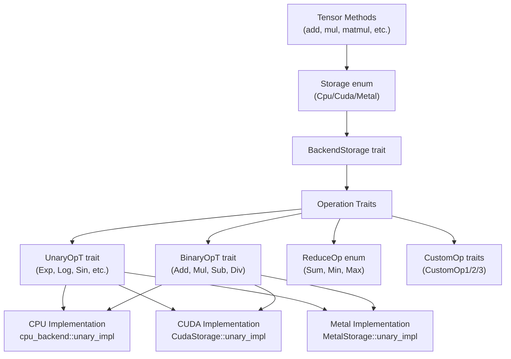

**Sources:** [candle-core/src/tensor.rs:78-155](), [candle-core/src/op.rs:1-190](), [candle-core/src/storage.rs:12-50](), [candle-core/src/backend.rs:6-139]()

### Operation Dispatch Mechanism

Operations follow a consistent dispatch pattern through multiple layers. For example, a binary operation like `add` starts at the `Tensor` level, checks for shape compatibility, and then dispatches to the underlying `Storage`.

| Layer | Component | Responsibility |
|-------|-----------|----------------|
| **User API** | `Tensor` methods | High-level operation interface (e.g., `tensor.add(&other)`) |
| **Validation** | `same_shape_binary_op` | Shape and device compatibility checks |
| **Storage Enum** | `Storage::binary_impl` | Dispatch to appropriate backend (`Cpu`, `Cuda`, or `Metal`) |
| **Backend Trait** | `BackendStorage` | Device-specific implementation of the operation |
| **Graph Tracking** | `BackpropOp` | Record operation for automatic differentiation if required |

**Sources:** [candle-core/src/tensor.rs:96-112](), [candle-core/src/storage.rs:141-174](), [candle-core/src/backend.rs:32-34](), [candle-core/src/tensor.rs:41-45]()

---

## Arithmetic Operations

Arithmetic operations are implemented as binary operations that combine two tensors element-wise. All operations support automatic broadcasting and gradient computation.

### Binary Arithmetic Operations

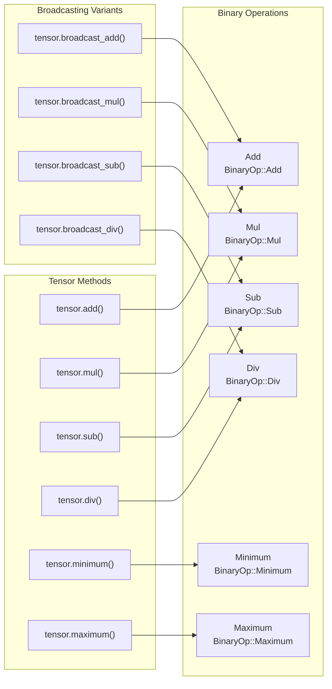

**Sources:** [candle-core/src/tensor.rs:96-158](), [candle-core/src/op.rs:42-49]()

### Arithmetic Operation Implementation

Each arithmetic operation is defined through the `BinaryOpT` trait and generated via macros. These operations are often optimized using SIMD on CPU or specialized kernels on GPU.

| Operation | Tensor Method | Macro Definition | Backward Pass |
|-----------|---------------|------------------|---------------|
| **Add** | `add(&self, rhs)` | `binary_op!(add, Add)` | `∂L/∂lhs = grad`, `∂L/∂rhs = grad` |
| **Multiply** | `mul(&self, rhs)` | `binary_op!(mul, Mul)` | `∂L/∂lhs = grad * rhs`, `∂L/∂rhs = grad * lhs` |
| **Subtract** | `sub(&self, rhs)` | `binary_op!(sub, Sub)` | `∂L/∂lhs = grad`, `∂L/∂rhs = -grad` |
| **Divide** | `div(&self, rhs)` | `binary_op!(div, Div)` | `∂L/∂lhs = grad / rhs`, `∂L/∂rhs = -grad * lhs / rhs²` |

**Sources:** [candle-core/src/tensor.rs:96-112](), [candle-core/src/op.rs:225-238](), [candle-core/src/backprop.rs:88-99]()

---

## Unary Operations

Unary operations transform tensor elements independently. Candle provides a comprehensive set of mathematical functions, each with automatic differentiation support.

### Unary Operation Categories

```mermaid
graph TD
    UnaryOps["Unary Operations"]
    
    Transcendental["Transcendental Functions"]
    Trigonometric["Trigonometric Functions"]
    Activation["Activation Functions"]
    Rounding["Rounding Functions"]
    
    UnaryOps --> Transcendental
    UnaryOps --> Trigonometric
    UnaryOps --> Activation
    UnaryOps --> Rounding
    
    Transcendental --> Exp["exp()<br/>UnaryOp::Exp"]
    Transcendental --> Log["log()<br/>UnaryOp::Log"]
    Transcendental --> Sqrt["sqrt()<br/>UnaryOp::Sqrt"]
    Transcendental --> Recip["recip()<br/>UnaryOp::Recip"]
    
    Trigonometric --> Sin["sin()<br/>UnaryOp::Sin"]
    Trigonometric --> Cos["cos()<br/>UnaryOp::Cos"]
    Trigonometric --> Tanh["tanh()<br/>UnaryOp::Tanh"]
    
    Activation --> Relu["relu()<br/>UnaryOp::Relu"]
    Activation --> Gelu["gelu()<br/>UnaryOp::Gelu"]
    Activation --> Silu["silu()<br/>UnaryOp::Silu"]
    Activation --> Erf["erf()<br/>UnaryOp::Erf"]
    
    Rounding --> Ceil["ceil()<br/>UnaryOp::Ceil"]
    Rounding --> Floor["floor()<br/>UnaryOp::Floor"]
    Rounding --> Round["round()<br/>UnaryOp::Round"]
    Rounding --> Sign["sign()<br/>UnaryOp::Sign"]
```

**Sources:** [candle-core/src/tensor.rs:80-94](), [candle-core/src/op.rs:53-73]()

### Unary Operation Trait Implementation

Each unary operation implements the `UnaryOpT` trait with type-specific functions. This trait is used by backends to apply the operation across the entire storage.

```rust
pub trait UnaryOpT {
    const NAME: &'static str;
    const KERNEL: &'static str;
    const V: Self;
    fn bf16(v1: bf16) -> bf16;
    fn f16(v1: f16) -> f16;
    fn f32(v1: f32) -> f32;
    fn f64(v1: f64) -> f64;
    // ... other types
}
```

**Key Unary Operations:**

| Operation | Formula | Gradient | Use Case |
|-----------|---------|----------|----------|
| `exp()` | `e^x` | `grad * exp(x)` | Softmax, probability models |
| `log()` | `ln(x)` | `grad / x` | Cross-entropy loss |
| `sqrt()` | `√x` | `grad / (2 * √x)` | Normalization (LayerNorm) |
| `gelu()` | Gaussian Error Linear Unit | `0.5 * (1 + erf(x/√2)) + ...` | Transformer activations |
| `silu()` | `x * σ(x)` | `σ(x) * (1 + x * (1 - σ(x)))` | Llama/Mistral activations |

**Sources:** [candle-core/src/op.rs:192-206](), [candle-core/tests/grad_tests.rs:145-197]()

---

## Broadcasting and Reshaping

Broadcasting allows operations between tensors of different shapes by automatically expanding dimensions. Candle implements NumPy-style broadcasting rules.

### Broadcasting Rules
When operating on two tensors, Candle compares their shapes element-wise, starting from the trailing dimensions. Two dimensions are compatible if:
1. They are equal.
2. One of them is 1.

The `broadcast_shape_binary_op` function in `shape.rs` calculates the resulting shape or returns an error if incompatible.

**Sources:** [candle-core/src/shape.rs:191-225](), [candle-core/src/tensor.rs:139-158]()

### Reshaping and Views
Operations like `reshape`, `transpose`, and `narrow` create new tensor views without copying the underlying data when possible. This is achieved by modifying the `Layout` (strides and offset) while pointing to the same `Storage`.

**Sources:** [candle-core/src/tensor.rs:161-179](), [candle-core/src/layout.rs:6-34]()

---

## Indexing and Selection

Candle provides a flexible indexing system through the `indexer` module and the `i()` method.

### The Indexer Module
The `TensorIndexer` enum defines how a tensor is sliced or indexed. It supports integer indexing, ranges, and tensor-based indexing.

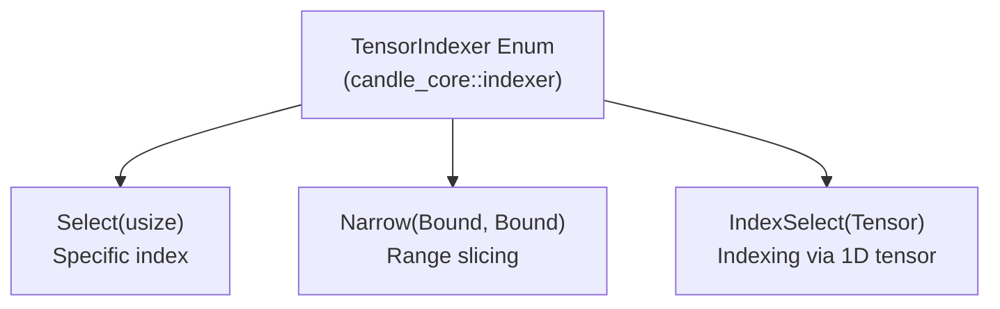

**Sources:** [candle-core/src/indexer.rs:64-74](), [candle-core/src/indexer.rs:134-138]()

### Indexing Syntax
Using the `IndexOp` trait, users can perform complex slicing with a syntax similar to Python/NumPy:

| Syntax | Component | Description |
|--------|-----------|-------------|
| `tensor.i(0)` | `Select` | Selects the first element along dimension 0. |
| `tensor.i(0..5)` | `Narrow` | Slices elements from index 0 to 4. |
| `tensor.i((.., 2))` | `Select` | Selects index 2 along the second dimension. |
| `tensor.i(&indices)` | `IndexSelect` | Uses a tensor of indices to gather elements. |

**Sources:** [candle-core/src/indexer.rs:9-26](), [candle-core/src/indexer.rs:212-225](), [candle-core/tests/tensor_tests.rs:93-102]()

---

## Reduction Operations

Reductions collapse one or more dimensions of a tensor into a smaller shape by aggregating values.

| Operation | ReduceOp Variant | Implementation |
|-----------|------------------|----------------|
| `sum()` | `Sum` | Sums elements along specified dimensions. |
| `min()` | `Min` | Finds the minimum value. |
| `max()` | `Max` | Finds the maximum value. |
| `argmin()` | `ArgMin` | Returns the index of the minimum value. |
| `argmax()` | `ArgMax` | Returns the index of the maximum value. |

**Sources:** [candle-core/src/op.rs:19-26](), [candle-core/src/backprop.rs:127-149](), [candle-core/src/storage.rs:176-191]()

---

## Display Utilities

Candle includes formatting logic to pretty-print tensors for debugging and logging.

### Printer Options
The `PrinterOptions` struct controls the level of detail in tensor output, including precision and summarizing large tensors.

| Option | Default | Description |
|--------|---------|-------------|
| `precision` | 4 | Number of decimal places for floating-point types. |
| `threshold` | 1000 | Total elements before the output is summarized with `...`. |
| `edge_items` | 3 | Number of elements to show at the start/end of each dimension when summarized. |
| `line_width` | 80 | Target character width for line wrapping. |

**Sources:** [candle-core/src/display.rs:81-103](), [candle-core/src/display.rs:203-238]()

### Tensor Formatting
The `TensorFormatter` trait provides logic to handle different data types and shapes, ensuring consistent output across CPU, CUDA, and Metal devices. Tensors are synchronized to CPU for printing.

**Sources:** [candle-core/src/display.rs:13-51](), [candle-core/src/display.rs:178-201]()

---

# Page: Automatic Differentiation

# Automatic Differentiation

<details>
<summary>Relevant source files</summary>

The following files were used as context for generating this wiki page:

- [candle-core/examples/basics.rs](candle-core/examples/basics.rs)
- [candle-core/src/backend.rs](candle-core/src/backend.rs)
- [candle-core/src/backprop.rs](candle-core/src/backprop.rs)
- [candle-core/src/device.rs](candle-core/src/device.rs)
- [candle-core/src/dummy_cuda_backend.rs](candle-core/src/dummy_cuda_backend.rs)
- [candle-core/src/dummy_metal_backend.rs](candle-core/src/dummy_metal_backend.rs)
- [candle-core/src/op.rs](candle-core/src/op.rs)
- [candle-core/src/storage.rs](candle-core/src/storage.rs)
- [candle-core/src/tensor.rs](candle-core/src/tensor.rs)
- [candle-core/src/test_utils.rs](candle-core/src/test_utils.rs)
- [candle-core/src/variable.rs](candle-core/src/variable.rs)
- [candle-core/tests/grad_tests.rs](candle-core/tests/grad_tests.rs)
- [candle-core/tests/matmul_tests.rs](candle-core/tests/matmul_tests.rs)
- [candle-core/tests/tensor_tests.rs](candle-core/tests/tensor_tests.rs)
- [candle-nn/src/batch_norm.rs](candle-nn/src/batch_norm.rs)
- [candle-nn/src/loss.rs](candle-nn/src/loss.rs)
- [candle-nn/tests/batch_norm.rs](candle-nn/tests/batch_norm.rs)
- [candle-nn/tests/group_norm.rs](candle-nn/tests/group_norm.rs)
- [candle-nn/tests/loss.rs](candle-nn/tests/loss.rs)

</details>


## Purpose and Scope

This document explains Candle's automatic differentiation (autograd) system, which enables gradient computation for neural network training. The system builds computation graphs during forward passes and computes gradients via reverse-mode differentiation (backpropagation). This page covers the `BackpropOp` graph construction, the `backward()` method, gradient accumulation in `GradStore`, and usage with `Var` for training.

For information about tensor operations themselves, see [Core Tensor System](2.2). For neural network layers built on top of autograd, see [Neural Network Building Blocks](5.1).

---

## Automatic Differentiation Architecture

Candle implements reverse-mode automatic differentiation by tracking operations during the forward pass and computing gradients during the backward pass. The system automatically builds a directed acyclic graph (DAG) of operations and computes derivatives using the chain rule.

### High-Level Flow

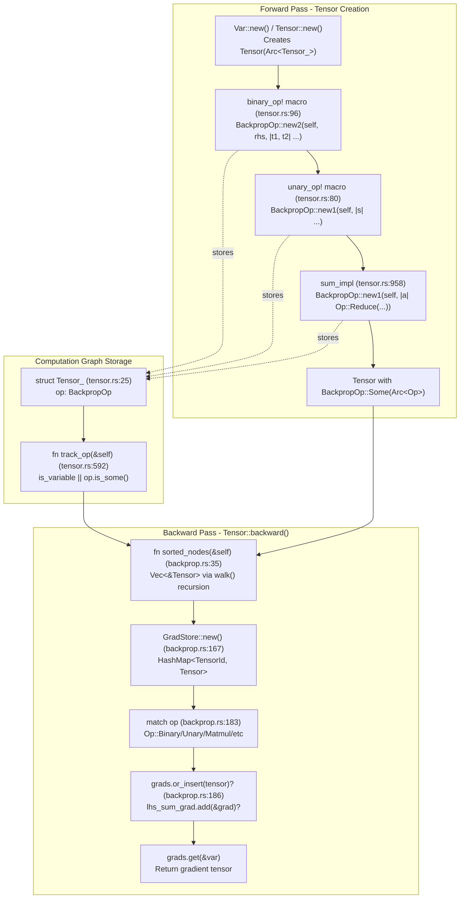

**Sources:** [candle-core/src/backprop.rs:35-168](), [candle-core/src/tensor.rs:25-45](), [candle-core/src/tensor.rs:80-112](), [candle-core/src/tensor.rs:592-594]()

---

## BackpropOp: Operation Tracking

Each `Tensor` contains a `BackpropOp` field that tracks how the tensor was created. This forms nodes in the computation graph used for gradient computation.

### Tensor_ Structure with BackpropOp

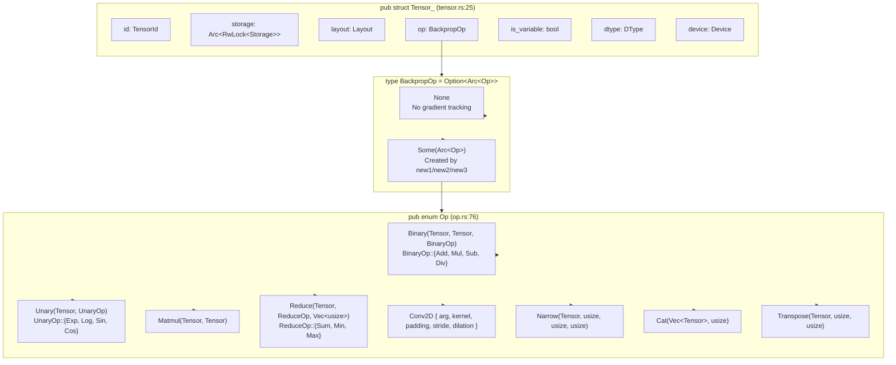

**Sources:** [candle-core/src/tensor.rs:25-45](), [candle-core/src/op.rs:76-190]()

### Operation Graph Construction

Operations automatically construct `BackpropOp` nodes when performed on tensors that require gradients. The macros `unary_op!`, `binary_op!`, and `binary_op_scalar!` expand to create these nodes:

| Operation Type | BackpropOp Creation Pattern | Code Location |
|---|---|---|
| Binary operations | `BackpropOp::new2(self, rhs, \|t1, t2\| Op::Binary(t1, t2, BinaryOp::$op_name))` | [candle-core/src/tensor.rs:108]() |
| Unary operations | `BackpropOp::new1(self, \|s\| Op::Unary(s, UnaryOp::$op_name))` | [candle-core/src/tensor.rs:90]() |
| Matmul | Manual construction in `Tensor::matmul()` | Implementation uses `BackpropOp::new2` |
| Reduce (sum/min/max) | `BackpropOp::new1(self, \|arg\| Op::Reduce(arg, op, dims.to_vec()))` | [candle-core/src/tensor.rs:946](), [candle-core/src/tensor.rs:967]() |
| Narrow | `BackpropOp::new1(self, \|t\| Op::Narrow(t, dim, start, len))` | [candle-core/src/tensor.rs:902]() |

The `Tensor::track_op()` method determines whether gradients should be tracked:

```rust
pub fn track_op(&self) -> bool {
    self.is_variable || self.op.is_some()
}
```

- Returns `true` if `is_variable == true` (created by `Var::new()`)
- Returns `true` if `op.is_some()` (has parent operations requiring gradients)
- Returns `false` for leaf constants or integer dtypes (e.g., [candle-core/src/backprop.rs:51]())

**Sources:** [candle-core/src/tensor.rs:592-594](), [candle-core/src/tensor.rs:80-112](), [candle-core/src/backprop.rs:47-52]()

---

## Forward Pass: Building the Computation Graph

During the forward pass, each operation creates a new tensor with a `BackpropOp` that references its input tensors. This forms a DAG where edges point from outputs to inputs.

### Example Computation Graph

```mermaid
graph BT
    x["x (Var)<br/>is_variable=true<br/>op=None"]
    x_sqr["x²<br/>op=Unary(x, Sqr)"]
    x_5["x * 5<br/>op=Binary(x, 5, Mul)"]
    sum1["x² + x*5<br/>op=Binary(x², x*5, Add)"]
    y["y = x² + x*5 + 4<br/>op=Binary(sum1, 4, Add)"]
    
    x_sqr --> x
    x_5 --> x
    sum1 --> x_sqr
    sum1 --> x_5
    y --> sum1
```

This graph is built automatically. For the expression `y = (x * x + x * 5) + 4`, each intermediate tensor stores references to its parent tensors in its `BackpropOp`.

**Sources:** [candle-core/src/backprop.rs:30-163](), [candle-core/tests/grad_tests.rs:7-19]()

---

## Backward Pass: Gradient Computation

The `Tensor::backward()` method performs reverse-mode automatic differentiation by traversing the computation graph in reverse topological order and applying the chain rule.

### Backward Pass Algorithm Implementation

```mermaid
graph TD
    Start["pub fn backward(&self) -> Result&lt;GradStore&gt;<br/>(backprop.rs:165)"]
    SortNodes["let sorted_nodes = self.sorted_nodes()<br/>(line 166)"]
    InitGrad["let mut grads = GradStore::new()<br/>grads.insert(self, self.ones_like()?) (line 167-168)"]
    
    IterNodes["for node in sorted_nodes.iter() (line 169)"]
    IsVar{"node.is_variable() (line 170)"}
    GetGrad["let grad = grads.remove(node)<br/>.expect(...) (line 173-175)"]
    Detach["let grad = if do_not_detach { grad }<br/>else { grad.detach() } (line 181-182)"]
    
    MatchOp["if let Some(op) = node.op() (line 183)<br/>match op"]
    
    BinaryAdd["Op::Binary(lhs, rhs, BinaryOp::Add) (line 185)<br/>let lhs_sum_grad = grads.or_insert(lhs)?<br/>*lhs_sum_grad = lhs_sum_grad.add(&grad)?<br/>let rhs_sum_grad = grads.or_insert(rhs)?<br/>*rhs_sum_grad = rhs_sum_grad.add(&grad)?"]
    
    BinaryMul["Op::Binary(lhs, rhs, BinaryOp::Mul) (line 197)<br/>let lhs_grad = grad.mul(rhs)?<br/>*grads.or_insert(lhs)? = (...).add(&lhs_grad)?<br/>let rhs_grad = grad.mul(lhs)?<br/>*grads.or_insert(rhs)? = (...).add(&rhs_grad)?"]
    
    UnaryExp["Op::Unary(arg, UnaryOp::Exp) (line 572)<br/>let arg_grad = grad.mul(&node)?<br/>*grads.or_insert(arg)? = (...).add(&arg_grad)?"]
    
    MatmulGrad["Op::Matmul(lhs, rhs) (line 457)<br/>let lhs_grad = grad.matmul(&rhs.t()?)?<br/>*grads.or_insert(lhs)? = (...).add(&lhs_grad)?<br/>let rhs_grad = lhs.t()?.matmul(&grad)?<br/>*grads.or_insert(rhs)? = (...).add(&rhs_grad)?"]
    
    Continue["continue (line 171)"]
    Done["Ok(grads) (line 688)"]
    
    Start --> SortNodes
    SortNodes --> InitGrad
    InitGrad --> IterNodes
    IterNodes --> IsVar
    IsVar -->|"true"| Continue
    IsVar -->|"false"| GetGrad
    GetGrad --> Detach
    Detach --> MatchOp
    
    MatchOp --> BinaryAdd
    MatchOp --> BinaryMul
    MatchOp --> UnaryExp
    MatchOp --> MatmulGrad
    
    BinaryAdd --> Continue
    BinaryMul --> Continue
    UnaryExp --> Continue
    MatmulGrad --> Continue
    
    Continue --> IterNodes
    IterNodes --> Done
```

**Sources:** [candle-core/src/backprop.rs:165-189](), [candle-core/src/backprop.rs:457-468](), [candle-core/src/backprop.rs:572-576]()

---

## GradStore: Gradient Accumulation

The `GradStore` struct accumulates gradients for tensors during backpropagation. It uses a `HashMap<TensorId, Tensor>` to store gradients indexed by tensor ID.

### GradStore API and Usage Pattern

```mermaid
graph TD
    subgraph GradStoreAPI["pub struct GradStore (backprop.rs)"]
        GSNew["GradStore::new() -> Self<br/>HashMap&lt;TensorId, Tensor&gt;::new()"]
        GSInsert["fn insert(&mut self, tensor: &Tensor, grad: Tensor)<br/>self.map.insert(tensor.id(), grad)"]
        GSOrInsert["fn or_insert(&mut self, tensor: &Tensor)<br/>-> Result&lt;&mut Tensor&gt;<br/>Entry::or_insert_with(|| tensor.zeros_like())"]
        GSGet["fn get(&self, tensor: &Tensor)<br/>-> Option&lt;&Tensor&gt;<br/>self.map.get(&tensor.id())"]
        GSRemove["fn remove(&mut self, tensor: &Tensor)<br/>-> Option&lt;Tensor&gt;<br/>self.map.remove(&tensor.id())"]
    end
    
    subgraph UsagePattern["Gradient Accumulation Pattern"]
        Pattern1["let sum_grad = grads.or_insert(tensor)?<br/>(creates zeros_like if not exists)"]
        Pattern2["*sum_grad = sum_grad.add(&new_grad)?<br/>(accumulates gradient in-place)"]
    end
    
    GSNew --> GSInsert
    GSNew --> GSOrInsert
    GSNew --> GSGet
    GSNew --> GSRemove
    
    GSOrInsert --> Pattern1
    Pattern1 --> Pattern2
```

### Gradient Accumulation Example

During backpropagation, gradients are accumulated when a tensor appears multiple times in the computation graph. The pattern implemented in `backward()` for `Op::Binary(lhs, rhs, BinaryOp::Add)`:

```rust
// backprop.rs:185-190
Op::Binary(lhs, rhs, BinaryOp::Add) => {
    let lhs_sum_grad = grads.or_insert(lhs)?;  // Get or create zeros_like(lhs)
    *lhs_sum_grad = lhs_sum_grad.add(&grad)?;  // Accumulate: ∂L/∂lhs += ∂L/∂node
    let rhs_sum_grad = grads.or_insert(rhs)?;  // Get or create zeros_like(rhs)
    *rhs_sum_grad = rhs_sum_grad.add(&grad)?;  // Accumulate: ∂L/∂rhs += ∂L/∂node
}
```

**Sources:** [candle-core/src/backprop.rs:185-190](), [candle-core/src/backprop.rs:167-168]()

---

## Using Variables for Training

The `Var` type represents trainable parameters. It wraps a `Tensor` with `is_variable=true`, marking it as a leaf node in the computation graph.

### Variable Lifecycle

```mermaid
graph TB
    subgraph VariableLifecycle["Variable Lifecycle"]
        Create["Var::new(data, device)<br/>Creates tensor with<br/>is_variable=true"]
        Forward["Forward pass<br/>Use var.as_tensor() in ops"]
        Loss["Compute loss"]
        Backward["loss.backward()<br/>Compute gradients"]
        GetGrad["grads.get(&var)<br/>Retrieve gradient"]
        Update["var.set(&new_value)<br/>Update parameters"]
    end
    
    Create --> Forward
    Forward --> Loss
    Loss --> Backward
    Backward --> GetGrad
    GetGrad --> Update
    Update --> Forward
```

### Training Loop Pattern

| Step | Code Pattern | Description |
|---|---|---|
| 1. Initialize | `let x = Var::new(0f32, device)?` | Create trainable variable [candle-core/tests/grad_tests.rs:132]() |
| 2. Forward | `let xt = x.as_tensor();` | Perform operations [candle-core/tests/grad_tests.rs:135]() |
| 3. Loss | `let c = ((xt - 4.2)? * (xt - 4.2)?)?` | Compute scalar loss [candle-core/tests/grad_tests.rs:136]() |
| 4. Backward | `let grads = c.backward()?` | Compute all gradients [candle-core/tests/grad_tests.rs:137]() |
| 5. Retrieve | `let x_grad = grads.get(&x)?` | Get gradient for variable [candle-core/tests/grad_tests.rs:138]() |
| 6. Update | `x.set(&(xt - x_grad * learning_rate)?)?` | Update parameters [candle-core/tests/grad_tests.rs:139]() |

**Sources:** [candle-core/tests/grad_tests.rs:131-143](), [candle-core/src/tensor.rs:42]()

---

## Topological Sorting with sorted_nodes()

The `Tensor::sorted_nodes()` method performs depth-first traversal of the computation graph to produce a topologically sorted list of tensors.

### Topological Sort Implementation

The `sorted_nodes()` method [candle-core/src/backprop.rs:35-163]() uses a recursive `walk()` function:

```mermaid
graph TD
    Start["pub fn sorted_nodes(&self)<br/>-> Vec&lt;&Tensor&gt; (backprop.rs:35)"]
    InitWalk["fn walk<'a>(<br/>node: &'a Tensor,<br/>nodes: Vec&lt;&'a Tensor&gt;,<br/>already_seen: &mut HashMap&lt;TensorId, bool&gt;<br/>) -> (bool, Vec&lt;&'a Tensor&gt;) (backprop.rs:38)"]
    
    CheckSeen{"already_seen.get(&node.id())<br/>(backprop.rs:43)"}
    ReturnCached["return (tg, nodes)<br/>(backprop.rs:44)"]
    
    InitTrack["let mut track_grad = false<br/>(backprop.rs:46)"]
    
    IsVar{"node.is_variable()<br/>(backprop.rs:47)"}
    SetTrackTrue["track_grad = true<br/>(backprop.rs:49)"]
    
    IsInt{"node.dtype().is_int()<br/>(backprop.rs:51)"}
    SkipInt["nodes (backprop.rs:52)"]
    
    HasOp{"if let Some(op) = node.op()<br/>(backprop.rs:53)"}
    MatchOp["match op (backprop.rs:54)"]
    
    RecurseInputs["For each input tensor:<br/>let (tg, nodes) = walk(input, nodes, seen)<br/>track_grad |= tg (backprop.rs:60-148)"]
    
    InsertSeen["already_seen.insert(node.id(), track_grad)<br/>(backprop.rs:154)"]
    
    PushNode{"if track_grad<br/>(backprop.rs:155)"}
    AddNode["nodes.push(node)<br/>(backprop.rs:156)"]
    
    ReturnPair["return (track_grad, nodes)<br/>(backprop.rs:158)"]
    
    Reverse["let (_tg, mut nodes) = walk(self, ...)<br/>nodes.reverse() (backprop.rs:160-161)"]
    
    Start --> InitWalk
    InitWalk --> CheckSeen
    CheckSeen -->|"found"| ReturnCached
    CheckSeen -->|"not found"| InitTrack
    InitTrack --> IsVar
    IsVar -->|"true"| SetTrackTrue
    IsVar -->|"false"| IsInt
    IsInt -->|"true"| SkipInt
    IsInt -->|"false"| HasOp
    HasOp -->|"Some"| MatchOp
    HasOp -->|"None"| InsertSeen
    MatchOp --> RecurseInputs
    RecurseInputs --> InsertSeen
    SetTrackTrue --> InsertSeen
    InsertSeen --> PushNode
    PushNode -->|"true"| AddNode
    PushNode -->|"false"| ReturnPair
    AddNode --> ReturnPair
    SkipInt --> ReturnPair
    ReturnPair --> Reverse
```

**Sources:** [candle-core/src/backprop.rs:35-163](), [candle-core/src/backprop.rs:47-52]()

---

## Implementation Details

### Gradient Detachment

By default, Candle detaches gradients during the backward pass to prevent computing second-order derivatives:

```rust
// backprop.rs:181-182
let grad = if do_not_detach { grad }
else { grad.detach() };
```

The `CANDLE_GRAD_DO_NOT_DETACH` environment variable can enable second-order derivatives if needed [candle-core/src/backprop.rs:19-28]().

**Sources:** [candle-core/src/backprop.rs:19-28](), [candle-core/src/backprop.rs:181-182]()

### Broadcast Gradients

When operations involve broadcasting, gradients must be summed over the broadcasted dimensions using `broadcast_back` [candle-core/src/backprop.rs:8-17]().

```rust
fn broadcast_back(arg: &Tensor, node: &Tensor, reduced_dims: &[usize]) -> Result<Tensor> {
    if arg.rank() == node.rank() {
        // keepdim = true
        node.broadcast_as(arg.shape())
    } else {
        // keepdim = false
        node.reshape(reduced_dims)?.broadcast_as(arg.shape())
    }
}
```

**Sources:** [candle-core/src/backprop.rs:8-17]()

### Supported and Unsupported Operations

| Operation Category | Backward Supported | Notes |
|---|---|---|
| Arithmetic (`add`, `mul`, `div`, `sub`) | ✓ | Full support [candle-core/src/backprop.rs:185-211]() |
| Unary (`exp`, `log`, `sin`, `cos`, `sqrt`) | ✓ | Full support [candle-core/src/backprop.rs:572-595]() |
| Matmul | ✓ | Full support [candle-core/src/backprop.rs:457-464]() |
| Rounding (`ceil`, `floor`, `round`, `sign`) | ✗ | No nodes added to graph [candle-core/src/backprop.rs:114-117]() |
| Integer operations | ✗ | Not differentiable [candle-core/src/backprop.rs:51-52]() |

**Sources:** [candle-core/src/backprop.rs:51-149](), [candle-core/src/backprop.rs:185-615]()

---

## Key Files Reference

| File | Purpose |
|---|---|
| [candle-core/src/backprop.rs]() | Implements `backward()`, `sorted_nodes()`, and gradient rules |
| [candle-core/src/tensor.rs:25-45]() | Defines `Tensor_` structure with `BackpropOp` field |
| [candle-core/src/tensor.rs:592-594]() | Implements `track_op()` to determine gradient tracking |
| [candle-core/src/op.rs:76-190]() | Defines `Op` enum with all operation types |
| [candle-core/tests/grad_tests.rs]() | Contains comprehensive gradient tests and examples |

**Sources:** [candle-core/src/backprop.rs:1-688](), [candle-core/src/tensor.rs:25-594](), [candle-core/src/op.rs:76-190]()

---

# Page: Shape, Layout, and Memory Management

# Shape, Layout, and Memory Management

<details>
<summary>Relevant source files</summary>

The following files were used as context for generating this wiki page:

- [candle-core/benches/benchmarks/broadcast.rs](candle-core/benches/benchmarks/broadcast.rs)
- [candle-core/benches/benchmarks/cat.rs](candle-core/benches/benchmarks/cat.rs)
- [candle-core/benches/benchmarks/contiguous.rs](candle-core/benches/benchmarks/contiguous.rs)
- [candle-core/src/convert.rs](candle-core/src/convert.rs)
- [candle-core/src/cpu/erf.rs](candle-core/src/cpu/erf.rs)
- [candle-core/src/cpu_backend/mod.rs](candle-core/src/cpu_backend/mod.rs)
- [candle-core/src/cpu_backend/utils.rs](candle-core/src/cpu_backend/utils.rs)
- [candle-core/src/display.rs](candle-core/src/display.rs)
- [candle-core/src/layout.rs](candle-core/src/layout.rs)
- [candle-core/src/nditer.rs](candle-core/src/nditer.rs)
- [candle-core/src/npy.rs](candle-core/src/npy.rs)
- [candle-core/src/pickle.rs](candle-core/src/pickle.rs)
- [candle-core/src/shape.rs](candle-core/src/shape.rs)
- [candle-core/src/strided_index.rs](candle-core/src/strided_index.rs)
- [candle-core/src/tensor_cat.rs](candle-core/src/tensor_cat.rs)
- [candle-core/tests/fortran_tensor_3d.pth](candle-core/tests/fortran_tensor_3d.pth)
- [candle-core/tests/layout_tests.rs](candle-core/tests/layout_tests.rs)
- [candle-core/tests/pth.py](candle-core/tests/pth.py)
- [candle-core/tests/pth_tests.rs](candle-core/tests/pth_tests.rs)
- [candle-core/tests/test.pt](candle-core/tests/test.pt)
- [candle-core/tests/test_with_key.pt](candle-core/tests/test_with_key.pt)
- [candle-examples/examples/glm4/main.rs](candle-examples/examples/glm4/main.rs)
- [candle-examples/examples/llava/main.rs](candle-examples/examples/llava/main.rs)
- [candle-examples/examples/quantized-gemma/README.md](candle-examples/examples/quantized-gemma/README.md)
- [candle-examples/examples/quantized-gemma/main.rs](candle-examples/examples/quantized-gemma/main.rs)
- [candle-examples/examples/quantized-glm4/main.rs](candle-examples/examples/quantized-glm4/main.rs)
- [candle-examples/examples/quantized-lfm2/main.rs](candle-examples/examples/quantized-lfm2/main.rs)
- [candle-examples/examples/quantized-phi/main.rs](candle-examples/examples/quantized-phi/main.rs)
- [candle-examples/examples/quantized-qwen2-instruct/main.rs](candle-examples/examples/quantized-qwen2-instruct/main.rs)
- [candle-examples/examples/quantized-qwen3-moe/main.rs](candle-examples/examples/quantized-qwen3-moe/main.rs)
- [candle-examples/examples/quantized-qwen3/main.rs](candle-examples/examples/quantized-qwen3/main.rs)
- [candle-transformers/src/models/quantized_gemma3.rs](candle-transformers/src/models/quantized_gemma3.rs)
- [candle-transformers/src/models/quantized_phi3.rs](candle-transformers/src/models/quantized_phi3.rs)
- [tensor-tools/src/main.rs](tensor-tools/src/main.rs)

</details>


This document explains how Candle represents tensor shapes and memory layouts to enable efficient operations with minimal data copying. Shape defines the logical dimensions of a tensor, while Layout specifies how data is physically arranged in memory using strides and offsets.

## Overview: The Three-Layer Memory Model

Candle separates the logical structure of tensors from their physical memory representation through three key abstractions:

```mermaid
graph TB
    Tensor["Tensor (Arc wrapper) [candle-core/src/tensor.rs]"]
    Tensor_["Tensor_ (Internal structure) [candle-core/src/tensor.rs]"]
    Storage["Storage enum (Cpu/Cuda/Metal) [candle-core/src/storage.rs]"]
    Layout["Layout (shape + stride + offset) [candle-core/src/layout.rs]"]
    Shape["Shape (dimensions vector) [candle-core/src/shape.rs]"]
    
    Tensor --> Tensor_
    Tensor_ --> Storage
    Tensor_ --> Layout
    Layout --> Shape
    
    Storage --> PhysicalMem["Physical Memory (Contiguous buffer)"]
    Layout --> LogicalView["Logical View (How to interpret buffer)"]
```

**Sources:** [candle-core/src/layout.rs:5-11](), [candle-core/src/shape.rs:5-8]()

## Shape Representation

### The Shape Struct

The `Shape` struct wraps a `Vec<usize>` of dimension sizes and provides utilities for shape manipulation and validation.

```mermaid
classDiagram
    class Shape {
        -Vec~usize~ 0
        +rank() usize
        +dims() &[usize]
        +elem_count() usize
        +stride_contiguous() Vec~usize~
        +is_contiguous(stride) bool
        +broadcast_shape_binary_op() Result~Shape~
    }
    
    class ShapeCreation {
        <<constructors>>
        from_dims(&[usize])
        from(tuple)
        from(Vec~usize~)
        from(&[usize; N])
    }
    
    class DimExtraction {
        <<methods>>
        dims1() Result~usize~
        dims2() Result~(usize, usize)~
        dims3() Result~(usize, usize, usize)~
        dims4() Result~(usize, usize, usize, usize)~
    }
    
    Shape ..> ShapeCreation
    Shape ..> DimExtraction
```

| Method | Purpose | Implementation |
|--------|---------|----------------|
| `rank()` | Number of dimensions | `self.0.len()` [candle-core/src/shape.rs:111-113]() |
| `elem_count()` | Total elements | `self.0.iter().product()` [candle-core/src/shape.rs:131-133]() |
| `dims()` | Dimension slice | `&self.0` [candle-core/src/shape.rs:120-122]() |
| `stride_contiguous()` | C-order strides | Calculated via `.rev().scan()` [candle-core/src/shape.rs:137-150]() |

**Sources:** [candle-core/src/shape.rs:5-150](), [candle-core/src/shape.rs:69-102]()

### Shape Construction and Conversion

Shapes can be created from tuples, slices, or vectors using `From` implementations:

```rust
// From tuple [candle-core/src/shape.rs:46-62]
Shape::from((2, 3, 4))

// From slice [candle-core/src/shape.rs:22-26]
Shape::from(&[2, 3, 4][..])

// From vector [candle-core/src/shape.rs:63-67]
Shape::from(vec![2, 3, 4])

// Scalar (0-dimensional) [candle-core/src/shape.rs:8]
let s = SCALAR; 
```

The `extract_dims!` macro generates methods like `dims2()`, `dims3()`, etc., that extract dimensions into tuples with validation [candle-core/src/shape.rs:69-102]().

**Sources:** [candle-core/src/shape.rs:16-67](), [candle-core/src/shape.rs:69-102]()

## Layout: Strides and Memory Organization

### Layout Structure

`Layout` combines a `Shape` with strides and a start offset to describe how tensor elements are arranged in a flat memory buffer.

```mermaid
graph TB
    subgraph "Layout Entity [candle-core/src/layout.rs]"
        Shape2["Shape [candle-core/src/shape.rs]<br/>dims: [2, 3, 4]"]
        Stride["stride: Vec&lt;usize&gt;<br/>[12, 4, 1]"]
        Offset["start_offset: usize"]
    end
    
    subgraph "Memory Access Formula"
        Access["index = start_offset + Σ(idx[i] * stride[i])"]
    end
    
    Shape2 --> Access
    Stride --> Access
    Offset --> Access
```

**Sources:** [candle-core/src/layout.rs:5-11](), [candle-core/src/layout.rs:14-20]()

### Contiguous vs Non-Contiguous Layouts

#### Contiguous Layout (C-order / Row-major)
For a shape `(d1, d2, d3)`, contiguous strides are `(d2*d3, d3, 1)`. The `is_contiguous()` method verifies this by checking if `stride == acc` while iterating dimensions in reverse [candle-core/src/shape.rs:153-165]().

**Sources:** [candle-core/src/shape.rs:153-165](), [candle-core/src/layout.rs:187-189]()

#### Fortran-Contiguous Layout (Column-major)
Checks if the first dimension has stride 1 and subsequent strides are products of previous dimensions [candle-core/src/shape.rs:168-180]().

**Sources:** [candle-core/src/shape.rs:168-180](), [candle-core/src/layout.rs:192-194]()

## Memory Access and Strided Indexing

### The StridedIndex Iterator
`StridedIndex` is used to iterate over the physical buffer positions for any layout. It maintains a `multi_index` (the logical coordinates) and updates the `next_storage_index` by applying strides [candle-core/src/strided_index.rs:37-70]().

**Sources:** [candle-core/src/strided_index.rs:6-12](), [candle-core/src/strided_index.rs:37-70]()

### Strided Blocks
For performance, Candle uses `StridedBlocks` to group contiguous chunks of data. If a layout is partially contiguous (e.g., the last few dimensions), it can be processed as `MultipleBlocks` where each block has a `block_len` [candle-core/src/strided_index.rs:85-100]().

**Sources:** [candle-core/src/strided_index.rs:85-100]()

## View Operations: Zero-Copy Views

Many tensor operations modify only the layout without copying data. While specific view methods like `narrow` and `transpose` are handled in `layout.rs` (via stride manipulation), the tensor-level API enables these zero-copy views.

### Narrowing and Slicing
Operations like `narrow(dim, start, len)` modify the `Layout` by updating the `start_offset` and `shape`. This is used extensively in transformer models for splitting QKV heads [candle-transformers/src/models/quantized_phi3.rs:118-124]().

**Sources:** [candle-transformers/src/models/quantized_phi3.rs:118-124](), [candle-core/src/layout.rs:10-11]()

### Transpose
`transpose(dim1, dim2)` swaps the dimensions and strides at the specified indices in the `Layout`. This is a constant-time operation that does not move data in the `Storage` [candle-transformers/src/models/quantized_phi3.rs:128-134]().

**Sources:** [candle-transformers/src/models/quantized_phi3.rs:128-134](), [candle-core/src/layout.rs:9]()

### Broadcasting
Broadcasting extends dimensions by setting the stride of the new/expanded dimension to `0`. This allows the same memory location to be read multiple times logically. The `broadcast_as` method is a common way to align masks or scalars to a tensor's shape [candle-transformers/src/models/quantized_phi3.rs:94-95]().

**Sources:** [candle-transformers/src/models/quantized_phi3.rs:94-95](), [candle-core/src/layout.rs:202]()

## Broadcasting Rules

Candle follows standard broadcasting rules for binary operations:
1. Dimensions are aligned from right to left [candle-core/src/shape.rs:200-210]().
2. Two dimensions are compatible if they are equal, or one of them is 1 [candle-core/src/shape.rs:211-224]().
3. If one tensor has fewer dimensions, it is prepended with 1s [candle-core/src/shape.rs:201-210]().

**Sources:** [candle-core/src/shape.rs:191-225]()

## Data Loading and Formats

### Pickle / PyTorch (.pth) Loading
Candle includes a custom pickle parser in `candle-core/src/pickle.rs` to read PyTorch checkpoints. It handles:
- **OpCodes:** Parsing Python's pickle stack-based machine [candle-core/src/pickle.rs:14-49]().
- **Object Representation:** Maps pickle streams to an internal `Object` enum (Int, Tuple, Dict, Class, etc.) [candle-core/src/pickle.rs:105-129]().
- **Tensor Rebuilds:** Specifically recognizes `torch._utils._rebuild_tensor_v2` and `torch._tensor._rebuild_from_type_v2` to extract layout and storage information [candle-core/src/pickle.rs:222-234]().

**Sources:** [candle-core/src/pickle.rs:14-129](), [candle-core/src/pickle.rs:222-234]()

### Numpy (.npy / .npz) Support
The `npy` module provides support for reading and writing Numpy files. It handles header parsing for `descr` (dtype), `fortran_order`, and `shape` [candle-core/src/npy.rs:64-68](). It maps Numpy type strings (e.g., `<f4`, `<i8`) to Candle `DType` variants [candle-core/src/npy.rs:164-174]().

**Sources:** [candle-core/src/npy.rs:64-68](), [candle-core/src/npy.rs:164-174]()

### Tensor-Tools Utility
The `tensor-tools` utility (found in the workspace) provides CLI commands to inspect and convert between formats like SafeTensors, GGUF, and PyTorch. It is built as a separate tool to facilitate model conversion and inspection.

**Sources:** [tensor-tools/src/main.rs:1-10]()

## Concatenation and Memory Management

When concatenating tensors via `Tensor::cat`, Candle attempts to optimize memory copies. If all tensors are contiguous or have compatible outer strides for the target dimension, it uses `cat_contiguous` [candle-core/src/tensor_cat.rs:61-66](). Otherwise, it may perform transpositions to align data for a contiguous copy [candle-core/src/tensor_cat.rs:70-76]().

**Sources:** [candle-core/src/tensor_cat.rs:21-77](), [candle-core/src/tensor_cat.rs:154-187]()

---
**Sources:**
- `candle-core/src/shape.rs`
- `candle-core/src/layout.rs`
- `candle-core/src/strided_index.rs`
- `candle-core/src/pickle.rs`
- `candle-core/src/npy.rs`
- `candle-core/src/tensor_cat.rs`
- `candle-transformers/src/models/quantized_phi3.rs`
- `tensor-tools/src/main.rs`

---

# Page: Device Abstraction and Backends

# Device Abstraction and Backends

<details>
<summary>Relevant source files</summary>

The following files were used as context for generating this wiki page:

- [candle-core/src/backend.rs](candle-core/src/backend.rs)
- [candle-core/src/backprop.rs](candle-core/src/backprop.rs)
- [candle-core/src/custom_op.rs](candle-core/src/custom_op.rs)
- [candle-core/src/device.rs](candle-core/src/device.rs)
- [candle-core/src/dummy_cuda_backend.rs](candle-core/src/dummy_cuda_backend.rs)
- [candle-core/src/dummy_metal_backend.rs](candle-core/src/dummy_metal_backend.rs)
- [candle-core/src/error.rs](candle-core/src/error.rs)
- [candle-core/src/lib.rs](candle-core/src/lib.rs)
- [candle-core/src/op.rs](candle-core/src/op.rs)
- [candle-core/src/storage.rs](candle-core/src/storage.rs)
- [candle-core/src/tensor.rs](candle-core/src/tensor.rs)
- [candle-core/src/test_utils.rs](candle-core/src/test_utils.rs)
- [candle-core/tests/custom_op_tests.rs](candle-core/tests/custom_op_tests.rs)
- [candle-core/tests/grad_tests.rs](candle-core/tests/grad_tests.rs)
- [candle-core/tests/matmul_tests.rs](candle-core/tests/matmul_tests.rs)
- [candle-core/tests/tensor_tests.rs](candle-core/tests/tensor_tests.rs)

</details>


Candle's device abstraction enables writing hardware-agnostic tensor code that automatically executes on CPU, CUDA GPUs, or Metal (Apple Silicon) without modification. This "write once, run anywhere" approach is achieved through a trait-based abstraction layer that dispatches operations to backend-specific implementations at runtime based on the tensor's device.

The abstraction consists of three key components:
- **Device enum**: Identifies where tensors reside (`Cpu`, `Cuda`, `Metal`) [candle-core/src/device.rs:16-20]()
- **BackendDevice trait**: Defines device-level operations like memory allocation and RNG [candle-core/src/backend.rs:141-174]()
- **BackendStorage trait**: Defines tensor storage operations including arithmetic and convolutions [candle-core/src/backend.rs:6-139]()

For tensor memory layouts and storage details, see [Core Tensor System](#2). For specific backend implementations, see the child pages linked below.

## Architecture Overview

Candle's device abstraction follows a layered architecture where high-level tensor operations are dispatched to backend-specific implementations based on the device type.

### Device Abstraction Layers

Diagram: Device Abstraction Architecture

```mermaid
graph TB
    subgraph "User Code"
        TensorStruct["Tensor struct<br/>(Arc&lt;Tensor_&gt;)<br/>tensor.rs:70"]
    end
    
    subgraph "Core Abstractions"
        DeviceEnum["Device enum<br/>device.rs:16-20"]
        StorageEnum["Storage enum<br/>storage.rs:12-16"]
    end
    
    subgraph "Backend Trait Layer"
        BackendDevice["BackendDevice trait<br/>backend.rs:141"]
        BackendStorage["BackendStorage trait<br/>backend.rs:6"]
    end
    
    subgraph "CPU Implementation"
        CpuDevice["CpuDevice struct<br/>cpu_backend/mod.rs"]
        CpuStorage["CpuStorage enum<br/>cpu_backend/mod.rs"]
        CpuOps["Rust + SIMD + Rayon"]
    end
    
    subgraph "CUDA Implementation"
        CudaDevice["CudaDevice struct<br/>cuda_backend/mod.rs"] 
        CudaStorage["CudaStorage<br/>cuda_backend/mod.rs"]
        CudaKernels[".cu kernels<br/>candle-kernels/"]
    end
    
    subgraph "Metal Implementation"
        MetalDevice["MetalDevice struct<br/>metal_backend/mod.rs"]
        MetalStorage["MetalStorage<br/>metal_backend/mod.rs"]
        MetalShaders[".metal shaders<br/>candle-metal-kernels/"]
    end
    
    TensorStruct --> DeviceEnum
    TensorStruct --> StorageEnum
    
    DeviceEnum --> BackendDevice
    StorageEnum --> BackendStorage
    
    BackendDevice -.implements.-> CpuDevice
    BackendDevice -.implements.-> CudaDevice  
    BackendDevice -.implements.-> MetalDevice
    
    BackendStorage -.implements.-> CpuStorage
    BackendStorage -.implements.-> CudaStorage
    BackendStorage -.implements.-> MetalStorage
    
    CpuDevice --> CpuOps
    CudaDevice --> CudaKernels
    MetalDevice --> MetalShaders
```

Sources: [candle-core/src/device.rs:16-20](), [candle-core/src/storage.rs:12-16](), [candle-core/src/backend.rs:6-174](), [candle-core/src/tensor.rs:70]()

## Device Types and Location

### Device Enum and DeviceLocation

The `Device` enum represents the supported backend types, while `DeviceLocation` identifies physical hardware [candle-core/src/device.rs:8-20]().

```mermaid
graph LR
    subgraph "Device Types"
        DeviceEnum["Device enum<br/>device.rs:16"]
        DeviceCpu["Device::Cpu"]
        DeviceCuda["Device::Cuda(CudaDevice)"]
        DeviceMetal["Device::Metal(MetalDevice)"]
    end
    
    subgraph "Physical Locations"
        DeviceLocation["DeviceLocation enum<br/>device.rs:8"]
        LocationCpu["DeviceLocation::Cpu"]
        LocationCuda["DeviceLocation::Cuda { gpu_id }"]
        LocationMetal["DeviceLocation::Metal { gpu_id }"]
    end
    
    DeviceEnum --> DeviceCpu
    DeviceEnum --> DeviceCuda  
    DeviceEnum --> DeviceMetal
    
    DeviceLocation --> LocationCpu
    DeviceLocation --> LocationCuda
    DeviceLocation --> LocationMetal
    
    DeviceCpu -.-> LocationCpu
    DeviceCuda -.-> LocationCuda
    DeviceMetal -.-> LocationMetal
```

Multiple `Device` instances can share the same `DeviceLocation`. For instance, in CUDA, all `CudaDevice` instances on the same GPU will use the same location, but they are tracked as distinct entities [candle-core/src/storage.rs:52-60]().

Sources: [candle-core/src/device.rs:5-20](), [candle-core/src/storage.rs:52-70]()

## Backend Trait System

### BackendDevice and BackendStorage Traits

The trait-based abstraction defines the interface all backends must implement to be compatible with the `Tensor` API.

| Trait | Purpose | Key Methods | File Reference |
|-------|---------|-------------|----------------|
| `BackendDevice` | Device management and memory allocation | `new()`, `zeros_impl()`, `alloc_uninit()`, `storage_from_slice()` | [candle-core/src/backend.rs:141-174]() |
| `BackendStorage` | Tensor storage and computation operations | `unary_impl::<B>()`, `binary_impl::<B>()`, `reduce_op()`, `matmul()`, `conv2d()`, `to_dtype()` | [candle-core/src/backend.rs:6-139]() |

The generic methods `unary_impl::<B>` and `binary_impl::<B>` allow compile-time specialization of operations (like `Add`, `Mul`, `Exp`) using the `UnaryOpT` and `BinaryOpT` traits [candle-core/src/backend.rs:30-32](), [candle-core/src/op.rs:192-269]().

### Operation Dispatch Pattern

Diagram: Binary Operation Dispatch Flow

```mermaid
graph TD
    TensorAdd["Tensor::add(&self, rhs)<br/>tensor.rs:98"]
    BinaryMacro["binary_op! macro<br/>tensor.rs:96-112"]
    StorageImpl["self.storage().binary_impl::<Add>()<br/>tensor.rs:103"]
    
    StorageMatch["Storage enum match<br/>storage.rs:193"]
    
    CpuPath["Storage::Cpu(storage)"]
    CudaPath["Storage::Cuda(storage)"] 
    MetalPath["Storage::Metal(storage)"]
    
    CpuImpl["CpuStorage::binary_impl::<Add>"]
    CudaImpl["CudaStorage::binary_impl::<Add>"]
    MetalImpl["MetalStorage::binary_impl::<Add>"]
    
    CpuKernel["Native Rust Kernels"]
    CudaKernel["Launch PTX kernel"]
    MetalKernel["Dispatch MSL shader"]
    
    TensorAdd --> BinaryMacro
    BinaryMacro --> StorageImpl
    StorageImpl --> StorageMatch
    
    StorageMatch --> CpuPath
    StorageMatch --> CudaPath
    StorageMatch --> MetalPath
    
    CpuPath --> CpuImpl
    CudaPath --> CudaImpl
    MetalPath --> MetalImpl
    
    CpuImpl --> CpuKernel
    CudaImpl --> CudaKernel
    MetalImpl --> MetalKernel
```

Sources: [candle-core/src/tensor.rs:96-112](), [candle-core/src/storage.rs:193-210](), [candle-core/src/backend.rs:32-33]()

## Storage Abstraction

### Storage Enum Implementation

The `Storage` enum wraps backend-specific storage, enabling polymorphic dispatch [candle-core/src/storage.rs:12-16]().

Diagram: Storage Type Hierarchy

```mermaid
graph TB
    Storage["Storage enum<br/>storage.rs:12-16"]
    CpuVariant["Storage::Cpu(CpuStorage)"]
    CudaVariant["Storage::Cuda(CudaStorage)"]
    MetalVariant["Storage::Metal(MetalStorage)"]
    
    CpuStorageEnum["CpuStorage enum<br/>cpu_backend/mod.rs"]
    CudaStorageStruct["CudaStorage struct<br/>cuda_backend/mod.rs"]
    MetalStorageStruct["MetalStorage struct<br/>metal_backend/mod.rs"]
    
    Storage --> CpuVariant
    Storage --> CudaVariant
    Storage --> MetalVariant
    
    CpuVariant --> CpuStorageEnum
    CudaVariant --> CudaStorageStruct
    MetalVariant --> MetalStorageStruct
```

### Backend Comparison Summary

| Operation | CPU Implementation | CUDA Implementation | Metal Implementation |
|-----------|-------------------|-------------------|---------------------|
| Memory allocation | `Vec<T>` in Rust heap | `cudaMalloc` via driver | `device.new_buffer()` |
| Data transfer (device→host) | Direct slice access | `to_cpu_storage()` | `buffer.contents()` |
| Kernel dispatch | Rayon/SIMD | PTX via `CudaDevice` | MSL via `MetalDevice` |
| Storage cloning | `Arc` reference or `Vec::clone` | GPU memory allocation | `Arc<Buffer>` sharing |

Sources: [candle-core/src/storage.rs:12-50](), [candle-core/src/dummy_cuda_backend.rs:36-232](), [candle-core/src/backend.rs:154-164]()

## Device Initialization and Selection

### Creating Devices

Devices are typically created using specialized constructors or fallback helpers [candle-core/src/device.rs:234-250]().

- `Device::Cpu`: Always available [candle-core/src/device.rs:17]().
- `Device::new_cuda(ordinal)`: Creates a CUDA device, returns error if not compiled with CUDA [candle-core/src/device.rs:234]().
- `Device::new_metal(ordinal)`: Creates a Metal device [candle-core/src/lib.rs:70-71]().

### Device Compatibility

Tensors must reside on the same device to participate in binary operations. Candle enforces this via `same_device` checks [candle-core/src/storage.rs:52-70](). If devices mismatch, a `DeviceMismatchBinaryOp` error is returned [candle-core/src/error.rs:105-110]().

## Backend Implementation Details

The following sub-pages provide detailed information about each backend:

- **[Device Abstraction Layer](#3.1)** — Deep dive into traits, `CustomOp` implementations [candle-core/src/custom_op.rs:8-153](), and the `UgIOp1` unified kernel generation via SSA [candle-core/src/lib.rs:96-97]().
- **[CPU Backend](#3.2)** — SIMD optimizations (AVX, NEON), MKL/Accelerate integration, and Rust-native kernels [candle-core/src/lib.rs:57]().
- **[CUDA Backend](#3.3)** — GPU acceleration via custom CUDA kernels, cuBLAS/cuDNN integration, and multi-GPU NCCL support [candle-core/src/lib.rs:59]().
- **[Metal Backend](#3.4)** — Apple Silicon acceleration using MSL shaders and unified memory management [candle-core/src/lib.rs:71]().
- **[Flash Attention Acceleration](#3.5)** — Optimized attention kernels (v1/v2/v3) for high-performance transformer inference.

Sources: [candle-core/src/lib.rs:50-120](), [candle-core/src/device.rs:234-235](), [candle-core/src/storage.rs:52-70](), [candle-core/src/custom_op.rs:8-153]()

---

# Page: Device Abstraction Layer

# Device Abstraction Layer

<details>
<summary>Relevant source files</summary>

The following files were used as context for generating this wiki page:

- [candle-core/src/backend.rs](candle-core/src/backend.rs)
- [candle-core/src/backprop.rs](candle-core/src/backprop.rs)
- [candle-core/src/custom_op.rs](candle-core/src/custom_op.rs)
- [candle-core/src/device.rs](candle-core/src/device.rs)
- [candle-core/src/dummy_cuda_backend.rs](candle-core/src/dummy_cuda_backend.rs)
- [candle-core/src/dummy_metal_backend.rs](candle-core/src/dummy_metal_backend.rs)
- [candle-core/src/error.rs](candle-core/src/error.rs)
- [candle-core/src/lib.rs](candle-core/src/lib.rs)
- [candle-core/src/op.rs](candle-core/src/op.rs)
- [candle-core/src/storage.rs](candle-core/src/storage.rs)
- [candle-core/src/tensor.rs](candle-core/src/tensor.rs)
- [candle-core/src/test_utils.rs](candle-core/src/test_utils.rs)
- [candle-core/tests/custom_op_tests.rs](candle-core/tests/custom_op_tests.rs)
- [candle-core/tests/grad_tests.rs](candle-core/tests/grad_tests.rs)
- [candle-core/tests/matmul_tests.rs](candle-core/tests/matmul_tests.rs)
- [candle-core/tests/tensor_tests.rs](candle-core/tests/tensor_tests.rs)

</details>


The Device Abstraction Layer provides a unified interface for executing tensor operations across different hardware backends (CPU, CUDA GPUs, and Metal GPUs). This layer enables the same user code to run on any supported backend without modification, with the framework handling device-specific optimizations and implementations transparently.

## Overview

The device abstraction is built on a trait-based system that separates the user-facing device representation from backend-specific implementation details. The core components are the `Device` enum, which represents a physical or virtual compute device, and the `Storage` enum, which acts as a container for backend-specific tensor data.

```mermaid
graph TB
    subgraph "User API Space"
    User["User Code"]
    Tensor["candle_core::Tensor"]
    Tensor_["candle_core::Tensor_"]
    end

    subgraph "Abstraction Space"
    Device["candle_core::Device (Enum)"]
    Storage["candle_core::Storage (Enum)"]
    BackendDevice["trait BackendDevice"]
    BackendStorage["trait BackendStorage"]
    end

    subgraph "Backend Implementation Space"
    Cpu["CpuDevice / CpuStorage"]
    Cuda["CudaDevice / CudaStorage"]
    Metal["MetalDevice / MetalStorage"]
    end

    User --> Tensor
    Tensor --> Tensor_
    Tensor_ -->|"device"| Device
    Tensor_ -->|"storage"| Storage

    Device -->|"Cpu"| Cpu
    Device -->|"Cuda"| Cuda
    Device -->|"Metal"| Metal

    Storage -->|"Cpu"| Cpu
    Storage -->|"Cuda"| Cuda
    Storage -->|"Metal"| Metal

    Cpu -.-> BackendDevice
    Cuda -.-> BackendDevice
    Metal -.-> BackendDevice
    
    Cpu -.-> BackendStorage
    Cuda -.-> BackendStorage
    Metal -.-> BackendStorage
```

**Sources**: [candle-core/src/tensor.rs:25-45](), [candle-core/src/device.rs:16-20](), [candle-core/src/storage.rs:12-16](), [candle-core/src/backend.rs:6-174]()

## Device Enumeration and Traits

The `Device` enum [candle-core/src/device.rs:16-20]() is the primary entry point for selecting hardware. It dispatches to types implementing backend logic via the `BackendDevice` trait [candle-core/src/backend.rs:141-174]().

### Device Locations
*   **DeviceLocation**: Represents the physical hardware. It distinguishes between the `Cpu` and specific GPU IDs for `Cuda` and `Metal` [candle-core/src/device.rs:8-12]().
*   **NdArray Trait**: Allows for creating tensors directly from Rust arrays and vectors, facilitating easy data movement from the CPU to any target `Device` [candle-core/src/device.rs:22-231]().

### Backend Storage Trait
The `BackendStorage` trait [candle-core/src/backend.rs:6-139]() defines the mandatory operations a backend must implement, including:
*   **Memory Management**: `try_clone`, `to_cpu_storage`, and `to_dtype` [candle-core/src/backend.rs:9-28]().
*   **Linear Algebra**: `matmul`, `conv2d`, and `affine` [candle-core/src/backend.rs:18-121]().
*   **Indexing**: `gather`, `scatter_set`, and `index_select` [candle-core/src/backend.rs:82-104]().

**Sources**: [candle-core/src/device.rs:8-20](), [candle-core/src/backend.rs:6-174]()

## Operation Dispatch Mechanism

Candle uses a layered dispatch mechanism. When a user calls a method like `tensor.add(&other)`, the call follows a specific path through the abstraction layers.

### Dispatch Flow
1.  **Tensor API**: High-level methods (defined via `unary_op!`, `binary_op!`, or `broadcast_binary_op!` macros) extract the internal `Storage` and verify device/shape compatibility [candle-core/src/tensor.rs:80-158]().
2.  **Storage Enum**: The `Storage` enum dispatches the call to the appropriate backend implementation (CPU, CUDA, or Metal) [candle-core/src/storage.rs:21-191]().
3.  **Backend Implementation**: The concrete implementation (e.g., `CudaStorage`) executes the kernel or library call (e.g., cuBLAS) [candle-core/src/dummy_cuda_backend.rs:36-232]().

```mermaid
sequenceDiagram
    participant U as User Code
    participant T as candle_core::Tensor
    participant S as candle_core::Storage (Enum)
    participant B as BackendStorage (e.g. CudaStorage)

    U->>T: .add(&rhs)
    T->>T: binary_op! macro
    T->>S: .binary_impl::<Add>(...)
    S->>B: .binary_impl::<Add>(...)
    B->>B: Execute Backend Kernel
    B-->>S: Result Storage
    S-->>T: Result Tensor
    T-->>U: Result Tensor
```

**Sources**: [candle-core/src/tensor.rs:96-112](), [candle-core/src/storage.rs:150-174](), [candle-core/src/backend.rs:32-32]()

## Custom and Unified Operations

Candle provides traits for extending functionality without modifying the core library.

### CustomOp Traits
Users can implement `CustomOp1`, `CustomOp2`, or `CustomOp3` to define new operations with optional autograd support [candle-core/src/custom_op.rs:8-153]().
*   **Backend Hooks**: The traits require a `cpu_fwd` implementation and provide optional `cuda_fwd` and `metal_fwd` hooks [candle-core/src/custom_op.rs:14-34]().
*   **Backward Pass**: The `bwd` method allows defining the gradient computation for the custom operation [candle-core/src/custom_op.rs:39-41]().
*   **Inplace Operations**: `InplaceOp1`, `InplaceOp2`, and `InplaceOp3` allow for memory-efficient modifications directly on the storage [candle-core/src/lib.rs:98]().

### Unified Kernel Generation (UgIOp1)
For backends supporting the `ug` feature, the `UgIOp1` trait [candle-core/src/lib.rs:97]() enables unified kernel generation via the `candle-ug` crate. This allows defining a kernel once in a high-level SSA (Static Single Assignment) form and having it compiled for specific backends [candle-core/src/error.rs:177-179]().

**Sources**: [candle-core/src/custom_op.rs:8-153](), [candle-core/src/lib.rs:96-98](), [candle-core/src/error.rs:177-179]()

## Error Handling

Candle uses a centralized `Error` enum [candle-core/src/error.rs:22-230]() to handle device and operation failures.

### Key Error Categories
*   **Device Mismatch**: `DeviceMismatchBinaryOp` occurs when attempting operations on tensors located on different physical devices [candle-core/src/error.rs:105-110]().
*   **Backend Support**: `NotCompiledWithCudaSupport` or `NotCompiledWithMetalSupport` are returned when a backend is requested but the framework was not built with the corresponding feature flag [candle-core/src/error.rs:161-165]().
*   **Backend-Specific Errors**: Errors from hardware APIs are wrapped, such as `MetalError` [candle-core/src/error.rs:175]() or boxed `Cuda` errors [candle-core/src/error.rs:172]().
*   **MatMul Striding**: Specialized `MatMulUnexpectedStriding` error for cases where the tensor layout is incompatible with backend-specific GEMM kernels [candle-core/src/error.rs:7-12]().

**Sources**: [candle-core/src/error.rs:7-230](), [candle-core/src/dummy_cuda_backend.rs:14-16]()

## Summary of Device Types

| Feature | CPU | CUDA | Metal |
| :--- | :--- | :--- | :--- |
| **Storage Type** | `CpuStorage` [candle-core/src/lib.rs:95]() | `CudaStorage` [candle-core/src/lib.rs:119]() | `MetalStorage` [candle-core/src/lib.rs:122]() |
| **Backend Implementation** | `cpu_backend` | `cuda_backend` | `metal_backend` |
| **Fallbacks** | N/A | `dummy_cuda_backend` [candle-core/src/dummy_cuda_backend.rs:11]() | `dummy_metal_backend` [candle-core/src/lib.rs:125]() |
| **Dispatch Logic** | Rust / MKL / Accelerate | PTX / cuBLAS / cuDNN | MSL / Compute Shaders |

**Sources**: [candle-core/src/lib.rs:95-125](), [candle-core/src/dummy_cuda_backend.rs:1-11](), [candle-core/src/device.rs:16-20]()

---

# Page: CPU Backend

# CPU Backend

<details>
<summary>Relevant source files</summary>

The following files were used as context for generating this wiki page:

- [candle-core/benches/bench_main.rs](candle-core/benches/bench_main.rs)
- [candle-core/benches/benchmarks/broadcast.rs](candle-core/benches/benchmarks/broadcast.rs)
- [candle-core/benches/benchmarks/cat.rs](candle-core/benches/benchmarks/cat.rs)
- [candle-core/benches/benchmarks/contiguous.rs](candle-core/benches/benchmarks/contiguous.rs)
- [candle-core/benches/benchmarks/mod.rs](candle-core/benches/benchmarks/mod.rs)
- [candle-core/benches/benchmarks/vec_dot.rs](candle-core/benches/benchmarks/vec_dot.rs)
- [candle-core/examples/cuda_basics.rs](candle-core/examples/cuda_basics.rs)
- [candle-core/examples/cuda_sum_benchmark.rs](candle-core/examples/cuda_sum_benchmark.rs)
- [candle-core/src/accelerate.rs](candle-core/src/accelerate.rs)
- [candle-core/src/conv.rs](candle-core/src/conv.rs)
- [candle-core/src/cpu/avx.rs](candle-core/src/cpu/avx.rs)
- [candle-core/src/cpu/kernels.rs](candle-core/src/cpu/kernels.rs)
- [candle-core/src/cpu/mod.rs](candle-core/src/cpu/mod.rs)
- [candle-core/src/cpu/neon.rs](candle-core/src/cpu/neon.rs)
- [candle-core/src/cpu/simd128.rs](candle-core/src/cpu/simd128.rs)
- [candle-core/src/cpu_backend/conv2d.rs](candle-core/src/cpu_backend/conv2d.rs)
- [candle-core/src/cpu_backend/mod.rs](candle-core/src/cpu_backend/mod.rs)
- [candle-core/src/cpu_backend/utils.rs](candle-core/src/cpu_backend/utils.rs)
- [candle-core/src/layout.rs](candle-core/src/layout.rs)
- [candle-core/src/mkl.rs](candle-core/src/mkl.rs)
- [candle-core/src/nditer.rs](candle-core/src/nditer.rs)
- [candle-core/src/strided_index.rs](candle-core/src/strided_index.rs)
- [candle-core/src/tensor_cat.rs](candle-core/src/tensor_cat.rs)
- [candle-core/tests/conv_tests.rs](candle-core/tests/conv_tests.rs)
- [candle-core/tests/layout_tests.rs](candle-core/tests/layout_tests.rs)
- [candle-core/tests/pool_tests.rs](candle-core/tests/pool_tests.rs)
- [candle-examples/examples/qwen/README.md](candle-examples/examples/qwen/README.md)
- [candle-examples/examples/qwen/main.rs](candle-examples/examples/qwen/main.rs)
- [candle-kernels/src/conv.cu](candle-kernels/src/conv.cu)
- [candle-nn/src/attention/cpu_flash/causal.rs](candle-nn/src/attention/cpu_flash/causal.rs)
- [candle-nn/src/attention/cpu_flash/mod.rs](candle-nn/src/attention/cpu_flash/mod.rs)
- [candle-nn/src/attention/cpu_flash/online_softmax.rs](candle-nn/src/attention/cpu_flash/online_softmax.rs)
- [candle-nn/src/attention/cpu_flash/standard.rs](candle-nn/src/attention/cpu_flash/standard.rs)
- [candle-nn/src/attention/cpu_flash/varlen.rs](candle-nn/src/attention/cpu_flash/varlen.rs)
- [candle-nn/src/cpu_flash_attention.rs](candle-nn/src/cpu_flash_attention.rs)
- [candle-nn/src/kv_cache.rs](candle-nn/src/kv_cache.rs)
- [candle-transformers/src/models/quantized_qwen3.rs](candle-transformers/src/models/quantized_qwen3.rs)
- [candle-transformers/src/models/qwen3.rs](candle-transformers/src/models/qwen3.rs)

</details>


## Purpose and Scope

The CPU Backend provides native CPU-based implementations of tensor operations in Candle. It serves as the default backend for CPU-only deployments and serverless environments where minimizing binary size is critical. The CPU backend implements the `BackendDevice` and `BackendStorage` traits to provide a consistent interface for tensor operations, with optional accelerations through Intel MKL and Apple Accelerate libraries via FFI bindings.

**Sources**: [candle-core/src/cpu_backend/mod.rs:1-60](), [candle-core/src/cpu_backend/mod.rs:2380-2385]()

## Architecture Overview

The CPU backend is organized around three main components: storage representation (`CpuStorage`), device management (`CpuDevice`), and operation dispatch through trait-based patterns. Operations are parallelized using Rayon and can optionally leverage BLAS implementations for matrix operations.

```mermaid
graph TB
    subgraph "Frontend API"
        Tensor["Tensor"]
        Device["Device::Cpu"]
    end
    
    subgraph "CPU Backend Core"
        CpuDevice["CpuDevice (struct)"]
        CpuStorage["CpuStorage (enum)"]
        BackendDevice["BackendDevice (trait impl)"]
        BackendStorage["BackendStorage (trait impl)"]
    end
    
    subgraph "Operation Dispatch"
        Map1["Map1 trait (unary ops)"]
        Map2["Map2 trait (binary ops)"]
        Map1Any["Map1Any trait (type-changing)"]
        Map2InPlace["Map2InPlace trait (mutating)"]
    end
    
    subgraph "Execution Layer"
        RustImpl["Native Rust + Rayon parallelism"]
        MKL["Intel MKL (optional)"]
        Accelerate["Apple Accelerate (optional)"]
        CPUFlashAttn["CPU Flash Attention (candle-nn)"]
    end
    
    Tensor --> Device
    Device --> CpuDevice
    CpuDevice --> BackendDevice
    CpuStorage --> BackendStorage
    
    BackendDevice --> Map1
    BackendDevice --> Map2
    BackendDevice --> Map1Any
    BackendDevice --> Map2InPlace
    
    Map1 --> RustImpl
    Map2 --> RustImpl
    
    RustImpl -.optional.-> MKL
    RustImpl -.optional.-> Accelerate
```

**Diagram: CPU Backend Architecture**

**Sources**: [candle-core/src/cpu_backend/mod.rs:1-60](), [candle-core/src/cpu_backend/utils.rs:1-30]()

## Storage Type System

### CpuStorage Enum
`CpuStorage` is an enum that holds typed vectors for each supported data type. Each variant contains a `Vec<T>` where `T` is the corresponding Rust type. This design allows type-safe storage while enabling runtime polymorphism through enum dispatch.

The storage enum includes variants for all supported data types, including low-bit formats:
*   **Standard**: `U8`, `U32`, `I16`, `I32`, `I64`, `BF16`, `F16`, `F32`, `F64` [candle-core/src/cpu_backend/mod.rs:23-31]()
*   **Low-bit/Quantized**: `F8E4M3`, `F6E2M3`, `F6E3M2`, `F4`, `F8E8M0` [candle-core/src/cpu_backend/mod.rs:32-37]()

**Sources**: [candle-core/src/cpu_backend/mod.rs:21-38]()

### CpuDevice Struct
`CpuDevice` is a zero-sized marker type that implements the `BackendDevice` trait. It provides factory methods for creating tensors and managing device-specific state. [candle-core/src/cpu_backend/mod.rs:59-60]()

**Sources**: [candle-core/src/cpu_backend/mod.rs:59-60]()

## Operation Dispatch System

The CPU backend uses a trait-based dispatch system to implement tensor operations. Each operation category has a corresponding trait that defines how to execute the operation on typed data.

```mermaid
graph TB
    subgraph "Trait Definitions"
        Map1Trait["Map1::f&lt;T&gt;"]
        Map2Trait["Map2::f&lt;T&gt;"]
        Map1AnyTrait["Map1Any::f&lt;T, W&gt;"]
        Map2InPlaceTrait["Map2InPlace::f&lt;T&gt;"]
    end
    
    subgraph "Concrete Implementations"
        UnaryOp["UnaryOpT impl (neg, abs, etc)"]
        BinaryOp["BinaryOpT impl (add, mul, etc)"]
        Affine["Affine struct (ax + b)"]
        ReduceIndex["ReduceIndex struct"]
        Cmp["Cmp struct"]
        WCond["WCond struct (where)"]
    end
    
    subgraph "Helper Functions"
        binary_map["binary_map (element-wise)"]
        unary_map["unary_map (element-wise)"]
        binary_map_vec["binary_map_vec (vectorized)"]
        unary_map_vec["unary_map_vec (vectorized)"]
    end
    
    Map1Trait --> UnaryOp
    Map1Trait --> Affine
    
    Map2Trait --> BinaryOp
    Map2Trait --> WCond
    Map2Trait --> Cmp
    
    Map1AnyTrait --> ReduceIndex
    
    UnaryOp --> unary_map
    BinaryOp --> binary_map
    Affine --> unary_map
    
    unary_map -.optimized.-> unary_map_vec
    binary_map -.optimized.-> binary_map_vec
```

**Diagram: Operation Dispatch Pattern**

### Map1 Trait Pattern
The `Map1` trait defines unary operations that transform a single input tensor into an output tensor of the same type. Implementations provide a generic method `f<T>` that operates on typed slices. [candle-core/src/cpu_backend/utils.rs:11-12]()

### Map2 Trait Pattern
The `Map2` trait defines binary operations that combine two input tensors into an output tensor. Both inputs must have the same dtype. [candle-core/src/cpu_backend/utils.rs:54-78]()

### Map1Any Trait Pattern
`Map1Any` allows operations that can change the output type (e.g., reductions that return indices as `u32`). The wrap function converts the result to the appropriate `CpuStorage` variant. [candle-core/src/cpu_backend/utils.rs:30-52]()

**Sources**: [candle-core/src/cpu_backend/utils.rs:6-131](), [candle-core/src/cpu_backend/mod.rs:62-120]()

## Optional Acceleration Libraries

Candle supports high-performance CPU backends through FFI bindings to industry-standard libraries. These are enabled via feature flags.

### Intel MKL Integration
When the `mkl` feature is enabled, Candle links against Intel MKL for optimized BLAS operations.
*   **Module**: `candle-core/src/mkl.rs`
*   **Key Functions**: `sgemm`, `dgemm`, `hgemm` for matrix multiplication [candle-core/src/mkl.rs:83-181](), and vector math functions like `vs_exp`, `vs_sin` [candle-core/src/mkl.rs:184-250]().
*   **Dependency**: External `mkl` library via `ffi` block [candle-core/src/mkl.rs:4-79]().

### Apple Accelerate Integration
On macOS, the `accelerate` feature enables Apple's Accelerate framework. This provides highly optimized implementations of BLAS and vector math operations tuned for Apple Silicon.
*   **Module**: `candle-core/src/accelerate.rs`
*   **Key Functions**: `sgemm`, `dgemm` via FFI bindings [candle-core/src/accelerate.rs:10-164]().

**Sources**: [candle-core/src/mkl.rs:4-79](), [candle-core/src/accelerate.rs:4-165](), [candle-examples/examples/qwen/main.rs:1-5]()

## Convolution Implementations

CPU convolutions are handled via the `conv.rs` abstraction, which dispatches to backend-specific logic.

### 1D Convolution
For 1D convolutions, the CPU backend can use an `im2col` approach or direct implementation. This is controlled by internal constants:
*   `USE_IM2COL_CONV1D`: If true, transforms the input into a matrix format for efficient multiplication. [candle-core/src/cpu_backend/mod.rs:16]()
*   `USE_COL2IM_CONV1D_TR`: Used for transposed convolutions. [candle-core/src/cpu_backend/mod.rs:17]()

### 2D Convolution
2D convolutions are implemented in `candle-core/src/cpu_backend/conv2d.rs`. The `Conv2D` struct manages the implementation of the forward pass, handling padding, strides, and dilations. It includes specializations for 1x1 convolutions (`conv2d_1x1`) and a tiled implementation (`conv2d_tiled`) to optimize memory access. [candle-core/src/cpu_backend/conv2d.rs:12-51](), [candle-core/src/cpu_backend/conv2d.rs:56-121]()

**Sources**: [candle-core/src/conv.rs:132-145](), [candle-core/src/cpu_backend/mod.rs:13-18](), [candle-core/src/cpu_backend/conv2d.rs:1-121]()

## CPU Flash Attention

The `candle-nn` crate provides a CPU-specific implementation of Scaled Dot-Product Attention (SDPA) inspired by Flash Attention, located in `candle-nn/src/attention/`.

### Dispatcher and Masking
The `flash_attn` function acts as a dispatcher, selecting the appropriate implementation based on input shapes and requirements. It supports causal masking via `AttnMask`. [candle-nn/src/attention/mod.rs](), [candle-transformers/src/models/qwen3.rs:13]()

### Implementation Variants
*   **Standard**: General implementation for SDPA on CPU. [candle-nn/src/attention/cpu_flash/standard.rs]()
*   **Causal**: Optimized path for causal attention, common in autoregressive LLMs. [candle-nn/src/attention/cpu_flash/causal.rs]()
*   **Fused Decode**: For quantized models like Qwen3, `causal_decode_f32_interleaved` provides a zero-allocation path for single-token generation. [candle-transformers/src/models/quantized_qwen3.rs:13-15]()
*   **VarLen**: Support for variable length sequences within a single batch, avoiding padding overhead. [candle-nn/src/attention/cpu_flash/varlen.rs]()

**Sources**: [candle-nn/src/attention/mod.rs](), [candle-nn/src/attention/cpu_flash/mod.rs](), [candle-transformers/src/models/quantized_qwen3.rs:13-15]()

## SIMD and Optimization

### SIMD Detection
Candle detects CPU features at compile-time and run-time to enable optimized paths:
*   **AVX**: Implementations in `candle-core/src/cpu/avx.rs`.
*   **NEON**: Implementations in `candle-core/src/cpu/neon.rs`.
*   **WASM SIMD128**: Implementations in `candle-core/src/cpu/simd128.rs`.

### Vectorized Maps
The CPU backend provides `unary_map_vec` and `binary_map_vec` which are designed to leverage SIMD optimizations where available. These functions take both a scalar closure and a vectorized implementation. [candle-core/src/cpu_backend/utils.rs:11-12]()

### Layout Handling
CPU operations must handle both contiguous and strided tensor layouts. The backend uses `contiguous_offsets()` to detect fast paths.
*   **Fast Path**: Direct slice iteration when data is contiguous. [candle-core/src/cpu_backend/mod.rs:129-137]()
*   **Strided Path**: Uses `NdIter` and `strided_index()` to compute offsets for non-contiguous tensors. [candle-core/src/cpu_backend/mod.rs:148-188]()

### Parallelization with Rayon
The CPU backend leverages the Rayon library for data parallelism across multiple CPU cores. Rayon's parallel iterators are used to split workloads for large tensors. [candle-core/src/cpu_backend/mod.rs:7]()

**Sources**: [candle-core/src/cpu_backend/utils.rs:11-12](), [candle-core/src/cpu_backend/mod.rs:129-188](), [candle-core/src/layout.rs:175-189]()

## Key Implementation Examples

### Reduction with Index
The `ReduceIndex` struct implements operations like `argmax` or `argmin`. It iterates through the specified reduction dimension and tracks the accumulator index.

```rust
struct ReduceIndex {
    reduce_dim_index: usize,
    use_min: bool,
    return_index: bool,
}
```

**Sources**: [candle-core/src/cpu_backend/mod.rs:194-201]()

### Comparison Logic
Comparisons are implemented via the `Cmp` struct, which uses `binary_map` to evaluate predicates like `Eq`, `Gt`, etc., and returns a `u8` mask. [candle-core/src/cpu_backend/mod.rs:62-83]()

### Conditional Selection (Where)
The `WCond` struct implements the `where` operation (triadic: condition, true_tensor, false_tensor). It uses the condition tensor's values to select elements from the true or false branches. [candle-core/src/cpu_backend/mod.rs:85-120]()

**Sources**: [candle-core/src/cpu_backend/mod.rs:62-120]()

---

# Page: CUDA Backend

# CUDA Backend

<details>
<summary>Relevant source files</summary>

The following files were used as context for generating this wiki page:

- [candle-core/src/cuda_backend/cudnn.rs](candle-core/src/cuda_backend/cudnn.rs)
- [candle-core/src/cuda_backend/device.rs](candle-core/src/cuda_backend/device.rs)
- [candle-core/src/cuda_backend/mod.rs](candle-core/src/cuda_backend/mod.rs)
- [candle-core/src/quantized/cuda.rs](candle-core/src/quantized/cuda.rs)
- [candle-core/src/quantized/dummy_cuda.rs](candle-core/src/quantized/dummy_cuda.rs)
- [candle-core/src/quantized/dummy_metal.rs](candle-core/src/quantized/dummy_metal.rs)
- [candle-core/src/quantized/fast_mmq.rs](candle-core/src/quantized/fast_mmq.rs)
- [candle-core/src/quantized/fast_mmvq.rs](candle-core/src/quantized/fast_mmvq.rs)
- [candle-core/src/quantized/metal.rs](candle-core/src/quantized/metal.rs)
- [candle-examples/build.rs](candle-examples/build.rs)
- [candle-examples/buildtime_downloader.rs](candle-examples/buildtime_downloader.rs)
- [candle-examples/examples/custom-ops/cuda_kernels.rs](candle-examples/examples/custom-ops/cuda_kernels.rs)
- [candle-examples/examples/custom-ops/kernels/layernorm_kernels.cu](candle-examples/examples/custom-ops/kernels/layernorm_kernels.cu)
- [candle-examples/examples/custom-ops/kernels/reduction_utils.cuh](candle-examples/examples/custom-ops/kernels/reduction_utils.cuh)
- [candle-examples/examples/custom-ops/main.rs](candle-examples/examples/custom-ops/main.rs)
- [candle-examples/examples/gemma4/main.rs](candle-examples/examples/gemma4/main.rs)
- [candle-flash-attn/build.rs](candle-flash-attn/build.rs)
- [candle-kernels/README.md](candle-kernels/README.md)
- [candle-kernels/build.rs](candle-kernels/build.rs)
- [candle-kernels/src/affine.cu](candle-kernels/src/affine.cu)
- [candle-kernels/src/binary.cu](candle-kernels/src/binary.cu)
- [candle-kernels/src/cast.cu](candle-kernels/src/cast.cu)
- [candle-kernels/src/compatibility.cuh](candle-kernels/src/compatibility.cuh)
- [candle-kernels/src/cuda_utils.cuh](candle-kernels/src/cuda_utils.cuh)
- [candle-kernels/src/ffi.rs](candle-kernels/src/ffi.rs)
- [candle-kernels/src/indexing.cu](candle-kernels/src/indexing.cu)
- [candle-kernels/src/lib.rs](candle-kernels/src/lib.rs)
- [candle-kernels/src/mmvq_gguf.cu](candle-kernels/src/mmvq_gguf.cu)
- [candle-kernels/src/moe/moe_wmma.cu](candle-kernels/src/moe/moe_wmma.cu)
- [candle-kernels/src/quantized.cu](candle-kernels/src/quantized.cu)
- [candle-kernels/src/ternary.cu](candle-kernels/src/ternary.cu)
- [candle-kernels/src/unary.cu](candle-kernels/src/unary.cu)
- [candle-metal-kernels/src/kernels/mod.rs](candle-metal-kernels/src/kernels/mod.rs)
- [candle-metal-kernels/src/kernels/quantized.rs](candle-metal-kernels/src/kernels/quantized.rs)
- [candle-transformers/src/models/gemma4/audio.rs](candle-transformers/src/models/gemma4/audio.rs)
- [candle-transformers/src/models/gemma4/config.rs](candle-transformers/src/models/gemma4/config.rs)
- [candle-transformers/src/models/gemma4/mod.rs](candle-transformers/src/models/gemma4/mod.rs)
- [candle-transformers/src/models/gemma4/text.rs](candle-transformers/src/models/gemma4/text.rs)
- [candle-transformers/src/models/gemma4/vision.rs](candle-transformers/src/models/gemma4/vision.rs)

</details>


## Purpose and Scope

This page documents Candle's CUDA backend implementation, which enables GPU-accelerated tensor operations on NVIDIA hardware. The CUDA backend implements the `BackendDevice` and `BackendStorage` traits to provide GPU execution of tensor operations through custom CUDA kernels, cuBLAS for linear algebra, and optional cuDNN for optimized convolutions. It also includes support for multi-GPU communication via NCCL, specialized fast paths for GGUF quantized matrix multiplication, and a `ModuleStore` for PTX kernel management.

Sources: [candle-core/src/cuda_backend/mod.rs:1-21](), [candle-core/src/cuda_backend/device.rs:1-10]()

## CudaDevice Architecture

### Core Components

The `CudaDevice` struct manages the CUDA context, streams, and computational resources for a specific GPU. Each device maintains its own kernel cache, BLAS handles, and random number generators.

```mermaid
graph TB
    subgraph "CudaDevice Structure [candle-core/src/cuda_backend/device.rs]"
        Device["CudaDevice"]
        DeviceId["id: DeviceId<br/>Unique identifier"]
        Context["context: Arc&lt;CudaContext&gt;<br/>CUDA context"]
        Stream["stream: Arc&lt;CudaStream&gt;<br/>Execution stream"]
        Blas["blas: Arc&lt;CudaBlas&gt;<br/>cuBLAS handle"]
        Modules["modules: RwLock&lt;ModuleStore&gt;<br/>PTX Compiled kernels"]
        CustomModules["custom_modules: RwLock&lt;HashMap&gt;<br/>User kernels"]
        Curand["curand: Mutex&lt;CudaRng&gt;<br/>RNG state"]
    end
    
    Device --> DeviceId
    Device --> Context
    Device --> Stream
    Device --> Blas
    Device --> Modules
    Device --> CustomModules
    Device --> Curand
    
    Context --> Stream
    Stream -.uses.-> Blas
    Stream -.uses.-> Modules
```

**Diagram: CudaDevice Internal Structure**

Sources: [candle-core/src/cuda_backend/device.rs:59-68](), [candle-core/src/cuda_backend/device.rs:16-25]()

### ModuleStore and PTX Caching

Candle uses a `ModuleStore` to manage compiled CUDA kernels. Built-in kernels are sourced from the `candle-kernels` crate and lazily loaded into the device. The `get_or_load_func` method handles the lookup and loading logic.

```mermaid
graph TB
    subgraph "Kernel Loading Flow"
        GetOrLoad["CudaDevice::get_or_load_func(name, ptx_src)"]
        Store["ModuleStore [RwLock]"]
        KernelsCrate["candle_kernels::* [PTX Source]"]
    end
    
    subgraph "Internal Logic [candle-core/src/cuda_backend/device.rs]"
        CheckCache["Check modules cache"]
        LoadPTX["device.load_ptx(ptx_src, module_name)"]
        GetFunc["module.get_func(kernel_name)"]
    end
    
    GetOrLoad --> CheckCache
    CheckCache -- "Miss" --> LoadPTX
    LoadPTX --> KernelsCrate
    LoadPTX --> Store
    CheckCache -- "Hit" --> GetFunc
    Store --> GetFunc
```

**Diagram: ModuleStore and Kernel Retrieval**

Sources: [candle-core/src/cuda_backend/device.rs:54-56](), [candle-core/src/cuda_backend/mod.rs:6-11]()

## Storage and Data Flow

### CudaStorage and Memory Layout

`CudaStorage` manages physical memory on the GPU. It uses `CudaStorageSlice` to handle different data types, including support for low-precision formats like `F8E4M3` and quantized types.

| Variant | Data Type | Implementation |
| :--- | :--- | :--- |
| `U8`, `U32` | Unsigned Integers | `CudaSlice<u8>`, `CudaSlice<u32>` |
| `I16`, `I32`, `I64` | Signed Integers | `CudaSlice<i16>`, etc. |
| `BF16`, `F16` | Half Precision | `CudaSlice<bf16>`, `CudaSlice<f16>` |
| `F32`, `F64` | Floating Point | `CudaSlice<f32>`, `CudaSlice<f64>` |
| `F8E4M3` | 8-bit Float | `CudaSlice<float8::F8E4M3>` |
| `F4`, `F6E2M3` | Raw Byte Dummies | `CudaSlice<u8>` |

Sources: [candle-core/src/cuda_backend/mod.rs:100-116](), [candle-core/src/cuda_backend/mod.rs:29-43]()

### Layout-Aware Kernel Arguments

The `SlicePtrOrNull` utility is used to pass tensor layouts to CUDA kernels. If a tensor is contiguous, the stride/dimension parameters are passed as `Null` to allow kernels to use optimized contiguous paths via the `is_contiguous` check in C++ headers.

Sources: [candle-core/src/cuda_backend/mod.rs:90-97](), [candle-kernels/src/unary.cu:16-29]()

## Custom CUDA Kernels

### Specialized Kernel Implementation

Candle implements a wide range of custom kernels in `candle-kernels` to handle operations not covered by standard libraries. These are compiled to PTX at build time using `KernelBuilder`.

*   **Unary Operations**: Implemented using `UNARY_OP` macros in `unary.cu` to generate type-specific variants like `ucopy_f32` or `usilu_bf16`. [candle-kernels/src/unary.cu:6-29]()
*   **Binary Operations**: Dispatched via `Map2` traits to kernels in `binary.cu`. [candle-core/src/cuda_backend/mod.rs:23]()
*   **Reductions**: Kernels for sum, mean, and argmax use warp-level primitives like `warp_reduce_sum`. [candle-kernels/src/quantized.cu:30-36]()
*   **Cast**: Specialized casting kernels including `fp8_e4m3` support via `__nv_cvt_fp8_to_halfraw`. [candle-kernels/src/cast.cu:27-50]()
*   **Indexing**: Support for `index_select`, `gather`, and `scatter_add` operations. [candle-kernels/src/indexing.cu:41-69]()
*   **Quantized Support**: CUDA kernels for dequantizing GGUF formats (Q4_0, Q4_K, etc.) to F32/F16. [candle-core/src/quantized/cuda.rs:105-135]()

### GGUF Fast Paths: fast_mmvq and fast_mmq

For quantized GGUF models, Candle provides two distinct CUDA paths optimized for different batch sizes. These kernels are statically compiled into a library (`libmoe.a`) rather than loaded as PTX.

1.  **fast_mmvq (DMMV)**: Optimized for small batch sizes (typically 1-8). It utilizes the `mmvq_gguf.cu` kernels for efficient vector-matrix multiplication. [candle-core/src/quantized/cuda.rs:22-27](), [candle-kernels/src/mmvq_gguf.cu:1-20]()
2.  **fast_mmq (MMQ)**: Optimized for larger batch sizes (>8), providing better throughput for parallel inference. It uses tensor cores when available (Ampere and later). [candle-kernels/src/quantized.cu:103-111](), [candle-core/src/quantized/fast_mmq.rs:1-20]()

Sources: [candle-kernels/build.rs:24-41](), [candle-core/src/quantized/cuda.rs:30-38]()

### Map Traits for Dispatch

Operation dispatch is handled by internal traits like `Map1`, `Map2`, and `Map3`, which abstract the boilerplate of launching a kernel via `cudarc`.

```rust
// Example: Elu implementation using Map1
struct Elu(f64);
impl Map1 for Elu {
    fn f<T: DeviceRepr + WithDType>(
        &self,
        src: &CudaSlice<T>,
        dev: &CudaDevice,
        layout: &Layout,
    ) -> Result<CudaSlice<T>> {
        let func = dev.get_or_load_func(&kernel_name::<T>("uelu"), &kernels::UNARY)?;
        // ... build args and launch ...
    }
}
```

Sources: [candle-core/src/cuda_backend/mod.rs:166-194](), [candle-core/src/cuda_backend/mod.rs:23]()

## Integration with Libraries

### cuBLAS for Linear Algebra

Matrix multiplications are dispatched to cuBLAS via `cudarc`. The backend handles standard GEMM and `StridedBatched` configurations.

Sources: [candle-core/src/cuda_backend/mod.rs:8-11](), [candle-core/src/cuda_backend/device.rs:65]()

### cuDNN for Convolutions

When the `cudnn` feature is enabled, Candle uses cuDNN for optimized convolutions. The integration is managed via `candle-core/src/cuda_backend/cudnn.rs`.

Sources: [candle-core/src/cuda_backend/mod.rs:16-17](), [candle-core/src/cuda_backend/cudnn.rs:1-10]()

### NCCL for Multi-GPU

Multi-GPU execution is supported through NCCL integration. This allows for collective operations (All-Reduce, Broadcast) across multiple GPUs, which is essential for distributed training and inference.

Sources: [candle-core/src/cuda_backend/device.rs:1-10]()

## Performance Features

### PTX Caching and Build System
PTX code is generated during the build of `candle-kernels`. The `KernelBuilder` scans `.cu` files and generates a Rust module containing the PTX strings, while excluding specialized GGUF kernels that require static compilation.

Sources: [candle-kernels/build.rs:11-22]()

### CUDA Graph and Parameter Caching
To optimize performance during CUDA graph capture, Candle implements a parameter cache (`CUDA_PARAM_CACHE`) for host-to-device transfers. This avoids illegal memory copies during graph playback.

Sources: [candle-core/src/cuda_backend/mod.rs:25-27](), [candle-core/src/cuda_backend/mod.rs:64-88]()

### Custom Ops and Extension
Users can implement their own CUDA kernels and load them into a `CudaDevice` using `get_or_load_custom_func`. This is demonstrated in the `custom-ops` example where a specialized `LayerNorm` kernel is integrated.

Sources: [candle-examples/examples/custom-ops/main.rs:55-90](), [candle-examples/build.rs:33-40]()

---

# Page: Metal Backend

# Metal Backend

<details>
<summary>Relevant source files</summary>

The following files were used as context for generating this wiki page:

- [candle-core/benches/benchmarks/binary.rs](candle-core/benches/benchmarks/binary.rs)
- [candle-core/benches/benchmarks/matmul.rs](candle-core/benches/benchmarks/matmul.rs)
- [candle-core/benches/benchmarks/qmatmul.rs](candle-core/benches/benchmarks/qmatmul.rs)
- [candle-core/benches/benchmarks/unary.rs](candle-core/benches/benchmarks/unary.rs)
- [candle-core/src/metal_backend/device.rs](candle-core/src/metal_backend/device.rs)
- [candle-core/src/metal_backend/mod.rs](candle-core/src/metal_backend/mod.rs)
- [candle-core/tests/metal_concurrent_tests.rs](candle-core/tests/metal_concurrent_tests.rs)
- [candle-metal-kernels/examples/metal_benchmarks.rs](candle-metal-kernels/examples/metal_benchmarks.rs)
- [candle-metal-kernels/src/err.rs](candle-metal-kernels/src/err.rs)
- [candle-metal-kernels/src/kernel.rs](candle-metal-kernels/src/kernel.rs)
- [candle-metal-kernels/src/kernels/affine.rs](candle-metal-kernels/src/kernels/affine.rs)
- [candle-metal-kernels/src/kernels/binary.rs](candle-metal-kernels/src/kernels/binary.rs)
- [candle-metal-kernels/src/kernels/cast.rs](candle-metal-kernels/src/kernels/cast.rs)
- [candle-metal-kernels/src/kernels/convolution.rs](candle-metal-kernels/src/kernels/convolution.rs)
- [candle-metal-kernels/src/kernels/macros.rs](candle-metal-kernels/src/kernels/macros.rs)
- [candle-metal-kernels/src/kernels/mlx_gemm.rs](candle-metal-kernels/src/kernels/mlx_gemm.rs)
- [candle-metal-kernels/src/kernels/reduce.rs](candle-metal-kernels/src/kernels/reduce.rs)
- [candle-metal-kernels/src/kernels/sdpa.rs](candle-metal-kernels/src/kernels/sdpa.rs)
- [candle-metal-kernels/src/kernels/sort.rs](candle-metal-kernels/src/kernels/sort.rs)
- [candle-metal-kernels/src/kernels/unary.rs](candle-metal-kernels/src/kernels/unary.rs)
- [candle-metal-kernels/src/lib.rs](candle-metal-kernels/src/lib.rs)
- [candle-metal-kernels/src/metal/buffer.rs](candle-metal-kernels/src/metal/buffer.rs)
- [candle-metal-kernels/src/metal/command_buffer.rs](candle-metal-kernels/src/metal/command_buffer.rs)
- [candle-metal-kernels/src/metal/commands.rs](candle-metal-kernels/src/metal/commands.rs)
- [candle-metal-kernels/src/metal/compute_pipeline.rs](candle-metal-kernels/src/metal/compute_pipeline.rs)
- [candle-metal-kernels/src/metal/device.rs](candle-metal-kernels/src/metal/device.rs)
- [candle-metal-kernels/src/metal/encoder.rs](candle-metal-kernels/src/metal/encoder.rs)
- [candle-metal-kernels/src/metal/library.rs](candle-metal-kernels/src/metal/library.rs)
- [candle-metal-kernels/src/metal_src/affine.metal](candle-metal-kernels/src/metal_src/affine.metal)
- [candle-metal-kernels/src/metal_src/binary.metal](candle-metal-kernels/src/metal_src/binary.metal)
- [candle-metal-kernels/src/metal_src/cast.metal](candle-metal-kernels/src/metal_src/cast.metal)
- [candle-metal-kernels/src/metal_src/conv.metal](candle-metal-kernels/src/metal_src/conv.metal)
- [candle-metal-kernels/src/metal_src/mlx_gemm.metal](candle-metal-kernels/src/metal_src/mlx_gemm.metal)
- [candle-metal-kernels/src/metal_src/reduce.metal](candle-metal-kernels/src/metal_src/reduce.metal)
- [candle-metal-kernels/src/metal_src/scaled_dot_product_attention.metal](candle-metal-kernels/src/metal_src/scaled_dot_product_attention.metal)
- [candle-metal-kernels/src/metal_src/unary.metal](candle-metal-kernels/src/metal_src/unary.metal)
- [candle-metal-kernels/src/tests.rs](candle-metal-kernels/src/tests.rs)
- [candle-metal-kernels/src/utils.rs](candle-metal-kernels/src/utils.rs)
- [candle-nn/benches/bench_main.rs](candle-nn/benches/bench_main.rs)
- [candle-nn/benches/benchmarks/mod.rs](candle-nn/benches/benchmarks/mod.rs)
- [candle-nn/benches/benchmarks/norm.rs](candle-nn/benches/benchmarks/norm.rs)
- [candle-nn/tests/sdpa.rs](candle-nn/tests/sdpa.rs)

</details>


## Purpose and Scope

The Metal backend provides GPU acceleration for Candle on Apple platforms (macOS, iOS) using Apple's Metal API. This backend implements the `BackendStorage` and `BackendDevice` traits defined in [candle-core/src/backend.rs:6-139]() to enable tensor operations on Apple Silicon and AMD GPUs.

The Metal backend is split across two main crates:
- **candle-core/src/metal_backend**: Implements `MetalStorage` and `MetalDevice` backend traits [candle-core/src/metal_backend/mod.rs:1-8]().
- **candle-metal-kernels**: Provides MSL (Metal Shading Language) compute kernels, kernel compilation, and low-level execution utilities [candle-metal-kernels/src/lib.rs:1-6]().

Key characteristics:
- **Unified Memory**: Uses `MTLResourceOptions::StorageModeShared` by default for zero-copy access between CPU and GPU [candle-metal-kernels/src/lib.rs:24-26]().
- **Private Storage**: Supports `StorageModePrivate` for intermediate buffers to avoid coherency overhead on macOS [candle-core/src/metal_backend/device.rs:77-83]().
- **Hazard Tracking**: Uses `HazardTrackingModeUntracked` combined with manual `Fence` synchronization to manage Read-After-Write (RAW) hazards [candle-metal-kernels/src/metal/commands.rs:170-185]().
- **Kernel Caching**: Lazy compilation and reuse of MSL pipelines via the `Kernels` struct [candle-metal-kernels/src/kernel.rs:65-68]().

Sources: [candle-core/src/metal_backend/mod.rs:1-87](), [candle-metal-kernels/src/lib.rs:1-49](), [candle-core/src/metal_backend/device.rs:32-83](), [candle-metal-kernels/src/metal/commands.rs:115-184]()

---

## Architecture Overview

```mermaid
graph TB
    subgraph "candle-core (Device Abstraction)"
        Tensor["Tensor"]
        Storage["Storage (Enum)"]
        Device["Device (Enum)"]
    end
    
    subgraph "candle-core/src/metal_backend (Trait Implementation)"
        MetalStorage["MetalStorage<br/>{buffer: Arc&lt;Buffer&gt;, dtype, count}"]
        MetalDevice["MetalDevice<br/>{id, commands, kernels, buffers}"]
        buffer_o["buffer_o(buffer, layout, dtype)<br/>→ BufferOffset"]
    end
    
    subgraph "candle-metal-kernels (Low-level Metal)"
        Kernels["Kernels<br/>{pipelines: HashMap}"]
        Commands["Commands (Pool)<br/>{command_queue, prev_ce_outputs}"]
        ComputeEncoder["ComputeCommandEncoder<br/>{raw, fence}"]
        BufferOffset["BufferOffset<br/>{buffer, offset_in_bytes}"]
    end
    
    Tensor --> Storage
    Tensor --> Device
    Storage -->|"Storage::Metal(storage)"| MetalStorage
    Device -->|"Device::Metal(device)"| MetalDevice
    
    MetalStorage -.->|"implements"| BackendStorage["BackendStorage Trait"]
    MetalDevice -.->|"implements"| BackendDevice["BackendDevice Trait"]
    
    MetalStorage -->|"uses"| buffer_o
    MetalDevice -->|"manages"| Commands
    MetalDevice -->|"caches"| Kernels
    
    buffer_o -->|"creates"| BufferOffset
    BufferOffset -->|"passed to"| ComputeEncoder
    Kernels -->|"provides pipelines to"| ComputeEncoder
```

**Diagram: Metal Backend Architecture and Code Entities**

The `MetalStorage` struct [candle-core/src/metal_backend/mod.rs:77-87]() holds the actual `Arc<Buffer>` containing the data. The `MetalDevice` [candle-core/src/metal_backend/device.rs:32-71]() manages the command queue and kernel cache. Operation dispatch typically involves calculating a `BufferOffset` [candle-core/src/metal_backend/mod.rs:23-28]() which encapsulates the Metal buffer and the starting byte offset determined by the tensor's `Layout`.

Sources: [candle-core/src/metal_backend/mod.rs:20-87](), [candle-core/src/metal_backend/device.rs:32-71](), [candle-metal-kernels/src/utils.rs:124-127]()

---

## Core Components

### MetalStorage and Buffer Management

`MetalStorage` represents tensor data in Metal memory. It is untyped at the Metal level but tracks `DType` for proper byte-offset calculations [candle-core/src/metal_backend/mod.rs:85-86]().

- **Buffer Pooling**: `MetalDevice` maintains a `BufferMap` to reuse buffers. When an `Arc<Buffer>` strong count reaches 1, it is considered unused and can be reclaimed [candle-core/src/metal_backend/device.rs:48-56]().
- **Residency Sets**: To minimize overhead, buffers are added to a `ResidencySet` which is registered with the command queue [candle-core/src/metal_backend/device.rs:69-70]().
- **Memory Modes**: 
    - `StorageModeShared`: Default for buffers that require CPU access (e.g., loading weights) [candle-metal-kernels/src/lib.rs:24-26]().
    - `StorageModePrivate`: Used for intermediate compute results on macOS to optimize GPU performance [candle-core/src/metal_backend/device.rs:77-83]().

Sources: [candle-core/src/metal_backend/mod.rs:77-87](), [candle-core/src/metal_backend/device.rs:43-83](), [candle-metal-kernels/src/lib.rs:24-26]()

### Command Dispatch and Synchronization

Candle uses a sophisticated command management system to handle the asynchronous nature of Metal.

```mermaid
graph LR
    subgraph "Command Flow"
        MetalDevice["MetalDevice"]
        Commands["Commands"]
        CB["CommandBuffer"]
        CE["ComputeCommandEncoder"]
        Fence["Fence (Arc)"]
    end

    MetalDevice -->|"command_encoder()"| Commands
    Commands -->|"creates"| CB
    CB -->|"compute_command_encoder(fence)"| CE
    CE -->|"wait_for_fence(prev)"| CE
    CE -->|"update_fence(current)"| CE
```

**Diagram: Metal Synchronization and Encoder Flow**

- **Encoder Pooling**: The `Commands` struct [candle-metal-kernels/src/metal/commands.rs:115-126]() batches multiple compute encoders into a single command buffer to reduce submission overhead. The limit is controlled by `CANDLE_METAL_COMPUTE_PER_BUFFER` (default: 50) [candle-metal-kernels/src/metal/commands.rs:136-141]().
- **Hazard Management**: Since `HazardTrackingModeUntracked` is used, the system manually tracks the last encoder that wrote to a buffer using `prev_ce_outputs` [candle-metal-kernels/src/metal/commands.rs:125](). Before a new encoder executes, it calls `wait_for_fence` on any prior fences associated with its input buffers [candle-metal-kernels/src/metal/commands.rs:175-185]().

Sources: [candle-metal-kernels/src/metal/commands.rs:115-190](), [candle-metal-kernels/src/metal/command_buffer.rs:21-27]()

---

## MSL Kernels and Shaders

### Shader Patterns

MSL kernels are located in `candle-metal-kernels/src/metal_src/`. They are implemented using templates to support various `DType` variants.

- **Indexing**: The `indexer_t` and `strided_indexer` structs in MSL handle the conversion from a linear thread index to a multi-dimensional strided index [candle-metal-kernels/src/metal_src/reduce.metal:50-139]().
- **Linear Split**: The `linear_split` utility [candle-metal-kernels/src/utils.rs:30-46]() calculates the grid size. It typically uses the maximum threads per threadgroup allowed by the pipeline and divides the total element count accordingly.
- **Tiling**: For data types like `f32`, `f16`, or `u8`, kernels often use tiling (processing multiple elements per thread) to maximize memory bandwidth [candle-metal-kernels/src/utils.rs:89-91]().

### Key Operations

| Operation | Implementation Strategy | MSL File |
| :--- | :--- | :--- |
| **Unary/Binary** | Contiguous and Strided variants | `unary.metal`, `binary.metal` |
| **Reduction** | Tree-based reduction using `simd_shuffle_down` | `reduce.metal` |
| **Convolution** | `im2col` transformation followed by GEMM | `conv.metal` |
| **SDPA** | Flash-attention style tiled kernels for Query/Key/Value | `scaled_dot_product_attention.metal` |
| **GEMM** | Integration with optimized MLX GEMM kernels | `mlx_gemm.metal` |

Sources: [candle-metal-kernels/src/metal_src/reduce.metal:50-139](), [candle-metal-kernels/src/utils.rs:30-91](), [candle-metal-kernels/src/lib.rs:10-14]()

---

## Custom Operations

The Metal backend supports user-defined operations via the `CustomOp1`, `CustomOp2`, and `CustomOp3` traits [candle-core/src/custom_op.rs:7-152]().

To implement a custom Metal operation:
1. Implement the `metal_fwd` method in your custom op struct [candle-core/src/custom_op.rs:25-33]().
2. Access the underlying Metal resources via the `MetalStorage` argument.
3. Use the `MetalDevice` to get a `command_encoder()` [candle-core/src/metal_backend/device.rs:157-160]().
4. Dispatch your custom MSL kernel.

If the `ug` feature is enabled, `MetalDevice` can also compile kernels from a `candle_ug` SSA representation at runtime [candle-core/src/metal_backend/device.rs:100-121]().

Sources: [candle-core/src/custom_op.rs:7-152](), [candle-core/src/metal_backend/device.rs:100-160]()

---

## Performance and Optimization

### Device Classification
The backend identifies Apple Silicon generations (Phone, BasePro, Max, Ultra) by parsing the Metal architecture name [candle-metal-kernels/src/metal/device.rs:18-30](). This allows for future device-specific tuning of threadgroup sizes and tiling factors.

### SDPA (Scaled Dot Product Attention)
The Metal backend provides a specialized SDPA kernel via `call_sdpa_full` [candle-metal-kernels/src/kernels/sdpa.rs:22-45](). It supports:
- **Vector Kernel**: Optimized for `q_seq = 1` (inference/decoding) [candle-nn/tests/sdpa.rs:52-79]().
- **Full Kernel**: Optimized for `q_seq > 8` (training/prefill) [candle-nn/tests/sdpa.rs:21-49]().
- **Softcapping**: Supported in the vector kernel path for models like Gemma 2 [candle-nn/tests/sdpa.rs:122-156]().
- **Head Size Support**: Supports head dimensions [32, 64, 72, 80, 96, 128, 256, 512] [candle-metal-kernels/src/kernels/sdpa.rs:77-83]().

Sources: [candle-metal-kernels/src/metal/device.rs:18-30](), [candle-nn/tests/sdpa.rs:21-156](), [candle-metal-kernels/src/kernels/sdpa.rs:77-83]()

---

# Page: Flash Attention Acceleration

# Flash Attention Acceleration

<details>
<summary>Relevant source files</summary>

The following files were used as context for generating this wiki page:

- [candle-core/tests/metal_concurrent_tests.rs](candle-core/tests/metal_concurrent_tests.rs)
- [candle-flash-attn-v3/build.rs](candle-flash-attn-v3/build.rs)
- [candle-flash-attn-v3/hkernel/flash_api.cu](candle-flash-attn-v3/hkernel/flash_api.cu)
- [candle-flash-attn-v3/src/ffi.rs](candle-flash-attn-v3/src/ffi.rs)
- [candle-flash-attn-v3/src/lib.rs](candle-flash-attn-v3/src/lib.rs)
- [candle-flash-attn/kernels/flash.h](candle-flash-attn/kernels/flash.h)
- [candle-flash-attn/kernels/flash_api.cu](candle-flash-attn/kernels/flash_api.cu)
- [candle-flash-attn/kernels/flash_fwd_hdim32_fp16_sm80.cu](candle-flash-attn/kernels/flash_fwd_hdim32_fp16_sm80.cu)
- [candle-flash-attn/kernels/flash_fwd_kernel.h](candle-flash-attn/kernels/flash_fwd_kernel.h)
- [candle-flash-attn/kernels/mask.h](candle-flash-attn/kernels/mask.h)
- [candle-flash-attn/src/ffi.rs](candle-flash-attn/src/ffi.rs)
- [candle-flash-attn/src/lib.rs](candle-flash-attn/src/lib.rs)
- [candle-flash-attn/tests/flash_attn_tests.rs](candle-flash-attn/tests/flash_attn_tests.rs)
- [candle-metal-kernels/examples/metal_benchmarks.rs](candle-metal-kernels/examples/metal_benchmarks.rs)
- [candle-metal-kernels/src/kernels/sdpa.rs](candle-metal-kernels/src/kernels/sdpa.rs)
- [candle-metal-kernels/src/kernels/sort.rs](candle-metal-kernels/src/kernels/sort.rs)
- [candle-metal-kernels/src/metal/buffer.rs](candle-metal-kernels/src/metal/buffer.rs)
- [candle-metal-kernels/src/metal/command_buffer.rs](candle-metal-kernels/src/metal/command_buffer.rs)
- [candle-metal-kernels/src/metal/commands.rs](candle-metal-kernels/src/metal/commands.rs)
- [candle-metal-kernels/src/metal/encoder.rs](candle-metal-kernels/src/metal/encoder.rs)
- [candle-metal-kernels/src/metal_src/scaled_dot_product_attention.metal](candle-metal-kernels/src/metal_src/scaled_dot_product_attention.metal)
- [candle-nn/tests/sdpa.rs](candle-nn/tests/sdpa.rs)

</details>


Flash Attention is a high-performance attention kernel implementation that provides significant memory and speed improvements for transformer models by reducing memory wall bottlenecks. Candle integrates Flash Attention through specialized crates that compile optimized CUDA kernels using the CUTLASS library and provides a high-performance Metal implementation for Apple Silicon.

## Overview

Candle supports multiple Flash Attention implementations tailored to specific hardware:

*   **candle-flash-attn**: Flash Attention v1/v2 for NVIDIA Ampere (SM80) and Ada Lovelace (SM89) architectures.
*   **candle-flash-attn-v3**: Flash Attention v3 for NVIDIA Hopper (SM90) architectures, featuring enhanced Grouped Query Attention (GQA) support.
*   **Metal SDPA**: A specialized Scaled Dot Product Attention kernel for Apple Silicon, integrated directly into the Metal backend.

Both CUDA implementations are separate crates excluded from the main workspace and compiled only when the `flash-attn` feature flag is enabled.

Sources: [candle-flash-attn/src/lib.rs:8-14](), [candle-flash-attn-v3/src/lib.rs:21-27]()

## Flash Attention Variants

### Flash Attention v1/v2 (CUDA)
The v1/v2 implementation targets compute capability 80+ devices. It supports standard and causal attention across various head dimensions (up to 512) and data types (F16, BF16). It includes support for Alibi slopes and windowed attention. The kernel expects input tensors of rank 4 and requires the last dimension to be contiguous.

Sources: [candle-flash-attn/src/lib.rs:8-14](), [candle-flash-attn/src/lib.rs:55-68](), [candle-flash-attn/src/lib.rs:79-81]()

### Flash Attention v3 (CUDA)
Targeting Hopper (SM90) architecture, v3 introduces specialized GQA packing kernels. It supports head dimensions of 64, 128, 256, and 512. The build process explicitly enforces SM90+ requirements. It uses a different set of kernels specifically optimized for the Hopper architecture's Tensor Cores, utilizing CUTLASS for collective operations.

Sources: [candle-flash-attn-v3/src/lib.rs:21-27](), [candle-flash-attn-v3/src/lib.rs:90-99](), [candle-flash-attn-v3/build.rs:163-164]()

### Metal SDPA
The Metal backend implements Scaled Dot Product Attention (SDPA) using two distinct kernel paths:
1.  **Vector Kernel**: Optimized for `q_seqlen == 1` (common in autoregressive decoding). This path supports softcapping.
2.  **Full Kernel**: A tiled implementation ("Steel Attention") for larger sequences, supporting head dimensions up to 512. It uses `bq` (query tile) and `bk` (key tile) dimensions to process the attention matrix in blocks.

Sources: [candle-metal-kernels/src/kernels/sdpa.rs:22-45](), [candle-metal-kernels/src/kernels/sdpa.rs:86-98](), [candle-nn/tests/sdpa.rs:21-49](), [candle-nn/tests/sdpa.rs:82-86]()

## Build System and CUTLASS Integration

The CUDA implementations use the `cudaforge` crate to orchestrate compilation. A key feature is the automatic fetching of the CUTLASS library from GitHub during the build process to provide the necessary primitives for efficient matrix multiplications and collective operations.

### Compilation Data Flow

Title: Flash Attention CUDA Compilation Pipeline
```mermaid
graph TD
    subgraph "Build_Trigger"
        Cargo["cargo build --features flash-attn"]
        B_V1["candle-flash-attn/build.rs"]
        B_V3["candle-flash-attn-v3/build.rs"]
    end

    subgraph "KernelBuilder_Configuration"
        KB["cudaforge::KernelBuilder"]
        CutlassV3["CUTLASS (4c42f73)"]
    end

    subgraph "NVCC_Compilation"
        V1_Files["flash_fwd_hdim*.cu"]
        V3_Files["flash_fwd_hdim*_gqa*_sm90.cu"]
        Flags["-std=c++17 -O3 --use_fast_math"]
    end

    subgraph "Static_Libraries"
        LibV1["libflashattention.a"]
        LibV3["libflashattentionv3.a"]
    end

    Cargo --> B_V1 & B_V3
    B_V1 --> KB
    B_V3 --> KB
    KB --> CutlassV3
    B_V1 --> V1_Files
    B_V3 --> V3_Files
    V1_Files & V3_Files --> Flags
    Flags --> LibV1 & LibV3
```
Sources: [candle-flash-attn-v3/build.rs:132-157](), [candle-flash-attn-v3/build.rs:96-96](), [candle-flash-attn-v3/build.rs:19-94]()

## Implementation Details

### Host-Device Interface (FFI)
The Rust wrapper interacts with the CUDA kernels via an `extern "C"` function `run_mha` (v1/v2) or `run_mha_v3` (v3). This function accepts raw device pointers to Query, Key, Value, and Output buffers, along with strides and attention metadata. On the C++ side, these are packed into a `Flash_fwd_params` struct.

Title: Flash Attention FFI Mapping
```mermaid
graph LR
    subgraph "Rust_Space"
        FA_Struct["FlashAttn struct"]
        FA_Fwd["cuda_fwd_t()"]
        FFI_Call["ffi::run_mha_v3()"]
    end

    subgraph "CUDA_Kernel_Space"
        C_RunMHA["extern C run_mha_v3"]
        Params["Flash_fwd_params"]
        Launch["run_mha_fwd()"]
    end

    FA_Struct -- "config" --> FA_Fwd
    FA_Fwd -- "CudaStorage" --> FFI_Call
    FFI_Call -- "raw_pointers" --> C_RunMHA
    C_RunMHA -- "init" --> Params
    Params -- "dispatch" --> Launch
```
Sources: [candle-flash-attn/src/ffi.rs:4-61](), [candle-flash-attn-v3/src/ffi.rs:13-65](), [candle-flash-attn/kernels/flash_api.cu:28-85](), [candle-flash-attn/src/lib.rs:169-175]()

### Parameter Handling
The `FlashAttn` struct manages high-level attention configuration:
*   `softmax_scale`: Scaling factor for the dot product.
*   `alibi_slopes`: Optional tensor for ALiBi positional embeddings.
*   `window_size_left`/`right`: Constraints for local/sliding window attention.
*   `softcap`: Logit soft-capping value (v1/v2).
*   `use_gqa_packing`: Flag to enable optimized GQA kernels (v3).

Sources: [candle-flash-attn/src/lib.rs:8-14](), [candle-flash-attn-v3/src/lib.rs:21-27]()

### Metal SDPA Implementation
The Metal SDPA implementation (`call_sdpa_full`) uses a tiled approach. It dynamically selects tile sizes (`bq`, `bk`) and threadgroup counts based on the head dimension (`bd`). 

*   For `bd == 512`, it uses reduced tiles (8x8) to fit within the 32KB threadgroup memory limit of Apple Silicon and is restricted to F16/BF16.
*   Lower head dimensions use larger tiles (e.g., `bq=32`, `bk=32` for `bd < 128`).
*   The implementation uses `MTLDispatchType::Concurrent` via the `CommandBuffer` to maximize GPU utilization.

Sources: [candle-metal-kernels/src/kernels/sdpa.rs:86-98](), [candle-metal-kernels/src/kernels/sdpa.rs:77-83](), [candle-metal-kernels/src/metal/commands.rs:170-187](), [candle-metal-kernels/src/metal_src/scaled_dot_product_attention.metal:1-10]()

## Usage in Transformer Models

Flash Attention is integrated into model forward passes to replace standard attention when compatible hardware and features are available.

### Integration Requirements
*   **Rank**: Tensors must be rank 4 (Batch, SeqLen, Heads, HeadDim).
*   **Contiguity**: The last dimension (HeadDim) must be contiguous (stride 1).
*   **Alignment**: Head dimensions must be multiples of 8.
*   **GQA**: For Flash v3, the number of Q heads must be a multiple of KV heads. Packing is supported for ratios of 2, 4, 8, 16, and 32.

Sources: [candle-flash-attn/src/lib.rs:55-68](), [candle-flash-attn/src/lib.rs:82-85](), [candle-flash-attn-v3/src/lib.rs:102-108]()

### Testing and Validation
Correctness is verified by comparing Flash Attention output against a "ground truth" implementation. The ground truth typically uses `matmul` and `softmax` on F32 data to minimize accumulation errors.

Sources: [candle-nn/tests/sdpa.rs:35-41](), [candle-nn/tests/sdpa.rs:100-108]()

## Summary of Capabilities

| Feature | Flash v1/v2 (CUDA) | Flash v3 (CUDA) | Metal SDPA |
| :--- | :--- | :--- | :--- |
| **Architecture** | Ampere/Ada (SM80+) | Hopper (SM90) | Apple Silicon |
| **Data Types** | F16, BF16 | F16, BF16 | F16, BF16, F32 |
| **Max Head Dim** | 512 | 512 | 512 |
| **GQA Support** | Standard | Optimized Packing | Vector/Tiled |
| **Soft-capping** | Yes | No | Vector path only |
| **ALiBi** | Yes | Yes | No |

Sources: [candle-flash-attn/src/lib.rs:79-81](), [candle-flash-attn-v3/src/lib.rs:90-99](), [candle-metal-kernels/src/kernels/sdpa.rs:77-83](), [candle-nn/tests/sdpa.rs:82-86]()

---

# Page: Quantization System

# Quantization System

<details>
<summary>Relevant source files</summary>

The following files were used as context for generating this wiki page:

- [candle-core/src/cuda_backend/cudnn.rs](candle-core/src/cuda_backend/cudnn.rs)
- [candle-core/src/cuda_backend/device.rs](candle-core/src/cuda_backend/device.rs)
- [candle-core/src/cuda_backend/mod.rs](candle-core/src/cuda_backend/mod.rs)
- [candle-core/src/quantized/avx.rs](candle-core/src/quantized/avx.rs)
- [candle-core/src/quantized/cuda.rs](candle-core/src/quantized/cuda.rs)
- [candle-core/src/quantized/dummy_cuda.rs](candle-core/src/quantized/dummy_cuda.rs)
- [candle-core/src/quantized/dummy_metal.rs](candle-core/src/quantized/dummy_metal.rs)
- [candle-core/src/quantized/ggml_file.rs](candle-core/src/quantized/ggml_file.rs)
- [candle-core/src/quantized/gguf_file.rs](candle-core/src/quantized/gguf_file.rs)
- [candle-core/src/quantized/k_quants.rs](candle-core/src/quantized/k_quants.rs)
- [candle-core/src/quantized/metal.rs](candle-core/src/quantized/metal.rs)
- [candle-core/src/quantized/mod.rs](candle-core/src/quantized/mod.rs)
- [candle-core/src/quantized/neon.rs](candle-core/src/quantized/neon.rs)
- [candle-core/src/quantized/simd128.rs](candle-core/src/quantized/simd128.rs)
- [candle-core/src/quantized/utils.rs](candle-core/src/quantized/utils.rs)
- [candle-core/src/utils.rs](candle-core/src/utils.rs)
- [candle-core/tests/gguf_tests.rs](candle-core/tests/gguf_tests.rs)
- [candle-core/tests/quantized_tests.rs](candle-core/tests/quantized_tests.rs)
- [candle-kernels/src/quantized.cu](candle-kernels/src/quantized.cu)
- [candle-metal-kernels/src/kernels/mod.rs](candle-metal-kernels/src/kernels/mod.rs)
- [candle-metal-kernels/src/kernels/quantized.rs](candle-metal-kernels/src/kernels/quantized.rs)
- [candle-nn/examples/cpu_benchmarks.rs](candle-nn/examples/cpu_benchmarks.rs)
- [candle-wasm-tests/tests/quantized_tests.rs](candle-wasm-tests/tests/quantized_tests.rs)

</details>


The quantization system in Candle enables memory-efficient model inference by storing weights in reduced-precision formats (2-8 bits per weight) while performing computations in higher precision. This reduces memory usage by 4-16x compared to float32 models with minimal accuracy loss. The system supports loading quantized models from GGUF and GGML file formats and provides device-specific optimizations for CPU (SIMD), CUDA, and Metal backends.

For model implementations using quantization, see [Using Quantized Models](#4.3). For the format specifications and quantization type details, see [Quantization Formats and Types](#4.1). For the optimized operations, see [Quantized Operations](#4.2).

## Architecture Overview

The quantization system consists of four main layers: file format loaders, storage abstraction, quantization types, and device-specific operations.

```mermaid
graph TB
    subgraph "File Format Layer"
        GGUF["gguf_file::Content<br/>Read GGUF files"]
        GGML["ggml_file::Content<br/>Read GGML files"]
        IMatrix["imatrix_file::load_imatrix()<br/>Importance matrix weights"]
    end
    
    subgraph "Tensor Abstraction"
        QTensor["QTensor<br/>storage: QStorage<br/>shape: Shape"]
        QStorage["QStorage enum<br/>Cpu/Cuda/Metal"]
    end
    
    subgraph "Storage Implementations"
        QStorageCpu["QStorage::Cpu<br/>Box&lt;dyn QuantizedType&gt;"]
        QStorageCuda["QStorage::Cuda<br/>QCudaStorage<br/>PaddedCudaSlice"]
        QStorageMetal["QStorage::Metal<br/>QMetalStorage<br/>Arc&lt;Buffer&gt;"]
    end
    
    subgraph "Quantization Types"
        GgmlDType["GgmlDType enum<br/>Q4_0, Q8_0, Q2K-Q8K<br/>F16, F32, BF16"]
        BlockTypes["Block Types<br/>BlockQ4_0, BlockQ8_0<br/>BlockQ2K-BlockQ8K"]
        GgmlType["GgmlType trait<br/>to_float(), from_float()<br/>vec_dot()"]
    end
    
    subgraph "Operations"
        QMatMul["QMatMul<br/>Quantized matrix multiplication"]
        Quantize["quantize()<br/>F32 -> Quantized"]
        Dequantize["dequantize()<br/>Quantized -> F32"]
    end
    
    GGUF --> QTensor
    GGML --> QTensor
    IMatrix -.optional.-> Quantize
    
    QTensor --> QStorage
    QStorage --> QStorageCpu
    QStorage --> QStorageCuda
    QStorage --> QStorageMetal
    
    QStorageCpu --> BlockTypes
    QStorageCuda --> BlockTypes
    QStorageMetal --> BlockTypes
    
    BlockTypes -.implements.-> GgmlType
    GgmlType --> GgmlDType
    
    QTensor --> QMatMul
    QTensor --> Dequantize
    Quantize --> QTensor
```

**Sources:** [candle-core/src/quantized/mod.rs:59-91](), [candle-core/src/quantized/k_quants.rs:22-75](), [candle-core/src/quantized/gguf_file.rs:81-128]()

## QTensor and QStorage System

The `QTensor` type is the primary abstraction for quantized tensors, wrapping a `QStorage` enum that dispatches to device-specific implementations.

### QTensor Structure

```mermaid
graph LR
    subgraph "Public API"
        QTensor["QTensor<br/>storage: QStorage<br/>shape: Shape"]
    end
    
    subgraph "Storage Dispatch"
        QStorage["QStorage enum"]
        QStorage --> Cpu["Cpu(Box&lt;dyn QuantizedType&gt;)"]
        QStorage --> Metal["Metal(QMetalStorage)"]
        QStorage --> Cuda["Cuda(QCudaStorage)"]
    end
    
    subgraph "CPU Storage"
        QuantizedType["QuantizedType trait<br/>matmul_t()<br/>dequantize()<br/>from_float()"]
        VecBlockQ4["Vec&lt;BlockQ4_0&gt;"]
        VecBlockQ8["Vec&lt;BlockQ8_0&gt;"]
        VecBlockQ2K["Vec&lt;BlockQ2K&gt;"]
    end
    
    subgraph "GPU Storage"
        QCudaStorage["QCudaStorage<br/>data: PaddedCudaSlice<br/>dtype: GgmlDType<br/>device: CudaDevice"]
        QMetalStorage["QMetalStorage<br/>buffer: Arc&lt;Buffer&gt;<br/>dtype: GgmlDType<br/>device: MetalDevice"]
    end
    
    QTensor --> QStorage
    Cpu --> QuantizedType
    QuantizedType -.implemented by.-> VecBlockQ4
    QuantizedType -.implemented by.-> VecBlockQ8
    QuantizedType -.implemented by.-> VecBlockQ2K
    
    Metal --> QMetalStorage
    Cuda --> QCudaStorage
```

**Sources:** [candle-core/src/quantized/mod.rs:59-91](), [candle-core/src/quantized/cuda.rs:16-20](), [candle-core/src/quantized/metal.rs:7-11]()

### QStorage Operations

The `QStorage` enum provides the following key operations:

| Operation | Purpose | CPU | CUDA | Metal |
|-----------|---------|-----|------|-------|
| `from_data()` | Load from raw bytes | ✓ | ✓ | ✓ |
| `quantize()` | Convert F32 tensor to quantized | ✓ | ✓ | ✓ |
| `quantize_imatrix()` | Quantize with importance matrix | ✓ | ✓ | ✓ |
| `dequantize()` | Convert quantized to F32 | ✓ | ✓ | ✓ |
| `size_in_bytes()` | Get raw storage size | ✓ | ✓ | ✓ |
| `device()` | Get associated Device | ✓ | ✓ | ✓ |

**Sources:** [candle-core/src/quantized/mod.rs:93-171]()

### Creating QTensor from Files

```mermaid
sequenceDiagram
    participant User
    participant File as GGUF/GGML File
    participant Content as gguf_file::Content
    participant TensorInfo as TensorInfo
    participant QTensor
    participant QStorage
    participant Device
    
    User->>File: open file
    User->>Content: Content::read(&mut file)
    Content-->>User: metadata + tensor_infos
    
    loop For each tensor
        User->>TensorInfo: tensor_info.read(file, offset, device)
        TensorInfo->>File: seek + read raw bytes
        TensorInfo->>QStorage: QStorage::from_data(bytes, device, dtype)
        
        alt CPU
            QStorage->>QStorage: dtype.from_data(bytes)
            QStorage-->>TensorInfo: QStorage::Cpu(Box<dyn QuantizedType>)
        else CUDA
            QStorage->>Device: cuda::load_quantized(bytes)
            QStorage-->>TensorInfo: QStorage::Cuda(QCudaStorage)
        else Metal
            QStorage->>Device: metal::load_quantized(bytes)
            QStorage-->>TensorInfo: QStorage::Metal(QMetalStorage)
        end
        
        TensorInfo->>QTensor: QTensor::new(storage, shape)
        TensorInfo-->>User: QTensor
    end
```

**Sources:** [candle-core/src/quantized/gguf_file.rs:88-128](), [candle-core/src/quantized/mod.rs:94-133]()

## Block Quantization Types

Block-based quantization divides tensors into fixed-size blocks, with each block storing quantized values and a scaling factor. Candle implements various formats including standard `Q4_0`, `Q8_0` and the more complex "K-Quants" (`Q2K` through `Q6K`).

### Block Structure Overview

| Type | Block Size | Components | Size (Bytes) |
|------|------------|------------|--------------|
| `BlockQ4_0` | 32 | `d: f16`, `qs: [u8; 16]` | 18 |
| `BlockQ4_1` | 32 | `d: f16`, `m: f16`, `qs: [u8; 16]` | 20 |
| `BlockQ8_0` | 32 | `d: f16`, `qs: [i8; 32]` | 34 |
| `BlockQ2K` | 256 | `scales: [u8; 16]`, `qs: [u8; 64]`, `d: f16`, `dmin: f16` | 84 |
| `BlockQ6K` | 256 | `ql: [u8; 128]`, `qh: [u8; 64]`, `scales: [i8; 16]`, `d: f16` | 210 |
| `BlockQ8K` | 256 | `d: f32`, `qs: [i8; 256]`, `bsums: [i16; 16]` | 292 |

**Sources:** [candle-core/src/quantized/k_quants.rs:79-190]()

### GgmlType Trait

The `GgmlType` trait defines the interface for all quantization block types:

```mermaid
graph TB
    subgraph "GgmlType Trait"
        Trait["trait GgmlType<br/>DTYPE: GgmlDType<br/>BLCK_SIZE: usize<br/>VecDotType: GgmlType"]
        
        Methods["Methods<br/>to_float(xs, ys)<br/>from_float(xs, ys)<br/>from_float_imatrix(xs, ys, imatrix)<br/>vec_dot(n, xs, ys) -> f32<br/>vec_dot_unopt(n, xs, ys) -> f32"]
    end
    
    subgraph "Implementations"
        Q4_0Impl["impl GgmlType for BlockQ4_0<br/>BLCK_SIZE = 32<br/>VecDotType = BlockQ8_0"]
        Q8_0Impl["impl GgmlType for BlockQ8_0<br/>BLCK_SIZE = 32<br/>VecDotType = BlockQ8_0"]
        Q2KImpl["impl GgmlType for BlockQ2K<br/>BLCK_SIZE = 256<br/>VecDotType = BlockQ8K"]
    end
    
    Trait --> Methods
    Trait -.implemented by.-> Q4_0Impl
    Trait -.implemented by.-> Q8_0Impl
    Trait -.implemented by.-> Q2KImpl
```

**Sources:** [candle-core/src/quantized/k_quants.rs:22-75]()

## Optimized Operations

### CPU (SIMD)
Candle provides handwritten SIMD implementations for major architectures:
- **AVX2**: Optimized `vec_dot` routines for x86_64 using instructions like `_mm256_maddubs_epi16`. [candle-core/src/quantized/avx.rs:50-87]()
- **NEON**: Optimized `vec_dot` routines for ARM Aarch64, utilizing `sdot` instructions where available. [candle-core/src/quantized/neon.rs:125-197]()
- **SIMD128**: Optimized `vec_dot` routines for WebAssembly. [candle-core/src/quantized/mod.rs:37]()

### CUDA Fast Paths
For CUDA, Candle includes high-performance kernels for GGUF tiled matrix multiplication:
- **fast_mmvq**: Optimized for small batch sizes (typically 1-8). [candle-core/src/quantized/mod.rs:28]()
- **fast_mmq**: Optimized for larger batch sizes (> 8). [candle-core/src/quantized/mod.rs:26]()
- **DMMV/MMQ**: Standard GGML-style kernels for various compute capabilities (Pascal, Ampere, etc.). [candle-core/src/quantized/cuda.rs:30-34](), [candle-kernels/src/quantized.cu:97-225]()

### Metal Kernels
The Metal backend supports dequantization and matrix-vector products directly in MSL shaders, with a fallback to CPU dequantization for certain paths. [candle-core/src/quantized/metal.rs:40-132]()

## Using Quantized Models

Quantized models are typically loaded using the `quantized_var_builder` which handles GGUF/GGML file parsing and mapping weights to `QTensor` objects. The `QMatMul` struct provides a high-level `Module` implementation for quantized linear layers.

For details on format specifications, see [Quantization Formats and Types](#4.1).
For operation details, see [Quantized Operations](#4.2).
For loading examples (LLaMA, Mistral, etc.), see [Using Quantized Models](#4.3).

**Sources:** [candle-core/src/quantized/gguf_file.rs:1-128](), [candle-core/src/quantized/mod.rs:11-14](), [candle-core/tests/quantized_tests.rs:19-54]()

---

# Page: Quantization Formats and Types

# Quantization Formats and Types

<details>
<summary>Relevant source files</summary>

The following files were used as context for generating this wiki page:

- [candle-core/src/quantized/avx.rs](candle-core/src/quantized/avx.rs)
- [candle-core/src/quantized/ggml_file.rs](candle-core/src/quantized/ggml_file.rs)
- [candle-core/src/quantized/gguf_file.rs](candle-core/src/quantized/gguf_file.rs)
- [candle-core/src/quantized/k_quants.rs](candle-core/src/quantized/k_quants.rs)
- [candle-core/src/quantized/mod.rs](candle-core/src/quantized/mod.rs)
- [candle-core/src/quantized/neon.rs](candle-core/src/quantized/neon.rs)
- [candle-core/src/quantized/simd128.rs](candle-core/src/quantized/simd128.rs)
- [candle-core/src/quantized/tokenizer.rs](candle-core/src/quantized/tokenizer.rs)
- [candle-core/src/quantized/utils.rs](candle-core/src/quantized/utils.rs)
- [candle-core/src/utils.rs](candle-core/src/utils.rs)
- [candle-core/tests/gguf_tests.rs](candle-core/tests/gguf_tests.rs)
- [candle-core/tests/quantized_tests.rs](candle-core/tests/quantized_tests.rs)
- [candle-examples/examples/gguf-tokenizer.rs](candle-examples/examples/gguf-tokenizer.rs)
- [candle-nn/examples/cpu_benchmarks.rs](candle-nn/examples/cpu_benchmarks.rs)
- [candle-wasm-tests/tests/quantized_tests.rs](candle-wasm-tests/tests/quantized_tests.rs)

</details>


## Purpose and Scope

This document describes the quantization formats and data types supported by Candle for memory-efficient model storage and inference. It covers the `GgmlDType` enumeration, block-based quantization structures (e.g., `BlockQ4_0`, `BlockQ6K`), and the GGUF/GGML file formats. For details on quantized matrix multiplication and SIMD optimizations, see [Quantized Operations](4.2).

---

## Overview of Quantization in Candle

Candle implements quantization based on the GGML library standards, supporting both the legacy GGML format and the modern GGUF (GGML Unified Format). Quantization reduces model memory footprint by representing weights with fewer bits per parameter (typically 2 to 8 bits) while maintaining acceptable accuracy through block-based scaling.

### Supported File Formats

```mermaid
graph LR
    ModelFile["Model File"]
    ModelFile --> GGUF["GGUF Format<br/>(Modern)"]
    ModelFile --> GGML["GGML Format<br/>(Legacy)"]
    
    GGUF --> GGUFv1["GGUF V1"]
    GGUF --> GGUFv2["GGUF V2"]
    GGUF --> GGUFv3["GGUF V3"]
    
    GGML --> GGMLUnversioned["GGML Unversioned"]
    GGML --> GgmfV1["GGMF V1"]
    GGML --> GgjtV1["GGJT V1/V2/V3"]
    
    GGUFv3 --> Tensors["Tensor Data"]
    GgjtV1 --> Tensors
    
    Tensors --> QTensor["QTensor<br/>candle-core/src/quantized/mod.rs:59"]
```

**GGUF Format** ([candle-core/src/quantized/gguf_file.rs:1-90]()): The modern unified format includes extensible metadata, tensor information, and binary tensor data with configurable alignment (default 32 bytes [candle-core/src/quantized/gguf_file.rs:10]()). It supports versioning via `VersionedMagic` ([candle-core/src/quantized/gguf_file.rs:52-78]()).

**GGML Format** ([candle-core/src/quantized/ggml_file.rs:1-66]()): The legacy format supports multiple magic numbers (GGJT, GGLA, GGMF, GGML, GGSN) with varying alignment requirements ([candle-core/src/quantized/ggml_file.rs:9-31]()).

**Sources**: [candle-core/src/quantized/gguf_file.rs:1-90](), [candle-core/src/quantized/ggml_file.rs:1-66](), [candle-core/src/quantized/mod.rs:59-66]()

---

## The GgmlDType Enumeration

The `GgmlDType` enum defines all supported quantization types in Candle:

```mermaid
graph TB
    GgmlDType["GgmlDType enum<br/>candle-core/src/quantized/mod.rs:254"]
    
    GgmlDType --> FullPrecision["Full Precision"]
    GgmlDType --> StandardQuant["Standard Quantization<br/>32-element blocks"]
    GgmlDType --> KQuant["K-Quantization<br/>256-element blocks"]
    
    FullPrecision --> F32["F32<br/>32-bit float"]
    FullPrecision --> F16["F16<br/>16-bit half"]
    FullPrecision --> BF16["BF16<br/>16-bit bfloat"]
    
    StandardQuant --> Q4_0["Q4_0<br/>4-bit, symmetric"]
    StandardQuant --> Q4_1["Q4_1<br/>4-bit, asymmetric"]
    StandardQuant --> Q5_0["Q5_0<br/>5-bit, symmetric"]
    StandardQuant --> Q5_1["Q5_1<br/>5-bit, asymmetric"]
    StandardQuant --> Q8_0["Q8_0<br/>8-bit, symmetric"]
    StandardQuant --> Q8_1["Q8_1<br/>8-bit, asymmetric"]
    
    KQuant --> Q2K["Q2K<br/>2-bit k-quant"]
    KQuant --> Q3K["Q3K<br/>3-bit k-quant"]
    KQuant --> Q4K["Q4K<br/>4-bit k-quant"]
    KQuant --> Q5K["Q5K<br/>5-bit k-quant"]
    KQuant --> Q6K["Q6K<br/>6-bit k-quant"]
    KQuant --> Q8K["Q8K<br/>8-bit k-quant"]
```

The enumeration provides methods for metadata retrieval and storage allocation.

| Method | Purpose | Location |
|--------|---------|----------|
| `block_size(&self)` | Elements per quantization block | [candle-core/src/quantized/mod.rs:135-141]() |
| `type_size(&self)` | Bytes per quantization block | [candle-core/src/quantized/gguf_file.rs:101]() |
| `qzeros(&self, n, dtype)` | Allocate zero-initialized storage | [candle-core/src/quantized/mod.rs:69-85]() |

**Sources**: [candle-core/src/quantized/mod.rs:69-141](), [candle-core/src/quantized/gguf_file.rs:94-101]()

---

## Block-Based Quantization Structures

Quantization in Candle operates on fixed-size blocks of elements. Each block contains compressed values and metadata (scales/offsets) required for dequantization.

### Block Size Constants

Defined in [candle-core/src/quantized/k_quants.rs:12-21]():

| Constant | Value | Used By |
|----------|-------|---------|
| `QK_K` | 256 | K-Quants (Q2K, Q3K, Q4K, Q5K, Q6K, Q8K) |
| `QK4_0`, `QK4_1` | 32 | Standard 4-bit types |
| `QK8_0`, `QK8_1` | 32 | Standard 8-bit types |

### Standard Quantization Types (32-element blocks)

These types use simple scaling schemes. For example, `BlockQ4_0` ([candle-core/src/quantized/k_quants.rs:79-82]()) uses a single `f16` scale and 16 bytes for 32 nibbles. `BlockQ4_1` ([candle-core/src/quantized/k_quants.rs:87-91]()) adds an `f16` minimum value for asymmetric quantization.

```rust
pub struct BlockQ4_0 {
    pub(crate) d: f16,           // scale
    pub(crate) qs: [u8; QK4_0 / 2], // 32 nibbles
}

pub struct BlockQ8_0 {
    pub(crate) d: f16,           // scale
    pub(crate) qs: [i8; QK8_0],  // 32 signed bytes
}
```

### K-Quantization Types (256-element blocks)

K-quants use "super-blocks" of 256 elements, further divided into smaller groups with their own scales.

**Q6K Structure** ([candle-core/src/quantized/k_quants.rs:175-180]()):
- `ql: [u8; 128]` - 256 low 4-bit nibbles.
- `qh: [u8; 64]` - 256 high 2-bit values.
- `scales: [i8; 16]` - 16 scales (one for every 16 elements).
- `d: f16` - Global scale for the super-block.

**Q2K Structure** ([candle-core/src/quantized/k_quants.rs:132-137]()):
- `scales: [u8; 16]` - Packed scales and mins.
- `qs: [u8; 64]` - 256 2-bit values.
- `d: f16`, `dmin: f16` - Global super-block scale and minimum.

**Sources**: [candle-core/src/quantized/k_quants.rs:12-190]()

---

## The GgmlType Trait

The `GgmlType` trait ([candle-core/src/quantized/k_quants.rs:22-75]()) is the core abstraction for quantized data types. It defines how blocks are converted to/from floats and how dot products are computed.

```mermaid
graph TB
    GgmlType["GgmlType trait<br/>k_quants.rs:22"]
    
    GgmlType --> Constants["Associated Constants"]
    GgmlType --> Methods["Required Methods"]
    
    Constants --> DTYPE["DTYPE: GgmlDType"]
    Constants --> BLCK_SIZE["BLCK_SIZE: usize"]
    Constants --> VecDotType["VecDotType: GgmlType"]
    
    Methods --> to_float["to_float(&[Self], &mut [f32])<br/>Dequantize blocks"]
    Methods --> from_float["from_float(&[f32], &mut [Self])<br/>Quantize blocks"]
    Methods --> vec_dot["vec_dot(n, &[Self], &[VecDotType]) -> f32<br/>Optimized dot product"]
```

Standard implementations like `BlockQ4_0` provide optimized `vec_dot` implementations for different architectures, such as AVX ([candle-core/src/quantized/avx.rs:50]()), NEON ([candle-core/src/quantized/neon.rs:125]()), and SIMD128 ([candle-core/src/quantized/simd128.rs:8]()).

**Sources**: [candle-core/src/quantized/k_quants.rs:22-75](), [candle-core/src/quantized/avx.rs:50-68](), [candle-core/src/quantized/neon.rs:125-164](), [candle-core/src/quantized/simd128.rs:8-51]()

---

## Importance Matrices (imatrix)

Importance matrices (`imatrix`) allow for non-uniform quantization where certain channels or weights are prioritized based on their contribution to the model's output variance or activation magnitude.

### IMatrix File Format
The `imatrix` file format ([candle-core/src/quantized/imatrix_file.rs:1-13]()) stores importance weights calculated during a calibration phase. These weights are applied during quantization via the `from_float_imatrix` method ([candle-core/src/quantized/k_quants.rs:34-44]()).

### Application in Quantization
Quantization logic in `utils.rs` ([candle-core/src/quantized/utils.rs:62-187]()) implements RMSE-based optimization using weights (`qw`) to minimize quantization error. The `make_qx_quants` function performs iterative refinement of scales and quantized values to achieve better fidelity.

**Sources**: [candle-core/src/quantized/imatrix_file.rs:1-13](), [candle-core/src/quantized/k_quants.rs:34-44](), [candle-core/src/quantized/utils.rs:62-187]()

---

## Device-Specific Storage

Quantized data is stored in a `QStorage` enum ([candle-core/src/quantized/mod.rs:87-91]()), which abstracts away the physical location of the quantized blocks.

- **CPU**: `Box<dyn QuantizedType>` stores the raw block structures in system memory.
- **CUDA**: `QCudaStorage` uses GPU memory and supports loading via `cuda::load_quantized` ([candle-core/src/quantized/mod.rs:115-131]()).
- **Metal**: `QMetalStorage` manages blocks in Metal buffers via `metal::load_quantized` ([candle-core/src/quantized/mod.rs:98-114]()).

### Dequantization Flow

When a quantized tensor needs to be converted back to a standard `Tensor`, the storage dispatches to device-specific dequantization:

```mermaid
graph TD
    QT["QTensor"] --> QS["QStorage"]
    QS -->|CPU| DQ_CPU["GgmlType::to_float<br/>k_quants.rs:32"]
    QS -->|CUDA| DQ_CUDA["QCudaStorage dequantize"]
    QS -->|Metal| DQ_Metal["QMetalStorage dequantize"]
    
    DQ_CPU --> FT["Tensor (F32)"]
    DQ_CUDA --> FT
    DQ_Metal --> FT
```

**Sources**: [candle-core/src/quantized/mod.rs:87-133](), [candle-core/src/quantized/k_quants.rs:32-33]()

---

## Summary of Quantization Types

| Type | Bits/Weight | Block Size | Structure | Use Case |
| :--- | :--- | :--- | :--- | :--- |
| **Q4_0** | 4.5 | 32 | `BlockQ4_0` | Standard fast 4-bit inference |
| **Q8_0** | 8.5 | 32 | `BlockQ8_0` | High precision, used for activations |
| **Q2K** | 2.56 | 256 | `BlockQ2K` | Extreme compression |
| **Q4K** | 4.5 | 256 | `BlockQ4K` | Balanced quality/speed K-quant |
| **Q6K** | 6.56 | 256 | `BlockQ6K` | Near-lossless compression |

**Sources**: [candle-core/src/quantized/k_quants.rs:79-190](), [candle-core/src/quantized/mod.rs:101-112]()

---

# Page: Quantized Operations

# Quantized Operations

<details>
<summary>Relevant source files</summary>

The following files were used as context for generating this wiki page:

- [candle-core/src/cuda_backend/cudnn.rs](candle-core/src/cuda_backend/cudnn.rs)
- [candle-core/src/cuda_backend/device.rs](candle-core/src/cuda_backend/device.rs)
- [candle-core/src/cuda_backend/mod.rs](candle-core/src/cuda_backend/mod.rs)
- [candle-core/src/quantized/avx.rs](candle-core/src/quantized/avx.rs)
- [candle-core/src/quantized/cuda.rs](candle-core/src/quantized/cuda.rs)
- [candle-core/src/quantized/dummy_cuda.rs](candle-core/src/quantized/dummy_cuda.rs)
- [candle-core/src/quantized/dummy_metal.rs](candle-core/src/quantized/dummy_metal.rs)
- [candle-core/src/quantized/fast_mmq.rs](candle-core/src/quantized/fast_mmq.rs)
- [candle-core/src/quantized/fast_mmvq.rs](candle-core/src/quantized/fast_mmvq.rs)
- [candle-core/src/quantized/ggml_file.rs](candle-core/src/quantized/ggml_file.rs)
- [candle-core/src/quantized/gguf_file.rs](candle-core/src/quantized/gguf_file.rs)
- [candle-core/src/quantized/k_quants.rs](candle-core/src/quantized/k_quants.rs)
- [candle-core/src/quantized/metal.rs](candle-core/src/quantized/metal.rs)
- [candle-core/src/quantized/mod.rs](candle-core/src/quantized/mod.rs)
- [candle-core/src/quantized/neon.rs](candle-core/src/quantized/neon.rs)
- [candle-core/src/quantized/simd128.rs](candle-core/src/quantized/simd128.rs)
- [candle-core/src/quantized/utils.rs](candle-core/src/quantized/utils.rs)
- [candle-core/src/utils.rs](candle-core/src/utils.rs)
- [candle-core/tests/gguf_tests.rs](candle-core/tests/gguf_tests.rs)
- [candle-core/tests/quantized_tests.rs](candle-core/tests/quantized_tests.rs)
- [candle-examples/examples/gemma4/main.rs](candle-examples/examples/gemma4/main.rs)
- [candle-kernels/src/ffi.rs](candle-kernels/src/ffi.rs)
- [candle-kernels/src/mmvq_gguf.cu](candle-kernels/src/mmvq_gguf.cu)
- [candle-kernels/src/quantized.cu](candle-kernels/src/quantized.cu)
- [candle-metal-kernels/src/kernels/mod.rs](candle-metal-kernels/src/kernels/mod.rs)
- [candle-metal-kernels/src/kernels/quantized.rs](candle-metal-kernels/src/kernels/quantized.rs)
- [candle-nn/examples/cpu_benchmarks.rs](candle-nn/examples/cpu_benchmarks.rs)
- [candle-transformers/src/models/gemma4/audio.rs](candle-transformers/src/models/gemma4/audio.rs)
- [candle-transformers/src/models/gemma4/config.rs](candle-transformers/src/models/gemma4/config.rs)
- [candle-transformers/src/models/gemma4/mod.rs](candle-transformers/src/models/gemma4/mod.rs)
- [candle-transformers/src/models/gemma4/text.rs](candle-transformers/src/models/gemma4/text.rs)
- [candle-transformers/src/models/gemma4/vision.rs](candle-transformers/src/models/gemma4/vision.rs)
- [candle-wasm-tests/tests/quantized_tests.rs](candle-wasm-tests/tests/quantized_tests.rs)

</details>


This page documents the quantized tensor operations in Candle, focusing on the computational kernels and device-specific implementations that enable efficient inference with quantized models. For information about quantization formats and data types, see [4.1](). For practical usage of quantized models, see [4.3]().

## Overview

Quantized operations in Candle are built around block-wise quantized matrix multiplication, with specialized implementations for CPU (SIMD-optimized), CUDA, and Metal backends. The core abstraction is the `GgmlType` trait, which defines how to dequantize blocks and compute dot products between quantized vectors. All quantized operations are optimized to avoid full dequantization, instead computing results directly from quantized representations through specialized kernels.

## Core Abstraction: GgmlType Trait

The `GgmlType` trait defines the interface for all quantized block types, providing methods for quantization, dequantization, and efficient dot product computation.

### Code-to-System Mapping: GgmlType Implementations
```mermaid
graph TB
    subgraph "GgmlType Trait [candle-core/src/quantized/k_quants.rs]"
        Trait["GgmlType"]
        Trait --> DTYPE["const DTYPE: GgmlDType"]
        Trait --> BLCK_SIZE["const BLCK_SIZE: usize"]
        Trait --> VecDotType["type VecDotType: GgmlType"]
        Trait --> to_float["fn to_float(xs: &[Self], ys: &mut [f32])"]
        Trait --> from_float["fn from_float(xs: &[f32], ys: &mut [Self])"]
        Trait --> vec_dot["fn vec_dot(n: usize, xs: &[Self], ys: &[Self::VecDotType]) -> f32"]
    end
    
    subgraph "Block Implementations [candle-core/src/quantized/k_quants.rs]"
        BlockQ4_0["BlockQ4_0<br/>BLCK_SIZE=32<br/>VecDotType=BlockQ8_0"]
        BlockQ4_1["BlockQ4_1<br/>BLCK_SIZE=32<br/>VecDotType=BlockQ8_1"]
        BlockQ2K["BlockQ2K<br/>BLCK_SIZE=256<br/>VecDotType=BlockQ8K"]
        BlockQ4K["BlockQ4K<br/>BLCK_SIZE=256<br/>VecDotType=BlockQ8K"]
        BlockQ8_0["BlockQ8_0<br/>BLCK_SIZE=32<br/>VecDotType=BlockQ8_0"]
    end
    
    Trait -.implements.-> BlockQ4_0
    Trait -.implements.-> BlockQ4_1
    Trait -.implements.-> BlockQ2K
    Trait -.implements.-> BlockQ4K
    Trait -.implements.-> BlockQ8_0
    
    subgraph "SIMD Dispatch [candle-core/src/quantized/mod.rs]"
        vec_dot --> AVX2["#[cfg(target_feature = avx2)]<br/>avx::vec_dot_*"]
        vec_dot --> NEON["#[cfg(target_feature = neon)]<br/>neon::vec_dot_*"]
        vec_dot --> SIMD128["#[cfg(target_feature = simd128)]<br/>simd128::vec_dot_*"]
        vec_dot --> Fallback["vec_dot_unopt<br/>(generic implementation)"]
    end
```
**Sources:** [candle-core/src/quantized/k_quants.rs:22-75](), [candle-core/src/quantized/mod.rs:7-38]()

### Key Methods

*   **`vec_dot`**: The critical method for quantized operations, computing the dot product between `n` elements of two quantized vectors [candle-core/src/quantized/k_quants.rs:50-50]().
*   **`vec_dot_2` / `vec_dot_4`**: Optimized versions that share one LHS load to compute multiple dot products simultaneously [candle-core/src/quantized/k_quants.rs:54-71]().
*   **`to_float`**: Dequantizes blocks back to `f32` values [candle-core/src/quantized/k_quants.rs:32-32]().
*   **`from_float`**: Quantizes `f32` values into quantized blocks [candle-core/src/quantized/k_quants.rs:33-33](). Supports optional importance matrix weighting via `from_float_imatrix` [candle-core/src/quantized/k_quants.rs:34-44]().

**Sources:** [candle-core/src/quantized/k_quants.rs:22-75]()

## Quantized Matrix Multiplication Architecture

Quantized matrix multiplication in Candle uses specialized wrappers and device-specific dispatch to handle various quantization formats (GGUF/GGML).

### QMatMul Data Flow and Dispatch
```mermaid
graph LR
    subgraph "User API"
        Input["Tensor<f32><br/>(m, k)"]
        QMatMul["QMatMul<br/>(wraps QTensor)"]
    end
    
    subgraph "QMatMul Logic [candle-core/src/quantized/mod.rs]"
        DeviceDispatch{Device?}
    end
    
    subgraph "CPU Path [candle-core/src/quantized/k_quants.rs]"
        CPUMatMul["k_quants::matmul<br/>(m, k, n)"]
        CPUVecDot["Uses GgmlType::vec_dot"]
    end
    
    subgraph "CUDA Path [candle-core/src/quantized/cuda.rs]"
        CUDADispatch{Use which kernel?}
        FastMMVQ["fast_mmvq<br/>(batch 1-8)"]
        FastMMQ["fast_mmq<br/>(batch > 8)"]
        Fallback["Standard MMQ/DMMV"]
    end
    
    subgraph "Metal Path [candle-core/src/quantized/metal.rs]"
        MetalMM["Metal Storage Dequantize<br/>(on-the-fly)"]
    end
    
    Input --> QMatMul
    QMatMul --> DeviceDispatch
    
    DeviceDispatch -->|CPU| CPUMatMul
    CPUMatMul --> CPUVecDot
    
    DeviceDispatch -->|CUDA| CUDADispatch
    CUDADispatch -->|"batch 1-8"| FastMMVQ
    CUDADispatch -->|"batch > 8"| FastMMQ
    
    DeviceDispatch -->|Metal| MetalMM
```
**Sources:** [candle-core/src/quantized/mod.rs:59-91](), [candle-core/src/quantized/cuda.rs:16-20](), [candle-core/src/quantized/metal.rs:7-11]()

### CPU Matrix Multiplication
CPU quantized matmul relies on the `matmul` function which iterates over the output matrix dimensions and calls the optimized `vec_dot` implementation of the corresponding `GgmlType` [candle-core/tests/quantized_tests.rs:100-100]().

**Sources:** [candle-core/tests/quantized_tests.rs:92-107](), [candle-core/src/quantized/k_quants.rs:213-217]()

## Vec Dot Product Implementations

### SIMD Optimizations
Candle provides highly optimized `vec_dot` kernels for different CPU architectures:
*   **AVX2 (x86_64)**: Uses `_mm256_maddubs_epi16` and `_mm256_fmadd_ps` for high-throughput dot products [candle-core/src/quantized/avx.rs:20-23](), [candle-core/src/quantized/avx.rs:50-68]().
*   **NEON (ARM/AArch64)**: Leverages `vdotq_s32` (with optional `dotprod` feature) or `vmull_s8` fallback to perform vector multiplications [candle-core/src/quantized/neon.rs:17-36]().
*   **SIMD128 (Wasm)**: Implements quantized dot products for browser-based inference [candle-core/src/quantized/mod.rs:36-37]().

**Sources:** [candle-core/src/quantized/avx.rs:7-10](), [candle-core/src/quantized/neon.rs:1-15](), [candle-core/src/quantized/mod.rs:7-37]()

## CUDA Quantized Operations

The CUDA backend implements several strategies for quantized matmul, primarily focused on GGUF compatibility.

### Fast Path Kernels (MMVQ/MMQ)
For GGUF tiled matrix multiplication, Candle provides two distinct fast paths:
*   **`fast_mmvq`**: Optimized for batch sizes 1 to 8. This is typically used for the auto-regressive decoding phase of LLMs [candle-core/src/quantized/fast_mmvq.rs]().
*   **`fast_mmq`**: Optimized for batch sizes greater than 8. This path is utilized during the prefill/prompt-processing phase [candle-core/src/quantized/fast_mmq.rs]().

**Sources:** [candle-core/src/quantized/mod.rs:26-28](), [candle-kernels/src/mmvq_gguf.cu]()

### DMMV and MMQ Kernels
Standard quantized kernels include:
*   **DMMV (Dequantize-Mul-Mat-Vec)**: Handles matrix-vector multiplication by dequantizing on the fly within the kernel [candle-core/src/quantized/cuda.rs:22-23]().
*   **Dynamic Quantization**: For certain operations, the source tensor is quantized to `Q8_1` on the fly to use optimized integer kernels [candle-core/src/quantized/cuda.rs:48-103]().

**Sources:** [candle-core/src/quantized/cuda.rs:22-103](), [candle-kernels/src/quantized.cu:19-22]()

## Metal Quantized Operations

The Metal backend handles quantized tensors via `QMetalStorage`.

*   **Dequantization**: Metal supports dequantizing buffers back to `f32` by reading blocks and applying `GgmlType::to_float` logic [candle-core/src/quantized/metal.rs:40-132]().
*   **Quantization**: Currently, quantization for Metal storage is performed by transferring data to the CPU, quantizing it using CPU kernels, and then uploading the result back to a Metal buffer [candle-core/src/quantized/metal.rs:134-149]().
*   **Importance Matrix**: Supports `quantize_imatrix` which uses weights to guide the quantization process for better accuracy [candle-core/src/quantized/metal.rs:151-171]().

**Sources:** [candle-core/src/quantized/metal.rs:7-11](), [candle-core/src/quantized/metal.rs:40-171]()

## GGUF/GGML Integration

Quantized operations are tightly integrated with the GGUF file format. `TensorInfo` structures in GGUF files contain the `GgmlDType` and offset, which are used to construct `QTensor` objects [candle-core/src/quantized/gguf_file.rs:81-85](). The data is read directly into the appropriate `Block` structures (e.g., `BlockQ4_0`) and dispatched to the hardware-specific storage (`QStorage`) [candle-core/src/quantized/gguf_file.rs:87-120]().

**Sources:** [candle-core/src/quantized/gguf_file.rs:81-120](), [candle-core/src/quantized/mod.rs:93-133]()

---

# Page: Using Quantized Models

# Using Quantized Models

<details>
<summary>Relevant source files</summary>

The following files were used as context for generating this wiki page:

- [candle-core/src/shape.rs](candle-core/src/shape.rs)
- [candle-examples/examples/bert/README.md](candle-examples/examples/bert/README.md)
- [candle-examples/examples/bigcode/README.md](candle-examples/examples/bigcode/README.md)
- [candle-examples/examples/dinov2/README.md](candle-examples/examples/dinov2/README.md)
- [candle-examples/examples/falcon/README.md](candle-examples/examples/falcon/README.md)
- [candle-examples/examples/glm4/main.rs](candle-examples/examples/glm4/main.rs)
- [candle-examples/examples/helium/README.md](candle-examples/examples/helium/README.md)
- [candle-examples/examples/helium/main.rs](candle-examples/examples/helium/main.rs)
- [candle-examples/examples/llama2-c/main.rs](candle-examples/examples/llama2-c/main.rs)
- [candle-examples/examples/llama2-c/training.rs](candle-examples/examples/llama2-c/training.rs)
- [candle-examples/examples/llava/main.rs](candle-examples/examples/llava/main.rs)
- [candle-examples/examples/mistral/main.rs](candle-examples/examples/mistral/main.rs)
- [candle-examples/examples/mixtral/README.md](candle-examples/examples/mixtral/README.md)
- [candle-examples/examples/mixtral/main.rs](candle-examples/examples/mixtral/main.rs)
- [candle-examples/examples/quantized-gemma/README.md](candle-examples/examples/quantized-gemma/README.md)
- [candle-examples/examples/quantized-gemma/main.rs](candle-examples/examples/quantized-gemma/main.rs)
- [candle-examples/examples/quantized-glm4/main.rs](candle-examples/examples/quantized-glm4/main.rs)
- [candle-examples/examples/quantized-lfm2/README.md](candle-examples/examples/quantized-lfm2/README.md)
- [candle-examples/examples/quantized-lfm2/main.rs](candle-examples/examples/quantized-lfm2/main.rs)
- [candle-examples/examples/quantized-phi/main.rs](candle-examples/examples/quantized-phi/main.rs)
- [candle-examples/examples/quantized-qwen2-instruct/main.rs](candle-examples/examples/quantized-qwen2-instruct/main.rs)
- [candle-examples/examples/quantized-qwen3-moe/main.rs](candle-examples/examples/quantized-qwen3-moe/main.rs)
- [candle-examples/examples/quantized-qwen3/main.rs](candle-examples/examples/quantized-qwen3/main.rs)
- [candle-examples/examples/quantized/README.md](candle-examples/examples/quantized/README.md)
- [candle-examples/examples/quantized/assets/aoc.gif](candle-examples/examples/quantized/assets/aoc.gif)
- [candle-examples/examples/quantized/main.rs](candle-examples/examples/quantized/main.rs)
- [candle-examples/examples/replit-code/README.md](candle-examples/examples/replit-code/README.md)
- [candle-examples/examples/replit-code/main.rs](candle-examples/examples/replit-code/main.rs)
- [candle-examples/examples/whisper/README.md](candle-examples/examples/whisper/README.md)
- [candle-nn/src/sampling.rs](candle-nn/src/sampling.rs)
- [candle-transformers/src/generation/mod.rs](candle-transformers/src/generation/mod.rs)
- [candle-transformers/src/models/granite.rs](candle-transformers/src/models/granite.rs)
- [candle-transformers/src/models/granitemoehybrid.rs](candle-transformers/src/models/granitemoehybrid.rs)
- [candle-transformers/src/models/helium.rs](candle-transformers/src/models/helium.rs)
- [candle-transformers/src/models/llama2_c.rs](candle-transformers/src/models/llama2_c.rs)
- [candle-transformers/src/models/mistral.rs](candle-transformers/src/models/mistral.rs)
- [candle-transformers/src/models/mixtral.rs](candle-transformers/src/models/mixtral.rs)
- [candle-transformers/src/models/mpt.rs](candle-transformers/src/models/mpt.rs)
- [candle-transformers/src/models/quantized_gemma3.rs](candle-transformers/src/models/quantized_gemma3.rs)
- [candle-transformers/src/models/quantized_lfm2.rs](candle-transformers/src/models/quantized_lfm2.rs)
- [candle-transformers/src/models/quantized_llama.rs](candle-transformers/src/models/quantized_llama.rs)
- [candle-transformers/src/models/quantized_llama2_c.rs](candle-transformers/src/models/quantized_llama2_c.rs)
- [candle-transformers/src/models/quantized_mistral.rs](candle-transformers/src/models/quantized_mistral.rs)
- [candle-transformers/src/models/quantized_mpt.rs](candle-transformers/src/models/quantized_mpt.rs)
- [candle-transformers/src/models/quantized_phi.rs](candle-transformers/src/models/quantized_phi.rs)
- [candle-transformers/src/models/quantized_phi3.rs](candle-transformers/src/models/quantized_phi3.rs)
- [candle-transformers/src/models/quantized_qwen2.rs](candle-transformers/src/models/quantized_qwen2.rs)
- [candle-transformers/src/quantized_nn.rs](candle-transformers/src/quantized_nn.rs)
- [candle-transformers/tests/generation_tests.rs](candle-transformers/tests/generation_tests.rs)
- [tensor-tools/src/main.rs](tensor-tools/src/main.rs)

</details>


This page provides a practical guide to loading and running quantized models in Candle. It covers model file loading, initialization, and inference execution across various architectures including LLaMA, Mistral, Phi, Qwen, Gemma, and GLM. For details on quantization formats and data types, see [Quantization Formats and Types](#4.1).

## Overview

Quantized models in Candle use compressed weight representations (GGUF/GGML) to reduce memory usage while maintaining model quality. The framework provides specialized building blocks in `quantized_nn` and a dedicated `VarBuilder` for GGUF loading.

**Typical workflow:**
1. Load quantized weights from a GGUF or GGML file using `candle::quantized::gguf_file` or `ggml_file`.
2. Initialize model architecture using `quantized_nn` components like `QMatMul` and `RmsNorm`.
3. Run inference using optimized quantized matrix multiplication kernels.

Sources: [candle-examples/examples/quantized/main.rs:11-17](), [candle-transformers/src/quantized_nn.rs:1-11]()

## Model File Loading Pipeline

The loading process transforms a binary file into an executable model by parsing metadata and mapping quantized tensors to model layers. The `gguf_file::Content` struct serves as the primary container for GGUF data.

```mermaid
flowchart TD
    FileOnDisk["Model File<br/>(GGUF or GGML)"]
    
    FileReader["File Reader<br/>std::fs::File"]
    
    FormatDetect{"File Extension?"}
    
    GGUFReader["gguf_file::Content::read()"]
    GGMLReader["ggml_file::Content::read()"]
    
    GGUFContent["gguf_file::Content<br/>{metadata, tensor_infos}"]
    GGMLContent["ggml_file::Content<br/>{hparams, tensors}"]
    
    ModelWeights["ModelWeights::from_gguf()<br/>or from_ggml()"]
    
    QTensorMap["HashMap&lt;String, QTensor&gt;"]
    
    Model["Initialized Model<br/>(quantized_llama::ModelWeights)"]
    
    FileOnDisk --> FileReader
    FileReader --> FormatDetect
    
    FormatDetect -->|".gguf"| GGUFReader
    FormatDetect -->|".ggml or .bin"| GGMLReader
    
    GGUFReader --> GGUFContent
    GGMLReader --> GGMLContent
    
    GGUFContent --> ModelWeights
    GGMLContent --> ModelWeights
    
    ModelWeights --> QTensorMap
    QTensorMap --> Model
```

Sources: [candle-examples/examples/quantized-phi/main.rs:202-214](), [candle-transformers/src/models/quantized_phi3.rs:30-40](), [candle-transformers/src/models/quantized_llama.rs:22-23]()

## Quantized Neural Network Blocks

Candle provides a set of quantized layers in `candle-transformers/src/quantized_nn.rs` that mirror standard `candle-nn` modules but operate on `QTensor` data.

### QMatMul and QLinear
The core of quantized inference is the `QMatMul` structure, which wraps the low-level quantized matrix multiplication logic. In Phi-3, `QLinear` is often used as a wrapper around `QMatMul` to provide a `Module` interface.

```mermaid
classDiagram
    class QMatMul {
        +inner: candle::quantized::QMatMul
        +span: tracing::Span
        +from_qtensor(qtensor: QTensor)
        +forward(xs: Tensor) Tensor
    }
    class QLinear {
        +inner: QMatMul
        +span: tracing::Span
        +new(ct, r, name, device) Result
        +forward(x: Tensor) Tensor
    }
    QLinear --> QMatMul : uses
```

Sources: [candle-transformers/src/quantized_nn.rs:39-63](), [candle-transformers/src/models/quantized_phi3.rs:24-48](), [candle-transformers/src/models/quantized_llama.rs:31-47]()

### Quantized Variable Builder
The `quantized_var_builder::VarBuilder` is a specialized version of `VarBuilder` designed to load weights directly from GGUF content. It handles the mapping of GGUF tensor names to model layer paths and manages dequantization for layers like `RmsNorm` or `Embedding`.

| Method | Description |
|--------|-------------|
| `get` | Retrieves a `QTensor` and often dequantizes it to the target device. |
| `pp` | Returns a new builder with a prefixed path for sub-modules. |
| `device` | Returns the current backend device (CPU, CUDA, or Metal). |

Sources: [candle-transformers/src/quantized_var_builder.rs:1-21](), [candle-transformers/src/models/quantized_mistral.rs:18-20](), [candle-transformers/src/models/quantized_mistral.rs:81-83]()

## Model Implementations

### LLaMA and Mistral
Quantized LLaMA and Mistral models share a similar architecture using `RmsNorm` and `QMatMul`. They support a wide range of GGUF types (Q4_0, Q4_K_M, etc.). The LLaMA implementation supports both standard MLP and Mixture-of-Experts (MoE) variants.

```mermaid
graph TD
    subgraph "quantized_mistral::Attention"
        Q_PROJ["q_proj: Linear"]
        K_PROJ["k_proj: Linear"]
        V_PROJ["v_proj: Linear"]
        O_PROJ["o_proj: Linear"]
        ROPE["rotary_emb: RotaryEmbedding"]
        KV_CACHE["kv_cache: Option&lt;(Tensor, Tensor)&gt;"]
    end
```

Sources: [candle-transformers/src/models/quantized_mistral.rs:102-114](), [candle-transformers/src/models/quantized_llama.rs:66-73](), [candle-transformers/src/models/quantized_llama.rs:146-169]()

### Phi-3
The Phi-3 implementation (`quantized_phi3.rs`) utilizes a fused `attn_qkv` projection and specialized `Mlp` structures. It also incorporates `KvCache` for efficient token generation.

| Component | Implementation Detail |
|-----------|-----------------------|
| **Attention** | Uses `attn_qkv` for combined Query, Key, Value projection. |
| **RoPE** | Applied via `candle_nn::rotary_emb::rope`. |
| **KV Cache** | Managed by `candle_nn::kv_cache::KvCache`. |

Sources: [candle-transformers/src/models/quantized_phi3.rs:74-90](), [candle-transformers/src/models/quantized_phi3.rs:104-104](), [candle-transformers/src/models/quantized_phi3.rs:139-142]()

### GLM4
GLM4 models come in two versions (`GLM4Old` and `GLM4New`). The `GLM4New` implementation supports a `pos` parameter in its `forward` pass to handle KV caching correctly during autoregressive generation.

Sources: [candle-examples/examples/glm4/main.rs:10-22](), [candle-examples/examples/glm4/main.rs:90-98]()

## Running Inference

### Text Generation Loop
The generation loop follows an autoregressive pattern, processing one token at a time. The `LogitsProcessor` handles sampling strategies like Top-P, Top-K, and Temperature.

```mermaid
sequenceDiagram
    participant App as main.rs
    participant Model as ModelWeights
    participant Logits as LogitsProcessor
    participant Tokenizer as TokenOutputStream
    
    App->>Tokenizer: encode(prompt)
    loop Generation
        App->>Model: forward(tokens, pos)
        Model-->>App: logits
        App->>Logits: sample(logits)
        Logits-->>App: next_token
        App->>Tokenizer: next_token(next_token)
        Tokenizer-->>App: text_chunk
    end
```

Sources: [candle-examples/examples/mistral/main.rs:95-126](), [candle-transformers/src/generation/mod.rs:20-23](), [candle-transformers/src/generation/mod.rs:117-119]()

### KV Cache Management
To optimize inference, quantized models use a cache to store previous Key and Value tensors.
- **Mistral**: The cache is an `Option<(Tensor, Tensor)>` updated in the `Attention` block.
- **Phi-3**: It uses the `KvCache` struct from `candle-nn`.
- **Llama2-c**: Managed via a `Cache` struct containing a `Vec<Option<(Tensor, Tensor)>>`.

Sources: [candle-transformers/src/models/quantized_mistral.rs:113-113](), [candle-transformers/src/models/quantized_phi3.rs:86-86](), [candle-transformers/src/models/llama2_c.rs:81-88](), [candle-transformers/src/models/llama2_c.rs:187-193]()

## Supported Architectures Reference

| Architecture | Example Path | Quantized Implementation |
|--------------|--------------|--------------------------|
| **LLaMA 2/3** | `examples/quantized` | `models/quantized_llama.rs` |
| **Mistral/Mixtral** | `examples/mistral` | `models/quantized_mistral.rs` |
| **Phi-2/3/4** | `examples/quantized-phi` | `models/quantized_phi.rs` / `phi3.rs` |
| **Qwen 2/3** | `examples/quantized-qwen2` | `models/quantized_qwen2.rs` |
| **Gemma 3** | `examples/quantized-gemma` | `models/quantized_gemma3.rs` |
| **GLM4** | `examples/quantized-glm4` | `models/glm4_new.rs` |

Sources: [candle-examples/examples/quantized/main.rs:28-80](), [candle-examples/examples/quantized-phi/main.rs:22-33](), [candle-examples/examples/glm4/main.rs:24-30]()

---

# Page: Neural Network Building Blocks

# Neural Network Building Blocks

<details>
<summary>Relevant source files</summary>

The following files were used as context for generating this wiki page:

- [candle-core/src/sort.rs](candle-core/src/sort.rs)
- [candle-kernels/src/reduce.cu](candle-kernels/src/reduce.cu)
- [candle-kernels/src/sort.cu](candle-kernels/src/sort.cu)
- [candle-nn/src/activation.rs](candle-nn/src/activation.rs)
- [candle-nn/src/conv.rs](candle-nn/src/conv.rs)
- [candle-nn/src/embedding.rs](candle-nn/src/embedding.rs)
- [candle-nn/src/group_norm.rs](candle-nn/src/group_norm.rs)
- [candle-nn/src/layer_norm.rs](candle-nn/src/layer_norm.rs)
- [candle-nn/src/lib.rs](candle-nn/src/lib.rs)
- [candle-nn/src/linear.rs](candle-nn/src/linear.rs)
- [candle-nn/src/ops.rs](candle-nn/src/ops.rs)
- [candle-nn/src/rotary_emb.rs](candle-nn/src/rotary_emb.rs)
- [candle-nn/tests/layer_norm.rs](candle-nn/tests/layer_norm.rs)
- [candle-nn/tests/ops.rs](candle-nn/tests/ops.rs)

</details>


The `candle-nn` crate provides the fundamental building blocks for constructing neural networks in Candle. It includes standard layers (Linear, Embedding, convolutions), normalization operations, activation functions, and the `VarBuilder` system for weight management and initialization. This module serves as the bridge between raw tensor operations and high-level model architectures.

**Scope**: This page covers the layer implementations, the `Module` trait interface, and the weight management infrastructure. For details on specific subsystems, see the child pages:
- [Core Layers and Modules](#5.1) — Linear, Embedding, and Normalization.
- [Convolution and Pooling Operations](#5.2) — Vision-related layers.
- [Activation Functions and Loss](#5.3) — Non-linearities and training objectives.
- [Variable Management with VarBuilder](#5.4) — Weight loading and management.
- [Optimizers, KV Cache, and Training Utilities](#5.5) — Training and autoregressive inference.

## VarBuilder and Weight Management

The `VarBuilder` is the central abstraction for retrieving and managing model weights. It provides a unified interface for loading weights from various sources (safetensors files, GGUF, numpy arrays, or in-memory tensors) while maintaining a hierarchical naming scheme.

### VarBuilder Architecture
```mermaid
graph TB
    subgraph "VarBuilder_System [candle-nn/src/var_builder.rs]"
        VB["VarBuilder"]
        VBA["VarBuilderArgs"]
        
        subgraph "Backends"
            ST["SafeTensors"]
            VM["VarMap_Training [candle-nn/src/var_map.rs]"]
            NPZ["Npz_NumPy"]
            PTH["Pth_PyTorch"]
            GGUF["quantized_var_builder_GGUF"]
        end
    end

    subgraph "Layer_Initialization"
        Lin["linear() [candle-nn/src/linear.rs]"]
        Emb["embedding() [candle-nn/src/embedding.rs]"]
        Conv["conv2d() [candle-nn/src/conv.rs]"]
    end

    VB --> VBA
    VBA --> ST
    VBA --> VM
    VBA --> GGUF
    
    VBA -- "get('weight')" --> Lin
    VBA -- "get('weight')" --> Emb
    VBA -- "get('weight')" --> Conv
```
**Sources**: [candle-nn/src/var_builder.rs:39-65](), [candle-nn/src/var_map.rs:1-66](), [candle-nn/src/linear.rs:84-94](), [candle-nn/src/embedding.rs:39-49]()

For details on the loading mechanics and memory-mapping, see [Variable Management with VarBuilder](#5.4).

## Core Layers and the Module Trait

All neural network components in Candle implement the `Module` or `ModuleT` (for training-aware layers like Dropout or BatchNorm) traits. These traits define a `forward` method that takes an input `Tensor` and returns a `Result<Tensor>`.

### Common Layer Implementations

| Layer | Struct | File | Description |
|-------|--------|------|-------------|
| **Linear** | `Linear` | [candle-nn/src/linear.rs:23-26]() | Standard `y = xW^T + b` transformation. |
| **Embedding** | `Embedding` | [candle-nn/src/embedding.rs:5-8]() | Lookup table for discrete tokens. |
| **LayerNorm** | `LayerNorm` | [candle-nn/src/layer_norm.rs:64-69]() | Normalization across the feature dimension. |
| **RmsNorm** | `RmsNorm` | [candle-nn/src/layer_norm.rs:177-177]() | Root Mean Square normalization, common in LLMs. |
| **GroupNorm** | `GroupNorm` | [candle-nn/src/group_norm.rs:8-14]() | Normalization over groups of channels. |
| **BatchNorm** | `BatchNorm` | [candle-nn/src/batch_norm.rs:47-47]() | Batch normalization with running statistics. |

### Module Trait Hierarchy
```mermaid
graph LR
    subgraph "Module_Trait_System [candle-nn/src/lib.rs]"
        M["trait Module"]
        MT["trait ModuleT_Trainable"]
    end

    subgraph "Implementations"
        L["Linear [linear.rs]"]
        E["Embedding [embedding.rs]"]
        LN["LayerNorm [layer_norm.rs]"]
        CV["Conv2d [conv.rs]"]
        GN["GroupNorm [group_norm.rs]"]
        BN["BatchNorm [batch_norm.rs]"]
    end

    M --- L
    M --- E
    M --- LN
    M --- CV
    M --- GN
    MT --- CV
    MT --- BN
```
**Sources**: [candle-nn/src/lib.rs:68-68](), [candle-nn/src/linear.rs:42-43](), [candle-nn/src/layer_norm.rs:116-116](), [candle-nn/src/group_norm.rs:8-14](), [candle-nn/src/batch_norm.rs:47-47]()

For detailed documentation on linear and normalization layers, see [Core Layers and Modules](#5.1).

## Convolutions and Vision Operations

The `candle-nn` crate supports 1D and 2D convolutions, including transposed variants for generative models. These operations are abstracted in `conv.rs` and dispatched to optimized backend kernels.

| Operation | Configuration | Implementation |
|-----------|---------------|----------------|
| **Conv1d** | `Conv1dConfig` | [candle-nn/src/conv.rs:27-31]() |
| **Conv2d** | `Conv2d` | [candle-nn/src/conv.rs:169-173]() |
| **ConvTranspose1d** | `ConvTranspose1d` | [candle-nn/src/conv.rs:98-102]() |
| **ConvTranspose2d** | `ConvTranspose2d` | [candle-nn/src/conv.rs:259-263]() |

The `Conv2d` implementation includes utilities like `absorb_bn` [candle-nn/src/conv.rs:196-215]() to fuse batch normalization layers into convolutions for optimized inference.

For details on strides, padding, and backend-specific optimizations, see [Convolution and Pooling Operations](#5.2).

## Activations and Loss Functions

Activation functions are provided both as standalone functions in the `ops` module and as a serializable `Activation` enum. This allows model configurations to specify non-linearities dynamically.

- **Activations**: ReLU, GELU, SiLU (Swish), Softmax, Sigmoid, and PReLU. [candle-nn/src/activation.rs:7-27](), [candle-nn/src/ops.rs:22-49]()
- **Losses**: Mean Squared Error (MSE), Cross Entropy, and Negative Log-Likelihood (NLL). [candle-nn/src/loss.rs:31-31]()

Specialized operations like `rotary_emb` (RoPE) are implemented as custom operations to support efficient transformer inference. [candle-nn/src/rotary_emb.rs:14-17]()

For the mathematical definitions and specialized kernels (like SwiGLU), see [Activation Functions and Loss](#5.3).

## Training and Inference Utilities

Beyond static layers, `candle-nn` provides the infrastructure for dynamic execution and model serving:

- **Optimizers**: Implementations of `SGD` and `AdamW` for updating weights via the `Optimizer` trait. [candle-nn/src/optim.rs:62-62]()
- **KV Cache**: `KvCache` and `Cache` structs for efficient autoregressive decoding in transformers. [candle-nn/src/kv_cache.rs:28-28]()
- **Attention**: Specialized attention modules including `varlen` support and CPU flash attention dispatchers. [candle-nn/src/attention.rs:19-44]()
- **Sampling**: `LogitsProcessor` and `Sampling` enum for text generation strategies. [candle-nn/src/sampling.rs:23]()
- **RNNs**: Support for `GRU` and `LSTM` layers with their respective configurations. [candle-nn/src/rnn.rs:63-63]()

For details on training loops and inference caching, see [Optimizers, KV Cache, and Training Utilities](#5.5).

---

### Sources:
- [candle-nn/src/lib.rs:18-68]() (Module structure and exports)
- [candle-nn/src/var_builder.rs:39-65]() (VarBuilder architecture)
- [candle-nn/src/linear.rs:23-114]() (Linear layer implementation and VarBuilder integration)
- [candle-nn/src/embedding.rs:5-49]() (Embedding struct and constructor)
- [candle-nn/src/activation.rs:7-50]() (Activation enum and forward logic)
- [candle-nn/src/ops.rs:22-187]() (High-level tensor ops like softmax and sigmoid)
- [candle-nn/src/conv.rs:27-263]() (Convolutional layer structs and BatchNorm absorption)
- [candle-nn/src/layer_norm.rs:64-219]() (LayerNorm and RmsNorm implementation)
- [candle-nn/src/group_norm.rs:8-55]() (GroupNorm implementation)
- [candle-nn/src/rotary_emb.rs:1-17]() (Rotary Embedding custom ops)
- [candle-nn/src/optim.rs:62-62]() (Optimizer exports)
- [candle-nn/src/rnn.rs:63-63]() (RNN/LSTM/GRU exports)

---

# Page: Core Layers and Modules

# Core Layers and Modules

<details>
<summary>Relevant source files</summary>

The following files were used as context for generating this wiki page:

- [candle-core/examples/metal_basics.rs](candle-core/examples/metal_basics.rs)
- [candle-core/src/variable.rs](candle-core/src/variable.rs)
- [candle-examples/examples/blip/README.md](candle-examples/examples/blip/README.md)
- [candle-examples/examples/blip/main.rs](candle-examples/examples/blip/main.rs)
- [candle-examples/examples/resnet/export_models.py](candle-examples/examples/resnet/export_models.py)
- [candle-examples/examples/resnet/main.rs](candle-examples/examples/resnet/main.rs)
- [candle-nn/src/batch_norm.rs](candle-nn/src/batch_norm.rs)
- [candle-nn/src/conv.rs](candle-nn/src/conv.rs)
- [candle-nn/src/embedding.rs](candle-nn/src/embedding.rs)
- [candle-nn/src/func.rs](candle-nn/src/func.rs)
- [candle-nn/src/group_norm.rs](candle-nn/src/group_norm.rs)
- [candle-nn/src/layer_norm.rs](candle-nn/src/layer_norm.rs)
- [candle-nn/src/lib.rs](candle-nn/src/lib.rs)
- [candle-nn/src/linear.rs](candle-nn/src/linear.rs)
- [candle-nn/src/loss.rs](candle-nn/src/loss.rs)
- [candle-nn/src/sequential.rs](candle-nn/src/sequential.rs)
- [candle-nn/tests/batch_norm.rs](candle-nn/tests/batch_norm.rs)
- [candle-nn/tests/group_norm.rs](candle-nn/tests/group_norm.rs)
- [candle-nn/tests/layer_norm.rs](candle-nn/tests/layer_norm.rs)
- [candle-nn/tests/loss.rs](candle-nn/tests/loss.rs)
- [candle-transformers/src/models/blip.rs](candle-transformers/src/models/blip.rs)
- [candle-transformers/src/models/blip_text.rs](candle-transformers/src/models/blip_text.rs)
- [candle-transformers/src/models/convmixer.rs](candle-transformers/src/models/convmixer.rs)
- [candle-transformers/src/models/efficientnet.rs](candle-transformers/src/models/efficientnet.rs)
- [candle-transformers/src/models/quantized_blip.rs](candle-transformers/src/models/quantized_blip.rs)
- [candle-transformers/src/models/quantized_blip_text.rs](candle-transformers/src/models/quantized_blip_text.rs)
- [candle-transformers/src/models/resnet.rs](candle-transformers/src/models/resnet.rs)
- [candle-transformers/src/models/segment_anything/tiny_vit.rs](candle-transformers/src/models/segment_anything/tiny_vit.rs)
- [candle-transformers/src/models/with_tracing.rs](candle-transformers/src/models/with_tracing.rs)
- [candle-wasm-examples/blip/README.md](candle-wasm-examples/blip/README.md)
- [candle-wasm-examples/blip/blipWorker.js](candle-wasm-examples/blip/blipWorker.js)
- [candle-wasm-examples/blip/build-lib.sh](candle-wasm-examples/blip/build-lib.sh)
- [candle-wasm-examples/blip/index.html](candle-wasm-examples/blip/index.html)
- [candle-wasm-examples/blip/src/bin/m.rs](candle-wasm-examples/blip/src/bin/m.rs)
- [candle-wasm-examples/blip/src/lib.rs](candle-wasm-examples/blip/src/lib.rs)

</details>


This page documents the fundamental neural network building blocks provided by the `candle-nn` crate. These include linear transformations, embedding layers, normalization layers (LayerNorm, RmsNorm, BatchNorm, GroupNorm), activation functions, and utility modules like `Sequential` and `with_tracing`. These components form the foundation for constructing neural networks in Candle, particularly for transformer and vision architectures.

## Module and ModuleT Traits

The core of the `candle-nn` ecosystem is the `Module` trait, which defines a standard interface for the forward pass of a neural network layer.

*   **`Module`**: Defines `forward(&self, xs: &Tensor) -> Result<Tensor>`. It is implemented by most layers like `Linear`, `Embedding`, and `LayerNorm` [candle-nn/src/lib.rs:68-68]().
*   **`ModuleT`**: An extension of `Module` that includes a training flag: `forward_t(&self, xs: &Tensor, train: bool) -> Result<Tensor>`. This is used for layers whose behavior changes during training, such as `Dropout` and `BatchNorm` [candle-nn/src/lib.rs:68-68]().

Sources: [candle-nn/src/lib.rs:1-68]()

## Linear and Embedding Layers

### Linear Layer
The `Linear` struct implements a standard fully connected transformation: $y = xW^T + b$ [candle-nn/src/linear.rs:3-6](). It supports optional biases and provides optimized execution paths for batched inputs to avoid slower broadcasted matrix multiplications when possible [candle-nn/src/linear.rs:43-73](). It is typically initialized using Kaiming Normal for weights [candle-nn/src/linear.rs:85-86]().

### Embedding Layer
The `Embedding` struct provides a lookup table that maps integer indices to dense vectors. It handles arbitrary input shapes by flattening the input, performing the lookup via `index_select`, and reshaping the output to $[..., \text{hidden\_size}]$ [candle-nn/src/embedding.rs:28-37]().

**Entity Relationship: Linear and Embedding**

```mermaid
graph TD
    subgraph "candle_nn::linear"
        L_STRUCT["Linear Struct"]
        L_NEW["Linear::new(weight, bias)"]
        L_FWD["forward()"]
        L_INIT["linear() / linear_no_bias()"]
    end

    subgraph "candle_nn::embedding"
        E_STRUCT["Embedding Struct"]
        E_NEW["Embedding::new(weight, hidden_size)"]
        E_FWD["forward()"]
    end

    VB["VarBuilder"] --> L_INIT
    L_INIT --> L_STRUCT
    L_STRUCT --> L_FWD
    
    VB --> E_NEW
    E_NEW --> E_STRUCT
    E_STRUCT --> E_FWD
```

Sources: [candle-nn/src/linear.rs:23-114](), [candle-nn/src/embedding.rs:4-49]()

## Normalization Layers

Candle provides several normalization strategies essential for stabilizing deep network training.

| Layer | Struct | Description |
| :--- | :--- | :--- |
| **LayerNorm** | `LayerNorm` | Normalizes across the last dimension. Supports optional affine weights and biases. Includes a specialized `remove_mean` flag [candle-nn/src/layer_norm.rs:64-144](). |
| **RmsNorm** | `RmsNorm` | A variant of LayerNorm that scales by the root mean square without subtracting the mean. Uses optimized `candle_nn::ops::rms_norm` kernels for contiguous tensors [candle-nn/src/layer_norm.rs:177-210](). |
| **BatchNorm** | `BatchNorm` | Normalizes across the batch and spatial dimensions. Tracks `running_mean` and `running_var`. Note that the implementation is primarily for inference but supports a `forward_train` method for updating stats [candle-nn/src/batch_norm.rs:6-7](), [candle-nn/src/batch_norm.rs:195-230](). |
| **GroupNorm** | `GroupNorm` | Normalizes groups of channels, often used in vision models like Stable Diffusion [candle-nn/src/lib.rs:55-55](). |

### Convolutional Layers
While detailed in section 5.2, `candle-nn` provides standard convolution primitives:
*   **`Conv1d` / `Conv2d`**: Standard spatial convolutions [candle-nn/src/conv.rs:27-31](), [candle-nn/src/conv.rs:169-173]().
*   **`ConvTranspose1d` / `ConvTranspose2d`**: Deconvolutional layers for upsampling [candle-nn/src/conv.rs:98-102](), [candle-nn/src/conv.rs:259-263]().
*   **`absorb_bn`**: `Conv2d` supports fusing a `BatchNorm` layer into its weights and biases for faster inference [candle-nn/src/conv.rs:196-215]().

Sources: [candle-nn/src/layer_norm.rs:1-219](), [candle-nn/src/batch_norm.rs:1-230](), [candle-nn/src/lib.rs:47-60](), [candle-nn/src/conv.rs:1-264]()

## Activation Functions and Loss

### Activation Functions
Activation functions are available both as an `enum Activation` (which implements `Module`) and as standalone functions.

*   **Enum Variants**: Includes common functions like `Gelu`, `Relu`, `Silu`, and `Softmax` [candle-nn/src/lib.rs:18-18]().
*   **Specialized Ops**: `softmax_last_dim` is implemented in `candle_nn::ops` for numerical stability and is used extensively in attention mechanisms [candle-transformers/src/models/blip.rs:158-158]().

### Loss Functions
The `loss` module provides standard objectives for training:
*   **`nll`**: Negative Log Likelihood loss for classification [candle-nn/src/loss.rs:14-30]().
*   **`cross_entropy`**: Combines `log_softmax` and `nll` [candle-nn/src/loss.rs:41-47]().
*   **`mse`**: Mean Squared Error loss [candle-nn/src/loss.rs:50-52]().
*   **`binary_cross_entropy_with_logit`**: BCE with internal sigmoid for stability [candle-nn/src/loss.rs:64-74]().
*   **`huber`**: Robust loss combining MAE and MSE [candle-nn/src/loss.rs:89-104]().

Sources: [candle-nn/src/lib.rs:18-46](), [candle-nn/src/loss.rs:1-104](), [candle-transformers/src/models/blip.rs:158-168]()

## Utilities and Tracing

### Sequential and Func
*   **`Sequential`**: A container to chain multiple `Module` instances together [candle-nn/src/lib.rs:64-64]().
*   **`Func` / `FuncT`**: Wrappers that allow using a closure as a `Module`. This is useful for inserting stateless operations (like `reshape`) into a model pipeline [candle-nn/src/lib.rs:54-54]().

### Encoding Utilities
The `encoding` module provides utilities like `one_hot` for converting label indices into one-hot encoded tensors [candle-nn/src/lib.rs:24-24]().

### with_tracing Module
Located in `candle-transformers`, this module provides wrappers for standard layers (`Linear`, `Embedding`, `Conv2d`, `LayerNorm`, `RmsNorm`, `QMatMul`) that include `tracing::Span` instrumentation [candle-transformers/src/models/with_tracing.rs:5-195](). This allows developers to profile and debug the execution flow of complex transformer models [candle-transformers/src/models/with_tracing.rs:31-33]().

**Data Flow: Traced Forward Pass**

```mermaid
sequenceDiagram
    participant Caller
    participant TracedLayer as "with_tracing::Linear"
    participant Span as "tracing::Span"
    participant Inner as "candle_nn::Linear"

    Caller->>TracedLayer: forward(tensor)
    TracedLayer->>Span: enter()
    TracedLayer->>Inner: forward(tensor)
    Inner-->>TracedLayer: result_tensor
    TracedLayer->>Span: exit()
    TracedLayer-->>Caller: result_tensor
```

Sources: [candle-transformers/src/models/with_tracing.rs:1-195](), [candle-nn/src/lib.rs:54-64]()

## Summary Table of Construction Functions

| Function | Return Type | Default Initialization |
| :--- | :--- | :--- |
| `linear(in, out, vb)` | `Linear` | Kaiming Normal (weights), Uniform (bias) [candle-nn/src/linear.rs:84-94]() |
| `embedding(v, h, vb)` | `Embedding` | Randn(mean=0, stdev=1) [candle-nn/src/embedding.rs:39-49]() |
| `layer_norm(sz, cfg, vb)` | `LayerNorm` | Constant 1 (weights), Constant 0 (bias) [candle-nn/src/layer_norm.rs:146-164]() |
| `rms_norm(sz, eps, vb)` | `RmsNorm` | Constant 1 (weights) [candle-nn/src/layer_norm.rs:212-219]() |

Sources: [candle-nn/src/linear.rs:84-94](), [candle-nn/src/embedding.rs:39-49](), [candle-nn/src/layer_norm.rs:146-164](), [candle-nn/src/layer_norm.rs:212-219]()

---

# Page: Convolution and Pooling Operations

# Convolution and Pooling Operations

<details>
<summary>Relevant source files</summary>

The following files were used as context for generating this wiki page:

- [candle-core/examples/cuda_basics.rs](candle-core/examples/cuda_basics.rs)
- [candle-core/examples/cuda_sum_benchmark.rs](candle-core/examples/cuda_sum_benchmark.rs)
- [candle-core/src/conv.rs](candle-core/src/conv.rs)
- [candle-core/src/cpu_backend/conv2d.rs](candle-core/src/cpu_backend/conv2d.rs)
- [candle-core/tests/conv_tests.rs](candle-core/tests/conv_tests.rs)
- [candle-core/tests/pool_tests.rs](candle-core/tests/pool_tests.rs)
- [candle-kernels/src/conv.cu](candle-kernels/src/conv.cu)
- [candle-nn/src/conv.rs](candle-nn/src/conv.rs)
- [candle-nn/src/embedding.rs](candle-nn/src/embedding.rs)
- [candle-nn/src/group_norm.rs](candle-nn/src/group_norm.rs)
- [candle-nn/src/layer_norm.rs](candle-nn/src/layer_norm.rs)
- [candle-nn/src/lib.rs](candle-nn/src/lib.rs)
- [candle-nn/src/linear.rs](candle-nn/src/linear.rs)
- [candle-nn/tests/layer_norm.rs](candle-nn/tests/layer_norm.rs)

</details>


## Purpose and Scope

This document details the implementation and usage of convolution and pooling operations within the Candle framework. These operations are the primary building blocks for Convolutional Neural Networks (CNNs), enabling spatial and temporal feature extraction.

Candle provides high-level abstractions in `candle-nn` for model building, while the core logic resides in `candle-core` with optimized backends for CPU, CUDA, and Metal.

---

## Convolution Operations

### Architecture and Data Flow

Convolution operations in Candle follow a layered approach: high-level `Module` implementations in `candle-nn` wrap low-level `Tensor` methods in `candle-core`, which then dispatch to backend-specific kernels.

```mermaid
graph TD
    subgraph "candle-nn (High-Level Layers)"
        Conv1dLayer["Conv1d Struct"]
        Conv2dLayer["Conv2d Struct"]
        ConvTranspose1dLayer["ConvTranspose1d Struct"]
        ConvTranspose2dLayer["ConvTranspose2d Struct"]
    end

    subgraph "candle-core (Tensor API)"
        Conv1dMethod["Tensor::conv1d()"]
        Conv2dMethod["Tensor::conv2d()"]
        ConvTranspose1dMethod["Tensor::conv_transpose1d()"]
        ConvTranspose2dMethod["Tensor::conv_transpose2d()"]
        ParamsConv1D["ParamsConv1D"]
        ParamsConv2D["ParamsConv2D"]
        ParamsConvTranspose1D["ParamsConvTranspose1D"]
        ParamsConvTranspose2D["ParamsConvTranspose2D"]
    end

    subgraph "Backends (Kernels)"
        CPU["CPU (im2col / conv2d.rs)"]
        CUDA["CUDA (cuDNN / conv.cu)"]
        Metal["Metal (im2col / shaders)"]
    end

    Conv1dLayer -->|calls| Conv1dMethod
    Conv2dLayer -->|calls| Conv2dMethod
    ConvTranspose1dLayer -->|calls| ConvTranspose1dMethod
    ConvTranspose2dLayer -->|calls| ConvTranspose2dMethod

    Conv1dMethod --> ParamsConv1D
    Conv2dMethod --> ParamsConv2D
    ConvTranspose1dMethod --> ParamsConvTranspose1D
    ConvTranspose2dMethod --> ParamsConvTranspose2D

    Conv1dMethod --> CPU
    Conv1dMethod --> CUDA
    Conv1dMethod --> Metal

    Conv2dMethod --> CPU
    Conv2dMethod --> CUDA
    Conv2dMethod --> Metal

    ConvTranspose1dMethod --> CPU
    ConvTranspose1dMethod --> CUDA
    ConvTranspose1dMethod --> Metal

    ConvTranspose2dMethod --> CPU
    ConvTranspose2dMethod --> CUDA
    ConvTranspose2dMethod --> Metal
```
**Sources**: [candle-nn/src/conv.rs:27-31](), [candle-nn/src/conv.rs:169-173](), [candle-nn/src/conv.rs:98-102](), [candle-nn/src/conv.rs:259-263](), [candle-core/src/conv.rs:148-157](), [candle-core/src/conv.rs:281-290](), [candle-core/src/conv.rs:231-239](), [candle-core/src/conv.rs:324-332]()

### Configuration and Parameters

Convolution behavior is controlled by specific configuration structs that define stride, padding, dilation, and groups.

| Struct | Purpose | Key Fields |
| :--- | :--- | :--- |
| `Conv1dConfig` | 1D Conv settings | `padding`, `stride`, `dilation`, `groups`, `cudnn_fwd_algo` |
| `Conv2dConfig` | 2D Conv settings | `padding`, `stride`, `dilation`, `groups`, `cudnn_fwd_algo` |
| `ConvTranspose1dConfig` | 1D Transposed Conv settings | `padding`, `output_padding`, `stride`, `dilation`, `groups` |
| `ConvTranspose2dConfig` | 2D Transposed Conv settings | `padding`, `output_padding`, `stride`, `dilation` |
| `ParamsConv1D` | Internal 1D Conv parameters | `b_size`, `l_in`, `c_out`, `c_in`, `k_size`, `padding`, `stride`, `dilation`, `cudnn_fwd_algo` |
| `ParamsConvTranspose1D` | Internal 1D Transposed Conv parameters | `b_size`, `l_in`, `c_out`, `c_in`, `k_size`, `padding`, `output_padding`, `stride`, `dilation` |
| `ParamsConv2D` | Internal 2D Conv parameters | `b_size`, `i_h`, `i_w`, `k_h`, `k_w`, `c_out`, `c_in`, `padding`, `stride`, `dilation`, `cudnn_fwd_algo` |
| `ParamsConvTranspose2D` | Internal 2D Transposed Conv parameters | `b_size`, `i_h`, `i_w`, `k_h`, `k_w`, `c_out`, `c_in`, `padding`, `output_padding`, `stride`, `dilation` |

**Sources**: [candle-nn/src/conv.rs:6-12](), [candle-nn/src/conv.rs:77-83](), [candle-nn/src/conv.rs:148-154](), [candle-nn/src/conv.rs:238-245](), [candle-core/src/conv.rs:6-18](), [candle-core/src/conv.rs:32-42](), [candle-core/src/conv.rs:72-84](), [candle-core/src/conv.rs:101-113]()

### Transposed Convolutions

Transposed convolutions (often used for upsampling) are supported for both 1D and 2D. They include an `output_padding` parameter to resolve shape ambiguities.
- **1D**: `ConvTranspose1d` [candle-nn/src/conv.rs:98-102]() calls `Tensor::conv_transpose1d` [candle-core/src/conv.rs:231-239]().
- **2D**: `ConvTranspose2d` [candle-nn/src/conv.rs:259-263]() calls `Tensor::conv_transpose2d` [candle-core/src/conv.rs:324-332]().

---

## Backend Implementations

### CPU Backend
The CPU implementation utilizes a mix of direct spatial convolution and `im2col` (image-to-column) transformations. 
- **1x1 Convolutions**: Optimized via `conv2d_1x1` which reshapes the operation into a standard matrix multiplication: `[c_out, c_in] @ [c_in, b*h*w]` [candle-core/src/cpu_backend/conv2d.rs:56-62]().
- **General 2D Convolution**: Managed by the `Conv2D` struct [candle-core/src/cpu_backend/conv2d.rs:12](). It supports three implementations: `TiledIm2Col` (default), `FullIm2Col`, and `Direct` [candle-core/src/cpu_backend/conv2d.rs:15-21]().
- **Tiled im2col**: Instead of materializing the full `im2col` matrix, it processes input/output in tiles in parallel to improve cache locality and parallelism [candle-core/src/cpu_backend/conv2d.rs:126-132]().

**Sources**: [candle-core/src/cpu_backend/conv2d.rs:12-21](), [candle-core/src/cpu_backend/conv2d.rs:56-62](), [candle-core/src/cpu_backend/conv2d.rs:126-132]()

### CUDA Backend
The CUDA backend provides two paths:
1.  **cuDNN**: If the `cudnn` feature is enabled, Candle uses NVIDIA's highly optimized cuDNN library. Users can specify a `CudnnFwdAlgo` such as `ImplicitGemm`, `Gemm`, `Winograd`, or `Fft` [candle-core/src/conv.rs:59-69]().
2.  **Custom Kernels**: For environments without cuDNN, Candle uses custom CUDA kernels.
    - `im2col1d` and `im2col` kernels transform input tensors into a format suitable for matrix multiplication [candle-kernels/src/conv.cu:55-98](), [candle-kernels/src/conv.cu:145-206]().
    - `col2im1d` kernel is used for 1D transposed convolutions [candle-kernels/src/conv.cu:100-142]().
    - A naive `conv1d` and `conv2d` implementation is also provided for fallback [candle-kernels/src/conv.cu:6-52](), [candle-kernels/src/conv.cu:209-226]().

**Sources**: [candle-core/src/conv.rs:59-69](), [candle-kernels/src/conv.cu:55-98](), [candle-kernels/src/conv.cu:100-142](), [candle-kernels/src/conv.cu:145-206]()

### Metal Backend
The Metal backend (for macOS/iOS) utilizes MSL kernels. Similar to CUDA, it often employs an `im2col` strategy to leverage optimized Metal matrix multiplication shaders.

---

## Pooling Operations

Pooling operations reduce spatial dimensions. Candle supports Max Pooling and Average Pooling.

### Max Pooling
- `max_pool2d(kernel_size)`: Performs 2D max pooling where the stride defaults to the kernel size [candle-core/tests/pool_tests.rs:21-34]().
- Implementation involves finding the maximum value in a sliding window across the `H` and `W` dimensions.

### Average Pooling
- `avg_pool2d(kernel_size)`: Computes the mean of values within the pooling window [candle-core/tests/pool_tests.rs:4-19]().
- Used extensively in models like ResNet or Inception for global feature aggregation.

### Upsampling
Candle provides `upsample_nearest2d(target_h, target_w)`, which performs nearest-neighbor interpolation to increase spatial resolution [candle-core/tests/pool_tests.rs:85-102]().

**Sources**: [candle-core/tests/pool_tests.rs:4-34](), [candle-core/tests/pool_tests.rs:85-102]()

---

## Usage in Vision Models

### Neural Network Layers
In `candle-nn`, convolutions are instantiated using `VarBuilder`, which handles weight and bias initialization.

```rust
// Example: Creating a Conv2d layer
let config = Conv2dConfig { padding: 1, ..Default::default() };
let conv = candle_nn::conv2d(in_channels, out_channels, k_size, config, vb)?;
```
**Sources**: [candle-nn/src/conv.rs:148-154](), [candle-nn/src/lib.rs:48-52]()

### Fusing Batch Normalization
A unique utility in Candle is `absorb_bn`, which allows a `Conv2d` layer to absorb the parameters of a subsequent `BatchNorm` layer. This optimization folds normalization constants into the convolution weights and biases, reducing the computational graph during inference [candle-nn/src/conv.rs:196-215]().

```mermaid
graph LR
    subgraph "Standard Inference"
        Conv["Convolution"] --> BN["BatchNorm"]
    end
    subgraph "Optimized Inference"
        Fused["Fused Conv2d<br/>(absorb_bn)"]
    end
    Conv -->|Fold parameters| Fused
    BN -->|Fold parameters| Fused
```
**Sources**: [candle-nn/src/conv.rs:196-205]()

### Code Entity Association

The following diagram maps high-level `candle-nn` structures to the low-level `candle-core` parameter objects they generate.

```mermaid
classDiagram
    class Conv1d {
        +Tensor weight
        +Option~Tensor~ bias
        +Conv1dConfig config
        +forward(x)
    }
    class Conv2d {
        +Tensor weight
        +Option~Tensor~ bias
        +Conv2dConfig config
        +forward(x)
        +absorb_bn(bn)
    }
    class ParamsConv1D {
        +usize b_size
        +usize c_out
        +usize k_size
        +l_out()
    }
    class ParamsConv2D {
        +usize i_h
        +usize i_w
        +usize k_h
        +out_h()
        +out_w()
    }
    Conv1d ..> ParamsConv1D : generates
    Conv2d ..> ParamsConv2D : generates
```
**Sources**: [candle-nn/src/conv.rs:27-31](), [candle-nn/src/conv.rs:169-173](), [candle-core/src/conv.rs:6-29](), [candle-core/src/conv.rs:72-98]()

---

## Summary of Key Entities

| Code Entity | File Path | Role |
| :--- | :--- | :--- |
| `Conv1d` | `candle-nn/src/conv.rs` | High-level 1D convolution layer [candle-nn/src/conv.rs:27-31]() |
| `Conv2d` | `candle-nn/src/conv.rs` | High-level 2D convolution layer [candle-nn/src/conv.rs:169-173]() |
| `ConvTranspose1d` | `candle-nn/src/conv.rs` | High-level 1D transposed convolution layer [candle-nn/src/conv.rs:98-102]() |
| `ConvTranspose2d` | `candle-nn/src/conv.rs` | High-level 2D transposed convolution layer [candle-nn/src/conv.rs:259-263]() |
| `ParamsConv1D` | `candle-core/src/conv.rs` | Internal parameters for 1D convolution [candle-core/src/conv.rs:6-18]() |
| `ParamsConv2D` | `candle-core/src/conv.rs` | Internal parameters for 2D convolution [candle-core/src/conv.rs:72-84]() |
| `im2col` (CUDA) | `candle-kernels/src/conv.cu` | CUDA kernel for image-to-column transformation [candle-kernels/src/conv.cu:145-157]() |
| `col2im1d` (CUDA) | `candle-kernels/src/conv.cu` | CUDA kernel for column-to-image transformation [candle-kernels/src/conv.cu:100-110]() |
| `conv2d_1x1` (CPU) | `candle-core/src/cpu_backend/conv2d.rs` | Optimized CPU path for 1x1 convolutions [candle-core/src/cpu_backend/conv2d.rs:56-62]() |
| `absorb_bn` | `candle-nn/src/conv.rs` | Optimization for fusing Conv and BatchNorm [candle-nn/src/conv.rs:196-215]() |

**Sources**: [candle-nn/src/conv.rs:27-263](), [candle-core/src/conv.rs:6-113](), [candle-kernels/src/conv.cu:100-157](), [candle-core/src/cpu_backend/conv2d.rs:56-62]()

---

# Page: Activation Functions and Loss

# Activation Functions and Loss

<details>
<summary>Relevant source files</summary>

The following files were used as context for generating this wiki page:

- [candle-core/src/sort.rs](candle-core/src/sort.rs)
- [candle-core/src/variable.rs](candle-core/src/variable.rs)
- [candle-examples/examples/encodec/README.md](candle-examples/examples/encodec/README.md)
- [candle-examples/examples/encodec/audio_io.rs](candle-examples/examples/encodec/audio_io.rs)
- [candle-examples/examples/encodec/jfk-codes.safetensors](candle-examples/examples/encodec/jfk-codes.safetensors)
- [candle-examples/examples/encodec/main.rs](candle-examples/examples/encodec/main.rs)
- [candle-examples/examples/mimi/audio_io.rs](candle-examples/examples/mimi/audio_io.rs)
- [candle-examples/src/bs1770.rs](candle-examples/src/bs1770.rs)
- [candle-examples/src/wav.rs](candle-examples/src/wav.rs)
- [candle-kernels/src/reduce.cu](candle-kernels/src/reduce.cu)
- [candle-kernels/src/sort.cu](candle-kernels/src/sort.cu)
- [candle-nn/src/activation.rs](candle-nn/src/activation.rs)
- [candle-nn/src/batch_norm.rs](candle-nn/src/batch_norm.rs)
- [candle-nn/src/loss.rs](candle-nn/src/loss.rs)
- [candle-nn/src/ops.rs](candle-nn/src/ops.rs)
- [candle-nn/src/rnn.rs](candle-nn/src/rnn.rs)
- [candle-nn/src/rotary_emb.rs](candle-nn/src/rotary_emb.rs)
- [candle-nn/tests/batch_norm.rs](candle-nn/tests/batch_norm.rs)
- [candle-nn/tests/group_norm.rs](candle-nn/tests/group_norm.rs)
- [candle-nn/tests/loss.rs](candle-nn/tests/loss.rs)
- [candle-nn/tests/ops.rs](candle-nn/tests/ops.rs)
- [candle-nn/tests/rnn.rs](candle-nn/tests/rnn.rs)
- [candle-transformers/src/models/segment_anything/mask_decoder.rs](candle-transformers/src/models/segment_anything/mask_decoder.rs)
- [candle-transformers/src/models/segment_anything/prompt_encoder.rs](candle-transformers/src/models/segment_anything/prompt_encoder.rs)

</details>


This page documents the activation functions, loss functions, and specialized neural network operations available in the `candle-nn` crate. These components form the mathematical foundation for non-linear transformations and training objectives in the Candle framework.

## Overview and Architecture

Candle provides these utilities through several modules in `candle-nn`:
1.  **`activation` module**: Provides the `Activation` enum for stateless functions and the `PReLU` struct for learnable activations. [candle-nn/src/activation.rs:5-27](), [candle-nn/src/activation.rs:53-70]()
2.  **`loss` module**: Implements standard training objectives like Cross-Entropy, MSE, and Huber loss. [candle-nn/src/loss.rs:1-3]()
3.  **`ops` module**: Contains low-level tensor operations including Softmax, Log-Softmax, and specialized kernels like SwiGLU and Sigmoid. [candle-nn/src/ops.rs:1-4]()
4.  **`rotary_emb` module**: Implements Rotary Positional Embeddings (RoPE) used in modern transformer architectures. [candle-nn/src/rotary_emb.rs:1-3]()
5.  **`rnn` module**: Provides implementations for Recurrent Neural Networks, specifically the `RNN` trait and `LSTM` layer. [candle-nn/src/rnn.rs:1-2]()

### Natural Language to Code Entity Mapping

```mermaid
graph TD
    subgraph "Natural Language Concepts"
        NL_Act["Activation Functions"]
        NL_Loss["Loss Functions"]
        NL_RNN["Recurrent Layers"]
        NL_RoPE["Positional Encoding"]
        NL_Ops["Tensor Operations"]
    end

    subgraph "Code Entity Space (candle-nn)"
        CE_ActEnum["enum Activation<br/>(activation.rs)"]
        CE_PReLU["struct PReLU<br/>(activation.rs)"]
        CE_Loss["mod loss<br/>(loss.rs)"]
        CE_Ops["mod ops<br/>(ops.rs)"]
        CE_RNN_Trait["trait RNN<br/>(rnn.rs)"]
        CE_LSTM["struct LSTM<br/>(rnn.rs)"]
        CE_RoPE_Struct["struct RotaryEmbI<br/>(rotary_emb.rs)"]
    end

    NL_Act --> CE_ActEnum
    NL_Act --> CE_PReLU
    NL_Loss --> CE_Loss
    NL_RNN --> CE_RNN_Trait
    NL_RNN --> CE_LSTM
    NL_RoPE --> CE_RoPE_Struct
    NL_Ops --> CE_Ops

    CE_Ops -.->|"Provides kernels for"| CE_ActEnum
    CE_Ops -.->|"Used by"| CE_Loss
    CE_Ops -.->|"Used by"| CE_LSTM
```
**Sources:** [candle-nn/src/activation.rs:5-27](), [candle-nn/src/activation.rs:53-70](), [candle-nn/src/loss.rs:1-3](), [candle-nn/src/ops.rs:1-4](), [candle-nn/src/rotary_emb.rs:1-3](), [candle-nn/src/rnn.rs:1-2]()

---

## Activation Functions

Activations are non-linear transformations. In Candle, they are typically used via the `Activation` enum which implements the `Module` trait, allowing them to be plugged into `Sequential` models. [candle-nn/src/activation.rs:29-31]()

### The Activation Enum
The `Activation` enum supports common functions and is serializable for model configuration compatibility. [candle-nn/src/activation.rs:5-27]()

| Variant | Implementation | Implementation Detail |
| :--- | :--- | :--- |
| `Gelu` | `xs.gelu_erf()` | Gaussian Error Linear Unit (standard) [candle-nn/src/activation.rs:32-32]() |
| `NewGelu` | `xs.gelu()` | Tanh-based approximation [candle-nn/src/activation.rs:34-34]() |
| `Relu` | `xs.relu()` | Rectified Linear Unit [candle-nn/src/activation.rs:35-35]() |
| `Relu2` | `xs.relu()?.sqr()` | Squared ReLU [candle-nn/src/activation.rs:36-36]() |
| `Relu6` | `xs.clamp(0f32, 6f32)` | Clamped ReLU [candle-nn/src/activation.rs:37-37]() |
| `Silu` | `xs.silu()` | Sigmoid Linear Unit (Swish) [candle-nn/src/activation.rs:38-38]() |
| `Sigmoid` | `crate::ops::sigmoid(xs)` | Logistic sigmoid via custom op [candle-nn/src/activation.rs:39-39]() |
| `HardSigmoid` | `crate::ops::hard_sigmoid(xs)` | Hard Sigmoid [candle-nn/src/activation.rs:40-40]() |
| `Swiglu` | `crate::ops::swiglu(xs)` | Gated linear unit using SiLU [candle-nn/src/activation.rs:41-41]() |
| `Swish` | `xs * crate::ops::sigmoid(xs)?` | Swish activation [candle-nn/src/activation.rs:42-42]() |
| `Mish` | `crate::ops::mish(xs)` | Mish activation [candle-nn/src/activation.rs:44-44]() |
| `HardSwish` | `xs * crate::ops::hard_sigmoid(xs)?` | Hard Swish activation [candle-nn/src/activation.rs:43-43]() |
| `Elu(alpha)` | `xs.elu(alpha)` | Exponential Linear Unit [candle-nn/src/activation.rs:45-45]() |
| `LeakyRelu(negative_slope)` | `crate::ops::leaky_relu(xs, negative_slope)` | Leaky Rectified Linear Unit [candle-nn/src/activation.rs:46-46]() |
| `GeluPytorchTanh` | `xs.gelu()` | PyTorch's Tanh-based GELU approximation [candle-nn/src/activation.rs:47-47]() |

**Sources:** [candle-nn/src/activation.rs:5-50]()

### PReLU (Parametric ReLU)
`PReLU` provides a learnable slope for negative values. It can be initialized as a single scalar or per-channel weights. [candle-nn/src/activation.rs:53-70]()

*   **Initialization**: `prelu(num_channels, vs)` creates weights initialized to a constant 0.25. [candle-nn/src/activation.rs:104-109]()
*   **Forward Pass**: Computes `max(0, x) + weight * min(0, x)`. It handles broadcasting based on whether weights are scalar or channel-wise. [candle-nn/src/activation.rs:73-92]()

---

## Loss Functions

Loss functions evaluate the difference between model predictions and ground truth labels. [candle-nn/src/loss.rs:1-3]()

### Common Loss Objectives

| Function | Signature | Description |
| :--- | :--- | :--- |
| `nll` | `(inp, target)` | Negative Log Likelihood. Expects log-probabilities. [candle-nn/src/loss.rs:14-14]() |
| `cross_entropy` | `(inp, target)` | Combines `log_softmax` and `nll`. Expects raw logits. [candle-nn/src/loss.rs:41-41]() |
| `mse` | `(inp, target)` | Mean Squared Error: `(inp - target)^2.mean()`. [candle-nn/src/loss.rs:50-50]() |
| `binary_cross_entropy_with_logit` | `(inp, target)` | Binary Cross-Entropy with logits. [candle-nn/src/loss.rs:64-64]() |
| `huber` | `(inp, target, delta)` | Robust loss combining MAE and MSE based on `delta`. [candle-nn/src/loss.rs:89-89]() |

**Sources:** [candle-nn/src/loss.rs:14-104]()

---

## Recurrent Neural Networks (RNN/LSTM)

Candle provides a trait-based abstraction for recurrent networks in `rnn.rs`. [candle-nn/src/rnn.rs:1-6]()

### RNN Trait and LSTM
The `RNN` trait defines the interface for stateful sequence processing. [candle-nn/src/rnn.rs:6-47]()

```mermaid
sequenceDiagram
    participant User
    participant RNN_Trait as "RNN Trait"
    participant LSTM_Impl as "LSTM (RNN Implementation)"
    participant LSTMState_Data as "LSTMState (h, c)"

    User->>LSTM_Impl: zero_state(batch_dim)
    LSTM_Impl->>LSTMState_Data: Initialize h, c with zeros
    User->>LSTM_Impl: seq(input_tensor [B, S, F])
    loop for each seq_index
        LSTM_Impl->>LSTM_Impl: step(input_slice, prev_state)
        Note over LSTM_Impl: Gate computation:<br/>i, f, g, o = sigmoid/tanh
        LSTM_Impl->>LSTMState_Data: Update h, c
    end
    LSTM_Impl->>User: Vec<LSTMState>
```
**Sources:** [candle-nn/src/rnn.rs:21-43](), [candle-nn/src/rnn.rs:210-235]()

*   **`LSTMState`**: Holds the hidden state `h` and cell state `c`. [candle-nn/src/rnn.rs:52-55]()
*   **`LSTM`**: Implements the standard LSTM architecture with weights for input-to-hidden (`w_ih`) and hidden-to-hidden (`w_hh`) transformations. [candle-nn/src/rnn.rs:121-130]()
    *   `LSTMConfig` allows customization of weight initialization (e.g., Kaiming Uniform) and bias presence. [candle-nn/src/rnn.rs:80-101]()
    *   The `lstm` function is a constructor for the `LSTM` struct. [candle-nn/src/rnn.rs:189-196]()

---

## Specialized Operations and Positional Embeddings

### Softmax and Log-Softmax
Implemented in `ops.rs`, these are numerically stabilized by subtracting the maximum value before exponentiation. [candle-nn/src/ops.rs:22-38]()

```rust
pub fn softmax<D: candle::shape::Dim>(xs: &Tensor, dim: D) -> Result<Tensor> {
    let dim = dim.to_index(xs.shape(), "softmax")?;
    let max = xs.max_keepdim(dim)?;
    let diff = xs.broadcast_sub(&max)?; // Stabilization
    let num = diff.exp()?;
    let den = num.sum_keepdim(dim)?;
    num.broadcast_div(&den)
}
```
**Sources:** [candle-nn/src/ops.rs:22-29]()

### Rotary Positional Embeddings (RoPE)
RoPE encodes positional information by rotating pairs of features in the embedding space. [candle-nn/src/rotary_emb.rs:1-10]()

*   **`RotaryEmbI`**: A custom operation (`CustomOp3`) for interleaved rotary embeddings. [candle-nn/src/rotary_emb.rs:12-12]()
    *   It provides CPU, CUDA, and Metal backend implementations for efficiency. [candle-nn/src/rotary_emb.rs:19-103](), [candle-nn/src/rotary_emb.rs:106-170]()
*   **Sorting**: The framework also provides optimized sorting via `ArgSort`, which implements `CustomOp1` to support CPU and CUDA backends. [candle-core/src/sort.rs:5-112]()

---

## Normalization Layers

Normalization layers rescale inputs based on statistical properties to stabilize training.

*   **`BatchNorm`**: Normalizes across the batch dimension. It tracks `running_mean` and `running_var` using an exponential moving average. [candle-nn/src/batch_norm.rs:48-55]()
    *   `BatchNormConfig` defines `eps` (default 1e-5) and `momentum` (default 0.1). [candle-nn/src/batch_norm.rs:13-36]()
    *   `forward_train` performs spatial normalization and updates the running stats. [candle-nn/src/batch_norm.rs:195-218]()
*   **`LayerNorm` and `RmsNorm`**: Used extensively in Transformers. Candle includes fused CUDA kernels for these operations to optimize performance. [candle-kernels/src/reduce.cu:126-186]()

**Sources:** [candle-nn/src/batch_norm.rs:13-55](), [candle-nn/src/batch_norm.rs:195-218](), [candle-kernels/src/reduce.cu:126-186]()

---

# Page: Variable Management with VarBuilder

# Variable Management with VarBuilder

<details>
<summary>Relevant source files</summary>

The following files were used as context for generating this wiki page:

- [candle-core/src/safetensors.rs](candle-core/src/safetensors.rs)
- [candle-examples/examples/llama_multiprocess/main.rs](candle-examples/examples/llama_multiprocess/main.rs)
- [candle-examples/examples/llama_multiprocess/model.rs](candle-examples/examples/llama_multiprocess/model.rs)
- [candle-examples/examples/mamba-minimal/README.md](candle-examples/examples/mamba-minimal/README.md)
- [candle-examples/examples/mamba-minimal/main.rs](candle-examples/examples/mamba-minimal/main.rs)
- [candle-examples/examples/mamba-minimal/model.rs](candle-examples/examples/mamba-minimal/model.rs)
- [candle-examples/examples/mamba/main.rs](candle-examples/examples/mamba/main.rs)
- [candle-examples/examples/quantized-t5/README.md](candle-examples/examples/quantized-t5/README.md)
- [candle-examples/examples/quantized-t5/main.rs](candle-examples/examples/quantized-t5/main.rs)
- [candle-examples/examples/t5/README.md](candle-examples/examples/t5/README.md)
- [candle-examples/examples/t5/main.rs](candle-examples/examples/t5/main.rs)
- [candle-examples/examples/yolo-v8/assets/bike.pp.jpg](candle-examples/examples/yolo-v8/assets/bike.pp.jpg)
- [candle-nn/examples/basic_optimizer.rs](candle-nn/examples/basic_optimizer.rs)
- [candle-nn/src/optim.rs](candle-nn/src/optim.rs)
- [candle-nn/src/var_builder.rs](candle-nn/src/var_builder.rs)
- [candle-nn/src/var_map.rs](candle-nn/src/var_map.rs)
- [candle-nn/tests/optim.rs](candle-nn/tests/optim.rs)
- [candle-transformers/src/lib.rs](candle-transformers/src/lib.rs)
- [candle-transformers/src/models/mamba.rs](candle-transformers/src/models/mamba.rs)
- [candle-transformers/src/models/quantized_rwkv_v5.rs](candle-transformers/src/models/quantized_rwkv_v5.rs)
- [candle-transformers/src/models/quantized_t5.rs](candle-transformers/src/models/quantized_t5.rs)
- [candle-transformers/src/models/rwkv_v5.rs](candle-transformers/src/models/rwkv_v5.rs)
- [candle-transformers/src/models/t5.rs](candle-transformers/src/models/t5.rs)
- [candle-transformers/src/quantized_var_builder.rs](candle-transformers/src/quantized_var_builder.rs)
- [candle-wasm-examples/llama2-c/src/model.rs](candle-wasm-examples/llama2-c/src/model.rs)
- [tensor-tools/Cargo.toml](tensor-tools/Cargo.toml)

</details>


`VarBuilder` is Candle's system for loading and managing model weights. It provides a unified interface for retrieving tensors from various storage formats (SafeTensors, PyTorch checkpoints, NPZ files, GGUF) while handling device placement, data type conversion, hierarchical parameter organization, and distributed tensor sharding. VarBuilder is used throughout model implementations to load pre-trained weights and initialize model parameters.

This page covers VarBuilder's architecture, the Backend trait system, supported file formats including memory-mapped loading, sharded tensor loading for distributed systems, and practical usage patterns.

Sources: [candle-nn/src/var_builder.rs:1-11]()

## Core Architecture

VarBuilder uses a trait-based backend system to abstract tensor loading from different storage formats. The main type is `VarBuilderArgs<'a, B: Backend>`, with `VarBuilder<'a>` as a type alias for the common case using `Box<dyn SimpleBackend + 'a>`.

**VarBuilder Entity Relationships**

Title: VarBuilder Entity Relationships
```mermaid
graph TB
    subgraph "Core Types [candle-nn/src/var_builder.rs]"
        VarBuilderArgs["VarBuilderArgs&lt;B: Backend&gt;<br/>data: Arc&lt;TensorData&gt;<br/>path: Vec&lt;String&gt;<br/>dtype: DType"]
        VarBuilder["type VarBuilder = VarBuilderArgs&lt;Box&lt;dyn SimpleBackend&gt;&gt;"]
        TensorData["TensorData&lt;B&gt;<br/>backend: Arc&lt;B&gt;<br/>device: Device<br/>dtype: DType"]
    end
    
    subgraph "Backend Traits [candle-nn/src/var_builder.rs]"
        Backend["trait Backend<br/>get(shape, name, hints)<br/>get_unchecked(name)<br/>contains_tensor(name)"]
        SimpleBackend["trait SimpleBackend<br/>get(shape, name, Init)<br/>get_unchecked(name)<br/>contains_tensor(name)"]
    end
    
    VarBuilderArgs --> TensorData
    VarBuilder -.alias.-> VarBuilderArgs
    TensorData --> Backend
    SimpleBackend -.implements.-> Backend
```

Sources: [candle-nn/src/var_builder.rs:16-36](), [candle-nn/src/var_builder.rs:44-68](), [candle-nn/src/var_builder.rs:69-106]()

Key implementation details:
- `VarBuilderArgs` stores an `Arc<TensorData>` for cheap cloning when navigating model hierarchies [candle-nn/src/var_builder.rs:23-32]().
- `path` field tracks the current prefix for hierarchical parameter access (e.g., `["model", "layers", "0"]`) [candle-nn/src/var_builder.rs:18-21]().
- `dtype` field specifies the default data type for loaded tensors [candle-nn/src/var_builder.rs:19-19]().
- `Backend` trait defines the interface; `SimpleBackend` is a simplified version for most use cases [candle-nn/src/var_builder.rs:50-84]().

## Tensor Retrieval Methods

VarBuilder provides several methods for retrieving tensors, varying in shape validation and initialization hints:

| Method | Parameters | Shape Validation | Source |
|--------|------------|------------------|--------|
| `get(shape, name)` | Required shape | Yes | [candle-nn/src/var_builder.rs:213-215]() |
| `get_with_hints(shape, name, hints)` | Shape + hints | Yes | [candle-nn/src/var_builder.rs:203-211]() |
| `get_unchecked(name)` | Name only | No | [candle-nn/src/var_builder.rs:218-220]() |

**Tensor Loading Flow**

Title: VarBuilder Data Retrieval Pipeline
```mermaid
graph TB
    subgraph "User Code Space"
        GetCall["vb.get((768, 768), 'weight')"]
    end
    
    subgraph "VarBuilder Internal [candle-nn/src/var_builder.rs]"
        Path["path() method<br/>Combines prefix + name"]
        Get["get() / get_with_hints()"]
        BackendGet["backend.get(shape, path, hints, dtype, device)"]
    end
    
    subgraph "Backend Implementation Space"
        Load["Load from storage"]
        Convert["to_dtype(dtype)"]
        Transfer["to_device(device)"]
        Validate["Shape validation"]
    end
    
    GetCall --> Path
    Path --> Get
    Get --> BackendGet
    BackendGet --> Load
    Load --> Convert
    Convert --> Transfer
    Transfer --> Validate
    Validate --> Tensor["candle::Tensor"]
```

Sources: [candle-nn/src/var_builder.rs:186-192](), [candle-nn/src/var_builder.rs:203-228]()

## SafeTensors and Memory Mapping

SafeTensors is the primary format for loading pre-trained models. Candle uses `MmapedSafetensors` to avoid full memory allocation by mapping files directly.

### Multi-file Loading
For models split across multiple files (shards), VarBuilder builds a routing table mapping tensor names to specific file indices. This is often initialized via `VarBuilder::from_mmaped_safetensors`.

Sources: [candle-core/src/safetensors.rs:423-516](), [candle-nn/src/var_builder.rs:642-649]()

### DType Handling
SafeTensors defines its own `st::Dtype` which Candle maps to its internal `DType` system.

| Candle DType | SafeTensors Dtype |
|--------------|-------------------|
| `F32` | `st::Dtype::F32` |
| `BF16` | `st::Dtype::BF16` |
| `F8E4M3` | `st::Dtype::F8_E4M3` |
| `F4` | `st::Dtype::F4` |

Sources: [candle-core/src/safetensors.rs:22-64]()

## Training with VarMap

For training, Candle uses `VarMap`, which holds mutable `Var` objects. `VarBuilder::from_varmap` creates a backend that either retrieves an existing variable or initializes a new one if it's missing from the map.

- `VarMap::new()`: Creates an empty store [candle-nn/src/var_map.rs:19-22]().
- `VarMap::get()`: Retrieves or initializes a `Var` based on a provided `Init` strategy [candle-nn/src/var_map.rs:95-116]().
- `VarMap::save()` / `VarMap::load()`: Serializes variables to/from SafeTensors files [candle-nn/src/var_map.rs:32-37](), [candle-nn/src/var_map.rs:43-54]().

Optimizers like `AdamW` or `SGD` consume the variables from a `VarMap` to perform gradient updates.
Sources: [candle-nn/src/var_map.rs:1-121](), [candle-nn/src/optim.rs:35-52](), [candle-nn/src/optim.rs:117-142]()

## Distributed and Sharded Loading

For multi-GPU setups (e.g., Tensor Parallelism), Candle provides `ShardedSafeTensors`. This allows loading only specific slices of tensors to different devices.

- `ShardedSafeTensors::var_builder()`: Creates a VarBuilder for sharded loading [candle-nn/src/var_builder.rs:821-829]().
- `shard(dim, rank, world_size)`: Defines how a tensor should be partitioned [candle-examples/examples/llama_multiprocess/model.rs:102-108]().

Title: Multi-GPU Sharded Loading with ShardedSafeTensors
```mermaid
graph TD
    subgraph "Process Rank 0"
        VB0["ShardedVarBuilder"]
        Shard0["shard(dim=0, rank=0, size=2)"]
        Load0["vb.get_with_hints(..., Shard0)"]
    end
    subgraph "Process Rank 1"
        VB1["ShardedVarBuilder"]
        Shard1["shard(dim=0, rank=1, size=2)"]
        Load1["vb.get_with_hints(..., Shard1)"]
    end
    
    Files[("model.safetensors.index.json<br/>+<br/>Shards")]
    
    Files --> VB0
    Files --> VB1
    Load0 --> Tensor0["Tensor (Half Weight)"]
    Load1 --> Tensor1["Tensor (Half Weight)"]
```

Sources: [candle-examples/examples/llama_multiprocess/main.rs:183-186](), [candle-examples/examples/llama_multiprocess/model.rs:110-128]()

## Quantized VarBuilder (GGUF)

For inference using GGUF files, a specialized `VarBuilder` is provided in `candle-transformers`. Unlike the standard VarBuilder which returns `Tensor`, this one handles GGUF's specific metadata and block-quantized formats.

- `VarBuilder::from_gguf(path, device)`: Loads quantized weights from a GGUF file [candle-transformers/src/quantized_var_builder.rs:104]().
- `get(shape, name)`: Retrieves a tensor, which may be dequantized on the fly or used directly by quantized layers [candle-transformers/src/models/quantized_t5.rs:125-125]().

GGUF loading is integrated with `quantized_nn` modules to build efficient inference pipelines.

Sources: [candle-transformers/src/quantized_var_builder.rs:1-20](), [candle-transformers/src/models/quantized_t5.rs:21-21]()

## Weight Management Patterns

### Hierarchical Path Navigation
Models use `pp()` (push prefix) to navigate the weight tree. This allows modules to be self-contained and only care about their local parameter names.

```rust
// Example from T5 implementation
let wi = QMatMul::new(cfg.d_model, cfg.d_ff, vb.pp("wi"))?;
let wo = QMatMul::new(cfg.d_ff, cfg.d_model, vb.pp("wo"))?;
```

Sources: [candle-nn/src/var_builder.rs:150-164](), [candle-transformers/src/models/quantized_t5.rs:158-159]()

### DType Overrides
A VarBuilder can be cloned with a different default DType using `to_dtype()`. This is useful when a model needs to load specific layers in a different precision than the rest of the network.

Sources: [candle-nn/src/var_builder.rs:177-184]()

### Parameter Renaming and Mapping
The `Renamer` backend allows mapping names from a checkpoint (e.g., from PyTorch) to the names expected by a Candle model implementation. This is essential for cross-framework compatibility.

Sources: [candle-nn/src/var_builder.rs:722-766]()

---

# Page: Optimizers, KV Cache, and Training Utilities

# Optimizers, KV Cache, and Training Utilities

<details>
<summary>Relevant source files</summary>

The following files were used as context for generating this wiki page:

- [candle-book/src/training/mnist.md](candle-book/src/training/mnist.md)
- [candle-datasets/src/batcher.rs](candle-datasets/src/batcher.rs)
- [candle-datasets/src/hub.rs](candle-datasets/src/hub.rs)
- [candle-datasets/src/lib.rs](candle-datasets/src/lib.rs)
- [candle-datasets/src/nlp/mod.rs](candle-datasets/src/nlp/mod.rs)
- [candle-datasets/src/vision/cifar.rs](candle-datasets/src/vision/cifar.rs)
- [candle-datasets/src/vision/fashion_mnist.rs](candle-datasets/src/vision/fashion_mnist.rs)
- [candle-datasets/src/vision/mnist.rs](candle-datasets/src/vision/mnist.rs)
- [candle-datasets/src/vision/mod.rs](candle-datasets/src/vision/mod.rs)
- [candle-examples/examples/helium/README.md](candle-examples/examples/helium/README.md)
- [candle-examples/examples/helium/main.rs](candle-examples/examples/helium/main.rs)
- [candle-examples/examples/mamba-minimal/README.md](candle-examples/examples/mamba-minimal/README.md)
- [candle-examples/examples/mamba-minimal/main.rs](candle-examples/examples/mamba-minimal/main.rs)
- [candle-examples/examples/mamba-minimal/model.rs](candle-examples/examples/mamba-minimal/model.rs)
- [candle-examples/examples/mamba/main.rs](candle-examples/examples/mamba/main.rs)
- [candle-examples/examples/mimi/README.md](candle-examples/examples/mimi/README.md)
- [candle-examples/examples/mimi/main.rs](candle-examples/examples/mimi/main.rs)
- [candle-examples/examples/mnist-training/main.rs](candle-examples/examples/mnist-training/main.rs)
- [candle-examples/examples/quantized/main.rs](candle-examples/examples/quantized/main.rs)
- [candle-examples/examples/qwen/README.md](candle-examples/examples/qwen/README.md)
- [candle-examples/examples/qwen/main.rs](candle-examples/examples/qwen/main.rs)
- [candle-examples/examples/yolo-v8/assets/bike.pp.jpg](candle-examples/examples/yolo-v8/assets/bike.pp.jpg)
- [candle-nn/examples/basic_optimizer.rs](candle-nn/examples/basic_optimizer.rs)
- [candle-nn/src/attention/cpu_flash/causal.rs](candle-nn/src/attention/cpu_flash/causal.rs)
- [candle-nn/src/attention/cpu_flash/mod.rs](candle-nn/src/attention/cpu_flash/mod.rs)
- [candle-nn/src/attention/cpu_flash/online_softmax.rs](candle-nn/src/attention/cpu_flash/online_softmax.rs)
- [candle-nn/src/attention/cpu_flash/standard.rs](candle-nn/src/attention/cpu_flash/standard.rs)
- [candle-nn/src/attention/cpu_flash/varlen.rs](candle-nn/src/attention/cpu_flash/varlen.rs)
- [candle-nn/src/cpu_flash_attention.rs](candle-nn/src/cpu_flash_attention.rs)
- [candle-nn/src/kv_cache.rs](candle-nn/src/kv_cache.rs)
- [candle-nn/src/optim.rs](candle-nn/src/optim.rs)
- [candle-nn/src/sampling.rs](candle-nn/src/sampling.rs)
- [candle-nn/src/var_map.rs](candle-nn/src/var_map.rs)
- [candle-nn/tests/kv_cache.rs](candle-nn/tests/kv_cache.rs)
- [candle-nn/tests/optim.rs](candle-nn/tests/optim.rs)
- [candle-transformers/src/generation/mod.rs](candle-transformers/src/generation/mod.rs)
- [candle-transformers/src/models/helium.rs](candle-transformers/src/models/helium.rs)
- [candle-transformers/src/models/mamba.rs](candle-transformers/src/models/mamba.rs)
- [candle-transformers/src/models/mimi/encodec.rs](candle-transformers/src/models/mimi/encodec.rs)
- [candle-transformers/src/models/mimi/mod.rs](candle-transformers/src/models/mimi/mod.rs)
- [candle-transformers/src/models/mimi/quantization.rs](candle-transformers/src/models/mimi/quantization.rs)
- [candle-transformers/src/models/mimi/seanet.rs](candle-transformers/src/models/mimi/seanet.rs)
- [candle-transformers/src/models/mimi/transformer.rs](candle-transformers/src/models/mimi/transformer.rs)
- [candle-transformers/src/models/quantized_qwen3.rs](candle-transformers/src/models/quantized_qwen3.rs)
- [candle-transformers/src/models/quantized_rwkv_v5.rs](candle-transformers/src/models/quantized_rwkv_v5.rs)
- [candle-transformers/src/models/qwen3.rs](candle-transformers/src/models/qwen3.rs)
- [candle-transformers/src/models/rwkv_v5.rs](candle-transformers/src/models/rwkv_v5.rs)
- [candle-transformers/tests/generation_tests.rs](candle-transformers/tests/generation_tests.rs)

</details>


This section documents the essential components for training and efficient inference within the Candle ecosystem. It covers the optimization algorithms in `candle-nn`, the caching mechanisms for autoregressive models, the attention utilities, and the data loading utilities provided by `candle-datasets`.

## Optimizers

The `candle-nn` crate provides a trait-based optimization system defined in `candle-nn/src/optim.rs`. All optimizers implement the `Optimizer` trait, which defines the standard interface for updating model parameters using computed gradients [candle-nn/src/optim.rs:5-29]().

### Supported Algorithms

| Optimizer | Description | Configuration |
| :--- | :--- | :--- |
| `SGD` | Stochastic Gradient Descent. Basic descent without momentum support [candle-nn/src/optim.rs:31-38](). | `learning_rate: f64` [candle-nn/src/optim.rs:41-42]() |
| `AdamW` | Adam with Weight Decay. Implements the standard decoupled weight decay algorithm [candle-nn/src/optim.rs:111-115](). | `ParamsAdamW` struct [candle-nn/src/optim.rs:83-89]() |

### The Optimization Loop
Optimizers interact with a `VarMap` to retrieve all trainable variables and a `GradStore` produced by the `backward()` call on a loss tensor [candle-nn/src/optim.rs:20-23](). Training loops typically shuffle batch indices and perform `backward_step` on the optimizer instance [candle-examples/examples/mnist-training/main.rs:140-151]().

**Optimizer Architecture**
```mermaid
graph TD
    subgraph "Training Iteration"
        Loss["loss: Tensor"] -- "backward()" --> Grads["grads: GradStore"]
        Grads -- "step(&grads)" --> Opt["Optimizer (Trait)"]
        Opt -- "update" --> Vars["vars: Vec<Var>"]
    end
    
    subgraph "Optimizer Entities"
        SGD_Struct["struct SGD"] --- Opt
        AdamW_Struct["struct AdamW"] --- Opt
        ParamsAdamW["struct ParamsAdamW"] --- AdamW_Struct
        VarAdamW["struct VarAdamW"] --- AdamW_Struct
    end
```
Sources: [candle-nn/src/optim.rs:5-183](), [candle-examples/examples/mnist-training/main.rs:131-151](), [candle-nn/src/var_map.rs:12-29]()

## KV Cache and Efficient Inference

For autoregressive models, recomputing hidden states for previous tokens is inefficient. Candle provides specialized cache structures in `candle-nn/src/kv_cache.rs` to manage these states.

### Cache Types
1.  **`Cache`**: Manages a single `Option<Tensor>`. It supports dynamic growth using `grow_by` and tracks `current_seq_len` [candle-nn/src/kv_cache.rs:6-16]().
2.  **`KvCache`**: A wrapper containing two `Cache` instances for Keys and Values [candle-nn/src/kv_cache.rs:83-86]().
3.  **`RotatingCache`**: Implements a sliding window using a fixed-size rotating buffer and an `offset` index [candle-nn/src/kv_cache.rs:154-164]().
4.  **`ConcatKvCache`**: Often used in GPU paths to concatenate along the sequence dimension (e.g., `dim=2`) [candle-transformers/src/models/qwen3.rs:168]().
5.  **Specialized CPU Caches**: Models like Qwen3 utilize `InterleavedKvCache` and `RawInterleavedKvCache` for optimized CPU flash attention paths [candle-transformers/src/models/quantized_qwen3.rs:15-16]().

### Data Flow in Inference
During the forward pass, the `append` method concatenates new K/V tensors with the existing cache.

```mermaid
sequenceDiagram
    participant M as Model Layer
    participant KVC as KvCache
    participant C as Internal Cache
    
    M->>KVC: append(new_k, new_v)
    KVC->>C: append(new_k)
    Note over C: If current_len + new > max_len<br/>Tensor::cat(old, zeros)
    C->>C: slice_set(new_k, current_seq_len)
    KVC-->>M: return (full_k, full_v)
```
Sources: [candle-nn/src/kv_cache.rs:58-79](), [candle-nn/src/kv_cache.rs:119-141](), [candle-transformers/src/models/qwen3.rs:223-224]()

## Attention Module Utilities

Candle-nn includes a dedicated attention module to unify CPU and GPU acceleration paths.

*   **`AttnMask`**: Provides an abstraction for attention masks, such as causal masks [candle-transformers/src/models/quantized_qwen3.rs:14]().
*   **`flash_attn` Dispatcher**: Handles standard attention or optimized paths like `causal_decode_f32_interleaved` for inference [candle-transformers/src/models/quantized_qwen3.rs:13-14]().
*   **CPU Flash Attention**: Implemented in `candle-nn/src/attention/cpu_flash/`, featuring specialized kernels for single-batch causal attention [candle-nn/src/attention/cpu_flash/causal.rs:49-62]() and fused softmax [candle-nn/src/attention/cpu_flash/standard.rs:13-21]().
*   **Variable Length Support**: The `varlen` module in `candle-nn/src/attention/cpu_flash/varlen.rs` supports sequences of different lengths within a single batch using `flash_attn_varlen_cpu`, which operates on packed, padding-free sequences [candle-nn/src/attention/cpu_flash/varlen.rs:17-40]().

Sources: [candle-nn/src/attention/cpu_flash/causal.rs:1-62](), [candle-nn/src/attention/cpu_flash/standard.rs:1-137](), [candle-nn/src/attention/cpu_flash/varlen.rs:1-114]()

## Sampling Strategies

The `candle-transformers` crate provides `LogitsProcessor` to sample token IDs from model outputs.

### Sampling Enum
The `Sampling` enum defines strategies for token selection [candle-transformers/src/generation/mod.rs:10-18]():
*   **`ArgMax`**: Selects the token with the highest logit [candle-transformers/src/generation/mod.rs:46-48]().
*   **`All { temperature }`**: Multinomial sampling from the full distribution [candle-transformers/src/generation/mod.rs:136-139]().
*   **`TopK` / `TopP`**: Filtering strategies to limit sampling to the most likely tokens [candle-transformers/src/generation/mod.rs:61-95]().
*   **`GumbelSoftmax`**: Uses `candle_nn::sampling::gumbel_softmax` for differentiable sampling [candle-transformers/src/generation/mod.rs:50-53]().

Sources: [candle-transformers/src/generation/mod.rs:1-161](), [candle-examples/examples/qwen/main.rs:61-70]()

## Training and Dataset Utilities

### Mixture-of-Experts (MoE)
MoE architectures use routing logic to select "experts". Candle provides:
*   **MoE Forwarding**: Logic for selecting experts and performing weighted summation of expert outputs, as seen in Qwen MoE variants [candle-examples/examples/qwen/main.rs:24-37]().
*   **MoE GEMM**: Optimized matrix multiplication utilities for MoE layers.

### Dataset Loading
The `candle-datasets` crate handles fetching and formatting data.

*   **Vision**: Standard loaders for MNIST [candle-datasets/src/vision/mnist.rs:119-126]() and other vision datasets.
*   **HF Hub**: `load_mnist_like` loads `.parquet` files directly from Hugging Face using `HFClientSync` [candle-datasets/src/vision/mnist.rs:89-117]().
*   **Data Conversion**: Images are converted to tensors and normalized (e.g., dividing by 255.0 for MNIST) [candle-datasets/src/vision/mnist.rs:45-47]().

**Data Loading Pipeline**
```mermaid
graph LR
    subgraph "Data Pipeline"
        HF["HFClientSync"] -- "load_mnist_like()" --> Parquet["SerializedFileReader<File>"]
        Parquet -- "load_parquet()" --> Tensors["candle::Tensor"]
        Tensors -- "Training Loop" --> Train["training_loop_cnn"]
    end
    
    subgraph "Dataset Entities"
        Dataset["struct Dataset"]
        MNIST["mnist::load()"]
    end
    
    MNIST --> Dataset
    Dataset --> Tensors
```
Sources: [candle-datasets/src/vision/mnist.rs:49-126](), [candle-examples/examples/mnist-training/main.rs:110-124]()

---

# Page: Model Implementations and Examples

# Model Implementations and Examples

<details>
<summary>Relevant source files</summary>

The following files were used as context for generating this wiki page:

- [README.md](README.md)
- [candle-core/Cargo.toml](candle-core/Cargo.toml)
- [candle-datasets/Cargo.toml](candle-datasets/Cargo.toml)
- [candle-examples/Cargo.toml](candle-examples/Cargo.toml)
- [candle-examples/examples/rwkv/README.md](candle-examples/examples/rwkv/README.md)
- [candle-examples/examples/rwkv/main.rs](candle-examples/examples/rwkv/main.rs)
- [candle-nn/Cargo.toml](candle-nn/Cargo.toml)
- [candle-pyo3/Cargo.toml](candle-pyo3/Cargo.toml)
- [candle-transformers/Cargo.toml](candle-transformers/Cargo.toml)
- [candle-transformers/src/models/mod.rs](candle-transformers/src/models/mod.rs)
- [candle-transformers/src/models/quantized_rwkv_v6.rs](candle-transformers/src/models/quantized_rwkv_v6.rs)
- [candle-transformers/src/models/rwkv_v6.rs](candle-transformers/src/models/rwkv_v6.rs)
- [candle-transformers/src/models/rwkv_v7.rs](candle-transformers/src/models/rwkv_v7.rs)
- [candle-wasm-examples/llama2-c/Cargo.toml](candle-wasm-examples/llama2-c/Cargo.toml)
- [candle-wasm-examples/whisper/Cargo.toml](candle-wasm-examples/whisper/Cargo.toml)
- [candle-wasm-examples/yolo/Cargo.toml](candle-wasm-examples/yolo/Cargo.toml)

</details>


This page provides an overview of the 50+ pre-implemented models in `candle-transformers` and the example applications in `candle-examples` that demonstrate their usage across various domains including Large Language Models (LLMs), speech, vision, and multimodal tasks.

## Examples Structure

The `candle-examples` crate contains standalone command-line applications. These examples serve as reference implementations for loading weights, configuring architectures, and running inference loops.

```mermaid
graph TB
    subgraph "candle-examples/ [Crate Root]"
        ExamplesDir["examples/ [Binary Entry Points]"]
        
        subgraph "LLM Examples"
            LlamaEx["llama/main.rs [Llama::load, autoregressive loop]"]
            MistralEx["mistral/main.rs [Model::forward, KV cache]"]
            PhiEx["phi/main.rs [TextGeneration pipeline]"]
            QwenEx["qwen/main.rs [Model::Base, Model::Moe]"]
            QuantEx["quantized/main.rs [GGUF loading, Q4/Q8 models]"]
            RWKVEx["rwkv/main.rs [RWKV v5/v6/v7 models]"]
        end
        
        subgraph "Audio Examples"
            WhisperEx["whisper/main.rs [Decoder with timestamp rules]"]
            EncodecEx["encodec/main.rs [Audio compression]"]
            MetaVoiceEx["metavoice/main.rs [Text-to-speech]"]
            ParlerTTSEx["parler_tts/main.rs [Text-to-speech]"]
            VoxtralEx["voxtral/main.rs [Symphonia decoding]"]
        end
        
        subgraph "Vision Examples"
            YoloEx["yolo-v8/main.rs [Object detection]"]
            SAMEx["segment-anything/main.rs [Image segmentation]"]
            DepthEx["depth_anything_v2/main.rs [Depth estimation]"]
            DINOv2Ex["dinov2/main.rs [Self-supervised vision]"]
        end
        
        subgraph "Generative Image Examples"
            SDEx["stable-diffusion/main.rs [Text-to-image generation]"]
            WuerstchenEx["wuerstchen/main.rs [Text-to-image generation]"]
        end

        subgraph "Multimodal Examples"
            BLIPEx["blip/main.rs [Image captioning]"]
            ColPaliEx["colpali/main.rs [PDF-to-image]"]
            Qwen3VLEx["qwen3-vl/main.rs [Multimodal LLM]"]
        end
    end
    
    CargoToml["Cargo.toml [Feature flags: cuda, metal, mkl, flash-attn]"]
    Models["candle-transformers/src/models/ [Model logic]"]
    
    ExamplesDir --> LlamaEx
    ExamplesDir --> QwenEx
    ExamplesDir --> WhisperEx
    ExamplesDir --> YoloEx
    ExamplesDir --> RWKVEx
    ExamplesDir --> MetaVoiceEx
    ExamplesDir --> ParlerTTSEx
    ExamplesDir --> DINOv2Ex
    ExamplesDir --> WuerstchenEx
    ExamplesDir --> Qwen3VLEx
    
    CargoToml --> ExamplesDir
    Models --> LlamaEx
    Models --> QwenEx
    Models --> WhisperEx
    Models --> RWKVEx
    Models --> MetaVoiceEx
    Models --> ParlerTTSEx
    Models --> DINOv2Ex
    Models --> WuerstchenEx
    Models --> Qwen3VLEx
```

**Examples Directory Structure**

Sources: [candle-transformers/src/models/mod.rs:1-140](), [README.md:50-140](), [candle-examples/Cargo.toml:100-166]()

## Model Organization

Models are implemented in `candle-transformers/src/models/`. The framework separates the core model logic (in `candle-transformers`) from the application-level logic (in `candle-examples`).

| Component | Purpose | Example |
|-----------|---------|---------|
| `Config` struct | Hyperparameters for the architecture | `Config` (RWKV v5) [candle-transformers/src/models/rwkv_v5.rs:1-1]() |
| Main model struct | Forward pass and layer composition | `Model` (RWKV v5) [candle-transformers/src/models/rwkv_v5.rs:1-1]() |
| Quantized variants | Low-precision implementations | `quantized_llama` [candle-transformers/src/models/quantized_llama.rs:1-1]() |
| Multi-GPU | Distributed inference support | `llama_multiprocess` [candle-examples/Cargo.toml:100-102]() |

```mermaid
graph LR
    subgraph "candle-transformers/src/models/ [Code Entity Space]"
        RWKV_V5_Mod["rwkv_v5.rs"]
        RWKV_V6_Mod["rwkv_v6.rs"]
        RWKV_V7_Mod["rwkv_v7.rs"]
        QuantRWKV_V5["quantized_rwkv_v5.rs"]
        QuantRWKV_V6["quantized_rwkv_v6.rs"]
    end
    
    subgraph "Model Structs"
        M5["Model (RWKV v5)"]
        M6["Model (RWKV v6)"]
        M7["Model (RWKV v7)"]
        Q5["Model (Quantized RWKV v5)"]
        Q6["Model (Quantized RWKV v6)"]
    end
    
    subgraph "candle-examples/examples/rwkv/ [Natural Language Space]"
        MainRWKV["main.rs"]
        EnumModel["enum Model { M5, Q5, M6, Q6 }"]
        TextGenV5["TextGeneration::run()"]
        TextGenV7["TextGenerationV7::run()"]
    end
    
    RWKV_V5_Mod --> M5
    RWKV_V6_Mod --> M6
    RWKV_V7_Mod --> M7
    QuantRWKV_V5 --> Q5
    QuantRWKV_V6 --> Q6
    
    MainRWKV --> EnumModel
    MainRWKV --> TextGenV5
    MainRWKV --> TextGenV7
    EnumModel --> TextGenV5
    M7 --> TextGenV7
```

**Association of Model Entities to Example Logic**

Sources: [candle-transformers/src/models/mod.rs:118-120](), [candle-transformers/src/models/mod.rs:106-107](), [candle-examples/examples/rwkv/main.rs:25-41](), [candle-examples/examples/rwkv/main.rs:132-143]()

---

## Domain Overview

### Large Language Models
For details, see [Large Language Models](#6.1).
Candle supports a vast array of LLMs including LLaMA (v1-v3), Mistral, Mixtral, Phi (1/2/3), Qwen (2/3/MoE), Gemma (1/2/3/4 text), Falcon, Granite, GraniteMoeHybrid, StableLM, DeepSeek2, GLM4, Helium, SmolLM3, RWKV (v5/v6/v7), and Mamba (v1/v2). These implementations typically include support for Rotary Positional Embeddings (RoPE), Grouped-Query Attention (GQA), and efficient KV caching for autoregressive inference.

Sources: [README.md:64-95](), [candle-transformers/src/models/mod.rs:5-6](), [candle-examples/examples/rwkv/main.rs:10-16]()

### Speech Recognition and Audio
For details, see [Speech Recognition and Audio Models](#6.2).
Audio support includes the Whisper model for multilingual speech-to-text, MetaVoice TTS, EnCodec for high-quality audio compression, Mimi, SNAC, Parler-TTS, MusicGen, Voxtral (multimodal speech+LLM), CSM (Conversational Speech Model), and Orpheus TTS. The framework provides utilities for PCM decoding and Mel spectrogram generation.

Sources: [README.md:120-127](), [candle-transformers/src/models/mod.rs:9-9](), [candle-examples/Cargo.toml:121-128]()

### Computer Vision Models
For details, see [Computer Vision Models](#6.3).
Vision implementations range from classic architectures like ResNet and VGG to modern Transformer-based models like ViT and DINOv2. Other models include YOLO (v3/v8), CLIP, SigLIP, Segment Anything (SAM), depth estimation (DepthAnythingV2), and image classification models like ConvNeXt, FastViT, and MobileNet.

Sources: [README.md:109-119](), [candle-transformers/src/models/mod.rs:10-10](), [candle-examples/Cargo.toml:149-150]()

### Generative Image Models
For details, see [Generative Image Models](#6.4).
Text-to-image capabilities are provided via Stable Diffusion (v1/v2/XL), Stable Diffusion 3 (MMDiT), Flux, and Wuerstchen. These examples demonstrate complex pipelines involving VAEs, UNets, CLIP text encoders, and various schedulers.

Sources: [README.md:99-107](), [candle-transformers/src/models/mod.rs:8-8](), [candle-transformers/src/models/mod.rs:44-44]()

### Multimodal Models
For details, see [Multimodal Models](#6.5).
Candle supports multimodal models that combine vision, audio, and language, such as Gemma4 (text+vision+audio), Voxtral (speech+LLM), LLaVA, PaliGemma, Pixtral, Qwen3-VL, BLIP, Moondream, ColPali, and PaddleOCR-VL. These models often involve multimodal embedding and cross-modal attention mechanisms.

Sources: [candle-transformers/src/models/mod.rs:7-7](), [candle-transformers/src/models/mod.rs:48-48](), [candle-transformers/src/models/mod.rs:133-134](), [candle-examples/Cargo.toml:157-162]()

---

## Common Implementation Patterns

Most examples follow a standardized lifecycle for inference:

1.  **Device Setup**: Selection of `Device::Cpu`, `Device::Cuda`, or `Device::Metal`. [README.md:27-46]()
2.  **Weight Loading**: Utilizing `VarBuilder` to load weights from `safetensors` or `GGUF` files. [candle-examples/examples/rwkv/main.rs:20-20]()
3.  **Tokenization**: Using the `tokenizers` crate to convert text to input IDs. [candle-examples/examples/rwkv/main.rs:80-80]()
4.  **Generation Loop**: Autoregressive sampling using `LogitsProcessor`. [candle-examples/examples/rwkv/main.rs:66-66](), [candle-examples/examples/rwkv/main.rs:109-109]()

### WASM Support
Candle models can be deployed to the browser using WebAssembly. Online demos include Whisper, LLaMA2, T5, YOLO, and Segment Anything.

Sources: [README.md:9-15](), [README.md:52-61](), [candle-wasm-examples/whisper/Cargo.toml:1-35]()

---

## Example Command Reference

Examples are typically executed via `cargo run --example`:

```bash
# LLM Inference (LLaMA)
cargo run --example llama --release

# Vision Inference (YOLO v8)
cargo run --example yolo-v8 --release -- --images input.jpg

# Audio Inference (Whisper)
cargo run --example whisper --release -- --input audio.wav

# Multi-process LLM (Requires CUDA and NCCL)
cargo run --example llama_multiprocess --features cuda,nccl,flash-attn
```

Sources: [README.md:64-120](), [candle-examples/Cargo.toml:100-102]()

---

# Page: Large Language Models

# Large Language Models

<details>
<summary>Relevant source files</summary>

The following files were used as context for generating this wiki page:

- [README.md](README.md)
- [candle-examples/examples/chatglm/main.rs](candle-examples/examples/chatglm/main.rs)
- [candle-examples/examples/codegeex4-9b/README.org](candle-examples/examples/codegeex4-9b/README.org)
- [candle-examples/examples/codegeex4-9b/main.rs](candle-examples/examples/codegeex4-9b/main.rs)
- [candle-examples/examples/colpali/README.md](candle-examples/examples/colpali/README.md)
- [candle-examples/examples/colpali/main.rs](candle-examples/examples/colpali/main.rs)
- [candle-examples/examples/deepseekv2/README.md](candle-examples/examples/deepseekv2/README.md)
- [candle-examples/examples/deepseekv2/main.rs](candle-examples/examples/deepseekv2/main.rs)
- [candle-examples/examples/gemma/README.md](candle-examples/examples/gemma/README.md)
- [candle-examples/examples/gemma/main.rs](candle-examples/examples/gemma/main.rs)
- [candle-examples/examples/glm4/README.md](candle-examples/examples/glm4/README.md)
- [candle-examples/examples/gte-qwen/README.md](candle-examples/examples/gte-qwen/README.md)
- [candle-examples/examples/gte-qwen/main.rs](candle-examples/examples/gte-qwen/main.rs)
- [candle-examples/examples/jina-bert/README.md](candle-examples/examples/jina-bert/README.md)
- [candle-examples/examples/jina-bert/main.rs](candle-examples/examples/jina-bert/main.rs)
- [candle-examples/examples/llama2-c/main.rs](candle-examples/examples/llama2-c/main.rs)
- [candle-examples/examples/llama2-c/training.rs](candle-examples/examples/llama2-c/training.rs)
- [candle-examples/examples/mamba-minimal/README.md](candle-examples/examples/mamba-minimal/README.md)
- [candle-examples/examples/mamba-minimal/main.rs](candle-examples/examples/mamba-minimal/main.rs)
- [candle-examples/examples/mamba-minimal/model.rs](candle-examples/examples/mamba-minimal/model.rs)
- [candle-examples/examples/mamba/main.rs](candle-examples/examples/mamba/main.rs)
- [candle-examples/examples/mistral/main.rs](candle-examples/examples/mistral/main.rs)
- [candle-examples/examples/mixtral/README.md](candle-examples/examples/mixtral/README.md)
- [candle-examples/examples/mixtral/main.rs](candle-examples/examples/mixtral/main.rs)
- [candle-examples/examples/moondream/main.rs](candle-examples/examples/moondream/main.rs)
- [candle-examples/examples/olmo/README.md](candle-examples/examples/olmo/README.md)
- [candle-examples/examples/olmo/main.rs](candle-examples/examples/olmo/main.rs)
- [candle-examples/examples/paligemma/README.md](candle-examples/examples/paligemma/README.md)
- [candle-examples/examples/paligemma/main.rs](candle-examples/examples/paligemma/main.rs)
- [candle-examples/examples/phi/README.md](candle-examples/examples/phi/README.md)
- [candle-examples/examples/phi/main.rs](candle-examples/examples/phi/main.rs)
- [candle-examples/examples/quantized-glm4/README.md](candle-examples/examples/quantized-glm4/README.md)
- [candle-examples/examples/quantized-lfm2/README.md](candle-examples/examples/quantized-lfm2/README.md)
- [candle-examples/examples/qwen/README.md](candle-examples/examples/qwen/README.md)
- [candle-examples/examples/qwen/main.rs](candle-examples/examples/qwen/main.rs)
- [candle-examples/examples/replit-code/README.md](candle-examples/examples/replit-code/README.md)
- [candle-examples/examples/replit-code/main.rs](candle-examples/examples/replit-code/main.rs)
- [candle-examples/examples/rwkv/README.md](candle-examples/examples/rwkv/README.md)
- [candle-examples/examples/rwkv/main.rs](candle-examples/examples/rwkv/main.rs)
- [candle-examples/examples/smollm3/main.rs](candle-examples/examples/smollm3/main.rs)
- [candle-examples/examples/stable-lm/README.md](candle-examples/examples/stable-lm/README.md)
- [candle-examples/examples/stable-lm/main.rs](candle-examples/examples/stable-lm/main.rs)
- [candle-examples/examples/starcoder2/main.rs](candle-examples/examples/starcoder2/main.rs)
- [candle-examples/examples/yi/main.rs](candle-examples/examples/yi/main.rs)
- [candle-examples/examples/yolo-v8/assets/bike.pp.jpg](candle-examples/examples/yolo-v8/assets/bike.pp.jpg)
- [candle-examples/src/token_output_stream.rs](candle-examples/src/token_output_stream.rs)
- [candle-flash-attn/kernels/flash_fwd_launch_template.h](candle-flash-attn/kernels/flash_fwd_launch_template.h)
- [candle-nn/examples/basic_optimizer.rs](candle-nn/examples/basic_optimizer.rs)
- [candle-nn/src/attention/cpu_flash/causal.rs](candle-nn/src/attention/cpu_flash/causal.rs)
- [candle-nn/src/attention/cpu_flash/mod.rs](candle-nn/src/attention/cpu_flash/mod.rs)
- [candle-nn/src/attention/cpu_flash/online_softmax.rs](candle-nn/src/attention/cpu_flash/online_softmax.rs)
- [candle-nn/src/attention/cpu_flash/standard.rs](candle-nn/src/attention/cpu_flash/standard.rs)
- [candle-nn/src/attention/cpu_flash/varlen.rs](candle-nn/src/attention/cpu_flash/varlen.rs)
- [candle-nn/src/attention/mod.rs](candle-nn/src/attention/mod.rs)
- [candle-nn/src/attention/varlen.rs](candle-nn/src/attention/varlen.rs)
- [candle-nn/src/cpu_flash_attention.rs](candle-nn/src/cpu_flash_attention.rs)
- [candle-nn/src/kv_cache.rs](candle-nn/src/kv_cache.rs)
- [candle-nn/src/optim.rs](candle-nn/src/optim.rs)
- [candle-nn/src/var_map.rs](candle-nn/src/var_map.rs)
- [candle-nn/tests/optim.rs](candle-nn/tests/optim.rs)
- [candle-transformers/src/models/bert.rs](candle-transformers/src/models/bert.rs)
- [candle-transformers/src/models/bigcode.rs](candle-transformers/src/models/bigcode.rs)
- [candle-transformers/src/models/chatglm.rs](candle-transformers/src/models/chatglm.rs)
- [candle-transformers/src/models/codegeex4_9b.rs](candle-transformers/src/models/codegeex4_9b.rs)
- [candle-transformers/src/models/colpali.rs](candle-transformers/src/models/colpali.rs)
- [candle-transformers/src/models/deepseek2.rs](candle-transformers/src/models/deepseek2.rs)
- [candle-transformers/src/models/falcon.rs](candle-transformers/src/models/falcon.rs)
- [candle-transformers/src/models/gemma.rs](candle-transformers/src/models/gemma.rs)
- [candle-transformers/src/models/gemma2.rs](candle-transformers/src/models/gemma2.rs)
- [candle-transformers/src/models/gemma3.rs](candle-transformers/src/models/gemma3.rs)
- [candle-transformers/src/models/glm4.rs](candle-transformers/src/models/glm4.rs)
- [candle-transformers/src/models/glm4_new.rs](candle-transformers/src/models/glm4_new.rs)
- [candle-transformers/src/models/granite.rs](candle-transformers/src/models/granite.rs)
- [candle-transformers/src/models/granitemoehybrid.rs](candle-transformers/src/models/granitemoehybrid.rs)
- [candle-transformers/src/models/jina_bert.rs](candle-transformers/src/models/jina_bert.rs)
- [candle-transformers/src/models/llama.rs](candle-transformers/src/models/llama.rs)
- [candle-transformers/src/models/llama2_c.rs](candle-transformers/src/models/llama2_c.rs)
- [candle-transformers/src/models/mamba.rs](candle-transformers/src/models/mamba.rs)
- [candle-transformers/src/models/mistral.rs](candle-transformers/src/models/mistral.rs)
- [candle-transformers/src/models/mixformer.rs](candle-transformers/src/models/mixformer.rs)
- [candle-transformers/src/models/mixtral.rs](candle-transformers/src/models/mixtral.rs)
- [candle-transformers/src/models/mod.rs](candle-transformers/src/models/mod.rs)
- [candle-transformers/src/models/moondream.rs](candle-transformers/src/models/moondream.rs)
- [candle-transformers/src/models/mpt.rs](candle-transformers/src/models/mpt.rs)
- [candle-transformers/src/models/olmo.rs](candle-transformers/src/models/olmo.rs)
- [candle-transformers/src/models/olmo2.rs](candle-transformers/src/models/olmo2.rs)
- [candle-transformers/src/models/paligemma.rs](candle-transformers/src/models/paligemma.rs)
- [candle-transformers/src/models/phi.rs](candle-transformers/src/models/phi.rs)
- [candle-transformers/src/models/phi3.rs](candle-transformers/src/models/phi3.rs)
- [candle-transformers/src/models/quantized_glm4.rs](candle-transformers/src/models/quantized_glm4.rs)
- [candle-transformers/src/models/quantized_lfm2.rs](candle-transformers/src/models/quantized_lfm2.rs)
- [candle-transformers/src/models/quantized_llama.rs](candle-transformers/src/models/quantized_llama.rs)
- [candle-transformers/src/models/quantized_llama2_c.rs](candle-transformers/src/models/quantized_llama2_c.rs)
- [candle-transformers/src/models/quantized_mistral.rs](candle-transformers/src/models/quantized_mistral.rs)
- [candle-transformers/src/models/quantized_mixformer.rs](candle-transformers/src/models/quantized_mixformer.rs)
- [candle-transformers/src/models/quantized_moondream.rs](candle-transformers/src/models/quantized_moondream.rs)
- [candle-transformers/src/models/quantized_mpt.rs](candle-transformers/src/models/quantized_mpt.rs)
- [candle-transformers/src/models/quantized_phi.rs](candle-transformers/src/models/quantized_phi.rs)
- [candle-transformers/src/models/quantized_qwen2.rs](candle-transformers/src/models/quantized_qwen2.rs)
- [candle-transformers/src/models/quantized_qwen3.rs](candle-transformers/src/models/quantized_qwen3.rs)
- [candle-transformers/src/models/quantized_qwen3_moe.rs](candle-transformers/src/models/quantized_qwen3_moe.rs)
- [candle-transformers/src/models/quantized_rwkv_v5.rs](candle-transformers/src/models/quantized_rwkv_v5.rs)
- [candle-transformers/src/models/quantized_rwkv_v6.rs](candle-transformers/src/models/quantized_rwkv_v6.rs)
- [candle-transformers/src/models/quantized_stable_lm.rs](candle-transformers/src/models/quantized_stable_lm.rs)
- [candle-transformers/src/models/qwen2.rs](candle-transformers/src/models/qwen2.rs)
- [candle-transformers/src/models/qwen2_moe.rs](candle-transformers/src/models/qwen2_moe.rs)
- [candle-transformers/src/models/qwen3.rs](candle-transformers/src/models/qwen3.rs)
- [candle-transformers/src/models/qwen3_moe.rs](candle-transformers/src/models/qwen3_moe.rs)
- [candle-transformers/src/models/rwkv_v5.rs](candle-transformers/src/models/rwkv_v5.rs)
- [candle-transformers/src/models/rwkv_v6.rs](candle-transformers/src/models/rwkv_v6.rs)
- [candle-transformers/src/models/rwkv_v7.rs](candle-transformers/src/models/rwkv_v7.rs)
- [candle-transformers/src/models/segformer.rs](candle-transformers/src/models/segformer.rs)
- [candle-transformers/src/models/smol/quantized_smollm3.rs](candle-transformers/src/models/smol/quantized_smollm3.rs)
- [candle-transformers/src/models/smol/smollm3.rs](candle-transformers/src/models/smol/smollm3.rs)
- [candle-transformers/src/models/stable_lm.rs](candle-transformers/src/models/stable_lm.rs)
- [candle-transformers/src/models/starcoder2.rs](candle-transformers/src/models/starcoder2.rs)
- [candle-transformers/src/models/whisper/model.rs](candle-transformers/src/models/whisper/model.rs)
- [candle-transformers/src/models/whisper/quantized_model.rs](candle-transformers/src/models/whisper/quantized_model.rs)
- [candle-transformers/src/models/yi.rs](candle-transformers/src/models/yi.rs)
- [candle-transformers/src/models/z_image/text_encoder.rs](candle-transformers/src/models/z_image/text_encoder.rs)
- [candle-transformers/src/quantized_nn.rs](candle-transformers/src/quantized_nn.rs)
- [candle-transformers/src/utils.rs](candle-transformers/src/utils.rs)
- [candle-wasm-examples/moondream/src/bin/m.rs](candle-wasm-examples/moondream/src/bin/m.rs)

</details>


This page documents Candle's implementations of Large Language Models (LLMs) for autoregressive text generation. The framework provides 30+ pre-implemented decoder-only transformer architectures with support for both full-precision and quantized inference.

**Related Pages:**
- For quantization techniques and formats, see page 4 (Quantization System)
- For speech models, see page 6.2 (Speech Recognition and Audio Models)
- For computer vision models, see page 6.3 (Computer Vision Models)

**Key Implementation Features:**
- **RoPE (Rotary Position Embeddings)**: For relative positional encoding.
- **GQA (Grouped Query Attention)**: For efficient attention computation by sharing KV heads.
- **KV Caching**: For fast autoregressive generation by caching past keys and values.
- **Sliding Window Attention**: For long context processing (e.g., Mistral).
- **Mixture of Experts (MoE)**: Sparse architectures like Mixtral, Qwen-MoE, and DeepSeek2.
- **State Space Models**: Non-transformer architectures like Mamba.

Sources: [candle-transformers/src/models/llama.rs:1-13](), [candle-transformers/src/models/mistral.rs:1-11]()

## Available LLM Implementations

Candle provides implementations across multiple model families, available in both standard and quantized variants.

**Implemented Models by Category**

| Model Family | Module Path | Quantized Variant | Key Characteristics |
|--------------|-------------|-------------------|---------------------|
| LLaMA (v1-v3.2) | `models::llama` | `quantized_llama` | RMSNorm, RoPE, GQA, 1B-70B [candle-transformers/src/models/llama.rs:105-143]() |
| Mistral 7B | `models::mistral` | `quantized_mistral` | Sliding window, GQA [candle-transformers/src/models/mistral.rs:41-43]() |
| Mixtral 8x7B | `models::mixtral` | ✗ | Sparse MoE, 8 experts, top-2 routing [candle-transformers/src/models/mixtral.rs:1-5]() |
| Phi (1/1.5/2) | `models::phi` | `quantized_phi` | MixFormer architecture, parallel blocks [candle-transformers/src/models/phi.rs:1-10]() |
| Phi-3 / 4-mini | `models::phi3` | `quantized_phi3` | LongRoPE, SuMMER attention [candle-transformers/src/models/phi3.rs:1-15]() |
| Qwen (1.5/2/3) | `models::qwen2` / `qwen3` | `quantized_qwen2` / `qwen3` | Bilingual, RoPE scaling [candle-transformers/src/models/qwen2.rs:1-10](), [candle-transformers/src/models/qwen3.rs:1-10]() |
| Qwen MoE | `models::qwen2_moe` / `qwen3_moe` | `quantized_qwen3_moe` | Hybrid dense/sparse MoE [candle-transformers/src/models/qwen3_moe.rs:1-15]() |
| Gemma (1/2/3/4) | `models::gemma` | `quantized_gemma3` | Soft-capping, logit scaling [candle-transformers/src/models/gemma.rs:1-10]() |
| Mamba / Mamba2 | `models::mamba` | ✗ | State Space Model (SSM) [candle-transformers/src/models/mamba.rs:1-10]() |
| RWKV (v5/v6/v7) | `models::rwkv_v5` | `quantized_rwkv_v5` | Linear attention RNN [candle-transformers/src/models/rwkv_v5.rs:1-10]() |
| StableLM | `models::stable_lm` | `quantized_stable_lm` | Parallel attention/MLP [candle-transformers/src/models/stable_lm.rs:1-10]() |
| DeepSeek2 | `models::deepseek2` | ✗ | Multi-head Latent Attention (MLA) [candle-transformers/src/models/deepseek2.rs:1-10]() |
| Granite | `models::granite` | ✗ | IBM Granite series, includes MoE variants [candle-transformers/src/models/granite.rs:1-10]() |
| Helium | `models::helium` | ✗ | Small efficient LLM [candle-transformers/src/models/helium.rs:1-10]() |
| SmolLM3 | `models::smol` | ✗ | Lightweight specialized models [candle-transformers/src/models/smol.rs:1-10]() |

**Quantized Model Loading Logic:**

```mermaid
graph LR
    GGUF["model.gguf<br/>GGUF format"]
    READER["gguf_file::Content::read()"]
    QVARBUILD["quantized_var_builder::VarBuilder"]
    MODEL_W["quantized_llama::ModelWeights"]
    FORWARD["ModelWeights::forward(&input, pos)"]
    
    GGUF --> READER
    READER --> QVARBUILD
    QVARBUILD --> MODEL_W
    MODEL_W --> FORWARD
```

Sources: [candle-transformers/src/models/quantized_llama.rs:17-25](), [candle-transformers/src/models/mod.rs:12-12]()

## Common LLM Architecture Pattern

Most LLMs in Candle follow the decoder-only transformer pattern with variations in normalization and attention.

**Canonical Decoder Layer Structure:**

```mermaid
graph TB
    INPUT_IDS["Input: Tensor<br/>Shape: [batch, seq_len]"]
    EMBED["Embedding::forward()<br/>candle_nn::Embedding"]
    
    subgraph LAYER["LayerWeights / Block (repeated)"]
        RES1["residual = xs"]
        NORM1["RmsNorm::forward()"]
        
        subgraph ATTN["Attention Module"]
            QKV["q_proj, k_proj, v_proj<br/>Linear / QMatMul"]
            ROPE["apply_rotary_emb()"]
            CACHE["kv_cache: Option<(Tensor, Tensor)>"]
            SDPA["Attention Computation<br/>flash_attn or standard"]
            O_PROJ["o_proj: Linear / QMatMul"]
        end
        
        ADD1["xs = (residual + attn_out)"]
        RES2["residual = xs"]
        NORM2["RmsNorm::forward()"]
        
        subgraph MLP["MLP / MlpOrMoe"]
            GATE["gate_proj / feed_forward_w1"]
            UP["up_proj / feed_forward_w3"]
            ACT["Activation (SiLU/GELU)"]
            DOWN["down_proj / feed_forward_w2"]
        end
        
        ADD2["xs = (residual + mlp_out)"]
    end
    
    FINAL_NORM["RmsNorm::forward()"]
    LM_HEAD["lm_head / final_linear"]
    
    INPUT_IDS --> EMBED
    EMBED --> RES1
    RES1 --> NORM1
    NORM1 --> QKV
    QKV --> ROPE
    ROPE --> CACHE
    CACHE --> SDPA
    SDPA --> O_PROJ
    O_PROJ --> ADD1
    ADD1 --> RES2
    RES2 --> NORM2
    NORM2 --> GATE
    NORM2 --> UP
    GATE --> ACT
    ACT --> DOWN
    UP --> DOWN
    DOWN --> ADD2
    ADD2 --> FINAL_NORM
    FINAL_NORM --> LM_HEAD
```

Sources: [candle-transformers/src/models/quantized_llama.rs:146-175](), [candle-transformers/src/models/mistral.rs:203-212](), [candle-transformers/src/models/qwen3.rs:100-118]()

## Key Architectural Techniques

### Rotary Position Embeddings (RoPE)

RoPE encodes position by rotating query and key vectors. Candle implements this via precomputed sine/cosine tables or on-the-fly computation.

**Implementation Flow:**
1. **Initialization**: `RotaryEmbedding::new()` calculates inverse frequencies based on `rope_theta` and generates `sin`/`cos` tensors [candle-transformers/src/models/mistral.rs:112-136]().
2. **Application**: `apply_rotary_emb_qkv()` slices the tables based on the `seqlen_offset` and applies rotation via `candle_nn::rotary_emb::rope` [candle-transformers/src/models/mistral.rs:138-150]().
3. **Convention**: Some models use "NEOX" (non-interleaved) vs "NORM" (interleaved) conventions, which must match the model architecture [candle-transformers/src/models/quantized_llama.rs:157-161]().

Sources: [candle-transformers/src/models/mistral.rs:112-151](), [candle-transformers/src/models/llama.rs:164-205](), [candle-transformers/src/models/qwen3.rs:36-70]()

### Grouped Query Attention (GQA)

GQA reduces memory overhead by having multiple query heads share a single key-value head pair.

**Logic:**
- `num_attention_heads` (Q) is a multiple of `num_key_value_heads` (KV).
- The ratio `num_kv_groups = num_heads / num_kv_heads` determines the grouping [candle-transformers/src/models/mistral.rs:210-210]().
- During inference, KV tensors are repeated or broadcast to match Q dimensions before attention [candle-transformers/src/models/qwen3.rs:133-133]().

Sources: [candle-transformers/src/models/llama.rs:57-60](), [candle-transformers/src/models/mistral.rs:203-212](), [candle-transformers/src/models/qwen3.rs:121-185]()

### KV Caching

To enable $O(1)$ token generation per step, past keys and values are stored in a cache.

**KV Cache Implementations:**
- **Static Cache**: Managed via `Vec<Option<(Tensor, Tensor)>>` in `llama.rs` [candle-transformers/src/models/llama.rs:149-149]().
- **Concat Cache**: `ConcatKvCache` concatenates new keys/values along the sequence dimension [candle-nn/src/kv_cache.rs:1-10]().
- **Standard Cache**: `candle_transformers::models::llama2_c::Cache` [candle-transformers/src/models/llama2_c.rs:22-22]().

Sources: [candle-transformers/src/models/llama.rs:146-205](), [candle-nn/src/kv_cache.rs:1-10](), [candle-transformers/src/models/qwen3.rs:168-168]()

## Model Specific Implementations

### Mixture of Experts (MoE)

Models like Mixtral 8x7B and Qwen-MoE use sparse layers where a router selects `top-k` experts.

**Routing Logic in `MlpOrMoe`:**
1. Input `xs` is passed to `feed_forward_gate_inp` to get router logits [candle-transformers/src/models/quantized_llama.rs:85-85]().
2. `softmax` is applied to get routing weights [candle-transformers/src/models/quantized_llama.rs:86-86]().
3. The top `n_expert_used` experts are selected per token via `top-k` logic [candle-transformers/src/models/quantized_llama.rs:94-111]().
4. Tokens are indexed and processed by their respective expert layers, then combined via `index_add` [candle-transformers/src/models/quantized_llama.rs:117-134]().

Sources: [candle-transformers/src/models/quantized_llama.rs:66-143](), [candle-transformers/src/models/qwen2_moe.rs:1-50]()

### BERT (Encoder-only)

While most documented LLMs are decoders, BERT is supported for embeddings and similarity tasks.

**Architecture:**
- Uses `BertEmbeddings` combining word, position, and token-type embeddings [candle-transformers/src/models/bert.rs:145-152]().
- Uses `BertLayer` blocks containing `BertAttention` and `BertIntermediate`/`BertOutput` [candle-transformers/src/models/bert.rs:57-76]().
- Implements `Absolute` position embeddings by default [candle-transformers/src/models/bert.rs:48-53]().

Sources: [candle-transformers/src/models/bert.rs:1-25](), [candle-transformers/src/models/bert.rs:186-197]()

## Usage Examples

### Running Phi-3 Inference

The `phi` example demonstrates switching between different versions (1, 1.5, 2, 3) using a central `Model` enum.

```rust
// From candle-examples/examples/phi/main.rs
let logits = match &mut self.model {
    Model::MixFormer(m) => m.forward(&input)?,
    Model::Phi(m) => m.forward(&input)?,
    Model::Quantized(m) => m.forward(&input)?,
    Model::Phi3(m) => m.forward(&input, pos)?.i((.., 0, ..))?,
};
```

Sources: [candle-examples/examples/phi/main.rs:95-100](), [candle-examples/examples/phi/main.rs:22-27]()

### Text Generation Loop

Inference is performed autoregressively using a `LogitsProcessor` for sampling.

```rust
// From candle-examples/examples/mistral/main.rs
for index in 0..sample_len {
    let context_size = if index > 0 { 1 } else { tokens.len() };
    let start_pos = tokens.len().saturating_sub(context_size);
    let ctxt = &tokens[start_pos..];
    let input = Tensor::new(ctxt, &self.device)?.unsqueeze(0)?;
    
    let logits = match &mut self.model {
        Model::Mistral(m) => m.forward(&input, start_pos)?,
        Model::Quantized(m) => m.forward(&input, start_pos)?,
    };
    let logits = logits.squeeze(0)?.squeeze(0)?.to_dtype(DType::F32)?;
    let next_token = self.logits_processor.sample(&logits)?;
    
    tokens.push(next_token);
    if next_token == eos_token { break; }
}
```

Sources: [candle-examples/examples/mistral/main.rs:95-126](), [candle-examples/examples/qwen/main.rs:99-127]()

## Summary of Configuration Parameters

| Parameter | Type | Description |
|-----------|------|-------------|
| `hidden_size` | `usize` | Dimensionality of the encoder layers and pooler layer [candle-transformers/src/models/llama.rs:89-89](). |
| `num_hidden_layers` | `usize` | Number of hidden layers in the Transformer decoder [candle-transformers/src/models/llama.rs:92-92](). |
| `num_attention_heads` | `usize` | Number of attention heads for each attention layer [candle-transformers/src/models/llama.rs:93-93](). |
| `intermediate_size` | `usize` | Dimensionality of the "intermediate" (feed-forward) layer [candle-transformers/src/models/llama.rs:90-90](). |
| `rms_norm_eps` | `f64` | The epsilon used by the RMSNorm layers [candle-transformers/src/models/llama.rs:96-96](). |
| `rope_theta` | `f32` | The base period of the RoPE embeddings [candle-transformers/src/models/llama.rs:97-97](). |
| `use_flash_attn` | `bool` | Whether to use Flash Attention kernels for speedup [candle-transformers/src/models/llama.rs:95-95](). |

Sources: [candle-transformers/src/models/llama.rs:88-103](), [candle-transformers/src/models/mistral.rs:27-44](), [candle-transformers/src/models/qwen3.rs:16-33]()

---

# Page: Speech Recognition and Audio Models

# Speech Recognition and Audio Models

<details>
<summary>Relevant source files</summary>

The following files were used as context for generating this wiki page:

- [candle-examples/examples/bert/main.rs](candle-examples/examples/bert/main.rs)
- [candle-examples/examples/bigcode/main.rs](candle-examples/examples/bigcode/main.rs)
- [candle-examples/examples/encodec/README.md](candle-examples/examples/encodec/README.md)
- [candle-examples/examples/encodec/audio_io.rs](candle-examples/examples/encodec/audio_io.rs)
- [candle-examples/examples/encodec/jfk-codes.safetensors](candle-examples/examples/encodec/jfk-codes.safetensors)
- [candle-examples/examples/encodec/main.rs](candle-examples/examples/encodec/main.rs)
- [candle-examples/examples/falcon/main.rs](candle-examples/examples/falcon/main.rs)
- [candle-examples/examples/llama/main.rs](candle-examples/examples/llama/main.rs)
- [candle-examples/examples/metavoice/main.rs](candle-examples/examples/metavoice/main.rs)
- [candle-examples/examples/mimi/README.md](candle-examples/examples/mimi/README.md)
- [candle-examples/examples/mimi/audio_io.rs](candle-examples/examples/mimi/audio_io.rs)
- [candle-examples/examples/mimi/main.rs](candle-examples/examples/mimi/main.rs)
- [candle-examples/examples/musicgen/main.rs](candle-examples/examples/musicgen/main.rs)
- [candle-examples/examples/musicgen/musicgen_model.rs](candle-examples/examples/musicgen/musicgen_model.rs)
- [candle-examples/examples/orpheus/README.md](candle-examples/examples/orpheus/README.md)
- [candle-examples/examples/orpheus/main.rs](candle-examples/examples/orpheus/main.rs)
- [candle-examples/examples/parler-tts/main.rs](candle-examples/examples/parler-tts/main.rs)
- [candle-examples/examples/snac/audio_io.rs](candle-examples/examples/snac/audio_io.rs)
- [candle-examples/examples/snac/main.rs](candle-examples/examples/snac/main.rs)
- [candle-examples/examples/stella-en-v5/README.md](candle-examples/examples/stella-en-v5/README.md)
- [candle-examples/examples/stella-en-v5/main.rs](candle-examples/examples/stella-en-v5/main.rs)
- [candle-examples/examples/voxtral/README.md](candle-examples/examples/voxtral/README.md)
- [candle-examples/examples/voxtral/download.rs](candle-examples/examples/voxtral/download.rs)
- [candle-examples/examples/voxtral/main.rs](candle-examples/examples/voxtral/main.rs)
- [candle-examples/examples/voxtral/melfilters128.bytes](candle-examples/examples/voxtral/melfilters128.bytes)
- [candle-examples/examples/voxtral/model.rs](candle-examples/examples/voxtral/model.rs)
- [candle-examples/examples/whisper-microphone/main.rs](candle-examples/examples/whisper-microphone/main.rs)
- [candle-examples/examples/whisper-microphone/multilingual.rs](candle-examples/examples/whisper-microphone/multilingual.rs)
- [candle-examples/examples/whisper/main.rs](candle-examples/examples/whisper/main.rs)
- [candle-examples/examples/whisper/multilingual.rs](candle-examples/examples/whisper/multilingual.rs)
- [candle-examples/examples/yolo-v3/darknet.rs](candle-examples/examples/yolo-v3/darknet.rs)
- [candle-examples/src/audio.rs](candle-examples/src/audio.rs)
- [candle-examples/src/bs1770.rs](candle-examples/src/bs1770.rs)
- [candle-examples/src/wav.rs](candle-examples/src/wav.rs)
- [candle-nn/src/encoding.rs](candle-nn/src/encoding.rs)
- [candle-nn/src/rnn.rs](candle-nn/src/rnn.rs)
- [candle-nn/tests/kv_cache.rs](candle-nn/tests/kv_cache.rs)
- [candle-nn/tests/one_hot.rs](candle-nn/tests/one_hot.rs)
- [candle-nn/tests/rnn.rs](candle-nn/tests/rnn.rs)
- [candle-transformers/src/models/dac.rs](candle-transformers/src/models/dac.rs)
- [candle-transformers/src/models/encodec.rs](candle-transformers/src/models/encodec.rs)
- [candle-transformers/src/models/metavoice.rs](candle-transformers/src/models/metavoice.rs)
- [candle-transformers/src/models/mimi/encodec.rs](candle-transformers/src/models/mimi/encodec.rs)
- [candle-transformers/src/models/mimi/mod.rs](candle-transformers/src/models/mimi/mod.rs)
- [candle-transformers/src/models/mimi/quantization.rs](candle-transformers/src/models/mimi/quantization.rs)
- [candle-transformers/src/models/mimi/seanet.rs](candle-transformers/src/models/mimi/seanet.rs)
- [candle-transformers/src/models/mimi/transformer.rs](candle-transformers/src/models/mimi/transformer.rs)
- [candle-transformers/src/models/parler_tts.rs](candle-transformers/src/models/parler_tts.rs)
- [candle-transformers/src/models/quantized_metavoice.rs](candle-transformers/src/models/quantized_metavoice.rs)
- [candle-transformers/src/models/segment_anything/mask_decoder.rs](candle-transformers/src/models/segment_anything/mask_decoder.rs)
- [candle-transformers/src/models/segment_anything/prompt_encoder.rs](candle-transformers/src/models/segment_anything/prompt_encoder.rs)
- [candle-transformers/src/models/snac.rs](candle-transformers/src/models/snac.rs)
- [candle-transformers/src/models/stella_en_v5.rs](candle-transformers/src/models/stella_en_v5.rs)
- [candle-transformers/src/models/whisper/audio.rs](candle-transformers/src/models/whisper/audio.rs)
- [candle-transformers/src/models/whisper/mod.rs](candle-transformers/src/models/whisper/mod.rs)
- [candle-wasm-examples/whisper/src/audio.rs](candle-wasm-examples/whisper/src/audio.rs)

</details>


This page details the implementation of speech recognition, text-to-speech (TTS), and audio processing models within the Candle framework. It covers the Whisper ASR system, MetaVoice TTS, audio codecs like EnCodec and Mimi, and specialized audio generation models.

## Whisper: Automatic Speech Recognition

Whisper is OpenAI's multi-task speech recognition model. In Candle, it is implemented to support multilingual transcription, translation, and timestamp generation using both standard and quantized weights.

### Model Architecture and Loading

Whisper uses a unified `Model` enum to dispatch calls between standard `f32`/`f16` implementations and quantized variants.

```mermaid
graph TD
    subgraph "Model Dispatch"
        Model["Model Enum (whisper/main.rs)"]
        Normal["Normal(m::model::Whisper)"]
        Quantized["Quantized(m::quantized_model::Whisper)"]
    end
    
    Model --> Normal
    Model --> Quantized
    
    subgraph "Whisper Core Entities"
        Encoder["Whisper.encoder (AudioEncoder)"]
        Decoder["Whisper.decoder (TextDecoder)"]
        Linear["Whisper.decoder.final_linear"]
    end
    
    Normal --> Encoder
    Normal --> Decoder
    Quantized --> Encoder
    Quantized --> Decoder
```

- **Model Wrapper**: The `Model` enum provides `encoder_forward`, `decoder_forward`, and `decoder_final_linear` methods that dispatch to the underlying implementation [candle-examples/examples/whisper/main.rs:29-68]().
- **Quantization**: Quantized models are loaded via `VarBuilder::from_gguf` [candle-examples/examples/metavoice/main.rs:151-152]().
- **Multilingual Detection**: The `detect_language` function runs a single forward pass of the decoder with the `<|startoftranscript|>` token and identifies the language by checking logits at specific language token indices [candle-examples/examples/whisper/multilingual.rs:107-139]().

### Audio Processing Pipeline

Whisper processes audio in the frequency domain using Mel spectrograms.

- **PCM Decoding**: Audio is typically decoded from WAV files into `Vec<f32>` at a 16kHz sample rate [candle-examples/examples/whisper/main.rs:721-724]().
- **Mel Spectrogram**: The `log_mel_spectrogram_` function converts PCM samples into a Mel spectrogram using FFT and pre-computed filter banks [candle-transformers/src/models/whisper/audio.rs:170-226]().
- **FFT Implementation**: A custom Fast Fourier Transform is used to process audio windows, applying a Hanning window before transformation [candle-transformers/src/models/whisper/audio.rs:17-60]().

**Sources:** [candle-examples/examples/whisper/main.rs:29-68](), [candle-transformers/src/models/whisper/audio.rs:17-60](), [candle-transformers/src/models/whisper/audio.rs:170-226](), [candle-examples/examples/whisper/multilingual.rs:107-139]()

## MetaVoice TTS

MetaVoice is a text-to-speech model capable of high-quality voice cloning. The Candle implementation supports a two-stage generation process.

### Generation Stages

1.  **First Stage (Transformer)**: Generates the initial audio tokens from text and a speaker embedding. It supports both normal and quantized execution via the `Transformer` enum [candle-examples/examples/metavoice/main.rs:30-33]().
2.  **Second Stage (GPT)**: Refines the tokens to produce high-fidelity audio codes [candle-examples/examples/metavoice/main.rs:166-169]().
3.  **Codec (EnCodec)**: Decodes the resulting tokens into a waveform [candle-examples/examples/metavoice/main.rs:176-179]().

### Speaker Encoding

MetaVoice uses a `speaker_encoder` to create embeddings from reference audio.
- **Architecture**: Uses a multi-layer LSTM to process Mel spectrograms of the reference voice [candle-transformers/src/models/metavoice.rs:47-71]().
- **Embedding**: The `embed_utterance` function slices the reference audio, computes Mel spectrograms, and averages the LSTM outputs to form a normalized speaker embedding [candle-transformers/src/models/metavoice.rs:120-157]().

**Sources:** [candle-examples/examples/metavoice/main.rs:30-33](), [candle-examples/examples/metavoice/main.rs:166-179](), [candle-transformers/src/models/metavoice.rs:47-71](), [candle-transformers/src/models/metavoice.rs:120-157]()

## Audio Codecs: EnCodec, Mimi, and SNAC

Candle implements several neural audio codecs used for compression and as backends for generative models.

### EnCodec

EnCodec is a high-fidelity neural audio compressor.
- **Structure**: Configurable through `Config` including parameters for `target_bandwidths`, `sampling_rate`, and `upsampling_ratios` [candle-transformers/src/models/encodec.rs:28-52]().
- **Weight Norm**: Implements `conv1d_weight_norm` for inference, which recomputes weights from `weight_g` and `weight_v` parameters [candle-transformers/src/models/encodec.rs:129-142]().
- **Quantization**: Uses a Residual Vector Quantizer (RVQ) to map continuous embeddings to discrete codebook indices [candle-transformers/src/models/encodec.rs:178-202]().

### Mimi and SNAC

- **Mimi**: An evolved version of EnCodec used in models like Moshi. The implementation includes `transformer`, `quantization`, `seanet`, and `encodec` components [candle-transformers/src/models/mimi/mod.rs]().
- **SNAC**: A multi-scale neural audio codec that handles different frequency bands at different temporal resolutions [candle-transformers/src/models/snac.rs]().

**Sources:** [candle-transformers/src/models/encodec.rs:28-52](), [candle-transformers/src/models/encodec.rs:129-142](), [candle-transformers/src/models/encodec.rs:178-202](), [candle-transformers/src/models/snac.rs]()

## Generative Audio Models

### MusicGen

MusicGen generates music from text prompts using a Transformer-based decoder.
- **Conditioning**: Uses a T5 text encoder to process prompts [candle-examples/examples/musicgen/musicgen_model.rs:6]().
- **Positional Embeddings**: Implements `MusicgenSinusoidalPositionalEmbedding` to provide temporal context [candle-examples/examples/musicgen/musicgen_model.rs:107-132]().
- **Attention**: Custom `MusicgenAttention` module handles query, key, and value projections with optional cross-attention [candle-examples/examples/musicgen/musicgen_model.rs:135-200]().

### Parler-TTS, Voxtral, and Orpheus

- **Parler-TTS**: A high-quality TTS model based on the Parler architecture [candle-transformers/src/models/parler_tts.rs]().
- **Voxtral**: An experimental multimodal speech-to-text and text-to-speech architecture, combining speech processing with LLMs [candle-examples/examples/voxtral/model.rs]().
- **Orpheus**: A text-to-speech model implementation [candle-examples/examples/orpheus/main.rs]().

**Sources:** [candle-examples/examples/musicgen/musicgen_model.rs:107-132](), [candle-examples/examples/musicgen/musicgen_model.rs:135-200](), [candle-transformers/src/models/parler_tts.rs](), [candle-examples/examples/voxtral/model.rs]()

## Audio Utilities

### Audio I/O and Processing

Candle provides utilities for handling audio files and preparing them for model consumption.
- **Loudness**: The `bs1770` module provides EBU R128 loudness normalization, critical for consistent TTS output [candle-examples/src/bs1770.rs]().
- **Audio Utilities**: General audio helpers are located in `candle-examples/src/audio.rs` [candle-examples/src/audio.rs]().

### Recurrent Neural Networks (RNN)

Many audio models rely on LSTMs. Candle provides a generic `RNN` trait and a standard `LSTM` implementation.

```mermaid
graph LR
    subgraph "RNN Trait (candle-nn/src/rnn.rs)"
        RNN["trait RNN"]
        Zero["zero_state"]
        Step["step"]
        Seq["seq / seq_init"]
    end
    
    subgraph "LSTM Implementation"
        LSTM["struct LSTM"]
        LState["struct LSTMState { h, c }"]
    end
    
    RNN -- implemented by --> LSTM
    Step -- returns --> LState
```

- **LSTM Implementation**: Computes input, forget, cell, and output gates using `matmul` and `sigmoid`/`tanh` activations [candle-nn/src/rnn.rs:210-221]().
- **State Management**: The `LSTMState` holds the hidden (`h`) and cell (`c`) tensors [candle-nn/src/rnn.rs:52-55]().
- **Sequence Processing**: The `seq` and `seq_init` methods handle multi-step recurrence over input tensors [candle-nn/src/rnn.rs:21-43]().

**Sources:** [candle-nn/src/rnn.rs:21-43](), [candle-nn/src/rnn.rs:52-55](), [candle-nn/src/rnn.rs:210-221](), [candle-examples/src/bs1770.rs]()

---

# Page: Computer Vision Models

# Computer Vision Models

<details>
<summary>Relevant source files</summary>

The following files were used as context for generating this wiki page:

- [.gitignore](.gitignore)
- [candle-book/src/inference/hub.md](candle-book/src/inference/hub.md)
- [candle-examples/examples/beit/README.md](candle-examples/examples/beit/README.md)
- [candle-examples/examples/beit/main.rs](candle-examples/examples/beit/main.rs)
- [candle-examples/examples/clip/README.md](candle-examples/examples/clip/README.md)
- [candle-examples/examples/clip/main.rs](candle-examples/examples/clip/main.rs)
- [candle-examples/examples/convmixer/main.rs](candle-examples/examples/convmixer/main.rs)
- [candle-examples/examples/convnext/README.md](candle-examples/examples/convnext/README.md)
- [candle-examples/examples/convnext/main.rs](candle-examples/examples/convnext/main.rs)
- [candle-examples/examples/dinov2/main.rs](candle-examples/examples/dinov2/main.rs)
- [candle-examples/examples/distilbert/README.md](candle-examples/examples/distilbert/README.md)
- [candle-examples/examples/distilbert/main.rs](candle-examples/examples/distilbert/main.rs)
- [candle-examples/examples/efficientnet/main.rs](candle-examples/examples/efficientnet/main.rs)
- [candle-examples/examples/efficientvit/main.rs](candle-examples/examples/efficientvit/main.rs)
- [candle-examples/examples/eva2/README.md](candle-examples/examples/eva2/README.md)
- [candle-examples/examples/eva2/main.rs](candle-examples/examples/eva2/main.rs)
- [candle-examples/examples/fastvit/README.md](candle-examples/examples/fastvit/README.md)
- [candle-examples/examples/fastvit/main.rs](candle-examples/examples/fastvit/main.rs)
- [candle-examples/examples/mobileclip/README.md](candle-examples/examples/mobileclip/README.md)
- [candle-examples/examples/mobileclip/main.rs](candle-examples/examples/mobileclip/main.rs)
- [candle-examples/examples/mobilenetv4/README.md](candle-examples/examples/mobilenetv4/README.md)
- [candle-examples/examples/mobilenetv4/main.rs](candle-examples/examples/mobilenetv4/main.rs)
- [candle-examples/examples/mobileone/README.md](candle-examples/examples/mobileone/README.md)
- [candle-examples/examples/mobileone/main.rs](candle-examples/examples/mobileone/main.rs)
- [candle-examples/examples/paddleocr-vl/README.md](candle-examples/examples/paddleocr-vl/README.md)
- [candle-examples/examples/paddleocr-vl/main.rs](candle-examples/examples/paddleocr-vl/main.rs)
- [candle-examples/examples/paddleocr-vl/test_chart.png](candle-examples/examples/paddleocr-vl/test_chart.png)
- [candle-examples/examples/paddleocr-vl/test_formula.png](candle-examples/examples/paddleocr-vl/test_formula.png)
- [candle-examples/examples/paddleocr-vl/test_ocr.png](candle-examples/examples/paddleocr-vl/test_ocr.png)
- [candle-examples/examples/paddleocr-vl/test_ocr_page2.png](candle-examples/examples/paddleocr-vl/test_ocr_page2.png)
- [candle-examples/examples/paddleocr-vl/test_table.png](candle-examples/examples/paddleocr-vl/test_table.png)
- [candle-examples/examples/paddleocr-vl/test_video.mp4](candle-examples/examples/paddleocr-vl/test_video.mp4)
- [candle-examples/examples/repvgg/README.md](candle-examples/examples/repvgg/README.md)
- [candle-examples/examples/repvgg/main.rs](candle-examples/examples/repvgg/main.rs)
- [candle-examples/examples/resnet/export_models.py](candle-examples/examples/resnet/export_models.py)
- [candle-examples/examples/resnet/main.rs](candle-examples/examples/resnet/main.rs)
- [candle-examples/examples/segformer/main.rs](candle-examples/examples/segformer/main.rs)
- [candle-examples/examples/segment-anything/README.md](candle-examples/examples/segment-anything/README.md)
- [candle-examples/examples/segment-anything/assets/sam_merged.jpg](candle-examples/examples/segment-anything/assets/sam_merged.jpg)
- [candle-examples/examples/segment-anything/assets/single_pt_prompt.jpg](candle-examples/examples/segment-anything/assets/single_pt_prompt.jpg)
- [candle-examples/examples/segment-anything/assets/two_pt_prompt.jpg](candle-examples/examples/segment-anything/assets/two_pt_prompt.jpg)
- [candle-examples/examples/segment-anything/main.rs](candle-examples/examples/segment-anything/main.rs)
- [candle-examples/examples/siglip/README.md](candle-examples/examples/siglip/README.md)
- [candle-examples/examples/siglip/main.rs](candle-examples/examples/siglip/main.rs)
- [candle-examples/examples/trocr/assets/noto.png](candle-examples/examples/trocr/assets/noto.png)
- [candle-examples/examples/trocr/assets/trocr.png](candle-examples/examples/trocr/assets/trocr.png)
- [candle-examples/examples/trocr/main.rs](candle-examples/examples/trocr/main.rs)
- [candle-examples/examples/trocr/readme.md](candle-examples/examples/trocr/readme.md)
- [candle-examples/examples/vit/main.rs](candle-examples/examples/vit/main.rs)
- [candle-examples/examples/yolo-v3/main.rs](candle-examples/examples/yolo-v3/main.rs)
- [candle-examples/examples/yolo-v8/main.rs](candle-examples/examples/yolo-v8/main.rs)
- [candle-examples/examples/yolo-v8/model.rs](candle-examples/examples/yolo-v8/model.rs)
- [candle-examples/src/imagenet.rs](candle-examples/src/imagenet.rs)
- [candle-examples/src/lib.rs](candle-examples/src/lib.rs)
- [candle-nn/src/func.rs](candle-nn/src/func.rs)
- [candle-nn/src/sequential.rs](candle-nn/src/sequential.rs)
- [candle-transformers/src/models/beit.rs](candle-transformers/src/models/beit.rs)
- [candle-transformers/src/models/clip/mod.rs](candle-transformers/src/models/clip/mod.rs)
- [candle-transformers/src/models/clip/text_model.rs](candle-transformers/src/models/clip/text_model.rs)
- [candle-transformers/src/models/clip/vision_model.rs](candle-transformers/src/models/clip/vision_model.rs)
- [candle-transformers/src/models/convmixer.rs](candle-transformers/src/models/convmixer.rs)
- [candle-transformers/src/models/convnext.rs](candle-transformers/src/models/convnext.rs)
- [candle-transformers/src/models/dinov2.rs](candle-transformers/src/models/dinov2.rs)
- [candle-transformers/src/models/dinov2reg4.rs](candle-transformers/src/models/dinov2reg4.rs)
- [candle-transformers/src/models/distilbert.rs](candle-transformers/src/models/distilbert.rs)
- [candle-transformers/src/models/efficientnet.rs](candle-transformers/src/models/efficientnet.rs)
- [candle-transformers/src/models/efficientvit.rs](candle-transformers/src/models/efficientvit.rs)
- [candle-transformers/src/models/eva2.rs](candle-transformers/src/models/eva2.rs)
- [candle-transformers/src/models/fastvit.rs](candle-transformers/src/models/fastvit.rs)
- [candle-transformers/src/models/mobileclip.rs](candle-transformers/src/models/mobileclip.rs)
- [candle-transformers/src/models/mobilenetv4.rs](candle-transformers/src/models/mobilenetv4.rs)
- [candle-transformers/src/models/mobileone.rs](candle-transformers/src/models/mobileone.rs)
- [candle-transformers/src/models/openclip/mod.rs](candle-transformers/src/models/openclip/mod.rs)
- [candle-transformers/src/models/openclip/text_model.rs](candle-transformers/src/models/openclip/text_model.rs)
- [candle-transformers/src/models/paddleocr_vl/config.rs](candle-transformers/src/models/paddleocr_vl/config.rs)
- [candle-transformers/src/models/paddleocr_vl/mod.rs](candle-transformers/src/models/paddleocr_vl/mod.rs)
- [candle-transformers/src/models/repvgg.rs](candle-transformers/src/models/repvgg.rs)
- [candle-transformers/src/models/resnet.rs](candle-transformers/src/models/resnet.rs)
- [candle-transformers/src/models/segment_anything/mod.rs](candle-transformers/src/models/segment_anything/mod.rs)
- [candle-transformers/src/models/segment_anything/sam.rs](candle-transformers/src/models/segment_anything/sam.rs)
- [candle-transformers/src/models/segment_anything/tiny_vit.rs](candle-transformers/src/models/segment_anything/tiny_vit.rs)
- [candle-transformers/src/models/siglip.rs](candle-transformers/src/models/siglip.rs)
- [candle-transformers/src/models/trocr.rs](candle-transformers/src/models/trocr.rs)
- [candle-transformers/src/models/vit.rs](candle-transformers/src/models/vit.rs)
- [candle-wasm-examples/segment-anything/README.md](candle-wasm-examples/segment-anything/README.md)
- [candle-wasm-examples/segment-anything/lib-example.html](candle-wasm-examples/segment-anything/lib-example.html)
- [candle-wasm-examples/segment-anything/samWorker.js](candle-wasm-examples/segment-anything/samWorker.js)
- [candle-wasm-examples/segment-anything/src/bin/m.rs](candle-wasm-examples/segment-anything/src/bin/m.rs)
- [candle-wasm-examples/yolo/build-lib.sh](candle-wasm-examples/yolo/build-lib.sh)
- [candle-wasm-examples/yolo/index.html](candle-wasm-examples/yolo/index.html)
- [candle-wasm-examples/yolo/src/bin/m.rs](candle-wasm-examples/yolo/src/bin/m.rs)
- [candle-wasm-examples/yolo/src/lib.rs](candle-wasm-examples/yolo/src/lib.rs)
- [candle-wasm-examples/yolo/src/model.rs](candle-wasm-examples/yolo/src/model.rs)
- [candle-wasm-examples/yolo/src/worker.rs](candle-wasm-examples/yolo/src/worker.rs)

</details>


This document covers computer vision model implementations in Candle, including image classification, object detection, depth estimation, and multimodal vision-language models. These models are available as native Candle implementations, supporting CPU, CUDA, and Metal backends, as well as WebAssembly for browser deployment.

## Overview

Candle provides a wide array of computer vision architectures ranging from classic CNNs to modern Vision Transformers (ViT) and multimodal models.

**Native Candle Implementations**:
- **Object Detection**: YOLO (v3/v8), Segment Anything (SAM). [candle-examples/examples/yolo-v8/main.rs:8-12](), [candle-examples/examples/segment-anything/main.rs:12-12]()
- **Image Classification**: ResNet, EfficientNet, ConvNeXt, FastViT, MobileNet, VGG, ViT, BEiT, DINOv2. [candle-transformers/src/models/convnext.rs:1-10](), [candle-transformers/src/models/fastvit.rs:1-12](), [candle-transformers/src/models/beit.rs:1-10](), [candle-transformers/src/models/dinov2.rs:1-10]()
- **Multimodal (Vision-Language)**: BLIP, Moondream, LLaVA, PaliGemma, Pixtral, Qwen3-VL, PaddleOCR-VL, NV-Embed-v2, SigLIP. [candle-transformers/src/models/blip.rs:1-15](), [candle-transformers/src/models/qwen3_vl/mod.rs:1-20](), [candle-transformers/src/models/siglip.rs:1-10]()
- **Depth Estimation**: Depth Anything V2. [candle-transformers/src/models/efficientnet.rs:1-10]() (Note: DepthAnythingV2 often shares backbones like DINOv2/ViT).

**Sources**: [candle-examples/examples/yolo-v8/main.rs:1-12](), [candle-transformers/src/models/dinov2.rs:1-10](), [candle-transformers/src/models/fastvit.rs:1-7](), [candle-transformers/src/models/segment_anything/sam.rs:1-12]()

## Architecture and Data Flow

The standard vision pipeline in Candle involves loading raw image bytes, decoding via the `image` crate, and transforming the data into a `(C, H, W)` tensor format.

```mermaid
graph TD
    subgraph "Input Processing (candle-examples/src/lib.rs)"
        Img["Input File"] --> Load["load_image()"]
        Load --> Decode["image::ImageReader::decode()"]
        Decode --> Resize["resize_exact() / resize_to_fill()"]
        Resize --> ToTensor["Tensor::from_vec() (H, W, 3)"]
        ToTensor --> Permute["permute(2, 0, 1) -> (C, H, W)"]
    end

    subgraph "Model Execution"
        Permute --> ToDevice["to_device(device)"]
        ToDevice --> Backbone["Vision Backbone (ViT/CNN)"]
        Backbone --> Head["Task Head (Detection/Classification)"]
    end

    subgraph "Output Handling"
        Head --> PostProc["Post-processing (NMS/Softmax)"]
        PostProc --> Save["save_image()"]
    end
```

**Sources**: [candle-examples/src/lib.rs:34-62](), [candle-examples/src/lib.rs:64-80](), [candle-examples/src/lib.rs:84-99]()

## Object Detection and Segmentation

### YOLO (v3/v8)
YOLO implementations in Candle utilize a Darknet or CSPDarknet backbone. The model outputs a tensor containing bounding box coordinates, objectness scores, and class probabilities. [candle-examples/examples/yolo-v8/main.rs:55-63]()

- **YOLOv3**: Uses a `Darknet` structure parsed from `.cfg` files. It handles detection through `Yolo` blocks with specific anchors. [candle-examples/examples/yolo-v3/main.rs:150-153]()
- **YOLOv8**: Implements `C2f` (Cross Stage Partial Bottleneck with two convolutions) and `Sppf` (Spatial Pyramid Pooling - Fast) modules. [candle-wasm-examples/yolo/src/model.rs:146-180](), [candle-wasm-examples/yolo/src/model.rs:183-216]()
- **Non-Maximum Suppression (NMS)**: Post-processing is handled by `non_maximum_suppression` to filter overlapping boxes based on an `nms_threshold`. [candle-transformers/src/object_detection/mod.rs:7-12]()
- **Pose Estimation**: YOLOv8-Pose is supported, outputting 17 keypoints (e.g., Nose, Eyes, Shoulders) via the `report_pose` function. [candle-examples/examples/yolo-v8/main.rs:34-51](), [candle-examples/examples/yolo-v8/main.rs:150-186]()

### Segment Anything (SAM)
SAM is used for promptable segmentation. It consists of an image encoder (ViT), a prompt encoder, and a mask decoder. [candle-transformers/src/models/segment_anything/sam.rs:34-40]()

- **Tiny SAM**: Support for MobileSAM using a `TinyViT` backbone for edge efficiency, instantiated via `Sam::new_tiny`. [candle-transformers/src/models/segment_anything/sam.rs:94-123]()
- **Prompt Encoding**: Supports points (x, y, boolean label) where `true` indicates a foreground point. [candle-transformers/src/models/segment_anything/sam.rs:158-186]()
- **WASM Support**: The `Model` struct in `candle-wasm-examples` manages image embeddings and point-based mask generation in the browser. [candle-wasm-examples/segment-anything/src/bin/m.rs:15-36](), [candle-wasm-examples/segment-anything/src/bin/m.rs:76-120]()

**Sources**: [candle-examples/examples/yolo-v8/main.rs:55-186](), [candle-transformers/src/models/segment_anything/sam.rs:34-123](), [candle-wasm-examples/yolo/src/model.rs:146-240]()

## Image Classification and Feature Extraction

### Vision Transformers (ViT) and DINOv2
- **ViT**: Standard transformer architecture applied to image patches. [candle-transformers/src/models/vit.rs:1-10]()
- **DINOv2**: Self-supervised ViT models used as robust feature extractors. Examples use `vit_small` for ImageNet-style classification. [candle-examples/examples/dinov2/main.rs:46-48](), [candle-transformers/src/models/dinov2.rs:1-10]()
- **SigLIP**: A vision-language model (similar to CLIP) using a sigmoid loss. [candle-transformers/src/models/siglip.rs:1-10]()

### Convolutional Architectures
- **FastViT**: A hybrid vision transformer that uses structural reparameterization. The `mobileone_block` is a key component that fuses convolutional kernels and batchnorm layers during inference for speed. [candle-transformers/src/models/fastvit.rs:1-6](), [candle-transformers/src/models/fastvit.rs:191-235]()
- **ConvNeXt**: Modernized CNN that mimics transformer behaviors (e.g., large kernels, LayerNorm). [candle-transformers/src/models/convnext.rs:1-10]()
- **EfficientNet**: Implements MBConv blocks with Squeeze-and-Excitation. [candle-transformers/src/models/efficientnet.rs:1-10]()

**Sources**: [candle-transformers/src/models/fastvit.rs:191-235](), [candle-examples/examples/dinov2/main.rs:37-61](), [candle-transformers/src/models/vit.rs:1-10]()

## Code Entity Space: Object Detection Mapping

The following diagram maps the logical object detection flow to specific code entities in the YOLOv8 and SAM implementations.

```mermaid
graph LR
    subgraph "YOLOv8 (candle-wasm-examples/yolo/src/model.rs)"
        Y_C2f["C2f Struct"] -- "bottleneck blocks" --> Y_Sppf["Sppf Struct"]
        Y_Sppf -- "max_pool2d" --> Y_Dfl["Dfl Struct"]
        Y_Dfl -- "forward()" --> Y_Out["Detection Tensor"]
    end

    subgraph "SAM (candle-transformers/src/models/segment_anything/sam.rs)"
        S_Enc["ImageEncoder Enum"] -- "forward()" --> S_Emb["Image Embeddings"]
        S_Pr["PromptEncoder"] -- "points/labels" --> S_Dec["MaskDecoder"]
        S_Dec -- "forward()" --> S_Mask["Segmentation Mask"]
    end

    NMS["non_maximum_suppression()"]
    Y_Out -.-> NMS
    
    classDef code font-family:monospace;
    class Y_C2f,Y_Sppf,Y_Dfl,S_Enc,S_Pr,S_Dec,NMS code;
```

**Sources**: [candle-wasm-examples/yolo/src/model.rs:146-240](), [candle-transformers/src/models/segment_anything/sam.rs:34-40](), [candle-transformers/src/object_detection/mod.rs:12-12]()

## Multimodal Vision-Language Models

These models integrate vision backbones with text decoders via projection layers.

| Model | Vision Component | Text Component | Key Feature |
| :--- | :--- | :--- | :--- |
| **Moondream** | ViT | Phi-2 | Parameter efficient multimodal. [candle-transformers/src/models/moondream.rs:4-11]() |
| **BLIP** | ViT | BERT-style Decoder | Cross-attention for image captioning. [candle-transformers/src/models/blip.rs:1-15]() |
| **Qwen3-VL** | ViT | Qwen2/3 | 3D Temporal Convs for video support. [candle-transformers/src/models/qwen3_vl/mod.rs:9-11]() |
| **Pixtral** | Vision Transformer | Mistral/Llama | High-resolution image processing. |

**Vision-Text Projection**: Models like Moondream use a projector to map vision embeddings to the text embedding dimension. In Moondream, this is handled by a `LinearPatchEmbedding`. [candle-transformers/src/models/moondream.rs:95-104]()

**Sources**: [candle-transformers/src/models/moondream.rs:1-110](), [candle-transformers/src/models/blip.rs:1-121](), [candle-transformers/src/models/qwen3_vl/mod.rs:1-20]()

## Implementation Details: Preprocessing and Post-processing

Vision tasks require specific utility functions for image manipulation and result interpretation.

- **Image Loading**: `load_image` and `load_image_and_resize` in `candle-examples` handle the conversion from `image::DynamicImage` to `candle::Tensor`. [candle-examples/src/lib.rs:34-80]()
- **Batch Normalization Fusion**: In `FastViT`, the `fuse_conv_bn` function mathematically combines `BatchNorm` parameters into a `Conv2d` weight and bias tensor to reduce compute during inference. [candle-transformers/src/models/fastvit.rs:180-189]()
- **Softmax/IOU**: Classification models use `candle_nn::ops::softmax` on logits [candle-examples/examples/dinov2/main.rs:49-51](), while SAM computes IOU predictions to rank mask quality. [candle-transformers/src/models/segment_anything/sam.rs:146-151]()

**Sources**: [candle-examples/src/lib.rs:34-80](), [candle-transformers/src/models/fastvit.rs:180-189](), [candle-examples/examples/dinov2/main.rs:49-51]()

---

# Page: Generative Image Models

# Generative Image Models

<details>
<summary>Relevant source files</summary>

The following files were used as context for generating this wiki page:

- [candle-examples/examples/flux/README.md](candle-examples/examples/flux/README.md)
- [candle-examples/examples/flux/assets/flux-robot.jpg](candle-examples/examples/flux/assets/flux-robot.jpg)
- [candle-examples/examples/flux/main.rs](candle-examples/examples/flux/main.rs)
- [candle-examples/examples/stable-diffusion-3/README.md](candle-examples/examples/stable-diffusion-3/README.md)
- [candle-examples/examples/stable-diffusion-3/assets/stable-diffusion-3.jpg](candle-examples/examples/stable-diffusion-3/assets/stable-diffusion-3.jpg)
- [candle-examples/examples/stable-diffusion-3/clip.rs](candle-examples/examples/stable-diffusion-3/clip.rs)
- [candle-examples/examples/stable-diffusion-3/main.rs](candle-examples/examples/stable-diffusion-3/main.rs)
- [candle-examples/examples/stable-diffusion-3/sampling.rs](candle-examples/examples/stable-diffusion-3/sampling.rs)
- [candle-examples/examples/stable-diffusion-3/vae.rs](candle-examples/examples/stable-diffusion-3/vae.rs)
- [candle-examples/examples/stable-diffusion/README.md](candle-examples/examples/stable-diffusion/README.md)
- [candle-examples/examples/stable-diffusion/assets/stable-diffusion-xl.jpg](candle-examples/examples/stable-diffusion/assets/stable-diffusion-xl.jpg)
- [candle-examples/examples/stable-diffusion/main.rs](candle-examples/examples/stable-diffusion/main.rs)
- [candle-examples/examples/wuerstchen/main.rs](candle-examples/examples/wuerstchen/main.rs)
- [candle-transformers/src/models/flux/autoencoder.rs](candle-transformers/src/models/flux/autoencoder.rs)
- [candle-transformers/src/models/flux/mod.rs](candle-transformers/src/models/flux/mod.rs)
- [candle-transformers/src/models/flux/model.rs](candle-transformers/src/models/flux/model.rs)
- [candle-transformers/src/models/flux/quantized_model.rs](candle-transformers/src/models/flux/quantized_model.rs)
- [candle-transformers/src/models/flux/sampling.rs](candle-transformers/src/models/flux/sampling.rs)
- [candle-transformers/src/models/mmdit/blocks.rs](candle-transformers/src/models/mmdit/blocks.rs)
- [candle-transformers/src/models/mmdit/model.rs](candle-transformers/src/models/mmdit/model.rs)
- [candle-transformers/src/models/mmdit/projections.rs](candle-transformers/src/models/mmdit/projections.rs)
- [candle-transformers/src/models/stable_diffusion/attention.rs](candle-transformers/src/models/stable_diffusion/attention.rs)
- [candle-transformers/src/models/stable_diffusion/clip.rs](candle-transformers/src/models/stable_diffusion/clip.rs)
- [candle-transformers/src/models/stable_diffusion/ddim.rs](candle-transformers/src/models/stable_diffusion/ddim.rs)
- [candle-transformers/src/models/stable_diffusion/ddpm.rs](candle-transformers/src/models/stable_diffusion/ddpm.rs)
- [candle-transformers/src/models/stable_diffusion/embeddings.rs](candle-transformers/src/models/stable_diffusion/embeddings.rs)
- [candle-transformers/src/models/stable_diffusion/euler_ancestral_discrete.rs](candle-transformers/src/models/stable_diffusion/euler_ancestral_discrete.rs)
- [candle-transformers/src/models/stable_diffusion/mod.rs](candle-transformers/src/models/stable_diffusion/mod.rs)
- [candle-transformers/src/models/stable_diffusion/resnet.rs](candle-transformers/src/models/stable_diffusion/resnet.rs)
- [candle-transformers/src/models/stable_diffusion/schedulers.rs](candle-transformers/src/models/stable_diffusion/schedulers.rs)
- [candle-transformers/src/models/stable_diffusion/unet_2d.rs](candle-transformers/src/models/stable_diffusion/unet_2d.rs)
- [candle-transformers/src/models/stable_diffusion/unet_2d_blocks.rs](candle-transformers/src/models/stable_diffusion/unet_2d_blocks.rs)
- [candle-transformers/src/models/stable_diffusion/utils.rs](candle-transformers/src/models/stable_diffusion/utils.rs)
- [candle-transformers/src/models/stable_diffusion/vae.rs](candle-transformers/src/models/stable_diffusion/vae.rs)
- [candle-transformers/src/models/wuerstchen/attention_processor.rs](candle-transformers/src/models/wuerstchen/attention_processor.rs)
- [candle-transformers/src/models/wuerstchen/common.rs](candle-transformers/src/models/wuerstchen/common.rs)
- [candle-transformers/src/models/wuerstchen/ddpm.rs](candle-transformers/src/models/wuerstchen/ddpm.rs)
- [candle-transformers/src/models/wuerstchen/diffnext.rs](candle-transformers/src/models/wuerstchen/diffnext.rs)
- [candle-transformers/src/models/wuerstchen/mod.rs](candle-transformers/src/models/wuerstchen/mod.rs)
- [candle-transformers/src/models/wuerstchen/paella_vq.rs](candle-transformers/src/models/wuerstchen/paella_vq.rs)
- [candle-transformers/src/models/wuerstchen/prior.rs](candle-transformers/src/models/wuerstchen/prior.rs)

</details>


Generative image models in Candle encompass a variety of architectures including Latent Diffusion Models (Stable Diffusion), Flow-matching models (Flux), and multi-stage hierarchical models (Wuerstchen). These models typically combine a text encoder (CLIP/T5) to process prompts, a generative core (UNet/MMDiT) to operate in latent space, and a Variational Autoencoder (VAE) to decode latents into pixel-space images.

## Stable Diffusion (v1.5, v2.1, XL)

Stable Diffusion implementations in Candle follow the standard pipeline of denoising latents using a UNet conditioned on text embeddings.

### Architecture and Components
*   **CLIP Text Encoder**: Processes natural language into embeddings. Different versions use different configurations: v1.5 uses `Config::v1_5()`, v2.1 uses `Config::v2_1()`, and XL uses two encoders `sdxl()` and `sdxl2()` [candle-transformers/src/models/stable_diffusion/clip.rs:46-103]().
*   **UNet2DConditionModel**: The core denoising engine. It consists of `DownBlock2D`, `UpBlock2D`, and `UNetMidBlock2D` containing ResNet blocks and Cross-Attention layers [candle-transformers/src/models/stable_diffusion/unet_2d.rs:84-102]().
*   **AutoEncoderKL (VAE)**: Responsible for compressing images into latents and decompressing them back. It uses a `Decoder` with `ResnetBlock2D` and `Attention` modules [candle-transformers/src/models/stable_diffusion/vae.rs:103-110]().

### Data Flow: Text-to-Image Pipeline
The generation process is iterative, guided by a scheduler that determines the noise levels (sigmas) at each step.

```mermaid
graph TD
    subgraph "Natural Language Space"
        Prompt["prompt: String"]
        Uncond["uncond_prompt: String"]
    end

    subgraph "Code Entity Space: CLIP"
        Tok["Tokenizer::from_file()"]
        Enc["ClipTextTransformer::forward()"]
    end

    subgraph "Code Entity Space: Latent Diffusion"
        Latents["Tensor::randn()"]
        UNet["UNet2DConditionModel::forward()"]
        Sch["Scheduler::step()"]
    end

    subgraph "Code Entity Space: VAE"
        VAE["AutoEncoderKL::decode()"]
        Img["sd_final.png"]
    end

    Prompt --> Tok
    Tok --> Enc
    Enc --> UNet
    Latents --> UNet
    UNet --> Sch
    Sch -- "Loop N Steps" --> UNet
    Sch --> VAE
    VAE --> Img
```
**Sources:** [candle-examples/examples/stable-diffusion/main.rs:17-123](), [candle-transformers/src/models/stable_diffusion/mod.rs:62-70]()

## Stable Diffusion 3 & Flux (MMDiT)

Stable Diffusion 3 and Flux utilize a Multi-Modal Diffusion Transformer (MMDiT) architecture. Unlike the traditional UNet, MMDiT treats text and image latents as sequences of tokens that interact via joint attention.

### Key Features
*   **MMDiT Core**: Implemented in `candle-transformers::models::mmdit`. It uses `JointBlock` structures where text and image sequences are processed together [candle-transformers/src/models/mmdit/model.rs:6-10]().
*   **Triple Clip**: SD3 uses three text encoders: CLIP-L, CLIP-G, and T5XXL to capture complex prompt semantics. These are managed via `StableDiffusion3TripleClipWithTokenizer` [candle-examples/examples/stable-diffusion-3/main.rs:182-187]().
*   **Flux Schedule**: Flux supports different schedules like `schnell` (4 steps) and `dev` (50 steps) using a flow-matching approach [candle-transformers/src/models/flux/sampling.rs:119](). Flux can also run in a `quantized` mode using GGUF weights [candle-examples/examples/flux/main.rs:182-185]().

**Sources:** [candle-examples/examples/stable-diffusion-3/main.rs:141-188](), [candle-transformers/src/models/flux/model.rs:1-10](), [candle-examples/examples/flux/main.rs:160-182]()

## Wuerstchen

Wuerstchen is a highly efficient architecture that uses a three-stage process (Stage A, B, and C). Stage C (the "Prior") works on a very small latent space (e.g., 24x24), which is then upscaled by Stage B and decoded by Stage A (VQGAN).

### Model Components
*   **WPrior (Stage C)**: Generates low-resolution latents from text embeddings using a series of `ResBlock`, `TimestepBlock`, and `AttnBlock` [candle-transformers/src/models/wuerstchen/prior.rs:13-21]().
*   **WDiffNeXt (Stage B)**: A diffusion model that upscales the latents produced by the Prior. It uses `DownBlock` and `UpBlock` containing `ResBlockStageB` [candle-transformers/src/models/wuerstchen/diffnext.rs:76-88]().
*   **PaellaVQ (Stage A)**: A VQGAN-style decoder that maps Stage B latents back to high-resolution pixels using `MixingResidualBlock` [candle-transformers/src/models/wuerstchen/paella_vq.rs:65-73]().

```mermaid
graph LR
    subgraph "Wuerstchen Pipeline"
        P["Text Prompt"] --> CLIP["CLIP Text Encoder"]
        CLIP --> Prior["WPrior::forward()"]
        Prior --> Diff["WDiffNeXt::forward()"]
        Diff --> VQ["PaellaVQ::decode()"]
        VQ --> Out["Final Image"]
    end
```
**Sources:** [candle-examples/examples/wuerstchen/main.rs:152-198](), [candle-transformers/src/models/wuerstchen/mod.rs:1-10](), [candle-transformers/src/models/wuerstchen/diffnext.rs:6-33](), [candle-transformers/src/models/wuerstchen/paella_vq.rs:191-193]()

## Schedulers

Schedulers define the denoising trajectory. Candle implements several common algorithms via the `Scheduler` trait.

| Scheduler | Code Entity | Description |
| :--- | :--- | :--- |
| **DDIM** | `DDIMScheduler` | Denoising Diffusion Implicit Models; allows for faster sampling with fewer steps [candle-transformers/src/models/stable_diffusion/ddim.rs:42-50](). |
| **DDPM** | `DDPMScheduler` | Denoising Diffusion Probabilistic Models; the foundational diffusion algorithm [candle-transformers/src/models/stable_diffusion/ddpm.rs:43-50](). |
| **Euler** | `EulerAncestralDiscreteScheduler` | Often used for SDXL Turbo and Flux for high-quality few-step generation [candle-transformers/src/models/stable_diffusion/euler_ancestral_discrete.rs:45-50](). |

### Scheduler Trait Interface
Schedulers must implement the `Scheduler` trait, which defines how to transition from $x_t$ to $x_{t-1}$.
*   `scale_model_input`: Prepares the latent sample for the UNet [candle-transformers/src/models/stable_diffusion/schedulers.rs:20]().
*   `step`: Computes the previous noisy sample based on the model output [candle-transformers/src/models/stable_diffusion/schedulers.rs:22]().

**Sources:** [candle-transformers/src/models/stable_diffusion/schedulers.rs:18-23]()

## Cross-Attention and Flash Attention

The interaction between text and images is handled by `CrossAttention`. Candle supports standard attention and optimized Flash Attention.

### Implementation Details
*   **Slicing**: To save memory on large images, `CrossAttention` can slice the query tensor and compute attention in chunks via `sliced_attention` [candle-transformers/src/models/stable_diffusion/attention.rs:145-171]().
*   **Flash Attention**: If the `flash-attn` feature is enabled, the model dispatches to optimized CUDA kernels [candle-transformers/src/models/stable_diffusion/attention.rs:64-73]().

```mermaid
graph TD
    subgraph "Attention Dispatch Logic"
        Input["CrossAttention::forward(xs, context)"]
        FlashFlag{"use_flash_attn?"}
        FlashKern["flash_attn() Kernel"]
        StdKern["Standard MatMul + Softmax"]
        SliceFlag{"slice_size set?"}
        SliceKern["CrossAttention::sliced_attention()"]
    end

    Input --> FlashFlag
    FlashFlag -- "Yes" --> FlashKern
    FlashFlag -- "No" --> SliceFlag
    SliceFlag -- "Yes" --> SliceKern
    SliceFlag -- "No" --> StdKern
```

**Sources:** [candle-transformers/src/models/stable_diffusion/attention.rs:81-129](), [candle-transformers/src/models/stable_diffusion/attention.rs:173-195](), [candle-transformers/src/models/stable_diffusion/attention.rs:64-73]()

---

# Page: Multimodal Models

# Multimodal Models

<details>
<summary>Relevant source files</summary>

The following files were used as context for generating this wiki page:

- [candle-core/examples/metal_basics.rs](candle-core/examples/metal_basics.rs)
- [candle-core/src/quantized/fast_mmq.rs](candle-core/src/quantized/fast_mmq.rs)
- [candle-core/src/quantized/fast_mmvq.rs](candle-core/src/quantized/fast_mmvq.rs)
- [candle-examples/examples/blip/README.md](candle-examples/examples/blip/README.md)
- [candle-examples/examples/blip/main.rs](candle-examples/examples/blip/main.rs)
- [candle-examples/examples/gemma4/main.rs](candle-examples/examples/gemma4/main.rs)
- [candle-examples/examples/moondream/main.rs](candle-examples/examples/moondream/main.rs)
- [candle-examples/examples/phi/README.md](candle-examples/examples/phi/README.md)
- [candle-examples/examples/phi/main.rs](candle-examples/examples/phi/main.rs)
- [candle-examples/examples/pixtral/README.md](candle-examples/examples/pixtral/README.md)
- [candle-examples/examples/pixtral/main.rs](candle-examples/examples/pixtral/main.rs)
- [candle-examples/examples/snac/audio_io.rs](candle-examples/examples/snac/audio_io.rs)
- [candle-examples/examples/snac/main.rs](candle-examples/examples/snac/main.rs)
- [candle-examples/examples/voxtral/README.md](candle-examples/examples/voxtral/README.md)
- [candle-examples/examples/voxtral/download.rs](candle-examples/examples/voxtral/download.rs)
- [candle-examples/examples/voxtral/main.rs](candle-examples/examples/voxtral/main.rs)
- [candle-examples/examples/voxtral/melfilters128.bytes](candle-examples/examples/voxtral/melfilters128.bytes)
- [candle-examples/examples/voxtral/model.rs](candle-examples/examples/voxtral/model.rs)
- [candle-examples/src/audio.rs](candle-examples/src/audio.rs)
- [candle-kernels/src/ffi.rs](candle-kernels/src/ffi.rs)
- [candle-kernels/src/mmvq_gguf.cu](candle-kernels/src/mmvq_gguf.cu)
- [candle-transformers/src/models/blip.rs](candle-transformers/src/models/blip.rs)
- [candle-transformers/src/models/blip_text.rs](candle-transformers/src/models/blip_text.rs)
- [candle-transformers/src/models/gemma4/audio.rs](candle-transformers/src/models/gemma4/audio.rs)
- [candle-transformers/src/models/gemma4/config.rs](candle-transformers/src/models/gemma4/config.rs)
- [candle-transformers/src/models/gemma4/mod.rs](candle-transformers/src/models/gemma4/mod.rs)
- [candle-transformers/src/models/gemma4/text.rs](candle-transformers/src/models/gemma4/text.rs)
- [candle-transformers/src/models/gemma4/vision.rs](candle-transformers/src/models/gemma4/vision.rs)
- [candle-transformers/src/models/llava/mod.rs](candle-transformers/src/models/llava/mod.rs)
- [candle-transformers/src/models/mixformer.rs](candle-transformers/src/models/mixformer.rs)
- [candle-transformers/src/models/moondream.rs](candle-transformers/src/models/moondream.rs)
- [candle-transformers/src/models/phi3.rs](candle-transformers/src/models/phi3.rs)
- [candle-transformers/src/models/pixtral/llava.rs](candle-transformers/src/models/pixtral/llava.rs)
- [candle-transformers/src/models/pixtral/mod.rs](candle-transformers/src/models/pixtral/mod.rs)
- [candle-transformers/src/models/pixtral/vision_model.rs](candle-transformers/src/models/pixtral/vision_model.rs)
- [candle-transformers/src/models/quantized_blip.rs](candle-transformers/src/models/quantized_blip.rs)
- [candle-transformers/src/models/quantized_blip_text.rs](candle-transformers/src/models/quantized_blip_text.rs)
- [candle-transformers/src/models/quantized_mixformer.rs](candle-transformers/src/models/quantized_mixformer.rs)
- [candle-transformers/src/models/quantized_moondream.rs](candle-transformers/src/models/quantized_moondream.rs)
- [candle-transformers/src/models/qwen3_vl/config.rs](candle-transformers/src/models/qwen3_vl/config.rs)
- [candle-transformers/src/models/qwen3_vl/conv3d_temporal_2.rs](candle-transformers/src/models/qwen3_vl/conv3d_temporal_2.rs)
- [candle-transformers/src/models/qwen3_vl/mod.rs](candle-transformers/src/models/qwen3_vl/mod.rs)
- [candle-transformers/src/models/qwen3_vl/text.rs](candle-transformers/src/models/qwen3_vl/text.rs)
- [candle-transformers/src/models/qwen3_vl/vision.rs](candle-transformers/src/models/qwen3_vl/vision.rs)
- [candle-transformers/src/models/segformer.rs](candle-transformers/src/models/segformer.rs)
- [candle-transformers/src/models/with_tracing.rs](candle-transformers/src/models/with_tracing.rs)
- [candle-wasm-examples/blip/README.md](candle-wasm-examples/blip/README.md)
- [candle-wasm-examples/blip/blipWorker.js](candle-wasm-examples/blip/blipWorker.js)
- [candle-wasm-examples/blip/build-lib.sh](candle-wasm-examples/blip/build-lib.sh)
- [candle-wasm-examples/blip/index.html](candle-wasm-examples/blip/index.html)
- [candle-wasm-examples/blip/src/bin/m.rs](candle-wasm-examples/blip/src/bin/m.rs)
- [candle-wasm-examples/blip/src/lib.rs](candle-wasm-examples/blip/src/lib.rs)
- [candle-wasm-examples/moondream/src/bin/m.rs](candle-wasm-examples/moondream/src/bin/m.rs)

</details>


This section documents the implementation and inference pipelines for multimodal models within the Candle framework. These models integrate multiple data modalities—typically vision, audio, and language—into a unified transformer architecture, enabling tasks such as image captioning, visual question answering (VQA), and speech-to-text with LLM reasoning.

## Overview of Multimodal Architectures

Multimodal models in Candle generally follow a modular design consisting of specialized encoders (Vision or Audio) and a central text-based decoder (LLM). The bridge between these modalities is often a projection layer or a cross-attention mechanism that aligns the embeddings into the same latent space.

### Key Components

*   **Vision Encoders**: Usually ViT-style (Vision Transformer) architectures that process images as patches [candle-transformers/src/models/moondream.rs:9-9]().
*   **Audio Encoders**: Process mel-spectrograms or raw audio into temporal embeddings [candle-transformers/src/models/gemma4/audio.rs:1-20]().
*   **Projection Modules**: Align non-text embeddings with the LLM's hidden dimension [candle-transformers/src/models/moondream.rs:11-11]().
*   **Cross-Modal Attention**: Mechanisms that allow the text decoder to attend to visual or audio features [candle-transformers/src/models/blip_text.rs:79-101]().

Sources: [candle-transformers/src/models/moondream.rs:9-11](), [candle-transformers/src/models/gemma4/audio.rs:1-20](), [candle-transformers/src/models/blip_text.rs:79-101]()

## Implementation Details: Vision-Language Models

### Moondream
Moondream is a lightweight (1.6B parameter) model combining a ViT vision encoder with a Phi-based text decoder [candle-transformers/src/models/moondream.rs:1-11]().

**Data Flow in Moondream:**
1.  **Image Processing**: The image is resized (e.g., 378x378) and converted to a tensor [candle-examples/examples/moondream/main.rs:208-209]().
2.  **Vision Encoding**: The `VisionTransformer` processes patches through `VitBlock` layers [candle-transformers/src/models/moondream.rs:192-212]().
3.  **Inference Loop**: The first forward pass uses `forward_with_img` to inject image embeddings alongside the BOS token [candle-examples/examples/moondream/main.rs:95-107](). Subsequent tokens are generated using standard text-only forward passes [candle-examples/examples/moondream/main.rs:89-93]().

### BLIP (Bootstrapping Language-Image Pre-training)
BLIP supports image captioning and visual reasoning by using a dedicated vision model and a text decoder with cross-attention [candle-transformers/src/models/blip.rs:1-8]().

**Entity Mapping: BLIP Architecture**

```mermaid
graph TD
    subgraph "Vision Space"
        VE["VisionEmbeddings (blip.rs:74)"]
        VM["VisionModel (blip.rs:245)"]
    end

    subgraph "Text Space"
        TD["TextDecoder (blip_text.rs:328)"]
        TA["TextAttention (blip_text.rs:184)"]
    end

    InputImage["Tensor (3, 384, 384)"] --> VE
    VE --> VM
    VM -->|image_embeds| TA
    InputTokens["input_ids"] --> TD
    TD --> TA
    TA --> Output["Logits"]

    style TA stroke-width:4px
```
*Sources: [candle-transformers/src/models/blip.rs:74-121](), [candle-transformers/src/models/blip_text.rs:184-189]()*

### Qwen3-VL
Qwen3-VL extends multimodal capabilities to video and high-resolution images using temporal convolutions and dynamic grid structures [candle-transformers/src/models/qwen3_vl/mod.rs:17-20]().

*   **Temporal Processing**: Uses `Conv3dTemporal2` for video sequences [candle-transformers/src/models/qwen3_vl/conv3d_temporal_2.rs:1-9]().
*   **Continuous Padding**: Implements `continuous_img_pad` and `continuous_vid_pad` to handle variable-length visual tokens within a text sequence [candle-transformers/src/models/qwen3_vl/mod.rs:123-138]().

Sources: [candle-transformers/src/models/moondream.rs:1-11](), [candle-examples/examples/moondream/main.rs:89-107](), [candle-transformers/src/models/blip.rs:1-8](), [candle-transformers/src/models/qwen3_vl/mod.rs:17-138]()

## Multimodal Embedding and Attention

### 2D Rotary Positional Embeddings (RoPE)
Models like Gemma 4 Vision use 2D RoPE to maintain spatial relationships in visual patches [candle-transformers/src/models/gemma4/vision.rs:55-87]().

### Cross-Attention Implementation
The cross-attention mechanism allows the text decoder to query the vision encoder's output. In `blip_text.rs`, this is handled by `TextSelfAttention` when `encoder_hidden_states` are provided [candle-transformers/src/models/blip_text.rs:127-148]().

**Cross-Modal Data Flow:**
1.  **Query**: Derived from text embeddings via `transpose_for_scores` [candle-transformers/src/models/blip_text.rs:103-112]().
2.  **Key/Value**: Derived from `encoder_hidden_states` (the vision output) [candle-transformers/src/models/blip_text.rs:143-147]().
3.  **Interaction**: The text tokens attend to all visual tokens via matrix multiplication of text-queries and vision-keys [candle-transformers/src/models/blip_text.rs:151-152]().

Sources: [candle-transformers/src/models/gemma4/vision.rs:55-87](), [candle-transformers/src/models/blip_text.rs:103-152]()

## Inference Pipelines

Multimodal inference requires a "prefill" phase where the non-text modality is processed once, followed by autoregressive generation.

**System Flow: Gemma4 Multimodal Inference**

```mermaid
sequenceDiagram
    participant App as "gemma4/main.rs"
    participant M as "ModelKind::Multimodal (gemma4/main.rs:26)"
    participant V as "VisionTower (gemma4/vision.rs)"
    participant T as "TextModel (gemma4/text.rs)"

    App->>M: forward(input_ids, pixel_values, audio_values)
    M->>V: forward(pixel_values, positions)
    V-->>M: image_embeds
    M->>T: forward(input, pos)
    T-->>M: logits
    M-->>App: next_token
```
*Sources: [candle-examples/examples/gemma4/main.rs:104-107](), [candle-transformers/src/models/gemma4/mod.rs:17-27]()*

### Quantized Multimodal Inference
Candle supports quantized multimodal models (e.g., GGUF format) to reduce memory footprint on edge devices.
*   **Quantized Moondream**: Uses `quantized_moondream::Model` which mirrors the standard architecture but uses `QMatMul` for linear layers [candle-examples/examples/moondream/main.rs:18-21](), [candle-transformers/src/models/with_tracing.rs:103-132]().
*   **GGUF Acceleration**: Utilizes `fast_mmvq` and `fast_mmq` kernels for efficient quantized matrix-vector multiplication during the autoregressive phase [candle-core/src/quantized/fast_mmvq.rs:1-10](), [candle-core/src/quantized/fast_mmq.rs:1-10]().

Sources: [candle-examples/examples/gemma4/main.rs:104-107](), [candle-examples/examples/moondream/main.rs:18-21](), [candle-core/src/quantized/fast_mmvq.rs:1-10](), [candle-core/src/quantized/fast_mmq.rs:1-10]()

## Model Support Matrix

| Model | Modalities | Primary Components | Key Files |
| :--- | :--- | :--- | :--- |
| **Gemma 4** | Text, Vision, Audio | VisionTower, AudioEncoder, TextModel | `gemma4/mod.rs`, `gemma4/vision.rs`, `gemma4/audio.rs` |
| **Voxtral** | Text, Audio | Speech Encoder + LLM | `examples/voxtral/model.rs` |
| **Moondream** | Text, Vision | ViT, Phi-1.5 | `moondream.rs`, `quantized_moondream.rs` |
| **BLIP** | Text, Vision | ViT, BERT-like Decoder | `blip.rs`, `blip_text.rs` |
| **Qwen3-VL** | Text, Vision, Video | VisionModel, Qwen3Text | `qwen3_vl/mod.rs`, `qwen3_vl/vision.rs` |
| **Pixtral** | Text, Vision | LLaVA-style Vision, Pixtral LLM | `pixtral/mod.rs`, `pixtral/vision_model.rs` |

Sources:
*   `candle-transformers/src/models/moondream.rs`
*   `candle-transformers/src/models/blip.rs`
*   `candle-transformers/src/models/blip_text.rs`
*   `candle-transformers/src/models/gemma4/mod.rs`
*   `candle-transformers/src/models/qwen3_vl/mod.rs`
*   `candle-examples/examples/moondream/main.rs`
*   `candle-examples/examples/gemma4/main.rs`
*   `candle-examples/examples/voxtral/model.rs`
*   `candle-transformers/src/models/pixtral/mod.rs`

---

# Page: Integrations and Interoperability

# Integrations and Interoperability

<details>
<summary>Relevant source files</summary>

The following files were used as context for generating this wiki page:

- [Makefile](Makefile)
- [candle-core/src/dtype.rs](candle-core/src/dtype.rs)
- [candle-examples/examples/onnx-llm/README.md](candle-examples/examples/onnx-llm/README.md)
- [candle-examples/examples/onnx-llm/main.rs](candle-examples/examples/onnx-llm/main.rs)
- [candle-examples/examples/onnx/README.md](candle-examples/examples/onnx/README.md)
- [candle-examples/examples/onnx/main.rs](candle-examples/examples/onnx/main.rs)
- [candle-onnx/src/eval.rs](candle-onnx/src/eval.rs)
- [candle-onnx/src/lib.rs](candle-onnx/src/lib.rs)
- [candle-onnx/tests/ops.rs](candle-onnx/tests/ops.rs)
- [candle-pyo3/README.md](candle-pyo3/README.md)
- [candle-pyo3/build.rs](candle-pyo3/build.rs)
- [candle-pyo3/py_src/candle/__init__.py](candle-pyo3/py_src/candle/__init__.py)
- [candle-pyo3/py_src/candle/nn/__init__.pyi](candle-pyo3/py_src/candle/nn/__init__.pyi)
- [candle-pyo3/py_src/candle/onnx/__init__.py](candle-pyo3/py_src/candle/onnx/__init__.py)
- [candle-pyo3/py_src/candle/utils/__init__.py](candle-pyo3/py_src/candle/utils/__init__.py)
- [candle-pyo3/quant-llama.py](candle-pyo3/quant-llama.py)
- [candle-pyo3/src/lib.rs](candle-pyo3/src/lib.rs)
- [candle-pyo3/src/utils.rs](candle-pyo3/src/utils.rs)
- [candle-pyo3/test.py](candle-pyo3/test.py)

</details>


This page covers how Candle integrates with external ecosystems and supports diverse model formats. It provides a high-level overview of the ONNX runtime implementation, the Python bindings via PyO3, and the variety of model serialization formats supported by the framework.

## Integration Architecture Overview

Candle acts as a bridge between high-level interfaces (Python, ONNX) and low-level hardware acceleration (CUDA, Metal, CPU).

#### Integration Points and Key Code Entities

```mermaid
graph TB
    subgraph "Python Interface (candle-pyo3)"
        PyTensorClass["candle.Tensor<br/>PyTensor wrapper"]
        PyONNXModel["candle.onnx.ONNXModel<br/>PyONNXModel wrapper"]
        UtilsFunctions["candle.utils<br/>load_gguf()<br/>load_ggml()"]
    end
    
    subgraph "Rust Integration Layer"
        PyTensorStruct["struct PyTensor(Tensor)<br/>candle-pyo3/src/lib.rs:34"]
        PyONNXModelStruct["struct PyONNXModel(ModelProto)<br/>candle-pyo3/src/onnx.rs"]
        SimpleEvalFn["simple_eval(model, inputs)<br/>candle-onnx/src/eval.rs:239"]
    end
    
    subgraph "Core Types (candle-core)"
        CandleTensor["candle::Tensor"]
        ModelProto["onnx::ModelProto"]
        QTensor["QTensor"]
    end
    
    PyTensorClass --> PyTensorStruct
    PyONNXModel --> PyONNXModelStruct
    UtilsFunctions --> SimpleEvalFn
    
    PyTensorStruct --> CandleTensor
    PyONNXModelStruct --> ModelProto
    SimpleEvalFn --> CandleTensor
    UtilsFunctions --> QTensor
```

Sources: [candle-pyo3/src/lib.rs:32-42](), [candle-onnx/src/eval.rs:239-248](), [candle-pyo3/src/lib.rs:20-20](), [candle-pyo3/quant-llama.py:34-54]()

## ONNX Model Support

The `candle-onnx` crate enables loading and executing ONNX models. It uses a `prost`-based parser to decode ONNX protobufs into a `ModelProto` [candle-onnx/src/lib.rs:11-14]() and provides an evaluation pipeline that maps ONNX operators to Candle tensor operations.

### ONNX Evaluation Pipeline

The core evaluation logic resides in `simple_eval` [candle-onnx/src/eval.rs:239-258](), which traverses the ONNX graph and executes nodes sequentially. It maps ONNX `DataType` [candle-onnx/src/eval.rs:11-22]() to Candle `DType` [candle-core/src/dtype.rs:9-38]() and extracts attributes like integers, floats, and tensors [candle-onnx/src/eval.rs:34-125]() to configure operators.

#### ONNX Simple Evaluator Flow

```mermaid
graph TB
    subgraph "File Loading"
        ONNXFile["model.onnx"]
        ReadFileFn["candle_onnx::read_file(path)<br/>candle-onnx/src/lib.rs:11"]
        ModelProto["onnx::ModelProto"]
    end
    
    subgraph "Graph Evaluation Loop"
        SimpleEval["simple_eval(model, inputs)<br/>candle-onnx/src/eval.rs:239"]
        InitFromProto["Load graph.initializer<br/>get_tensor() line 192"]
        ValuesMap["values: HashMap<String, Tensor>"]
        NodeLoop["for node in graph.node"]
        OpTypeMatch["match node.op_type.as_str()"]
        InsertOutput["values.insert(node.output[0], result)"]
    end
    
    subgraph "Operator Dispatch (eval.rs)"
        AddOp["'Add' => broadcast_add<br/>line 337"]
        MatMulOp["'MatMul' => broadcast_matmul<br/>line 390"]
        ConvOp["'Conv' => conv1d/conv2d<br/>line 837"]
    end
    
    ONNXFile --> ReadFileFn
    ReadFileFn --> ModelProto
    ModelProto --> SimpleEval
    
    SimpleEval --> InitFromProto
    InitFromProto --> ValuesMap
    ValuesMap --> NodeLoop
    NodeLoop --> OpTypeMatch
    OpTypeMatch --> AddOp
    OpTypeMatch --> MatMulOp
    OpTypeMatch --> ConvOp
    AddOp --> InsertOutput
    MatMulOp --> InsertOutput
    ConvOp --> InsertOutput
```

For details on operator implementations and examples like `onnx-llm` or `silero-vad`, see [ONNX Model Support](#7.1).

Sources: [candle-onnx/src/eval.rs:11-22](), [candle-onnx/src/eval.rs:192-210](), [candle-onnx/src/eval.rs:239-258](), [candle-onnx/src/lib.rs:11-14](), [candle-examples/examples/onnx/main.rs:67-71]()

## Model Format Support

Candle provides native support for several industry-standard model formats, focusing on memory efficiency and ease of use.

| Format | Key Feature | Implementation |
| :--- | :--- | :--- |
| **SafeTensors** | Zero-copy memory mapping | `candle-core/src/safetensors.rs` |
| **GGUF / GGML** | Block-based quantization support | `candle-pyo3/src/lib.rs` (via `utils`) |
| **NPZ** | Compatibility with NumPy exports | `candle-core` |
| **Pickle / PTH** | Loading legacy PyTorch model weights | `candle-core/src/pickle.rs` |

The `VarBuilder` system serves as the primary abstraction for loading these formats, supporting both memory-mapped `SafeTensors` and sharded weights for multi-GPU setups. The `tensor-tools` utility provides a CLI for inspecting and converting between these formats.

For detailed documentation on format-specific loading patterns and zero-copy mapping, see [Model Format Support](#7.2).

Sources: [candle-pyo3/quant-llama.py:34-54](), [candle-pyo3/src/lib.rs:20-20](), [candle-onnx/src/eval.rs:192-210]()

## Python Bindings

The `candle-pyo3` crate exposes Candle's high-performance Rust core to the Python ecosystem. It provides a `Tensor` API that closely mirrors PyTorch while maintaining the underlying Rust performance.

### PyO3 Integration Architecture

The bindings wrap core Rust types like `Tensor` and `DType` into `PyTensor` and `PyDType` classes using PyO3 macros.

```mermaid
graph TB
    subgraph "Python API (candle/__init__.py)"
        CandleTensorPy["candle.Tensor"]
        CandleDTypePy["candle.DType"]
        ReshapeMethod["tensor.reshape()"]
    end
    
    subgraph "PyO3 Wrappers (candle-pyo3/src/lib.rs)"
        PyTensorStruct["#[pyclass(name='Tensor')]<br/>struct PyTensor(Tensor)<br/>line 32"]
        PyDTypeStruct["#[pyclass(name='DType')]<br/>struct PyDType(DType)<br/>line 45"]
        PyShapeImpl["struct PyShape(Vec<usize>)<br/>candle-pyo3/src/shape.rs:26"]
    end
    
    subgraph "Rust Core (candle-core)"
        CandleTensor["candle::Tensor"]
        CandleDType["candle::DType"]
        WrapErrFn["wrap_err(Error) -> PyErr<br/>candle-pyo3/src/utils.rs"]
    end
    
    CandleTensorPy --> PyTensorStruct
    CandleDTypePy --> PyDTypeStruct
    ReshapeMethod --> PyShapeImpl
    
    PyTensorStruct --> CandleTensor
    PyDTypeStruct --> CandleDType
    PyShapeImpl --> WrapErrFn
```

The build process uses `maturin` [candle-pyo3/README.md:7-9]() to compile the Rust crate into a Python module. The bindings also include `.pyi` stub files for type hinting [candle-pyo3/README.md:11-20]() and support for running quantized models like Llama via `QuantizedLlama` [candle-pyo3/quant-llama.py:58-65]().

For details on the Python `nn` module, ONNX support in Python, and the `maturin` build process, see [Python Bindings](#7.3).

Sources: [candle-pyo3/src/lib.rs:31-48](), [candle-pyo3/src/lib.rs:20-20](), [candle-pyo3/README.md:1-10](), [candle-pyo3/quant-llama.py:58-65](), [candle-pyo3/py_src/candle/__init__.py:4-55]()

---

# Page: ONNX Model Support

# ONNX Model Support

<details>
<summary>Relevant source files</summary>

The following files were used as context for generating this wiki page:

- [candle-examples/examples/onnx-llm/README.md](candle-examples/examples/onnx-llm/README.md)
- [candle-examples/examples/onnx-llm/main.rs](candle-examples/examples/onnx-llm/main.rs)
- [candle-examples/examples/onnx/README.md](candle-examples/examples/onnx/README.md)
- [candle-examples/examples/onnx/main.rs](candle-examples/examples/onnx/main.rs)
- [candle-onnx/src/eval.rs](candle-onnx/src/eval.rs)
- [candle-onnx/src/lib.rs](candle-onnx/src/lib.rs)
- [candle-onnx/tests/ops.rs](candle-onnx/tests/ops.rs)
- [candle-pyo3/py_src/candle/onnx/__init__.py](candle-pyo3/py_src/candle/onnx/__init__.py)
- [candle-pyo3/src/utils.rs](candle-pyo3/src/utils.rs)

</details>


The `candle-onnx` crate provides an ONNX runtime implementation that enables Candle to execute models exported in the ONNX (Open Neural Network Exchange) format. This allows interoperability with models trained in other frameworks like PyTorch, TensorFlow, and scikit-learn by leveraging a `prost`-based parser and a direct evaluation engine.

**Scope**: This page covers the ONNX runtime architecture, operator implementations in `eval.rs`, and the evaluation pipeline used in examples like `onnx-basics`, `onnx-llm`, and `silero-vad`.

## Architecture Overview

The ONNX runtime in Candle is designed as a direct evaluation engine that processes ONNX computation graphs. It converts ONNX protocol buffer definitions into executable operations on Candle tensors, primarily targeting CPU execution.

### System Components

```mermaid
graph TB
    subgraph "UserInterface"
        ReadFile["candle_onnx::read_file(path)"]
        SimpleEval["candle_onnx::simple_eval(model, inputs)"]
    end
    
    subgraph "ModelRepresentation [candle-onnx/src/lib.rs]"
        ModelProto["onnx::ModelProto"]
        GraphProto["onnx::GraphProto"]
        NodeProto["onnx::NodeProto"]
        TensorProto["onnx::TensorProto"]
    end
    
    subgraph "ExecutionEngine [candle-onnx/src/eval.rs]"
        SimpleEval_["simple_eval_(graph, values)"]
        OpDispatch["match node.op_type.as_str()"]
        GetAttr["get_attr<T>(node, name)"]
    end
    
    subgraph "TypeSystem"
        DTypeFunc["eval::dtype(DataType)"]
        GetTensor["eval::get_tensor(TensorProto, name)"]
    end
    
    subgraph "CandleIntegration"
        TensorOps["Tensor methods"]
        DeviceCpu["Device::Cpu"]
    end
    
    ReadFile --> ModelProto
    ModelProto --> GraphProto
    GraphProto --> NodeProto
    GraphProto --> TensorProto
    
    SimpleEval --> SimpleEval_
    SimpleEval_ --> OpDispatch
    OpDispatch --> GetAttr
    OpDispatch --> GetTensor
    
    GetTensor --> DTypeFunc
    OpDispatch --> TensorOps
    TensorOps --> DeviceCpu
    
    TensorProto --> GetTensor
```

**Sources**: [candle-onnx/src/lib.rs:1-14](), [candle-onnx/src/eval.rs:11-22](), [candle-onnx/src/eval.rs:127-151](), [candle-onnx/src/eval.rs:192-209](), [candle-onnx/src/eval.rs:239-260]()

### Data Flow Pipeline

```mermaid
graph LR
    ONNXFile[".onnx File"]
    Parse["onnx::ModelProto::decode()"]
    Model["ModelProto"]
    Inputs["HashMap<String, Tensor>"]
    Eval["simple_eval(model, inputs)"]
    Outputs["HashMap<String, Tensor>"]
    
    ONNXFile --> Parse
    Parse --> Model
    Model --> Eval
    Inputs --> Eval
    Eval --> Outputs
```

**Sources**: [candle-onnx/src/lib.rs:11-14](), [candle-onnx/src/eval.rs:9](), [candle-onnx/src/eval.rs:239-253]()

## Loading ONNX Models

### File Reading and Parsing
The `read_file` function handles the binary decoding of ONNX files using `prost`. It converts the raw byte stream into a structured `ModelProto`.

| Function | Purpose | Return Type |
|----------|---------|-------------|
| `read_file(path)` | Load ONNX model from file | `Result<ModelProto>` |
| `ModelProto::decode(bytes)` | Parse protobuf binary | `Result<ModelProto>` |

**Sources**: [candle-onnx/src/lib.rs:11-14]()

### Type and Tensor Conversion
ONNX data types are mapped to Candle `DType` via the `dtype` function [candle-onnx/src/eval.rs:11-22](). The `get_tensor` function [candle-onnx/src/eval.rs:192-209]() is responsible for converting `TensorProto` data (either from `raw_data` or typed fields like `float_data` or `int32_data`) into Candle `Tensor` objects on `Device::Cpu`.

```mermaid
graph LR
    subgraph "ONNX DataType [candle-onnx/src/eval.rs]"
        U8["Uint8"]
        U32["Uint32"]
        I64["Int64"]
        F16["Float16"]
        F32["Float"]
        BOOL["Bool"]
    end
    
    subgraph "Candle DType [candle-core]"
        DU8["DType::U8"]
        DU32["DType::U32"]
        DI64["DType::I64"]
        DF16["DType::F16"]
        DF32["DType::F32"]
    end
    
    U8 --> DU8
    U32 --> DU32
    I64 --> DI64
    F16 --> DF16
    F32 --> DF32
    BOOL --> DU8
```

**Sources**: [candle-onnx/src/eval.rs:11-22](), [candle-onnx/src/eval.rs:192-209]()

## Execution Model

### Graph Evaluation
The core logic resides in `simple_eval_` (called by `simple_eval` [candle-onnx/src/eval.rs:239-253]()), which iterates through the `graph.node` list.

1. **Initializers**: Tensors in `graph.initializer` are loaded into the value map first [candle-onnx/src/eval.rs:255-260]().
2. **Inputs**: Provided input tensors are validated against the graph's input metadata.
3. **Node Processing**: For each node, the `op_type` is matched against implemented operators.

**Sources**: [candle-onnx/src/eval.rs:239-260]()

### Attribute Handling
ONNX attributes are accessed using the `Attr` and `AttrOwned` traits, which provide type-safe retrieval for `i64`, `f32`, `[i64]`, `str`, `GraphProto`, and `Vec<String>` [candle-onnx/src/eval.rs:24-81](). The runtime also supports converting `Tensor` attributes directly [candle-onnx/src/eval.rs:83-125]().

| Method | Description |
|--------|-------------|
| `get_attr<T>` | Retrieves a reference to an attribute of type T [candle-onnx/src/eval.rs:140-151]() |
| `get_attr_opt<T>` | Optionally retrieves a reference to an attribute [candle-onnx/src/eval.rs:153-172]() |
| `get_attr_opt_owned<T>` | Optionally retrieves an owned attribute (e.g., `Vec<String>`) [candle-onnx/src/eval.rs:174-190]() |

**Sources**: [candle-onnx/src/eval.rs:24-125](), [candle-onnx/src/eval.rs:127-172](), [candle-onnx/src/eval.rs:174-190]()

## Operator Implementations

The `eval.rs` file implements ONNX operators using Candle's tensor API and `candle-nn` activations like `PReLU` [candle-onnx/src/eval.rs:6]().

| Category | Examples | Candle Backend Call |
|----------|----------|---------------------|
| Arithmetic | `Add`, `Sub`, `Mul`, `Div` | `broadcast_add`, `broadcast_sub`, etc. |
| Linear Algebra | `MatMul`, `Gemm` | `matmul` or `broadcast_matmul` |
| Shape | `Reshape`, `Transpose`, `Squeeze` | `reshape()`, `transpose()`, `squeeze()` |
| Activation | `Relu`, `Sigmoid`, `PReLU` | `relu()`, `sigmoid()`, `candle_nn::activation::PReLU` |

**Sources**: [candle-onnx/src/eval.rs:1-209](), [candle-onnx/tests/ops.rs:45-196]()

## Usage and Examples

### Image Classification (`onnx-basics`)
The `onnx` example demonstrates loading models like `SqueezeNet`, `EfficientNet`, or `EsrGan`. It uses `candle_onnx::read_file` to load the model and `simple_eval` to run inference on an image [candle-examples/examples/onnx/main.rs:67-71]().

**Sources**: [candle-examples/examples/onnx/main.rs:31-113]()

### Large Language Models (`onnx-llm`)
The `onnx-llm` example implements inference for models like `SmolLM-135M` [candle-examples/examples/onnx-llm/main.rs:26](). It demonstrates how to handle KV-caching by passing `past_key_values` and extracting `present` tensors through the ONNX graph [candle-examples/examples/onnx-llm/main.rs:116-186]().

```mermaid
graph TD
    Start["Prompt Tokens"]
    Sub1["Prepare inputs (input_ids, attention_mask, past_kv)"]
    Sub2["candle_onnx::simple_eval() [candle-onnx/src/eval.rs]"]
    Sub3["Extract logits and present_kv"]
    Sub4["Sample next token via LogitsProcessor"]
    Loop["Repeat for max_tokens"]
    
    Start --> Sub1
    Sub1 --> Sub2
    Sub2 --> Sub3
    Sub3 --> Sub4
    Sub4 --> Loop
    Loop --> Sub1
```

**Sources**: [candle-examples/examples/onnx-llm/main.rs:64-186]()

### Testing Operators
The `candle-onnx/tests/ops.rs` file contains unit tests that manually construct `ModelProto` objects to verify individual operator logic.

| Test Case | Operation | Verification |
|-----------|-----------|--------------|
| `test_add_operation` | `Add` | Validates sum of two tensors [candle-onnx/tests/ops.rs:45-81]() |
| `test_sub_operation` | `Sub` | Validates subtraction [candle-onnx/tests/ops.rs:85-121]() |
| `test_mul_operation` | `Mul` | Validates multiplication [candle-onnx/tests/ops.rs:125-161]() |
| `test_div_operation` | `Div` | Validates division [candle-onnx/tests/ops.rs:165-196]() |

**Sources**: [candle-onnx/tests/ops.rs:1-196]()

---

# Page: Model Format Support

# Model Format Support

<details>
<summary>Relevant source files</summary>

The following files were used as context for generating this wiki page:

- [candle-core/src/convert.rs](candle-core/src/convert.rs)
- [candle-core/src/cpu/erf.rs](candle-core/src/cpu/erf.rs)
- [candle-core/src/display.rs](candle-core/src/display.rs)
- [candle-core/src/npy.rs](candle-core/src/npy.rs)
- [candle-core/src/pickle.rs](candle-core/src/pickle.rs)
- [candle-core/src/safetensors.rs](candle-core/src/safetensors.rs)
- [candle-core/src/shape.rs](candle-core/src/shape.rs)
- [candle-core/tests/fortran_tensor_3d.pth](candle-core/tests/fortran_tensor_3d.pth)
- [candle-core/tests/pth.py](candle-core/tests/pth.py)
- [candle-core/tests/pth_tests.rs](candle-core/tests/pth_tests.rs)
- [candle-core/tests/test.pt](candle-core/tests/test.pt)
- [candle-core/tests/test_with_key.pt](candle-core/tests/test_with_key.pt)
- [candle-examples/examples/glm4/main.rs](candle-examples/examples/glm4/main.rs)
- [candle-examples/examples/llama_multiprocess/main.rs](candle-examples/examples/llama_multiprocess/main.rs)
- [candle-examples/examples/llama_multiprocess/model.rs](candle-examples/examples/llama_multiprocess/model.rs)
- [candle-examples/examples/llava/main.rs](candle-examples/examples/llava/main.rs)
- [candle-examples/examples/quantized-gemma/README.md](candle-examples/examples/quantized-gemma/README.md)
- [candle-examples/examples/quantized-gemma/main.rs](candle-examples/examples/quantized-gemma/main.rs)
- [candle-examples/examples/quantized-glm4/main.rs](candle-examples/examples/quantized-glm4/main.rs)
- [candle-examples/examples/quantized-lfm2/main.rs](candle-examples/examples/quantized-lfm2/main.rs)
- [candle-examples/examples/quantized-phi/main.rs](candle-examples/examples/quantized-phi/main.rs)
- [candle-examples/examples/quantized-qwen2-instruct/main.rs](candle-examples/examples/quantized-qwen2-instruct/main.rs)
- [candle-examples/examples/quantized-qwen3-moe/main.rs](candle-examples/examples/quantized-qwen3-moe/main.rs)
- [candle-examples/examples/quantized-qwen3/main.rs](candle-examples/examples/quantized-qwen3/main.rs)
- [candle-nn/src/var_builder.rs](candle-nn/src/var_builder.rs)
- [candle-transformers/src/models/quantized_gemma3.rs](candle-transformers/src/models/quantized_gemma3.rs)
- [candle-transformers/src/models/quantized_phi3.rs](candle-transformers/src/models/quantized_phi3.rs)
- [candle-wasm-examples/llama2-c/src/model.rs](candle-wasm-examples/llama2-c/src/model.rs)
- [tensor-tools/src/main.rs](tensor-tools/src/main.rs)

</details>


Candle provides native Rust implementations for loading model weights from multiple file formats without Python dependencies. All formats integrate through the `VarBuilder` abstraction in [candle-nn/src/var_builder.rs](), which provides a unified interface for parameter retrieval across formats and devices.

## Overview and VarBuilder Integration

The `VarBuilder` struct acts as the primary interface for loading model parameters. Different file formats are supported through implementations of the `SimpleBackend` trait, which defines how tensors are retrieved by name.

**VarBuilder Format Support Architecture**
```mermaid
graph TB
    subgraph "File_Format_Implementations"
        ST["MmapedSafetensors<br/>BufferedSafetensors<br/>SliceSafetensors"]
        PTH["PthTensors"]
        NPZ["NpzTensors"]
        GGUF["gguf_file::Content<br/>QTensor + GgmlDType"]
        HMAP["HashMap&lt;String,Tensor&gt;"]
        VMAP["VarMap"]
    end
    
    subgraph "Backend_Trait_System"
        SimpleBackend["trait SimpleBackend<br/>fn get(Shape, name, Init, DType, Device)<br/>fn get_unchecked(name, DType, Device)<br/>fn contains_tensor(name)"]
        Backend["trait Backend<br/>type Hints<br/>fn get(..., Hints)<br/>fn get_unchecked(...)<br/>fn contains_tensor(...)"]
    end
    
    subgraph "VarBuilder_API"
        VBArgs["VarBuilderArgs&lt;B: Backend&gt;<br/>data: Arc&lt;TensorData&lt;B&gt;&gt;<br/>path: Vec&lt;String&gt;<br/>dtype: DType"]
        VB["type VarBuilder = VarBuilderArgs&lt;Box&lt;dyn SimpleBackend&gt;&gt;"]
        TensorData["TensorData&lt;B&gt;<br/>backend: Arc&lt;B&gt;<br/>device: Device<br/>dtype: DType"]
    end
    
    subgraph "Model_Usage"
        Model["Model::load(vb)<br/>Linear::new(vb)<br/>Embedding::new(vb)"]
    end
    
    ST --> SimpleBackend
    PTH --> SimpleBackend
    NPZ --> SimpleBackend
    GGUF --> SimpleBackend
    HMAP --> SimpleBackend
    VMAP --> SimpleBackend
    
    SimpleBackend --> Backend
    Backend --> VBArgs
    VBArgs --> VB
    VBArgs --> TensorData
    VB --> Model
```

Sources: [candle-nn/src/var_builder.rs:16-21](), [candle-nn/src/var_builder.rs:50-67](), [candle-nn/src/var_builder.rs:69-84]()

## Supported Model Formats

| Format | VarBuilder Constructor / Loader | Backend Implementation | File Location | Primary Use Case |
|--------|----------------------|----------------------|---------------|------------------|
| SafeTensors | `from_mmaped_safetensors()` | `candle::safetensors::MmapedSafetensors` | [candle-core/src/safetensors.rs]() | Primary format, memory-mapped loading |
| SafeTensors (buffered) | `from_buffered_safetensors()` | `candle::safetensors::BufferedSafetensors` | [candle-core/src/safetensors.rs]() | In-memory loading from `Vec<u8>` |
| SafeTensors (slice) | `from_slice_safetensors()` | `candle::safetensors::SliceSafetensors` | [candle-core/src/safetensors.rs]() | Zero-copy loading from `&[u8]` |
| PyTorch | `from_pth()` | `candle::pickle::PthTensors` | [candle-core/src/pickle.rs]() | Legacy PyTorch checkpoints |
| GGUF | `gguf_file::Content::read()` | `candle::quantized::gguf_file` | [candle-transformers/src/models/quantized_phi3.rs:18-38]() | Quantized models (LLaMA, Phi, Qwen) |
| NPZ | `from_npz()` | `candle::npz::Npz` | [candle-core/src/npy.rs]() | NumPy array format |
| Training | `from_varmap()` | `VarMap` | [candle-nn/src/var_builder.rs:6]() | Parameter initialization and saving |

Sources: [candle-nn/src/var_builder.rs:1-10](), [candle-core/src/npy.rs:1-10](), [candle-transformers/src/models/quantized_phi3.rs:18-38]()

## SafeTensors Format

SafeTensors is the primary format for model weights in Candle, providing secure, fast, and memory-efficient tensor storage. Candle supports multiple loading strategies through [candle-core/src/safetensors.rs]().

### SafeTensors Loading Strategies

**SafeTensors Loading Implementations**
```mermaid
graph TB
    subgraph "File_Sources"
        DiskFile["Path<br/>.safetensors file"]
        MemBuffer["Vec&lt;u8&gt;<br/>in-memory buffer"]
        ByteSlice["&[u8]<br/>borrowed slice"]
        MultiFile["Vec&lt;PathBuf&gt;<br/>+ index.json"]
    end
    
    subgraph "Loader_Structs"
        Mmap["MmapedSafetensors<br/>tensors: HashMap&lt;String, TensorView&gt;<br/>path: PathBuf"]
        Buffered["BufferedSafetensors<br/>Yoke&lt;SafeTensors, Vec&lt;u8&gt;&gt;"]
        Slice["SliceSafetensors<br/>Yoke&lt;SafeTensors, &[u8]&gt;"]
    end
    
    subgraph "SafeTensors_API"
        ST["SafeTensors::deserialize()<br/>from safetensors crate"]
        TensorView["st::TensorView<br/>shape(), dtype(), data()"]
    end
    
    subgraph "Conversion_Functions"
        Convert["convert_slice&lt;T&gt;(data, shape, device)"]
        Cast["convert_slice_with_cast&lt;T, U&gt;"]
    end
    
    subgraph "Output"
        Tensor["Tensor<br/>Storage + Layout + DType"]
    end
    
    DiskFile --> Mmap
    MemBuffer --> Buffered
    ByteSlice --> Slice
    MultiFile --> Mmap
    
    Mmap --> ST
    Buffered --> ST
    Slice --> ST
    
    ST --> TensorView
    TensorView --> Convert
    TensorView --> Cast
    Convert --> Tensor
    Cast --> Tensor
```

Sources: [candle-core/src/safetensors.rs:1-10](), [candle-core/src/safetensors.rs:115-170]()

### MmapedSafetensors

Memory-mapped loading avoids loading entire files into RAM. The `MmapedSafetensors` struct maps files directly into the process address space.

**Key Features**:
- Zero-copy tensor access via memory mapping.
- Support for serialization back to file via `Tensor::save_safetensors` [candle-core/src/safetensors.rs:108-113]().
- Lazy loading - tensors loaded on demand from the underlying memory map.

Sources: [candle-core/src/safetensors.rs:1-10](), [candle-core/src/safetensors.rs:108-113]()

### SafeTensors Type Conversion

The loader handles alignment requirements and efficiently converts to native storage. Unaligned data is copied to aligned buffers before conversion to prevent undefined behavior during slice casting [candle-core/src/safetensors.rs:115-138]().

**Supported dtypes mapping**:
Candle maps its internal `DType` to the `safetensors` crate `Dtype` enum, including support for specialized types like `F8E4M3`, `F6E2M3`, and `F4` [candle-core/src/safetensors.rs:22-41]().

Sources: [candle-core/src/safetensors.rs:115-138](), [candle-core/src/safetensors.rs:43-64]()

## PyTorch Checkpoint Format (PTH)

Candle implements a custom pickle parser in [candle-core/src/pickle.rs]() to load PyTorch `.pth` and `.pt` files without requiring Python dependencies.

### Pickle Parser Architecture

The pickle parser handles the subset of pickle operations needed for tensor deserialization, including `OpCode::Global` for class resolution and `OpCode::BinPersId` for persistent storage references.

**PyTorch Pickle Loading Pipeline**
```mermaid
graph TB
    subgraph "File_Structure"
        PTHFile[".pth/.pt file<br/>ZIP archive"]
        DataPKL["data.pkl<br/>Pickle bytecode"]
        DataDir["data/ directory<br/>e.g. data/0, data/1"]
    end
    
    subgraph "Pickle_Parser"
        OpCode["enum OpCode<br/>Global, BinPut, Tuple<br/>BinPersid, Build, etc"]
        Object["enum Object<br/>Class, Int, Unicode, Tuple<br/>List, Dict, Reduce, Build"]
    end
    
    subgraph "Tensor_Reconstruction"
        TensorInfo["struct TensorInfo<br/>name: String<br/>dtype: DType<br/>layout: Layout<br/>path: String"]
    end
    
    subgraph "PthTensors_Backend"
        PthTensors["struct PthTensors<br/>tensor_infos: HashMap&lt;String, TensorInfo&gt;"]
    end
    
    PTHFile --> DataPKL
    PTHFile --> DataDir
    
    DataPKL --> OpCode
    OpCode --> Object
    Object --> TensorInfo
    
    TensorInfo --> PthTensors
    DataDir --> PthTensors
```

Sources: [candle-core/src/pickle.rs:14-49](), [candle-core/src/pickle.rs:105-129](), [candle-core/src/pickle.rs:208-234]()

### Layout Handling
PyTorch tensors can have various memory layouts. The parser identifies class names such as `torch._tensor._rebuild_from_type_v2` and `torch._utils._rebuild_parameter` to reconstruct tensor metadata including shape and storage offsets [candle-core/src/pickle.rs:221-234]().

Sources: [candle-core/src/pickle.rs:208-234]()

## GGUF and GGML Formats

Candle supports loading models in the GGUF format, primarily for quantized models. This is handled by the `gguf_file` module.

**Key Features**:
- Supports various GGUF quantization types (e.g., Q4_0, Q8_0, K-Quants) [candle-transformers/src/models/quantized_phi3.rs:18-19]().
- Used for efficient inference in large models like Phi-3, Qwen3, and Llama [candle-examples/examples/quantized-phi/main.rs:11-18](), [candle-examples/examples/quantized-qwen3/main.rs:11-16]().
- `gguf_file::Content` provides access to tensor metadata and data [candle-transformers/src/models/quantized_phi3.rs:30-38]().

**Usage Pattern**:
```rust
// Load a quantized model from a GGUF file
let mut file = std::fs::File::open(&model_path)?;
let model_content = gguf_file::Content::read(&mut file)?;
let w = model_content.tensor(&mut file, "weight_name", &device)?;
let qmatmul = QMatMul::from_qtensor(w)?;
```

Sources: [candle-transformers/src/models/quantized_phi3.rs:30-40](), [candle-examples/examples/quantized-phi/main.rs:202-205]()

## NPZ (NumPy) Format

Candle can load tensors stored in the NumPy `.npz` format and single arrays in `.npy` format. This is useful for interoperability with NumPy-based data. The `Header` struct in [candle-core/src/npy.rs]() handles the deserialization of the magic string and metadata.

**Key Features**:
- Direct parsing of NumPy headers, including `descr`, `fortran_order`, and `shape` [candle-core/src/npy.rs:63-68]().
- Converts NumPy dtypes (e.g., `f2`, `f4`, `f8`, `i4`, `u1`) to Candle `DType` [candle-core/src/npy.rs:164-180]().
- Detects and prevents loading of unsupported types like `bf16` or `f8e4m3` in the NPY format [candle-core/src/npy.rs:83-98]().

Sources: [candle-core/src/npy.rs:63-75](), [candle-core/src/npy.rs:109-180]()

## Sharded Model Loading

Large models are often distributed across multiple shards. Candle provides `ShardedSafeTensors` for distributed loading with tensor parallelism support.

**Sharding Logic**:
The `Shard` struct defines how a tensor is split across ranks [candle-examples/examples/llama_multiprocess/model.rs:102-108](). The `ShardedSafeTensors` builder is used to initialize the `VarBuilder` for multi-GPU inference [candle-examples/examples/llama_multiprocess/main.rs:183-185]().

```rust
// Load with sharding hints in a multi-process context
let vb = unsafe {
    candle_nn::var_builder::ShardedSafeTensors::var_builder(&filenames, dtype, &device)?
};
```

Sources: [candle-examples/examples/llama_multiprocess/model.rs:102-108](), [candle-examples/examples/llama_multiprocess/main.rs:183-185]()

## VarBuilder Path Management

VarBuilder provides hierarchical path management using `push_prefix` (aliased as `pp`) to navigate nested model structures [candle-nn/src/var_builder.rs:150-165]().

```rust
let layer_vb = vb.pp("model").pp("layers").pp("0");
// Accesses "model.layers.0.weight"
```

The path is stored as a `Vec<String>` and joined with dots during retrieval [candle-nn/src/var_builder.rs:186-192]().

Sources: [candle-nn/src/var_builder.rs:123-192]()

## Tensor-Tools Utility

The `tensor-tools` crate provides a CLI for inspecting and converting model files. It supports operations on `safetensors`, `npz`, and `pth` files.

**Key Operations**:
- **ls**: List tensors in a file.
- **inspect**: Show detailed tensor information (shape, dtype).
- **convert**: Convert between formats (e.g., PTH to SafeTensors).

Sources: [tensor-tools/src/main.rs:1-50]()

---

# Page: Python Bindings

# Python Bindings

<details>
<summary>Relevant source files</summary>

The following files were used as context for generating this wiki page:

- [Makefile](Makefile)
- [candle-core/src/dtype.rs](candle-core/src/dtype.rs)
- [candle-pyo3/.gitignore](candle-pyo3/.gitignore)
- [candle-pyo3/README.md](candle-pyo3/README.md)
- [candle-pyo3/_additional_typing/README.md](candle-pyo3/_additional_typing/README.md)
- [candle-pyo3/_additional_typing/__init__.py](candle-pyo3/_additional_typing/__init__.py)
- [candle-pyo3/build.rs](candle-pyo3/build.rs)
- [candle-pyo3/e5.py](candle-pyo3/e5.py)
- [candle-pyo3/py_src/candle/__init__.py](candle-pyo3/py_src/candle/__init__.py)
- [candle-pyo3/py_src/candle/__init__.pyi](candle-pyo3/py_src/candle/__init__.pyi)
- [candle-pyo3/py_src/candle/functional/__init__.py](candle-pyo3/py_src/candle/functional/__init__.py)
- [candle-pyo3/py_src/candle/functional/__init__.pyi](candle-pyo3/py_src/candle/functional/__init__.pyi)
- [candle-pyo3/py_src/candle/models/bert.py](candle-pyo3/py_src/candle/models/bert.py)
- [candle-pyo3/py_src/candle/models/llama.py](candle-pyo3/py_src/candle/models/llama.py)
- [candle-pyo3/py_src/candle/nn/__init__.py](candle-pyo3/py_src/candle/nn/__init__.py)
- [candle-pyo3/py_src/candle/nn/__init__.pyi](candle-pyo3/py_src/candle/nn/__init__.pyi)
- [candle-pyo3/py_src/candle/nn/linear.py](candle-pyo3/py_src/candle/nn/linear.py)
- [candle-pyo3/py_src/candle/testing/__init__.py](candle-pyo3/py_src/candle/testing/__init__.py)
- [candle-pyo3/py_src/candle/typing/__init__.py](candle-pyo3/py_src/candle/typing/__init__.py)
- [candle-pyo3/py_src/candle/utils/__init__.py](candle-pyo3/py_src/candle/utils/__init__.py)
- [candle-pyo3/py_src/candle/utils/__init__.pyi](candle-pyo3/py_src/candle/utils/__init__.pyi)
- [candle-pyo3/pyproject.toml](candle-pyo3/pyproject.toml)
- [candle-pyo3/quant-llama.py](candle-pyo3/quant-llama.py)
- [candle-pyo3/src/lib.rs](candle-pyo3/src/lib.rs)
- [candle-pyo3/src/onnx.rs](candle-pyo3/src/onnx.rs)
- [candle-pyo3/src/shape.rs](candle-pyo3/src/shape.rs)
- [candle-pyo3/stub.py](candle-pyo3/stub.py)
- [candle-pyo3/test.py](candle-pyo3/test.py)
- [candle-pyo3/test_pytorch.py](candle-pyo3/test_pytorch.py)
- [candle-pyo3/tests/bindings/test_module.py](candle-pyo3/tests/bindings/test_module.py)
- [candle-pyo3/tests/bindings/test_testing.py](candle-pyo3/tests/bindings/test_testing.py)
- [candle-pyo3/tests/native/test_shape.py](candle-pyo3/tests/native/test_shape.py)
- [candle-pyo3/tests/native/test_tensor.py](candle-pyo3/tests/native/test_tensor.py)

</details>


This page documents the `candle-pyo3` crate, which provides high-performance Python bindings for the Candle ML framework. These bindings expose the core Rust tensor operations, neural network modules, and model loading utilities to the Python ecosystem, enabling users to leverage Candle's efficiency with Python's flexibility.

## Architecture and Build System

The bindings are implemented using [PyO3](https://pyo3.rs), bridging Rust types like `Tensor`, `Device`, and `DType` to Python classes. The build process is managed by `maturin`, which handles the compilation of Rust code into a Python extension module.

### Build Process
The project uses a `pyproject.toml` and `Cargo.toml` configuration to define the extension.
*   **Compilation**: `maturin develop -r` compiles the Rust code with optimizations and installs it into the active virtual environment [candle-pyo3/README.md:1-9]().
*   **Feature Flags**: Backends like `mkl`, `accelerate`, and `onnx` are enabled via Cargo features and exposed to Python [candle-pyo3/src/lib.rs:14-30]().
*   **Type Stubs**: Since PyO3 modules are compiled binaries, `.pyi` stub files are generated using `stub.py` to provide IDE autocompletion and static type checking [candle-pyo3/stub.py:1-168](). The generation script inspects the compiled module and produces type hints in `py_src/candle/__init__.pyi` [candle-pyo3/py_src/candle/__init__.pyi:1-119]().

### Build and Entity Mapping
The following diagram illustrates how the build process transforms Rust source into accessible Python entities.

Title: Build System and Code Entity Mapping
```mermaid
graph TD
    subgraph "Build System"
        M["maturin develop -r"] --> Rust["Rust Compiler (rustc)"]
        Rust --> Bin["candle.so / candle.pyd"]
        Stub["python stub.py"] --> Pyi["candle/__init__.pyi"]
    end

    subgraph "Code Entity Mapping"
        Bin --> PyT["PyTensor (struct PyTensor)"]
        Bin --> PyD["PyDevice (enum PyDevice)"]
        Bin --> PyDT["PyDType (struct PyDType)"]
        Bin --> PyQ["QTensor (pyclass QTensor)"]
    end

    subgraph "Natural Language Space"
        User["Python Developer"] --> PyT
        User --> Pyi
    end
```
Sources: [candle-pyo3/README.md:1-26](), [candle-pyo3/src/lib.rs:1-47](), [candle-pyo3/stub.py:1-20](), [candle-pyo3/py_src/candle/__init__.pyi:1-119]()

## Core API: Tensor and Device

The primary interface is the `Tensor` class, which wraps the underlying Rust `candle::Tensor` [candle-pyo3/src/lib.rs:32-34]().

### Data Flow: Python to Rust Tensor
When a tensor is created in Python via `candle.Tensor(...)`, the data is extracted from Python objects (lists, tuples, or scalars) and converted into Rust `Storage`. The `PyTensor` implementation uses a `Deref` to provide access to the inner `candle::Tensor` [candle-pyo3/src/lib.rs:36-42]().

Title: Data Flow from Python to Rust Storage
```mermaid
graph LR
    subgraph "Python Space"
        List["[1.0, 2.0]"]
        PyT["candle.Tensor(List)"]
    end

    subgraph "Binding Layer (PyO3)"
        Extract["PyTensor::new"]
        ToRust["FromPyObject for PyTensor"]
    end

    subgraph "Rust Space"
        RT["candle::Tensor"]
        RS["candle::Storage"]
    end

    List --> PyT
    PyT --> Extract
    Extract --> ToRust
    ToRust --> RT
    RT --> RS
```
Sources: [candle-pyo3/src/lib.rs:31-42](), [candle-pyo3/src/lib.rs:170-222]()

### Key Classes and Methods
| Class | Role | Key Implementation Pointers |
| :--- | :--- | :--- |
| `PyTensor` | Main tensor handle | [candle-pyo3/src/lib.rs:34]() |
| `PyDevice` | Hardware abstraction (`cpu`, `cuda`, `metal`) | [candle-pyo3/src/lib.rs:75-80]() |
| `PyDType` | Data type handle (`f32`, `bf16`, `u8`, etc.) | [candle-pyo3/src/lib.rs:44-47]() |
| `QTensor` | Quantized tensor for inference | [candle-pyo3/py_src/candle/__init__.pyi:81-118]() |

### Device Management
Devices are managed as singletons for CUDA and Metal to prevent redundant initialization [candle-pyo3/src/lib.rs:72-73](). The `as_device()` method handles the transition from Python strings to Rust `Device` enums [candle-pyo3/src/lib.rs:91-113](). The `PyDevice` enum supports extraction from Python strings like "cpu", "cuda", or "metal" [candle-pyo3/src/lib.rs:116-129]().

## Neural Network Module (`candle.nn`)

The `candle.nn` module provides high-level layers implemented in Python that utilize the core tensor bindings. This includes common layers like `Linear`, `Embedding`, and `LayerNorm` [candle-pyo3/py_src/candle/models/bert.py:3-5]().

### Example: BERT Implementation
The BERT implementation in `candle-pyo3/py_src/candle/models/bert.py` demonstrates how to build complex architectures using the Python bindings:
*   **Self-Attention**: Uses `matmul`, `transpose`, and `softmax` [candle-pyo3/py_src/candle/models/bert.py:30-68]().
*   **Encoder Layers**: Chains multiple `BertLayer` instances [candle-pyo3/py_src/candle/models/bert.py:133-143]().
*   **Embeddings**: Combines word, position, and token type embeddings [candle-pyo3/py_src/candle/models/bert.py:146-165]().

## Quantization Support

Candle's powerful quantization system is fully exposed. Tensors can be quantized into various formats (e.g., Q4_0, Q8_0, K-Quants) directly from Python using the `quantize` method [candle-pyo3/test.py:27-28](). The `QTensor` class wraps the `candle::quantized::QTensor` and provides methods like `dequantize()` and `matmul_t()` [candle-pyo3/py_src/candle/__init__.pyi:86-103]().

### Quantized Llama Inference
The `quant-llama.py` example showcases how to replicate `llama.cpp` functionality:
1.  **Loading**: Uses `utils.load_gguf` or `utils.load_ggml` to read quantized weights [candle-pyo3/quant-llama.py:34-54]().
2.  **Mapping**: Renames GGUF tensor names (e.g., `blk.` to `layers.`) to match the internal model architecture [candle-pyo3/quant-llama.py:10-24]().
3.  **Inference**: Uses `QuantizedLlama` for autoregressive generation [candle-pyo3/quant-llama.py:58-71]().

Sources: [candle-pyo3/quant-llama.py:1-75](), [candle-pyo3/test.py:27-31](), [candle-pyo3/py_src/candle/__init__.pyi:81-118]()

## Interoperability and Utilities

### ONNX Support
If compiled with the `onnx` feature, the bindings allow loading and evaluating ONNX models [candle-pyo3/src/lib.rs:28-29](). The `candle-onnx` crate provides the core ONNX parsing and evaluation logic, with `candle-pyo3/src/onnx.rs` exposing this functionality to Python through `PyONNXModel` [candle-pyo3/src/onnx.rs:83-85](). The `run` method in Python calls `candle_onnx::eval::simple_eval` in Rust [candle-pyo3/src/onnx.rs:202-206]().

Title: ONNX Evaluation Pipeline
```mermaid
graph TD
    subgraph "Python"
        PyOnnx["ONNXModel(path)"]
        PyEval["ONNXModel.run(inputs)"]
    end

    subgraph "Rust (candle-pyo3)"
        OnnxMod["PyONNXModel (onnx.rs)"]
        LoadFn["PyONNXModel::new"]
        EvalFn["PyONNXModel::run"]
    end

    subgraph "Rust (candle-onnx)"
        SimpleEval["simple_eval(ModelProto, HashMap)"]
        ModelProto["onnx::ModelProto"]
        GetTensor["get_tensor()"]
    end

    PyOnnx --> LoadFn
    LoadFn --> ModelProto
    PyEval --> EvalFn
    EvalFn --> SimpleEval
    SimpleEval --> GetTensor
```
Sources: [candle-pyo3/src/lib.rs:28-29](), [candle-pyo3/src/onnx.rs:83-206](), [candle-pyo3/py_src/candle/__init__.pyi:1-119]()

### Testing Infrastructure
Candle provides a testing utility to ensure parity between Python and Rust operations. The `candle-pyo3/tests/native/test_tensor.py` suite validates tensor operations, slicing, quantization, and device transfers [candle-pyo3/tests/native/test_tensor.py:1-217]().
*   **Constructors**: Validates construction from scalars and lists [candle-pyo3/tests/native/test_tensor.py:8-20]().
*   **Indexing/Slicing**: Tests complex 2D/3D slicing and indexing via lists or other tensors [candle-pyo3/tests/native/test_tensor.py:43-79](), [candle-pyo3/tests/native/test_tensor.py:168-188]().
*   **Broadcasting**: Validates broadcasting in equality operations [candle-pyo3/tests/native/test_tensor.py:133-143]().

### Serialization
The `utils` module provides FFI wrappers for Candle's serialization formats:
*   `load_safetensors` / `save_safetensors`: Industry standard zero-copy format [candle-pyo3/py_src/candle/utils/__init__.pyi:52-70]().
*   `load_gguf`: For GGUF/llama.cpp models [candle-pyo3/py_src/candle/utils/__init__.pyi:44-49]().
*   `load_ggml`: Support for legacy GGML files [candle-pyo3/py_src/candle/utils/__init__.pyi:36-41]().

Sources: [candle-pyo3/src/lib.rs:1-222](), [candle-pyo3/py_src/candle/utils/__init__.pyi:1-70](), [candle-pyo3/tests/native/test_tensor.py:1-217]()

---

# Page: Advanced Topics

# Advanced Topics

<details>
<summary>Relevant source files</summary>

The following files were used as context for generating this wiki page:

- [candle-core/src/custom_op.rs](candle-core/src/custom_op.rs)
- [candle-core/src/error.rs](candle-core/src/error.rs)
- [candle-core/src/lib.rs](candle-core/src/lib.rs)
- [candle-core/tests/custom_op_tests.rs](candle-core/tests/custom_op_tests.rs)
- [candle-examples/build.rs](candle-examples/build.rs)
- [candle-examples/buildtime_downloader.rs](candle-examples/buildtime_downloader.rs)
- [candle-examples/examples/custom-ops/cuda_kernels.rs](candle-examples/examples/custom-ops/cuda_kernels.rs)
- [candle-examples/examples/custom-ops/kernels/layernorm_kernels.cu](candle-examples/examples/custom-ops/kernels/layernorm_kernels.cu)
- [candle-examples/examples/custom-ops/kernels/reduction_utils.cuh](candle-examples/examples/custom-ops/kernels/reduction_utils.cuh)
- [candle-examples/examples/custom-ops/main.rs](candle-examples/examples/custom-ops/main.rs)
- [candle-flash-attn/build.rs](candle-flash-attn/build.rs)
- [candle-kernels/README.md](candle-kernels/README.md)
- [candle-kernels/build.rs](candle-kernels/build.rs)
- [candle-kernels/src/lib.rs](candle-kernels/src/lib.rs)
- [candle-kernels/src/moe/moe_wmma.cu](candle-kernels/src/moe/moe_wmma.cu)

</details>


This page covers advanced usage patterns and optimization techniques for Candle. Topics include distributed multi-GPU execution, implementing custom operations to extend the framework, deploying models to WebAssembly for browser-based inference, and performance optimization strategies.

---

## Multi-GPU and Distributed Execution

Candle supports distributed computing and multi-GPU setups primarily through NCCL (NVIDIA Collective Communications Library) integration. This allows for both data parallelism and tensor parallelism in large-scale model inference and training.

### Distributed Architecture

The distributed system relies on process-level parallelism where each GPU is managed by a separate process. These processes communicate using NCCL primitives. In multi-GPU environments, weights are often sharded across devices to fit large models into memory.

**Distributed Execution Flow**:

```mermaid
graph TB
    subgraph "Process Space (Rank N)"
        Main["main.rs<br/>Process Entry"]
        Model["Model Instance<br/>Sharded Layers"]
    end
    
    subgraph "Candle Core & Networking"
        CudaDev["CudaDevice<br/>Device ID: N"]
        ShardedVB["ShardedSafeTensors<br/>VarBuilder with Shards"]
        NcclLib["libnccl.so<br/>Collective Ops"]
    end
    
    Main --> CudaDev
    Main --> NcclLib
    Model --> ShardedVB
    ShardedVB --> CudaDev
    
    subgraph "Cross-Process Sync"
        Rank0["Rank 0<br/>Master ID"]
        RankN["Rank N<br/>Client ID"]
        Rank0 -- "TCP/File" --> RankN
    end
```

### Key Components for Distributed Execution
*   **`ShardedSafeTensors`**: Part of the `VarBuilder` system, it allows loading only specific slices of model weights into each GPU's memory based on the process rank and the number of shards.
*   **`candle-hub`**: A utility for downloading models and managing revisions from the Hugging Face Hub, often used in build scripts to prepare distributed environments via `download_model` [candle-examples/buildtime_downloader.rs:4-31]().
*   **`CudaDevice`**: The core handle for GPU operations, which identifies the specific device index for the current process [candle-core/src/lib.rs:119-119]().

For implementation details on tensor parallelism and NCCL setup, see [Distributed and Multi-GPU Execution](#8.2).

Sources: [candle-examples/buildtime_downloader.rs:1-31](), [candle-examples/build.rs:43-50](), [candle-core/src/lib.rs:21-21]()

---

## Custom Operations and Extensions

Candle is designed to be extensible through a suite of `CustomOp` traits. These allow users to define new mathematical operations or integrate hand-optimized kernels (CUDA/Metal) into the computation graph.

### Custom Operation Traits
The framework provides several traits depending on the number of inputs and whether the operation is in-place:

| Trait | Purpose | Inputs | File Reference |
|-------|---------|--------|----------------|
| `CustomOp1/2/3` | Standard operations with autograd support | 1, 2, or 3 | [candle-core/src/custom_op.rs:8-153]() |
| `InplaceOp1/2/3`| Memory-efficient in-place mutation | 1, 2, or 3 | [candle-core/src/lib.rs:98-98]() |
| `UgIOp1` | Unified kernel generation (via `candle-ug`) | 1 | [candle-core/src/custom_op.rs:97-97]() |

Sources: [candle-core/src/custom_op.rs:8-153](), [candle-core/src/lib.rs:96-98](), [candle-core/tests/custom_op_tests.rs:116-133]()

### Custom Kernel Integration
Users can implement custom CUDA kernels by writing `.cu` files and using a `build.rs` script with `cudaforge::KernelBuilder` to compile them into PTX [candle-examples/build.rs:33-40]() or static libraries [candle-kernels/build.rs:14-20](). These kernels are then loaded at runtime using `get_or_load_custom_func` [candle-examples/examples/custom-ops/main.rs:74-75]().

**Custom Op Integration Logic**:

```mermaid
graph LR
    subgraph "User Code"
        MyOp["struct LayerNorm<br/>impl CustomOp1"]
    end
    
    subgraph "candle-core Dispatch"
        Apply["Tensor::apply_op1"]
        CPU_Fwd["CustomOp1::cpu_fwd"]
        CUDA_Fwd["CustomOp1::cuda_fwd"]
    end
    
    subgraph "External Kernels"
        PTX["layernorm_kernels.ptx"]
        CU["rms_f32 (CUDA Kernel)"]
    end
    
    MyOp --> Apply
    Apply --> CPU_Fwd
    Apply --> CUDA_Fwd
    CUDA_Fwd --> PTX
    PTX --> CU
```

For a deep dive into implementing these traits and custom CUDA kernels, see [Custom Operations and Extensions](#8.1).

Sources: [candle-examples/examples/custom-ops/main.rs:31-90](), [candle-kernels/build.rs:1-23](), [candle-core/tests/custom_op_tests.rs:15-33]()

---

## WebAssembly and Browser Deployment

Candle enables running high-performance ML models directly in the browser by compiling to WebAssembly (WASM). This leverages the CPU backend, which can be optimized with SIMD for supported browsers.

### Browser Integration
*   **`wasm-bindgen`**: Used to expose Rust structures and functions to JavaScript.
*   **Web Workers**: Essential for running inference without blocking the main UI thread.
*   **Examples**: Candle provides extensive browser-based examples including Whisper for speech recognition, YOLO for object detection, and LLaMA2-C for text generation.

For a guide on setting up `wasm-pack`, using `yew`, and handling browser-specific limitations, see [WASM and Browser Deployment](#8.3).

---

## Performance Optimization

Optimization in Candle involves choosing the right backend, leveraging specialized kernels, and efficient memory usage.

### Optimization Strategies
*   **Flash Attention**: Candle supports Flash Attention v1, v2, and v3 (Hopper-specific). The `candle-flash-attn` crates manage the complex build process, including CUTLASS integration [candle-flash-attn/build.rs:132-132]().
*   **Quantization**: Utilizing low-bit types (GGUF, K-Quants) to reduce memory bandwidth bottlenecks. Optimized kernels for MoE (Mixture of Experts) and GGUF matmuls are available in `candle-kernels` [candle-kernels/build.rs:24-41]().
*   **WMMA Kernels**: For Ampere and newer GPUs, Candle uses Warp-level Matrix Multiply-Accumulate (WMMA) for high-performance MoE execution [candle-kernels/src/moe/moe_wmma.cu:49-77]().

### Backend and Kernel Management
Candle organizes its CUDA kernels into modules (e.g., Unary, Binary, Reduce, Sort) which are compiled to PTX and indexed for efficient dispatch [candle-kernels/src/lib.rs:5-32]().

| Optimization | Target Architecture | Implementation |
|--------------|---------------------|----------------|
| Flash Attention | CUDA (SM80+) | `candle-flash-attn` |
| MoE WMMA | CUDA (Ampere+) | `moe_gemm_grouped_kernel` |
| GGUF Quantization| CPU/CUDA/Metal | `mmq_gguf.cu` |

For detailed optimization techniques and profiling guides, see [Performance Optimization](#8.4).

Sources: [candle-flash-attn/build.rs:8-62](), [candle-kernels/src/lib.rs:70-80](), [candle-kernels/src/moe/moe_wmma.cu:65-77]()

---

# Page: Custom Operations and Extensions

# Custom Operations and Extensions

<details>
<summary>Relevant source files</summary>

The following files were used as context for generating this wiki page:

- [candle-core/src/custom_op.rs](candle-core/src/custom_op.rs)
- [candle-core/src/error.rs](candle-core/src/error.rs)
- [candle-core/src/lib.rs](candle-core/src/lib.rs)
- [candle-core/tests/custom_op_tests.rs](candle-core/tests/custom_op_tests.rs)
- [candle-examples/build.rs](candle-examples/build.rs)
- [candle-examples/buildtime_downloader.rs](candle-examples/buildtime_downloader.rs)
- [candle-examples/examples/custom-ops/cuda_kernels.rs](candle-examples/examples/custom-ops/cuda_kernels.rs)
- [candle-examples/examples/custom-ops/kernels/layernorm_kernels.cu](candle-examples/examples/custom-ops/kernels/layernorm_kernels.cu)
- [candle-examples/examples/custom-ops/kernels/reduction_utils.cuh](candle-examples/examples/custom-ops/kernels/reduction_utils.cuh)
- [candle-examples/examples/custom-ops/main.rs](candle-examples/examples/custom-ops/main.rs)
- [candle-flash-attn/build.rs](candle-flash-attn/build.rs)
- [candle-kernels/README.md](candle-kernels/README.md)
- [candle-kernels/build.rs](candle-kernels/build.rs)
- [candle-kernels/src/lib.rs](candle-kernels/src/lib.rs)
- [candle-kernels/src/moe/moe_wmma.cu](candle-kernels/src/moe/moe_wmma.cu)

</details>


This page documents how to extend Candle with custom operations that can be executed across different hardware backends (CPU, CUDA, Metal). Custom operations allow you to implement specialized kernels or integrate external libraries while maintaining Candle's automatic differentiation and multi-backend architecture.

---

## Overview

Candle provides several trait-based extension points for adding custom operations:

- **`CustomOp1/2/3`**: Traits for unary, binary, and ternary operations with full autograd support. [candle-core/src/custom_op.rs:8-153]()
- **`InplaceOp1/2/3`**: Traits for operations that modify tensor data in-place (no autograd). [candle-core/src/lib.rs:98-98]()
- **`UgIOp1`**: A specialized trait for unified kernel generation via the `candle-ug` SSA (Static Single Assignment) kernel language. [candle-core/src/lib.rs:97-97]()

---

## Custom Operation Architecture

```mermaid
graph TB
    subgraph "Tensor API Space [candle-core/src/custom_op.rs]"
        apply_op1["Tensor::apply_op1(c: impl CustomOp1)"]
        apply_op1_no_bwd["Tensor::apply_op1_no_bwd()"]
        inplace_op1["Tensor::inplace_op1(c: impl InplaceOp1)"]
        apply_op2["Tensor::apply_op2(rhs, c: impl CustomOp2)"]
        apply_op2_no_bwd["Tensor::apply_op2_no_bwd()"]
        inplace_op2["Tensor::inplace_op2(rhs, c: impl InplaceOp2)"]
        apply_op3["Tensor::apply_op3(t2, t3, c: impl CustomOp3)"]
        apply_op3_no_bwd["Tensor::apply_op3_no_bwd()"]
    end
    
    subgraph "Core Dispatch Logic [candle-core/src/storage.rs]"
        storage_apply1["Storage::apply_op1(layout, custom_op)"]
        storage_apply2["Storage::apply_op2(l1, s2, l2, custom_op)"]
        storage_apply3["Storage::apply_op3(l1, s2, l2, s3, l3, custom_op)"]
        dispatch_match{"match Storage"}
    end
    
    subgraph "Backend Trait Implementations [candle-core/src/custom_op.rs]"
        cpu_fwd1["CustomOp1::cpu_fwd"]
        cuda_fwd1["CustomOp1::cuda_fwd"]
        metal_fwd1["CustomOp1::metal_fwd"]
        cpu_fwd2["CustomOp2::cpu_fwd"]
        cuda_fwd2["CustomOp2::cuda_fwd"]
        metal_fwd2["CustomOp2::metal_fwd"]
        cpu_fwd3["CustomOp3::cpu_fwd"]
        cuda_fwd3["CustomOp3::cuda_fwd"]
        metal_fwd3["CustomOp3::metal_fwd"]
    end
    
    subgraph "Autograd Integration [candle-core/src/op.rs]"
        backprop_op1["BackpropOp::new1"]
        op_enum1["Op::CustomOp1(Tensor, Arc<Box<dyn CustomOp1>>)"]
        backprop_op2["BackpropOp::new2"]
        op_enum2["Op::CustomOp2(Tensor, Tensor, Arc<Box<dyn CustomOp2>>)"]
        backprop_op3["BackpropOp::new3"]
        op_enum3["Op::CustomOp3(Tensor, Tensor, Tensor, Arc<Box<dyn CustomOp3>>)"]
    end

    apply_op1 --> storage_apply1
    apply_op1_no_bwd --> storage_apply1
    inplace_op1 --> storage_apply1
    apply_op2 --> storage_apply2
    apply_op2_no_bwd --> storage_apply2
    inplace_op2 --> storage_apply2
    apply_op3 --> storage_apply3
    apply_op3_no_bwd --> storage_apply3
    
    storage_apply1 --> dispatch_match
    storage_apply2 --> dispatch_match
    storage_apply3 --> dispatch_match

    dispatch_match -->|CpuStorage| cpu_fwd1
    dispatch_match -->|CudaStorage| cuda_fwd1
    dispatch_match -->|MetalStorage| metal_fwd1
    dispatch_match -->|CpuStorage| cpu_fwd2
    dispatch_match -->|CudaStorage| cuda_fwd2
    dispatch_match -->|MetalStorage| metal_fwd2
    dispatch_match -->|CpuStorage| cpu_fwd3
    dispatch_match -->|CudaStorage| cuda_fwd3
    dispatch_match -->|MetalStorage| metal_fwd3
    
    apply_op1 --> backprop_op1
    backprop_op1 --> op_enum1
    apply_op2 --> backprop_op2
    backprop_op2 --> op_enum2
    apply_op3 --> backprop_op3
    backprop_op3 --> op_enum3
```

**Diagram: Custom Operation Dispatch and Autograd Integration**

The dispatch flows from the `Tensor` level through `Storage::apply_opN`, which routes to the appropriate backend-specific forward pass defined in the `CustomOp` trait. If the operation is not "no_bwd", it wraps the result in an `Op` variant to track gradients. [candle-core/src/custom_op.rs:157-187]()

Sources: [candle-core/src/custom_op.rs:1-187](), [candle-core/src/lib.rs:98-111]()

---

## CustomOp Traits and Autograd

The `CustomOp` traits (`CustomOp1`, `CustomOp2`, `CustomOp3`) require implementations for backend forward passes and an optional backward pass.

| Method | Purpose | Source |
| :--- | :--- | :--- |
| `name()` | Returns a unique string identifier for the operation. | [candle-core/src/custom_op.rs:10-10]() |
| `cpu_fwd()` | Implementation for CPU (required). | [candle-core/src/custom_op.rs:14-14]() |
| `cuda_fwd()` | Implementation for CUDA (optional, defaults to error). | [candle-core/src/custom_op.rs:18-22]() |
| `metal_fwd()` | Implementation for Metal (optional, defaults to error). | [candle-core/src/custom_op.rs:26-34]() |
| `bwd()` | Gradient calculation (optional, defaults to error). | [candle-core/src/custom_op.rs:39-41]() |

### Autograd Flow
When `Tensor::backward()` is called, the framework traverses the graph. For custom ops, it invokes the `bwd` method, passing the original arguments, the result, and the gradient of the result. For example, `CustomOp1::bwd` returns `Result<Option<Tensor>>`. [candle-core/src/custom_op.rs:39-41]()

Sources: [candle-core/src/custom_op.rs:8-153](), [candle-core/tests/custom_op_tests.rs:95-100]()

---

## Custom CUDA Kernels with build.rs

Implementing custom CUDA kernels involves writing `.cu` files and using a build script to compile them into PTX or a static library.

### The Build Process
Candle uses `cudaforge` in `build.rs` to automate kernel compilation.

1. **PTX Generation**: Compiles `.cu` files into PTX strings that are embedded in the Rust binary via generated code. [candle-examples/build.rs:33-40]()
2. **Static Library**: Compiles complex kernels (like MoE or GGUF matmuls) into a `.a` library linked at build time. [candle-kernels/build.rs:24-67]()

```mermaid
graph LR
    subgraph "Build Time [candle-examples/build.rs]"
        cu_files["*.cu Source Files"]
        k_builder["cudaforge::KernelBuilder"]
        ptx_out["OUT_DIR/cuda_kernels.rs"]
    end
    
    subgraph "Runtime Rust [candle-examples/examples/custom-ops/main.rs]"
        include_ptx["include!(concat!(env!('OUT_DIR'), '/cuda_kernels.rs'))"]
        get_func["CudaDevice::get_or_load_custom_func"]
        launch["CudaFunc::builder().launch()"]
    end

    cu_files --> k_builder
    k_builder -->|build_ptx| ptx_out
    ptx_out --> include_ptx
    include_ptx --> get_func
    get_func --> launch
```

**Diagram: CUDA Kernel Build and Loading Pipeline**

Sources: [candle-examples/build.rs:23-40](), [candle-kernels/build.rs:14-22](), [candle-examples/examples/custom-ops/main.rs:74-85]()

---

## Unified Kernel Generation (candle-ug)

The `UgIOp1` trait enables a "write once, run anywhere" approach for GPU kernels using the `candle-ug` SSA language.

### UgIOp1 Mechanism
1. **Kernel Definition**: Define the operation using `candle_ug::lang::op` primitives like `op::load`, `op::unary`, and `op::store`. [candle-core/tests/custom_op_tests.rs:153-160]()
2. **Lowering**: The kernel is lowered to a representation compatible with the target backend. [candle-core/tests/custom_op_tests.rs:162-162]()
3. **Execution**: The `UgIOp1` struct wraps the lowered kernel and can be applied to tensors. [candle-core/tests/custom_op_tests.rs:171-173]()

```mermaid
graph TD
    A["UgIOp1::new [candle-core/src/lib.rs]"] --> B["Kernel Definition [candle_ug::lang::op]"]
    B --> C["Kernel::lower [candle-core/tests/custom_op_tests.rs]"]
    C --> D["Device Dispatch [Device::new_cuda / Device::new_metal]"]
    D --> E["Inplace Execution [Tensor::inplace_op1]"]
```

**Diagram: UgIOp1 Unified Kernel Generation and Execution**

Sources: [candle-core/tests/custom_op_tests.rs:151-182](), [candle-core/src/lib.rs:96-97]()

---

## Example: Custom Operations

The `custom-ops` example demonstrates a full implementation of a custom `LayerNorm` operation.

### Implementation Steps
1. **Build Configuration**: The `build.rs` script in `candle-examples` scans for `layernorm_kernels.cu` and generates Rust bindings. [candle-examples/build.rs:10-13]()
2. **CPU Forward**: Implements the logic using standard Rust, iterating over slices extracted from `CpuStorage`. [candle-examples/examples/custom-ops/main.rs:36-52]()
3. **CUDA Forward**:
    - Retrieves the PTX kernel string from the build-generated bindings. [candle-examples/examples/custom-ops/main.rs:74-75]()
    - Loads the function via `get_or_load_custom_func`. [candle-examples/examples/custom-ops/main.rs:75-75]()
    - Configures `LaunchConfig` and launches the kernel via `builder.launch()`. [candle-examples/examples/custom-ops/main.rs:76-85]()

Sources: [candle-examples/build.rs:5-40](), [candle-examples/examples/custom-ops/main.rs:27-90](), [candle-core/src/custom_op.rs:55-89]()

---

## In-place Operations

`InplaceOp1`, `InplaceOp2`, and `InplaceOp3` are used for performance-critical modifications where creating a new tensor is unnecessary. These traits do not support automatic differentiation and directly mutate the underlying `Storage`.

| Trait | Target | Source |
| :--- | :--- | :--- |
| `InplaceOp1` | Unary mutation (e.g., `x.inplace_op1(&op)`) | [candle-core/src/lib.rs:98-98]() |
| `InplaceOp2` | Binary mutation (e.g., `x.inplace_op2(&y, &op)`) | [candle-core/src/lib.rs:98-98]() |
| `InplaceOp3` | Ternary mutation | [candle-core/src/lib.rs:98-98]() |

Sources: [candle-core/src/lib.rs:98-98](), [candle-core/tests/custom_op_tests.rs:116-146](), [candle-core/tests/custom_op_tests.rs:184-210]()

---

# Page: Distributed and Multi-GPU Execution

# Distributed and Multi-GPU Execution

<details>
<summary>Relevant source files</summary>

The following files were used as context for generating this wiki page:

- [candle-core/Cargo.toml](candle-core/Cargo.toml)
- [candle-core/src/safetensors.rs](candle-core/src/safetensors.rs)
- [candle-datasets/Cargo.toml](candle-datasets/Cargo.toml)
- [candle-examples/Cargo.toml](candle-examples/Cargo.toml)
- [candle-examples/examples/llama_multiprocess/main.rs](candle-examples/examples/llama_multiprocess/main.rs)
- [candle-examples/examples/llama_multiprocess/model.rs](candle-examples/examples/llama_multiprocess/model.rs)
- [candle-nn/Cargo.toml](candle-nn/Cargo.toml)
- [candle-nn/src/var_builder.rs](candle-nn/src/var_builder.rs)
- [candle-pyo3/Cargo.toml](candle-pyo3/Cargo.toml)
- [candle-transformers/Cargo.toml](candle-transformers/Cargo.toml)
- [candle-wasm-examples/llama2-c/Cargo.toml](candle-wasm-examples/llama2-c/Cargo.toml)
- [candle-wasm-examples/llama2-c/src/model.rs](candle-wasm-examples/llama2-c/src/model.rs)
- [candle-wasm-examples/whisper/Cargo.toml](candle-wasm-examples/whisper/Cargo.toml)
- [candle-wasm-examples/yolo/Cargo.toml](candle-wasm-examples/yolo/Cargo.toml)

</details>


## Purpose and Scope

This page documents Candle's support for distributed execution and multi-GPU inference, focusing on **tensor parallelism** for large language models. The system enables splitting model weights across multiple GPUs using NCCL collective communication primitives. The primary mechanisms covered are:

- **Sharded model loading** via `ShardedSafeTensors` and `ShardedVarBuilder`.
- **NCCL integration** for GPU-to-GPU communication via `cudarc`.
- **Tensor parallel linear layers** that partition weights across devices.
- **Multi-process coordination** for spawning and synchronizing GPU workers.
- **Model Hub integration** for downloading sharded weights via `hf-hub`.

For single-GPU execution and device abstraction, see [Device Abstraction and Backends](). For quantization techniques that reduce memory usage, see [Quantization System]().

## Architecture Overview

Candle's distributed execution model uses **tensor parallelism** with NCCL for collective communication. The architecture separates concerns into three layers:

```mermaid
graph TB
    subgraph "Application_Layer"
        UserCode["User Application<br/>llama_multiprocess/main.rs"]
    end
    
    subgraph "Model_Loading_Layer"
        ShardedVB["ShardedVarBuilder<br/>var_builder.rs"]
        ShardedST["ShardedSafeTensors<br/>var_builder.rs"]
        ShardStruct["Shard struct<br/>(dim, rank, world_size)"]
    end
    
    subgraph "Computation_Layer"
        TPCol["TensorParallelColumnLinear<br/>model.rs"]
        TPRow["TensorParallelRowLinear<br/>model.rs"]
        AllReduce["AllReduce CustomOp1<br/>model.rs"]
    end
    
    subgraph "Communication_Layer"
        NCCL["cudarc::nccl::safe::Comm"]
        NCCLId["NCCL Id<br/>(process coordination)"]
    end
    
    UserCode --> ShardedVB
    ShardedVB --> ShardedST
    ShardedVB --> ShardStruct
    
    UserCode --> TPCol
    UserCode --> TPRow
    
    TPRow --> AllReduce
    AllReduce --> NCCL
    
    TPCol --> ShardedVB
    TPRow --> ShardedVB
    
    UserCode --> NCCLId
    NCCLId --> NCCL
```

**Figure 1: Distributed Execution Architecture**

The system coordinates multiple processes, each owning a single GPU. Model weights are **sharded at load time** (not runtime), and **AllReduce** synchronizes activations across devices during the forward pass.

Sources: [candle-nn/src/var_builder.rs:734-855](), [candle-examples/examples/llama_multiprocess/model.rs:13-100](), [candle-examples/examples/llama_multiprocess/main.rs:148-186]()

## Sharded Model Loading

### ShardedSafeTensors and ShardedVarBuilder

The `ShardedSafeTensors` backend extends the standard safetensors loading mechanism to support **automatic tensor partitioning** based on a `Shard` specification. Instead of loading entire tensors into each GPU's memory, each process loads only its assigned slice.

```mermaid
graph LR
    subgraph "Rank_0_GPU"
        VB0["ShardedVarBuilder<br/>rank=0"]
        Weight0["weight[:512, :]"]
    end
    
    subgraph "Rank_1_GPU"
        VB1["ShardedVarBuilder<br/>rank=1"]
        Weight1["weight[512:, :]"]
    end
    
    subgraph "Storage"
        ST["MmapedSafetensors<br/>(full weight file)"]
    end
    
    VB0 --> ST
    VB1 --> ST
    ST --> Weight0
    ST --> Weight1
```

**Figure 2: Sharded Weight Loading**

**Key Types:**

| Type | Purpose | File Location |
|------|---------|---------------|
| `ShardedSafeTensors` | Backend that implements sharded tensor retrieval | [candle-nn/src/var_builder.rs:734-754]() |
| `ShardedVarBuilder` | Type alias for `VarBuilderArgs<'a, ShardedSafeTensors>` | [candle-nn/src/var_builder.rs:736]() |
| `Shard` | Struct specifying `(dim, rank, world_size)` for partitioning | [candle-nn/src/var_builder.rs:756-771]() |

### Shard Structure

The `Shard` struct defines how to partition a tensor:

```rust
pub struct Shard {
    pub dim: usize,        // Dimension to split along (0 or 1)
    pub rank: usize,       // Current process rank
    pub world_size: usize, // Total number of processes
}
```

**Partitioning Logic:**
- If `world_size == 1`: Load the entire tensor (no sharding).
- Otherwise: Compute `block_size = shape[dim] / world_size` and load slice `[rank * block_size : (rank+1) * block_size]`.

The implementation in `candle-nn/src/var_builder.rs` performs the slicing using safetensors' zero-copy slice operations, extracting only the required bytes for each rank [candle-nn/src/var_builder.rs:784-846]().

Sources: [candle-nn/src/var_builder.rs:734-855]()

## Tensor Parallelism Patterns

Tensor parallelism splits weight matrices across devices. Two patterns are used depending on matrix multiplication semantics:

### TensorParallelColumnLinear

Partitions weights **along dimension 0** (rows). Each GPU computes a partial matrix multiplication with its weight shard. No communication is needed during the forward pass.

```mermaid
graph LR
    Input["Input<br/>[B, H]"]
    
    subgraph "Rank_0"
        W0["Weight[0:H', H]"]
        Out0["Output[B, 0:H']"]
    end
    
    subgraph "Rank_1"
        W1["Weight[H':, H]"]
        Out1["Output[B, H':]"]
    end
    
    Input --> W0
    Input --> W1
    W0 --> Out0
    W1 --> Out1
```

**Figure 3: Column-Parallel Linear Layer**

Used for: QKV projections and MLP up/gate projections where outputs can be independently computed.

Implementation: [candle-examples/examples/llama_multiprocess/model.rs:13-24](), [candle-examples/examples/llama_multiprocess/model.rs:110-128]()

### TensorParallelRowLinear

Partitions weights **along dimension 1** (columns). Each GPU computes a partial result, then performs **AllReduce** to sum results across devices.

```mermaid
graph LR
    Input["Input<br/>[B, H]"]
    
    subgraph "Rank_0"
        W0["Weight[H, 0:H']"]
        Partial0["Partial[B, H]"]
    end
    
    subgraph "Rank_1"
        W1["Weight[H, H':]"]
        Partial1["Partial[B, H]"]
    end
    
    AllReduceOp["AllReduce<br/>(Sum)"]
    
    FinalOut["Output[B, H]"]
    
    Input --> W0
    Input --> W1
    W0 --> Partial0
    W1 --> Partial1
    Partial0 --> AllReduceOp
    Partial1 --> AllReduceOp
    AllReduceOp --> FinalOut
```

**Figure 4: Row-Parallel Linear Layer**

Used for: Output projections and MLP down projections where partial results must be summed to restore the full activation.

Implementation: [candle-examples/examples/llama_multiprocess/model.rs:26-30](), [candle-examples/examples/llama_multiprocess/model.rs:92-100]()

Sources: [candle-examples/examples/llama_multiprocess/model.rs:13-137]()

## NCCL AllReduce Custom Operation

The `AllReduce` operation is implemented as a `CustomOp1` that wraps NCCL's collective communication primitives provided by `cudarc`.

### AllReduce Structure

```rust
struct AllReduce {
    comm: Rc<Comm>,  // NCCL communicator
}
```

The operation [candle-examples/examples/llama_multiprocess/model.rs:40-90]():
1. Extracts a contiguous CUDA slice from the input tensor using `as_cuda_slice<T>()`.
2. Allocates a destination buffer on the same device using `dev.alloc<T>(elem_count)`.
3. Calls `self.comm.all_reduce(s, &mut dst, &ReduceOp::Sum)` to sum values across all GPUs.
4. Returns the result as a new `CudaStorage`.

**Supported DTypes:** `BF16`, `F16` (matches common LLM inference dtypes) [candle-examples/examples/llama_multiprocess/model.rs:61-87]().

**Safety Note:** The implementation marks `AllReduce` as `Send + Sync` despite NCCL's threading restrictions [candle-examples/examples/llama_multiprocess/model.rs:35-38](). This is acceptable for the single-threaded per-process execution model used in the `llama_multiprocess` example.

Sources: [candle-examples/examples/llama_multiprocess/model.rs:31-100]()

## Multi-Process Coordination

The `llama_multiprocess` example demonstrates a complete distributed inference pipeline using **process-level parallelism** (one process per GPU).

### Process Spawning and NCCL Initialization

```mermaid
graph TB
    MainProcess["Main Process<br/>main.rs"]
    
    SpawnChildren["Spawn N child processes<br/>Command::new().args(...)"]
    
    Rank0["Rank 0 Process"]
    RankN["Rank N-1 Process"]
    
    CreateNCCLId["Rank 0: Create NCCL Id<br/>Id::new()"]
    WriteFile["Rank 0: Write Id to file<br/>nccl_id.txt"]
    
    WaitFile["Ranks 1..N: Wait for file"]
    ReadFile["Ranks 1..N: Read NCCL Id"]
    
    InitComm0["Comm::from_rank()<br/>rank=0"]
    InitCommN["Comm::from_rank()<br/>rank=N-1"]
    
    Barrier["Implicit barrier<br/>(NCCL initialization)"]
    
    MainProcess --> SpawnChildren
    SpawnChildren --> Rank0
    SpawnChildren --> RankN
    
    Rank0 --> CreateNCCLId
    CreateNCCLId --> WriteFile
    WriteFile --> InitComm0
    
    RankN --> WaitFile
    WaitFile --> ReadFile
    ReadFile --> InitCommN
    
    InitComm0 --> Barrier
    InitCommN --> Barrier
```

**Figure 5: Multi-Process NCCL Coordination**

**Key Steps:**

1. **Parent Process** (no rank): Spawns child processes using `std::process::Command` with the `--rank` argument [candle-examples/examples/llama_multiprocess/main.rs:126-142]().
2. **Rank 0 Process**: 
   - Creates a unique NCCL `Id` via `Id::new()` [candle-examples/examples/llama_multiprocess/main.rs:149]().
   - Writes the 128-byte ID to a coordination file (e.g., `nccl_id.txt`) [candle-examples/examples/llama_multiprocess/main.rs:150-154]().
3. **Other Ranks**:
   - Poll for the coordination file existence [candle-examples/examples/llama_multiprocess/main.rs:156]().
   - Read the ID bytes and reconstruct the `Id` via `Id::uninit(internal)` [candle-examples/examples/llama_multiprocess/main.rs:159-167]().
4. **All Ranks**:
   - Initialize the communicator: `Comm::from_rank(device, rank, num_shards, id)` [candle-examples/examples/llama_multiprocess/main.rs:170-173]().

Sources: [candle-examples/examples/llama_multiprocess/main.rs:126-177]()

## Hub Integration and Loading

Distributed models often use sharded weight files. Candle integrates with `hf-hub` to download and locate these shards.

### Weight Discovery
The `candle_examples::hub_load_safetensors` utility is used to fetch the weight index (`model.safetensors.index.json`) and all referenced shard files [candle-examples/examples/llama_multiprocess/main.rs:124]().

### Sharded Loading
Once NCCL is initialized and files are downloaded, each process initializes its `ShardedSafeTensors` backend:

```rust
let vb = unsafe {
    candle_nn::var_builder::ShardedSafeTensors::var_builder(&filenames, dtype, &device)?
};
```

This creates a `ShardedVarBuilder` [candle-examples/examples/llama_multiprocess/main.rs:183-185](). When model layers request weights, they use the `shard` helper to specify partitioning [candle-examples/examples/llama_multiprocess/model.rs:102-108]():

```rust
fn shard(dim: usize, rank: usize, world_size: usize) -> candle_nn::var_builder::Shard {
    candle_nn::var_builder::Shard { dim, rank, world_size }
}
```

Sources: [candle-examples/examples/llama_multiprocess/main.rs:108-125](), [candle-examples/examples/llama_multiprocess/main.rs:183-186](), [candle-examples/examples/llama_multiprocess/model.rs:102-108]()

## Inference Execution

### Forward Pass Synchronization
In a distributed forward pass, all ranks receive the same input tokens [candle-examples/examples/llama_multiprocess/main.rs:189-194](). Communication only occurs during the `AllReduce` operation within `TensorParallelRowLinear` layers.

### Attention Mechanism
The attention mechanism shards across the **head dimension**. Each GPU processes a subset of the total heads:
- `num_attention_heads = cfg.num_attention_heads / comm.world_size()` [candle-examples/examples/llama_multiprocess/model.rs:286]().
- `num_key_value_heads = cfg.num_key_value_heads() / comm.world_size()` [candle-examples/examples/llama_multiprocess/model.rs:287]().

Sources: [candle-examples/examples/llama_multiprocess/main.rs:207-250](), [candle-examples/examples/llama_multiprocess/model.rs:186-292]()

## Summary of Distributed Components

| Component | Code Entity | Purpose |
|-----------|-------------|---------|
| **Loading** | `ShardedSafeTensors` | Backend for sharded weight retrieval |
| **Builder** | `ShardedVarBuilder` | VarBuilder for multi-GPU weight distribution |
| **Communication** | `cudarc::nccl::safe::Comm` | Handle for NCCL collective operations |
| **Coordination** | `cudarc::nccl::safe::Id` | Unique ID for bootstrapping the NCCL cluster |
| **Linear Layer** | `TensorParallelColumnLinear` | Column-parallel weight distribution (no sync) |
| **Linear Layer** | `TensorParallelRowLinear` | Row-parallel weight distribution (with AllReduce) |

Sources: [candle-nn/src/var_builder.rs:734-754](), [candle-examples/examples/llama_multiprocess/model.rs:13-33](), [candle-examples/examples/llama_multiprocess/main.rs:18-19]()

---

# Page: WASM and Browser Deployment

# WASM and Browser Deployment

<details>
<summary>Relevant source files</summary>

The following files were used as context for generating this wiki page:

- [.gitignore](.gitignore)
- [candle-examples/examples/segment-anything/README.md](candle-examples/examples/segment-anything/README.md)
- [candle-examples/examples/segment-anything/assets/sam_merged.jpg](candle-examples/examples/segment-anything/assets/sam_merged.jpg)
- [candle-examples/examples/segment-anything/assets/single_pt_prompt.jpg](candle-examples/examples/segment-anything/assets/single_pt_prompt.jpg)
- [candle-examples/examples/segment-anything/assets/two_pt_prompt.jpg](candle-examples/examples/segment-anything/assets/two_pt_prompt.jpg)
- [candle-examples/examples/segment-anything/main.rs](candle-examples/examples/segment-anything/main.rs)
- [candle-examples/examples/yolo-v8/model.rs](candle-examples/examples/yolo-v8/model.rs)
- [candle-transformers/src/models/segment_anything/sam.rs](candle-transformers/src/models/segment_anything/sam.rs)
- [candle-wasm-examples/bert/src/bin/m.rs](candle-wasm-examples/bert/src/bin/m.rs)
- [candle-wasm-examples/llama2-c/index.html](candle-wasm-examples/llama2-c/index.html)
- [candle-wasm-examples/llama2-c/lib-example.html](candle-wasm-examples/llama2-c/lib-example.html)
- [candle-wasm-examples/llama2-c/llama2cWorker.js](candle-wasm-examples/llama2-c/llama2cWorker.js)
- [candle-wasm-examples/llama2-c/src/app.rs](candle-wasm-examples/llama2-c/src/app.rs)
- [candle-wasm-examples/llama2-c/src/bin/m.rs](candle-wasm-examples/llama2-c/src/bin/m.rs)
- [candle-wasm-examples/llama2-c/src/lib.rs](candle-wasm-examples/llama2-c/src/lib.rs)
- [candle-wasm-examples/llama2-c/src/worker.rs](candle-wasm-examples/llama2-c/src/worker.rs)
- [candle-wasm-examples/phi/README.md](candle-wasm-examples/phi/README.md)
- [candle-wasm-examples/phi/build-lib.sh](candle-wasm-examples/phi/build-lib.sh)
- [candle-wasm-examples/phi/index.html](candle-wasm-examples/phi/index.html)
- [candle-wasm-examples/phi/phiWorker.js](candle-wasm-examples/phi/phiWorker.js)
- [candle-wasm-examples/phi/src/bin/m.rs](candle-wasm-examples/phi/src/bin/m.rs)
- [candle-wasm-examples/phi/src/lib.rs](candle-wasm-examples/phi/src/lib.rs)
- [candle-wasm-examples/segment-anything/README.md](candle-wasm-examples/segment-anything/README.md)
- [candle-wasm-examples/segment-anything/lib-example.html](candle-wasm-examples/segment-anything/lib-example.html)
- [candle-wasm-examples/segment-anything/samWorker.js](candle-wasm-examples/segment-anything/samWorker.js)
- [candle-wasm-examples/segment-anything/src/bin/m.rs](candle-wasm-examples/segment-anything/src/bin/m.rs)
- [candle-wasm-examples/t5/README.md](candle-wasm-examples/t5/README.md)
- [candle-wasm-examples/t5/T5ModelConditionalGeneration.js](candle-wasm-examples/t5/T5ModelConditionalGeneration.js)
- [candle-wasm-examples/t5/T5ModelEncoderWorker.js](candle-wasm-examples/t5/T5ModelEncoderWorker.js)
- [candle-wasm-examples/t5/build-lib.sh](candle-wasm-examples/t5/build-lib.sh)
- [candle-wasm-examples/t5/index.html](candle-wasm-examples/t5/index.html)
- [candle-wasm-examples/t5/src/bin/m-quantized.rs](candle-wasm-examples/t5/src/bin/m-quantized.rs)
- [candle-wasm-examples/t5/src/bin/m.rs](candle-wasm-examples/t5/src/bin/m.rs)
- [candle-wasm-examples/t5/src/lib.rs](candle-wasm-examples/t5/src/lib.rs)
- [candle-wasm-examples/t5/utils.js](candle-wasm-examples/t5/utils.js)
- [candle-wasm-examples/whisper/README.md](candle-wasm-examples/whisper/README.md)
- [candle-wasm-examples/whisper/index.html](candle-wasm-examples/whisper/index.html)
- [candle-wasm-examples/whisper/lib-example.html](candle-wasm-examples/whisper/lib-example.html)
- [candle-wasm-examples/whisper/src/app.rs](candle-wasm-examples/whisper/src/app.rs)
- [candle-wasm-examples/whisper/src/bin/m.rs](candle-wasm-examples/whisper/src/bin/m.rs)
- [candle-wasm-examples/whisper/src/lib.rs](candle-wasm-examples/whisper/src/lib.rs)
- [candle-wasm-examples/whisper/src/worker.rs](candle-wasm-examples/whisper/src/worker.rs)
- [candle-wasm-examples/whisper/whisperWorker.js](candle-wasm-examples/whisper/whisperWorker.js)
- [candle-wasm-examples/yolo/README.md](candle-wasm-examples/yolo/README.md)
- [candle-wasm-examples/yolo/build-lib.sh](candle-wasm-examples/yolo/build-lib.sh)
- [candle-wasm-examples/yolo/index.html](candle-wasm-examples/yolo/index.html)
- [candle-wasm-examples/yolo/lib-example.html](candle-wasm-examples/yolo/lib-example.html)
- [candle-wasm-examples/yolo/src/app.rs](candle-wasm-examples/yolo/src/app.rs)
- [candle-wasm-examples/yolo/src/bin/m.rs](candle-wasm-examples/yolo/src/bin/m.rs)
- [candle-wasm-examples/yolo/src/lib.rs](candle-wasm-examples/yolo/src/lib.rs)
- [candle-wasm-examples/yolo/src/model.rs](candle-wasm-examples/yolo/src/model.rs)
- [candle-wasm-examples/yolo/src/worker.rs](candle-wasm-examples/yolo/src/worker.rs)
- [candle-wasm-examples/yolo/yoloWorker.js](candle-wasm-examples/yolo/yoloWorker.js)

</details>


This document describes how to compile and deploy Candle models to WebAssembly (WASM) for execution in web browsers. It covers the build configuration, integration with `wasm-bindgen`, UI frameworks like Yew, background inference using Web Workers, and specific browser examples including Whisper, LLaMA2-C, Segment Anything, YOLO, T5, and others.

For distributed training and multi-GPU execution, see [8.2 Distributed and Multi-GPU Execution](). For native deployment with full hardware acceleration, see [3. Device Abstraction and Backends]().

---

## Overview

Candle supports compiling models to WebAssembly (WASM) for browser-based inference. This deployment target enables running ML models directly in web browsers without server-side computation. The framework provides a dedicated suite of examples in `candle-wasm-examples` [candle-wasm-examples/whisper/src/lib.rs:1-1]() demonstrating speech recognition, language models, and computer vision.

The WASM deployment is primarily CPU-only [candle-wasm-examples/segment-anything/src/bin/m.rs:25-25](). While it lacks CUDA or Metal support, it leverages SIMD128 acceleration via specific Rust compiler flags and optimized kernels for CPU backends.

**Sources:** [candle-wasm-examples/whisper/src/worker.rs:1-9](), [candle-wasm-examples/llama2-c/src/bin/m.rs:1-12](), [candle-wasm-examples/segment-anything/src/bin/m.rs:25-25]()

---

## Build Architecture

### Compilation Pipeline

The WASM build process transforms Rust code into WebAssembly modules suitable for browser execution. The configuration is managed to enable SIMD features for the `wasm32-unknown-unknown` target.

```mermaid
graph TB
    subgraph "Source Code"
        RustSource["Rust Source (candle-core, candle-nn, candle-transformers)"] -- "Compiles to" --> Compiler[rustc]
        CargoToml["Cargo.toml (crate-type = cdylib)"] -- "Configures" --> Compiler
    end
    
    subgraph "WASM Toolchain"
        Compiler -- "Target: wasm32-unknown-unknown" --> WasmModule["WASM Module (.wasm)"]
        WasmModule -- "wasm-bindgen" --> JSGlue["JavaScript Glue Code (_bg.js)"]
        WasmModule -- "wasm-bindgen" --> TSTypes["TypeScript Type Definitions (.d.ts)"]
    end
    
    subgraph "Browser Assets"
        WasmModule -- "Loaded by" --> WebApp[WebApp]
        JSGlue -- "Used by" --> WebApp
        ModelWeights["Model Weights (e.g., .safetensors, .gguf)"] -- "Fetched via Fetch API" --> WebApp
    end
    
    subgraph "Web Application"
        WebApp -- "UI Interaction" --> YewUI["Yew/Gloo UI (Main Thread)"]
        WebApp -- "Heavy Computation" --> WebWorker["Web Worker (Background Thread)"]
    end
```
**Diagram: WASM Build Pipeline and Asset Flow**

The build process relies on `wasm-bindgen` to bridge the gap between Rust's memory model and the JavaScript environment [candle-wasm-examples/segment-anything/src/bin/m.rs:4-4](). For performance, the `wasm32-unknown-unknown` target is typically configured with `+simd128`.

**Sources:** [candle-wasm-examples/llama2-c/src/lib.rs:1-5](), [candle-wasm-examples/segment-anything/src/bin/m.rs:4-4]()

---

## Browser Example Applications

Candle provides several sophisticated examples for browser deployment.

| Example | Model | Implementation Strategy | Key File |
|---------|-------|-------------------------|----------|
| **Whisper** | Speech-to-Text | `yew-agent` Worker for decoding | [candle-wasm-examples/whisper/src/worker.rs]() |
| **LLaMA2-C** | LLM (Stories) | Autoregressive generation loop | [candle-wasm-examples/llama2-c/src/worker.rs]() |
| **SAM** | Segment Anything | `wasm-bindgen` Model struct | [candle-wasm-examples/segment-anything/src/bin/m.rs]() |
| **YOLO** | Object Detection | DarkNet architecture in WASM | [candle-wasm-examples/yolo/src/model.rs]() |
| **T5** | Text-to-Text | Quantized & Normal variants | [candle-wasm-examples/t5/src/bin/m.rs]() |

### Application Architecture: Natural Language to Code

The following diagram maps high-level browser concepts to the specific code entities used in the Candle WASM examples.

```mermaid
graph TD
    subgraph "Natural Language Space"
        UI_Event["User Interaction (e.g., button click, image upload)"] --> Background_Task["Background Inference Task"]
        Model_Weights["Model Weights (e.g., .safetensors, .gguf)"] --> Inference_Engine["Inference Engine (Candle Model)"]
    end

    subgraph "Code Entity Space"
        App_Msg["App::update(Msg)"] -- "Msg::Run" --> Worker_Input["WorkerInput (e.g., WorkerInput::Run)"]
        Worker_Input -- "Sent to" --> Worker_Link["yew_agent::WorkerLink"]
        Worker_Link -- "Responds with" --> Worker_Output["WorkerOutput (e.g., WorkerOutput::Generated)"]
        
        Fetch_URL["fetch_url() (JS/Rust)"] -- "Downloads" --> ModelData["ModelData (tokenizer, model bytes)"]
        ModelData -- "Loaded by" --> Model_load["Model::load()"]
        Model_load -- "Performs" --> Llama_forward["llama.forward()"]
        Llama_forward -- "Generates" --> Logits["Logits (Tensor)"]
    end

    UI_Event -.-> App_Msg
    Background_Task -.-> Worker_Link
    Model_Weights -.-> ModelData
    Inference_Engine -.-> Model_load
```
**Diagram: Mapping Browser Concepts to Code Entities**

**Sources:** [candle-wasm-examples/llama2-c/src/app.rs:30-37](), [candle-wasm-examples/llama2-c/src/app.rs:115-132](), [candle-wasm-examples/llama2-c/src/bin/m.rs:19-19](), [candle-wasm-examples/llama2-c/src/app.rs:55-60](), [candle-wasm-examples/llama2-c/src/worker.rs:29-32]()

---

## Implementation Details

### Web Workers and Background Inference

To prevent blocking the UI main thread during heavy computation, Candle examples use Web Workers via `yew-agent`. The `App` struct manages a `Bridge` to the worker [candle-wasm-examples/llama2-c/src/app.rs:52-52]().

In `llama2-c`, the `App` sends `WorkerInput::Run` [candle-wasm-examples/llama2-c/src/app.rs:130-130]() and handles `WorkerOutput::Generated(token)` to update the UI [candle-wasm-examples/llama2-c/src/app.rs:156-159]().

**Sources:** [candle-wasm-examples/llama2-c/src/app.rs:52-52](), [candle-wasm-examples/llama2-c/src/app.rs:130-130](), [candle-wasm-examples/llama2-c/src/app.rs:156-159]()

### Model Loading and VarBuilder

Weights are typically fetched as `Vec<u8>` using the browser's Fetch API [candle-wasm-examples/llama2-c/src/app.rs:9-28]() and then loaded into a `VarBuilder`.

```rust
// Example from Segment Anything (SAM)
#[wasm_bindgen(constructor)]
pub fn new(weights: Vec<u8>, use_tiny: bool) -> Result<Model, JsError> {
    console_error_panic_hook::set_once();
    let dev = &Device::Cpu;
    let vb = VarBuilder::from_buffered_safetensors(weights, DType::F32, dev)?;
    let sam = if use_tiny {
        sam::Sam::new_tiny(vb)? 
    } else {
        sam::Sam::new(768, 12, 12, &[2, 5, 8, 11], vb)?
    };
    Ok(Self { sam, embeddings: None })
}
```

**Sources:** [candle-wasm-examples/segment-anything/src/bin/m.rs:22-36](), [candle-wasm-examples/llama2-c/src/app.rs:9-28]()

### Segment Anything (SAM) Flow

The SAM implementation demonstrates complex data flow involving image preprocessing, embedding generation, and point-based masking. The `sam::Sam` struct [candle-transformers/src/models/segment_anything/sam.rs:34-40]() encapsulates the image encoder, prompt encoder, and mask decoder.

```mermaid
sequenceDiagram
    participant JS as "JavaScript/UI (lib-example.html)"
    participant M as "Model (Rust/WASM, m.rs)"
    participant SAM as "Sam (candle-transformers::models::segment_anything::sam)"

    JS->>M: new(weights: Vec<u8>, use_tiny: bool)
    M->>SAM: Sam::new_tiny() or Sam::new()
    SAM-->>M: Sam instance
    M-->>JS: Model instance

    JS->>M: set_image_embeddings(image_data: Vec<u8>)
    M->>M: Decode image, resize (image::ImageReader, image::resize_exact)
    M->>M: Convert to Tensor (Tensor::from_vec, permute)
    M->>SAM: sam.embeddings(image_t: &Tensor)
    SAM->>SAM: preprocess(img)
    SAM->>SAM: image_encoder.forward(img)
    SAM-->>M: image_embeddings: Tensor
    M->>M: Store image_embeddings in self.embeddings
    M-->>JS: Result<(), JsError>
    
    JS->>M: mask_for_point(input: JsValue)
    M->>M: Deserialize PointsInput (serde_wasm_bindgen)
    M->>SAM: sam.forward_for_embeddings(img_embeddings, original_h, original_w, points, multimask_output)
    SAM->>SAM: prompt_encoder.forward(points, ...)
    SAM->>SAM: mask_decoder.forward(img_embeddings, ...)
    SAM-->>M: (mask: Tensor, iou_predictions: Tensor)
    M->>M: Process mask and IOU (ge, flatten_all, to_vec1)
    M->>M: Serialize MaskImage (serde_wasm_bindgen)
    M-->>JS: JsValue (MaskImage)
```
**Diagram: SAM Inference Sequence**

**Sources:** [candle-wasm-examples/segment-anything/src/bin/m.rs:22-36](), [candle-wasm-examples/segment-anything/src/bin/m.rs:38-74](), [candle-wasm-examples/segment-anything/src/bin/m.rs:76-119](), [candle-transformers/src/models/segment_anything/sam.rs:125-128](), [candle-transformers/src/models/segment_anything/sam.rs:158-197]()

---

## Example Overviews

### Whisper (Speech Recognition)
Whisper in the browser uses a `Model` enum [candle-wasm-examples/whisper/src/worker.rs:29-32]() to dispatch between `Normal` (f32) and `Quantized` variants.
- **Key Function**: `Decoder::decode` [candle-wasm-examples/whisper/src/worker.rs:159-207]() handles the autoregressive loop, calling `model.encoder_forward` once and `model.decoder_forward` for each token.
- **Probabilities**: Extracts `no_speech_prob` on the first iteration via `softmax` [candle-wasm-examples/whisper/src/worker.rs:201-206] (implied logic).

**Sources:** [candle-wasm-examples/whisper/src/worker.rs:29-32](), [candle-wasm-examples/whisper/src/worker.rs:159-207]()

### LLaMA2-C (Language Modeling)
This example implements the Llama architecture using a custom cache for keys and values.
- **Sampling**: Uses `LogitsProcessor` [candle-wasm-examples/llama2-c/src/bin/m.rs:2-2]() with temperature and top-p sampling [candle-wasm-examples/llama2-c/src/bin/m.rs:83-88]().
- **Repeat Penalty**: Applies `apply_repeat_penalty` to the logits before sampling [candle-wasm-examples/llama2-c/src/bin/m.rs:25-30]().

**Sources:** [candle-wasm-examples/llama2-c/src/bin/m.rs:2-2](), [candle-wasm-examples/llama2-c/src/bin/m.rs:83-88](), [candle-wasm-examples/llama2-c/src/bin/m.rs:25-30]()

### YOLO (Object Detection)
YOLOv8 is implemented for real-time object detection in the browser.
- **Architecture**: Implements `DarkNet` [candle-wasm-examples/yolo/src/model.rs:243-243](), `C2f` [candle-wasm-examples/yolo/src/model.rs:146-150](), and `Sppf` [candle-wasm-examples/yolo/src/model.rs:183-187]() blocks.
- **Post-processing**: Includes a `Dfl` (Distribution Focal Loss) layer [candle-wasm-examples/yolo/src/model.rs:219-222]() for bounding box refinement.

**Sources:** [candle-wasm-examples/yolo/src/model.rs:146-243]()

---

## Limitations vs. Native

While WASM deployment offers high portability, it has significant technical constraints compared to native execution:

1.  **Device Support**: WASM is restricted to `Device::Cpu` [candle-wasm-examples/segment-anything/src/bin/m.rs:25-25](). CUDA and Metal backends are not available.
2.  **Performance**: Native CPU execution can use AVX/NEON instructions; WASM is limited to the `simd128` feature.
3.  **Memory**: Browser environments typically limit WASM memory (often to 4GB), making large model loading challenging.
4.  **Multi-threading**: While Web Workers allow background tasks, true multi-threaded tensor operations require specific cross-origin isolation headers and `SharedArrayBuffer` support.

**Sources:** [candle-wasm-examples/segment-anything/src/bin/m.rs:25-25](), [candle-wasm-examples/llama2-c/src/worker.rs:68-68]()

---

# Page: Performance Optimization

# Performance Optimization

<details>
<summary>Relevant source files</summary>

The following files were used as context for generating this wiki page:

- [candle-core/benches/bench_main.rs](candle-core/benches/bench_main.rs)
- [candle-core/benches/benchmarks/matmul.rs](candle-core/benches/benchmarks/matmul.rs)
- [candle-core/benches/benchmarks/mod.rs](candle-core/benches/benchmarks/mod.rs)
- [candle-core/benches/benchmarks/vec_dot.rs](candle-core/benches/benchmarks/vec_dot.rs)
- [candle-core/src/cpu/avx.rs](candle-core/src/cpu/avx.rs)
- [candle-core/src/cpu/kernels.rs](candle-core/src/cpu/kernels.rs)
- [candle-core/src/cpu/mod.rs](candle-core/src/cpu/mod.rs)
- [candle-core/src/cpu/neon.rs](candle-core/src/cpu/neon.rs)
- [candle-core/src/cpu/simd128.rs](candle-core/src/cpu/simd128.rs)
- [candle-flash-attn-v3/build.rs](candle-flash-attn-v3/build.rs)
- [candle-flash-attn-v3/hkernel/flash_api.cu](candle-flash-attn-v3/hkernel/flash_api.cu)
- [candle-flash-attn-v3/src/ffi.rs](candle-flash-attn-v3/src/ffi.rs)
- [candle-flash-attn-v3/src/lib.rs](candle-flash-attn-v3/src/lib.rs)
- [candle-flash-attn/kernels/flash.h](candle-flash-attn/kernels/flash.h)
- [candle-flash-attn/kernels/flash_api.cu](candle-flash-attn/kernels/flash_api.cu)
- [candle-flash-attn/kernels/flash_fwd_hdim32_fp16_sm80.cu](candle-flash-attn/kernels/flash_fwd_hdim32_fp16_sm80.cu)
- [candle-flash-attn/kernels/flash_fwd_kernel.h](candle-flash-attn/kernels/flash_fwd_kernel.h)
- [candle-flash-attn/kernels/mask.h](candle-flash-attn/kernels/mask.h)
- [candle-flash-attn/src/ffi.rs](candle-flash-attn/src/ffi.rs)
- [candle-flash-attn/src/lib.rs](candle-flash-attn/src/lib.rs)
- [candle-flash-attn/tests/flash_attn_tests.rs](candle-flash-attn/tests/flash_attn_tests.rs)
- [candle-metal-kernels/src/err.rs](candle-metal-kernels/src/err.rs)
- [candle-metal-kernels/src/kernels/mlx_gemm.rs](candle-metal-kernels/src/kernels/mlx_gemm.rs)
- [candle-metal-kernels/src/kernels/reduce.rs](candle-metal-kernels/src/kernels/reduce.rs)
- [candle-metal-kernels/src/metal/device.rs](candle-metal-kernels/src/metal/device.rs)
- [candle-metal-kernels/src/metal_src/mlx_gemm.metal](candle-metal-kernels/src/metal_src/mlx_gemm.metal)
- [candle-metal-kernels/src/metal_src/reduce.metal](candle-metal-kernels/src/metal_src/reduce.metal)
- [candle-nn/benches/bench_main.rs](candle-nn/benches/bench_main.rs)
- [candle-nn/benches/benchmarks/mod.rs](candle-nn/benches/benchmarks/mod.rs)
- [candle-nn/benches/benchmarks/norm.rs](candle-nn/benches/benchmarks/norm.rs)

</details>


This page documents optimization strategies for Candle-based applications, covering backend selection, Flash Attention acceleration, quantization trade-offs, kernel optimizations, and profiling techniques. These strategies enable efficient inference and training across diverse hardware configurations from CPUs to high-end GPUs.

For device-specific backend implementations, see [Device Abstraction and Backends](). For quantization system details, see [Quantization System]().

## Backend Selection Strategy

Candle supports three hardware backends, each with distinct performance characteristics. Selecting the optimal backend depends on available hardware, workload characteristics, and model size.

### Backend Compilation and Feature Flags

Backends are enabled via Cargo feature flags. The framework compiles only the backends specified, minimizing binary size.

| Feature Flag | Backend | Requirements | Primary Use Case |
|-------------|---------|--------------|------------------|
| `accelerate` | CPU (Apple Accelerate) | macOS | Optimized CPU inference on Apple Silicon |
| `mkl` | CPU (Intel MKL) | Intel CPUs | Optimized CPU inference on x86 |
| `cuda` | CUDA | NVIDIA GPUs | Training and inference on NVIDIA hardware |
| `metal` | Metal | Apple GPUs | Inference on Apple Silicon GPUs |
| `flash-attn` | Flash Attention v1/v2 | NVIDIA Ampere+ | Accelerated attention for transformers (requires `cuda`) |
| `flash-attn-v3` | Flash Attention v3 | NVIDIA Hopper+ | SOTA attention for H100/H200 (requires `cuda`) |

**Backend Decision Matrix**

```mermaid
graph TD
    Start["Select Backend"]
    
    HasGPU{"GPU Available?"}
    GPUType{"GPU Type?"}
    CPUType{"CPU Type?"}
    
    NVIDIA["NVIDIA GPU"]
    AppleGPU["Apple Silicon"]
    NoCPU["Generic CPU"]
    IntelCPU["Intel CPU"]
    AppleCPU["Apple Silicon"]
    
    CudaArch{"Architecture?"}
    Hopper["Hopper (H100)"]
    Ampere["Ampere/Ada"]
    
    MetalDecision{"Model Size?"}
    MetalFits["Small/Medium"]
    
    UseCUDA3["Use CUDA + Flash v3<br/>--features cuda,flash-attn-v3"]
    UseCUDAFlash["Use CUDA + Flash v1/2<br/>--features cuda,flash-attn"]
    
    UseMetal["Use Metal Backend<br/>--features metal"]
    
    UseMKL["Use Intel MKL<br/>--features mkl"]
    UseAccelerate["Use Accelerate<br/>--features accelerate"]
    UseGenericCPU["Use Generic CPU<br/>no features"]
    
    Start --> HasGPU
    HasGPU -->|Yes| GPUType
    HasGPU -->|No| CPUType
    
    GPUType --> NVIDIA
    GPUType --> AppleGPU
    
    NVIDIA --> CudaArch
    CudaArch -->|sm_90| Hopper
    CudaArch -->|sm_80/86/89| Ampere
    
    Hopper --> UseCUDA3
    Ampere --> UseCUDAFlash
    
    AppleGPU --> MetalDecision
    MetalDecision --> MetalFits
    
    MetalFits --> UseMetal
    
    CPUType --> IntelCPU
    CPUType --> AppleCPU
    CPUType --> NoCPU
    
    IntelCPU --> UseMKL
    AppleCPU --> UseAccelerate
    NoCPU --> UseGenericCPU
```

**Sources:** [candle-core/benches/benchmarks/mod.rs:46-61](), [candle-flash-attn-v3/build.rs:163-164]()

### Performance Characteristics by Backend

The `BenchDevice` trait provides a unified interface for benchmarking across backends, including synchronization via `sync()` to ensure accurate timing of asynchronous GPU operations [candle-core/benches/benchmarks/mod.rs:18-22]().

| Backend | Synchronization Method | Benchmark Name Prefix |
|---------|-----------------------|-----------------------|
| **CPU** | No-op (Synchronous) | `cpu_`, `mkl_`, or `accelerate_` |
| **CUDA** | `device.synchronize()` | `cuda_` |
| **Metal** | `device.wait_until_completed()` | `metal_` |

**Sources:** [candle-core/benches/benchmarks/mod.rs:24-61]()

## Flash Attention Acceleration

Flash Attention is a memory-efficient attention implementation that significantly accelerates transformer inference on NVIDIA GPUs.

### Flash Attention v1/v2 vs v3 Trade-offs

| Feature | `candle-flash-attn` (v1/v2) | `candle-flash-attn-v3` |
|---------|-----------------------------|------------------------|
| **Hardware** | Ampere, Ada, Hopper | Hopper (sm_90) exclusively [candle-flash-attn-v3/build.rs:163-164]() |
| **Integration** | CUTLASS / Custom C++ | CUTLASS 3.x [candle-flash-attn-v3/build.rs:140]() |
| **GQA Support** | Standard dispatch | Optimized `use_gqa_packing` [candle-flash-attn-v3/src/lib.rs:105-108]() |
| **Head Sizes** | Multiples of 8 up to 512 [candle-flash-attn/src/lib.rs:79-85]() | Fixed 64, 128, 256, 512 [candle-flash-attn-v3/src/lib.rs:91-97]() |

### Implementation and Data Flow

Both versions utilize a similar FFI bridge to launch CUDA kernels. The `FlashAttn` struct manages parameters like `softmax_scale` and `alibi_slopes` [candle-flash-attn/src/lib.rs:8-14](), [candle-flash-attn-v3/src/lib.rs:21-27]().

**Flash Attention v3 Data Flow**

```mermaid
graph TD
    User["FlashAttn::cuda_fwd_t"]
    
    subgraph "Rust Wrapper [candle-flash-attn-v3/src/lib.rs]"
        AllocLSE["alloc softmax_lse"]
        AllocSem["alloc tile_count_semaphore"]
        GQACheck["Check GQA packing ratios"]
    end
    
    subgraph "FFI Bridge [candle-flash-attn-v3/src/ffi.rs]"
        RunMHAV3["extern C run_mha_v3"]
    end
    
    subgraph "CUDA Kernel [candle-flash-attn-v3/hkernel/flash_api.cu]"
        Params["Populate Flash_fwd_params"]
        Launch["Launch sm90 kernels"]
    end
    
    User --> AllocLSE
    AllocLSE --> AllocSem
    AllocSem --> GQACheck
    GQACheck --> RunMHAV3
    RunMHAV3 --> Params
    Params --> Launch
```

**Sources:** [candle-flash-attn-v3/src/lib.rs:29-171](), [candle-flash-attn-v3/src/ffi.rs:12-67](), [candle-flash-attn-v3/hkernel/flash_api.cu:58-143]()

## Quantization Impact

Quantization is the primary method for increasing throughput and reducing memory footprint.

### CPU Vectorized Operations
For CPU backends, performance is driven by SIMD implementations in `candle-core/src/cpu/`.
- **AVX2/NEON**: Specialized `vec_dot_f32`, `vec_dot_f16`, and `vec_dot_bf16` functions provide hardware acceleration [candle-core/src/cpu/mod.rs:91-214]().
- **Quantized MatMul**: The `qmatmul` benchmark measures the impact of block-based quantization on different devices [candle-core/benches/benchmarks/mod.rs:9]().

**Sources:** [candle-core/src/cpu/mod.rs:91-113](), [candle-core/src/cpu/kernels.rs:101-109]()

## Profiling and Benchmarking

Candle includes a robust benchmarking suite using the `criterion` crate, located in `candle-core/benches` and `candle-nn/benches`.

### Benchmark Modules
Benchmarks cover critical path operations:
- **Core Ops**: `vec_dot`, `matmul`, `qmatmul`, `conv_transpose2d`, `reduce`, `unary` [candle-core/benches/bench_main.rs:6-19]().
- **NN Ops**: `norm`, `softmax` [candle-nn/benches/benchmarks/mod.rs:1-3]().

**Sources:** [candle-core/benches/benchmarks/mod.rs:1-14](), [candle-core/benches/bench_main.rs:1-20]()

## Metal vs CUDA Performance Characteristics

### Metal (Apple Silicon)
- **Architecture Detection**: Metal classifies devices into `Phone`, `BasePro`, `Max`, and `Ultra` based on architecture name suffixes ('p', 'g', 's', 'd') [candle-metal-kernels/src/metal/device.rs:19-30]().
- **Memory Management**: Uses `recommended_max_working_set_size` to optimize buffer allocations [candle-metal-kernels/src/metal/device.rs:134-136]().
- **Kernel Efficiency**: MSL kernels like `reduce.metal` use `simd_shuffle_down` for intra-warp communication [candle-metal-kernels/src/metal_src/reduce.metal:224-229]().

**Metal Device to Code Mapping**
```mermaid
graph TD
    subgraph "Code Entity Space"
        MTLDevice["MTLDevice (Protocol)"]
        DevType["MetalDeviceType Enum"]
        ArchName["architecture_name()"]
    end
    
    subgraph "Natural Language / HW Space"
        M3Max["M3 Max Chip"]
        M2Ultra["M2 Ultra Chip"]
        iPhone["A-Series Phone"]
    end
    
    ArchName -- "Suffix 's'" --> M3Max
    ArchName -- "Suffix 'd'" --> M2Ultra
    ArchName -- "Suffix 'p'" --> iPhone
    
    M3Max -- "Maps to" --> DevType::Max
    M2Ultra -- "Maps to" --> DevType::Ultra
    iPhone -- "Maps to" --> DevType::Phone
    
    MTLDevice -- "Wraps" --> ArchName
```
**Sources:** [candle-metal-kernels/src/metal/device.rs:9-30](), [candle-metal-kernels/src/metal/device.rs:150-175]()

### CUDA (NVIDIA)
- **Kernel Compilation**: `candle-flash-attn-v3` uses `cudaforge::KernelBuilder` to manage NVCC flags and CUTLASS integration [candle-flash-attn-v3/build.rs:137-157]().
- **Throughput**: Optimized for high-batch scenarios using specialized GQA packing [candle-flash-attn-v3/src/lib.rs:105-108]().

## Single-File Binary Builder

For deployment optimization, Candle supports a "single-file binary" pattern, typically used in examples like `bert_single_file_binary`.

- **Efficiency**: Reduces startup latency by embedding model weights directly into the executable.
- **Implementation**: Uses `include_bytes!` to load SafeTensors at compile time, which are then accessed via `VarBuilder`.

**Sources:** [candle-flash-attn-v3/src/lib.rs:14-15](), [candle-core/benches/benchmarks/mod.rs:71-80]()

---

# Page: Glossary

# Glossary

<details>
<summary>Relevant source files</summary>

The following files were used as context for generating this wiki page:

- [README.md](README.md)
- [candle-core/src/backend.rs](candle-core/src/backend.rs)
- [candle-core/src/backprop.rs](candle-core/src/backprop.rs)
- [candle-core/src/cuda_backend/cudnn.rs](candle-core/src/cuda_backend/cudnn.rs)
- [candle-core/src/cuda_backend/device.rs](candle-core/src/cuda_backend/device.rs)
- [candle-core/src/cuda_backend/mod.rs](candle-core/src/cuda_backend/mod.rs)
- [candle-core/src/device.rs](candle-core/src/device.rs)
- [candle-core/src/dummy_cuda_backend.rs](candle-core/src/dummy_cuda_backend.rs)
- [candle-core/src/dummy_metal_backend.rs](candle-core/src/dummy_metal_backend.rs)
- [candle-core/src/metal_backend/device.rs](candle-core/src/metal_backend/device.rs)
- [candle-core/src/metal_backend/mod.rs](candle-core/src/metal_backend/mod.rs)
- [candle-core/src/op.rs](candle-core/src/op.rs)
- [candle-core/src/quantized/avx.rs](candle-core/src/quantized/avx.rs)
- [candle-core/src/quantized/cuda.rs](candle-core/src/quantized/cuda.rs)
- [candle-core/src/quantized/dummy_cuda.rs](candle-core/src/quantized/dummy_cuda.rs)
- [candle-core/src/quantized/dummy_metal.rs](candle-core/src/quantized/dummy_metal.rs)
- [candle-core/src/quantized/ggml_file.rs](candle-core/src/quantized/ggml_file.rs)
- [candle-core/src/quantized/gguf_file.rs](candle-core/src/quantized/gguf_file.rs)
- [candle-core/src/quantized/k_quants.rs](candle-core/src/quantized/k_quants.rs)
- [candle-core/src/quantized/metal.rs](candle-core/src/quantized/metal.rs)
- [candle-core/src/quantized/mod.rs](candle-core/src/quantized/mod.rs)
- [candle-core/src/quantized/neon.rs](candle-core/src/quantized/neon.rs)
- [candle-core/src/quantized/simd128.rs](candle-core/src/quantized/simd128.rs)
- [candle-core/src/quantized/utils.rs](candle-core/src/quantized/utils.rs)
- [candle-core/src/safetensors.rs](candle-core/src/safetensors.rs)
- [candle-core/src/storage.rs](candle-core/src/storage.rs)
- [candle-core/src/tensor.rs](candle-core/src/tensor.rs)
- [candle-core/src/test_utils.rs](candle-core/src/test_utils.rs)
- [candle-core/src/utils.rs](candle-core/src/utils.rs)
- [candle-core/tests/gguf_tests.rs](candle-core/tests/gguf_tests.rs)
- [candle-core/tests/grad_tests.rs](candle-core/tests/grad_tests.rs)
- [candle-core/tests/matmul_tests.rs](candle-core/tests/matmul_tests.rs)
- [candle-core/tests/quantized_tests.rs](candle-core/tests/quantized_tests.rs)
- [candle-core/tests/tensor_tests.rs](candle-core/tests/tensor_tests.rs)
- [candle-examples/examples/llama_multiprocess/main.rs](candle-examples/examples/llama_multiprocess/main.rs)
- [candle-examples/examples/llama_multiprocess/model.rs](candle-examples/examples/llama_multiprocess/model.rs)
- [candle-examples/examples/rwkv/README.md](candle-examples/examples/rwkv/README.md)
- [candle-examples/examples/rwkv/main.rs](candle-examples/examples/rwkv/main.rs)
- [candle-kernels/src/quantized.cu](candle-kernels/src/quantized.cu)
- [candle-metal-kernels/src/kernel.rs](candle-metal-kernels/src/kernel.rs)
- [candle-metal-kernels/src/kernels/mod.rs](candle-metal-kernels/src/kernels/mod.rs)
- [candle-metal-kernels/src/kernels/quantized.rs](candle-metal-kernels/src/kernels/quantized.rs)
- [candle-metal-kernels/src/lib.rs](candle-metal-kernels/src/lib.rs)
- [candle-metal-kernels/src/metal/compute_pipeline.rs](candle-metal-kernels/src/metal/compute_pipeline.rs)
- [candle-metal-kernels/src/metal/library.rs](candle-metal-kernels/src/metal/library.rs)
- [candle-metal-kernels/src/tests.rs](candle-metal-kernels/src/tests.rs)
- [candle-metal-kernels/src/utils.rs](candle-metal-kernels/src/utils.rs)
- [candle-nn/examples/cpu_benchmarks.rs](candle-nn/examples/cpu_benchmarks.rs)
- [candle-nn/src/var_builder.rs](candle-nn/src/var_builder.rs)
- [candle-transformers/src/models/mod.rs](candle-transformers/src/models/mod.rs)
- [candle-transformers/src/models/quantized_rwkv_v6.rs](candle-transformers/src/models/quantized_rwkv_v6.rs)
- [candle-transformers/src/models/rwkv_v6.rs](candle-transformers/src/models/rwkv_v6.rs)
- [candle-transformers/src/models/rwkv_v7.rs](candle-transformers/src/models/rwkv_v7.rs)
- [candle-wasm-examples/llama2-c/src/model.rs](candle-wasm-examples/llama2-c/src/model.rs)
- [candle-wasm-tests/tests/quantized_tests.rs](candle-wasm-tests/tests/quantized_tests.rs)

</details>


This glossary defines technical terms, architectural components, and domain-specific jargon used within the Candle framework. It serves as a reference for engineers to map conceptual terminology to specific code entities.

## Core Tensor Concepts

### Tensor & Tensor_
In Candle, a `Tensor` is a reference-counted wrapper (`Arc`) around a `Tensor_` struct. This design ensures that cloning a `Tensor` is a cheap operation, only incrementing a reference count rather than copying underlying data [candle-core/src/tensor.rs:53-70]().

*   **`Tensor`**: The public-facing handle [candle-core/src/tensor.rs:70]().
*   **`Tensor_`**: The internal structure containing the `id`, `storage`, `layout`, `op`, `dtype`, and `device` [candle-core/src/tensor.rs:25-45]().

### Storage
The physical memory buffer containing tensor data. It is abstracted via the `Storage` enum, which dispatches to backend-specific implementations (Cpu, Cuda, or Metal) [candle-core/src/storage.rs:1-20]().

### Layout
Defines how the N-dimensional logical shape of a tensor maps onto the 1D flat `Storage`. It includes the `shape`, `stride`, and `start_offset`. This allows for zero-copy operations like `transpose` or `narrow` by simply modifying the strides and offset [candle-core/src/tensor.rs:40-40](), [candle-core/src/tensor.rs:53-56]().

### DType
The data type of the elements stored in a tensor. Candle supports standard types (F32, F16, BF16, U8, U32, I64) and specialized low-bit types for quantization (F8E4M3, F6E2M3, F6E3M2, F4, F8E8M0) [candle-core/src/tensor.rs:43-43](), [candle-core/tests/tensor_tests.rs:1-83]().

---

## Backend Abstractions

### Device
An enum representing the hardware where tensor computations occur: `Cpu`, `Cuda(CudaDevice)`, or `Metal(MetalDevice)` [candle-core/src/tensor.rs:44-44](), [README.md:27-45]().

### BackendStorage & BackendDevice
Traits that hardware backends must implement to provide low-level operations like memory allocation, kernel dispatch, and data transfer [candle-core/src/backend.rs:1-50](), [candle-core/src/metal_backend/mod.rs:89-91]().

**Natural Language to Code Entity Mapping: Device Dispatch**

```mermaid
graph TD
    User["'Run MatMul'"] -- "calls" --> T["Tensor::matmul() [candle-core/src/tensor.rs]"]
    T -- "dispatches" --> D{"Device Enum [candle-core/src/device.rs]"}
    D -- "Cpu" --> CS["CpuStorage [candle-core/src/storage.rs]"]
    D -- "Cuda" --> CUS["CudaStorage [candle-core/src/cuda_backend/mod.rs]"]
    D -- "Metal" --> MS["MetalStorage [candle-core/src/metal_backend/mod.rs]"]
    
    subgraph "Backend Implementations"
    CS -- "executes" --> CPURun["CPU Kernels / MKL"]
    CUS -- "executes" --> CUDARun["CUDA Kernels / cuBLAS"]
    MS -- "executes" --> MetalRun["MSL Kernels / candle-metal-kernels"]
    end
```
*Sources: [candle-core/src/tensor.rs:62-65](), [candle-core/src/tensor.rs:44-44](), [candle-core/src/metal_backend/mod.rs:78-87](), [candle-core/src/cuda_backend/mod.rs:1-50]()*

---

## Quantization Terminology

### GGUF / GGML
Formats for storing quantized model weights, popularized by the llama.cpp ecosystem. Candle provides parsers and specialized logic for these formats [candle-core/src/quantized/gguf_file.rs:1-50](), [candle-core/src/quantized/ggml_file.rs:1-50](), [README.md:92-96]().

### K-Quants
A specific quantization scheme that uses different block sizes and bit-widths (e.g., Q2K, Q3K, Q4K, Q5K, Q6K, Q8K) to optimize the trade-off between model size and perplexity [candle-core/src/quantized/k_quants.rs:132-190](). These are defined as `BlockQ*K` structs.

### QMatMul
A specialized implementation for Matrix Multiplication where the weights are quantized. It avoids dequantizing the entire weight matrix into memory, instead performing the operation block-by-block using optimized SIMD or GPU kernels [candle-core/tests/quantized_tests.rs:41-42](), [candle-core/src/quantized/mod.rs:120-121](). The `GgmlType` trait defines the `vec_dot` method for these operations [candle-core/src/quantized/k_quants.rs:22-50]().

### BlockQ4_0 / BlockQ6K
Structs representing a "block" of quantized values. For example, `BlockQ4_0` stores 32 values using 4 bits each, plus a 16-bit scale factor (`d`) [candle-core/src/quantized/k_quants.rs:79-82](). `BlockQ6K` uses a structure with `ql`, `qh`, `scales`, and a scale factor `d` [candle-core/src/quantized/k_quants.rs:175-180]().

**Quantization Data Flow**

```mermaid
graph TD
    InputTensor[("Input Tensor (f32)")] --> Quantize[("QTensor::quantize() [candle-core/src/quantized/mod.rs]")]
    Quantize --> QStorage[("QStorage (e.g., BlockQ4_0) [candle-core/src/quantized/mod.rs]")]
    QStorage --> QTensor[("QTensor [candle-core/src/quantized/mod.rs]")]
    
    InputTensorLHS[("LHS Tensor (f32)")] --> QMatMul[("QMatMul::forward() [candle-core/src/quantized/mod.rs]")]
    QTensor -- "weights" --> QMatMul
    InputTensorLHS -- "input" --> QMatMul
    QMatMul --> OutputTensor[("Output Tensor (f32)")]

    subgraph "QStorage Details"
        QStorage -- "Cpu" --> CpuQuantizedType[("Box<dyn QuantizedType> [candle-core/src/quantized/mod.rs]")]
        QStorage -- "Metal" --> QMetalStorage[("metal::QMetalStorage [candle-core/src/quantized/metal.rs]")]
        QStorage -- "Cuda" --> QCudaStorage[("cuda::QCudaStorage [candle-core/src/quantized/cuda.rs]")]
    end

    subgraph "CPU Quantization Kernels"
        CpuQuantizedType -- "vec_dot" --> KQuants[("k_quants::vec_dot [candle-core/src/quantized/k_quants.rs]")]
        KQuants -- "SIMD" --> AVX[("avx::vec_dot [candle-core/src/quantized/avx.rs]")]
        KQuants -- "SIMD" --> NEON[("neon::vec_dot [candle-core/src/quantized/neon.rs]")]
        KQuants -- "SIMD" --> SIMD128[("simd128::vec_dot [candle-core/src/quantized/simd128.rs]")]
    end

    subgraph "GPU Quantization Kernels"
        QMetalStorage --> MetalKernels[("candle_metal_kernels::quantized [candle-metal-kernels/src/lib.rs]")]
        QCudaStorage --> CudaKernels[("candle_kernels::quantized.cu [candle-kernels/src/quantized.cu]")]
        QCudaStorage -- "fast_mmq" --> FastMMQ[("fast_mmq [candle-core/src/quantized/fast_mmq.rs]")]
        QCudaStorage -- "fast_mmvq" --> FastMMVQ[("fast_mmvq [candle-core/src/quantized/fast_mmvq.rs]")]
    end
```
*Sources: [candle-core/src/quantized/mod.rs:59-133](), [candle-core/src/quantized/k_quants.rs:22-50](), [candle-core/src/quantized/k_quants.rs:79-181](), [candle-core/src/quantized/cuda.rs:1-50](), [candle-metal-kernels/src/lib.rs:10-14]()*

---

## Autograd & Training

### BackpropOp
An internal struct used to track the operation that created a tensor, forming the computational graph required for reverse-mode automatic differentiation. It contains the `Op` enum and references to parent tensors [candle-core/src/tensor.rs:41-41](), [candle-core/src/op.rs:76-190]().

### Variable (Var)
A concept denoting a `Tensor` that marks it as a leaf node in the computational graph whose gradients should be tracked and updated during training [candle-core/src/tensor.rs:42-42](), [candle-core/src/backprop.rs:47-50]().

### GradStore
A container (essentially a `HashMap<TensorId, Tensor>`) that stores the gradients computed during the `.backward()` pass [candle-core/src/backprop.rs:165-168]().

**Autograd Data Flow**

```mermaid
graph LR
    subgraph "Forward Pass"
    V["Tensor (is_variable=true) [candle-core/src/tensor.rs]"] --> Op["Op::Binary [candle-core/src/op.rs]"]
    Op --> Out["Output Tensor"]
    end
    
    subgraph "Backward Pass"
    Out -- "backward()" --> B["backprop.rs [candle-core/src/backprop.rs]"]
    B -- "topological sort" --> SN["sorted_nodes() [candle-core/src/backprop.rs:35-163]"]
    SN -- "accumulate" --> GS["GradStore [candle-core/src/backprop.rs:167-168]"]
    end
```
*Sources: [candle-core/src/backprop.rs:35-168](), [candle-core/src/tensor.rs:25-45](), [candle-core/src/op.rs:76-190]()*

---

## Neural Network Building Blocks

### VarBuilder
A stateless helper used to retrieve or initialize tensors (weights/biases) for a model. It can load weights from `SafeTensors` files or other formats [candle-nn/src/var_builder.rs:1-50]().

### VarMap
A mutable container that holds variables (trainable parameters) of a model, typically used to save/load checkpoints or provide parameters to an optimizer.

---

## Technical Jargon & Abbreviations

| Term | Definition | Code Pointer |
| :--- | :--- | :--- |
| **BF16** | Bfloat16 floating point format, providing same dynamic range as F32 but with lower precision. | [candle-core/src/op.rs:196-196](), [candle-metal-kernels/src/lib.rs:30-30]() |
| **MSL** | Metal Shading Language; used for writing kernels in the Metal backend. | [candle-metal-kernels/src/lib.rs:1-20]() |
| **SIMD** | Single Instruction, Multiple Data. Candle uses this for CPU optimizations (AVX, NEON, SIMD128). | [candle-core/src/quantized/avx.rs:1-8](), [candle-core/src/quantized/neon.rs:1-35](), [candle-core/src/quantized/simd128.rs:1-37]() |
| **Stride** | The number of elements to skip in physical memory to move to the next element in a specific dimension. | [candle-core/src/tensor.rs:53-56]() |
| **Contiguous** | A tensor layout where data is stored in memory in the same order as the logical dimensions, with no gaps. | [candle-core/src/tensor.rs:172-172]() |
| **Broadcast** | Automatically expanding a tensor's dimensions to match another tensor's shape for element-wise operations. | [candle-core/src/tensor.rs:139-158]() |
| **F8E4M3** | A low-precision floating-point format (8-bit, 4 exponent bits, 3 mantissa bits) used for quantization. | [candle-core/src/op.rs:5-5](), [candle-core/tests/tensor_tests.rs:2-2]() |
| **F6E2M3 / F6E3M2** | Other low-precision floating-point formats (6-bit) used for quantization. | [candle-core/src/metal_backend/mod.rs:116-116]() |
| **F4** | A 4-bit floating-point format for quantization. | [candle-core/src/metal_backend/mod.rs:116-116]() |
| **F8E8M0** | An 8-bit floating-point format with 8 exponent bits and 0 mantissa bits. | [candle-core/src/metal_backend/mod.rs:116-116]() |

*Sources: [candle-core/src/tensor.rs:1-179](), [candle-core/src/quantized/k_quants.rs:1-190](), [candle-nn/src/var_builder.rs:1-50](), [candle-core/src/op.rs:1-269](), [candle-core/tests/tensor_tests.rs:1-150]()*