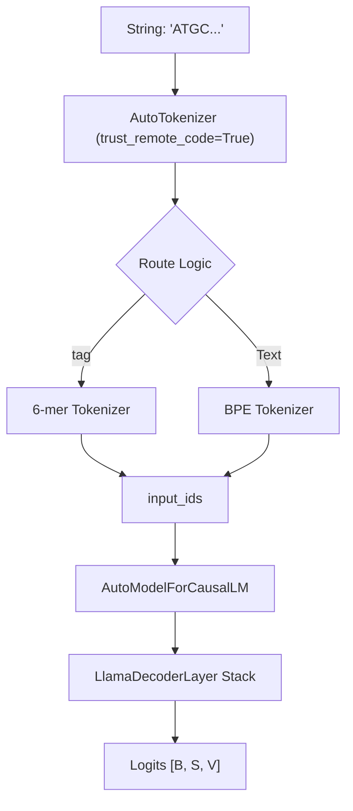
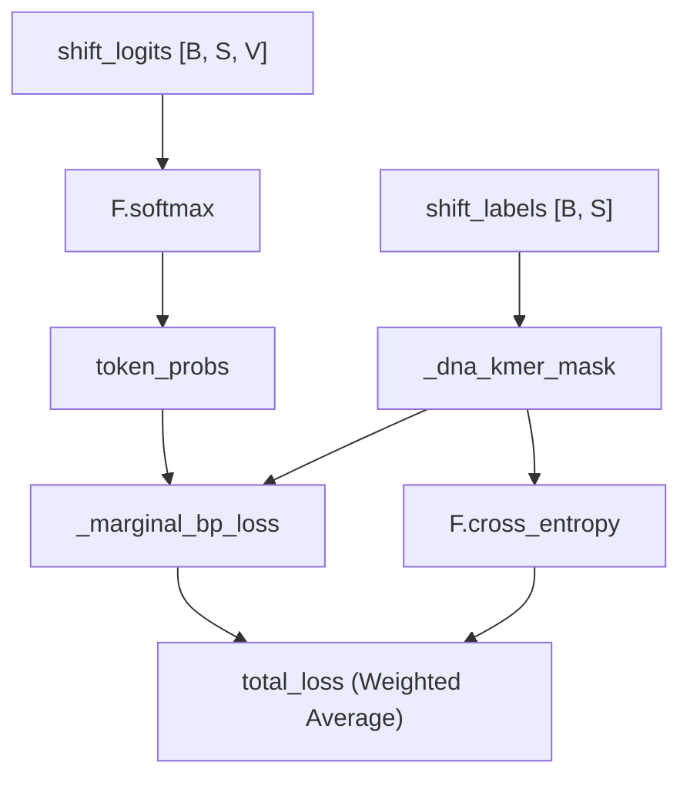

<!-- source: DeepWiki mcp.deepwiki.com · repo huggingface/carbon · page 1.1 Model Family and Architecture · fetched 2026-10-26 -->

# Model Family and Architecture

<details>
<summary>Relevant source files</summary>

The following files were used as context for generating this wiki page:

- [.gitignore](.gitignore)
- [LICENSE](LICENSE)
- [README.md](README.md)
- [clustering/README.md](clustering/README.md)
- [finetuning/finetune_sft.py](finetuning/finetune_sft.py)
- [finetuning/fns_trainer.py](finetuning/fns_trainer.py)
- [pyproject.toml](pyproject.toml)
- [uv.lock](uv.lock)

</details>


This page provides a detailed technical description of the Carbon model family, including its architectural components, the hybrid tokenization system, and the specialized loss functions used during pretraining and fine-tuning.

## Model Family Scales

Carbon is a family of causal language models trained on 1T tokens (approximately 6T DNA base pairs) [README.md:85-86](). The family consists of three distinct scales designed for different computational requirements and performance targets.

| Model | Params | Role / Performance |
|---|---|---|
| `HuggingFaceBio/Carbon-500M` | 500M | Optimized as a draft model for speculative decoding [README.md:30](). |
| `HuggingFaceBio/Carbon-3B` | 3B | **Flagship.** Matches or beats Evo2 7B performance [README.md:31](). |
| `HuggingFaceBio/Carbon-8B` | 8B | Largest variant for maximum performance on complex tasks [README.md:32](). |

Sources: [README.md:28-32]()

## Architectural Backbone

The Carbon models utilize the `LlamaDecoderLayer` as their fundamental building block [README.md:15](). This architecture follows the standard transformer-based causal language modeling paradigm.

### Hybrid Tokenizer and Routing
Carbon employs a **hybrid tokenizer** that allows the model to process both natural language (English) and genomic data (DNA) within the same sequence [README.md:34-35]().

*   **BPE Mode:** Standard Byte-Pair Encoding for English text [README.md:34]().
*   **6-mer Mode:** Fixed-length 6-mer tokenization for DNA sequences [README.md:34-35]().

The transition between these modes is handled by a **`<dna>` tag routing mechanism**. When the tokenizer encounters a `<dna>` tag, it switches into 6-mer mode for the subsequent genomic input [README.md:72-74](). During fine-tuning or inference, sequences are typically wrapped as `<dna>{sequence}</dna>` [finetuning/finetune_sft.py:88-89]().

### Data Flow: Tokenization and Model Input
The following diagram illustrates how the `AutoTokenizer` and model components interact to process genomic data.

**Diagram: Carbon Tokenization and Input Flow**

Sources: [README.md:34-37](), [README.md:61-75](), [finetuning/finetune_sft.py:88-93]()

## Pretraining and Hybrid Loss

Carbon was trained using a specialized fork: `huggingface/Megatron-LM-Carbon` [README.md:103-104](). To bridge the gap between coarse 6-mer tokenization and single-nucleotide resolution, the models utilize a **Hybrid Loss** [README.md:107]().

### FNSTrainer and Base-Pair Level Loss
During fine-tuning, the `FNSTrainer` class implements this logic by calculating loss at the nucleotide level rather than the token level for DNA segments [finetuning/fns_trainer.py:6-7]().

1.  **Token Classification:** The trainer identifies tokens as DNA k-mers, DNA special tokens (`<dna>`, `</dna>`), or BPE tokens [finetuning/fns_trainer.py:38-42]().
2.  **Marginal BP Loss:** For 6-mer tokens, it calculates a marginal base-pair loss by summing the probabilities of all 6-mer tokens that contain a specific nucleotide at a given position [finetuning/fns_trainer.py:129-153]().
3.  **Weighted Combination:** The final loss is a weighted average of the base-pair level loss (for k-mers) and standard cross-entropy loss (for BPE and special tokens) [finetuning/fns_trainer.py:68-75]().

**Diagram: Loss Computation in FNSTrainer**

Sources: [finetuning/fns_trainer.py:19-82](), [finetuning/fns_trainer.py:129-155]()

## Loading and Inference Patterns

Carbon models require `trust_remote_code=True` to initialize the custom hybrid tokenizer and configurations [README.md:65-68]().

### Hugging Face Loading Example
```python
from transformers import AutoModelForCausalLM, AutoTokenizer

model_id = "HuggingFaceBio/Carbon-3B"
tok = AutoTokenizer.from_pretrained(model_id, trust_remote_code=True)
model = AutoModelForCausalLM.from_pretrained(
  model_id, 
  trust_remote_code=True,
  torch_dtype="bfloat16"
).to("cuda")
```
Sources: [README.md:61-70]()

### Embedding Representation
Carbon-3B organizes sequences into biologically meaningful structures in its hidden states.
*   **Separator Embeddings:** Extracted from the `</dna>` token; captures genome-level and taxonomic structure [clustering/README.md:11-13]().
*   **Content-Token Embeddings:** Extracted from the final DNA 6-mer; captures local state such as **strand orientation** and **codon phase** [clustering/README.md:11-14]().

Sources: [clustering/README.md:9-16]()

## Technical Requirements
*   **Python:** `==3.12.*` [uv.lock:3](), [pyproject.toml:9]().
*   **Environment Management:** Uses `uv` for dependency resolution [README.md:41-50]().
*   **Core Dependencies:** `vllm==0.19.1`, `transformers`, `accelerate>=1.13.0` [pyproject.toml:11-17]().
*   **Hardware:** Optimized for `bfloat16` precision on NVIDIA GPUs [README.md:69]().

Sources: [pyproject.toml:9-17](), [uv.lock:3](), [README.md:41-50]()

---

