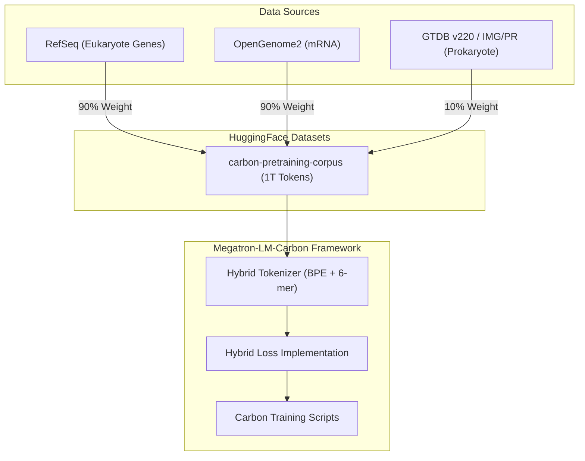
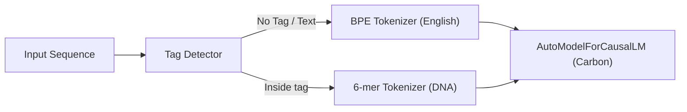

<!-- source: DeepWiki mcp.deepwiki.com · repo huggingface/carbon · page 1.2 Pretraining Corpus and Data Mixture · fetched 2026-10-26 -->

# Pretraining Corpus and Data Mixture

Relevant source files

The following files were used as context for generating this wiki page:

- [.gitignore](.gitignore)
- [LICENSE](LICENSE)
- [README.md](README.md)
- [pyproject.toml](pyproject.toml)
- [uv.lock](uv.lock)

This page documents the composition, rationale, and technical framework behind the **Carbon Pretraining Corpus**, a ~1 trillion token dataset (approximately 6 trillion DNA base pairs) used to train the Carbon family of genomic foundation models [README.md:4-6]().

## Dataset Composition

The Carbon models are trained on a curated mixture of DNA and RNA sequences designed to maximize performance on eukaryotic downstream tasks while maintaining broad biological coverage. The corpus is hosted as the [Carbon Pretraining Corpus](https://huggingface.co/datasets/HuggingFaceBio/carbon-pretraining-corpus) [README.md:88-89]().

### Data Sources and Domains

The mixture consists of three primary biological components:

| Component | Source | Description |
| :--- | :--- | :--- |
| **Eukaryote Genes** | RefSeq (via GENERator mix) | Functional genomic regions including animals, plants, fungi, and protists [README.md:91](). |
| **mRNA Transcripts** | OpenGenome2 | Processed, spliced mRNA sequences representing the expressed transcriptome [README.md:92](). |
| **Prokaryote Genomes** | GTDB v220 + IMG/PR | Long chromosomal chunks from bacteria and archaea [README.md:93-94](). |

### Mixture Rationale: The 90/10 Split

The pretraining mixture is **eukaryote-heavy by design** [README.md:97]().
*   **Eukaryote (90%)**: The primary target use case for Carbon is eukaryotic biology (e.g., human variant effect prediction, enhancer activity). This includes the Eukaryote gene and mRNA transcript components [README.md:97-98]().
*   **Prokaryote (10%)**: Included as a smaller fraction (~10%) to provide the model with a "base" of prokaryotic understanding. This share allows the model to be efficiently continually pretrained on specific prokaryotic species if required for specialized tasks [README.md:94-99]().

### Data Flow and Source Mapping

The following diagram bridges the biological data sources to the training infrastructure and code entities.

**Corpus-to-Training Mapping**

**Sources:** [README.md:88-108]()

## Megatron-LM-Carbon Framework

Carbon was trained using a specialized fork of Megatron-LM located at [huggingface/Megatron-LM-Carbon](https://github.com/huggingface/Megatron-LM-Carbon) [README.md:103-104]().

### Hybrid Loss Mechanism
The framework introduces a **Hybrid Loss** to bridge the gap between different resolutions in the sequence [README.md:107]():
1.  **Coarse 6-mer Tokenization**: Standard next-token prediction on the 6-mer tokens.
2.  **Single-Nucleotide Resolution**: Specialized loss components to ensure the model understands fine-grained genomic variations even when processing larger k-mer blocks [README.md:107]().

### DNA Routing and Tokenization
The pretraining data is processed using a hybrid tokenizer that switches modes based on special tags. During pretraining and subsequent inference, DNA sequences are wrapped in `<dna>` tags [README.md:34-37]().

*   **BPE Mode**: Used for any English text metadata (if present).
*   **6-mer Mode**: Activated by the `<dna>` tag to process genomic sequences [README.md:72-74]().

**Tokenizer Routing Logic**

**Sources:** [README.md:34-37](), [README.md:61-75]()

## Training Specifications

The pretraining process utilizes several architectural optimizations to handle the 1T token scale:

*   **Context Length Support**: The model is trained to handle long-range dependencies, as evidenced by evaluations like `Genome-NIAH` which test context lengths up to 786 kbp [README.md:124-125]().
*   **Model Scales**: The corpus was used to train the 500M (draft), 3B (flagship), and 8B parameter variants [README.md:28-32]().
*   **Environment**: Pretraining and evaluation require a Python 3.12+ environment with specific pins for `vllm==0.19.1` and `accelerate>=1.13.0` [pyproject.toml:9-17]().
*   **Precision**: Training and inference typically utilize `torch_dtype="bfloat16"` [README.md:69]().

**Sources:** [README.md:28-32](), [README.md:69-70](), [README.md:124-125](), [pyproject.toml:9-17]()

---

