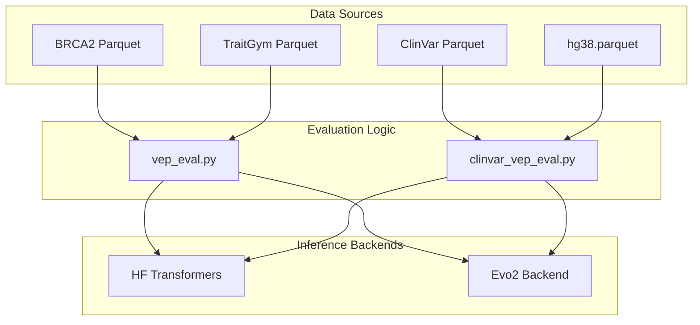
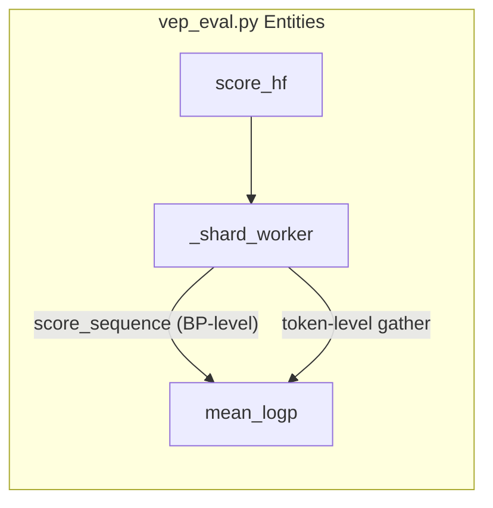
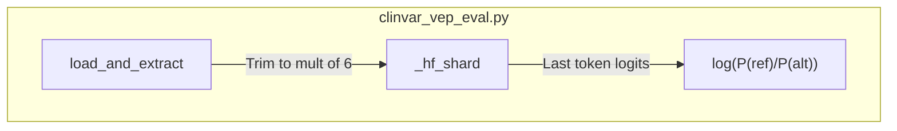

<!-- source: DeepWiki mcp.deepwiki.com · repo huggingface/carbon · page 2.1 Variant Effect Prediction (VEP) · fetched 2026-10-26 -->

# Variant Effect Prediction (VEP)

Relevant source files

The following files were used as context for generating this wiki page:

- [evaluation/clinvar_vep_eval.py](evaluation/clinvar_vep_eval.py)
- [evaluation/slurm/carbon-3B/clinvar.sbatch](evaluation/slurm/carbon-3B/clinvar.sbatch)
- [evaluation/slurm/carbon-3B/vep_brca2.sbatch](evaluation/slurm/carbon-3B/vep_brca2.sbatch)
- [evaluation/slurm/carbon-3B/vep_traitgym.sbatch](evaluation/slurm/carbon-3B/vep_traitgym.sbatch)
- [evaluation/slurm/evo2-1b/vep_brca2.sbatch](evaluation/slurm/evo2-1b/vep_brca2.sbatch)
- [evaluation/slurm/evo2-7b/clinvar.sbatch](evaluation/slurm/evo2-7b/clinvar.sbatch)
- [evaluation/slurm/evo2-7b/perturbation_tasks.sbatch](evaluation/slurm/evo2-7b/perturbation_tasks.sbatch)
- [evaluation/slurm/evo2-7b/vep_brca2.sbatch](evaluation/slurm/evo2-7b/vep_brca2.sbatch)
- [evaluation/slurm/evo2-7b/vep_traitgym.sbatch](evaluation/slurm/evo2-7b/vep_traitgym.sbatch)
- [evaluation/slurm/generator-v2-3b/vep_brca2.sbatch](evaluation/slurm/generator-v2-3b/vep_brca2.sbatch)
- [evaluation/vep_eval.py](evaluation/vep_eval.py)

Variant Effect Prediction (VEP) in the Carbon repository is a zero-shot evaluation framework designed to assess how well genomic foundation models can distinguish between benign and pathogenic Single Nucleotide Variants (SNVs). The framework supports two distinct scoring methodologies tailored to different biological contexts and dataset conventions: centered full-sequence log-likelihood deltas and right-end next-token marginalization.

### Core Evaluation Approaches

The system is split into two primary scripts based on the scoring recipe:

1.  **Full-Sequence Log-Likelihood Delta (`vep_eval.py`):** Used for BRCA2 and TraitGym. It calculates the difference in log-likelihood (LL) between a sequence containing the reference allele and one containing the variant allele, typically within an 8,192 bp window [evaluation/vep_eval.py:4-7]().
2.  **Next-Token Probability Marginalization (`clinvar_vep_eval.py`):** Used for ClinVar. It places the variant at the immediate right end of a long left-context (up to 48kb) and calculates the log-ratio of the probabilities for the reference vs. variant nucleotides [evaluation/clinvar_vep_eval.py:4-18]().

### VEP System Architecture

The following diagram illustrates how the evaluation scripts interact with the model backends and datasets.

**VEP Execution Flow**

Sources: [evaluation/vep_eval.py:9-17](), [evaluation/clinvar_vep_eval.py:68-74]()

---

### Centered Window Scoring (BRCA2, TraitGym)

The `vep_eval.py` script handles datasets where variants are evaluated within a fixed-width window (default 8,192 bp). It supports multi-GPU sharding via `_shard_worker` [evaluation/vep_eval.py:90-92]().

*   **Delta Scoring:** The score is defined as $\Delta = LL(\text{variant}) - LL(\text{reference})$ [evaluation/vep_eval.py:5]().
*   **Strand-Symmetric Averaging:** For datasets like TraitGym where the causal strand may be unknown, the `--rev_comp_avg` flag enables scoring both the forward and reverse-complement sequences, averaging the resulting deltas [evaluation/vep_eval.py:75-79]().
*   **Metrics:** The script reports AUROC (against Loss-of-Function labels) and Spearman correlation (against continuous functional scores) [evaluation/vep_eval.py:6-7]().

**Scoring Implementation Detail**

Sources: [evaluation/vep_eval.py:104-107](), [evaluation/vep_eval.py:135-146](), [evaluation/vep_eval.py:148-166]()

---

### Right-End Next-Token Scoring (ClinVar)

The `clinvar_vep_eval.py` script implements the "production recipe" used for Carbon's ClinVar benchmarks [evaluation/clinvar_vep_eval.py:2-5]().

*   **Context Alignment:** The script extracts a left-context window and trims it to a multiple of 6. This ensures the tokenizer boundary aligns exactly with the variant position for 6-mer tokenizers like Carbon's [evaluation/clinvar_vep_eval.py:112-118]().
*   **Marginalization:** Since the model predicts 6-mer tokens, the probability of a single nucleotide (e.g., 'A') is calculated by summing the probabilities of all 6-mer tokens in the vocabulary that start with that nucleotide [evaluation/clinvar_vep_eval.py:15-16]().
*   **Weighting:** Results are often calculated separately for `coding` and `non_coding` variants to provide a granular view of model performance [evaluation/slurm/carbon-3B/clinvar.sbatch:26-38]().

**ClinVar Marginalization Flow**

Sources: [evaluation/clinvar_vep_eval.py:93-125](), [evaluation/clinvar_vep_eval.py:128-158](), [evaluation/clinvar_vep_eval.py:15-18]()

---

### Dataset Preparation and Schemas

Both evaluation scripts rely on preprocessed Parquet files. While `vep_eval.py` expects a schema containing `ref_seq` and `var_seq` columns [evaluation/vep_eval.py:9-10](), `clinvar_vep_eval.py` dynamically extracts context from an `hg38.parquet` reference based on the variant's chromosome and position [evaluation/clinvar_vep_eval.py:93-111]().

For details on how these datasets are generated and the specific sourcing of BRCA2, TraitGym, and ClinVar data, see **[VEP Dataset Preparation](#2.1.1)**.

### Orchestration via SLURM

Evaluation is typically executed via SLURM scripts located in `evaluation/slurm/`. These scripts handle environment setup using `uv run --group evaluation` and manage multi-GPU resource allocation [evaluation/slurm/carbon-3B/vep_brca2.sbatch:15-28]().

| Task | Script | Default Context | GPUs |
| :--- | :--- | :--- | :--- |
| BRCA2 | `vep_brca2.sbatch` | 8,192 bp (centered) | 8 |
| TraitGym | `vep_traitgym.sbatch` | 8,192 bp (centered) | 8 |
| ClinVar | `clinvar.sbatch` | 24,000 bp (left) | 8 |

Sources: [evaluation/slurm/carbon-3B/vep_brca2.sbatch](), [evaluation/slurm/carbon-3B/vep_traitgym.sbatch](), [evaluation/slurm/carbon-3B/clinvar.sbatch]()

---

