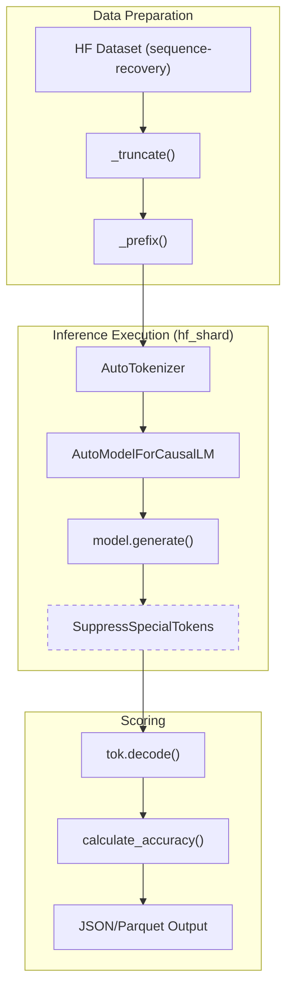
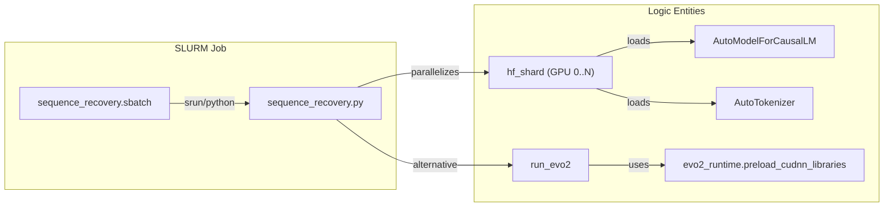

<!-- source: DeepWiki mcp.deepwiki.com · repo huggingface/carbon · page 2.2 Sequence Recovery · fetched 2026-10-26 -->

# Sequence Recovery

Relevant source files

The following files were used as context for generating this wiki page:

- [evaluation/scripts/benchmark_sequence_recovery_gen_len.py](evaluation/scripts/benchmark_sequence_recovery_gen_len.py)
- [evaluation/scripts/plot_sequence_recovery_sweep.py](evaluation/scripts/plot_sequence_recovery_sweep.py)
- [evaluation/sequence_recovery.py](evaluation/sequence_recovery.py)
- [evaluation/sequence_recovery_eval.py](evaluation/sequence_recovery_eval.py)
- [evaluation/sequence_recovery_eval.slurm](evaluation/sequence_recovery_eval.slurm)
- [evaluation/slurm/carbon-3B/sequence_recovery.sbatch](evaluation/slurm/carbon-3B/sequence_recovery.sbatch)
- [evaluation/slurm/carbon-500M/sequence_recovery.sbatch](evaluation/slurm/carbon-500M/sequence_recovery.sbatch)
- [evaluation/slurm/carbon-8B/sequence_recovery.sbatch](evaluation/slurm/carbon-8B/sequence_recovery.sbatch)
- [evaluation/slurm/evo2-1b/sequence_recovery.sbatch](evaluation/slurm/evo2-1b/sequence_recovery.sbatch)
- [evaluation/slurm/evo2-20b/sequence_recovery.sbatch](evaluation/slurm/evo2-20b/sequence_recovery.sbatch)
- [evaluation/slurm/evo2-40b/sequence_recovery.sbatch](evaluation/slurm/evo2-40b/sequence_recovery.sbatch)
- [evaluation/slurm/evo2-7b/sequence_recovery.sbatch](evaluation/slurm/evo2-7b/sequence_recovery.sbatch)
- [evaluation/slurm/generator-v2-1.2b/sequence_recovery.sbatch](evaluation/slurm/generator-v2-1.2b/sequence_recovery.sbatch)
- [evaluation/slurm/generator-v2-3b/sequence_recovery.sbatch](evaluation/slurm/generator-v2-3b/sequence_recovery.sbatch)
- [evaluation/submit_sequence_recovery_gen_len_sweep.sh](evaluation/submit_sequence_recovery_gen_len_sweep.sh)

Sequence Recovery is a zero-shot generative evaluation task designed to measure a genomic model's ability to accurately predict downstream DNA sequences given a preceding context. The model is provided with a fixed-length DNA sequence and tasked with generating the next $N$ tokens (or $M$ base pairs). Accuracy is calculated by comparing the generated nucleotides against the actual held-out sequence from the dataset on a per-base basis.

## Evaluation Methodology

The evaluation focuses on "exact-base recovery accuracy." For a given prompt, the model generates a continuation, and the accuracy is defined as the fraction of matching nucleotides at each position within the evaluation window (typically 30 bp).

### Key Metrics
*   **Per-Base Accuracy**: The sum of matching bases divided by the total length of the evaluation window `min(len(label), len(pred), seq_len)` [[evaluation/sequence_recovery.py:93-98]]().
*   **Overall Accuracy**: The mean accuracy across all samples in a dataset split [[evaluation/scripts/plot_sequence_recovery_sweep.py:94-94]]().
*   **By-Type Accuracy**: Accuracy broken down by taxonomic or genomic categories (e.g., fungi, invertebrate, plant, vertebrate_mammalian) [[evaluation/scripts/plot_sequence_recovery_sweep.py:182-192]]().

### Dataset Splits
The evaluation uses the `GenerTeam/sequence-recovery` dataset, which is partitioned into three primary splits [[evaluation/sequence_recovery.py:53-54]]():
1.  **Eukaryote**: High-complexity genomic data from eukaryotic organisms.
2.  **Bacteria**: Prokaryotic genomic sequences.
3.  **Others**: Additional genomic sequences not covered by the primary categories.

## Implementation Details

The suite consists of a production script for standard benchmarks and an extended evaluation script for long-rollout analysis.

### System Architecture and Data Flow

The following diagram illustrates the flow from raw DNA sequences in the dataset to the final accuracy metrics using the `hf` (HuggingFace) backend.

**Sequence Recovery Data Flow (HF Backend)**

**Sources:** [[evaluation/sequence_recovery.py:87-90]](), [[evaluation/sequence_recovery.py:101-144]]()

### Model Backends
The evaluation supports two primary inference backends [[evaluation/sequence_recovery.py:52-52]]():
1.  **HF (HuggingFace)**: Standard `transformers` implementation used for Carbon and GENERator models. It supports `add_dna_tag` for Carbon's hybrid architecture and `add_bos` for pure DNA models [[evaluation/sequence_recovery.py:79-84]]().
2.  **Evo2**: Uses the official `evo2` inference library via `evo2_runtime.py` [[evaluation/sequence_recovery.py:166-173]]().

### Token Management
To ensure valid DNA generation, the `SuppressSpecialTokens` class is used as a `LogitsProcessor`. It sets the scores of all special tokens (like `<pad>`, `<s>`, or `</dna>`) to `-inf` during the generation loop, forcing the model to only output content tokens [[evaluation/sequence_recovery.py:69-76]]().

## Script Components

### 1. `sequence_recovery.py` (Production)
The primary script for running standard 30 bp recovery benchmarks. It uses `ProcessPoolExecutor` to shard the workload across all available GPUs on a node [[evaluation/sequence_recovery.py:148-163]]().

**Key Functions:**
*   `hf_shard`: Manages the model loading, tokenization, and generation for a specific GPU shard [[evaluation/sequence_recovery.py:101-107]]().
*   `_truncate`: Ensures the input context is truncated from the left to fit `max_seq_len` while maintaining 6-mer alignment for Carbon's tokenizer [[evaluation/sequence_recovery.py:87-90]]().

### 2. `sequence_recovery_eval.py` (Extended/Legacy)
An advanced version of the script supporting "Long-rollout" scoring. It allows for sweeps across different generation lengths to analyze how model accuracy decays over long sequences [[evaluation/sequence_recovery_eval.py:17-30]](). It also introduces support for `vLLM` and `continuous` batching via `ContinuousBatchingConfig` [[evaluation/sequence_recovery_eval.py:138-153]]() [[evaluation/sequence_recovery_eval.py:172-178]]().

**Accuracy Modes:**
*   `fixed_bp`: Standard evaluation against a fixed window (e.g., 30 bp) [[evaluation/sequence_recovery_eval.py:3-15]]().
*   `prediction_length`: Derives a tail label from the generated window to score longer sequences [[evaluation/sequence_recovery_eval.py:17-30]]().

### 3. Generation-Length Sweeps
Tooling is provided to automate the study of recovery accuracy vs. generation length (e.g., 5, 10, 20... 2560 tokens).

*   **`submit_sequence_recovery_gen_len_sweep.sh`**: Orchestrates SLURM jobs across a range of `GEN_LENS`.
*   **`plot_sequence_recovery_sweep.py`**: Aggregates the resulting JSON summaries and generates performance curves [[evaluation/scripts/plot_sequence_recovery_sweep.py:1-20]](). It distinguishes between labels sourced from the dataset versus those derived from the sequence tail [[evaluation/scripts/plot_sequence_recovery_sweep.py:155-158]]().

## SLURM Orchestration

Standardized SBATCH scripts are provided for Carbon model scales. These scripts typically use 8 GPUs on a single node and utilize the `uv` environment manager.

| Model | Script Path |
| :--- | :--- |
| Carbon-500M | `evaluation/slurm/carbon-500M/sequence_recovery.sbatch` [[evaluation/slurm/carbon-500M/sequence_recovery.sbatch:1-30]]() |
| Carbon-3B | `evaluation/slurm/carbon-3B/sequence_recovery.sbatch` [[evaluation/slurm/carbon-3B/sequence_recovery.sbatch:1-30]]() |
| Carbon-8B | `evaluation/slurm/carbon-8B/sequence_recovery.sbatch` [[evaluation/slurm/carbon-8B/sequence_recovery.sbatch:1-30]]() |
| Evo2 (1B/7B/20B/40B) | `evaluation/slurm/evo2-*/sequence_recovery.sbatch` [[evaluation/slurm/evo2-40b/sequence_recovery.sbatch:1-30]]() |

**Execution Mapping**

**Sources:** [[evaluation/slurm/carbon-3B/sequence_recovery.sbatch:24-29]](), [[evaluation/sequence_recovery.py:101-114]](), [[evaluation/sequence_recovery.py:166-173]]()

## Configuration Parameters

| Parameter | Description |
| :--- | :--- |
| `--max_seq_len` | Context length in base pairs (default: 6144) [[evaluation/sequence_recovery.py:56-56]](). |
| `--gen_len` | Number of tokens to generate for HF models (default: 5, approx 30 bp) [[evaluation/sequence_recovery.py:57-57]](). |
| `--gen_len_bp` | Number of base pairs to generate for Evo2 models (default: 30) [[evaluation/sequence_recovery.py:58-58]](). |
| `--add_dna_tag` | Prepends the `<dna>` tag required for Carbon hybrid models [[evaluation/sequence_recovery.py:61-61]](). |
| `--add_bos` | Prepends the `<s>` tag for pure DNA models like GENERator [[evaluation/sequence_recovery.py:62-62]](). |
| `--shard_idx` / `--n_shards` | Allows manual sharding of the dataset across multiple nodes [[evaluation/sequence_recovery.py:64-65]](). |

**Sources:** [[evaluation/sequence_recovery.py:48-66]](), [[evaluation/sequence_recovery_eval.py:52-112]]()

---

