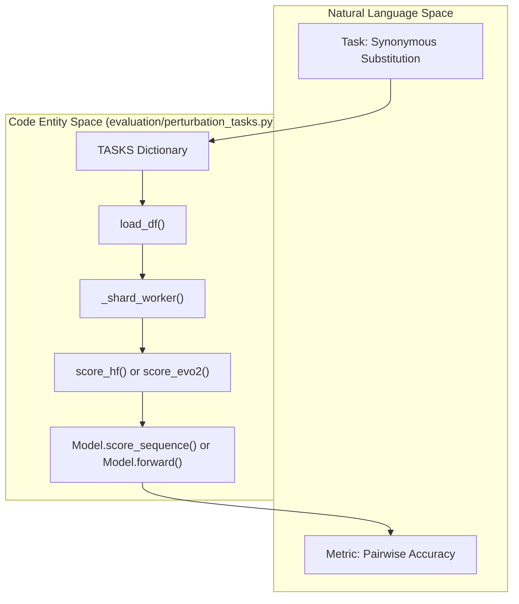
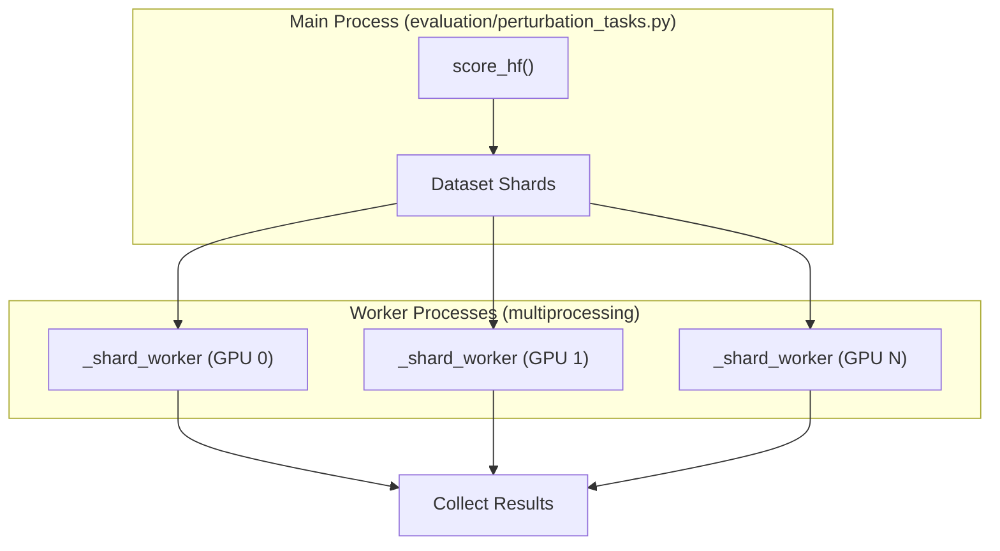

<!-- source: DeepWiki mcp.deepwiki.com · repo huggingface/carbon · page 2.3 Perturbation Tasks · fetched 2026-10-26 -->

# Perturbation Tasks

Relevant source files

The following files were used as context for generating this wiki page:

- [evaluation/perturbation_tasks.py](evaluation/perturbation_tasks.py)
- [evaluation/slurm/carbon-3B/perturbation_tasks.sbatch](evaluation/slurm/carbon-3B/perturbation_tasks.sbatch)
- [evaluation/slurm/carbon-8B/clinvar.sbatch](evaluation/slurm/carbon-8B/clinvar.sbatch)
- [evaluation/slurm/carbon-8B/genome_niah.sbatch](evaluation/slurm/carbon-8B/genome_niah.sbatch)
- [evaluation/slurm/carbon-8B/perturbation_tasks.sbatch](evaluation/slurm/carbon-8B/perturbation_tasks.sbatch)
- [evaluation/slurm/evo2-1b/clinvar.sbatch](evaluation/slurm/evo2-1b/clinvar.sbatch)
- [evaluation/slurm/evo2-1b/perturbation_tasks.sbatch](evaluation/slurm/evo2-1b/perturbation_tasks.sbatch)
- [evaluation/slurm/evo2-1b/vep_traitgym.sbatch](evaluation/slurm/evo2-1b/vep_traitgym.sbatch)
- [evaluation/slurm/evo2-20b/clinvar.sbatch](evaluation/slurm/evo2-20b/clinvar.sbatch)
- [evaluation/slurm/evo2-20b/perturbation_tasks.sbatch](evaluation/slurm/evo2-20b/perturbation_tasks.sbatch)
- [evaluation/slurm/evo2-40b/clinvar.sbatch](evaluation/slurm/evo2-40b/clinvar.sbatch)
- [evaluation/slurm/evo2-40b/perturbation_tasks.sbatch](evaluation/slurm/evo2-40b/perturbation_tasks.sbatch)
- [evaluation/slurm/generator-v2-3b/perturbation_tasks.sbatch](evaluation/slurm/generator-v2-3b/perturbation_tasks.sbatch)

The perturbation tasks evaluation, implemented in `evaluation/perturbation_tasks.py`, assesses a model's ability to discriminate between natural biological sequences and synthetically perturbed variants [evaluation/perturbation_tasks.py:1-6](). Unlike Variant Effect Prediction (VEP), which focuses on single-nucleotide substitutions, these tasks involve structural or multi-codon changes [evaluation/perturbation_tasks.py:4-6]().

## Overview of Tasks

The evaluation suite utilizes the `HuggingFaceBio/carbon-perturbation-bench` dataset and includes four primary tasks defined in the `TASKS` dictionary [evaluation/perturbation_tasks.py:18-19, 57-62]().

| Task Name | Biological Context | Perturbation Method |
| :--- | :--- | :--- |
| `motif_human` | Human Coding Sequence (CDS) | Insertion of a tiled CAG repeat (10 consecutive CAG codons), creating a synthetic polyglutamine expansion [evaluation/perturbation_tasks.py:9-12](). |
| `syn_human` | Human CDS | Synonymous codon substitution: replacing codons with synonyms encoding the same amino acid [evaluation/perturbation_tasks.py:14-16](). |
| `syn_mouse` | Mouse CDS | Synonymous codon substitution using mouse-specific genomic contexts [evaluation/perturbation_tasks.py:14-16, 60](). |
| `promoter_revcomp` | Human Promoters | Reverse-complementing the promoter sequence [evaluation/perturbation_tasks.py:38, 61](). |

The primary metric for these tasks is **pairwise discrimination accuracy**, calculated as the mean frequency with which the model assigns a higher log-likelihood (LL) to the original sequence compared to the perturbed version [evaluation/perturbation_tasks.py:20]().

## System Architecture and Data Flow

The evaluation pipeline supports multiple backends and utilizes multi-GPU sharding via `multiprocessing` to accelerate scoring across large datasets [evaluation/perturbation_tasks.py:45, 178-185]().

### Data Flow Diagram
This diagram illustrates the transition from high-level task definitions to the specific code entities responsible for processing and scoring.

Sources: [evaluation/perturbation_tasks.py:57-62](), [evaluation/perturbation_tasks.py:85-89](), [evaluation/perturbation_tasks.py:91-93](), [evaluation/perturbation_tasks.py:174-176]()

### Execution Logic and Multi-GPU Sharding

The script uses `multiprocessing` to shard the dataset across available GPUs. Each worker process initializes its own model instance on a dedicated CUDA device [evaluation/perturbation_tasks.py:91-103]().

Sources: [evaluation/perturbation_tasks.py:91-95](), [evaluation/perturbation_tasks.py:174-188]()

## Scoring Methodologies

The evaluation dynamically selects between two scoring strategies based on the model's capabilities:

### 1. BP-level Scoring
If the model object possesses a `score_sequence` method, the script uses it for base-pair (BP) level scoring [evaluation/perturbation_tasks.py:105-107](). This is typical for models like Carbon that handle their own tokenization and log-prob aggregation internally. The script computes the mean log-probability per base by taking the mean of the log-transformed probabilities returned by `m.score_sequence(seqs)` [evaluation/perturbation_tasks.py:136-147]().

### 2. Token-level Scoring
For standard HuggingFace causal language models (e.g., GENERator), the script performs manual token-level scoring [evaluation/perturbation_tasks.py:109-110, 149-150]().
*   **Preprocessing**: Sequences are truncated to multiples of the k-mer size (6 for Carbon and GENERator) and prefixed with a BOS token (`<dna>` for Carbon, `<s>` for GENERator) [evaluation/perturbation_tasks.py:112-117, 130-133]().
*   **Computation**: The script calculates `log_softmax` on logits from `m(input_ids=ids, attention_mask=attn).logits`, gathers the log-probs for target tokens, and computes the masked mean log-prob per token [evaluation/perturbation_tasks.py:155-164]().

Sources: [evaluation/perturbation_tasks.py:105-167]()

## SLURM Orchestration

Evaluations are typically orchestrated via SLURM sbatch scripts located in `evaluation/slurm/`. These scripts chain multiple tasks together and handle environment setup using `uv run --group evaluation` [evaluation/slurm/carbon-3B/perturbation_tasks.sbatch:15, 29-40]().

### Configuration Patterns
*   **Carbon Models**: Use the `hf` backend on 8 GPUs, typically with `bf16` precision [evaluation/slurm/carbon-3B/perturbation_tasks.sbatch:8, 34-39]().
*   **Evo2 Models**: Use the `evo2` backend. Larger variants like `evo2_40b` use a single model-parallel instance across all 8 GPUs with `batch_size 1`, whereas smaller variants like `evo2_1b` use independent shards [evaluation/slurm/evo2-40b/perturbation_tasks.sbatch:36-39](), [evaluation/slurm/evo2-1b/perturbation_tasks.sbatch:8, 35-39]().
*   **GENERator Models**: Use the `hf` backend and follow the same multi-GPU chaining logic as Carbon [evaluation/slurm/generator-v2-3b/perturbation_tasks.sbatch:20, 34-40]().

Sources: [evaluation/slurm/carbon-3B/perturbation_tasks.sbatch:1-41](), [evaluation/slurm/evo2-40b/perturbation_tasks.sbatch:1-41](), [evaluation/slurm/generator-v2-3b/perturbation_tasks.sbatch:1-41]()

---

