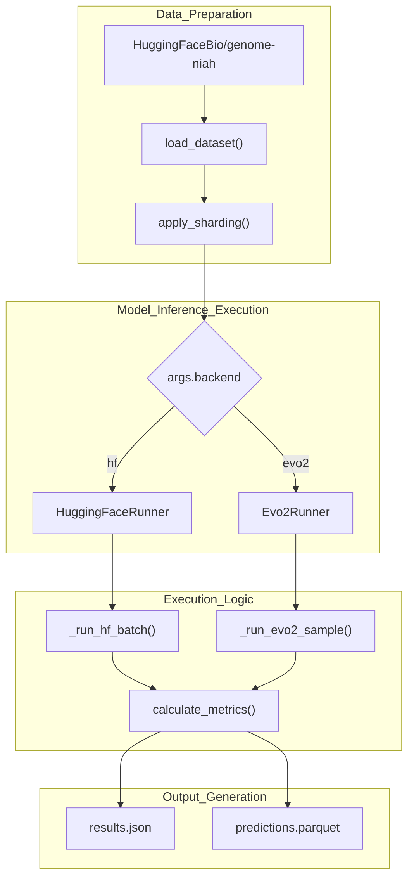
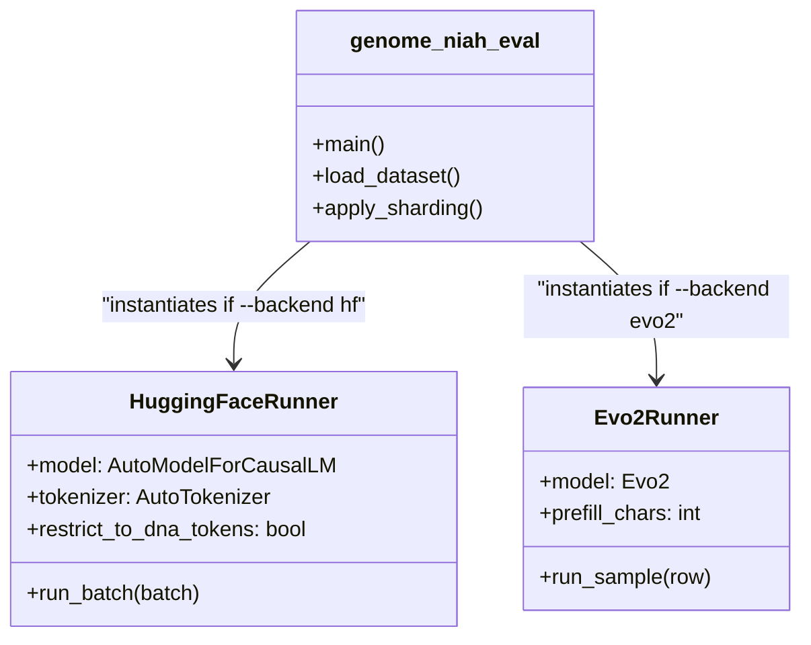

<!-- source: DeepWiki mcp.deepwiki.com · repo huggingface/carbon · page 2.4 Genome Needle-In-A-Haystack (NIAH) · fetched 2026-10-26 -->

# Genome Needle-In-A-Haystack (NIAH)

<details>
<summary>Relevant source files</summary>

The following files were used as context for generating this wiki page:

- [evaluation/genome_niah_eval.py](evaluation/genome_niah_eval.py)
- [evaluation/slurm/carbon-3B/genome_niah.sbatch](evaluation/slurm/carbon-3B/genome_niah.sbatch)
- [evaluation/slurm/carbon-500M/clinvar.sbatch](evaluation/slurm/carbon-500M/clinvar.sbatch)
- [evaluation/slurm/carbon-500M/genome_niah.sbatch](evaluation/slurm/carbon-500M/genome_niah.sbatch)
- [evaluation/slurm/evo2-1b/genome_niah.sbatch](evaluation/slurm/evo2-1b/genome_niah.sbatch)
- [evaluation/slurm/evo2-20b/genome_niah.sbatch](evaluation/slurm/evo2-20b/genome_niah.sbatch)
- [evaluation/slurm/evo2-40b/genome_niah.sbatch](evaluation/slurm/evo2-40b/genome_niah.sbatch)
- [evaluation/slurm/evo2-7b/genome_niah.sbatch](evaluation/slurm/evo2-7b/genome_niah.sbatch)
- [evaluation/slurm/generator-v2-1.2b/clinvar.sbatch](evaluation/slurm/generator-v2-1.2b/clinvar.sbatch)
- [evaluation/slurm/generator-v2-1.2b/genome_niah.sbatch](evaluation/slurm/generator-v2-1.2b/genome_niah.sbatch)
- [evaluation/slurm/generator-v2-1.2b/perturbation_tasks.sbatch](evaluation/slurm/generator-v2-1.2b/perturbation_tasks.sbatch)
- [evaluation/slurm/generator-v2-1.2b/vep_brca2.sbatch](evaluation/slurm/generator-v2-1.2b/vep_brca2.sbatch)
- [evaluation/slurm/generator-v2-1.2b/vep_traitgym.sbatch](evaluation/slurm/generator-v2-1.2b/vep_traitgym.sbatch)
- [evaluation/slurm/generator-v2-3b/clinvar.sbatch](evaluation/slurm/generator-v2-3b/clinvar.sbatch)
- [evaluation/slurm/generator-v2-3b/genome_niah.sbatch](evaluation/slurm/generator-v2-3b/genome_niah.sbatch)

</details>


The Genome Needle-In-A-Haystack (NIAH) evaluation measures a model's ability to retrieve specific information from extremely long DNA contexts. It simulates a "key-value" retrieval task where a 24 bp "needle" (the value) is hidden within a "haystack" of real genomic sequence. The model is prompted with the haystack followed by a specific 24 bp "key", and it must correctly generate the associated value.

### System Architecture and Data Flow

The evaluation is implemented in `evaluation/genome_niah_eval.py` [evaluation/genome_niah_eval.py:1-54](). It supports two primary inference backends: `hf` (HuggingFace Transformers) for Carbon and GENERator models, and `evo2` (using the official `vortex` library) for Arc Institute models [evaluation/genome_niah_eval.py:17-26]().

#### Data Retrieval and Sharding
The benchmark processes datasets hosted on the HuggingFace Hub (`HuggingFaceBio/genome-niah`) or local parquet files [evaluation/genome_niah_eval.py:82-83](). Because long-context evaluation (up to 128k tokens or 786 kbp) is computationally expensive, the script implements a sharding mechanism via `apply_sharding` to distribute a single (task, context-length) cell across multiple compute nodes [evaluation/genome_niah_eval.py:158-167]().

Title: Genome NIAH Evaluation Data Flow

Sources: [evaluation/genome_niah_eval.py:141-155](), [evaluation/genome_niah_eval.py:158-175]()

### Task Definitions and Difficulty

The benchmark defines four tasks that increase in difficulty by introducing "near-duplicate" distractors. These distractors are sequences similar to the "key" but associated with different values, testing the model's precision in high-entropy long-context scenarios [evaluation/genome_niah_eval.py:8-12]().

| Task Name | Distractors | Key Identity | Difficulty |
| :--- | :--- | :--- | :--- |
| `niah` | 0 | N/A | Baseline retrieval |
| `neardup_d4` | 8 | 83% (Δ=4 bp) | Moderate |
| `neardup_d2` | 8 | 92% (Δ=2 bp) | High |
| `neardup_d1` | 8 | 96% (Δ=1 bp) | Discriminator level |

The context lengths (`--ctx`) are measured in Carbon tokens (6 bp per token), ranging from 4,096 tokens (24.5 kbp) up to 131,072 tokens (786.4 kbp) [evaluation/genome_niah_eval.py:14-15](), [evaluation/genome_niah_eval.py:86-88]().

Sources: [evaluation/genome_niah_eval.py:8-15](), [evaluation/genome_niah_eval.py:125-139]()

### Implementation Details

#### Haystack Construction and Scaling
The haystack is constructed by taking real genomic sequences and inserting the needle at controlled depths. For Carbon models, the `--add_dna_tag` flag prepends the `<dna>` routing tag [evaluation/genome_niah_eval.py:93-94](). To handle lengths beyond the 32k training window, the `--with_yarn` flag enables YaRN (Yet another RoPE extension) rope scaling for contexts up to 128k tokens [evaluation/genome_niah_eval.py:91-92]().

#### Metrics
The evaluation tracks four primary metrics [evaluation/genome_niah_eval.py:32-37]():
1.  **`gen_exact_match`**: Boolean indicating if the greedy-decoded 24 bp value exactly matches the ground truth label.
2.  **`gen_base_accuracy`**: Per-base accuracy of the decoded sequence.
3.  **`ll_correct`**: (HF backend only) Binary check if the log-likelihood of the correct sequence is higher than an incorrect sequence.
4.  **`ll_margin`**: The difference in log-likelihood between the positive and negative sequences.

Sources: [evaluation/genome_niah_eval.py:32-37](), [evaluation/genome_niah_eval.py:91-95]()

### Inference Backends

The codebase abstracts model interaction through a `Runner` pattern, specifically `HuggingFaceRunner` and `Evo2Runner`.

Title: NIAH Backend Abstraction


*   **HF Backend**: Uses `transformers` with support for `flash_attention_2` and `sdpa` [evaluation/genome_niah_eval.py:100-101](). It includes a specialized `--restrict_to_dna_tokens` flag for Carbon hybrid models to mask non-DNA tokens during generation using the model's `dna_config.json` [evaluation/genome_niah_eval.py:96-99]().
*   **Evo2 Backend**: Utilizes the `vortex` library for distributed inference across multiple GPUs [evaluation/genome_niah_eval.py:20-21](). It implements a `prefill_chars` strategy where the haystack is processed in chunks before switching to 1-by-1 decoding [evaluation/genome_niah_eval.py:104-105]().

Sources: [evaluation/genome_niah_eval.py:77-105](), [evaluation/genome_niah_eval.py:17-26]()

### SLURM Orchestration

Due to the extreme latency of long-context retrieval (e.g., a 128k context sample can take up to 14 hours on Evo2), the repository provides SLURM `.sbatch` templates for sharding the workload [evaluation/slurm/evo2-7b/genome_niah.sbatch:14-15]().

| Model | Batch Script | Default Backend | Context Limits |
| :--- | :--- | :--- | :--- |
| Carbon-3B | `evaluation/slurm/carbon-3B/genome_niah.sbatch` | `hf` | Up to 128k (with YaRN) |
| Carbon-500M | `evaluation/slurm/carbon-500M/genome_niah.sbatch` | `hf` | Up to 128k (with YaRN) |
| GENERator-v2 | `evaluation/slurm/generator-v2-3b/genome_niah.sbatch` | `hf` | Native 16k |
| Evo2-7B | `evaluation/slurm/evo2-7b/genome_niah.sbatch` | `evo2` | Up to 128k |
| Evo2-40B | `evaluation/slurm/evo2-40b/genome_niah.sbatch` | `evo2` | Up to 128k |

Example command for a full sweep at 32k context using 6 shards on Evo2-7B:
```bash
for SHARD in 0 1 2 3 4 5; do
  SHARD=$SHARD NSHARDS=6 CTX=32768 sbatch evaluation/slurm/evo2-7b/genome_niah.sbatch
done
```

Sources: [evaluation/slurm/evo2-7b/genome_niah.sbatch:26-29](), [evaluation/slurm/carbon-3B/genome_niah.sbatch:11-22](), [evaluation/slurm/generator-v2-3b/genome_niah.sbatch:11-16]()

---

