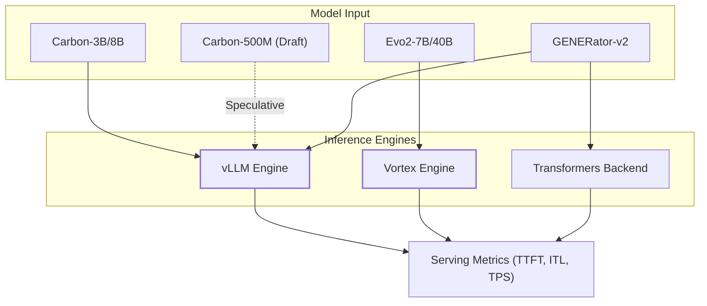

<!-- source: DeepWiki mcp.deepwiki.com · repo huggingface/carbon · page 2.5 Inference Backends and Serving Benchmarks · fetched 2026-10-26 -->

# Inference Backends and Serving Benchmarks

<details>
<summary>Relevant source files</summary>

The following files were used as context for generating this wiki page:

- [evaluation/evo2_runtime.py](evaluation/evo2_runtime.py)
- [evaluation/scripts/benchmark_evo2_serving.py](evaluation/scripts/benchmark_evo2_serving.py)
- [evaluation/scripts/benchmark_generator_transformers_serving.py](evaluation/scripts/benchmark_generator_transformers_serving.py)
- [evaluation/scripts/run_serving_benchmarks.py](evaluation/scripts/run_serving_benchmarks.py)

</details>


The Carbon project supports multiple inference backends to facilitate both high-throughput production serving and comparative benchmarking against existing genomic foundation models like Evo2 and GENERator. The codebase includes specialized orchestration scripts to measure serving metrics such as Time To First Token (TTFT), Inter-Token Latency (ITL), and total throughput across different hardware configurations and model scales.

## Inference Backends

Carbon supports two primary execution paths for inference, depending on the model architecture and the desired serving framework.

### Hugging Face & vLLM (Carbon / GENERator)
Carbon models are built on the `LlamaDecoderLayer` architecture [evaluation/scripts/run_serving_benchmarks.py:26-26](), making them natively compatible with the **vLLM** engine. This backend is used for production serving and speculative decoding.
*   **Architecture Override:** When serving via vLLM, the `LlamaForCausalLM` architecture is often forced to avoid attention-name collisions in speculative decoding [evaluation/scripts/run_serving_benchmarks.py:129-137]().
*   **Speculative Decoding:** Carbon-3B or Carbon-8B can be served with **Carbon-500M** as a draft model to accelerate generation [evaluation/scripts/run_serving_benchmarks.py:24-25]().

### Vortex / Evo2 Backend
Models from the Evo2 family utilize the **Vortex** inference engine.
*   **Evo2 Runtime:** To ensure compatibility with CUDA environments, the helper `preload_cudnn_libraries` in `evo2_runtime.py` explicitly loads cuDNN shared objects (e.g., `libcudnn_ops.so.9`, `libcudnn_cnn.so.9`) into the global symbol table using `ctypes.CDLL` [evaluation/evo2_runtime.py:6-34]().
*   **Vortex Generation:** The `benchmark_evo2_serving.py` script interfaces with `vortex.model.generation.Generator` to perform inference [evaluation/scripts/benchmark_evo2_serving.py:167-178]().

### Backend Comparison Data Flow
The following diagram illustrates how different model families are routed to their respective inference engines within the benchmarking suite.

**Model to Backend Routing**

**Sources:** [evaluation/scripts/run_serving_benchmarks.py:60-77](), [evaluation/scripts/benchmark_evo2_serving.py:166-180](), [evaluation/scripts/benchmark_generator_transformers_serving.py:212-229]()

---

## Serving Benchmarks

The repository provides a suite of scripts in `evaluation/scripts/` to measure real-world serving performance. These tools simulate a production environment by calculating latencies and throughputs.

### Core Benchmarking Tools
1.  **`run_serving_benchmarks.py`**: The primary orchestrator. It manages the lifecycle of vLLM servers, handles GPU allocation, and executes requests against the served endpoints [evaluation/scripts/run_serving_benchmarks.py:1-202]().
2.  **`benchmark_evo2_serving.py`**: A specialized script for the Evo2/Vortex backend that mimics vLLM's metric reporting (TTFT, ITL) for fair comparison [evaluation/scripts/benchmark_evo2_serving.py:19-91]().
3.  **`benchmark_generator_transformers_serving.py`**: Benchmarks the GENERator model using the native Hugging Face Transformers library [evaluation/scripts/benchmark_generator_transformers_serving.py:46-87]().

### Key Metrics Tracked
The benchmarking suite records the following fields for every run [evaluation/scripts/run_serving_benchmarks.py:29-57]():
*   **TTFT (Time To First Token):** Latency from request to the first generated token.
*   **TPOT (Time Per Output Token):** Average time for each subsequent token.
*   **ITL (Inter-Token Latency):** The time delta between consecutive tokens [evaluation/scripts/benchmark_evo2_serving.py:207-210]().
*   **Throughput:** Requests per second and tokens per second.

### Speculative Decoding Configuration
The system supports speculative decoding, which uses a smaller "draft" model to predict multiple tokens that the larger "target" model then verifies in parallel.
*   **Draft Model:** Defaults to `HuggingFaceBio/Carbon-500M` [evaluation/scripts/run_serving_benchmarks.py:25-25]().
*   **Speculative Tokens:** Configurable via `--carbon-speculative-tokens`, typically testing 2, 4, or 8 tokens [evaluation/scripts/run_serving_benchmarks.py:139-143]().

**Inference Benchmarking Class Interaction**
```mermaid
classDiagram
    class RunSpec {
        +str name
        +str backend
        +str model
        +str draft_model
        +int num_speculative_tokens
        +list server_extra_args
    }
    class benchmark_evo2_serving {
        +load_evo2_model()
        +run_one_request()
        +synchronize_cuda()
    }
    class run_serving_benchmarks {
        +parse_args()
        +launch_vllm_server()
        +collect_metrics()
    }
    class KmerTokenizer {
        +encode(text)
        +decode(token_ids)
    }

    run_serving_benchmarks ..> RunSpec : "creates"
    benchmark_evo2_serving ..> KmerTokenizer : "uses for GENERator"
    benchmark_evo2_serving --> "vortex.model.generation.Generator" : "calls generate()"
```
**Sources:** [evaluation/scripts/run_serving_benchmarks.py:60-77](), [evaluation/scripts/benchmark_evo2_serving.py:152-163](), [evaluation/scripts/benchmark_generator_transformers_serving.py:148-175](), [evaluation/scripts/benchmark_evo2_serving.py:167-178]()

---

## Implementation Details

### Evo2 Runtime Initialization
Because Evo2 relies on specific cuDNN versions, the `evo2_runtime.py` script provides a preloading mechanism. It locates the `nvidia.cudnn` package and manually loads the `.so` files into the global process space using `ctypes.CDLL` with `RTLD_GLOBAL` to prevent runtime link errors during Vortex execution [evaluation/evo2_runtime.py:19-34]().

### K-mer Tokenization for Benchmarking
For models like GENERator that use fixed k-mer tokenization, a custom `KmerTokenizer` is implemented in the benchmarking scripts. It supports a vocabulary of 4^k combinations (e.g., 4096 for 6-mers) plus special tokens like `<dna>`, `<cds>`, and taxonomic tags [evaluation/scripts/benchmark_generator_transformers_serving.py:10-43](), [evaluation/scripts/benchmark_generator_transformers_serving.py:148-175]().

### Benchmark Execution Flow
1.  **Preparation:** Prompts are sampled from the `GenerTeam/sequence-recovery` dataset [evaluation/scripts/run_serving_benchmarks.py:93-94]().
2.  **Server Launch:** For vLLM, a subprocess is spawned with the specified model, revision, and GPU ID [evaluation/scripts/run_serving_benchmarks.py:101-116]().
3.  **Request Dispatch:** Requests are sent via `urllib.request` to the local server [evaluation/scripts/run_serving_benchmarks.py:13-14]().
4.  **Metric Calculation:** The system calculates P99 latencies and mean throughputs, outputting a summary CSV [evaluation/scripts/run_serving_benchmarks.py:29-57]().

**Sources:** [evaluation/evo2_runtime.py:1-35](), [evaluation/scripts/run_serving_benchmarks.py:21-57](), [evaluation/scripts/benchmark_evo2_serving.py:180-210](), [evaluation/scripts/benchmark_generator_transformers_serving.py:176-210]()

---

