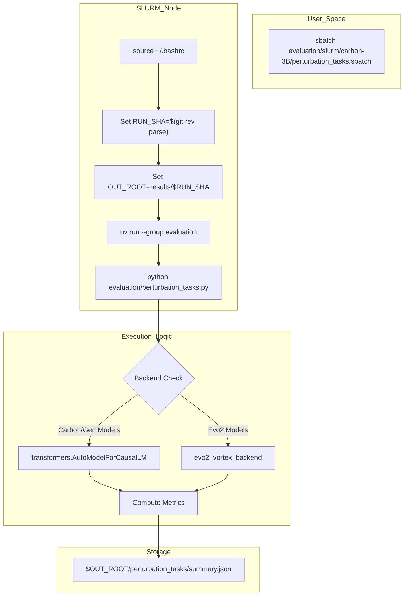
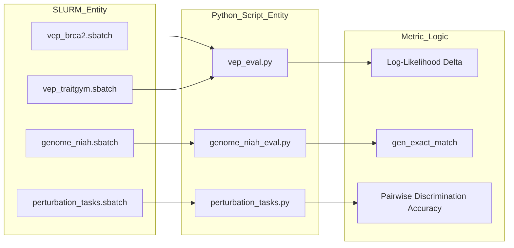

<!-- source: DeepWiki mcp.deepwiki.com · repo huggingface/carbon · page 2.6 SLURM Orchestration for Evaluation · fetched 2026-10-26 -->

# SLURM Orchestration for Evaluation

<details>
<summary>Relevant source files</summary>

The following files were used as context for generating this wiki page:

- [evaluation/slurm/README.md](evaluation/slurm/README.md)
- [evaluation/slurm/carbon-3B/perturbation_tasks.sbatch](evaluation/slurm/carbon-3B/perturbation_tasks.sbatch)
- [evaluation/slurm/carbon-500M/perturbation_tasks.sbatch](evaluation/slurm/carbon-500M/perturbation_tasks.sbatch)
- [evaluation/slurm/carbon-500M/vep_brca2.sbatch](evaluation/slurm/carbon-500M/vep_brca2.sbatch)
- [evaluation/slurm/carbon-500M/vep_traitgym.sbatch](evaluation/slurm/carbon-500M/vep_traitgym.sbatch)
- [evaluation/slurm/carbon-8B/vep_brca2.sbatch](evaluation/slurm/carbon-8B/vep_brca2.sbatch)
- [evaluation/slurm/carbon-8B/vep_traitgym.sbatch](evaluation/slurm/carbon-8B/vep_traitgym.sbatch)
- [evaluation/slurm/evo2-1b/genome_niah.sbatch](evaluation/slurm/evo2-1b/genome_niah.sbatch)
- [evaluation/slurm/evo2-20b/genome_niah.sbatch](evaluation/slurm/evo2-20b/genome_niah.sbatch)
- [evaluation/slurm/evo2-40b/genome_niah.sbatch](evaluation/slurm/evo2-40b/genome_niah.sbatch)
- [evaluation/slurm/evo2-7b/genome_niah.sbatch](evaluation/slurm/evo2-7b/genome_niah.sbatch)
- [evaluation/slurm/generator-v2-3b/perturbation_tasks.sbatch](evaluation/slurm/generator-v2-3b/perturbation_tasks.sbatch)
- [evaluation/slurm/generator-v2-3b/vep_traitgym.sbatch](evaluation/slurm/generator-v2-3b/vep_traitgym.sbatch)
- [logs/.gitkeep](logs/.gitkeep)

</details>


This page documents the SLURM-based orchestration layer used to execute the Carbon evaluation suite at scale. The system is designed to provide reproducible, version-controlled benchmarking across multiple model families (Carbon, GENERator, and Evo2) by leveraging structured directory hierarchies, environment-isolated execution via `uv`, and standardized output versioning.

## Directory Structure and Model Families

The orchestration logic is located in `evaluation/slurm/`, organized into subdirectories based on model families [evaluation/slurm/README.md:1-25](). Each subdirectory contains a standardized set of `.sbatch` scripts tailored to the specific architectural requirements of that model family (e.g., GPU counts, memory limits, and inference backends).

| Model Family | Subdirectory | Target Checkpoint Example |
| :--- | :--- | :--- |
| **Carbon 500M** | `carbon-500M/` | `HuggingFaceBio/Carbon-500M` |
| **Carbon 3B** | `carbon-3B/` | `HuggingFaceBio/Carbon-3B` |
| **Carbon 8B** | `carbon-8B/` | `HuggingFaceBio/Carbon-8B` |
| **GENERator v2** | `generator-v2-1.2b/`, `generator-v2-3b/` | `GenerTeam/GENERator-v2-eukaryote-3b-base` |
| **Evo2** | `evo2-1b/`, `evo2-7b/`, `evo2-20b/`, `evo2-40b/` | `arcinstitute/evo2_7b` |

### Core Evaluation Scripts
Each model directory typically includes the following sbatch templates [evaluation/slurm/README.md:27-34]():
*   `sequence_recovery.sbatch`: Generative next-token accuracy.
*   `vep_brca2.sbatch`: Variant effect prediction on BRCA2.
*   `vep_traitgym.sbatch`: Mendelian trait VEP with reverse-complement averaging.
*   `clinvar.sbatch`: ClinVar coding and non-coding tasks (supports context length overrides).
*   `perturbation_tasks.sbatch`: Motif insertion and synonymous codon substitution tasks.
*   `genome_niah.sbatch`: Long-context "Needle-In-A-Haystack" retrieval.

**Sources:** [evaluation/slurm/README.md:1-34]()

## Execution Pattern and Environment

The orchestration layer uses `uv` for environment management, ensuring that evaluation-only dependencies do not pollute the core training environment.

### The `uv run` Pattern
Scripts execute using the following command structure:
`uv run --no-sync --group evaluation [--group evo2] python evaluation/<script>.py` [evaluation/slurm/evo2-7b/genome_niah.sbatch:32]()

*   `--group evaluation`: Includes core evaluation dependencies [evaluation/slurm/carbon-3B/perturbation_tasks.sbatch:15]().
*   `--group evo2`: Required specifically for the Evo2 backend to load the `vortex` inference library [evaluation/slurm/evo2-7b/genome_niah.sbatch:32]().

### Versioning with `RUN_SHA`
To ensure reproducibility, the orchestration layer uses the current Git commit hash to version results [evaluation/slurm/carbon-3B/perturbation_tasks.sbatch:16-17]():
1.  **`RUN_SHA`**: Captured via `git rev-parse --short=12 HEAD`.
2.  **`OUT_ROOT`**: Results are stored in `results/$RUN_SHA/`, preventing accidental overwrites of previous benchmark runs.

### Orchestration Data Flow

The following diagram illustrates how a SLURM job transitions from a shell command to a versioned result using the `uv` environment.

**Job Submission and Execution Flow**

**Sources:** [evaluation/slurm/carbon-3B/perturbation_tasks.sbatch:13-40](), [evaluation/slurm/evo2-7b/genome_niah.sbatch:30-57]()

## Implementation Details

### VEP Task Configuration
The VEP scripts implement different scoring recipes based on the benchmark. `vep_brca2.sbatch` and `vep_traitgym.sbatch` utilize the `vep_eval.py` script. For example, `vep_traitgym.sbatch` enables `--rev_comp_avg` for strand-symmetric scoring [evaluation/slurm/carbon-500M/vep_traitgym.sbatch:25]().

### Long-Context NIAH Sweeps
The `genome_niah.sbatch` script is designed for parameterized sweeps. Users can override the task and context length via environment variables during submission [evaluation/slurm/README.md:45-52](). For Evo2 models, it supports sharding to split a (task, ctx) cell across multiple jobs, which is critical for long contexts (e.g., 128k) where per-row time can grow significantly [evaluation/slurm/evo2-7b/genome_niah.sbatch:13-22]().

```bash
# Example: Sweep across context lengths for Carbon-3B
for TASK in niah neardup_d4; do
  for CTX in 4096 8192 16384 32768; do
    TASK=$TASK CTX=$CTX sbatch evaluation/slurm/carbon-3B/genome_niah.sbatch
  done
done
```

### Perturbation Task Iteration
The `perturbation_tasks.sbatch` script iterates through a `TASK_SPECS` array, executing multiple sub-tasks (motif_human, syn_human, syn_mouse, promoter_revcomp) within a single job allocation [evaluation/slurm/carbon-3B/perturbation_tasks.sbatch:22-40]().

**Entity Mapping: SLURM to Code**

**Sources:** [evaluation/slurm/README.md:27-34](), [evaluation/slurm/carbon-3B/perturbation_tasks.sbatch:34](), [evaluation/slurm/evo2-7b/genome_niah.sbatch:51]()

## Monitoring and Resource Management

### Hardware Requirements
*   **Standard Carbon Models**: Typically run on 8 GPUs to leverage data parallelism or multi-task chaining [evaluation/slurm/carbon-3B/perturbation_tasks.sbatch:8-11]().
*   **Evo2 Models**: Utilize the `vortex` backend. Larger variants (20B/40B) require 8 GPUs with model-parallel loading [evaluation/slurm/README.md:36-38](). 40B NIAH jobs request up to 1024G of RAM and 72 hours walltime [evaluation/slurm/evo2-40b/genome_niah.sbatch:10-11]().

### Logging
Standard output and error logs are redirected to the `logs/` directory using SLURM job names (`%x`) and IDs (`%j`) [evaluation/slurm/carbon-3B/perturbation_tasks.sbatch:3-4]().

**Sources:** [evaluation/slurm/README.md:36-38](), [evaluation/slurm/evo2-40b/genome_niah.sbatch:1-11]()

---

