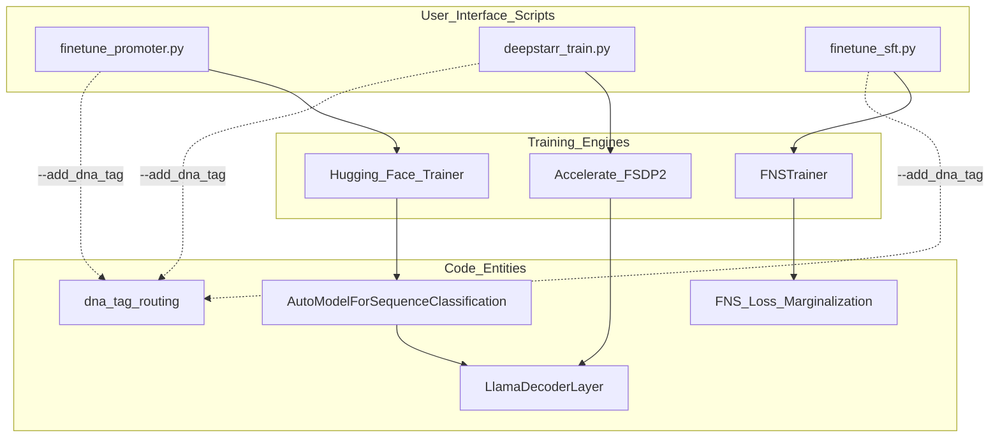
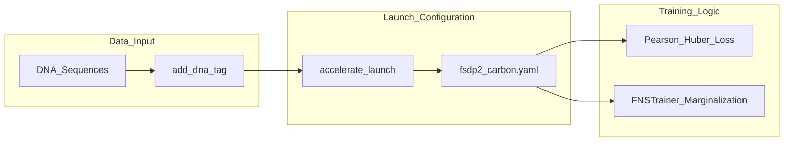

<!-- source: DeepWiki mcp.deepwiki.com · repo huggingface/carbon · page 3 Fine-Tuning Recipes · fetched 2026-10-26 -->

# Fine-Tuning Recipes

Relevant source files

The following files were used as context for generating this wiki page:

- [finetuning/README.md](finetuning/README.md)
- [finetuning/deepstarr/fsdp2_carbon.yaml](finetuning/deepstarr/fsdp2_carbon.yaml)

The `finetuning/` directory provides standardized recipes for adapting Carbon models to specific biological downstream tasks. These recipes cover three primary training paradigms: **Regression** (for predicting continuous biological activity), **Classification** (for categorical tasks like promoter detection), and **Supervised Fine-Tuning (SFT)** (for generative sequence modeling).

The recipes are designed to scale from the **Carbon-500M** to the **Carbon-8B** models, utilizing advanced distributed training techniques like **FSDP2** to manage the memory requirements of genomic foundation models.

## Training Paradigms

Carbon fine-tuning is split into three distinct architectural approaches based on the task objective:

### 1. Regression via Accelerate + FSDP2
For continuous value prediction, the repository uses custom training loops built on `accelerate`. This allows for specialized loss functions (like Pearson Correlation) and the use of **FSDP2 (Fully Sharded Data Parallel)** via `torch.distributed.device_mesh` for efficient sharding of large models.

*   **Key Files**: `finetuning/deepstarr/deepstarr_train.py` [finetuning/README.md:36-39](), `finetuning/promoter_activity/promoter_activity_train.py` [finetuning/README.md:55-57](), `finetuning/malinois/malinois_train.py` [finetuning/README.md:73-75]().
*   **Infrastructure**: Uses `fsdp2_carbon.yaml` which specifies `LlamaDecoderLayer` for `fsdp_transformer_layer_cls_to_wrap` [finetuning/deepstarr/fsdp2_carbon.yaml:15]().

### 2. Classification via Hugging Face Trainer
For categorical tasks, the repository provides a streamlined approach using the standard `transformers.Trainer`. This is ideal for GUE (Genomic Understanding Evaluation) benchmarks.

*   **Key File**: `finetuning/finetune_promoter.py` [finetuning/README.md:107-111]().
*   **Model Class**: `AutoModelForSequenceClassification` [finetuning/README.md:131-132]().

### 3. Generative SFT via FNSTrainer
For base-pair level supervision, the `finetune_sft.py` script uses **Factorized Nucleotide Supervision (FNS)**. This marginalizes k-mer token probabilities to nucleotide-level probabilities, providing k× more supervision signal [finetuning/README.md:150-161]().

*   **Key File**: `finetuning/finetune_sft.py` [finetuning/README.md:168-172]().
*   **Trainer**: `FNSTrainer` [finetuning/README.md:145]().

---

## Technical Patterns and Configuration

### DNA Tag Routing
Carbon models use a hybrid tokenizer. For fine-tuning on DNA-specific tasks, the `--add_dna_tag` flag must be used for hybrid models (e.g., Carbon-3B/8B) [finetuning/README.md:125-127](). This ensures the input is wrapped in `<dna>...</dna>` tags, routing the hidden states through the 6-mer DNA processing path [finetuning/README.md:199]().

### SLURM and Execution
Training is orchestrated through SLURM launch templates located within each recipe sub-directory. These templates are configured for single-node execution by default but can be adapted for multi-node setups by modifying the `accelerate` configuration [finetuning/README.md:22-24]().

### Common Patterns
| Feature | Implementation |
| :--- | :--- |
| **Gradient Checkpointing** | Enabled to fit long genomic sequences in VRAM. |
| **Hybrid Loss** | Pearson-Huber setup for regression to handle outliers while maximizing correlation [finetuning/README.md:46-47](). |
| **Distributed Metrics** | Pearson correlation is computed globally across all ranks by gathering predictions and labels [finetuning/README.md:47-49](). |
| **FNS Loss** | Marginalizes token-level predictions to nucleotide-level cross-entropy [finetuning/README.md:150-157](). |

---

## Code Entity Map: Training Infrastructure

The following diagram illustrates the relationship between the training launch scripts and the underlying Carbon model components.

**Sources:** [finetuning/README.md:33-39](), [finetuning/README.md:107-111](), [finetuning/README.md:125-127](), [finetuning/README.md:150-161](), [finetuning/deepstarr/fsdp2_carbon.yaml:15]()

---

## Recipe Overview and Child Pages

### [DeepSTARR Enhancer Activity Regression](#3.1)
Focused on predicting enhancer activity in *Drosophila*. This recipe uses a Pearson correlation loss and FSDP2 to fine-tune the Carbon-3B model.
*   **Task**: Regression (PCC / log PCC) [finetuning/README.md:7]().
*   **Key Detail**: Uses `fsdp2_carbon.yaml` and `LlamaDecoderLayer` wrapping [finetuning/deepstarr/fsdp2_carbon.yaml:15]().
*   **For details, see [DeepSTARR Enhancer Activity Regression](#3.1)**.

### [Promoter Activity Regression](#3.2)
Addresses the Random Promoter DREAM 2022 challenge. It utilizes a hybrid Pearson-Huber loss to optimize for correlation across distributed ranks.
*   **Task**: Regression (PCC / Spearman) [finetuning/README.md:8]().
*   **Key Detail**: Default model is `Carbon-500M-remote` [finetuning/README.md:46]().
*   **For details, see [Promoter Activity Regression](#3.2)**.

### [Malinois MPRA Regression](#3.3)
Fine-tunes models on the Gosai et al. MPRA dataset across three cell types (K562, HepG2, SK-N-SH) using MSE loss on z-scored labels.
*   **Task**: Regression (PCC / Spearman) [finetuning/README.md:9]().
*   **Key Detail**: Implements benchmark chromosome holdout splits [finetuning/README.md:67]().
*   **For details, see [Malinois MPRA Regression](#3.3)**.

### [Promoter Classification (GUE Tasks)](#3.4)
A classification recipe for binary TSS (Transcription Start Site) detection using the Nucleotide Transformer downstream tasks dataset.
*   **Task**: Binary Classification (Accuracy, F1, MCC) [finetuning/README.md:10]().
*   **Key Detail**: Demonstrates the use of `AutoModelForSequenceClassification` [finetuning/README.md:132]().
*   **For details, see [Promoter Classification (GUE Tasks)](#3.4)**.

---

## Workflow: From Data to Fine-Tuned Model

The following diagram maps the high-level fine-tuning workflow to specific code entities and configurations.

**Sources:** [finetuning/README.md:33-39](), [finetuning/README.md:125-127](), [finetuning/README.md:150-161](), [finetuning/deepstarr/fsdp2_carbon.yaml:1-20]()

**Sources:**
- [finetuning/README.md:1-211]()
- [finetuning/deepstarr/fsdp2_carbon.yaml:1-28]()

---

