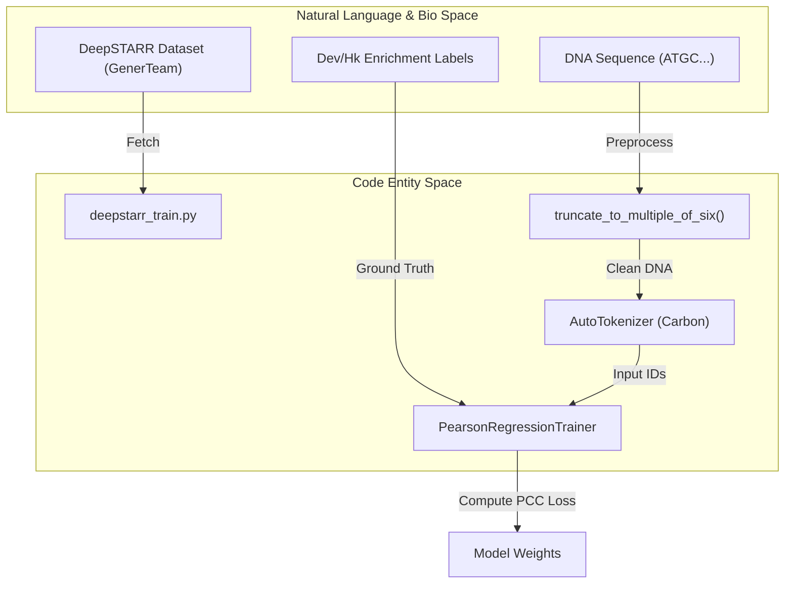
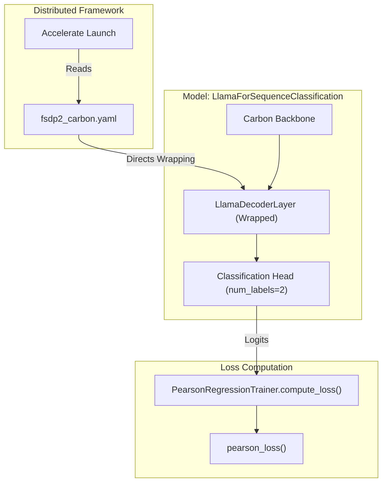

<!-- source: DeepWiki mcp.deepwiki.com · repo huggingface/carbon · page 3.1 DeepSTARR Enhancer Activity Regression · fetched 2026-10-26 -->

# DeepSTARR Enhancer Activity Regression

Relevant source files

The following files were used as context for generating this wiki page:

- [finetuning/deepstarr/README.md](finetuning/deepstarr/README.md)
- [finetuning/deepstarr/deepstarr_regression.slurm](finetuning/deepstarr/deepstarr_regression.slurm)
- [finetuning/deepstarr/deepstarr_train.py](finetuning/deepstarr/deepstarr_train.py)
- [finetuning/deepstarr/fsdp2_carbon.yaml](finetuning/deepstarr/fsdp2_carbon.yaml)

This page provides a technical deep dive into the fine-tuning recipe for the DeepSTARR enhancer activity regression task. The implementation is located in `finetuning/deepstarr/` and is designed to adapt Carbon models to predict quantitative enhancer activity across two distinct targets: developmental (dev) and housekeeping (hk) enhancers.

## Overview and Purpose

The DeepSTARR fine-tuning pipeline adapts the Carbon foundation model to perform multi-task regression on the `GenerTeam/DeepSTARR-enhancer-activity` dataset [finetuning/deepstarr/deepstarr_train.py:23-23](). The goal is to predict the log2 enrichment values for enhancer sequences, specifically targeting the `Dev_log2_enrichment_scaled` and `Hk_log2_enrichment_scaled` columns [finetuning/deepstarr/deepstarr_train.py:26-26]().

### Key Components
*   **Loss Function**: A custom Pearson correlation-based loss.
*   **Trainer**: A specialized `PearsonRegressionTrainer` that overrides the standard Hugging Face `Trainer` loss calculation.
*   **Preprocessing**: DNA sequence trimming to maintain 6-mer alignment.
*   **Optimization**: Support for FSDP2 (Fully Sharded Data Parallel) and `reduce_lr_on_plateau` scheduling.

## Data Flow and Preprocessing

The pipeline consumes raw DNA sequences and targets from the DeepSTARR dataset. Before tokenization, sequences undergo a specific "trim-to-multiple-of-6" step to ensure compatibility with Carbon's hybrid tokenizer, which uses 6-mer content tokens.

### Preprocessing Logic
1.  **DNA Tagging**: Sequences are wrapped with `<dna>` and `</dna>` tags based on the `--dna_mode` (defaulting to `auto_dna_tags`) [finetuning/deepstarr/deepstarr_train.py:65-69]().
2.  **Length Alignment**: Sequences are truncated to a multiple of 6 using the `--truncate_to_multiple_of` argument (default 6) [finetuning/deepstarr/deepstarr_train.py:71-75](). This prevents partial 6-mer tokens at the sequence boundaries.
3.  **Tokenization**: The `AutoTokenizer` processes the tagged and trimmed strings [finetuning/deepstarr/deepstarr_train.py:17-17]().

### System Data Flow
The following diagram bridges the biological data space with the code entities responsible for processing it.

**Diagram: DeepSTARR Data Processing Pipeline**

Sources: [finetuning/deepstarr/deepstarr_train.py:23-27](), [finetuning/deepstarr/deepstarr_train.py:71-75](), [finetuning/deepstarr/deepstarr_train.py:18-20]()

## Implementation Details

### Pearson Correlation Loss
Unlike standard MSE regression, this task utilizes a Pearson-based loss function. This focuses the model on capturing the linear correlation between predictions and experimental enrichment values rather than absolute error.

The `pearson_loss` function:
1.  Centers both `logits` and `labels` by subtracting their means [finetuning/deepstarr/deepstarr_train.py:177-178]().
2.  Calculates the numerator as the dot product of centered vectors [finetuning/deepstarr/deepstarr_train.py:179-179]().
3.  Normalizes by the product of the standard deviations (clamped by `eps`) [finetuning/deepstarr/deepstarr_train.py:180-182]().
4.  Returns `1.0 - mean_correlation` to be minimized [finetuning/deepstarr/deepstarr_train.py:183-183]().

### PearsonRegressionTrainer
The `PearsonRegressionTrainer` class inherits from the Hugging Face `Trainer` [finetuning/deepstarr/deepstarr_train.py:19-19](). It overrides `compute_loss` to invoke the `pearson_loss` function instead of the default `LlamaForSequenceClassification` loss (which is typically MSE for regression tasks).

### Training Configuration
The default optimization settings include:
*   **Optimizer**: AdamW with $\beta_2 = 0.95$ [finetuning/deepstarr/README.md:55-57]().
*   **Scheduler**: `reduce_lr_on_plateau` [finetuning/deepstarr/deepstarr_train.py:50-50](). This scheduler reduces the learning rate by a factor of 0.5 when the validation `pcc_mean` fails to improve for 2 epochs [finetuning/deepstarr/deepstarr_train.py:121-123]().
*   **Metric**: Checkpoints are selected based on the mean Pearson Correlation Coefficient (`pcc_mean`) of the Dev and Hk targets [finetuning/deepstarr/README.md:4-5]().

Sources: [finetuning/deepstarr/deepstarr_train.py:172-183](), [finetuning/deepstarr/deepstarr_train.py:121-123](), [finetuning/deepstarr/README.md:99-103]()

## FSDP2 and Model Architecture

To handle the 3B and 8B parameter variants of Carbon, the recipe uses **FSDP2** (Fully Sharded Data Parallel version 2) via Accelerate.

### Configuration (`fsdp2_carbon.yaml`)
The FSDP2 configuration is optimized for the Llama-based architecture of Carbon:
*   **Transformer Layer Wrapping**: `fsdp_transformer_layer_cls_to_wrap` is set to `LlamaDecoderLayer` [finetuning/deepstarr/fsdp2_carbon.yaml:15-15]().
*   **Sharding Strategy**: `fsdp_reshard_after_forward: true` to minimize GPU memory footprint [finetuning/deepstarr/fsdp2_carbon.yaml:13-13]().
*   **State Dict**: `FULL_STATE_DICT` is used for saving checkpoints [finetuning/deepstarr/fsdp2_carbon.yaml:14-14]().

### Model Integration
The following diagram illustrates how the FSDP2 configuration wraps the Carbon architecture for regression.

**Diagram: FSDP2 Wrapping of Carbon Architecture**

Sources: [finetuning/deepstarr/fsdp2_carbon.yaml:1-16](), [finetuning/deepstarr/deepstarr_train.py:16-16]()

## Execution and Slurm Integration

Training is typically launched via the `deepstarr_regression.slurm` script, which provides a template for single-node multi-GPU runs [finetuning/deepstarr/deepstarr_regression.slurm:3-5]().

### Slurm Wrapper Features
*   **Port Management**: Automatically calculates a `MAIN_PROCESS_PORT` based on the `SLURM_JOB_ID` to avoid collisions on shared login nodes [finetuning/deepstarr/deepstarr_regression.slurm:21-27]().
*   **Hyperparameters**: Defaults to a learning rate of `2e-5`, `bfloat16` precision, and `gradient_checkpointing` enabled [finetuning/deepstarr/deepstarr_regression.slurm:69-82]().
*   **Attention Implementation**: Defaults to `flash-attn3` (kernels-community) for high-performance training on compatible hardware [finetuning/deepstarr/deepstarr_regression.slurm:83-83]().

### Key Output Files
Upon completion, the trainer generates:
*   `validation_metrics.json`: PCC scores for `dev` and `hk` targets on the validation set [finetuning/deepstarr/README.md:97-97]().
*   `test_metrics.json`: Final performance on the DeepSTARR test split [finetuning/deepstarr/README.md:98-98]().
*   `best_model/`: A standalone copy of the model with the highest `pcc_mean` [finetuning/deepstarr/README.md:100-100]().

Sources: [finetuning/deepstarr/deepstarr_regression.slurm:1-85](), [finetuning/deepstarr/README.md:93-104]()

---

