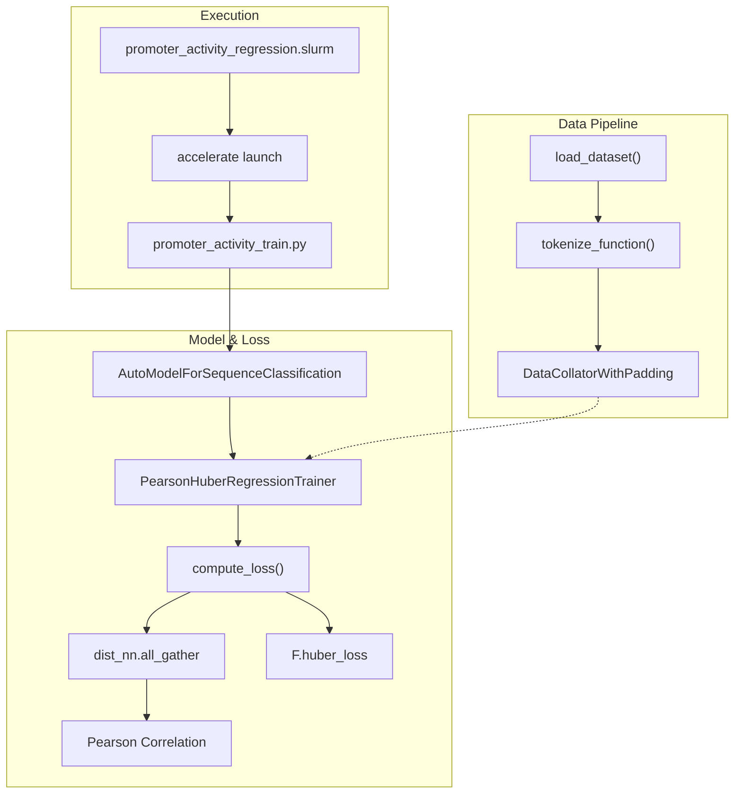
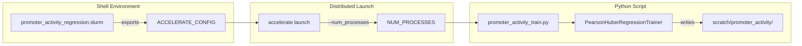

<!-- source: DeepWiki mcp.deepwiki.com · repo huggingface/carbon · page 3.2 Promoter Activity Regression · fetched 2026-10-26 -->

# Promoter Activity Regression

Relevant source files

The following files were used as context for generating this wiki page:

- [finetuning/promoter_activity/README.md](finetuning/promoter_activity/README.md)
- [finetuning/promoter_activity/promoter_activity_regression.slurm](finetuning/promoter_activity/promoter_activity_regression.slurm)
- [finetuning/promoter_activity/promoter_activity_train.py](finetuning/promoter_activity/promoter_activity_train.py)

The promoter activity regression task fine-tunes the Carbon-500M model to predict gene expression levels from DNA sequences, specifically targeting the **Random Promoter DREAM Challenge 2022**. This task utilizes a hybrid objective combining Pearson correlation and Huber loss to optimize for both linear correlation and point-wise accuracy across distributed ranks.

## Task Overview: Random Promoter DREAM 2022

The goal of this task is to map synthetic promoter sequences to their measured expression activity. The implementation uses a specific validated setup for the Carbon-500M model to achieve high correlation metrics.

*   **Dataset**: `HuggingFaceBio/random-promoter-dream-2022` [finetuning/promoter_activity/promoter_activity_train.py:27-29]().
*   **Revision Pinning**: The dataset is pinned to revision `5b18e5067fd20e589f698a4406ca6e4f2344d68f` because the supervised train/validation/test split configuration is not available on the Hub's `main` branch [finetuning/promoter_activity/README.md:97-98]().
*   **Default Model**: `HuggingFaceBio/Carbon-500M-remote` [finetuning/promoter_activity/promoter_activity_train.py:30]().
*   **Performance**: Reaches a Pearson Correlation Coefficient (PCC) of `0.807` and Spearman correlation of `0.806` on the labeled test set (71,103 sequences) [finetuning/promoter_activity/README.md:13-15]().

Sources: [finetuning/promoter_activity/README.md:1-15](), [finetuning/promoter_activity/promoter_activity_train.py:27-30]()

## Implementation Architecture

The training logic is encapsulated in `promoter_activity_train.py`, which utilizes the Hugging Face `Trainer` API extended with a custom loss function.

### Data Flow and Tokenization
The system supports three DNA processing modes via the `--dna_mode` argument: `auto_dna_tags`, `dna_tags`, and `plain` [finetuning/promoter_activity/promoter_activity_train.py:74-78](). By default, it uses `auto_dna_tags` to ensure the hybrid tokenizer correctly routes DNA sequences through the Carbon architecture using `<dna>` and `</dna>` tags.

### Pearson-Huber Hybrid Loss
To optimize for regression, the model employs a specialized loss function defined in a custom trainer class. The objective minimizes:
$$Loss = (1 - \text{Pearson } r) + (w \cdot \text{Huber})$$

The default weights and parameters are:
*   **Huber Delta**: 1.0 [finetuning/promoter_activity/promoter_activity_train.py:85-89]().
*   **Huber Loss Weight ($w$)**: 0.2 [finetuning/promoter_activity/promoter_activity_train.py:90-95]().

### Code Entity Space: Training Components

The following diagram maps the high-level training logic to the specific classes and functions in the implementation.

**Diagram: Promoter Training Architecture**

Sources: [finetuning/promoter_activity/promoter_activity_train.py:20-24](), [finetuning/promoter_activity/promoter_activity_regression.slurm:67-71]()

## Distributed Pearson Computation

A critical feature of this implementation is the cross-rank distributed Pearson computation. Standard Pearson correlation is poorly conditioned on small per-device microbatches [finetuning/promoter_activity/README.md:66-67]().

To solve this, the trainer's `compute_loss` performs the following:
1.  **Gathering**: It uses `torch.distributed.nn.functional.all_gather` to collect predictions and labels from all GPU ranks [finetuning/promoter_activity/README.md:17-19]().
2.  **Global Correlation**: It computes the Pearson correlation on the global microbatch rather than local per-rank subsets.
3.  **Stability**: This ensures the optimizer sees a representative correlation signal even when `per_device_train_batch_size` is small.

Sources: [finetuning/promoter_activity/README.md:17-19](), [finetuning/promoter_activity/README.md:66-67]()

## Training Configuration

The training process uses a Cosine learning rate schedule with a warmup period.

| Parameter | Default Value | Source |
| :--- | :--- | :--- |
| Optimizer | AdamW (Trainer default) | [finetuning/promoter_activity/promoter_activity_train.py:23]() |
| Learning Rate | `2e-5` | [finetuning/promoter_activity/promoter_activity_train.py:56]() |
| LR Schedule | `cosine` | [finetuning/promoter_activity/promoter_activity_train.py:59]() |
| Warmup Ratio | `0.05` | [finetuning/promoter_activity/promoter_activity_train.py:58]() |
| Precision | `bf16` | [finetuning/promoter_activity/promoter_activity_train.py:101]() |
| Gradient Checkpointing | Enabled | [finetuning/promoter_activity/promoter_activity_train.py:104-107]() |

### SLURM Orchestration
Training is typically launched via `promoter_activity_regression.slurm`. This script handles single-node multi-GPU setups using `accelerate` and sets `MAIN_PROCESS_PORT` based on the SLURM Job ID to avoid collisions [finetuning/promoter_activity/promoter_activity_regression.slurm:21-27]().

**Diagram: SLURM to Python Execution Flow**

Sources: [finetuning/promoter_activity/promoter_activity_regression.slurm:13-30](), [finetuning/promoter_activity/promoter_activity_regression.slurm:67-93]()

## Output and Evaluation

The trainer generates several artifacts in the `output_dir`:
1.  **Metrics**: `train_results.json` and `eval_results.json` containing PCC and Spearman scores.
2.  **Predictions**: If `--save_predictions` is enabled, it writes TSV files containing raw-scale labels and model predictions for validation and test sets [finetuning/promoter_activity/README.md:102-104]().
3.  **Model**: Checkpoints are saved based on `--save_model` and `--save_total_limit` [finetuning/promoter_activity/promoter_activity_train.py:69, 118]().

Sources: [finetuning/promoter_activity/README.md:100-104](), [finetuning/promoter_activity/promoter_activity_train.py:116-118]()

---

