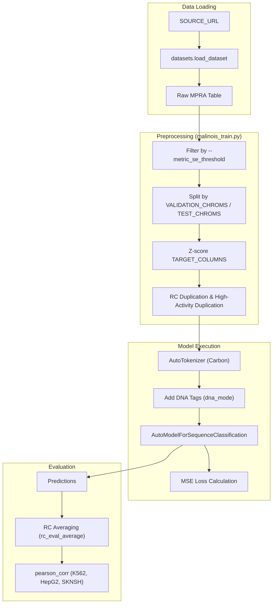
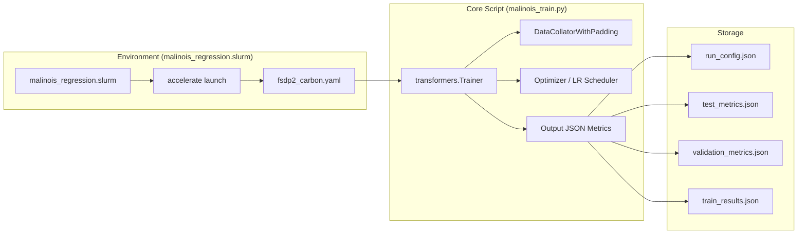

<!-- source: DeepWiki mcp.deepwiki.com · repo huggingface/carbon · page 3.3 Malinois MPRA Regression · fetched 2026-10-26 -->

# Malinois MPRA Regression

<details>
<summary>Relevant source files</summary>

The following files were used as context for generating this wiki page:

- [finetuning/malinois/README.md](finetuning/malinois/README.md)
- [finetuning/malinois/malinois_regression.slurm](finetuning/malinois/malinois_regression.slurm)
- [finetuning/malinois/malinois_train.py](finetuning/malinois/malinois_train.py)

</details>


The Malinois MPRA regression task involves fine-tuning Carbon models on the Massively Parallel Reporter Assay (MPRA) dataset from Gosai et al. (2024). The objective is to predict log2 fold-change (log2FC) activity targets across three specific cell types: **K562**, **HepG2**, and **SK-N-SH** [finetuning/malinois/README.md:1-6]().

## Task Specification

The model is trained as a multi-target regression head on top of the Carbon backbone. It maps genomic sequences to three continuous activity values corresponding to the cell-type targets [finetuning/malinois/malinois_train.py:29-30]().

### Dataset and Splits
The dataset is sourced from the Gosai et al. MPRA table [finetuning/malinois/malinois_train.py:23-27](). Splits are defined by chromosome holdouts to ensure genomic independence between sets:
*   **Validation**: Chromosomes 19, 21, and X [finetuning/malinois/malinois_train.py:32]().
*   **Test**: Chromosomes 7 and 13 [finetuning/malinois/malinois_train.py:33]().
*   **Training**: All remaining chromosomes in the dataset.

### Label Preprocessing
*   **Z-Scoring**: Labels are z-scored based on the training set statistics [finetuning/malinois/README.md:15-16]().
*   **Filtering**: Rows can be filtered based on Standard Error (SE) thresholds (default `metric_se_threshold=1.0`) to remove noisy measurements [finetuning/malinois/malinois_train.py:86-87]().

### Data Augmentation Strategies
The implementation employs two primary data augmentation techniques to improve regression performance:
1.  **Reverse-Complement (RC) Duplication**: During training, both the forward and reverse-complement versions of a sequence are added to the training set [finetuning/malinois/README.md:16-17]().
2.  **High-Activity Row Duplication**: Sequences with activity above a specific threshold (default `0.5`) are duplicated to over-represent high-signal regulatory elements [finetuning/malinois/malinois_train.py:93-97]().

**Sources:** [finetuning/malinois/README.md:1-20](), [finetuning/malinois/malinois_train.py:23-35]().

## Implementation Details

### Model Architecture
The task uses `AutoModelForSequenceClassification` with `num_labels=3` [finetuning/malinois/malinois_train.py:16](). The default backbone is `Carbon-3B`, though `Carbon-500M-remote` and `Carbon-8B` are also supported [finetuning/malinois/README.md:69-82]().

### Training Logic
The fine-tuning script `malinois_train.py` utilizes the Hugging Face `Trainer` API with the following configuration:
*   **Loss Function**: Mean Squared Error (MSE) on z-scored log2FC labels [finetuning/malinois/README.md:15-16]().
*   **Optimization**: Learning rate of `1e-5`, no weight decay, and a warmup ratio of `0.05` [finetuning/malinois/malinois_regression.slurm:92-94]().
*   **Scheduler**: `reduce_lr_on_plateau` is used by default to adjust the learning rate based on validation performance [finetuning/malinois/malinois_train.py:66](). The default configuration uses a factor of `0.5` and a patience of `2` [finetuning/malinois/malinois_train.py:149]().

### DNA Tokenization and Tagging
The script supports different `dna_mode` settings to handle the hybrid nature of Carbon (which accepts both DNA and natural language tokens):
*   `auto_dna_tags`: Automatically wraps sequences in `<dna>` and `</dna>` tags [finetuning/malinois/malinois_train.py:81-83]().

### Evaluation Metrics
The primary metric for model selection is the **mean Pearson Correlation Coefficient (PCC)** across the three cell-type targets [finetuning/malinois/README.md:95-96](). During evaluation, if `rc_eval_average` is enabled, the model's predictions for the forward and reverse-complement strands are averaged before calculating metrics [finetuning/malinois/README.md:17-18]().

**Sources:** [finetuning/malinois/malinois_train.py:39-143](), [finetuning/malinois/malinois_regression.slurm:84-108]().

## Data Flow and Logic

### Data Preparation Pipeline
The following diagram illustrates the flow from the raw Gosai et al. table to the training-ready tensors.

**Figure 1: Malinois Data Preparation and Training Flow**

**Sources:** [finetuning/malinois/malinois_train.py:23-35](), [finetuning/malinois/malinois_train.py:86-102](), [finetuning/malinois/malinois_train.py:185-195](), [finetuning/malinois/README.md:15-18]().

### System Orchestration
The fine-tuning is typically orchestrated via SLURM using `malinois_regression.slurm`, which configures the `accelerate` environment for multi-GPU execution using FSDP2.

**Figure 2: Orchestration and Training Components**

**Sources:** [finetuning/malinois/malinois_regression.slurm:1-108](), [finetuning/malinois/README.md:84-97]().

## Execution

### Single-Node SLURM Launch
The default SLURM wrapper is configured for an 8-GPU node using FSDP2 [finetuning/malinois/README.md:11]().

```bash
RUN_NAME=carbon-3b-malinois-mse \
sbatch finetuning/malinois/malinois_regression.slurm
```
[finetuning/malinois/README.md:64-67]()

### Key Configuration Parameters
| Parameter | Default | Description |
| :--- | :--- | :--- |
| `--model` | `Carbon-3B` | Model repository or local path [finetuning/malinois/malinois_train.py:41](). |
| `--learning_rate` | `1e-5` | Training learning rate [finetuning/malinois/malinois_train.py:63](). |
| `--dna_mode` | `auto_dna_tags` | Tokenization wrapping strategy [finetuning/malinois/malinois_train.py:81-83](). |
| `--high_activity_threshold` | `0.5` | Threshold for row duplication [finetuning/malinois/malinois_train.py:97](). |
| `--metric_se_threshold` | `1.0` | Filter for label standard error [finetuning/malinois/malinois_train.py:86](). |
| `--attn_implementation` | `flash-attn3` | Attention backend; defaults to community flash-attn3 [finetuning/malinois/malinois_train.py:121](). |

**Sources:** [finetuning/malinois/malinois_train.py:39-130](), [finetuning/malinois/malinois_regression.slurm:84-108]().

---

