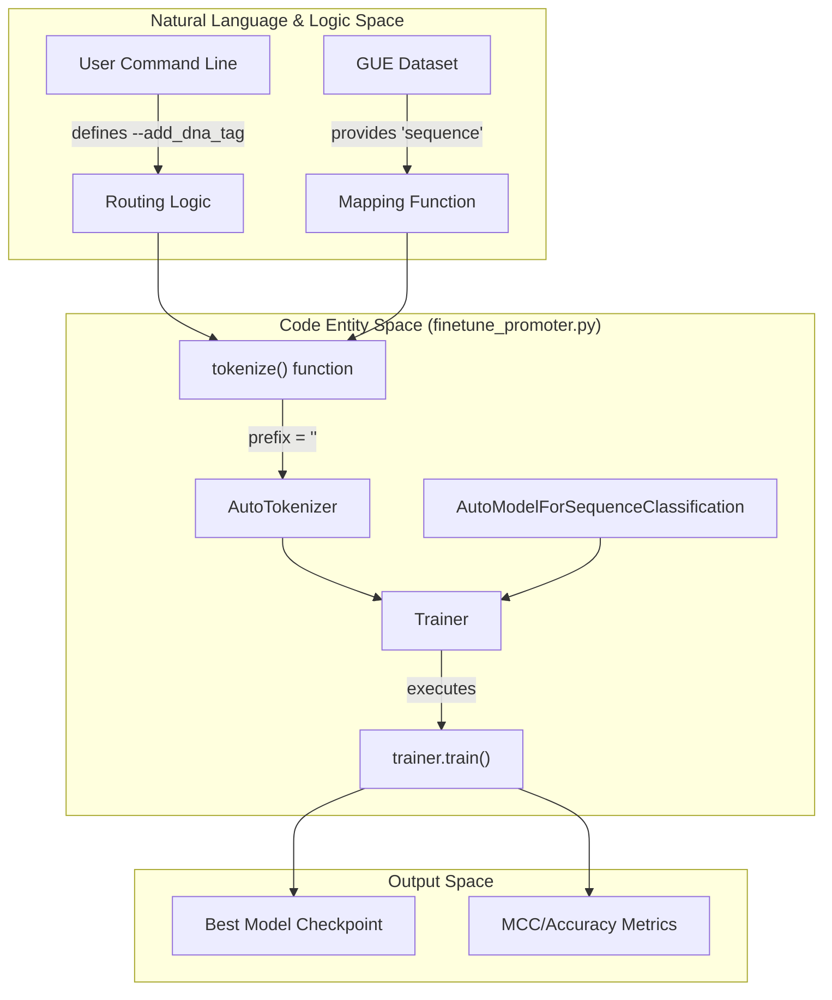
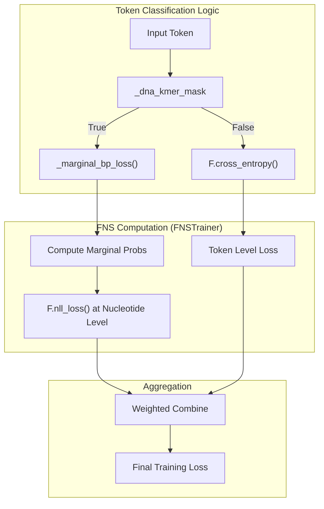

<!-- source: DeepWiki mcp.deepwiki.com · repo huggingface/carbon · page 3.4 Promoter Classification (GUE Tasks) · fetched 2026-10-26 -->

# Promoter Classification (GUE Tasks)

Relevant source files

The following files were used as context for generating this wiki page:

- [clustering/README.md](clustering/README.md)
- [finetuning/README.md](finetuning/README.md)
- [finetuning/finetune_promoter.py](finetuning/finetune_promoter.py)
- [finetuning/finetune_sft.py](finetuning/finetune_sft.py)
- [finetuning/fns_trainer.py](finetuning/fns_trainer.py)

The `finetune_promoter.py` script provides a streamlined implementation for fine-tuning Carbon models on genomic sequence classification tasks. While its primary focus is binary promoter detection—identifying Transcription Start Sites (TSS) in 300 bp human DNA segments—it serves as a general-purpose template for the Genomic Understanding Evaluation (GUE) benchmark suite [finetuning/finetune_promoter.py:1-7](). In addition to classification, the directory includes `finetune_sft.py` and the `FNSTrainer` class for Supervised Fine-Tuning using base-pair level supervision [finetuning/README.md:142-149]().

## Implementation Overview

The classification pipeline utilizes the Hugging Face `Trainer` API combined with `AutoModelForSequenceClassification` [finetuning/finetune_promoter.py:42-48](). This approach allows the Carbon backbone to be coupled with a task-specific linear head that is automatically initialized by the `transformers` library [finetuning/finetune_promoter.py:14-16]().

### Model and Tokenizer Configuration
The script initializes the model and tokenizer with `trust_remote_code=True` to support Carbon's custom architecture and hybrid tokenizer [finetuning/finetune_promoter.py:92-102](). 

Key configuration steps include:
- **Padding**: If the tokenizer lacks a pad token, it is set to the `eos_token` [finetuning/finetune_promoter.py:93-94]().
- **Label Inference**: The `num_labels` parameter is explicitly set (defaulting to 2 for binary classification) which determines the output dimension of the classification head [finetuning/finetune_promoter.py:100]().
- **Precision**: Training defaults to `bf16` for efficient memory usage on modern GPUs [finetuning/finetune_promoter.py:68, 101]().

### Data Flow and Hybrid Routing
For Carbon hybrid models (e.g., `carbon-3B-hybrid`), the script implements a routing mechanism via the `--add_dna_tag` argument. This ensures the sequence is processed by the 6-mer DNA tokenizer rather than the natural language BPE tokenizer [finetuning/finetune_promoter.py:18-20, 106]().

**Sequence Processing Logic:**
1. **Tagging**: If `--add_dna_tag` is active, the `<dna>` prefix is prepended to every sequence [finetuning/finetune_promoter.py:109]().
2. **Tokenization**: Sequences are tokenized with a default `max_length` of 320, providing overhead for the DNA tag and special tokens [finetuning/finetune_promoter.py:58-59, 110]().
3. **Collation**: `DataCollatorWithPadding` dynamically pads sequences within a batch to the length of the longest sequence [finetuning/finetune_promoter.py:146]().

**Entity Association: Finetuning Architecture**

Sources: [finetuning/finetune_promoter.py:106-114](), [finetuning/finetune_promoter.py:140-150]()

## Dataset and Tasks

The script defaults to the `promoter_all` configuration of the `InstaDeepAI/nucleotide_transformer_downstream_tasks` dataset [finetuning/finetune_promoter.py:55-56]().

| Task Config | Sequences | Sequence Length | Description |
| :--- | :--- | :--- | :--- |
| `promoter_all` | ~59k total | 300 bp | Human TSS promoter vs. non-promoter |
| `enhancers` | Variable | Variable | Strong/Weak enhancer classification |
| `H3K4me3` | Variable | Variable | Histone modification site prediction |
| `splice_sites_all` | Variable | Variable | Donor/Acceptor/Non-site classification |

Sources: [finetuning/finetune_promoter.py:9-12](), [finetuning/finetune_promoter.py:132-133]()

## Supervised Fine-Tuning (SFT) with FNS

For tasks requiring generative alignment or refined DNA modeling, Carbon provides `finetune_sft.py` which utilizes the `FNSTrainer` [finetuning/finetune_sft.py:4-6]().

### Factorized Nucleotide Supervision (FNS)
The `FNSTrainer` implements a hybrid loss function that applies different supervision signals based on token type [finetuning/fns_trainer.py:38-41]():
- **DNA k-mer Tokens**: Marginalized base-pair level loss.
- **BPE and Special Tokens**: Standard token-level cross-entropy loss.

The `_marginal_bp_loss` function computes the probability of each nucleotide within a k-mer by summing the probabilities of all tokens that contain that nucleotide at the specific position [finetuning/fns_trainer.py:133-142](). This provides $k \times$ more supervision signal per token than standard causal language modeling [finetuning/README.md:159-161]().

**Entity Association: SFT Loss Pipeline**

Sources: [finetuning/fns_trainer.py:19-82](), [finetuning/fns_trainer.py:129-155]()

## Evaluation Metrics

For classification tasks, the script uses Matthews Correlation Coefficient (MCC) as the primary metric for model selection (`metric_for_best_model="mcc"`) [finetuning/finetune_promoter.py:132-134]().

The `compute_metrics` function calculates:
- **Accuracy**: General correctness [finetuning/finetune_promoter.py:78]().
- **F1 Score**: Harmonic mean of precision and recall [finetuning/finetune_promoter.py:79]().
- **MCC**: Quality of binary classifications [finetuning/finetune_promoter.py:80]().
- **AUROC**: Area under the receiver operating characteristic curve using softmax probabilities [finetuning/finetune_promoter.py:76, 81]().

Sources: [finetuning/finetune_promoter.py:73-82]()

## Execution Patterns

### Launch Examples
- **Promoter Classification**: `python finetune_promoter.py --model HuggingFaceBio/Carbon-3B --add_dna_tag --output_dir ./outputs/` [finetuning/finetune_promoter.py:23-26]().
- **SFT with FNS**: `python finetune_sft.py --model HuggingFaceBio/Carbon-3B --dataset your/dataset --add_dna_tag` [finetuning/finetune_sft.py:168-172]().
- **DNA-Only SFT**: Use `--dna_loss_only` to ignore BPE tokens during loss calculation [finetuning/finetune_sft.py:188-194]().

### Distributed Training
Both scripts support multi-GPU execution via `torchrun`. For `finetune_promoter.py`, this is invoked as:
`torchrun --nproc_per_node=8 finetune_promoter.py --model HuggingFaceBio/Carbon-3B --add_dna_tag --batch_size 4 --grad_accum 4` [finetuning/finetune_promoter.py:29-32]().

Sources: [finetuning/finetune_promoter.py:22-33](), [finetuning/finetune_sft.py:11-23](), [finetuning/README.md:163-184]()

---

