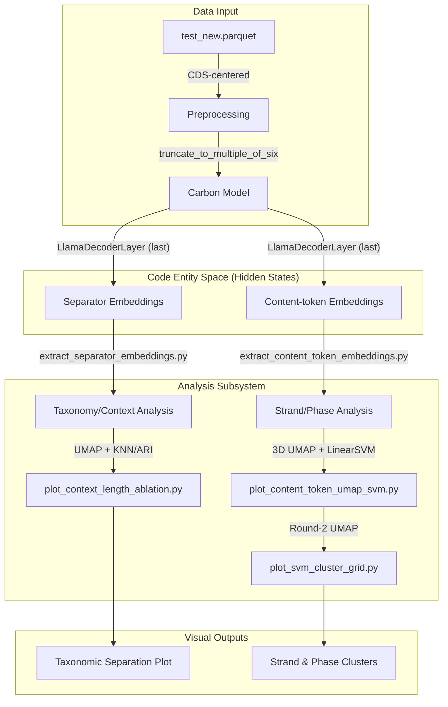
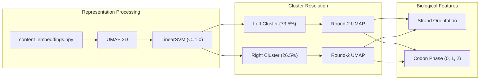

<!-- source: DeepWiki mcp.deepwiki.com · repo huggingface/carbon · page 4 Embedding Analysis and Clustering · fetched 2026-10-26 -->

# Embedding Analysis and Clustering

Relevant source files

The following files were used as context for generating this wiki page:

- [clustering/README.md](clustering/README.md)
- [clustering/figures/carbon_last_token_nn100_row.png](clustering/figures/carbon_last_token_nn100_row.png)
- [clustering/figures/round2_left_umap12_svm2d.png](clustering/figures/round2_left_umap12_svm2d.png)
- [clustering/figures/round2_right_umap12_svm2d.png](clustering/figures/round2_right_umap12_svm2d.png)
- [clustering/figures/umap12_cluster_stats_svm2d.png](clustering/figures/umap12_cluster_stats_svm2d.png)
- [clustering/figures/umap12_clusters_overlay_svm2d.png](clustering/figures/umap12_clusters_overlay_svm2d.png)
- [finetuning/finetune_sft.py](finetuning/finetune_sft.py)
- [finetuning/fns_trainer.py](finetuning/fns_trainer.py)

The `clustering/` subsystem provides a suite of training-free probes designed to analyze the internal representations learned by Carbon models. By extracting hidden states from specific token positions, this analysis demonstrates how the model organizes genomic sequences according to biological hierarchies, including taxonomic classification, strand orientation, and codon periodicity.

The pipeline transitions from high-dimensional hidden states to interpretable 2D and 3D visualizations, using dimensionality reduction and linear classification to validate the emergent structure of the "Code Entity Space" (the model's internal vector space).

### System Architecture: Analysis Pipeline

The following diagram illustrates the flow from raw genomic data through the model's hidden layers to the final clustering visualizations.

**Figure 1: Embedding Extraction and Analysis Flow**

**Sources:** [clustering/README.md:37-50](), [clustering/embedding_extraction/extract_content_token_embeddings.py:1-40]()

---

### Embedding Types

The analysis distinguishes between two types of embeddings extracted from adjacent positions at the end of a DNA sequence. Despite their proximity, they specialize in different biological signals [clustering/README.md:9-16]().

| Embedding Type | Token Position | Primary Signal Captured |
| :--- | :--- | :--- |
| **Separator** | `</dna>` (last token) | Genome-level and taxonomic structure (GC content, repeat density, gene architecture). |
| **Content-token** | Final DNA 6-mer | Local sequence state: strand orientation, codon phase, and local sequence grammar. |

**Codon Phase Definition:** In the context of Carbon's 6-mer tokenization, phase is defined as the offset (0, +1, or +2) between the 6-mer tokenization boundary and the canonical codon frame [clustering/README.md:18-18]().

---

### Analysis Subsystems

#### 1. Taxonomic and Context-Length Analysis
This pipeline investigates how the model's ability to cluster sequences by taxonomy (e.g., Mammals vs. Fungi) improves as the input context length increases. The separator embeddings are evaluated using KNN, Adjusted Rand Index (ARI), and Normalized Mutual Information (NMI) [clustering/README.md:99-103]().

*   **Extraction:** Uses `extract_separator_embeddings.py` to sweep context lengths (8k, 16k, 48k bp) [clustering/README.md:83-85]().
*   **Key Finding:** Taxonomic groups resolve into distinct regions more clearly at 48k bp (ARI 0.380) compared to 8k bp (ARI 0.274), suggesting the model integrates global genomic signatures over long ranges [clustering/README.md:97-103]().

For details on the extraction process, see [Embedding Extraction](#4.1).

#### 2. Strand and Codon Phase Analysis
This pipeline probes the "Content-token" embeddings to determine if the model understands reading frames despite using a fixed 6-mer tokenizer.

**Figure 2: Content-token Clustering Logic**

**Sources:** [clustering/README.md:109-121](), [clustering/plots/plot_content_token_umap_svm.py:1-50]()

*   **Extraction:** Uses `extract_content_token_embeddings.py` on CDS-centered eukaryotic data [clustering/README.md:42-42]().
*   **Analysis:** A Linear SVM is used to bisect the primary UMAP projection (U1, U2 plane). Within the resulting clusters, the model reveals a clear 3-phase periodic structure corresponding to the triplet genetic code, demonstrating that 6-mer tokenization does not prevent the model from representing nucleotide-level reading-frame information [clustering/README.md:111-123]().

For details on the SVM methodology and quality metrics, see [UMAP, SVM Analysis, and Visualization](#4.2).

---

### Data Sources
The clustering subsystem utilizes held-out sets from the `GenerTeam/sequence-recovery` dataset.
*   **Taxonomy Analysis:** 30,000 sequences across six taxonomic groups (fungi, plants, invertebrates, protozoa, vertebrate (other), vertebrate (mammalian)) [clustering/README.md:26-29]().
*   **Strand/Phase Analysis:** 29,411 sequences from `eukaryote/test_new.parquet`, centered on Coding Sequences (CDS) to ensure well-defined ground truth for strand and phase [clustering/README.md:27-31]().

**Sources:** [clustering/README.md:22-35]()

---

