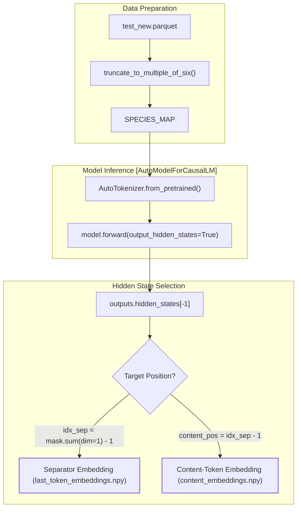
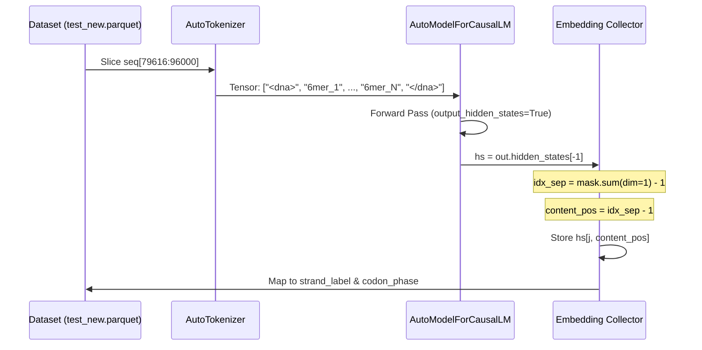

<!-- source: DeepWiki mcp.deepwiki.com · repo huggingface/carbon · page 4.1 Embedding Extraction · fetched 2026-10-26 -->

# Embedding Extraction

Relevant source files

The following files were used as context for generating this wiki page:

- [clustering/README.md](clustering/README.md)
- [clustering/embedding_extraction/extract_content_token_embeddings.py](clustering/embedding_extraction/extract_content_token_embeddings.py)
- [clustering/embedding_extraction/extract_separator_embeddings.py](clustering/embedding_extraction/extract_separator_embeddings.py)
- [clustering/plots/plot_cluster_stats.py](clustering/plots/plot_cluster_stats.py)
- [clustering/plots/plot_content_token_umap_svm.py](clustering/plots/plot_content_token_umap_svm.py)
- [clustering/plots/plot_context_length_ablation.py](clustering/plots/plot_context_length_ablation.py)
- [clustering/plots/plot_svm_cluster_grid.py](clustering/plots/plot_svm_cluster_grid.py)
- [finetuning/finetune_sft.py](finetuning/finetune_sft.py)
- [finetuning/fns_trainer.py](finetuning/fns_trainer.py)

The Carbon-3B model learns structured internal representations of genomic sequences that organize data according to biological factors such as taxonomy, strand orientation, and codon phase [clustering/README.md:1-4](). This page details the technical implementation of extracting these representations using two distinct scripts that target different token positions within the model's hidden states.

## Overview of Extraction Targets

The extraction process focuses on two adjacent hidden states at the end of a DNA sequence. Despite their proximity, they capture different scales of biological information [clustering/README.md:9-16]().

| Embedding Type | Token Position | Biological Signal | Script |
| :--- | :--- | :--- | :--- |
| **Separator** | `</dna>` (Final token) | Taxonomic background, genome-level regularities | `extract_separator_embeddings.py` |
| **Content-token** | Final DNA 6-mer | Strand orientation, codon phase | `extract_content_token_embeddings.py` |

### Data Preparation and Preprocessing
Both scripts utilize a held-out eukaryotic dataset centered on CDS (Coding Sequence) annotations to ensure strand and phase are well-defined [clustering/README.md:27-31]().

*   **Dataset:** `eukaryote/test_new.parquet` [clustering/README.md:27]().
*   **Preprocessing:** Sequences are truncated using `truncate_to_multiple_of_six` to ensure they align with the 6-mer tokenizer boundaries [clustering/embedding_extraction/extract_content_token_embeddings.py:35-37]().
*   **Species Mapping:** Taxonomic tags (e.g., `<fng>`, `<pln>`) are mapped to human-readable labels (fungi, plant, etc.) [clustering/embedding_extraction/extract_content_token_embeddings.py:28-31]().

### Code Entity Space: Extraction Workflow
The following diagram maps the logical extraction steps to the specific code implementations within the `clustering/embedding_extraction/` directory.

Sources: [clustering/embedding_extraction/extract_content_token_embeddings.py:35-94](), [clustering/embedding_extraction/extract_separator_embeddings.py:85-115]()

---

## Separator Embedding Extraction

The `extract_separator_embeddings.py` script is designed to probe how context length affects the model's ability to cluster sequences by taxonomy [clustering/README.md:80-85]().

### Implementation Details
*   **Slicing:** The script takes the *last* window of the sequence based on the requested length: `s[-args.max_length:]` [clustering/embedding_extraction/extract_separator_embeddings.py:95]().
*   **Tokenization:** Sequences are wrapped in `<dna>...</dna>` tags to route them to the 6-mer tokenizer mode [clustering/embedding_extraction/extract_separator_embeddings.py:95-96]().
*   **Extraction Logic:** It identifies the position of the `</dna>` token using the sum of the `attention_mask` [clustering/embedding_extraction/extract_separator_embeddings.py:109-112]().
*   **Metrics:** After extraction, `compute_metrics` calculates kNN accuracy, Adjusted Rand Index (ARI), and Normalized Mutual Information (NMI) using `KMeans(n_clusters=6)` [clustering/embedding_extraction/extract_separator_embeddings.py:36-53]().

### Context-Length Sweep
The extraction is typically run at three scales to observe monotonic improvement in taxonomic resolution:
1.  **8k bp:** Partially overlapping taxonomic clouds.
2.  **16k bp:** Increasing compactness.
3.  **48k bp:** High-resolution separation, particularly for mammalian vertebrates [clustering/README.md:97-103]().

Sources: [clustering/embedding_extraction/extract_separator_embeddings.py:8-10](), [clustering/embedding_extraction/extract_separator_embeddings.py:109-115](), [clustering/README.md:99-103]()

---

## Content-Token Embedding Extraction

The `extract_content_token_embeddings.py` script extracts the hidden state of the final 6-mer DNA token (the token immediately preceding the `</dna>` separator) [clustering/embedding_extraction/extract_content_token_embeddings.py:6-9]().

### Implementation Details
*   **Slicing:** Uses a 16,384 bp window centered on CDS annotations, specifically `seq[96000 - 16384 : 96000]` [clustering/embedding_extraction/extract_content_token_embeddings.py:8-24]().
*   **Positioning:** The script calculates the content position as `idx_sep[j].item() - 1` [clustering/embedding_extraction/extract_content_token_embeddings.py:89]().
*   **Codon Phase Calculation:** It computes the ground-truth codon phase as the offset between the start of the slice and the CDS start: `(df['start'] - SLICE_START) % 3` [clustering/embedding_extraction/extract_content_token_embeddings.py:45]().

### Data Flow: Content Extraction
The diagram below illustrates the precise indexing logic used to separate content from separators in the hidden state tensor.

Sources: [clustering/embedding_extraction/extract_content_token_embeddings.py:43-92](), [clustering/README.md:31]()

### Emergent Structure
The content-token geometry is used to demonstrate that the model recovers 3-phase codon information and strand orientation even when using a 6-mer tokenizer [clustering/README.md:121-123](). 

*   **Phase 0:** Codon-aligned.
*   **Phase +1/+2:** Shifted by 1 or 2 bases [clustering/README.md:18]().

Sources: [clustering/embedding_extraction/extract_content_token_embeddings.py:45](), [clustering/README.md:123]()

---

## Analysis Pipeline Integration

Once extracted, these `.npy` files serve as the input for the visualization and clustering suite [clustering/README.md:54-63]().

1.  **UMAP Projection:** 3D UMAP (`n_neighbors=100`, cosine metric) is computed on the raw embeddings [clustering/plots/plot_content_token_umap_svm.py:77-81]().
2.  **SVM Boundary:** A `LinearSVM(C=1.0)` is fit on the (U1, U2) plane to partition the data into "left" and "right" clusters [clustering/plots/plot_content_token_umap_svm.py:96-106]().
3.  **Round-2 Analysis:** Each cluster is re-embedded independently to reveal the internal strand and phase organization [clustering/plots/plot_content_token_umap_svm.py:117]().

Sources: [clustering/plots/plot_content_token_umap_svm.py:77-117](), [clustering/README.md:113-117]()

---

