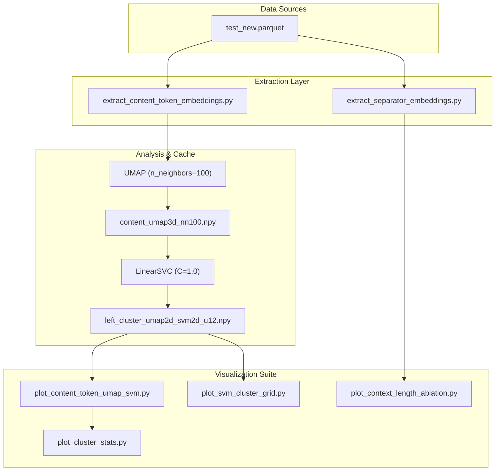
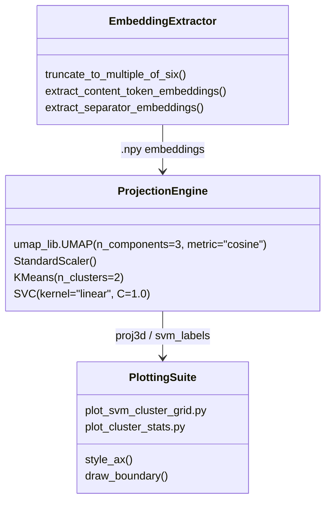

<!-- source: DeepWiki mcp.deepwiki.com · repo huggingface/carbon · page 4.2 UMAP, SVM Analysis, and Visualization · fetched 2026-10-26 -->

# UMAP, SVM Analysis, and Visualization

Relevant source files

The following files were used as context for generating this wiki page:

- [clustering/README.md](clustering/README.md)
- [clustering/embedding_extraction/extract_content_token_embeddings.py](clustering/embedding_extraction/extract_content_token_embeddings.py)
- [clustering/embedding_extraction/extract_separator_embeddings.py](clustering/embedding_extraction/extract_separator_embeddings.py)
- [clustering/figures/carbon_last_token_nn100_row.png](clustering/figures/carbon_last_token_nn100_row.png)
- [clustering/figures/round2_left_umap12_svm2d.png](clustering/figures/round2_left_umap12_svm2d.png)
- [clustering/figures/round2_right_umap12_svm2d.png](clustering/figures/round2_right_umap12_svm2d.png)
- [clustering/figures/umap12_cluster_stats_svm2d.png](clustering/figures/umap12_cluster_stats_svm2d.png)
- [clustering/figures/umap12_clusters_overlay_svm2d.png](clustering/figures/umap12_clusters_overlay_svm2d.png)
- [clustering/plots/plot_cluster_stats.py](clustering/plots/plot_cluster_stats.py)
- [clustering/plots/plot_content_token_umap_svm.py](clustering/plots/plot_content_token_umap_svm.py)
- [clustering/plots/plot_context_length_ablation.py](clustering/plots/plot_context_length_ablation.py)
- [clustering/plots/plot_svm_cluster_grid.py](clustering/plots/plot_svm_cluster_grid.py)
- [finetuning/finetune_sft.py](finetuning/finetune_sft.py)
- [finetuning/fns_trainer.py](finetuning/fns_trainer.py)

This page covers the post-extraction analysis pipeline for genomic embeddings in the Carbon project. The pipeline utilizes 3D UMAP projections to identify global structures, Linear Support Vector Machines (SVM) to define cluster boundaries, and iterative Round-2 UMAPs to resolve fine-grained biological features like strand orientation and codon phase.

## Analysis Pipeline Overview

The analysis follows a multi-stage workflow designed to probe the internal representations of the Carbon-3B model. The process transitions from high-dimensional hidden states to interpretable 2D/3D visualizations and quantitative quality metrics.

### Data Flow and Implementation

1.  **3D UMAP Projection**: High-dimensional embeddings (e.g., shape 29411 × D) are projected into 3D space using `umap-learn` with a cosine metric and `n_neighbors=100` [clustering/plots/plot_content_token_umap_svm.py:70-81]().
2.  **Linear SVM Separation**: The first two UMAP dimensions (U1, U2) are standardized using `StandardScaler`. A `LinearSVC(C=1.0)` is fitted on labels initialized via `KMeans(n_clusters=2)` to find the optimal linear boundary separating the two primary data clouds [clustering/plots/plot_content_token_umap_svm.py:88-102]().
3.  **Round-2 UMAP**: Data points are split into "left" and "right" clusters based on the SVM boundary. Each cluster is then re-embedded independently using 2D UMAP to reveal local organization that was previously compressed or obscured [clustering/plots/plot_content_token_umap_svm.py:183-200]().
4.  **Metric Calculation**: Quality of the representation is measured using K-Nearest Neighbors (KNN) accuracy, Adjusted Rand Index (ARI), and Normalized Mutual Information (NMI) [clustering/README.md:99-103]().

### System Component Interaction

The following diagram illustrates how the extraction scripts feed into the visualization and analysis suite, utilizing the `test_new.parquet` dataset.

**Diagram: Embedding Analysis Workflow**

**Sources:** [clustering/README.md:40-50](), [clustering/plots/plot_content_token_umap_svm.py:19-25](), [clustering/embedding_extraction/extract_content_token_embeddings.py:18-24]()

---

## Content-Token Embedding Analysis

Content-token embeddings are extracted from the final DNA 6-mer hidden state, which is the token immediately preceding the `</dna>` separator [clustering/embedding_extraction/extract_content_token_embeddings.py:6-9]().

### Emergent Biological Structure
Analysis reveals that while the primary UMAP axis (U1) captures an unresolved source of variation (possibly broad compositional or phylogenetic factors), the local geometry within clusters is dominated by:
*   **Strand Orientation**: Separation between forward (+) and reverse (-) strands [clustering/README.md:121-122]().
*   **Codon Phase**: The offset (0, 1, or 2) between the 6-mer tokenization boundary and the canonical codon frame. Carbon-3B recovers this 3-phase structure despite using non-overlapping 6-mer tokens [clustering/README.md:15-18](), [clustering/README.md:123]().

### SVM and Cluster Visualization
The script `plot_content_token_umap_svm.py` generates the primary 3D to 2D mapping and SVM boundary plots.

| Script | Output File | Purpose |
| :--- | :--- | :--- |
| `plot_content_token_umap_svm.py` | `umap12_clusters_overlay_svm2d.pdf` | Shows global U1/U2 with SVM boundary overlay [clustering/plots/plot_content_token_umap_svm.py:136-178](). |
| `plot_svm_cluster_grid.py` | `merged_svm_grid.pdf` | A 2×3 grid comparing strand/phase across global and per-cluster views [clustering/plots/plot_svm_cluster_grid.py:107-161](). |
| `plot_cluster_stats.py` | `umap12_cluster_stats_svm2d.png` | Bar charts showing the % breakdown of species, strand, and phase per cluster [clustering/plots/plot_cluster_stats.py:86-111](). |

**Sources:** [clustering/README.md:68-79](), [clustering/plots/plot_content_token_umap_svm.py:2-7](), [clustering/README.md:121-125]()

---

## Separator Embedding and Context Ablation

Separator embeddings are extracted from the `</dna>` token position [clustering/README.md:13](). These embeddings specialize in capturing genome-level and taxonomic structures.

### Context-Length Sweep
The script `plot_context_length_ablation.py` visualizes how taxonomic separation improves as the model sees more context (8 kb vs 16 kb vs 48 kb). Metrics improve monotonically with length, with mammalian vertebrates forming a compact isolated region at 48 kb [clustering/README.md:97-98]().

**Metric Improvements with Context:**
| Context Length | KNN Acc | ARI | NMI |
| :--- | :--- | :--- | :--- |
| 8 kb | 0.985 | 0.274 | 0.377 |
| 16 kb | 0.990 | 0.316 | 0.415 |
| 48 kb | 0.995 | 0.380 | 0.474 |

**Sources:** [clustering/README.md:99-103](), [clustering/README.md:95-98]()

---

## Implementation Details: Code Entity Mapping

The following diagram maps the high-level analysis concepts to specific classes and functions in the `clustering/` directory.

**Diagram: Analysis Implementation Map**

**Sources:** [clustering/embedding_extraction/extract_content_token_embeddings.py:35-37](), [clustering/plots/plot_content_token_umap_svm.py:77-80](), [clustering/plots/plot_content_token_umap_svm.py:89-102](), [clustering/plots/plot_svm_cluster_grid.py:52-57]()

### Key Variables and Constants
*   `NN = 100`: The number of neighbors used for UMAP manifold construction [clustering/plots/plot_content_token_umap_svm.py:23]().
*   `SLICE_START = 96000 - 16384`: Defines the genomic window (79,616 to 96,000) centered on CDS annotations for eukaryotic analysis [clustering/embedding_extraction/extract_content_token_embeddings.py:24]().
*   `SPECIES_MAP`: Maps token tags (e.g., `<mam>`, `<fng>`) to human-readable taxonomic groups like `vertebrate_mammalian` or `fungi` [clustering/plots/plot_content_token_umap_svm.py:26-29]().
*   `PHASE_CLR`: Consistent color palette for codon phases (0: Dark Green, 1: Yellow, 2: Brown) [clustering/plots/plot_content_token_umap_svm.py:42]().
*   `STRAND_CLR`: Color mapping for strand orientation (Forward: Dark Green, Reverse: Yellow) [clustering/plots/plot_svm_cluster_grid.py:36]().

**Sources:** [clustering/plots/plot_content_token_umap_svm.py:26-43](), [clustering/embedding_extraction/extract_content_token_embeddings.py:24-31](), [clustering/plots/plot_svm_cluster_grid.py:36-37]()

---

