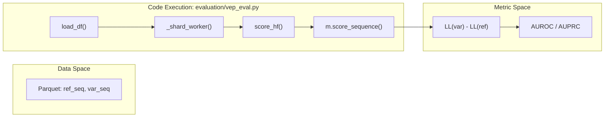

<!-- source: DeepWiki mcp.deepwiki.com · repo huggingface/carbon · page 5 Glossary · fetched 2026-10-26 -->

# Glossary

<details>
<summary>Relevant source files</summary>

The following files were used as context for generating this wiki page:

- [.gitignore](.gitignore)
- [LICENSE](LICENSE)
- [README.md](README.md)
- [clustering/README.md](clustering/README.md)
- [evaluation/README.md](evaluation/README.md)
- [finetuning/README.md](finetuning/README.md)
- [finetuning/finetune_sft.py](finetuning/finetune_sft.py)
- [finetuning/fns_trainer.py](finetuning/fns_trainer.py)
- [pyproject.toml](pyproject.toml)
- [uv.lock](uv.lock)

</details>


This glossary defines the technical terminology, biological concepts, and architectural jargon specific to the Carbon codebase. It serves as a reference for onboarding engineers to understand how biological data maps to model implementation.

## 1. Model & Architecture Terms

### Hybrid Tokenizer
Carbon uses a dual-mode tokenizer that routes between standard natural language (BPE) and genomic sequences (6-mer).
*   **`<dna>` tag**: A special control token used to signal the transition from natural language processing to DNA processing. When the tokenizer encounters this tag, it switches to 6-mer mode [README.md:34-37](), [evaluation/README.md:52-55]().
*   **6-mer**: The fundamental unit of DNA tokenization in Carbon, where 6 nucleotides (e.g., `ATGGCG`) are treated as a single token. This reduces sequence length by a factor of 6 compared to single-nucleotide tokenization [README.md:104-104](), [evaluation/README.md:52-55]().

### Hybrid Loss
A specialized objective function used during pretraining to bridge the gap between coarse 6-mer tokenization and the need for single-nucleotide resolution in genomic tasks [README.md:104-104]().

### Factorized Nucleotide Supervision (FNS)
A fine-tuning technique that provides base-pair level loss for DNA k-mer tokens while maintaining standard token-level loss for BPE tokens. It marginalizes token-level predictions to nucleotide-level probabilities to provide finer-grained supervision [finetuning/README.md:144-161]().
*   **`FNSTrainer`**: The custom implementation of the Transformers `Trainer` that calculates the marginalized nucleotide cross-entropy loss [finetuning/fns_trainer.py:6-11]().

### DNA Tag Routing
The mechanism by which the model is prompted to use its DNA-specific weights and tokenization logic. In code, this is implemented by prepending the `<dna>` string to input sequences [README.md:69-72](), [evaluation/README.md:57-59]().

**Natural Language Space to Code Entity Space: Tokenization Routing**
```mermaid
graph TD
    subgraph "Natural Language Space"
        ["User DNA Prompt"] --> B["'ATGGC...'"]
    end

    subgraph "Code Entity Space"
        B --> C["evaluation/README.md"]
        C -- "add_dna_tag flag" --> D["<dna>ATGGC..."]
        D --> E["AutoTokenizer"]
        E -- "Routes to 6-mer" --> F["Model Hidden States"]
    end
```
Sources: [README.md:34-37](), [README.md:69-72](), [evaluation/README.md:52-59](), [finetuning/finetune_sft.py:87-90]().

---

## 2. Biological Concepts in Code

### CDS (Coding Sequence)
Portions of the genome that are translated into proteins. In the `clustering/` subsystem, sequences are often centered around CDS annotations to analyze how the model represents protein-coding information [clustering/README.md:31-31]().

### Codon Phase
The offset (0, +1, or +2) between the 6-mer tokenization boundary and the biological codon frame (triplets).
*   **Phase 0**: The 6-mer token is perfectly aligned with two codons.
*   **Phases 1/2**: The 6-mer token is shifted by 1 or 2 nucleotides relative to the codon start [clustering/README.md:18-19]().

### Strand Orientation
DNA is double-stranded (Forward and Reverse). The model must represent which strand a sequence belongs to.
*   **`rev_comp_avg`**: A technique used in `vep_eval.py` where a variant is scored on both the forward window and its reverse-complement, with the results averaged to ensure strand-symmetric scoring [evaluation/vep_eval.py:75-79]().

### SNV (Single Nucleotide Variant)
A variation in a single DNA base pair. This is the primary unit of analysis for Variant Effect Prediction (VEP) tasks [evaluation/vep_eval.py:4-7]().

---

## 3. Evaluation Metrics & Logic

### VEP (Variant Effect Prediction)
Predicting the functional impact of a genetic mutation.
*   **Full-LL Delta**: A scoring method where the log-likelihood (LL) of the entire sequence window is calculated for both the reference (`ref`) and variant (`var`) sequences. The score is `LL(var) - LL(ref)` [evaluation/vep_eval.py:4-5](), [evaluation/README.md:133-137]().
*   **Next-Token Scoring**: An alternative VEP method (used for ClinVar) where the model predicts the likelihood of the specific variant nucleotide given the preceding left-context [evaluation/clinvar_vep_eval.py:15-17](), [evaluation/README.md:33-36]().

### Sequence Recovery
A generative task measuring the model's ability to predict the next $N$ base pairs (usually 30 bp) of a held-out genomic sequence [README.md:130-130](), [evaluation/sequence_recovery.py:20-20]().

### Genome-NIAH (Needle-In-A-Haystack)
A long-context retrieval benchmark. A specific "needle" (a key-value DNA pair) is hidden inside a "haystack" (a long genomic sequence). The model is tested on its ability to retrieve the value when prompted with the key [evaluation/genome_niah_eval.py:4-6](), [evaluation/README.md:14-14]().

**System Logic: VEP Scoring Pipeline**

Sources: [evaluation/vep_eval.py:4-17](), [evaluation/vep_eval.py:90-106](), [evaluation/vep_eval.py:172-174]().

---

## 4. Architectural Components

| Term | Implementation File | Description |
| :--- | :--- | :--- |
| **`score_sequence`** | Model Remote Code | A custom method in Carbon models that provides base-pair level log-probabilities, bypassing standard token-level constraints [evaluation/vep_eval.py:104-107](). |
| **`FNSTrainer`** | `finetuning/fns_trainer.py` | A specialized trainer that computes `_marginal_bp_loss` by summing token probabilities into 4-class nucleotide probabilities [finetuning/fns_trainer.py:129-154](). |
| **`vortex`** | `evo2` dependency | A model-parallel loading library used for the Evo2 backend to distribute large models (20B/40B) across multiple GPUs [evaluation/slurm/README.md:36-38](). |
| **`YaRN`** | `evaluation/genome_niah_eval.py` | Yet another RoPE extensioN; a technique for scaling the context window of the model (e.g., up to 128k tokens) [evaluation/genome_niah_eval.py:91-92](). |
| **`Separator Embedding`** | `clustering/embedding_extraction/` | The hidden state extracted at the `</dna>` token. It captures taxonomic and genome-level structure [clustering/README.md:11-13](). |
| **`Content-Token Embedding`** | `clustering/embedding_extraction/` | The hidden state of the final DNA 6-mer token. It captures local features like strand and codon phase [clustering/README.md:14-14](). |

Sources: [evaluation/vep_eval.py:104-107](), [finetuning/fns_trainer.py:129-154](), [evaluation/slurm/README.md:36-38](), [evaluation/genome_niah_eval.py:91-92](), [clustering/README.md:9-16]().