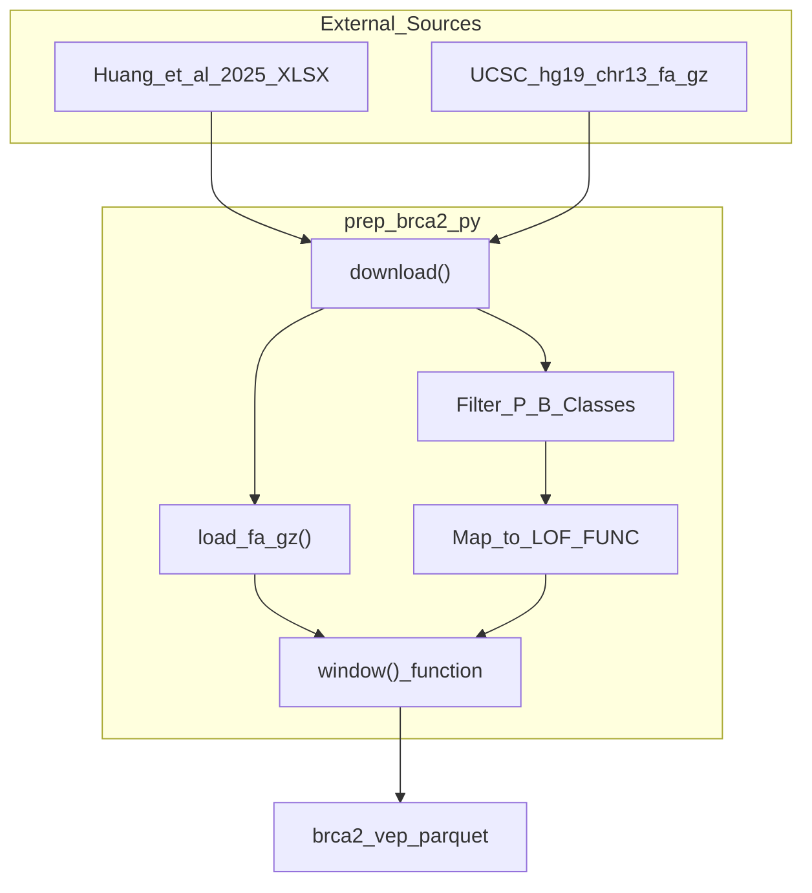
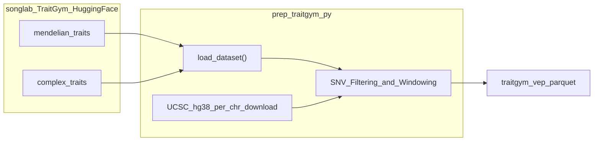

<!-- source: DeepWiki mcp.deepwiki.com · repo huggingface/carbon · extra page VEP Dataset Preparation · fetched 2026-10-26 -->

# VEP Dataset Preparation

Relevant source files

The following files were used as context for generating this wiki page:

- [evaluation/data_prep/README.md](evaluation/data_prep/README.md)
- [evaluation/data_prep/prep_brca2.py](evaluation/data_prep/prep_brca2.py)
- [evaluation/data_prep/prep_traitgym.py](evaluation/data_prep/prep_traitgym.py)

The `evaluation/data_prep/` directory contains scripts used to reconstruct Variant Effect Prediction (VEP) datasets from primary biological sources. While the evaluation suite defaults to pre-built parquets hosted on the Hugging Face Hub, these scripts provide transparency into the filtering, windowing, and labeling logic used to create the benchmarks [evaluation/data_prep/README.md:3-7]().

### Core Objective and Shared Schema

The primary goal of the preparation scripts is to transform raw variant tables (from Excel supplements or other dataset repositories) into a standardized Parquet format compatible with the `vep_eval.py` scoring engine [evaluation/data_prep/README.md:13-15]().

| Column | Description |
| :--- | :--- |
| `chrom` | Chromosome identifier (e.g., "13", "chr13"). |
| `pos` | 1-based genomic position of the variant. |
| `ref` | Reference nucleotide (single base for SNVs). |
| `alt` | Alternative nucleotide (single base for SNVs). |
| `score` | Continuous value (e.g., mean functional score or PIP). |
| `class` | Binary categorical label: `LOF` (Loss of Function) or `FUNC/INT` (Functional/Interesting). |
| `ref_seq` | The 8,192 bp genomic window centered on the variant from the reference genome. |
| `var_seq` | The same 8,192 bp window with the center base replaced by the `alt` allele. |

Sources: [evaluation/data_prep/prep_brca2.py:12-13](), [evaluation/data_prep/prep_traitgym.py:14-16](), [evaluation/data_prep/README.md:13-15]()

### BRCA2 Dataset Construction (`prep_brca2.py`)

The BRCA2 benchmark is derived from Huang et al. (2025) and focuses on DNA Binding Domain (DBD) Single Nucleotide Variants (SNVs) [evaluation/data_prep/prep_brca2.py:2-6]().

#### Data Flow and Processing
1.  **Source Retrieval**: Downloads the Nature 2025 supplementary Excel (Table S3) and the `hg19` chr13 reference from UCSC [evaluation/data_prep/prep_brca2.py:84-87]().
2.  **Filtering**: Filters variants based on ACMG-style functional classes. It keeps "Strong", "Moderate", and "Supporting" evidence for both Pathogenic (P) and Benign (B) labels, while dropping Variants of Uncertain Significance (VUS) [evaluation/data_prep/prep_brca2.py:100-103]().
3.  **Label Mapping**: Collapses classes into a binary format: P* becomes `LOF` and B* becomes `FUNC/INT` [evaluation/data_prep/prep_brca2.py:105-105]().
4.  **Sequence Extraction**: Uses the `window` function to slice an 8,192 bp window centered on the variant position [evaluation/data_prep/prep_brca2.py:68-77](). It performs a safety check to ensure the reference base in the FASTA matches the `ref` column in the metadata [evaluation/data_prep/prep_brca2.py:75-76]().

#### BRCA2 Preparation Logic
The following diagram illustrates the transformation from raw Excel data to the final evaluation-ready Parquet.

**BRCA2 Data Preparation Pipeline**

Sources: [evaluation/data_prep/prep_brca2.py:49-77](), [evaluation/data_prep/prep_brca2.py:84-130]()

### TraitGym Dataset Construction (`prep_traitgym.py`)

The TraitGym preparation script handles two distinct configurations: `mendelian_traits` (monogenic regulatory variants) and `complex_traits` (polygenic fine-mapped variants) [evaluation/data_prep/prep_traitgym.py:4-9]().

#### Implementation Details
*   **Reference Genome**: Unlike BRCA2, TraitGym uses `hg38`. The script dynamically downloads the required chromosome FASTA files from UCSC based on the variants present in the source [evaluation/data_prep/prep_traitgym.py:100-104]().
*   **PIP Scores**: For `complex_traits`, the Posterior Inclusion Probability (PIP) is preserved in the `score` column [evaluation/data_prep/prep_traitgym.py:121-121]().
*   **SNV Filtering**: Explicitly ensures only single-base substitutions are processed [evaluation/data_prep/prep_traitgym.py:94-96]().
*   **Windowing**: Uses a 8,192 bp window. If the variant is too close to the chromosome edge to fulfill the window size, the variant is dropped [evaluation/data_prep/prep_traitgym.py:77-78]().

**TraitGym Configuration Mapping**

Sources: [evaluation/data_prep/prep_traitgym.py:36-37](), [evaluation/data_prep/prep_traitgym.py:88-108](), [evaluation/data_prep/prep_traitgym.py:112-124]()

### ClinVar Sourcing Strategy

Unlike BRCA2 and TraitGym, ClinVar does not have a local preparation script in `data_prep/`. Instead, the production evaluation script `clinvar_vep_eval.py` directly pulls a curated dataset: `HuggingFaceBio/clinvar-vep-final` [evaluation/data_prep/README.md:22-24]().

This dataset is a composite of:
1.  **GenerTeam ClinVar Release**: Primarily covering coding variants [evaluation/data_prep/README.md:25-26]().
2.  **Carbon-curated Noncoding Split**: Augmented data specifically targeting non-coding regions to test the foundation model's regulatory understanding [evaluation/data_prep/README.md:26-27]().

### Key Functions and Utilities

| Function | File | Role |
| :--- | :--- | :--- |
| `download(url, dst)` | `prep_brca2.py` / `prep_traitgym.py` | Handles cached retrieval of large genomic files and supplements [evaluation/data_prep/prep_brca2.py:49-57](). |
| `load_fa_gz(path)` | `prep_brca2.py` / `prep_traitgym.py` | Decompresses and parses `.fa.gz` files into a single uppercase string [evaluation/data_prep/prep_brca2.py:59-66](). |
| `window(chrom_seq, pos, ...)` | `prep_brca2.py` / `prep_traitgym.py` | Extracts centered genomic context and generates the mutated `var_seq` [evaluation/data_prep/prep_brca2.py:68-77](). |

Sources: [evaluation/data_prep/prep_brca2.py:49-77](), [evaluation/data_prep/prep_traitgym.py:53-80]()

---

