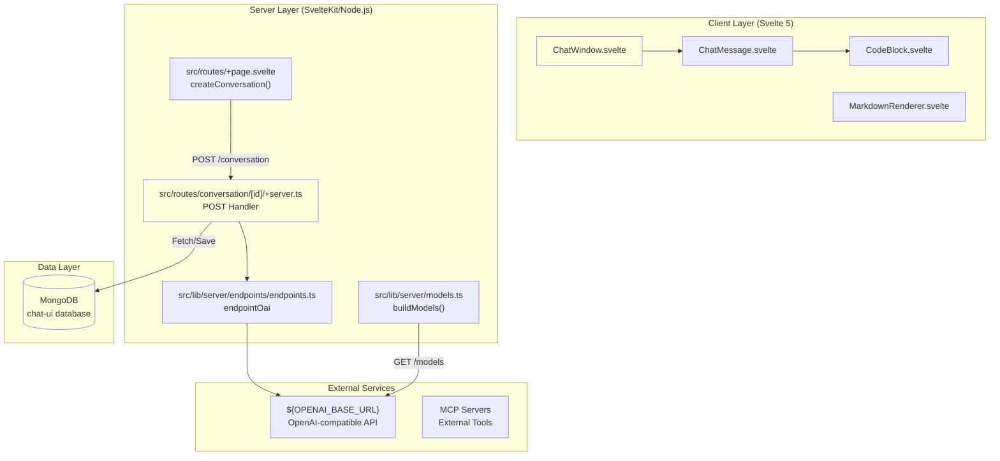
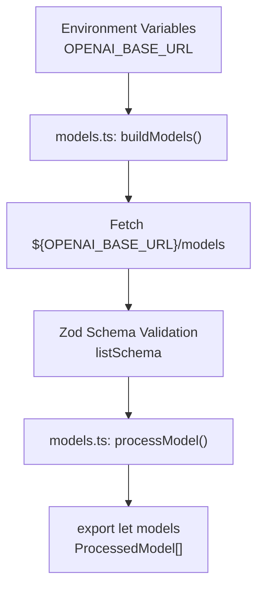

<!-- source: DeepWiki mcp.deepwiki.com · repo huggingface/chat-ui · page 1 Overview · fetched 2026-10-26 -->

# Overview

Relevant source files

The following files were used as context for generating this wiki page:

- [README.md](README.md)
- [docs/source/configuration/common-issues.md](docs/source/configuration/common-issues.md)
- [docs/source/configuration/llm-router.md](docs/source/configuration/llm-router.md)
- [docs/source/configuration/mcp-tools.md](docs/source/configuration/mcp-tools.md)
- [docs/source/configuration/overview.md](docs/source/configuration/overview.md)
- [docs/source/developing/architecture.md](docs/source/developing/architecture.md)
- [docs/source/index.md](docs/source/index.md)
- [package-lock.json](package-lock.json)
- [package.json](package.json)
- [src/app.html](src/app.html)
- [src/lib/components/CodeBlock.svelte](src/lib/components/CodeBlock.svelte)
- [src/lib/components/chat/ChatIntroduction.svelte](src/lib/components/chat/ChatIntroduction.svelte)
- [src/lib/server/endpoints/endpoints.ts](src/lib/server/endpoints/endpoints.ts)
- [src/lib/server/models.ts](src/lib/server/models.ts)
- [src/routes/+page.svelte](src/routes/+page.svelte)
- [src/routes/logout/+server.ts](src/routes/logout/+server.ts)
- [vite.config.ts](vite.config.ts)

Chat UI is a SvelteKit-based chat interface for Large Language Models. It is designed as a customizable, self-hostable application that supports multiple LLM providers through an OpenAI-compatible interface with intelligent routing capabilities. The codebase powers HuggingChat at [https://huggingface.co/chat](https://huggingface.co/chat).

## Purpose and Core Functionality

Chat UI provides a web interface for interacting with Large Language Models through OpenAI-compatible APIs. The system allows users to:

1.  Engage in conversations with different AI models.
2.  Switch between models or use the intelligent LLM Router ("Omni") for automatic model selection.
3.  Customize model parameters and system prompts.
4.  Upload files and images for multimodal conversations.
5.  Create and manage custom assistants with specific configurations.
6.  Use external tools via the **Model Context Protocol (MCP)**.
7.  Share conversations and manage conversation history.

The application connects to any OpenAI-compatible endpoint via `OPENAI_BASE_URL`, including Hugging Face Router, OpenAI, llama.cpp servers, Ollama, OpenRouter, and other compatible providers.

Sources: [README.md:1-6](), [README.md:14-16](), [docs/source/index.md:1-11](), [src/lib/server/models.ts:207-212]()

## High-Level Architecture

**System Architecture Diagram**

The system follows a layered architecture:

1.  **Client Layer**: SvelteKit components using Svelte 5 runes render the chat interface. `ChatWindow` manages the conversation state, while `CodeBlock` handles syntax highlighting and HTML/SVG previews. [src/lib/components/CodeBlock.svelte:1-45](), [src/routes/+page.svelte:182-189]()
2.  **Server Layer**: API routes handle message processing. `src/routes/+page.svelte` initiates conversation creation via `createConversation()`. [src/routes/+page.svelte:33-117]()
3.  **LLM Integration Layer**: Abstracts LLM providers through OpenAI-compatible endpoints. The `endpointOai` function in the endpoints system handles the actual communication with the upstream API. [src/lib/server/endpoints/endpoints.ts:40-45]()
4.  **Data Layer**: MongoDB stores conversations, user data, and settings. It falls back to an embedded MongoDB (via `mongodb-memory-server` in dev) if `MONGODB_URL` is unset. [package.json:55-55](), [README.md:58-60]()
5.  **External Services**: Connects to any service speaking the OpenAI protocol at `OPENAI_BASE_URL`. [README.md:14-16]()

Sources: [src/routes/+page.svelte:1-198](), [src/lib/server/models.ts:1-150](), [src/lib/components/CodeBlock.svelte:1-87](), [package.json:74-113]()

## Key Components

### Web UI (SvelteKit & Svelte 5)

The user interface is built with SvelteKit and Svelte 5. Key components include:

1.  **ChatWindow**: The primary interface for conversation display and interaction. [src/routes/+page.svelte:9-10]()
2.  **CodeBlock**: Renders code snippets with syntax highlighting using `highlight.js` and provides "Preview" functionality for HTML5 and SVG documents. [src/lib/components/CodeBlock.svelte:18-45]()
3.  **ChatIntroduction**: Displays the landing state of the application with the application name and description. [src/lib/components/chat/ChatIntroduction.svelte:22-45]()

Sources: [src/lib/components/CodeBlock.svelte:1-87](), [src/routes/+page.svelte:1-198](), [src/lib/components/chat/ChatIntroduction.svelte:1-86]()

### Model Discovery and Configuration

**Model Discovery Flow**

Chat UI sources models dynamically:

1.  **Model Discovery**: `buildModels()` fetches available models from the configured `OPENAI_BASE_URL`. [src/lib/server/models.ts:206-215]()
2.  **Validation**: Responses are validated against a Zod `listSchema` to ensure compatibility. [src/lib/server/models.ts:92-110]()
3.  **Metadata Enrichment**: `processModel()` handles preprompt fetching from URLs and sets up model parameters like `stop_sequences`. [src/lib/server/models.ts:127-135]()
4.  **Endpoint Assignment**: Each model is assigned a `getEndpoint` function that defaults to the OpenAI implementation. [src/lib/server/models.ts:137-150]()

Sources: [src/lib/server/models.ts:1-205](), [src/lib/server/endpoints/endpoints.ts:1-45]()

### LLM Router (Omni)

Chat UI includes an optional "Omni" router system. It selects the best model for a request based on heuristics:
*   **Multimodal**: Images trigger a multimodal route. [README.md:129-131]()
*   **Agentic**: Requests requiring MCP tools use an agentic route. [README.md:129-131]()
*   **Default**: Standard text requests use the default route. [README.md:131-131]()

Sources: [README.md:127-141](), [src/lib/server/models.ts:9-10]()

## Configuration Overview

The application is configured through environment variables and a centralized config manager.

| Category | Key Variables | Purpose |
| :--- | :--- | :--- |
| **LLM Provider** | `OPENAI_BASE_URL` | The base URL for the OpenAI-compatible API. [src/lib/server/models.ts:87-89]() |
| **LLM Auth** | `OPENAI_API_KEY` | API key for the provider (or `HF_TOKEN` as legacy alias). [README.md:28-35]() |
| **Database** | `MONGODB_URL` | MongoDB connection string. [README.md:56-60]() |
| **Theming** | `PUBLIC_APP_NAME` | The name displayed throughout the UI. [README.md:113-119]() |
| **Routing** | `LLM_ROUTER_ROUTES_PATH` | Path to the JSON configuration for the Omni router. [README.md:131-132]() |

Sources: [README.md:24-41](), [src/lib/server/models.ts:87-90](), [package.json:1-113]()

## Deployment and Environment

The project uses Vite for development and building. It supports different SvelteKit adapters, primarily `@sveltejs/adapter-node` for standard deployments. [package.json:30-31](), [vite.config.ts:1-23]()

*   **Development**: `npm run dev` starts a Vite server on port 5173. [package.json:7-7]()
*   **Production**: `npm run build` generates a production-ready Node.js application. [package.json:8-8]()
*   **Testing**: Includes Vitest for unit/integration tests and Playwright for E2E testing. [package.json:15-19](), [vite.config.ts:43-102]()

Sources: [package.json:1-24](), [vite.config.ts:1-104](), [README.md:80-90]()

---

