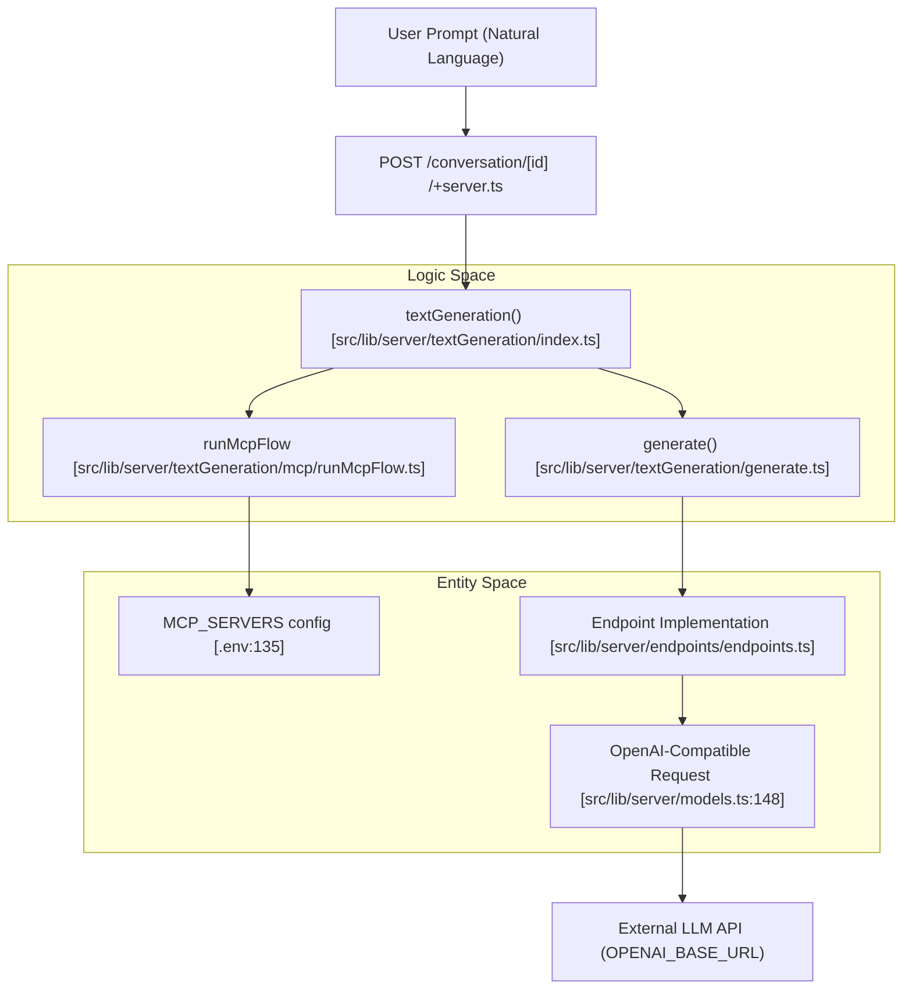
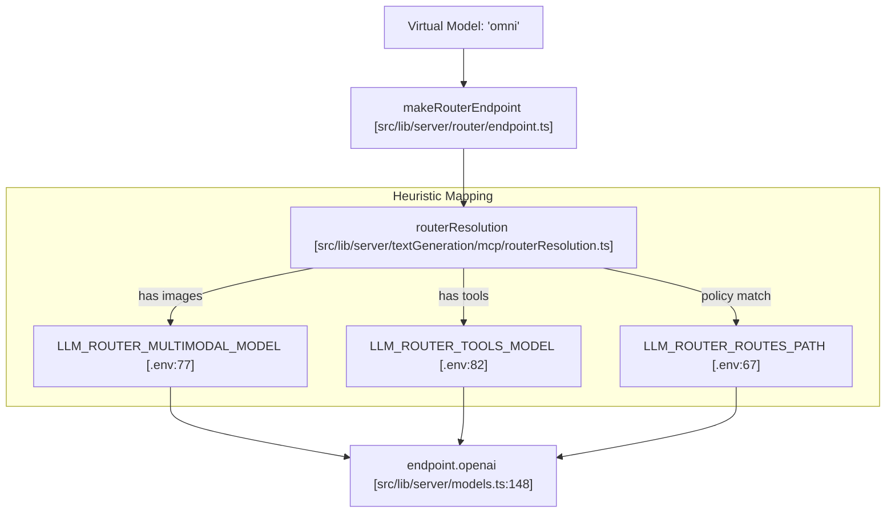

<!-- source: DeepWiki mcp.deepwiki.com · repo huggingface/chat-ui · page 10 Glossary · fetched 2026-10-26 -->

# Glossary

Relevant source files

The following files were used as context for generating this wiki page:

- [.env](.env)
- [README.md](README.md)
- [chart/env/dev.yaml](chart/env/dev.yaml)
- [chart/env/prod.yaml](chart/env/prod.yaml)
- [playwright.config.ts](playwright.config.ts)
- [src/hooks.server.ts](src/hooks.server.ts)
- [src/lib/components/chat/ChatMessage.svelte](src/lib/components/chat/ChatMessage.svelte)
- [src/lib/components/chat/ChatWindow.svelte](src/lib/components/chat/ChatWindow.svelte)
- [src/lib/components/chat/MarkdownBlock.svelte](src/lib/components/chat/MarkdownBlock.svelte)
- [src/lib/components/chat/MarkdownRenderer.svelte](src/lib/components/chat/MarkdownRenderer.svelte)
- [src/lib/server/auth.ts](src/lib/server/auth.ts)
- [src/lib/server/endpoints/endpoints.ts](src/lib/server/endpoints/endpoints.ts)
- [src/lib/server/mcp/clientPool.ts](src/lib/server/mcp/clientPool.ts)
- [src/lib/server/mcp/tools.test.ts](src/lib/server/mcp/tools.test.ts)
- [src/lib/server/mcp/tools.ts](src/lib/server/mcp/tools.ts)
- [src/lib/server/models.ts](src/lib/server/models.ts)
- [src/lib/server/router/endpoint.ts](src/lib/server/router/endpoint.ts)
- [src/lib/server/router/types.ts](src/lib/server/router/types.ts)
- [src/lib/server/textGeneration/mcp/routerResolution.ts](src/lib/server/textGeneration/mcp/routerResolution.ts)
- [src/lib/server/textGeneration/mcp/runMcpFlow.ts](src/lib/server/textGeneration/mcp/runMcpFlow.ts)
- [src/lib/server/urlSafety.test.ts](src/lib/server/urlSafety.test.ts)
- [src/lib/server/urlSafety.ts](src/lib/server/urlSafety.ts)
- [src/lib/types/User.ts](src/lib/types/User.ts)
- [src/lib/utils/markdownWorkerPool.ts](src/lib/utils/markdownWorkerPool.ts)
- [src/lib/utils/marked.ts](src/lib/utils/marked.ts)
- [src/lib/utils/markedLight.ts](src/lib/utils/markedLight.ts)
- [src/lib/utils/messageUpdates.spec.ts](src/lib/utils/messageUpdates.spec.ts)
- [src/lib/utils/messageUpdates.ts](src/lib/utils/messageUpdates.ts)
- [src/lib/workers/markdownWorker.ts](src/lib/workers/markdownWorker.ts)
- [src/routes/api/mcp/health/+server.ts](src/routes/api/mcp/health/+server.ts)
- [src/routes/conversation/[id]/+page.svelte](src/routes/conversation/[id]/+page.svelte)
- [src/routes/conversation/[id]/+server.ts](src/routes/conversation/[id]/+server.ts)
- [src/routes/login/callback/+server.ts](src/routes/login/callback/+server.ts)
- [src/routes/login/callback/updateUser.ts](src/routes/login/callback/updateUser.ts)
- [src/routes/r/[id]/+page.svelte](src/routes/r/[id]/+page.svelte)
- [static/huggingchat/routes.chat.json](static/huggingchat/routes.chat.json)
- [tests/mock-mcp.ts](tests/mock-mcp.ts)

This glossary defines codebase-specific terms, abbreviations, and domain concepts used within `chat-ui`.

## Core System Concepts

### Omni (LLM Router)
The "Omni" model is a virtual model alias that acts as an intelligent entry point for requests. Instead of routing to a static model, it uses a local heuristic-based routing system to analyze the user's intent and select the most appropriate model.

*   **Implementation**: Defined in `src/lib/server/models.ts` where it triggers the creation of a router endpoint [src/lib/server/models.ts:9]().
*   **Routing Logic**: Uses signals like image attachments, MCP server status, or a policy JSON file (configured via `LLM_ROUTER_ROUTES_PATH`) to classify the request [README.md:129-138]().
*   **Multimodal/Tools**: Bypasses standard routing if images are detected (routing to `LLM_ROUTER_MULTIMODAL_MODEL`) or if tools are required (routing to `LLM_ROUTER_TOOLS_MODEL`) [.env:75-82]().
*   **Metadata**: Emits `RouterMetadata` immediately upon selection so the UI can display which specific model and route were chosen [README.md:138-140]().

### MCP (Model Context Protocol)
A standard protocol that allows the LLM to interact with external tools and data sources. In `chat-ui`, MCP servers are treated as dynamic tool providers.

*   **Registry**: Manages the list of active servers, defined in the `MCP_SERVERS` environment variable [.env:135]().
*   **Forwarding**: Can forward the user's Hugging Face access token to MCP servers if `MCP_FORWARD_HF_USER_TOKEN` is enabled [.env:137]().
*   **Tool Execution**: Managed via the `runMcpFlow` and tool invocation logic to handle the interaction between LLM tool calls and remote endpoints [src/lib/server/textGeneration/mcp/runMcpFlow.ts]().

### Message Tree
Conversations in `chat-ui` are stored as a tree structure where each message can have `ancestors` and `children`. This allows for "branching" when a user edits an old message or retries an assistant response.

*   **Traversal**: The frontend uses `createMessagesPath` to resolve the linear path of messages from the root to the current leaf [src/routes/conversation/[id]/+page.svelte:73-114]().
*   **Branching Logic**: New branches are created using `addSibling` and `addChildren` utilities when editing or retrying [src/routes/conversation/[id]/+page.svelte:176-196]().
*   **UI Handling**: The `ChatMessage` component handles rendering different branches and alternatives [src/lib/components/chat/ChatMessage.svelte:19]().

---

## Technical Jargon & Abbreviations

| Term | Definition | Code Pointer |
| :--- | :--- | :--- |
| **SSE** | Server-Sent Events used for streaming model responses and tool updates to the frontend. | `src/routes/conversation/[id]/+server.ts` |
| **Preprompt** | A system-level instruction (System Role) prepended to the conversation context. | [src/lib/server/models.ts:32]() |
| **Task Model** | A secondary model (configured via `TASK_MODEL`) used for background tasks like title summarization. | [src/lib/server/models.ts:194]() |
| **Endpoint** | An abstraction layer for LLM providers. Currently, the codebase exclusively supports OpenAI-compatible endpoints. | [src/lib/server/endpoints/endpoints.ts]() |
| **Stop Marker** | A tombstone in the `abortedGenerations` collection used to signal a generation should stop across different server pods. | [src/routes/conversation/[id]/+server.ts:36]() |
| **Artifacts** | Self-contained code snippets, diagrams, or docs emitted by models in `<artifact>` tags, rendered in a dedicated side panel. | [src/lib/components/chat/ChatWindow.svelte:118-130]() |

---

## Data Flow Diagrams

### From Natural Language to Code Entity (Inference)
This diagram maps how a user's natural language input is transformed into a model-specific request through various code entities.

**Text Generation Pipeline**

**Sources**: [src/routes/conversation/[id]/+server.ts:38](), [src/lib/server/textGeneration/generate.ts](), [src/lib/server/endpoints/endpoints.ts](), [.env:7]().

### LLM Router (Omni) Flow
How the system maps a general request to a specific model entity via the local router logic.

**Omni Routing Mechanism**

**Sources**: [src/lib/server/models.ts:9-15](), [src/lib/server/textGeneration/mcp/routerResolution.ts](), [README.md:127-140](), [.env:67-82]().

---

## Domain Concepts

### Reasoning Blocks
Certain models produce "thinking" or "reasoning" text (often enclosed in `<think>` tags). The UI detects these blocks to render them separately from the final answer.

*   **Detection**: Uses `THINK_BLOCK_REGEX` to identify reasoning segments in the stream [src/lib/components/chat/ChatMessage.svelte:136]().
*   **UI State**: Reasoning is displayed in a collapsible "Thinking" section to keep the main chat clean [src/lib/components/chat/ChatMessage.svelte:157-160]().
*   **Model Support**: Models can be flagged with `supportsReasoning: true` in configuration to enable specific UI features [chart/env/prod.yaml:95]().

### Prompt Building
The process of converting the conversation history into a single string or message array that the LLM understands.

*   **Logic**: Handled by `getChatPromptRender` which constructs the sequence of system, user, and assistant roles [src/lib/server/models.ts:112-125]().
*   **Sanitization**: Content is cleaned and formatted, including the stripping of artifacts and thinking blocks for specific use cases like clipboard copying [src/lib/components/chat/ChatMessage.svelte:138-142]().

### Transcription
The system supports voice-to-text input using Whisper-compatible models.

*   **Model**: Configured via `TRANSCRIPTION_MODEL` [.env:96]().
*   **Implementation**: Enables a microphone button in `ChatWindow` and uses the transcription API to convert audio to text [src/lib/components/chat/ChatWindow.svelte:144-150]().

**Sources**: [src/lib/components/chat/ChatMessage.svelte:135-142](), [src/lib/server/models.ts:112-125](), [.env:92-99](), [src/routes/conversation/[id]/+server.ts:36-40]().