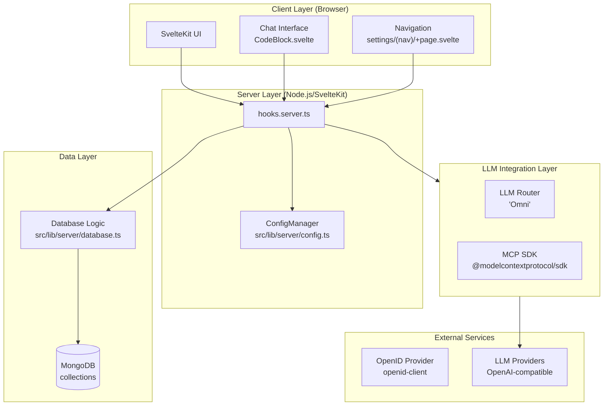

<!-- source: DeepWiki mcp.deepwiki.com · repo huggingface/chat-ui · page 2 System Architecture · fetched 2026-10-26 -->

# System Architecture

Relevant source files

The following files were used as context for generating this wiki page:

- [.github/workflows/deploy-prod.yml](.github/workflows/deploy-prod.yml)
- [Dockerfile](Dockerfile)
- [package-lock.json](package-lock.json)
- [package.json](package.json)
- [src/app.d.ts](src/app.d.ts)
- [src/lib/components/CodeBlock.svelte](src/lib/components/CodeBlock.svelte)
- [src/lib/server/config.ts](src/lib/server/config.ts)
- [src/lib/utils/tree/addChildren.spec.ts](src/lib/utils/tree/addChildren.spec.ts)
- [src/lib/utils/tree/addSibling.spec.ts](src/lib/utils/tree/addSibling.spec.ts)
- [src/lib/utils/tree/buildSubtree.spec.ts](src/lib/utils/tree/buildSubtree.spec.ts)
- [src/lib/utils/tree/convertLegacyConversation.spec.ts](src/lib/utils/tree/convertLegacyConversation.spec.ts)
- [src/routes/settings/(nav)/+page.svelte](src/routes/settings/(nav)/+page.svelte)
- [svelte.config.js](svelte.config.js)
- [vite.config.ts](vite.config.ts)

This document describes the high-level architecture of the chat-ui application, outlining its core components and how they interact. Chat-ui is a SvelteKit application that provides a web interface for interacting with various Large Language Models (LLMs). The architecture follows a clear layered approach with separation between the client layer, server layer, data persistence, and LLM integration.

For specific details about frontend components, see [Frontend Architecture](#2.1). For backend services and API endpoints, see [Backend Architecture](#2.2). For data persistence, see [Data Layer](#2.3).

## High-Level Architecture Overview

The chat-ui system follows a layered architecture with clear separation of concerns. The system consists of five primary layers: client layer (browser), server layer (Node.js/SvelteKit), data layer (MongoDB), LLM integration layer, and external services.

### System Architecture Diagram

Sources:
- [src/lib/server/config.ts:13-147]()
- [package.json:74-113]()
- [src/app.d.ts:8-33]()

## Layered Architecture

The chat-ui architecture is organized into distinct layers, each with specific responsibilities. This separation enables clear interfaces between components and facilitates independent scaling and maintenance.

### Layer Overview

| Layer | Primary Components | Responsibilities |
|-------|-------------------|------------------|
| **Client Layer** | Svelte 5 components, SvelteKit UI | User interface rendering, client-side state, user interactions |
| **Server Layer** | `hooks.server.ts`, `ConfigManager` | Request authentication, routing, dynamic configuration |
| **Data Layer** | MongoDB collections, GridFS | Data persistence, conversation trees, file storage |
| **LLM Integration** | Router, OpenAI endpoints, MCP | Model selection, provider abstraction, tool execution |

### Configuration and Request Interception

All HTTP requests pass through the server-side logic in `hooks.server.ts`, which manages user context and application state.

- **Dynamic Configuration**: The `ConfigManager` class in `src/lib/server/config.ts` handles environment variables and database-backed configuration overrides [src/lib/server/config.ts:13-42](). It supports a "Config Manager" mode for runtime updates [src/lib/server/config.ts:44-46]().
- **Authentication Context**: The system maintains user information in `App.Locals`, including `sessionId`, `user` object, and `isAdmin` status [src/app.d.ts:11-18]().
- **Server Initialization**: The `ready` promise ensures that the database and configuration are initialized before the application starts serving requests [src/lib/server/config.ts:152-156]().

Sources:
- [src/lib/server/config.ts:13-191]()
- [src/app.d.ts:1-35]()

### Frontend Layer

The frontend is built with Svelte 5, utilizing its runes-based reactivity system (e.g., `$state`, `$derived`) for high-performance UI updates.

- **Navigation**: Structured using SvelteKit routes, such as settings pages located in `src/routes/settings/(nav)/` [src/routes/settings/(nav)/+page.svelte:1-1]().
- **Content Rendering**: Components like `CodeBlock.svelte` handle complex rendering tasks, including HTML sanitization via `isomorphic-dompurify` and syntax highlighting [src/lib/components/CodeBlock.svelte:3-30]().
- **Build System**: Powered by Vite with SvelteKit and Tailwind CSS integration [vite.config.ts:1-31]().

For details, see [Frontend Architecture](#2.1).

Sources:
- [src/lib/components/CodeBlock.svelte:1-87]()
- [vite.config.ts:23-31]()
- [package.json:62-63]()

### API and Backend Layer

The backend leverages SvelteKit's server-side capabilities and integrates with external services.

- **OpenAI Compatibility**: The system communicates with LLMs using the `openai` SDK [package.json:96-96]().
- **MCP Integration**: Uses the `@modelcontextprotocol/sdk` to allow LLMs to interact with external tools and data sources [package.json:78-78]().
- **LLM Router**: An "Omni" router handles intelligent model selection, particularly for multimodal requests [package.json:103-103]().

For details, see [Backend Architecture](#2.2).

Sources:
- [package.json:74-113]()
- [src/lib/server/config.ts:164-167]()

### Data Layer

Persistence is managed via MongoDB, with support for complex conversation structures.

- **Conversation Trees**: The system supports non-linear conversation histories through a message tree structure, managed by utilities like `addSibling` and `buildSubtree` [src/lib/utils/tree/addSibling.spec.ts:7-86]() [src/lib/utils/tree/buildSubtree.spec.ts:10-114]().
- **Persistence**: Data is stored in MongoDB collections. For development environments, `mongodb-memory-server` can be used [package.json:55-55]().
- **File Handling**: Supports file uploads and attachments, often stored in GridFS [package.json:94-94]().

For details, see [Data Layer](#2.3).

Sources:
- [src/lib/utils/tree/addSibling.spec.ts:1-86]()
- [src/lib/utils/tree/buildSubtree.spec.ts:1-115]()
- [package.json:55-55]()

## Request Flow: Message Generation

When a user interacts with the chat, the system orchestrates the following flow:

1.  **Client Submission**: The Svelte UI captures user input and sends it to the server.
2.  **Server Processing**: `hooks.server.ts` validates the session and retrieves the `User` object [src/app.d.ts:11-13]().
3.  **Config Check**: `ConfigManager` retrieves model settings and API keys [src/lib/server/config.ts:82-87]().
4.  **Tree Update**: The new message is added to the conversation tree in MongoDB [src/lib/utils/tree/addSibling.spec.ts:67-85]().
5.  **LLM Interaction**: The backend calls the OpenAI-compatible endpoint or uses MCP tools if required [package.json:78-96]().
6.  **Streaming**: Responses are streamed back to the client, where components like `CodeBlock.svelte` render the output in real-time [src/lib/components/CodeBlock.svelte:20-30]().

Sources:
- [src/lib/server/config.ts:13-191]()
- [src/lib/components/CodeBlock.svelte:14-30]()
- [src/lib/utils/tree/addSibling.spec.ts:67-85]()

## Summary

Chat UI's architecture is a modular gateway to LLMs, built on SvelteKit and MongoDB. It provides a robust framework for managing non-linear conversations, dynamic configurations, and tool integrations via MCP, while maintaining strict compatibility with OpenAI-style endpoints.

---

