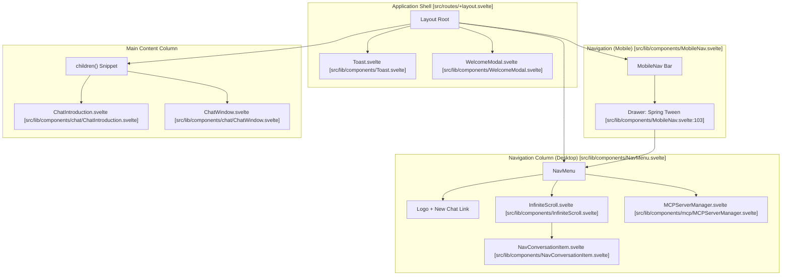
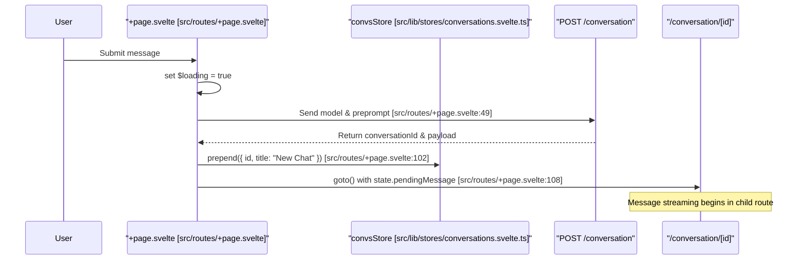

<!-- source: DeepWiki mcp.deepwiki.com · repo huggingface/chat-ui · page 2.1 Frontend Architecture · fetched 2026-10-26 -->

# Frontend Architecture

Relevant source files

The following files were used as context for generating this wiki page:

- [scripts/setups/vitest-setup-server.ts](scripts/setups/vitest-setup-server.ts)
- [src/app.html](src/app.html)
- [src/lib/components/ExpandNavigation.svelte](src/lib/components/ExpandNavigation.svelte)
- [src/lib/components/MobileNav.svelte](src/lib/components/MobileNav.svelte)
- [src/lib/components/Modal.svelte](src/lib/components/Modal.svelte)
- [src/lib/components/NavConversationItem.svelte](src/lib/components/NavConversationItem.svelte)
- [src/lib/components/NavMenu.svelte](src/lib/components/NavMenu.svelte)
- [src/lib/components/WelcomeModal.svelte](src/lib/components/WelcomeModal.svelte)
- [src/lib/components/chat/ChatIntroduction.svelte](src/lib/components/chat/ChatIntroduction.svelte)
- [src/lib/components/chat/ToolCallsSummary.svelte](src/lib/components/chat/ToolCallsSummary.svelte)
- [src/lib/components/chat/ToolCallsSummary.svelte.test.ts](src/lib/components/chat/ToolCallsSummary.svelte.test.ts)
- [src/routes/+layout.svelte](src/routes/+layout.svelte)
- [src/routes/+page.svelte](src/routes/+page.svelte)
- [src/routes/settings/+layout.svelte](src/routes/settings/+layout.svelte)
- [static/huggingchat/omni-welcome.gif](static/huggingchat/omni-welcome.gif)

## Purpose and Scope

This document details the frontend architecture of chat-ui, a SvelteKit-based web application. It covers the layout system, routing structure, component hierarchy, navigation implementations, and global state management using Svelte 5 runes and stores.

For information about the chat interface components (ChatWindow, ChatMessage, etc.), see **3.1 Chat Window and Messages**. For content rendering (MarkdownRenderer, CodeBlock), see **3.2 Markdown and Code Rendering**. For backend request handling and API routes, see **2.2 Backend Architecture**.

---

## SvelteKit Application Structure

The frontend uses SvelteKit's file-based routing system with a nested layout architecture. The application shell is defined at two levels: the HTML shell and the root layout component.

### Root Layout Component

The root layout [src/routes/+layout.svelte:1-204]() establishes the application shell and coordinates global concerns using Svelte 5 runes (`$state`, `$derived`, `$effect`).

**Key Responsibilities:**
- **Public Config Context**: Provides `publicConfig` via Svelte context for child components [src/routes/+layout.svelte:31-33]().
- **Conversation State**: Manages the `convsStore` reactively, initializing it with server-side data for SSR and syncing it client-side [src/routes/+layout.svelte:36-46]().
- **Global Error Handling**: Manages a toast system for errors with a 5-second timeout and logic to wait for previous errors to clear [src/routes/+layout.svelte:53-67]().
- **Keyboard Shortcuts**: Implements `Ctrl/Cmd + Shift + O` for starting a new chat, which triggers `isAborted` to stop current generations [src/routes/+layout.svelte:107-120]().
- **MCP Initialization**: Seeds the Model Context Protocol (MCP) store with base servers during `onMount` [src/routes/+layout.svelte:145]().

### Main Page Logic

The index route [src/routes/+page.svelte:1-198]() serves as the entry point for new conversations.

- **URL Parameter Handling**: Processes `q` (query), `prompt` (draft), and `attachments` parameters from the URL on mount [src/routes/+page.svelte:119-172]().
- **Conversation Creation**: The `createConversation` function manages the POST request to `/conversation`, handles authentication redirects, and optimistically updates the sidebar before navigating to the new conversation route [src/routes/+page.svelte:33-117]().
- **Optimistic UI**: Prepends the new conversation to the sidebar immediately so it appears before streaming starts [src/routes/+page.svelte:102-107]().

**Sources:** [src/routes/+layout.svelte:1-204](), [src/routes/+page.svelte:1-198]()

---

## Component Hierarchy and Code Mapping

The following diagram maps UI regions to their implementing components and identifies key code entities.

**Sources:** [src/routes/+layout.svelte:15-27](), [src/lib/components/NavMenu.svelte:20-34](), [src/lib/components/MobileNav.svelte:19-25](), [src/routes/+page.svelte:9-15]()

---

## Navigation System

### Desktop Navigation (NavMenu)

The `NavMenu` component [src/lib/components/NavMenu.svelte:10-130]() implements the persistent sidebar.

- **Conversation Grouping**: Conversations are reactively filtered into "Today", "This week", "This month", and "Older" categories using `$derived` and `dateRanges` [src/lib/components/NavMenu.svelte:71-86]().
- **Infinite Scrolling**: Uses `InfiniteScroll` to trigger `handleVisible`, which fetches more conversations from the API using `client.conversations.get` and increments the page counter `p` [src/lib/components/NavMenu.svelte:90-107]().
- **Authentication Guard**: Intercepts clicks on "New Chat" and navigation items to ensure a user is authenticated if required by the configuration [src/lib/components/NavMenu.svelte:57-69]().

### Mobile Navigation (MobileNav)

The `MobileNav` component [src/lib/components/MobileNav.svelte:13-221]() provides a touch-friendly drawer with advanced gesture support.

- **Gesture Mechanics**: Implements a custom swipe handler with `VELOCITY_THRESHOLD` (0.4 px/ms) and `DIRECTION_LOCK_THRESHOLD` (10 px) to distinguish between horizontal drawer drags and vertical content scrolling [src/lib/components/MobileNav.svelte:87-98]().
- **Animation**: Uses a `Spring` tween to follow the `dragOffset` during interaction and snap to `0` (open) or `-100` (closed) [src/lib/components/MobileNav.svelte:102-103]().
- **Inertness**: When a modal is open, touch events are ignored to prevent drawer interaction while the app is marked as `inert` [src/lib/components/MobileNav.svelte:106-107]().

**Sources:** [src/lib/components/NavMenu.svelte:1-130](), [src/lib/components/MobileNav.svelte:1-221](), [src/lib/components/NavConversationItem.svelte:58-143]()

---

## State Management and Data Flow

The application uses a mix of Svelte 5 runes for local component state and Svelte 4 stores for global shared state.

### Global Store Interactions

| Store | File | Usage in Frontend |
|-------|------|---------|
| `isAborted` | `src/lib/stores/isAborted.ts` | Set to `true` when starting a new chat or clicking "New Chat" to stop current LLM generation [src/routes/+layout.svelte:116](), [src/lib/components/NavMenu.svelte:58](). |
| `error` | `src/lib/stores/errors.ts` | Updated when API calls fail (e.g., deleting a conversation or creating one) [src/routes/+layout.svelte:83](), [src/routes/+page.svelte:112](). |
| `loading` | `src/lib/stores/loading.ts` | Controls UI states during conversation creation and file processing [src/routes/+page.svelte:35](). |
| `isPro` | `src/lib/stores/isPro.ts` | Stores the Hugging Face Pro status of the user, fetched on mount [src/routes/+layout.svelte:151](). |

### Data Flow: Conversation Creation

The following sequence describes the data flow when a user initiates a chat from the index page.

**Sources:** [src/routes/+page.svelte:33-117](), [src/routes/+layout.svelte:36-46](), [src/lib/stores/isAborted.ts:1-5]()

---

## UI Components and Patterns

### Modals and Portals
Modals are managed using a `Portal` component to ensure they render at the top level of the DOM. The base `Modal` component [src/lib/components/Modal.svelte:1-116]() handles:
- **Focus Trapping**: Sets the main `#app` element to `inert` when open [src/lib/components/Modal.svelte:50]().
- **Keyboard Navigation**: Listens for the `Escape` key to trigger `onclose` [src/lib/components/Modal.svelte:32-38]().
- **Transitions**: Uses `fade` for the backdrop and `fly` for the modal content [src/lib/components/Modal.svelte:73-100]().

### Theming
The application supports dark and light modes. Theme detection happens early in `app.html` to prevent a Flash of Unstyled Content (FOUC) [src/app.html:10-22](). The `NavMenu` subscribes to theme changes to toggle icons and styles [src/lib/components/NavMenu.svelte:121-125]().

**Sources:** [src/lib/components/Modal.svelte:1-116](), [src/app.html:10-22](), [src/lib/components/NavMenu.svelte:121-125]()

---

