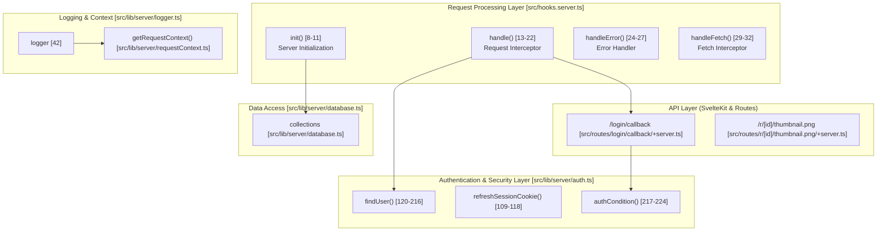
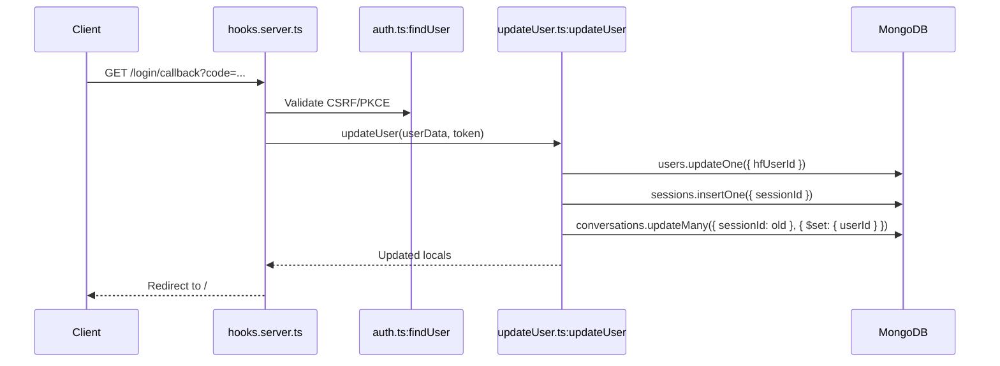

<!-- source: DeepWiki mcp.deepwiki.com · repo huggingface/chat-ui · page 2.2 Backend Architecture · fetched 2026-10-26 -->

# Backend Architecture

Relevant source files

The following files were used as context for generating this wiki page:

- [.env](.env)
- [chart/env/dev.yaml](chart/env/dev.yaml)
- [chart/env/prod.yaml](chart/env/prod.yaml)
- [src/hooks.server.ts](src/hooks.server.ts)
- [src/lib/server/auth.ts](src/lib/server/auth.ts)
- [src/lib/server/hooks/error.ts](src/lib/server/hooks/error.ts)
- [src/lib/server/hooks/fetch.ts](src/lib/server/hooks/fetch.ts)
- [src/lib/server/hooks/init.ts](src/lib/server/hooks/init.ts)
- [src/lib/server/logger.ts](src/lib/server/logger.ts)
- [src/lib/server/metrics.ts](src/lib/server/metrics.ts)
- [src/lib/server/requestContext.ts](src/lib/server/requestContext.ts)
- [src/lib/server/shareThumbnail/shareThumbnail.ssr.test.ts](src/lib/server/shareThumbnail/shareThumbnail.ssr.test.ts)
- [src/lib/server/shareThumbnail/shareThumbnail.ts](src/lib/server/shareThumbnail/shareThumbnail.ts)
- [src/lib/server/shareThumbnail/thumbnail-background.png](src/lib/server/shareThumbnail/thumbnail-background.png)
- [src/lib/types/User.ts](src/lib/types/User.ts)
- [src/routes/login/callback/+server.ts](src/routes/login/callback/+server.ts)
- [src/routes/login/callback/updateUser.ts](src/routes/login/callback/updateUser.ts)
- [src/routes/r/[id]/thumbnail.png/+server.ts](src/routes/r/[id]/thumbnail.png/+server.ts)
- [static/huggingchat/routes.chat.json](static/huggingchat/routes.chat.json)

The backend architecture of chat-ui is organized into distinct layers that handle request processing, authentication, API routing, and data access. The architecture centers around SvelteKit server hooks for request interception, authentication middleware for identity management, and a robust configuration system.

## Architectural Layers

The backend follows a layered architecture with clear separation of concerns:

**Backend Architecture Layers**

Sources: [src/hooks.server.ts](), [src/lib/server/auth.ts](), [src/lib/server/logger.ts](), [src/lib/server/requestContext.ts]()

## Request Processing Layer

The request processing layer is implemented in `src/hooks.server.ts` and provides four main lifecycle hooks that intercept server-side operations.

### Server Initialization - `init()`
The `init()` function runs once when the server starts. It skips execution during the static build phase [src/hooks.server.ts:9]() and calls `initServer()` to prepare the environment, database connections, and background tasks [src/hooks.server.ts:10]().

### Request Handler - `handle()`
The `handle()` hook is the primary entry point for all HTTP requests. 
- During static builds, it performs simple HTML transformations like clearing Google Analytics placeholders [src/hooks.server.ts:17-19]().
- In production, it delegates to `handleRequest()` [src/hooks.server.ts:21](), which manages the request lifecycle, including authentication, CSRF validation, and session persistence.

### Error and Fetch Handlers
- **`handleError()`**: Intercepts server-side errors to provide structured logging via `handleServerError()` [src/hooks.server.ts:26]().
- **`handleFetch()`**: Intercepts server-side `fetch` calls via `handleFetchRequest()`, allowing the application to inject authentication headers or modify outgoing requests to internal/external services [src/hooks.server.ts:31]().

Sources: [src/hooks.server.ts:1-32]()

## Authentication and User Management

The authentication system supports OpenID Connect (OIDC) and manages user sessions through MongoDB-backed persistence.

### Session Lifecycle and Token Refresh
The `findUser()` function [src/lib/server/auth.ts:120]() is responsible for identifying the user from a `sessionId`. It includes sophisticated logic for OAuth token maintenance:
1. **Validation**: Checks if the session exists in `collections.sessions` [src/lib/server/auth.ts:129](). If `coupledCookieHash` is enabled, it validates the hash against the session [src/lib/server/auth.ts:135]().
2. **Refresh Check**: If the OAuth token expires in less than 5 minutes, it initiates a refresh [src/lib/server/auth.ts:142]().
3. **Concurrency Control**: Uses a distributed lock (semaphore) via `acquireLock` with key `Semaphores.OAUTH_TOKEN_REFRESH` to ensure only one process refreshes the token for a given session [src/lib/server/auth.ts:143-146]().
4. **Session Update**: Updates the session in the database with the new `oauth` data and `updatedAt` values [src/lib/server/auth.ts:169-177]().

### User Update and Migration
When a user logs in via OIDC, the `updateUser()` function handles identity synchronization:
- **Identity Mapping**: It parses user data (username, email, avatar) from the OIDC `UserinfoResponse` using a configurable `NAME_CLAIM` [src/routes/login/callback/updateUser.ts:35-82]().
- **Session Rotation**: It generates a new `secretSessionId`, hashes it, and rotates the session ID to prevent session fixation [src/routes/login/callback/updateUser.ts:117-119]().
- **Data Migration**: If a user was previously using the app without an account (session-based), `updateUser()` migrates their settings and conversations to the new `userId` [src/routes/login/callback/updateUser.ts:184-214]().

Sources: [src/lib/server/auth.ts:120-216](), [src/routes/login/callback/updateUser.ts:19-215]()

## API Routing and Data Loading

API routes are primarily handled via SvelteKit `+server.ts` files, utilizing the `authCondition` helper to enforce data isolation.

### The `authCondition` Helper
The `authCondition` function [src/lib/server/auth.ts:217]() returns a MongoDB query object that restricts data access based on the current authentication state:
- If `locals.user` exists, it filters by `{ userId: locals.user._id }` [src/lib/server/auth.ts:222-223]().
- If only `locals.sessionId` exists, it filters by `{ sessionId: locals.sessionId, userId: { $exists: false } }` [src/lib/server/auth.ts:224]().

### Specialized Endpoints
- **Thumbnail Generation**: `GET /r/[id]/thumbnail.png` generates social preview images for shared conversations [src/routes/r/[id]/thumbnail.png/+server.ts:14](). It verifies the conversation is shared (7-character ID) before calling `getShareThumbnailPng` [src/routes/r/[id]/thumbnail.png/+server.ts:17-31]().
- **Login Callback**: `GET /login/callback` processes the OIDC redirect, validates the CSRF state and PKCE code verifier, and filters users based on `ALLOWED_USER_EMAILS` or `ALLOWED_USER_DOMAINS` [src/routes/login/callback/+server.ts:34-142]().

**Request Data Flow**

Sources: [src/lib/server/auth.ts:217-224](), [src/routes/login/callback/+server.ts:34-142](), [src/routes/login/callback/updateUser.ts:19-215]()

## Metrics and Monitoring

The backend includes a standalone Prometheus metrics server managed by the `MetricsServer` class [src/lib/server/metrics.ts:20]().

- **Metrics Collection**: It tracks model-specific performance including `conversationsTotal`, `messagesTotal`, `tokenCountTotal`, and latencies like `timeToFirstToken` [src/lib/server/metrics.ts:72-117]().
- **Standalone Server**: If `METRICS_ENABLED` is true, it starts an HTTP server on `METRICS_PORT` (default 5565) to export metrics in Prometheus format [src/lib/server/metrics.ts:120-148]().
- **Lifecycle**: The server uses an `onExit` handler to ensure clean shutdown when the Node.js process terminates [src/lib/server/metrics.ts:150-163]().

Sources: [src/lib/server/metrics.ts:1-166]()

## Logging and Request Context

Logging is handled by a `pino` instance enriched with request-specific metadata.

- **`RequestContext`**: Uses `AsyncLocalStorage` to store `requestId`, `url`, `ip`, and `user` information for the duration of an asynchronous call chain [src/lib/server/requestContext.ts]().
- **Automatic Mixin**: The logger uses a `mixin()` function [src/lib/server/logger.ts:28]() to pull data from `getRequestContext()` and append it to every log entry [src/lib/server/logger.ts:29-39]().
- **Structured Logging**: In production, logs are structured for consumption by logging aggregators, while in development, `pino-pretty` is used [src/lib/server/logger.ts:8-17]().

Sources: [src/lib/server/logger.ts:1-42](), [src/lib/server/requestContext.ts]()

---

