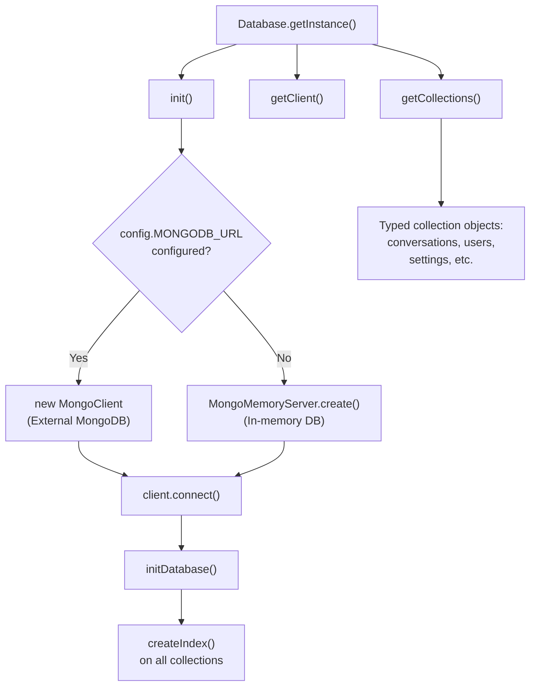
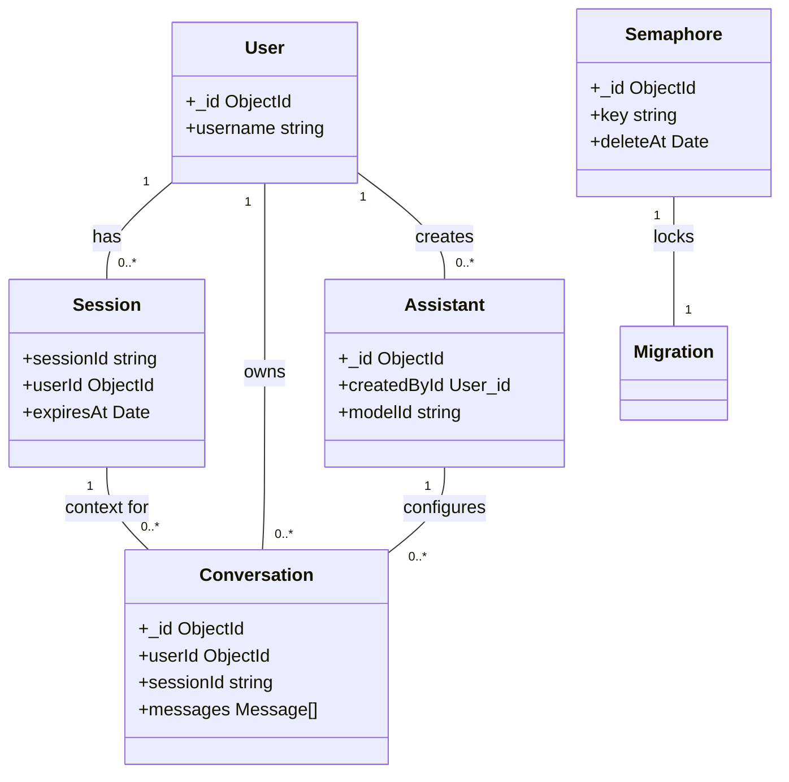

<!-- source: DeepWiki mcp.deepwiki.com · repo huggingface/chat-ui · page 2.3 Data Layer · fetched 2026-10-26 -->

# Data Layer

Relevant source files

The following files were used as context for generating this wiki page:

- [.devcontainer/Dockerfile](.devcontainer/Dockerfile)
- [.devcontainer/devcontainer.json](.devcontainer/devcontainer.json)
- [docker-compose.yml](docker-compose.yml)
- [src/lib/components/icons/IconMoon.svelte](src/lib/components/icons/IconMoon.svelte)
- [src/lib/jobs/refresh-conversation-stats.ts](src/lib/jobs/refresh-conversation-stats.ts)
- [src/lib/migrations/lock.ts](src/lib/migrations/lock.ts)
- [src/lib/migrations/migrations.spec.ts](src/lib/migrations/migrations.spec.ts)
- [src/lib/migrations/migrations.ts](src/lib/migrations/migrations.ts)
- [src/lib/migrations/routines/01-update-search-assistants.ts](src/lib/migrations/routines/01-update-search-assistants.ts)
- [src/lib/migrations/routines/10-update-reports-assistantid.ts](src/lib/migrations/routines/10-update-reports-assistantid.ts)
- [src/lib/migrations/routines/index.ts](src/lib/migrations/routines/index.ts)
- [src/lib/server/database.ts](src/lib/server/database.ts)
- [src/lib/types/Assistant.ts](src/lib/types/Assistant.ts)
- [src/lib/types/MigrationResult.ts](src/lib/types/MigrationResult.ts)
- [src/lib/types/Semaphore.ts](src/lib/types/Semaphore.ts)
- [src/routes/admin/export/+server.ts](src/routes/admin/export/+server.ts)
- [src/routes/admin/stats/compute/+server.ts](src/routes/admin/stats/compute/+server.ts)

This document describes the MongoDB data persistence layer in chat-ui, including database connection management, collection schemas, indexing strategy, and how data is stored and retrieved. The data layer provides typed collections with automatic index creation and supports both external MongoDB and an in-memory development mode.

## Database Connection Management

The data layer uses a singleton `Database` class to manage the MongoDB connection. The connection is established during server initialization and is reused throughout the application lifecycle.

### Database Class Structure

The `Database` class handles the lifecycle of the MongoDB client:
- **Singleton Pattern**: Managed via `Database.getInstance()` [src/lib/server/database.ts:86-93]().
- **Connection Logic**: Connects to an external instance via `config.MONGODB_URL` or spawns a `MongoMemoryServer` for local development [src/lib/server/database.ts:34-65]().
- **Typed Collections**: Accessors are provided via `getCollections()`, which returns a map of MongoDB `Collection` objects typed with project-specific interfaces [src/lib/server/database.ts:109-164]().
- **Initialization**: Runs `initDatabase()` to ensure all required indexes are present [src/lib/server/database.ts:170-291]().
- **Cleanup**: Uses an `onExit` handler to close the client and stop the memory server [src/lib/server/database.ts:79-83]().

Title: Database Initialization and Access

**In-Memory MongoDB for Development**

When `MONGODB_URL` is absent, the system starts a `MongoMemoryServer` (version 7.0.18) [src/lib/server/database.ts:49-57](). It persists data to a local `db/` folder or a path specified by `config.MONGO_STORAGE_PATH` [src/lib/server/database.ts:35-37]().

Sources: [src/lib/server/database.ts:28-94]()

## Collections Overview

The data layer exposes 16 collections and a GridFS bucket. Collections are configured with specific `ReadPreference` settings to balance consistency and performance [src/lib/server/database.ts:118-145]().

| Collection Name | Type | Read Preference | Purpose |
|-----------------|------|-----------------|---------|
| `conversations` | `Conversation` | Primary | Main storage for chat history and message trees [src/lib/server/database.ts:119]() |
| `settings` | `Settings` | Primary | User preferences and sharing permissions [src/lib/server/database.ts:120]() |
| `users` | `User` | Primary | User accounts and identity metadata [src/lib/server/database.ts:121]() |
| `sessions` | `Session` | Primary | Active user sessions and OAuth state [src/lib/server/database.ts:122]() |
| `messageEvents` | `MessageEvent` | Primary | Real-time event tracking [src/lib/server/database.ts:123]() |
| `abortedGenerations` | `AbortedGeneration` | Primary | Signal storage for interrupted LLM calls [src/lib/server/database.ts:124]() |
| `semaphores` | `Semaphore` | Primary | Distributed locks for tasks and migrations [src/lib/server/database.ts:125]() |
| `tokenCaches` | `TokenCache` | Primary | Cache for external API tokens [src/lib/server/database.ts:126]() |
| `config` | `ConfigKey` | Primary | Dynamic configuration overrides [src/lib/server/database.ts:127]() |
| `migrationResults` | `MigrationResult` | Primary | Log of executed database migrations [src/lib/server/database.ts:128]() |
| `sharedConversations` | `SharedConversation` | Primary | Public snapshots of conversations [src/lib/server/database.ts:129]() |
| `bucket` | `GridFSBucket` | Primary | Binary storage for file attachments [src/lib/server/database.ts:130]() |
| `assistants` | `Assistant` | SecondaryPreferred | Custom AI assistant definitions [src/lib/server/database.ts:134-136]() |
| `conversationStats` | `ConversationStats` | SecondaryPreferred | Aggregated usage metrics [src/lib/server/database.ts:137-139]() |
| `reports` | `Report` | SecondaryPreferred | Content moderation and assistant reports [src/lib/server/database.ts:140-142]() |
| `tools` | `any` | SecondaryPreferred | MCP and internal tool configurations [src/lib/server/database.ts:143-145]() |

Sources: [src/lib/server/database.ts:109-164]()

## Migration System

The system uses a migration framework to ensure schema consistency across deployments. Migrations are defined as routines that run sequentially.

### Migration Logic
Each migration implements the `Migration` interface, defining an `up` function and optional metadata like `runEveryTime` [src/lib/migrations/routines/index.ts:5-13]().

- **Locking**: Before running migrations, the system attempts to `acquireLock` on `Semaphores.MIGRATION` [src/lib/migrations/migrations.ts:27-29](). This prevents multiple instances from corrupting the schema.
- **Transactions**: Migrations are executed within a MongoDB session transaction to ensure atomicity [src/lib/migrations/migrations.ts:89-100]().
- **Persistence**: Successful migrations are recorded in the `migrationResults` collection [src/lib/migrations/migrations.ts:102-111]().

Sources: [src/lib/migrations/migrations.ts:8-119](), [src/lib/migrations/routines/index.ts:1-16](), [src/lib/migrations/lock.ts:8-25]()

## Indexing Strategy

The `initDatabase()` method creates indexes necessary for both query optimization and automatic data expiration (TTL).

### Performance Indexes
- **Conversations**: Compound indexes on `{ sessionId: 1, updatedAt: -1 }` and `{ userId: 1, updatedAt: -1 }` facilitate rapid retrieval of a user's recent chat history [src/lib/server/database.ts:187-202]().
- **Message Search**: Index on `{ "message.id": 1, "message.ancestors": 1 }` supports navigating complex conversation trees [src/lib/server/database.ts:204-210]().
- **Assistants**: Indexes on `userCount`, `last24HoursCount`, and `searchTokens` power the discovery and search features [src/lib/server/database.ts:250-262]().

### TTL Indexes (Automatic Cleanup)
| Collection | Field | TTL | Purpose |
|------------|-------|-----|---------|
| `sessions` | `expiresAt` | 0s | Automatically log out users [src/lib/server/database.ts:241-242]() |
| `abortedGenerations` | `updatedAt` | 30s | Cleanup stale generation signals [src/lib/server/database.ts:224-225]() |
| `semaphores` | `deleteAt` | 0s | Auto-release distributed locks [src/lib/server/database.ts:271-272]() |
| `tokenCaches` | `createdAt` | 300s | Expire cached auth tokens [src/lib/server/database.ts:283-284]() |

Sources: [src/lib/server/database.ts:187-291]()

## Background Jobs and Stats

The data layer includes an aggregation pipeline for computing usage statistics stored in `CONVERSATION_STATS_COLLECTION` [src/lib/jobs/refresh-conversation-stats.ts:2-255]().

- **Distributed Lock**: The stats job uses `Semaphores.CONVERSATION_STATS` and a `maintainLock` loop to ensure only one worker computes statistics at a time [src/lib/jobs/refresh-conversation-stats.ts:265-280]().
- **Aggregation**: Uses `$dateTrunc` and `$facet` to calculate distinct user and session counts across different time spans (day, week, month) [src/lib/jobs/refresh-conversation-stats.ts:110-225]().

Sources: [src/lib/jobs/refresh-conversation-stats.ts:1-280]()

## Data Relationships

Title: Entity Relationships in Code

Sources: [src/lib/server/database.ts:119-156](), [src/lib/types/Assistant.ts:6-28](), [src/lib/types/Semaphore.ts:8-19]()

---

