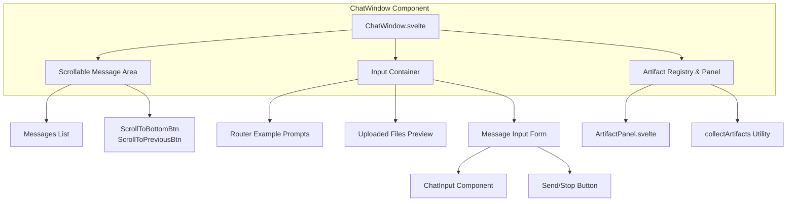
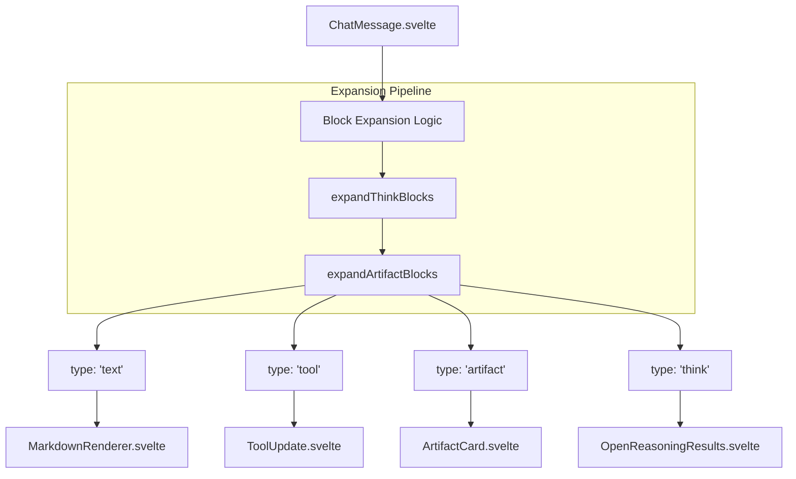

<!-- source: DeepWiki mcp.deepwiki.com · repo huggingface/chat-ui · page 3 Chat Interface · fetched 2026-10-26 -->

# Chat Interface

Relevant source files

The following files were used as context for generating this wiki page:

- [src/lib/components/chat/BlockWrapper.svelte](src/lib/components/chat/BlockWrapper.svelte)
- [src/lib/components/chat/ChatInput.svelte](src/lib/components/chat/ChatInput.svelte)
- [src/lib/components/chat/ChatMessage.svelte](src/lib/components/chat/ChatMessage.svelte)
- [src/lib/components/chat/ChatWindow.svelte](src/lib/components/chat/ChatWindow.svelte)
- [src/lib/components/chat/ToolUpdate.svelte](src/lib/components/chat/ToolUpdate.svelte)
- [src/lib/types/MessageUpdate.ts](src/lib/types/MessageUpdate.ts)
- [src/routes/conversation/[id]/+page.svelte](src/routes/conversation/[id]/+page.svelte)
- [src/routes/conversation/[id]/+server.ts](src/routes/conversation/[id]/+server.ts)
- [src/routes/models/+page.svelte](src/routes/models/+page.svelte)
- [src/routes/r/[id]/+page.svelte](src/routes/r/[id]/+page.svelte)
- [src/styles/main.css](src/styles/main.css)

The Chat Interface is the core user interaction component of the chat-ui application, enabling communication with large language models through a web-based interface. This system manages conversation display, message rendering, user input handling, and file uploads. The interface adapts to different model capabilities, supporting features like tool execution, multimodal interactions, and reasoning blocks.

For information about the conversation data model and API endpoints, see [Conversation System](#5). For details on text generation with language models, see [Models and LLM Integration](#4).

## Component Architecture

The Chat Interface consists of several interconnected components that work together to provide a seamless user experience.

**Chat Interface Component Hierarchy**

```mermaid
graph TD
    ChatWindow["ChatWindow.svelte"] --> ChatMessage["ChatMessage.svelte"]
    ChatWindow --> ChatInput["ChatInput.svelte"]
    ChatWindow --> FileDropzone["FileDropzone.svelte"]
    ChatWindow --> ChatIntro["ChatIntroduction.svelte"]
    ChatWindow --> ScrollControls["ScrollToBottomBtn<br/>ScrollToPreviousBtn"]
    ChatWindow --> ModelSwitch["ModelSwitch.svelte"]
    ChatWindow --> ArtifactPanel["ArtifactPanel.svelte"]
    
    ChatMessage --> MessageAvatar["MessageAvatar.svelte"]
    ChatMessage --> MarkdownRenderer["MarkdownRenderer.svelte"]
    ChatMessage --> OpenReasoning["OpenReasoningResults.svelte"]
    ChatMessage --> UploadedFile["UploadedFile.svelte"]
    ChatMessage --> Alternatives["Alternatives.svelte"]
    ChatMessage --> ToolUpdate["ToolUpdate.svelte"]
    ChatMessage --> ArtifactCard["ArtifactCard.svelte"]
    
    ChatInput --> FileUpload["File Upload Controls"]
    ChatInput --> MCPServerManager["MCPServerManager.svelte"]
    ChatInput --> UrlFetchModal["UrlFetchModal.svelte"]
    
    subgraph "User Interaction Components"
        FileUpload
        ScrollControls
        ModelSwitch
        MCPServerManager
    end
    
    subgraph "Content Display Components"
        MarkdownRenderer
        OpenReasoning
        Alternatives
        ToolUpdate
        ArtifactCard
    end
```

Sources: [src/lib/components/chat/ChatWindow.svelte:5-41](), [src/lib/components/chat/ChatMessage.svelte:7-26](), [src/lib/components/chat/ChatInput.svelte:6-17]()

## Chat Window

The `ChatWindow` component serves as the main container for the chat interface. It manages the overall state of the conversation and orchestrates all chat-related components, including the new **Artifacts** system.

**Chat Window Structure**

The `ChatWindow` component accepts props defined in the `Props` interface [src/lib/components/chat/ChatWindow.svelte:69-84](). Key features include:

1. **Artifacts Management**: Uses `collectArtifacts` to build a versioned registry of `<artifact>` tags from message history [src/lib/components/chat/ChatWindow.svelte:122-124](). It automatically opens the `ArtifactPanel` when new versions stream in [src/lib/components/chat/ChatWindow.svelte:134-138]().
2. **Router Examples**: For router models, displays clickable example prompts from `routerExamples` [src/lib/components/chat/ChatWindow.svelte:42]().
3. **File Handling**: Supports drag-and-drop [src/lib/components/chat/ChatWindow.svelte:164-172]() and paste file uploads [src/lib/components/chat/ChatWindow.svelte:174-204]().
4. **Large Text Paste Detection**: Automatically converts pasted text over 3984 characters into file attachments with the `application/vnd.chatui.clipboard` type [src/lib/components/chat/ChatWindow.svelte:177-188]().
5. **Voice Interaction**: Integrates `VoiceRecorder` for transcribing audio input when enabled [src/lib/components/chat/ChatWindow.svelte:145-149]().

For details, see [Chat Window and Messages](#3.1).

Sources: [src/lib/components/chat/ChatWindow.svelte:69-138](), [src/lib/components/chat/ChatWindow.svelte:164-204](), [src/lib/utils/artifacts.ts:1-10]()

## Message Rendering

The `ChatMessage` component renders individual messages. It handles different message types and various content formats through a complex block-based pipeline that strips or expands specialized tags.

**Message Component Logic**

- **Reasoning Blocks**: Automatically detects `<think>` tags in content using `THINK_BLOCK_REGEX` [src/lib/components/chat/ChatMessage.svelte:136](). These are rendered as expandable reasoning results via `OpenReasoningResults` [src/lib/components/chat/ChatMessage.svelte:18]().
- **Artifact Integration**: Inline `<artifact>` blocks are extracted and replaced with `ArtifactCard` components [src/lib/components/chat/ChatMessage.svelte:182-199]().
- **Tool Updates**: Renders tool execution status, including parameters, results, and progress labels via `ToolUpdate` [src/lib/components/chat/ToolUpdate.svelte:102-138]().
- **Interactivity**: Supports editing [src/lib/components/chat/ChatMessage.svelte:80-87](), retrying [src/lib/components/chat/ChatMessage.svelte:41](), and navigating alternative message branches [src/lib/components/chat/ChatMessage.svelte:42]().

For details, see [Markdown and Code Rendering](#3.2).

Sources: [src/lib/components/chat/ChatMessage.svelte:135-147](), [src/lib/components/chat/ChatMessage.svelte:159-199](), [src/lib/components/chat/ToolUpdate.svelte:102-138]()

## Input System

The `ChatInput` component manages user text entry and attachment integration.

- **Adaptive Textarea**: Automatically adjusts height based on content using `adjustTextareaHeight` [src/lib/components/chat/ChatInput.svelte:167-178]().
- **Attachment Controls**: Includes dropdowns for file uploads (images and documents) and `UrlFetchModal` for URL fetching [src/lib/components/chat/ChatInput.svelte:14-15](), [src/lib/components/chat/ChatInput.svelte:83-103]().
- **MCP Integration**: Features a server manager (`MCPServerManager`) for Model Context Protocol tools [src/lib/components/chat/ChatInput.svelte:16-17]().
- **Keyboard Handling**: Manages composition states for IME and prevents submission on Shift+Enter [src/lib/components/chat/ChatInput.svelte:186-198]().

For details, see [File Attachments and URL Fetching](#3.3).

Sources: [src/lib/components/chat/ChatInput.svelte:31-62](), [src/lib/components/chat/ChatInput.svelte:167-184](), [src/lib/components/chat/ChatInput.svelte:230-232]()

## Page Integration

The chat interface is integrated into the application via SvelteKit routes:

- **Conversation View** (`src/routes/conversation/[id]/+page.svelte`): Orchestrates the message history and streaming updates. It uses `createMessagesPath` [src/routes/conversation/[id]/+page.svelte:73-114]() to construct the conversation thread from a tree structure and `writeMessage` [src/routes/conversation/[id]/+page.svelte:127-213]() to handle message submission, file encoding to base64, and retries.
- **Backend Communication** (`src/routes/conversation/[id]/+server.ts`): Handles the POST request for new messages. It manages cross-pod stop signals via `collections.abortedGenerations` [src/routes/conversation/[id]/+server.ts:86-101](), performs rate limiting [src/routes/conversation/[id]/+server.ts:113-132](), and triggers the `textGeneration` pipeline [src/routes/conversation/[id]/+server.ts:24]().

Sources: [src/routes/conversation/[id]/+page.svelte:73-114](), [src/routes/conversation/[id]/+page.svelte:127-156](), [src/routes/conversation/[id]/+server.ts:86-132](), [src/routes/conversation/[id]/+server.ts:24-28]()

---

