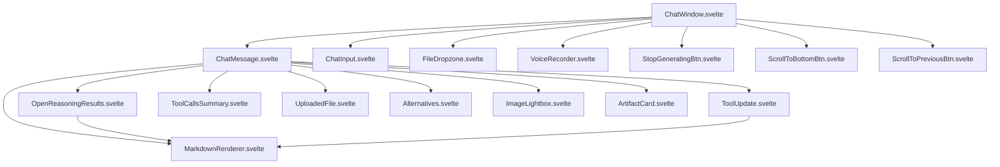
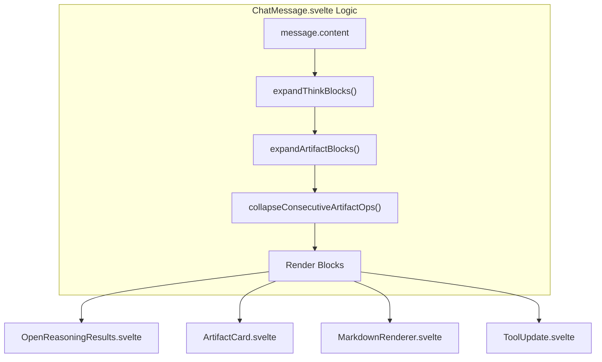
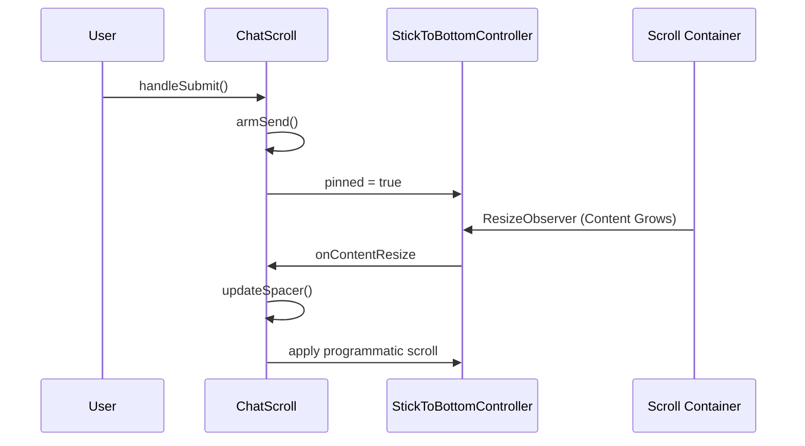

<!-- source: DeepWiki mcp.deepwiki.com · repo huggingface/chat-ui · page 3.1 Chat Window and Messages · fetched 2026-10-26 -->

# Chat Window and Messages

Relevant source files

The following files were used as context for generating this wiki page:

- [src/lib/components/CopyToClipBoardBtn.svelte](src/lib/components/CopyToClipBoardBtn.svelte)
- [src/lib/components/RetryBtn.svelte](src/lib/components/RetryBtn.svelte)
- [src/lib/components/ScrollToBottomBtn.svelte](src/lib/components/ScrollToBottomBtn.svelte)
- [src/lib/components/ScrollToPreviousBtn.svelte](src/lib/components/ScrollToPreviousBtn.svelte)
- [src/lib/components/StopGeneratingBtn.svelte](src/lib/components/StopGeneratingBtn.svelte)
- [src/lib/components/chat/Alternatives.svelte](src/lib/components/chat/Alternatives.svelte)
- [src/lib/components/chat/ChatMessage.svelte](src/lib/components/chat/ChatMessage.svelte)
- [src/lib/components/chat/ChatWindow.svelte](src/lib/components/chat/ChatWindow.svelte)
- [src/lib/components/chat/OpenReasoningResults.svelte](src/lib/components/chat/OpenReasoningResults.svelte)
- [src/lib/components/chat/OpenReasoningResults.svelte.test.ts](src/lib/components/chat/OpenReasoningResults.svelte.test.ts)
- [src/lib/constants/gestures.ts](src/lib/constants/gestures.ts)
- [src/lib/utils/scroll/__tests__/chatScroll.svelte.test.ts](src/lib/utils/scroll/__tests__/chatScroll.svelte.test.ts)
- [src/lib/utils/scroll/__tests__/harness.ts](src/lib/utils/scroll/__tests__/harness.ts)
- [src/lib/utils/scroll/chatScroll.svelte.ts](src/lib/utils/scroll/chatScroll.svelte.ts)
- [src/lib/utils/scroll/stickToBottom.ts](src/lib/utils/scroll/stickToBottom.ts)
- [src/routes/api/conversation/[id]/message/[messageId]/+server.ts](src/routes/api/conversation/[id]/message/[messageId]/+server.ts)
- [src/routes/conversation/[id]/+page.svelte](src/routes/conversation/[id]/+page.svelte)
- [src/routes/conversation/[id]/+server.ts](src/routes/conversation/[id]/+server.ts)
- [src/routes/r/[id]/+page.svelte](src/routes/r/[id]/+page.svelte)

This document details the core components responsible for rendering the chat interface and displaying messages in the chat-ui application. It covers the main components, their relationships, and the rendering process for various message types, including streaming updates, reasoning blocks, artifacts, and tool executions.

## Component Structure

The chat interface consists of a hierarchy of components that work together to display conversations between users and AI assistants.

Sources: [src/lib/components/chat/ChatWindow.svelte:5-30](), [src/lib/components/chat/ChatMessage.svelte:7-30]()

## ChatWindow Component

The `ChatWindow.svelte` component serves as the main container for the chat interface. It manages the state of the conversation, handles sophisticated scrolling behavior via `createChatScroll`, and orchestrates the rendering of messages and input controls.

### Key Properties and State

| Property | Type | Description |
|----------|------|-------------|
| `messages` | `Message[]` | Array of message objects in the conversation. |
| `messagesAlternatives` | `Message["id"][][]` | Alternative message versions for branching. |
| `loading` | `boolean` | Indicates if a response is currently being generated. |
| `currentModel` | `Model` | The currently selected language model configuration. |
| `files` | `File[]` | Files currently staged in the input area. |
| `draft` | `string` | The current text in the chat input. |

Sources: [src/lib/components/chat/ChatWindow.svelte:69-84]()

### Artifact Registry
`ChatWindow` uses a `collectArtifacts` utility to fold `<artifact>` operations from the visible message path into a versioned registry. This registry is shared via context to inline `ArtifactCard` components and the `ArtifactPanel`.

Sources: [src/lib/components/chat/ChatWindow.svelte:122-130]()

## ChatMessage Component

The `ChatMessage.svelte` component renders individual messages. It parses the message content into blocks (text, reasoning, tools, or artifacts) and handles user interactions.

### Message Blocks Processing

Messages are decomposed into a sequence of `Block` types to handle interleaved content. The component uses `expandThinkBlocks` and `expandArtifactBlocks` to separate these special segments from standard markdown text.

Sources: [src/lib/components/chat/ChatMessage.svelte:143-200]()

### Reasoning Blocks (Thinking)
The UI supports "Reasoning" blocks, denoted by `<think>` tags.
- **Detection**: `THINK_BLOCK_REGEX` identifies these blocks. [src/lib/components/chat/ChatMessage.svelte:136]()
- **Display**: Rendered via `OpenReasoningResults.svelte`. It provides a "Thinking" shimmer effect during generation. [src/lib/components/chat/OpenReasoningResults.svelte:53-56]()
- **Streaming View**: Uses a gradient mask (`.thinking-viewport.has-overflow`) to fade out older tokens while keeping the bottom of the stream visible. [src/lib/components/chat/OpenReasoningResults.svelte:72-76](), [src/lib/components/chat/OpenReasoningResults.svelte:95-98]()

## Scrolling Orchestration

The application uses a sophisticated scroll management system to handle streaming content growth without losing the user's place.

### StickToBottomController
A low-level controller that manages the scroll container. It uses position-based scroll attribution to distinguish between programmatic writes (streaming tokens) and user input (scrolling up to read).

Sources: [src/lib/utils/scroll/stickToBottom.ts:9-17]()

### ChatScroll Class
Built on top of the controller, `ChatScroll` manages "intents" like `send` or `retry`.
- **Send Anchoring**: When a user sends a message, the UI "anchors" the new message ~50px from the top of the viewport using a dynamic spacer element, allowing the assistant's reply to grow into the view. [src/lib/utils/scroll/chatScroll.svelte.ts:28-30](), [src/lib/utils/scroll/chatScroll.svelte.ts:90-94]()
- **Spacer Management**: `computeSpacerHeight` calculates the required padding to keep the anchored message stable during the "fill phase" of a reply. [src/lib/utils/scroll/chatScroll.svelte.ts:17-22]()

Sources: [src/lib/utils/scroll/chatScroll.svelte.ts:127-130](), [src/lib/components/chat/ChatWindow.svelte:152-158]()

## User Interactions

### Editing and Retrying
- **Editing**: Users can edit their messages by clicking the `CarbonPen` icon. This sets `editMsdgId`, rendering a `textarea` for the message. [src/lib/components/chat/ChatMessage.svelte:12](), [src/lib/components/chat/ChatMessage.svelte:80-87]()
- **Retrying**: The `onretry` callback is triggered when a user clicks the retry button on an assistant message. [src/lib/components/chat/ChatMessage.svelte:41](), [src/lib/components/chat/ChatMessage.svelte:54]()

### Branching (Alternatives)
When a message is edited or retried, a new branch is created in the conversation tree. The `Alternatives.svelte` component allows users to navigate between these siblings (e.g., "2 of 3").

Sources: [src/lib/components/chat/Alternatives.svelte:1-20]()

### Paste Behavior
`ChatWindow` intercepts `onPaste`. If text content is >= 3984 characters, it is converted into a virtual file attachment with MIME type `application/vnd.chatui.clipboard` to prevent UI lag and prompt bloat.

Sources: [src/lib/components/chat/ChatWindow.svelte:174-188]()

## Streaming Implementation

Streaming is handled by fetching updates from `/conversation/[id]`. The `writeMessage` function in the page route manages the lifecycle of a generation:
1. **Initialization**: Creates an `AbortController` and generates an `activeGenerationId`. [src/routes/conversation/[id]/+page.svelte:141-146]()
2. **File Encoding**: Converts staged files to base64. [src/routes/conversation/[id]/+page.svelte:147-156]()
3. **Update Consumption**: Uses `fetchMessageUpdates` to process the Server-Sent Events (SSE) stream. [src/routes/conversation/[id]/+page.svelte:230-240]()
4. **Tombstone Logic**: A `stopRequestedFor` flag ensures that if a user stops a generation, the UI doesn't accidentally resume it during subsequent SvelteKit invalidations. [src/routes/conversation/[id]/+page.svelte:54-60]()

Sources: [src/routes/conversation/[id]/+page.svelte:127-160](), [src/routes/conversation/[id]/+server.ts:157-204]()

### Sources:
- [src/lib/components/chat/ChatWindow.svelte]()
- [src/lib/components/chat/ChatMessage.svelte]()
- [src/lib/utils/scroll/stickToBottom.ts]()
- [src/lib/utils/scroll/chatScroll.svelte.ts]()
- [src/lib/components/chat/OpenReasoningResults.svelte]()
- [src/routes/conversation/[id]/+page.svelte]()
- [src/routes/conversation/[id]/+server.ts]()

---

