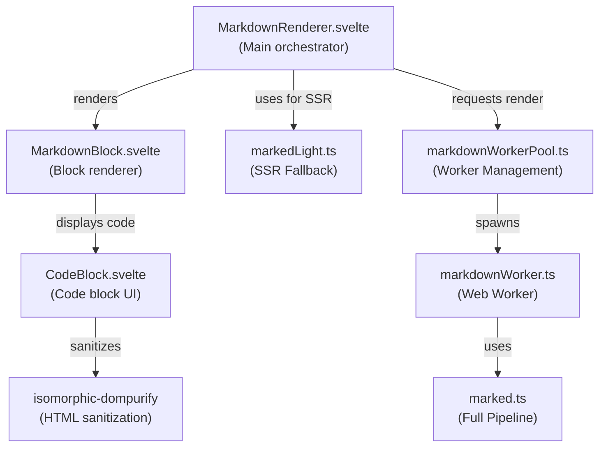
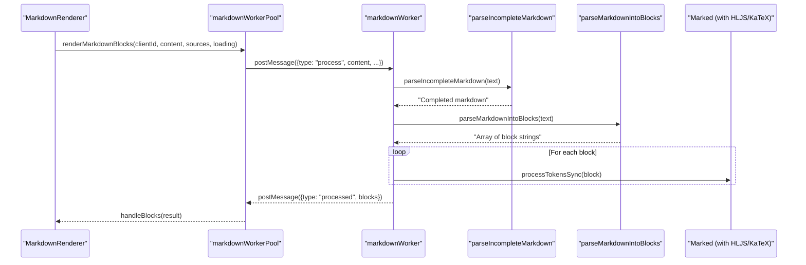

<!-- source: DeepWiki mcp.deepwiki.com · repo huggingface/chat-ui · page 3.2 Markdown and Code Rendering · fetched 2026-10-26 -->

# Markdown and Code Rendering

Relevant source files

The following files were used as context for generating this wiki page:

- [package-lock.json](package-lock.json)
- [package.json](package.json)
- [src/lib/components/CodeBlock.svelte](src/lib/components/CodeBlock.svelte)
- [src/lib/components/ExternalLinkModal.svelte](src/lib/components/ExternalLinkModal.svelte)
- [src/lib/components/HtmlPreviewModal.svelte](src/lib/components/HtmlPreviewModal.svelte)
- [src/lib/components/chat/MarkdownBlock.svelte](src/lib/components/chat/MarkdownBlock.svelte)
- [src/lib/components/chat/MarkdownRenderer.svelte](src/lib/components/chat/MarkdownRenderer.svelte)
- [src/lib/components/chat/MarkdownRenderer.svelte.test.ts](src/lib/components/chat/MarkdownRenderer.svelte.test.ts)
- [src/lib/stores/pendingChatInput.ts](src/lib/stores/pendingChatInput.ts)
- [src/lib/utils/externalLink.spec.ts](src/lib/utils/externalLink.spec.ts)
- [src/lib/utils/externalLink.ts](src/lib/utils/externalLink.ts)
- [src/lib/utils/markdownWorkerPool.ts](src/lib/utils/markdownWorkerPool.ts)
- [src/lib/utils/marked.spec.ts](src/lib/utils/marked.spec.ts)
- [src/lib/utils/marked.ts](src/lib/utils/marked.ts)
- [src/lib/utils/markedLight.ts](src/lib/utils/markedLight.ts)
- [src/lib/utils/parseBlocks.spec.ts](src/lib/utils/parseBlocks.spec.ts)
- [src/lib/utils/parseBlocks.ts](src/lib/utils/parseBlocks.ts)
- [src/lib/utils/parseIncompleteMarkdown.spec.ts](src/lib/utils/parseIncompleteMarkdown.spec.ts)
- [src/lib/utils/parseIncompleteMarkdown.ts](src/lib/utils/parseIncompleteMarkdown.ts)
- [src/lib/utils/previewSrcdoc.svelte.test.ts](src/lib/utils/previewSrcdoc.svelte.test.ts)
- [src/lib/workers/markdownWorker.ts](src/lib/workers/markdownWorker.ts)
- [src/styles/highlight-js.css](src/styles/highlight-js.css)
- [vite.config.ts](vite.config.ts)

## Purpose and Scope

This document describes the markdown and code rendering system in chat-ui, which transforms markdown text from LLM responses into formatted HTML. The system is optimized for streaming updates, handling incomplete markdown tokens, providing syntax highlighting for code blocks, rendering mathematical notation via KaTeX, and ensuring security through HTML sanitization.

## System Architecture

The rendering system follows a layered architecture where markdown content is first normalized, split into manageable blocks for memoization, and then processed into tokens. To protect the main thread from heavy synchronous tasks like KaTeX and Highlight.js, the system utilizes a shared worker pool.

**Component Hierarchy**

Sources: [src/lib/components/chat/MarkdownRenderer.svelte:1-53](), [src/lib/utils/markdownWorkerPool.ts:1-125](), [src/lib/components/CodeBlock.svelte:1-30]()

## Markdown Processing Pipeline

The pipeline transforms raw markdown strings into structured `BlockToken` objects. It supports "streaming repairs" to ensure that partial syntax (like unclosed bold tags) does not flash as raw text during generation.

**Processing Flow**

Sources: [src/lib/utils/marked.ts:32-34](), [src/lib/workers/markdownWorker.ts:26-41](), [src/lib/utils/parseIncompleteMarkdown.ts:1-16](), [src/lib/utils/markdownWorkerPool.ts:180-210]()

## Worker Pool and Performance

To avoid exhausting browser memory (especially on mobile), `chat-ui` uses a shared `markdownWorkerPool` instead of one worker per message [src/lib/utils/markdownWorkerPool.ts:40-45]().

- **Pool Size**: Deliberately small (max 2 workers) to stay within tab memory caps [src/lib/utils/markdownWorkerPool.ts:45]().
- **Coalescing**: If a client sends multiple requests while a worker is busy, the pool only keeps the latest job, discarding superseded intermediate states [src/lib/utils/markdownWorkerPool.ts:69-72]().
- **Graceful Degradation**: If workers are blocked by CSP or fail repeatedly, the system falls back to an async main-thread import of the rich module [src/lib/utils/markdownWorkerPool.ts:82-97]().
- **SSR Safety**: Server-side rendering uses `fallbackBlocks` from `markedLight.ts`, which performs basic escaping and block splitting without pulling in the 700KB KaTeX/Highlight.js bundle [src/lib/components/chat/MarkdownRenderer.svelte:22-26]().

Sources: [src/lib/utils/markdownWorkerPool.ts:40-75](), [src/lib/components/chat/MarkdownRenderer.svelte:22-31]()

## Code Block Rendering

The `CodeBlock.svelte` component provides syntax highlighting, clipboard integration, and live previews for web technologies.

| Feature | Implementation |
| :--- | :--- |
| **Syntax Highlighting** | Handled in `marked.ts` via `highlight.js`. Supported languages include JS, TS, Python, Rust, etc. [src/lib/utils/marked.ts:43-66](). |
| **Sanitization** | Uses `isomorphic-dompurify`. During streaming, it skips full sanitization if the code only contains `` tags from the highlighter to maintain performance [src/lib/components/CodeBlock.svelte:27-30](). |
| **HTML/SVG Preview** | Detects `<!doctype html>` or `<svg>` tags and enables a "Preview" button [src/lib/components/CodeBlock.svelte:32-45](). |
| **Iframe Sandbox** | Previews run in a sandboxed `iframe` with `allow-scripts` but no `referrer` [src/lib/components/HtmlPreviewModal.svelte:83-90](). |

### HTML Preview System
The `HtmlPreviewModal` allows users to view generated artifacts. It uses a `MessageEvent` listener to capture errors from within the iframe and allows the user to send those errors back to the chat for the model to fix [src/lib/components/HtmlPreviewModal.svelte:33-51](), [src/lib/components/HtmlPreviewModal.svelte:102-113]().

Sources: [src/lib/components/CodeBlock.svelte:1-46](), [src/lib/components/HtmlPreviewModal.svelte:33-115](), [src/lib/utils/marked.ts:43-66]()

## Math Rendering with KaTeX

Mathematical notation is processed using custom `marked` extensions for both block and inline display modes.

- **Delimiters**: Supports `$$...$$` and `\[...\]` for blocks [src/lib/utils/marked.ts:153-178](), and `$...$` or `\(...\)` for inline math [src/lib/utils/marked.ts:200-225]().
- **Size Constraints**: To prevent pathological inputs from hanging the renderer, KaTeX processing is capped at 10,000 characters; longer strings are escaped as plaintext [src/lib/utils/marked.ts:78-137]().
- **Chemistry**: The `mhchem` extension is loaded to support chemical equations [src/lib/utils/marked.ts:2]().

Sources: [src/lib/utils/marked.ts:1-236]()

## Streaming Repairs

The `parseIncompleteMarkdown` function uses `remend` to ensure partial markdown doesn't break the layout during streaming [src/lib/utils/parseIncompleteMarkdown.ts:1-16]().

- **Incomplete Links**: Closed with a placeholder `streamdown:incomplete-link`. The renderer detects this and produces an inert `<a>` tag without an `href` to prevent dead clicks [src/lib/utils/marked.spec.ts:107-112]().
- **Emphasis**: Ensures that unclosed `**` or `_` tokens are treated as formatting rather than literal text during the stream [src/lib/utils/marked.spec.ts:125-128]().
- **Setext Headings**: Prevents a lone dash `-` on a new line from being prematurely rendered as an `<h2>` until the next line confirms it is not a list item [src/lib/utils/marked.spec.ts:141-145]().

Sources: [src/lib/utils/parseIncompleteMarkdown.ts:1-16](), [src/lib/utils/marked.spec.ts:106-158]()

---

