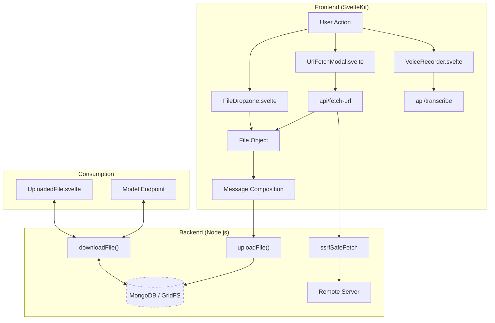
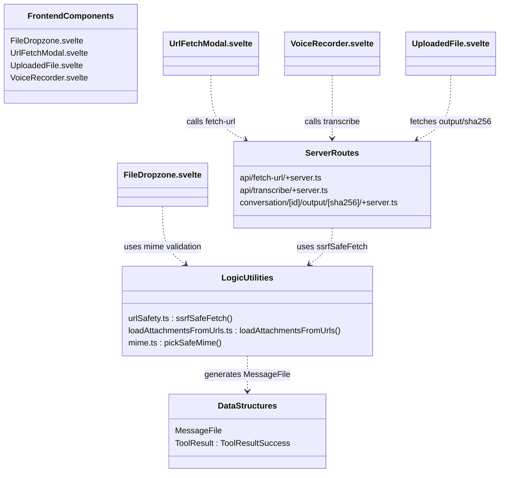

<!-- source: DeepWiki mcp.deepwiki.com · repo huggingface/chat-ui · page 3.3 File Attachments and URL Fetching · fetched 2026-10-26 -->

# File Attachments and URL Fetching

Relevant source files

The following files were used as context for generating this wiki page:

- [src/lib/components/chat/FileDropzone.svelte](src/lib/components/chat/FileDropzone.svelte)
- [src/lib/components/chat/UploadedFile.svelte](src/lib/components/chat/UploadedFile.svelte)
- [src/lib/components/chat/UrlFetchModal.svelte](src/lib/components/chat/UrlFetchModal.svelte)
- [src/lib/components/chat/VoiceRecorder.svelte](src/lib/components/chat/VoiceRecorder.svelte)
- [src/lib/components/voice/AudioWaveform.svelte](src/lib/components/voice/AudioWaveform.svelte)
- [src/lib/types/Tool.ts](src/lib/types/Tool.ts)
- [src/lib/utils/loadAttachmentsFromUrls.ts](src/lib/utils/loadAttachmentsFromUrls.ts)
- [src/lib/utils/mime.ts](src/lib/utils/mime.ts)
- [src/routes/api/fetch-url/+server.ts](src/routes/api/fetch-url/+server.ts)
- [src/routes/api/transcribe/+server.ts](src/routes/api/transcribe/+server.ts)

The `chat-ui` system provides a robust mechanism for attaching local files and fetching remote content via URLs. These attachments are processed, validated for security, and stored for consumption by Large Language Models (LLMs).

## Attachment Pipeline Overview

The attachment system handles four primary entry points: direct file uploads (via `FileDropzone.svelte`), clipboard pasting, voice recordings (via `VoiceRecorder.svelte`), and remote URL fetching (via `UrlFetchModal.svelte`). All files undergo MIME type validation and size checks before being persisted or sent to the model.

### Data Flow Diagram

This diagram illustrates the flow from user interaction to the storage and retrieval of file assets.

**Attachment Ingestion and Retrieval Flow**

Sources: [src/lib/components/chat/FileDropzone.svelte:20-69](), [src/routes/api/fetch-url/+server.ts:17-114](), [src/lib/utils/loadAttachmentsFromUrls.ts:69-115](), [src/lib/components/chat/VoiceRecorder.svelte:142-158]()

## URL Fetching API

The `/api/fetch-url` endpoint acts as a security-hardened proxy for fetching remote assets. It is designed to prevent Server-Side Request Forgery (SSRF) and ensure that only safe, valid content is ingested.

### Security Controls
- **Protocol Restriction**: Only `https:` URLs are permitted [src/routes/api/fetch-url/+server.ts:25-28]().
- **Size Limits**: Maximum file size is capped at 10MB [src/routes/api/fetch-url/+server.ts:5]().
- **Timeout**: Requests time out after 30 seconds [src/routes/api/fetch-url/+server.ts:6]().
- **SSRF Protection**: 
    - The `isValidUrl` function (used in the route) rejects unsafe targets [src/routes/api/fetch-url/+server.ts:25-28]().
    - A custom `ssrfSafeFetch` is used to execute the request [src/routes/api/fetch-url/+server.ts:41]().
    - Redirects are followed manually (up to 5 hops), and every hop is re-validated via `isValidUrl` [src/routes/api/fetch-url/+server.ts:49-73]().

### Content Delivery
The endpoint returns the file as `text/plain` for browser safety but includes an `X-Forwarded-Content-Type` header containing the original MIME type [src/routes/api/fetch-url/+server.ts:93-100](). It also enforces a strict `Content-Security-Policy` to prevent execution of active content [src/routes/api/fetch-url/+server.ts:8-15]().

Sources: [src/routes/api/fetch-url/+server.ts:1-114](), [src/lib/server/urlSafety.ts:1-5]()

## Audio Transcription

Voice inputs are handled by `VoiceRecorder.svelte`, which captures audio via `MediaRecorder` [src/lib/components/chat/VoiceRecorder.svelte:77](). The resulting blob is sent to the `/api/transcribe` endpoint.

- **Format Support**: Supports `audio/webm`, `audio/ogg`, `audio/wav`, `audio/flac`, and others [src/routes/api/transcribe/+server.ts:9-17]().
- **Backend Processing**: The API forwards the audio buffer to a configured transcription model (e.g., Whisper) via the Hugging Face Inference API [src/routes/api/transcribe/+server.ts:55-72]().
- **Size Limit**: Audio files are limited to 25MB [src/routes/api/transcribe/+server.ts:6]().

Sources: [src/lib/components/chat/VoiceRecorder.svelte:49-101](), [src/routes/api/transcribe/+server.ts:1-104]()

## File Validation and MIME Types

Attachments are categorized by their MIME types to determine how they are rendered in the UI and processed by the backend.

| Category | Validation Logic | UI Component |
| :--- | :--- | :--- |
| **Images** | `image/*`, `webp`, `jpeg`, `png` | `` tag in `UploadedFile.svelte` [src/lib/components/chat/UploadedFile.svelte:39-41]() |
| **Audio** | `audio/*`, `mp3`, `wav`, `x-wav` | `AudioPlayer.svelte` [src/lib/components/chat/UploadedFile.svelte:42-43]() |
| **Video** | `video/*`, `mp4`, `x-mpeg` | `<video>` tag in `UploadedFile.svelte` [src/lib/components/chat/UploadedFile.svelte:44-45]() |
| **Plain Text** | `TEXT_MIME_ALLOWLIST` or clipboard type | `<pre>` block in `UploadedFile.svelte` [src/lib/components/chat/UploadedFile.svelte:60-61]() |

### Key Functions
- `matchesAllowed(contentType, allowed)`: Performs wildcard matching (e.g., `image/*`) against a list of allowed types [src/lib/components/chat/UploadedFile.svelte:47-58]().
- `pickSafeMime(forwardedType, blobType, url)`: Resolves the most appropriate MIME type from multiple sources [src/lib/utils/mime.ts:41-56]().
- `extractFilename(url, contentDisposition)`: Parses the filename from headers or URL path segments [src/lib/utils/loadAttachmentsFromUrls.ts:32-64]().

Sources: [src/lib/components/chat/UploadedFile.svelte:39-62](), [src/lib/components/chat/FileDropzone.svelte:34-51](), [src/lib/utils/loadAttachmentsFromUrls.ts:32-64](), [src/lib/utils/mime.ts:41-56]()

## Storage and Retrieval

Once a file is accepted by the frontend, it is converted into a `MessageFile` object [src/lib/types/Message.ts]().

### File Representation
Files can be stored in two formats within the `MessageFile` interface:
1. **Base64**: Used for small or temporary files [src/lib/components/chat/UploadedFile.svelte:79]().
2. **Hash**: A SHA-256 hash pointing to a file persisted in the backend (GridFS) [src/lib/components/chat/UploadedFile.svelte:72]().

### Retrieval Route
The route `/output/[sha256]` (relative to the conversation) serves stored files. `UploadedFile.svelte` fetches these hashes to display content [src/lib/components/chat/UploadedFile.svelte:104]().

Sources: [src/lib/components/chat/UploadedFile.svelte:66-126](), [src/lib/utils/loadAttachmentsFromUrls.ts:69-115]()

## Implementation Mapping

This diagram maps system concepts to specific code entities involved in the attachment lifecycle.

**Code Entity Mapping**

Sources: [src/lib/components/chat/UploadedFile.svelte:1-20](), [src/lib/utils/loadAttachmentsFromUrls.ts:69-71](), [src/lib/types/Tool.ts:12-17](), [src/routes/api/fetch-url/+server.ts:1-15]()

---

