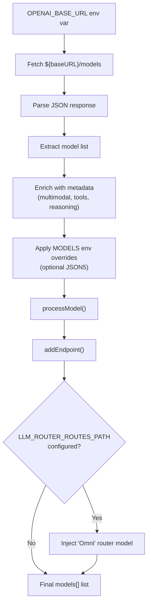
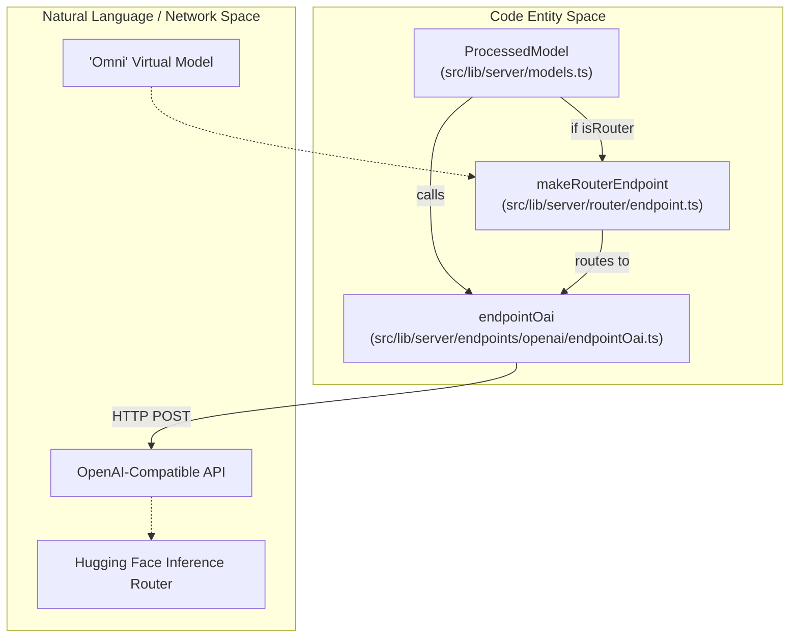
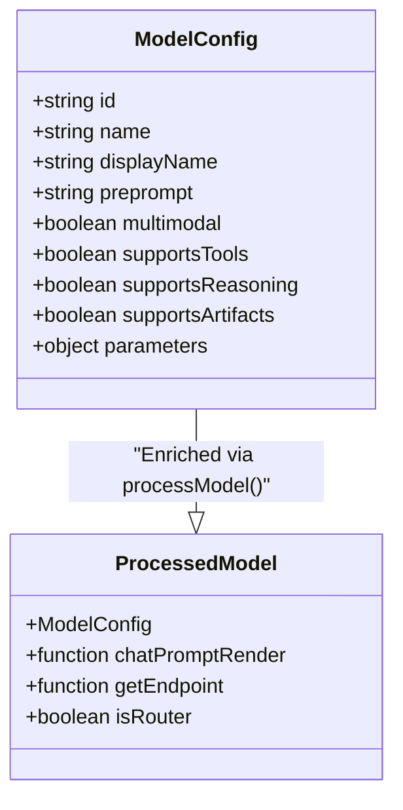

<!-- source: DeepWiki mcp.deepwiki.com · repo huggingface/chat-ui · page 4 Models and LLM Integration · fetched 2026-10-26 -->

# Models and LLM Integration

Relevant source files

The following files were used as context for generating this wiki page:

- [README.md](README.md)
- [src/lib/APIClient.ts](src/lib/APIClient.ts)
- [src/lib/server/api/types.ts](src/lib/server/api/types.ts)
- [src/lib/server/api/utils/serializeModel.ts](src/lib/server/api/utils/serializeModel.ts)
- [src/lib/server/endpoints/endpoints.ts](src/lib/server/endpoints/endpoints.ts)
- [src/lib/server/endpoints/openai/endpointOai.ts](src/lib/server/endpoints/openai/endpointOai.ts)
- [src/lib/server/endpoints/openai/openAIChatToTextGenerationStream.ts](src/lib/server/endpoints/openai/openAIChatToTextGenerationStream.ts)
- [src/lib/server/endpoints/openai/openAICompletionToTextGenerationStream.ts](src/lib/server/endpoints/openai/openAICompletionToTextGenerationStream.ts)
- [src/lib/server/models.ts](src/lib/server/models.ts)
- [src/lib/types/Model.ts](src/lib/types/Model.ts)
- [src/routes/api/v2/models/[namespace]/+server.ts](src/routes/api/v2/models/[namespace]/+server.ts)
- [src/routes/api/v2/models/[namespace]/[model]/+server.ts](src/routes/api/v2/models/[namespace]/[model]/+server.ts)

The Models and LLM Integration system is the core component of chat-ui that handles communication with language model providers. Chat-ui exclusively uses OpenAI-compatible APIs, providing a unified interface for interacting with any LLM provider that implements the OpenAI protocol (e.g., Hugging Face Inference Providers, Ollama, vLLM, or OpenAI itself).

This page explains how models are discovered and configured, how the LLM Router intelligently selects models, how endpoints process requests, and how text generation is orchestrated.

## Overview of the System

The LLM integration system consists of several interconnected components that handle the lifecycle of a model from discovery to generation.

**Model Discovery and Configuration**

Title: Model Discovery and Initialization Flow

Sources:
- [src/lib/server/models.ts:206-250]() - `buildModels` discovery logic and schema validation
- [src/lib/server/models.ts:159-172]() - `getModelOverrides` processing for the `MODELS` env var
- [src/lib/server/models.ts:276-321]() - LLM Router injection and Omni model configuration

**Endpoint Architecture**

Title: Model to Provider Communication Space

Sources:
- [src/lib/server/models.ts:137-150]() - `addEndpoint` implementation mapping models to endpoint logic
- [src/lib/server/endpoints/endpoints.ts:35-37]() - `Endpoint` type definition for the abstraction layer
- [src/lib/server/endpoints/openai/endpointOai.ts:53-67]() - `endpointOai` implementation

## Model Schema and Metadata

The system uses a strict Zod schema to define model capabilities. This metadata determines how the UI renders features like image uploads or reasoning toggles.

Title: Model Configuration Entities

Sources:
- [src/lib/server/models.ts:19-71]() - `modelConfig` Zod schema definition
- [src/lib/server/models.ts:127-135]() - `processModel` implementation for metadata enrichment
- [src/lib/types/Model.ts:6-27]() - Client-side `Model` type for UI consumption

### Model Discovery and Overrides

Chat-ui fetches models from `${OPENAI_BASE_URL}/models`. It detects multimodal capabilities by inspecting `architecture.input_modalities` in the response. If the `MODELS` environment variable is provided, it is parsed as JSON5 and used to override discovered metadata (e.g., adding a custom logo or description).

For details, see [Model Configuration and Discovery](#4.1).

Sources:
- [src/lib/server/models.ts:92-110]() - Discovery list schema
- [src/lib/server/models.ts:159-172]() - Environment variable override logic

## LLM Router ('Omni')

The LLM Router is a heuristic-based system that exposes a virtual model (default ID `omni`). Instead of a fixed model, Omni selects a "route" based on the request content:
- **Multimodal**: If images are attached.
- **Agentic**: If MCP tools are enabled.
- **Default**: For standard text chat.

For details, see [LLM Router](#4.2).

Sources:
- [README.md:127-140]() - LLM Router high-level configuration and logic
- [src/lib/server/models.ts:276-321]() - Injection of the router model into the global model list

## OpenAI-Compatible Endpoint Implementation

The `endpointOai` function is the primary implementation of the `Endpoint` interface. It handles:
1.  **Message Formatting**: Converting internal message shapes to OpenAI `ChatCompletionMessageParam`.
2.  **File Handling**: Processing images into base64 Data URLs for multimodal models.
3.  **Stream Conversion**: Transforming OpenAI's stream format into the internal `TextGenerationStreamOutputSimplified` format.
4.  **Metadata Capture**: Extracting router-specific headers (e.g., `X-Router-Model`) to show the user which model was actually used by a provider-side router.

For details, see [Endpoint Implementations](#4.3).

Sources:
- [src/lib/server/endpoints/openai/endpointOai.ts:178-203]() - Chat message and preprompt preparation
- [src/lib/server/endpoints/openai/openAIChatToTextGenerationStream.ts:8-41]() - Stream transformation and router metadata yielding

## Text Generation Orchestration

Text generation is orchestrated by the server to handle multiple concurrent requirements:
- **Streaming**: Tokens are streamed to the client via Server-Sent Events (SSE).
- **Reasoning**: Models like DeepSeek R1 or OpenAI o1 that emit `<think>` blocks are handled by parsing reasoning content.
- **Tools**: If a request requires tools, the system executes them via the Model Context Protocol (MCP) before final generation.

For details, see [Text Generation](#4.4), [Prompt Building and Templates](#4.5), and [MCP Tool Integration](#4.6).

Sources:
- [src/lib/server/endpoints/openai/openAIChatToTextGenerationStream.ts:101-123]() - Logic for handling `<think>` tags and reasoning content
- [src/lib/server/endpoints/openai/endpointOai.ts:205-230]() - Parameter merging (temperature, max_tokens, etc.)

---

