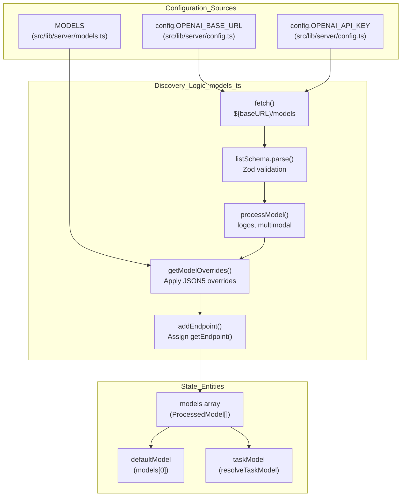
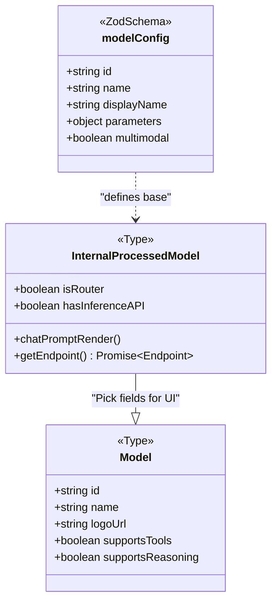

<!-- source: DeepWiki mcp.deepwiki.com · repo huggingface/chat-ui · page 4.1 Model Configuration and Discovery · fetched 2026-10-26 -->

# Model Configuration and Discovery

Relevant source files

The following files were used as context for generating this wiki page:

- [README.md](README.md)
- [src/lib/APIClient.ts](src/lib/APIClient.ts)
- [src/lib/components/BackgroundGenerationPoller.svelte](src/lib/components/BackgroundGenerationPoller.svelte)
- [src/lib/components/chat/ModelSwitch.svelte](src/lib/components/chat/ModelSwitch.svelte)
- [src/lib/server/api/types.ts](src/lib/server/api/types.ts)
- [src/lib/server/api/utils/serializeModel.ts](src/lib/server/api/utils/serializeModel.ts)
- [src/lib/server/endpoints/endpoints.ts](src/lib/server/endpoints/endpoints.ts)
- [src/lib/server/models.ts](src/lib/server/models.ts)
- [src/lib/stores/conversations.svelte.ts](src/lib/stores/conversations.svelte.ts)
- [src/lib/types/Model.ts](src/lib/types/Model.ts)
- [src/lib/utils/models.ts](src/lib/utils/models.ts)
- [src/lib/utils/pendingFiles.ts](src/lib/utils/pendingFiles.ts)
- [src/routes/api/v2/models/+server.ts](src/routes/api/v2/models/+server.ts)
- [src/routes/api/v2/models/[namespace]/+server.ts](src/routes/api/v2/models/[namespace]/+server.ts)
- [src/routes/api/v2/models/[namespace]/[model]/+server.ts](src/routes/api/v2/models/[namespace]/[model]/+server.ts)
- [src/routes/api/v2/public-config/+server.ts](src/routes/api/v2/public-config/+server.ts)
- [src/routes/models/[...model]/+page.svelte](src/routes/models/[...model]/+page.svelte)
- [src/routes/models/[...model]/thumbnail.png/+server.ts](src/routes/models/[...model]/thumbnail.png/+server.ts)
- [src/routes/models/[...model]/thumbnail.png/ModelThumbnail.svelte](src/routes/models/[...model]/thumbnail.png/ModelThumbnail.svelte)
- [static/huggingchat/fulltext-logo.svg](static/huggingchat/fulltext-logo.svg)
- [static/huggingchat/thumbnail.png](static/huggingchat/thumbnail.png)

## Purpose and Scope

This document describes how `chat-ui` discovers, configures, and manages Large Language Models (LLMs). The system primarily supports OpenAI-compatible API endpoints and automatically discovers available models by querying the `/models` endpoint. Model metadata can be enriched with custom properties, and an optional LLM Router alias ("Omni") can be injected for intelligent model selection.

For information about the LLM Router's route selection logic, see **4.2 LLM Router**. For details on endpoint implementations and streaming, see **4.3 Endpoint Implementations**.

---

## Model Discovery Architecture

The model discovery system fetches available models from an OpenAI-compatible API endpoint at startup. The system queries `${OPENAI_BASE_URL}/models`, parses the response, and constructs internal model configurations with enriched metadata.

### Model Discovery Flow

The discovery process is orchestrated in `src/lib/server/models.ts`. It follows a pipeline from environment configuration to a final array of `ProcessedModel` objects.

**Sources:** [src/lib/server/models.ts:206-218](), [src/lib/server/models.ts:159-172](), [src/lib/server/models.ts:87-91](), [src/lib/server/models.ts:127-135]()

---

## Model Configuration Schema

Models are validated using a `zod` schema named `modelConfig`. This schema defines the structure for both discovered models and manual overrides.

| Field | Type | Description |
|-------|------|-------------|
| `id` | `string` | Used as a unique identifier in the database. [src/lib/server/models.ts:21-21]() |
| `name` | `string` | The model name used for inference calls. [src/lib/server/models.ts:23-23]() |
| `displayName` | `string` | Human-readable name shown in the UI. [src/lib/server/models.ts:24-24]() |
| `preprompt` | `string` | The system prompt prefix for the model. [src/lib/server/models.ts:32-32]() |
| `parameters` | `object` | Generation parameters like `temperature`, `max_tokens`, `stop`. [src/lib/server/models.ts:45-57]() |
| `multimodal` | `boolean` | Whether the model supports image inputs. [src/lib/server/models.ts:58-58]() |
| `supportsTools` | `boolean` | Aggregated tool-calling capability across providers. [src/lib/server/models.ts:61-61]() |
| `supportsReasoning`| `boolean` | Supports `reasoning_effort` (e.g., o1/o3 models). [src/lib/server/models.ts:63-63]() |
| `supportsArtifacts`| `boolean` | Opt-in for rendering code/HTML in a side panel. [src/lib/server/models.ts:66-66]() |

### Code Entity Space: Model Types

The system differentiates between raw configuration, processed server-side models, and the subset of data sent to the frontend.

**Sources:** [src/lib/server/models.ts:19-71](), [src/lib/server/models.ts:152-155](), [src/lib/types/Model.ts:6-27]()

---

## Metadata Enrichment and Processing

Once models are fetched from the `/models` endpoint (validated by `listSchema` [src/lib/server/models.ts:92-110]()), they undergo enrichment in the `processModel` and `addEndpoint` functions.

### Enrichment Logic
1.  **ID Assignment**: If no ID is provided, it defaults to the model name. [src/lib/server/models.ts:130-130]()
2.  **Preprompt Loading**: If `prepromptUrl` is provided, the system fetches the text content. [src/lib/server/models.ts:132-132]()
3.  **Parameter Mapping**: Maps `parameters.stop` to `stop_sequences` for internal compatibility. [src/lib/server/models.ts:133-133]()
4.  **Prompt Rendering**: Attaches a `chatPromptRender` function. In this build, it uses a minimal template that formats messages into a `[ROLE]\ncontent` structure to support legacy flows. [src/lib/server/models.ts:112-125]()

### Endpoint Association
The `addEndpoint` function assigns an async `getEndpoint` method to each model. This build exclusively supports OpenAI-compatible endpoints by calling `endpoints.openai` with the model's configuration. [src/lib/server/models.ts:137-150]()

**Sources:** [src/lib/server/models.ts:127-135](), [src/lib/server/models.ts:137-150](), [src/lib/server/endpoints/endpoints.ts:40-42]()

---

## Model Overrides via Environment Variables

Users can customize discovered models or define new ones using the `MODELS` environment variable. This variable accepts a JSON5 array of partial model configurations.

### Override Logic
1.  **Sanitization**: The `sanitizeJSONEnv` function strips backticks and whitespace from the environment string. [src/lib/server/models.ts:13-17]()
2.  **Parsing**: `getModelOverrides` parses the JSON5 string and validates it against `overrideEntrySchema`. [src/lib/server/models.ts:159-172]()
3.  **Schema Requirements**: Each override must provide at least an `id` or `name` to match against discovered models. [src/lib/server/models.ts:75-83]()

**Sources:** [src/lib/server/models.ts:13-17](), [src/lib/server/models.ts:159-172](), [src/lib/server/models.ts:75-83]()

---

## Task Model and Selection

The system maintains a `taskModel` used for background operations like title generation.

### Selection Logic
- If `config.TASK_MODEL` is defined, the system searches the `models` list for a matching ID or name. [src/lib/server/models.ts:194-201]()
- If no match is found or no variable is set, it falls back to the first model in the processed list. [src/lib/server/models.ts:203-203]()

The `findCurrentModel` utility is used on the frontend to resolve which model a conversation should use, especially when switching models for an existing conversation. [src/lib/utils/models.ts:3-14](), [src/lib/components/chat/ModelSwitch.svelte:26-46]()

**Sources:** [src/lib/server/models.ts:189-204](), [src/lib/utils/models.ts:3-14](), [src/lib/components/chat/ModelSwitch.svelte:26-46]()

---

## API Exposure and Discovery

The frontend discovers available models via the `GET /api/v2/models` endpoint.

### Model Filtering
The API endpoint `src/routes/api/v2/models/+server.ts` filters out models marked as `unlisted`. It returns a serialized summary of models to the client. [src/routes/api/v2/models/+server.ts:11-23]()

### Client-Side Access
The `APIClient` provides a structured way to fetch models. `client.models.get()` retrieves the list, while `client.models({ id: "..." }).get()` retrieves specific details like providers and parameters. [src/lib/APIClient.ts:120-128]()

### Thumbnail Generation
For social sharing and UI previews, the system provides a dynamic thumbnail generator at `src/routes/models/[...model]/thumbnail.png/+server.ts`. This uses `satori` and `resvg-js` to render a Svelte component (`ModelThumbnail.svelte`) into a PNG image. [src/routes/models/[...model]/thumbnail.png/+server.ts:15-64]()

**Sources:** [src/routes/api/v2/models/+server.ts:11-23](), [src/lib/APIClient.ts:120-128](), [src/routes/models/[...model]/thumbnail.png/+server.ts:15-64](), [src/routes/models/[...model]/thumbnail.png/ModelThumbnail.svelte:17-32]()

---

