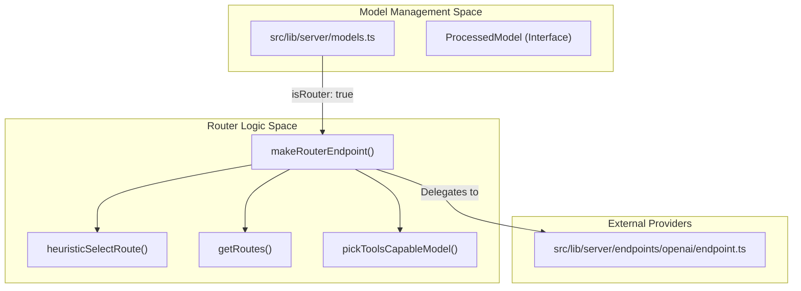
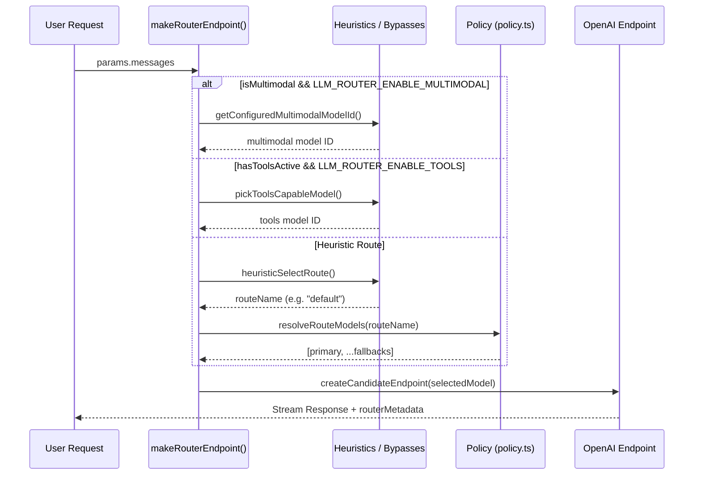

<!-- source: DeepWiki mcp.deepwiki.com · repo huggingface/chat-ui · page 4.2 LLM Router · fetched 2026-10-26 -->

# LLM Router

<details>
<summary>Relevant source files</summary>

The following files were used as context for generating this wiki page:

- [.env](.env)
- [chart/env/dev.yaml](chart/env/dev.yaml)
- [chart/env/prod.yaml](chart/env/prod.yaml)
- [docs/source/configuration/common-issues.md](docs/source/configuration/common-issues.md)
- [docs/source/configuration/llm-router.md](docs/source/configuration/llm-router.md)
- [docs/source/configuration/mcp-tools.md](docs/source/configuration/mcp-tools.md)
- [docs/source/configuration/overview.md](docs/source/configuration/overview.md)
- [docs/source/developing/architecture.md](docs/source/developing/architecture.md)
- [docs/source/index.md](docs/source/index.md)
- [src/hooks.server.ts](src/hooks.server.ts)
- [src/lib/constants/mcpExamples.ts](src/lib/constants/mcpExamples.ts)
- [src/lib/constants/routerExamples.ts](src/lib/constants/routerExamples.ts)
- [src/lib/server/auth.ts](src/lib/server/auth.ts)
- [src/lib/server/router/endpoint.ts](src/lib/server/router/endpoint.ts)
- [src/lib/server/router/types.ts](src/lib/server/router/types.ts)
- [src/lib/server/textGeneration/mcp/routerResolution.ts](src/lib/server/textGeneration/mcp/routerResolution.ts)
- [src/lib/types/User.ts](src/lib/types/User.ts)
- [src/routes/login/callback/+server.ts](src/routes/login/callback/+server.ts)
- [src/routes/login/callback/updateUser.ts](src/routes/login/callback/updateUser.ts)
- [src/routes/logout/+server.ts](src/routes/logout/+server.ts)
- [static/huggingchat/castle-example.jpg](static/huggingchat/castle-example.jpg)
- [static/huggingchat/routes.chat.json](static/huggingchat/routes.chat.json)

</details>


## Purpose and Scope

The LLM Router is an intelligent model selection system that dynamically chooses the best model for each conversation turn. It appears to users as a virtual model alias (by default called "Omni") that, when selected, routes requests to specialized models based on the conversation context. This system uses local heuristics and a policy-based configuration to select models for multimodal, agentic (tool-using), or general-purpose tasks.

---

## Overview

The LLM Router provides server-side intelligent routing without requiring a separate selection model call for every request. When a user selects the router alias (e.g., "Omni") from the model list, the system:

1.  Analyzes the request for specific features (images or active tools). [src/lib/server/router/endpoint.ts:112-118]()
2.  Applies synchronous heuristics to select a route category (e.g., `multimodal`, `agentic`, or `default`). [src/lib/server/router/endpoint.ts:111-111]()
3.  Maps the route to a specific model from a routes policy JSON file. [src/lib/server/router/endpoint.ts:107-107]()
4.  Streams the response from the selected model. [src/lib/server/router/endpoint.ts:163-163]()
5.  Falls back to alternative models if the primary selection fails. [src/lib/server/router/policy.ts:35-44]()

**Sources:** [docs/source/developing/architecture.md:33-35](), [docs/source/configuration/llm-router.md:1-15](), [chart/env/prod.yaml:77-89](), [src/lib/server/router/endpoint.ts:105-165]()

---

## Architecture

### Virtual Model Integration

The router is implemented as a synthetic model entry. Unlike regular models, which have static endpoint configurations, the router model uses a wrapper endpoint that performs dynamic selection.

**Router Entity Mapping**


The router model is identified by `isRouter: true`. Its execution logic is encapsulated in `makeRouterEndpoint`, which creates a standard `Endpoint` interface that internally handles the routing and fallback orchestration. [src/lib/server/router/endpoint.ts:105-106]()

**Sources:** [src/lib/server/router/endpoint.ts:105-106](), [src/lib/server/textGeneration/mcp/routerResolution.ts:40-42](), [src/lib/server/router/heuristics.ts:11-11]()

### Router Endpoint Wrapper

The `makeRouterEndpoint` function creates an endpoint that intercepts generation requests. It sanitizes messages (stripping reasoning blocks like `<think>`) and then determines the target model using a priority-based selection: multimodal bypass, then tools bypass, then heuristic-based route selection. [src/lib/server/router/endpoint.ts:105-120]()

**Sources:** [src/lib/server/router/endpoint.ts:105-120](), [src/lib/server/router/endpoint.ts:87-99](), [src/lib/server/router/endpoint.ts:21-21]()

---

## Configuration

### Environment Variables

The router is configured through environment variables that control selection behavior, fallback logic, and UI presentation. [chart/env/prod.yaml:77-91]()

| Variable | Purpose | Default |
|----------|---------|---------|
| `LLM_ROUTER_ROUTES_PATH` | Path to the JSON policy file defining routes | None (Required) |
| `LLM_ROUTER_DEFAULT_ROUTE` | Route name used when no specific heuristic matches | `default` |
| `LLM_ROUTER_FALLBACK_MODEL` | Model to use if every candidate in the selected route fails | None |
| `LLM_ROUTER_ENABLE_MULTIMODAL` | Enable immediate bypass to a specific multimodal model | `false` |
| `LLM_ROUTER_MULTIMODAL_MODEL` | The model ID used for the multimodal bypass | None |
| `LLM_ROUTER_ENABLE_TOOLS` | Enable immediate bypass for tool-active requests | `false` |
| `LLM_ROUTER_TOOLS_MODEL` | The model ID used for the tools bypass | None |
| `PUBLIC_LLM_ROUTER_ALIAS_ID` | The ID used for the virtual router model (e.g., `omni`) | `omni` |

**Sources:** [docs/source/configuration/llm-router.md:17-31](), [chart/env/prod.yaml:77-89](), [.env:64-90]()

### Routes Policy

The routes policy is a JSON array specified by `LLM_ROUTER_ROUTES_PATH`. It maps route names to primary and fallback models. [static/huggingchat/routes.chat.json:1-25]()

```json
[
  {
    "name": "default",
    "description": "General purpose route.",
    "primary_model": "moonshotai/Kimi-K2.6",
    "fallback_models": ["zai-org/GLM-4.6"]
  }
]
```

**Sources:** [static/huggingchat/routes.chat.json:1-25](), [src/lib/server/router/policy.ts:8-28](), [src/lib/server/router/types.ts:1-6]()

---

## Selection Process

### Route Selection Flow

When a request is made via the router, the `routerEndpoint` function follows a strict priority sequence. [src/lib/server/router/endpoint.ts:167-210]()

**Execution Data Flow**


**Sources:** [src/lib/server/router/endpoint.ts:167-210](), [src/lib/server/textGeneration/mcp/routerResolution.ts:48-88](), [docs/source/configuration/llm-router.md:9-15](), [src/lib/server/router/endpoint.ts:121-149]()

### Fallback Mechanism

The router handles failures by iterating through the `fallback_models` defined in the policy for the selected route. If the `primary_model` returns an error (captured via `extractUpstreamError`), the router attempts the next candidate in the list. [src/lib/server/router/policy.ts:35-44]() If all candidates fail, it falls back to the global `LLM_ROUTER_FALLBACK_MODEL`. [src/lib/server/router/endpoint.ts:50-85]()

**Sources:** [src/lib/server/router/endpoint.ts:50-85](), [src/lib/server/router/policy.ts:35-44](), [docs/source/configuration/llm-router.md:28-30]()

---

## Multimodal and Tool Support

The router uses specific triggers to identify specialized requests:

*   **Multimodal Detection**: Triggered if any message in the conversation contains a file with a MIME type starting with `image/`. [src/lib/server/router/endpoint.ts:112-116]()
*   **Tools Detection**: Triggered if the user has active MCP server selections in their session (`hasActiveToolsSelection`). [src/lib/server/router/endpoint.ts:118-118]()

If the respective bypass flags (`LLM_ROUTER_ENABLE_MULTIMODAL` or `LLM_ROUTER_ENABLE_TOOLS`) are enabled, the router skips the policy lookup and uses the configured shortcut models. [src/lib/server/router/endpoint.ts:167-188]() If disabled, it falls back to the semantic routes `multimodal` and `agentic` defined within the policy JSON. [static/huggingchat/routes.chat.json:13-23]()

**Sources:** [src/lib/server/router/endpoint.ts:112-118](), [src/lib/server/router/endpoint.ts:167-188](), [src/lib/server/router/endpoint.ts:205-220](), [src/lib/server/textGeneration/mcp/routerResolution.ts:48-78]()

---

## Router Metadata

Before the first token of the generated text is delivered, the router yields a `routerMetadata` object. [src/lib/server/router/endpoint.ts:152-164]() This metadata is used by the UI to inform the user which specific model and route were chosen by the "Omni" system.

```typescript
yield {
    token: { id: 0, text: "", special: true, logprob: 0 },
    generated_text: null,
    details: null,
    routerMetadata: { route: selectedRoute, model: actualModel },
};
```

**Sources:** [src/lib/server/router/endpoint.ts:152-164](), [src/lib/server/router/endpoint.ts:188-188]()

---

