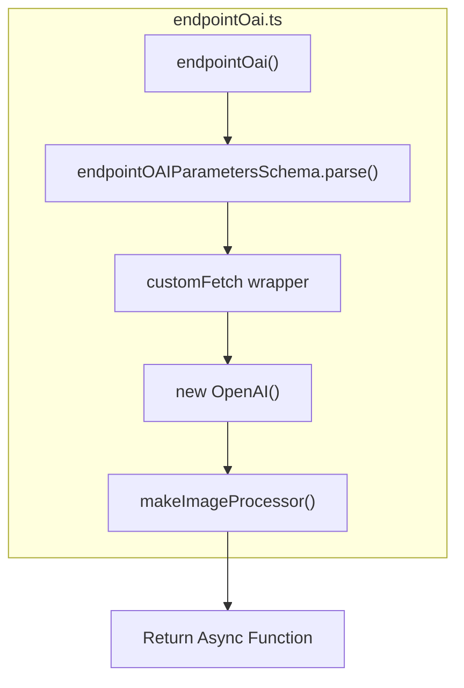
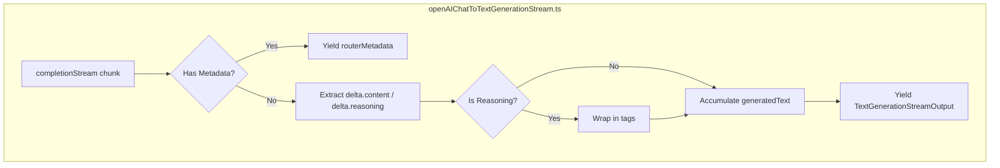
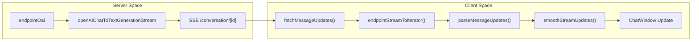

<!-- source: DeepWiki mcp.deepwiki.com · repo huggingface/chat-ui · page 4.3 Endpoint Implementations · fetched 2026-10-26 -->

# Endpoint Implementations

<details>
<summary>Relevant source files</summary>

The following files were used as context for generating this wiki page:

- [src/lib/server/endpoints/openai/endpointOai.ts](src/lib/server/endpoints/openai/endpointOai.ts)
- [src/lib/server/endpoints/openai/openAIChatToTextGenerationStream.ts](src/lib/server/endpoints/openai/openAIChatToTextGenerationStream.ts)
- [src/lib/server/endpoints/openai/openAICompletionToTextGenerationStream.ts](src/lib/server/endpoints/openai/openAICompletionToTextGenerationStream.ts)
- [src/lib/server/endpoints/preprocessMessages.ts](src/lib/server/endpoints/preprocessMessages.ts)
- [src/lib/server/generateFromDefaultEndpoint.ts](src/lib/server/generateFromDefaultEndpoint.ts)

</details>


This page documents the endpoint abstraction layer that provides a unified interface for interacting with various Large Language Model providers. The focus is on the OpenAI-compatible endpoint implementation (`endpointOai`), stream processing mechanisms, and the conversion of LLM responses into `MessageUpdate` events.

## Endpoint Abstraction Layer

The endpoint abstraction defines a unified interface that all LLM providers must implement, allowing the system to interact with different providers through a consistent API.

### Core Types

The `Endpoint` type defines the function signature that all endpoint implementations must conform to:

```typescript
export type Endpoint = (
	params: EndpointParameters
) => Promise<AsyncGenerator<TextGenerationStreamOutputSimplified, void, void>>;
```

**Sources:** [src/lib/server/endpoints/endpoints.ts:35-37]()

The `EndpointParameters` interface specifies the inputs passed to endpoints:

| Parameter | Type | Purpose |
|-----------|------|---------|
| `messages` | `EndpointMessage[]` | Array of conversation messages to send to the LLM |
| `preprompt` | `string \| undefined` | System-level instructions prepended to the conversation |
| `generateSettings` | `Partial<Model["parameters"]>` | Override parameters like temperature, max_tokens, etc. |
| `isMultimodal` | `boolean \| undefined` | Whether to process images in user messages |
| `conversationId` | `ObjectId \| undefined` | Identifier for request tracking and caching |
| `locals` | `App.Locals \| undefined` | Request context including user token for authentication |
| `abortSignal` | `AbortSignal \| undefined` | Signal to cancel the LLM request |
| `provider` | `string \| undefined` | Inference provider preference (e.g., "fastest", "cheapest") |
| `reasoningEffort` | `"low" \| "medium" \| "high"` | Optional effort level for reasoning models |

**Sources:** [src/lib/server/endpoints/endpoints.ts:16-28]()

The `TextGenerationStreamOutputSimplified` type extends the standard Hugging Face inference output with optional router metadata:

```typescript
export type TextGenerationStreamOutputSimplified = TextGenerationStreamOutput & {
	token: TextGenerationStreamToken;
	routerMetadata?: { route?: string; model?: string; provider?: InferenceProvider };
};
```

**Sources:** [src/lib/server/endpoints/endpoints.ts:30-33]()

### Endpoint Registry

The system maintains a registry of available endpoint implementations:

```typescript
export const endpoints = {
	openai: endpointOai,
};
```

**Sources:** [src/lib/server/endpoints/endpoints.ts:40-42]()

## OpenAI Endpoint Implementation

The `endpointOai` function creates an endpoint that communicates with OpenAI-compatible APIs. This implementation supports both the legacy completions API and the modern chat completions API.

### Configuration Schema

The endpoint accepts configuration parameters validated by `endpointOAIParametersSchema`:

| Parameter | Type | Default | Purpose |
|-----------|------|---------|---------|
| `baseURL` | `string` | `"https://api.openai.com/v1"` | Base URL for the OpenAI-compatible API |
| `apiKey` | `string` | `OPENAI_API_KEY` or `HF_TOKEN` | Authentication token |
| `completion` | `"completions" \| "chat_completions"` | `"chat_completions"` | Which API endpoint to use |
| `useCompletionTokens` | `boolean` | `false` | Use `max_completion_tokens` instead of `max_tokens` |
| `multimodal` | `object` | See below | Image processing configuration |

**Sources:** [src/lib/server/endpoints/openai/endpointOai.ts:20-51]()

### OpenAI Client Initialization

The endpoint initializes an OpenAI client with custom configuration and a fetch wrapper to capture metadata:

**Data Flow: OpenAI Endpoint Initialization**


**Sources:** [src/lib/server/endpoints/openai/endpointOai.ts:53-115]()

### Router Metadata Extraction

The `customFetch` wrapper captures router metadata from response headers:
- **X-Router-Route**: The routing decision made by an upstream router.
- **X-Router-Model**: The specific model selected.
- **x-inference-provider**: The provider that handled the request.

**Sources:** [src/lib/server/endpoints/openai/endpointOai.ts:79-102]()

## Completion Modes

### Legacy Completions Mode

When `completion: "completions"` is used, the endpoint builds a single prompt string using `buildPrompt` and calls `openai.completions.create`.

**Sources:** [src/lib/server/endpoints/openai/endpointOai.ts:117-165]()

### Chat Completions Mode

The default mode uses `openai.chat.completions.create`. It handles multimodal content via `prepareMessagesWithFiles` and intelligently injects system prompts.

**Sources:** [src/lib/server/endpoints/openai/endpointOai.ts:166-237]()

#### System Message Logic

If a system message already exists at the start of the message array, the `preprompt` is prepended to it. Otherwise, a new system message is inserted.

**Sources:** [src/lib/server/endpoints/openai/endpointOai.ts:186-203]()

## Stream Processing

Stream processors transform raw OpenAI responses into `TextGenerationStreamOutputSimplified`.

### Chat Completions Stream Processor

The `openAIChatToTextGenerationStream` function handles the following:

1.  **Router Metadata**: Yields metadata if found in `x-router-metadata` property or response headers.
2.  **Reasoning Blocks**: Extracts `reasoning` or `reasoning_content` deltas and wraps them in `<think>` tags.
3.  **Content**: Passes through standard content tokens.
4.  **Finish Reasons**: Signals the end of generation when `finish_reason` is "stop" or "length".

**Stream Logic: openAIChatToTextGenerationStream**


**Sources:** [src/lib/server/endpoints/openai/openAIChatToTextGenerationStream.ts:8-165]()

## Conversion to MessageUpdate Events

The frontend consumes streams via `fetchMessageUpdates`, which converts the server's newline-delimited JSON stream into `MessageUpdate` objects.

### Streaming Modes

Two streaming modes are supported via `applyStreamingMode`:
1.  **raw**: Yields updates as they arrive from the server.
2.  **smooth**: Buffers tokens and releases them at a controlled rate to prevent "jittery" UI updates.

**Sources:** [src/lib/utils/messageUpdates.ts:97-111]()

### Smooth Streaming Implementation

The `smoothStreamUpdates` function uses a `ChunkDetector` (defaulting to word-based detection) to buffer partial tokens and emit them based on a character-rate target (`minRateCharsPerMs`).

**Sources:** [src/lib/utils/messageUpdates.ts:165-220]()

### Stream Event Flow

**Code Entity Space: Stream to MessageUpdate Conversion**


**Sources:** [src/lib/utils/messageUpdates.ts:45-95](), [src/lib/utils/messageUpdates.ts:113-141](), [src/lib/utils/messageUpdates.ts:143-163]()

## Preprocessing and Safety

### Preprocessing Pipeline

Before reaching the endpoint, messages are passed through `preprocessMessages` to:
1.  **Download Files**: Fetch remote content for file attachments using `downloadFile`.
2.  **Inject Clipboard Files**: Convert `application/vnd.chatui.clipboard` files into plaintext.
3.  **Strip Empty System Messages**: Remove whitespace-only system prompts to prevent provider errors via `stripEmptyInitialSystemMessage`.

**Sources:** [src/lib/server/endpoints/preprocessMessages.ts:6-14](), [src/lib/server/endpoints/preprocessMessages.ts:48-61]()

### Default Endpoint Utility

The `generateFromDefaultEndpoint` function provides a simplified way to generate text (e.g., for summaries or titles) using the configured `taskModel`. It handles the extraction of `generated_text` and stripping of stop tokens.

**Sources:** [src/lib/server/generateFromDefaultEndpoint.ts:5-46]()

---

