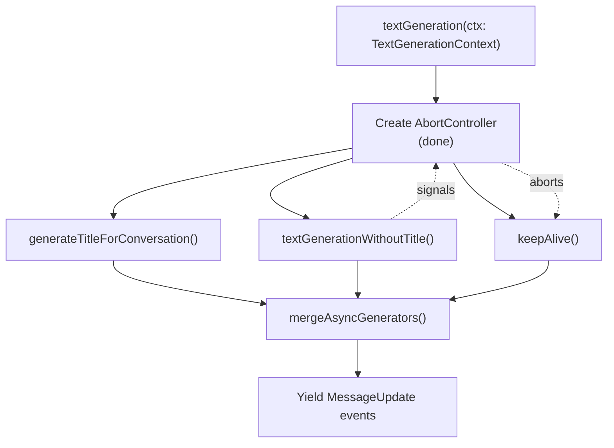
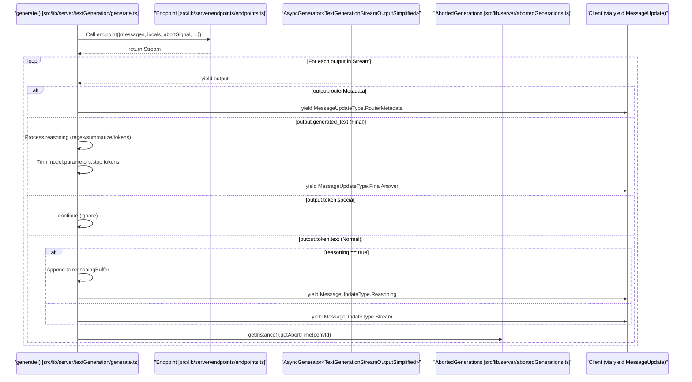
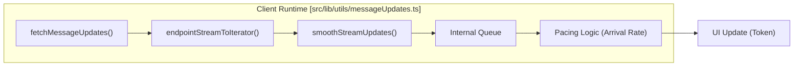

<!-- source: DeepWiki mcp.deepwiki.com · repo huggingface/chat-ui · page 4.4 Text Generation · fetched 2026-10-26 -->

# Text Generation

<details>
<summary>Relevant source files</summary>

The following files were used as context for generating this wiki page:

- [src/lib/server/__tests__/stopTruncation.spec.ts](src/lib/server/__tests__/stopTruncation.spec.ts)
- [src/lib/server/abortedGenerations.ts](src/lib/server/abortedGenerations.ts)
- [src/lib/server/exitHandler.ts](src/lib/server/exitHandler.ts)
- [src/lib/server/stopTruncation.ts](src/lib/server/stopTruncation.ts)
- [src/lib/server/textGeneration/generate.ts](src/lib/server/textGeneration/generate.ts)
- [src/lib/server/textGeneration/index.ts](src/lib/server/textGeneration/index.ts)
- [src/lib/server/textGeneration/reasoning.ts](src/lib/server/textGeneration/reasoning.ts)
- [src/lib/server/textGeneration/title.ts](src/lib/server/textGeneration/title.ts)
- [src/lib/server/textGeneration/types.ts](src/lib/server/textGeneration/types.ts)
- [src/lib/types/AbortedGeneration.ts](src/lib/types/AbortedGeneration.ts)
- [src/lib/utils/messageUpdates.spec.ts](src/lib/utils/messageUpdates.spec.ts)
- [src/lib/utils/messageUpdates.ts](src/lib/utils/messageUpdates.ts)
- [src/routes/conversation/[id]/stop-generating/+server.ts](src/routes/conversation/[id]/stop-generating/+server.ts)

</details>


## Purpose and Scope

This document describes the text generation orchestration system in `chat-ui`, which coordinates the parallel execution of title generation, main content generation, and keep-alive operations. It covers the `textGeneration()` orchestrator function, message preprocessing, the `generate()` function that interfaces with endpoints, the integration of Model Context Protocol (MCP) tool flows, and the flow of `MessageUpdate` events through the system.

For information about endpoint implementations and stream processing, see [Endpoint Implementations](#4.3). For details on the LLM Router that selects models, see [LLM Router](#4.2). For prompt template building, see [Prompt Building and Templates](#4.5).

---

## Overview

The text generation system orchestrates multiple concurrent operations to provide a responsive user experience. When a user sends a message, the system:

1.  Starts three parallel async generators: title generation, main text generation, and keep-alive signals [[src/lib/server/textGeneration/index.ts:28-30]]().
2.  Preprocesses messages to resolve file attachments and formats them for model consumption [[src/lib/server/textGeneration/index.ts:56]]().
3.  Attempts an MCP tool execution flow if configured; otherwise, falls back to standard generation [[src/lib/server/textGeneration/index.ts:60-85]]().
4.  Streams tokens back to the client as `MessageUpdate` events [[src/lib/server/textGeneration/generate.ts:158-204]]().
5.  Handles abort signals and polling-based abort detection to cancel ongoing generation [[src/lib/server/textGeneration/generate.ts:92-98]]().

Sources: [[src/lib/server/textGeneration/index.ts:1-101]](), [[src/lib/server/textGeneration/generate.ts:1-205]]()

---

## Text Generation Orchestration

### The textGeneration Function

The main entry point for text generation is the `textGeneration()` function, which sets up three parallel async generators using `mergeAsyncGenerators()` [[src/lib/server/textGeneration/index.ts:25-35]]().

```typescript
export async function* textGeneration(ctx: TextGenerationContext) {
	const done = new AbortController();

	const titleGen = generateTitleForConversation(ctx.conv, ctx.locals);
	const textGen = textGenerationWithoutTitle(ctx, done);
	const keepAliveGen = keepAlive(done.signal);

	yield* mergeAsyncGenerators([titleGen, textGen, keepAliveGen]);
}
```

**textGeneration Function Flow**



Sources: [[src/lib/server/textGeneration/index.ts:25-35]]()

### Parallel Processes

#### Title Generation
`generateTitleForConversation()` runs concurrently. If the conversation is new (`conv.title === "New Chat"`), it uses `generateFromDefaultEndpoint()` to produce a 2-4 word descriptive title [[src/lib/server/textGeneration/title.ts:8-24]](). It relies on the `TASK_MODEL` or the conversation's model for summarization [[src/lib/server/textGeneration/title.ts:18-19]](). If `LLM_SUMMARIZATION` is disabled, it falls back to the first five words of the user message [[src/lib/server/textGeneration/title.ts:35-38]]().

#### Text Generation
The `textGenerationWithoutTitle()` function manages the primary response:
1.  Yields `MessageUpdateStatus.Started` [[src/lib/server/textGeneration/index.ts:41-44]]().
2.  Handles Artifacts prompt injection if supported or overridden [[src/lib/server/textGeneration/index.ts:51-54]]().
3.  Preprocesses messages using `preprocessMessages()` [[src/lib/server/textGeneration/index.ts:56]]().
4.  Invokes `runMcpFlow()` to check for tool-use requirements [[src/lib/server/textGeneration/index.ts:60-81]]().
5.  If `runMcpFlow()` returns `"not_applicable"`, it falls back to the standard `generate()` function [[src/lib/server/textGeneration/index.ts:82-85]]().
6.  Signals completion by aborting the `done` controller, which stops the keep-alive generator [[src/lib/server/textGeneration/index.ts:100]]().

Sources: [[src/lib/server/textGeneration/index.ts:37-101]](), [[src/lib/server/textGeneration/title.ts:8-81]]()

#### Keep-Alive
The `keepAlive()` generator yields `MessageUpdateStatus.KeepAlive` every 100ms until the `done` signal is aborted, preventing connection timeouts during long inference steps [[src/lib/server/textGeneration/index.ts:15-23]]().

---

## The Generate Function

The `generate()` function interfaces with the `Endpoint` to stream tokens and handle specialized model behaviors like reasoning [[src/lib/server/textGeneration/generate.ts:16-31]]().

### Reasoning and Chain-of-Thought
If a model supports reasoning (defined in the `model.reasoning` config), `generate()` manages a `reasoningBuffer` [[src/lib/server/textGeneration/generate.ts:33-54]]().

*   **Regex Extraction**: Extracts the final answer from the buffer using a configured regex [[src/lib/server/textGeneration/generate.ts:112-114]]().
*   **Summarization**: If `modelReasoning.type` is `"summarize"`, it invokes `generateFromDefaultEndpoint()` to summarize the reasoning steps before presenting the final answer [[src/lib/server/textGeneration/generate.ts:115-142]]().
*   **Token Delimiters**: Handles reasoning encapsulated between tokens (e.g., `beginToken` and `endToken`). It yields `MessageUpdateType.Reasoning` for tokens within these boundaries [[src/lib/server/textGeneration/generate.ts:162-177]]().

### Generate Function Data Flow



Sources: [[src/lib/server/textGeneration/generate.ts:55-161]](), [[src/lib/server/textGeneration/reasoning.ts:4-23]](), [[src/lib/server/textGeneration/generate.ts:162-205]]()

---

## Abort Handling

The system uses a two-tier abort mechanism to ensure generation stops immediately when requested.

1.  **AbortController**: The `ctx.abortController` is passed to the `Endpoint` and underlying network calls to terminate active requests [[src/lib/server/textGeneration/generate.ts:63]]().
2.  **AbortedGenerations Singleton**: The `generate()` function checks `AbortedGenerations.getInstance().getAbortTime(conv._id.toString())` during the stream loop. If an abort record exists in the database with a timestamp newer than the generation start time (`promptedAt`), it manually aborts the controller and breaks the loop [[src/lib/server/textGeneration/generate.ts:92-98]]().
3.  **Stop Endpoint**: The `/conversation/[id]/stop-generating` route updates the `abortedGenerations` collection in MongoDB and triggers the `AbortRegistry` to stop the in-process request [[src/routes/conversation/[id]/stop-generating/+server.ts:44-53]]().

Sources: [[src/lib/server/textGeneration/generate.ts:92-98]](), [[src/lib/server/abortedGenerations.ts:7-43]](), [[src/routes/conversation/[id]/stop-generating/+server.ts:16-56]]()

---

## Client-Side Streaming and Smoothing

The client receives `MessageUpdate` events via the `fetchMessageUpdates` function [[src/lib/utils/messageUpdates.ts:49]]().

### Streaming Modes
`chat-ui` supports two streaming modes [[src/lib/utils/messageUpdates.ts:102-116]]():
*   **Raw**: Tokens are yielded as soon as they are parsed from the response stream.
*   **Smooth**: Tokens are passed through `smoothStreamUpdates`, which buffers characters and paces their release based on an exponentially-decayed estimate of the arrival rate [[src/lib/utils/messageUpdates.ts:177-218]](). This prevents "bursty" text display caused by network jitter.

### Smoothing Data Flow



Sources: [[src/lib/utils/messageUpdates.ts:49-146]](), [[src/lib/utils/messageUpdates.ts:177-220]]()

---

