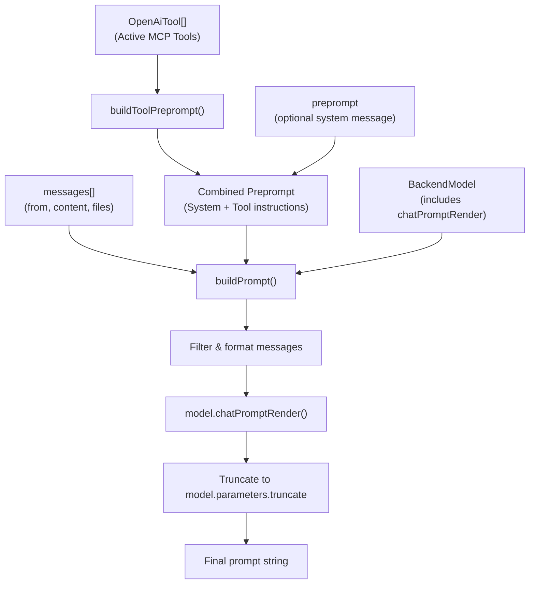
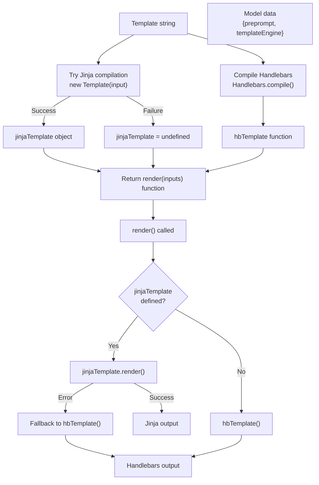
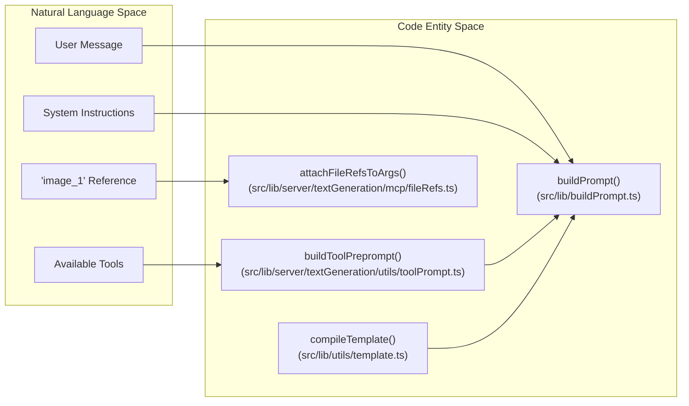

<!-- source: DeepWiki mcp.deepwiki.com · repo huggingface/chat-ui · page 4.5 Prompt Building and Templates · fetched 2026-10-26 -->

# Prompt Building and Templates

<details>
<summary>Relevant source files</summary>

The following files were used as context for generating this wiki page:

- [src/lib/buildPrompt.ts](src/lib/buildPrompt.ts)
- [src/lib/server/mcp/httpClient.ts](src/lib/server/mcp/httpClient.ts)
- [src/lib/server/router/multimodal.ts](src/lib/server/router/multimodal.ts)
- [src/lib/server/textGeneration/mcp/fileRefs.ts](src/lib/server/textGeneration/mcp/fileRefs.ts)
- [src/lib/server/textGeneration/mcp/toolInvocation.ts](src/lib/server/textGeneration/mcp/toolInvocation.ts)
- [src/lib/server/textGeneration/utils/toolPrompt.spec.ts](src/lib/server/textGeneration/utils/toolPrompt.spec.ts)
- [src/lib/server/textGeneration/utils/toolPrompt.ts](src/lib/server/textGeneration/utils/toolPrompt.ts)
- [src/lib/types/Template.ts](src/lib/types/Template.ts)
- [src/lib/utils/template.spec.ts](src/lib/utils/template.spec.ts)
- [src/lib/utils/template.ts](src/lib/utils/template.ts)

</details>


## Purpose and Scope

This document explains how chat-ui constructs prompts from user messages and formats them according to model-specific templates. The system supports two templating engines (Jinja and Handlebars) and handles message formatting, preprompt injection, tool-specific instructions, and token truncation.

For information about how these prompts are used in text generation, see [Text Generation](4.4). For details on model configuration including template definitions, see [Model Configuration and Discovery](4.1).

---

## Overview

The prompt building system consists of three main components:

1.  **Template Compilation**: Compiles template strings into render functions that support both Jinja and Handlebars syntax.
2.  **Prompt Building**: Takes messages and applies the compiled template to produce the final prompt string sent to LLMs.
3.  **Tool Preprompt Injection**: Dynamically generates instructions for models when Model Context Protocol (MCP) tools are active.

The process flows as follows:

### Prompt Construction Flow



**Sources:** [src/lib/buildPrompt.ts:8-33](), [src/lib/server/textGeneration/utils/toolPrompt.ts:3-34]()

---

## Template System

The template system supports two templating engines with automatic fallback behavior to ensure compatibility with various model prompt formats.

### Template Compilation

The `compileTemplate` function attempts to compile templates using both Jinja and Handlebars, with Jinja taking precedence at runtime. This allows the UI to support standard Jinja templates often found in Hugging Face model cards while maintaining backward compatibility with Handlebars templates used in older configurations.

**Sources:** [src/lib/utils/template.ts:18-53]()

### Template Engine Execution Logic



**Sources:** [src/lib/utils/template.ts:18-53]()

### Handlebars Helpers

The system registers custom Handlebars helpers to handle message roles within templates:

*   `ifUser`: Renders block only for user messages [src/lib/utils/template.ts:7-9]().
*   `ifAssistant`: Renders block only for assistant messages [src/lib/utils/template.ts:11-16]().

---

## Tool Prompt Building

When tools are available via MCP, the system injects a dynamically generated preprompt to guide the model on tool usage, time awareness, and parallel execution.

### Tool Preprompt Components

The `buildToolPreprompt` function constructs a string containing:
*   **Tool Inventory**: A list of available tool names [src/lib/server/textGeneration/utils/toolPrompt.ts:23]().
*   **Temporal Context**: Current date, time, and user timezone [src/lib/server/textGeneration/utils/toolPrompt.ts:24]().
*   **Usage Guidelines**: Instructions on when to call tools versus responding directly (e.g., for coding or math) [src/lib/server/textGeneration/utils/toolPrompt.ts:25]().
*   **Parallelism**: Rules for executing multiple independent tool calls simultaneously in a single response [src/lib/server/textGeneration/utils/toolPrompt.ts:26]().
*   **Search and Facts**: Specific instructions for keyword usage and factual grounding [src/lib/server/textGeneration/utils/toolPrompt.ts:27-28]().
*   **Image Handling**: Instructions on how to reference uploaded files (e.g., "image_1") in tool arguments [src/lib/server/textGeneration/utils/toolPrompt.ts:31]().

**Sources:** [src/lib/server/textGeneration/utils/toolPrompt.ts:3-34]()

---

## File and Image References

The system uses a referencing mechanism to allow models to "see" and "use" files in prompts without passing massive base64 blobs repeatedly in the template itself.

### Image Reference Resolution

The `buildFileRefResolver` creates a mapping where files are indexed chronologically (e.g., `image_1` is the first image uploaded in the conversation) [src/lib/server/textGeneration/mcp/fileRefs.ts:33-52]().

When a model generates a tool call containing a reference like `image_1`, `attachFileRefsToArgs` walks the tool arguments and replaces the reference with the actual base64 data or a Data URL depending on the configured `FieldRule` (e.g., `image_url` or `input_image`) [src/lib/server/textGeneration/mcp/fileRefs.ts:104-155]().

**Sources:** [src/lib/server/textGeneration/mcp/fileRefs.ts:18-155]()

---

## Prompt Building Process

The `buildPrompt` function orchestrates the final construction:

1.  **Preprompt Injection**: If the first message is a "system" message and a `preprompt` is provided, the message content is updated to the `preprompt` [src/lib/buildPrompt.ts:15-17]().
2.  **Role Mapping**: Messages are mapped to a standard `{ role, content }` format for the template engine [src/lib/buildPrompt.ts:21-24]().
3.  **Template Rendering**: The model's `chatPromptRender` (the compiled template) is called with the messages and preprompt [src/lib/buildPrompt.ts:19-26]().
4.  **Truncation**: The resulting string is truncated based on the model's `truncate` parameter. This is done by splitting on spaces and taking the last `N` tokens [src/lib/buildPrompt.ts:28-30]().

**Sources:** [src/lib/buildPrompt.ts:8-33]()

---

## Key Entity Mapping

This diagram maps natural language concepts to the specific code entities responsible for prompt construction.



**Sources:** [src/lib/buildPrompt.ts:8-33](), [src/lib/utils/template.ts:19-22](), [src/lib/server/textGeneration/utils/toolPrompt.ts:3-5](), [src/lib/server/textGeneration/mcp/fileRefs.ts:104-108]()

---

## Technical Reference

### Template Input Format
Templates receive a `ChatTemplateInput` object containing the history and optional preprompt:
```typescript
type ChatTemplateInput = {
    messages: Pick<Message, "from" | "content" | "files">[];
    preprompt?: string;
};
```
**Sources:** [src/lib/types/Template.ts:3-6]()

### Error Handling
The system is designed to be resilient during the rendering phase:
*   If Jinja compilation fails during initialization, it falls back to Handlebars [src/lib/utils/template.ts:27-31]().
*   If Jinja rendering fails at runtime (e.g., due to a template syntax error not caught during compilation), it logs the error and attempts Handlebars rendering [src/lib/utils/template.ts:45-49]().

**Sources:** [src/lib/utils/template.ts:23-52]()

---

