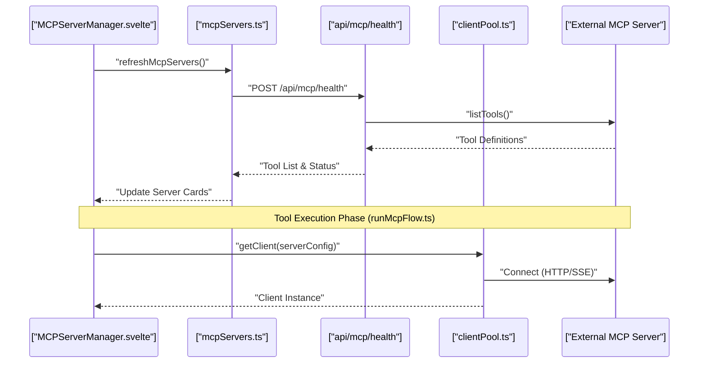
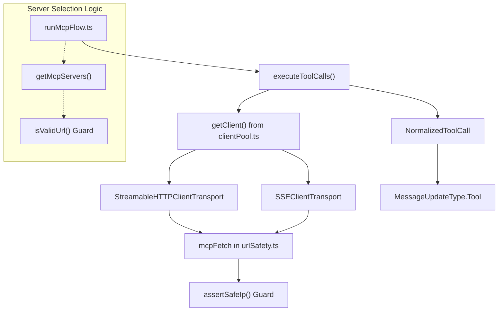

<!-- source: DeepWiki mcp.deepwiki.com · repo huggingface/chat-ui · page 4.6 MCP Tool Integration · fetched 2026-10-26 -->

# MCP Tool Integration

Relevant source files

The following files were used as context for generating this wiki page:

- [playwright.config.ts](playwright.config.ts)
- [src/lib/components/mcp/MCPServerManager.svelte](src/lib/components/mcp/MCPServerManager.svelte)
- [src/lib/components/mcp/ServerCard.svelte](src/lib/components/mcp/ServerCard.svelte)
- [src/lib/server/mcp/clientPool.ts](src/lib/server/mcp/clientPool.ts)
- [src/lib/server/mcp/hf.ts](src/lib/server/mcp/hf.ts)
- [src/lib/server/mcp/tools.test.ts](src/lib/server/mcp/tools.test.ts)
- [src/lib/server/mcp/tools.ts](src/lib/server/mcp/tools.ts)
- [src/lib/server/textGeneration/mcp/runMcpFlow.ts](src/lib/server/textGeneration/mcp/runMcpFlow.ts)
- [src/lib/server/urlSafety.test.ts](src/lib/server/urlSafety.test.ts)
- [src/lib/server/urlSafety.ts](src/lib/server/urlSafety.ts)
- [src/lib/stores/mcpServers.spec.ts](src/lib/stores/mcpServers.spec.ts)
- [src/lib/stores/mcpServers.ts](src/lib/stores/mcpServers.ts)
- [src/lib/utils/hf.ts](src/lib/utils/hf.ts)
- [src/routes/api/mcp/health/+server.ts](src/routes/api/mcp/health/+server.ts)
- [src/routes/api/mcp/servers/+server.ts](src/routes/api/mcp/servers/+server.ts)
- [tests/mock-mcp.ts](tests/mock-mcp.ts)

The Model Context Protocol (MCP) integration in `chat-ui` allows Large Language Models to interact with external systems through a standardized interface. This integration enables capabilities such as web searching, image generation, and data retrieval by connecting the chat interface to various MCP servers.

## Overview and Server Configuration

MCP servers are categorized into **base** servers (configured via environment variables like `MCP_SERVERS`) and **custom** servers (added by users through the UI) [[src/lib/server/config.ts:160]]() [[src/lib/stores/mcpServers.ts:1-5]](). The system manages these servers using a Svelte store that persists user selections and custom configurations in `localStorage` [[src/lib/stores/mcpServers.ts:32-42]]().

### Server Discovery and Health
The application validates and discovers tools from MCP servers using a health check mechanism. It supports two primary transports defined by the MCP SDK: `StreamableHTTPClientTransport` and `SSEClientTransport` [[src/routes/api/mcp/health/+server.ts:1-3]]().

- **Discovery Flow**: The `POST /api/mcp/health` endpoint attempts to connect to a provided URL, first using the Streamable HTTP transport and falling back to SSE if necessary [[src/routes/api/mcp/health/+server.ts:106-186]]().
- **Authentication**: For official Hugging Face MCP endpoints, the system can forward the user's `hfAccessToken` if `MCP_FORWARD_HF_USER_TOKEN` is enabled [[src/routes/api/mcp/health/+server.ts:81-92]]().
- **Tool Mapping**: Tools discovered from servers are converted into OpenAI-compatible function definitions via `getOpenAiToolsForMcp` [[src/lib/server/mcp/tools.ts:150-172]](). To avoid name collisions across different servers, tool names are sanitized and optionally suffixed with the server name [[src/lib/server/mcp/tools.ts:45-47]]().

**Sources:** `src/lib/stores/mcpServers.ts`, `src/routes/api/mcp/health/+server.ts`, `src/lib/server/mcp/tools.ts`, `src/lib/server/config.ts`

---

## System Architecture: MCP Flow

The following diagram illustrates the interaction between the frontend, the backend tool orchestration, and the external MCP servers.

### MCP Component Interaction

**Sources:** `src/lib/stores/mcpServers.ts`, `src/routes/api/mcp/health/+server.ts`, `src/lib/server/mcp/clientPool.ts`, `src/lib/server/textGeneration/mcp/runMcpFlow.ts`

---

## Tool Execution Flow

Tool execution is orchestrated by the `runMcpFlow` function [[src/lib/server/textGeneration/mcp/runMcpFlow.ts:45]](), which manages server selection, URL safety, and the execution loop.

### 1. Preparation and Argument Resolution
Before invocation, tool arguments are parsed and "cleaned." A critical step is **File Reference Resolution**, where identifiers are resolved to actual payloads from the conversation history [[src/lib/server/textGeneration/mcp/runMcpFlow.ts:24-25]](). This allows tools to "see" images uploaded by the user.

### 2. Client Pool Management
To minimize connection overhead, the system uses a `clientPool`. Clients are keyed by a combination of the server URL and its headers [[src/lib/server/mcp/clientPool.ts:47-53]]().
- **Persistence**: Clients are kept in a `Map` pool and reused for subsequent calls [[src/lib/server/mcp/clientPool.ts:9]]().
- **Sweeper**: An idle TTL mechanism closes connections that haven't been used for 10 minutes [[src/lib/server/mcp/clientPool.ts:17-45]]().
- **Health Checks**: Clients are pinged if they have been idle for more than 30 seconds before being reused [[src/lib/server/mcp/clientPool.ts:13]]() [[src/lib/server/mcp/clientPool.ts:64]]().

### 3. Execution Logic
Tools are executed via `executeToolCalls`, which manages the parallel execution of multiple tool calls generated by the model [[src/lib/server/textGeneration/mcp/runMcpFlow.ts:16]](). The flow enforces strict URL safety through `isValidUrl` to prevent SSRF attacks [[src/lib/server/urlSafety.ts:89]]() [[src/lib/server/textGeneration/mcp/runMcpFlow.ts:147-170]]().

### Code Entity Space: Execution Pipeline

**Sources:** `src/lib/server/textGeneration/mcp/runMcpFlow.ts`, `src/lib/server/mcp/clientPool.ts`, `src/lib/server/urlSafety.ts`, `src/lib/server/mcp/tools.ts`

---

## Tool Prompting and Feedback

To ensure the LLM uses tools correctly, a specific "preprompt" is generated and appended to the system message via `buildToolPreprompt` [[src/lib/server/textGeneration/mcp/runMcpFlow.ts:13]]().

### JSON Schema Sanitization
To ensure compatibility with strict providers (e.g., Fireworks), the system sanitizes MCP tool JSON schemas via `sanitizeJsonSchema` [[src/lib/server/mcp/tools.ts:71]]().
- **Null Defaults**: Removes contradictory `default: null` values [[src/lib/server/mcp/tools.ts:74]]().
- **Type Inference**: Infers missing `type` fields based on object/array keywords [[src/lib/server/mcp/tools.ts:111-115]]().

### Result Processing
Once a tool execution finishes, the results are yielded back to the conversation. The `runMcpFlow` function handles the entire lifecycle, returning a `McpFlowResult` indicating if the flow was completed, not applicable, or aborted [[src/lib/server/textGeneration/mcp/runMcpFlow.ts:42-43]]().

**Sources:** `src/lib/server/textGeneration/mcp/runMcpFlow.ts`, `src/lib/server/mcp/tools.ts`

---

## Summary of Key Classes and Functions

| Entity | Location | Role |
| :--- | :--- | :--- |
| `getClient` | `src/lib/server/mcp/clientPool.ts` | Manages persistent connections to MCP servers with HTTP/SSE fallback [[src/lib/server/mcp/clientPool.ts:55]](). |
| `runMcpFlow` | `src/lib/server/textGeneration/mcp/runMcpFlow.ts` | Main orchestrator for the MCP lifecycle during text generation [[src/lib/server/textGeneration/mcp/runMcpFlow.ts:45]](). |
| `sanitizeJsonSchema` | `src/lib/server/mcp/tools.ts` | Normalizes tool schemas for strict OpenAI-compatible providers [[src/lib/server/mcp/tools.ts:71]](). |
| `isValidUrl` | `src/lib/server/urlSafety.ts` | Validates protocols and hostnames to prevent SSRF [[src/lib/server/urlSafety.ts:89]](). |
| `getOpenAiToolsForMcp` | `src/lib/server/mcp/tools.ts` | Aggregates and caches tool definitions from multiple servers [[src/lib/server/mcp/tools.ts:150]](). |
| `drainPool` | `src/lib/server/mcp/clientPool.ts` | Closes all active connections in the pool during shutdown [[src/lib/server/mcp/clientPool.ts:133]](). |

**Sources:** `src/lib/server/mcp/clientPool.ts`, `src/lib/server/textGeneration/mcp/runMcpFlow.ts`, `src/lib/server/mcp/tools.ts`, `src/lib/server/urlSafety.ts`

---

