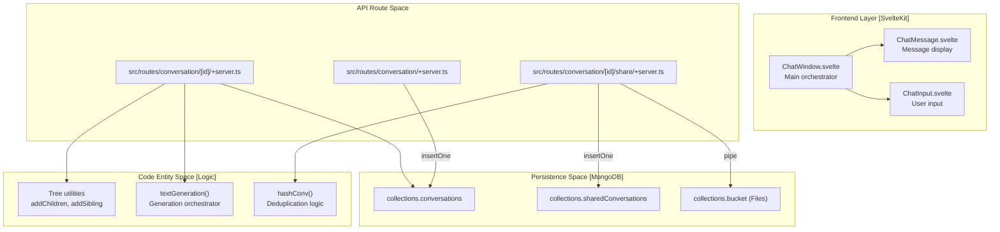
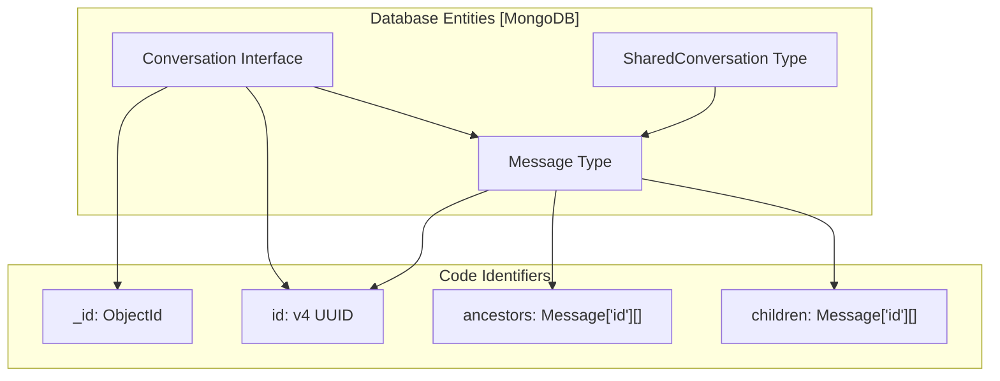

<!-- source: DeepWiki mcp.deepwiki.com · repo huggingface/chat-ui · page 5 Conversation System · fetched 2026-10-26 -->

# Conversation System

Relevant source files

The following files were used as context for generating this wiki page:

- [src/lib/types/Conversation.ts](src/lib/types/Conversation.ts)
- [src/lib/types/Message.ts](src/lib/types/Message.ts)
- [src/lib/types/SharedConversation.ts](src/lib/types/SharedConversation.ts)
- [src/routes/conversation/+server.ts](src/routes/conversation/+server.ts)
- [src/routes/conversation/[id]/share/+server.ts](src/routes/conversation/[id]/share/+server.ts)

## Purpose and Scope

The Conversation System manages all aspects of chat conversations in chat-ui, including conversation storage, message threading, real-time streaming responses, and user interactions. This system orchestrates the flow from user input through the frontend components, backend API, and LLM integration, back to the UI with streamed updates.

For details on the conversation API endpoints and the SSE streaming mechanism, see [Conversation API](#5.1). For details on how messages are processed, including file handling and reasoning block parsing, see [Message Processing](#5.2).

---

## System Architecture

The conversation system spans three layers: frontend UI components, backend API endpoints, and MongoDB persistence. The frontend uses Svelte components for rendering and interaction, the backend provides REST and streaming APIs via SvelteKit, and MongoDB stores conversation state with a tree-based message structure.

### Component and Data Flow

**Sources:** [src/routes/conversation/+server.ts:15-137](), [src/routes/conversation/[id]/share/+server.ts:27-90](), [src/lib/types/Conversation.ts:7-36](), [src/lib/types/Message.ts:6-34]()

---

## Message Tree Structure

Conversations use a tree-based message structure where each message can have multiple children (for branching conversations) and ancestors. This enables features like editing previous messages and retrying generations.

### Message Schema and Operations

Each message is a node containing identifiers for its `ancestors` and `children` [src/lib/types/Message.ts:30-33](). The system supports various content types including standard `content`, `reasoning` (for `<think>` blocks), and `files` [src/lib/types/Message.ts:9-19]().

- **`ancestors`**: An array of message IDs leading back to the root [src/lib/types/Message.ts:30]().
- **`children`**: An array of message IDs representing direct descendants (branches) [src/lib/types/Message.ts:33]().
- **`rootMessageId`**: The entry point for the conversation tree [src/lib/types/Conversation.ts:16]().

### Visualizing the Data Entities

**Sources:** [src/lib/types/Conversation.ts:7-36](), [src/lib/types/Message.ts:6-41](), [src/lib/types/SharedConversation.ts:3-9]()

---

## Conversation Lifecycle

### 1. Creation and Sharing
New conversations are initialized via `POST /conversation` [src/routes/conversation/+server.ts:15](). 
- **Initialization**: Sets up the initial `system` message and preprompt [src/routes/conversation/+server.ts:45-55]().
- **Sharing**: When a conversation is shared, it is hashed via `hashConv` to prevent duplicates and stored in `collections.sharedConversations` [src/routes/conversation/[id]/share/+server.ts:37-51]().
- **File Cloning**: Shared conversations clone associated files in the MongoDB `bucket` (GridFS) to ensure the share remains static even if the original conversation is deleted [src/routes/conversation/[id]/share/+server.ts:68-82]().

### 2. Import from Share
Users can create a new conversation from a shared link. The system fetches the source, strips `<think>` markers from the title to keep the UI clean, and seeds the new conversation with the shared message history [src/routes/conversation/+server.ts:59-74]().

### 3. Usage Limits
The system enforces `usageLimits` during creation, checking the `convCount` against configured thresholds before allowing a new `insertOne` operation [src/routes/conversation/+server.ts:33-37]().

---

## Message Metadata and Features

Messages track various metadata to support advanced UI features:
- **Reasoning**: Support for server-side or client-side reasoning content via the `reasoning` field [src/lib/types/Message.ts:13]().
- **Router Metadata**: When using the `llm-router`, messages store the specific `route` and `model` used for that generation [src/lib/types/Message.ts:23-27]().
- **Files**: Messages can contain `MessageFile` objects which are either `base64` encoded or reference a `hash` in the server's storage [src/lib/types/Message.ts:36-41]().

**Sources:** [src/lib/types/Message.ts:1-41](), [src/routes/conversation/+server.ts:87-103](), [src/routes/conversation/[id]/share/+server.ts:19-25]()

---

