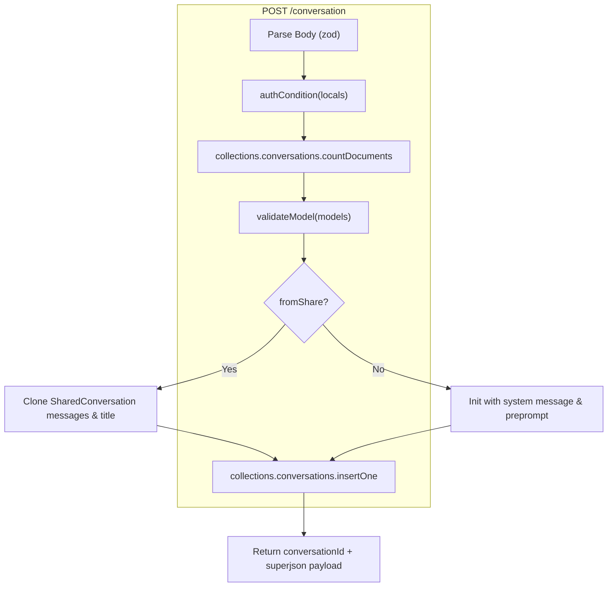
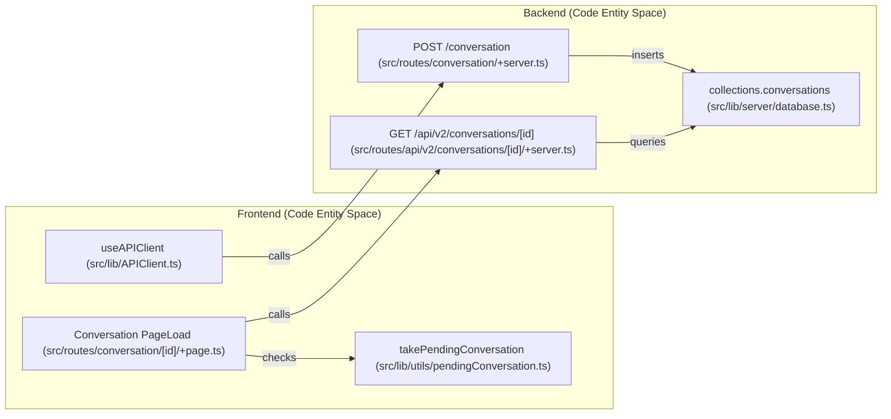

<!-- source: DeepWiki mcp.deepwiki.com · repo huggingface/chat-ui · page 5.1 Conversation API · fetched 2026-10-26 -->

# Conversation API

<details>
<summary>Relevant source files</summary>

The following files were used as context for generating this wiki page:

- [src/lib/components/NavigationLoadingBar.svelte](src/lib/components/NavigationLoadingBar.svelte)
- [src/lib/components/SharePreviewTags.svelte](src/lib/components/SharePreviewTags.svelte)
- [src/lib/components/chat/DeployToSpaceModal.svelte](src/lib/components/chat/DeployToSpaceModal.svelte)
- [src/lib/types/Conversation.ts](src/lib/types/Conversation.ts)
- [src/lib/types/SharedConversation.ts](src/lib/types/SharedConversation.ts)
- [src/lib/utils/deployableHtml.spec.ts](src/lib/utils/deployableHtml.spec.ts)
- [src/lib/utils/generationState.spec.ts](src/lib/utils/generationState.spec.ts)
- [src/lib/utils/generationState.ts](src/lib/utils/generationState.ts)
- [src/lib/utils/pendingConversation.ts](src/lib/utils/pendingConversation.ts)
- [src/lib/utils/previewSrcdoc.ts](src/lib/utils/previewSrcdoc.ts)
- [src/lib/utils/sharePreviewText.spec.ts](src/lib/utils/sharePreviewText.spec.ts)
- [src/lib/utils/sharePreviewText.ts](src/lib/utils/sharePreviewText.ts)
- [src/routes/api/conversation/[id]/+server.ts](src/routes/api/conversation/[id]/+server.ts)
- [src/routes/api/conversations/+server.ts](src/routes/api/conversations/+server.ts)
- [src/routes/api/models/+server.ts](src/routes/api/models/+server.ts)
- [src/routes/api/v2/conversations/[id]/+server.ts](src/routes/api/v2/conversations/[id]/+server.ts)
- [src/routes/api/v2/conversations/updates/+server.ts](src/routes/api/v2/conversations/updates/+server.ts)
- [src/routes/api/v2/spaces/deploy/+server.ts](src/routes/api/v2/spaces/deploy/+server.ts)
- [src/routes/conversation/+server.ts](src/routes/conversation/+server.ts)
- [src/routes/conversation/[id]/+page.ts](src/routes/conversation/[id]/+page.ts)
- [src/routes/conversation/[id]/share/+server.ts](src/routes/conversation/[id]/share/+server.ts)
- [src/routes/r/[id]/+page.ts](src/routes/r/[id]/+page.ts)

</details>


The Conversation API provides endpoints for creating, retrieving, updating, and managing conversations in the `chat-ui` application. This document details the API routes, request/response formats, and the conversation data flow between the SvelteKit frontend and the MongoDB backend.

## Conversation Data Model

The conversation model uses a tree structure for messages, allowing for branching conversations with multiple paths. Each message can have children (replies) and ancestors (parent messages).

Title: Conversation Data Entities
```mermaid
classDiagram
    class "Conversation" {
        _id: ObjectId
        sessionId: string
        userId: ObjectId
        model: string
        title: string
        rootMessageId: string
        messages: Message[]
        preprompt: string
        assistantId: ObjectId
        createdAt: Date
        updatedAt: Date
        userAgent: string
        deployedSpaces: Record
    }

    class "Message" {
        id: string
        from: "user" | "assistant" | "system"
        content: string
        files: File[]
        createdAt: Date
        updatedAt: Date
        children: string[]
        ancestors: string[]
        updates: MessageUpdate[]
    }

    "Conversation" "1" --> "many" "Message" : contains
```

Sources: [src/lib/types/Conversation.ts:7-36](), [src/routes/conversation/+server.ts:45-55](), [src/routes/api/conversation/[id]/+server.ts:22-31]()

## API Endpoints

The system exposes several RESTful endpoints for conversation management, primarily handled by SvelteKit server routes. The application utilizes a mix of standard SvelteKit routes and a versioned API (`/api/v2`).

| Method | Endpoint | Description |
| --- | --- | --- |
| `POST` | `/conversation` | Create a new conversation or clone from a share [src/routes/conversation/+server.ts:15]() |
| `GET` | `/api/conversations` | List conversations for the current user (paginated) [src/routes/api/conversations/+server.ts:6]() |
| `DELETE` | `/api/conversations` | Delete all conversations for the current user [src/routes/api/conversations/+server.ts:40]() |
| `GET` | `/api/v2/conversations/[id]` | Retrieve a specific conversation (v2) [src/routes/api/v2/conversations/[id]/+server.ts:10]() |
| `PATCH` | `/api/v2/conversations/[id]` | Update conversation title or model [src/routes/api/v2/conversations/[id]/+server.ts:52]() |
| `DELETE` | `/api/v2/conversations/[id]` | Delete a specific conversation [src/routes/api/v2/conversations/[id]/+server.ts:33]() |
| `POST` | `/conversation/[id]/share` | Create a public shareable link [src/routes/conversation/[id]/share/+server.ts:27]() |

### Creating a Conversation

To create a new conversation, a `POST` request is sent to `/conversation`. The server validates the model and applies usage limits.

Title: Conversation Creation Logic


Sources: [src/routes/conversation/+server.ts:15-137](), [src/lib/server/auth.ts:10](), [src/lib/server/models.ts:8]()

### Listing and Retrieval

Conversations are retrieved with pagination support. 

- **Pagination**: The `GET /api/conversations` endpoint uses `CONV_NUM_PER_PAGE` to skip and limit results based on the `p` query parameter [src/routes/api/conversations/+server.ts:7-21]().
- **Authorization**: All requests use `authCondition(locals)` to ensure users only see their own conversations (via `userId` for logged-in users or `sessionId` for anonymous users) [src/routes/api/conversations/+server.ts:11](), [src/routes/api/v2/conversations/[id]/+server.ts:43]().
- **Optimization**: The creation endpoint returns a `superjson` encoded payload of the new conversation so the client can seed its cache and skip a follow-up `GET` request [src/routes/conversation/+server.ts:115-133]().

### Sharing Mechanism

Sharing a conversation creates a static snapshot in the `sharedConversations` collection.

1. **Hashing**: The conversation content is hashed using `hashConv` to prevent duplicate shares of identical content [src/routes/conversation/[id]/share/+server.ts:37-41]().
2. **Persistence**: A new document is created with a short 7-character ID generated by `nanoid(7)` [src/routes/conversation/[id]/share/+server.ts:52]().
3. **File Duplication**: Associated files in the GridFS `bucket` are copied from the original conversation prefix (`${conversation._id}-`) to the shared prefix (`${shared._id}-`) by piping download streams to upload streams [src/routes/conversation/[id]/share/+server.ts:68-82]().
4. **Prewarming**: The server immediately triggers a social-preview thumbnail generation so link unfurlers (like Slack) hit a cached image [src/routes/conversation/[id]/share/+server.ts:19-25]().

Sources: [src/routes/conversation/[id]/share/+server.ts:27-90](), [src/lib/types/SharedConversation.ts:3-9]()

## Client-Side Integration

The frontend interacts with these endpoints using a typed API client.

Title: System Entity Mapping


Sources: [src/routes/conversation/[id]/+page.ts:12-58](), [src/lib/utils/pendingConversation.ts:7](), [src/routes/api/v2/conversations/[id]/+server.ts:10-31]()

### Share Import Logic
When a logged-in user visits a shared URL (`/r/[id]` or `/conversation/[id]` where ID is 7 chars), the application attempts to "import" it. This converts the public snapshot into a private, editable conversation in the user's account [src/routes/conversation/[id]/+page.ts:15-38](), [src/routes/r/[id]/+page.ts:13-30]().

### Artifact Deployment
Conversations can contain "artifacts" (HTML, SVG, React, Mermaid) that can be deployed to Hugging Face Spaces. The `POST /api/v2/spaces/deploy` endpoint handles creating or updating a static Space with the artifact content [src/routes/api/v2/spaces/deploy/+server.ts:106-181](). The deployment state is stored in the conversation's `deployedSpaces` field [src/lib/types/Conversation.ts:35]().

Sources: [src/routes/api/v2/spaces/deploy/+server.ts:14-31](), [src/lib/utils/previewSrcdoc.ts:40-75]()

---

