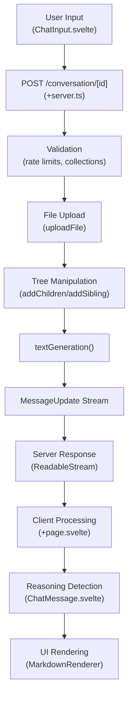
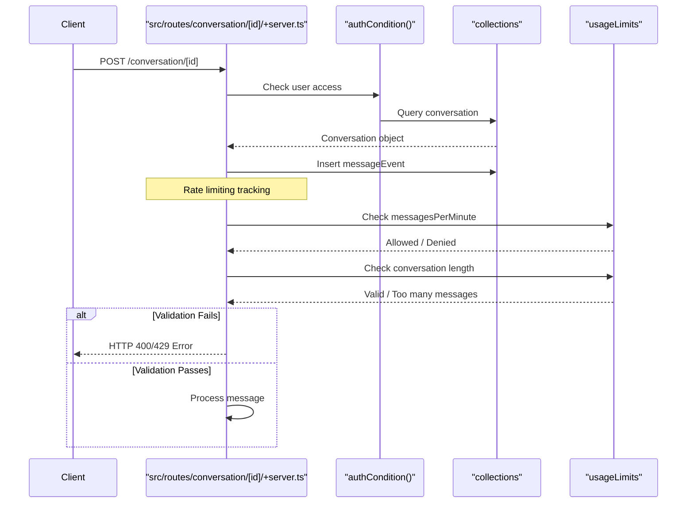
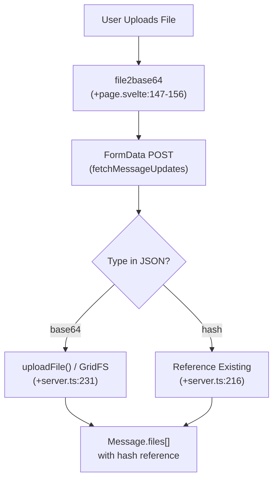

<!-- source: DeepWiki mcp.deepwiki.com · repo huggingface/chat-ui · page 5.2 Message Processing · fetched 2026-10-26 -->

# Message Processing

Relevant source files

The following files were used as context for generating this wiki page:

- [src/lib/components/chat/ChatMessage.svelte](src/lib/components/chat/ChatMessage.svelte)
- [src/lib/components/chat/ChatWindow.svelte](src/lib/components/chat/ChatWindow.svelte)
- [src/lib/types/Message.ts](src/lib/types/Message.ts)
- [src/lib/utils/messageUpdates.spec.ts](src/lib/utils/messageUpdates.spec.ts)
- [src/lib/utils/messageUpdates.ts](src/lib/utils/messageUpdates.ts)
- [src/lib/utils/tree/addChildren.ts](src/lib/utils/tree/addChildren.ts)
- [src/lib/utils/tree/addSibling.ts](src/lib/utils/tree/addSibling.ts)
- [src/lib/utils/tree/convertLegacyConversation.ts](src/lib/utils/tree/convertLegacyConversation.ts)
- [src/lib/utils/tree/isMessageId.spec.ts](src/lib/utils/tree/isMessageId.spec.ts)
- [src/routes/conversation/[id]/+page.svelte](src/routes/conversation/[id]/+page.svelte)
- [src/routes/conversation/[id]/+server.ts](src/routes/conversation/[id]/+server.ts)
- [src/routes/r/[id]/+page.svelte](src/routes/r/[id]/+page.svelte)

This document explains how messages are processed in the chat-ui application, including input validation, file handling, message tree manipulation, reasoning block parsing, and the streaming of message updates from server to client.

For information about the conversation API endpoints, see [5.1 Conversation API](). For details on text generation orchestration, see [4.4 Text Generation]().

## Overview

Message processing encompasses the complete lifecycle of a message from user input to displayed response. The key stages are:

1.  **Input Validation**: Checking message length, rate limits, and user permissions.
2.  **File Processing**: Handling file uploads and converting them to storable formats.
3.  **Message Tree Manipulation**: Adding messages to the conversation tree structure.
4.  **Streaming Updates**: Generating and transmitting `MessageUpdate` events to the client.
5.  **Client-Side Processing**: Handling updates, parsing reasoning blocks, and updating the UI.

**Message Processing Flow**

Sources:
- [src/routes/conversation/[id]/+server.ts:38-111]()
- [src/routes/conversation/[id]/+page.svelte:127-220]()
- [src/lib/components/chat/ChatMessage.svelte:135-177]()

## Message Validation

Before a message is processed, the server performs several validation checks to ensure the request is legitimate and within usage limits.

**Validation Sequence**

The validation checks include:

| Validation | Location | Description |
| :--- | :--- | :--- |
| Authentication | [src/routes/conversation/[id]/+server.ts:43-48]() | Verifies `userId` or `sessionId` exists. |
| Access Control | [src/routes/conversation/[id]/+server.ts:51-84]() | Checks if the user has access via `authCondition`. |
| Rate Limiting | [src/routes/conversation/[id]/+server.ts:113-132]() | Checks `messagesPerMinute` limit via `messageEvents` collection. |
| Conversation Size | [src/routes/conversation/[id]/+server.ts:134-139]() | Ensures conversation hasn't exceeded `usageLimits.messages`. |

Sources:
- [src/routes/conversation/[id]/+server.ts:43-139]()
- [src/lib/server/auth.ts:1-20]()

## File Handling

Messages can include file attachments such as images or documents. The file handling process converts uploaded files to a storable format and associates them with messages.

**File Processing Pipeline**

File processing involves:

1.  **Client-Side Preparation**: Files are converted to base64 in the browser using `file2base64` [src/routes/conversation/[id]/+page.svelte:147-156]().
2.  **Transmission**: Files are appended to `FormData` with metadata (mime/name) before being sent to the server [src/lib/utils/messageUpdates.ts:71-75]().
3.  **Server-Side Parsing**: `FormData` is parsed to extract files and JSON metadata [src/routes/conversation/[id]/+server.ts:149-204]().
4.  **Storage**: New files are uploaded to storage via `uploadFile()` which returns a hash for persistence in the message object [src/routes/conversation/[id]/+server.ts:231]().

Sources:
- [src/routes/conversation/[id]/+server.ts:149-233]()
- [src/routes/conversation/[id]/+page.svelte:147-156]()
- [src/lib/utils/messageUpdates.ts:71-75]()

## Message Tree Structure

Messages are organized as a tree to support editing and retries. This is managed by `rootMessageId` and the `ancestors`/`children` arrays in the `Message` object.

**Message Tree Operations**

| Function | Location | Purpose |
| :--- | :--- | :--- |
| `addChildren()` | [src/lib/utils/tree/addChildren.ts:4-48]() | Appends a new message as a child of an existing one. |
| `addSibling()` | [src/lib/utils/tree/addSibling.ts:4-41]() | Adds an alternative message at the same depth. |
| `convertLegacyConversation()` | [src/lib/utils/tree/convertLegacyConversation.ts:5-36]() | Migrates flat message arrays to the tree structure. |

In `writeMessage`, the tree is manipulated based on the user action:
-   **Edit User Message**: `addSibling` creates a new user message node, followed by `addChildren` for the assistant response [src/routes/conversation/[id]/+page.svelte:173-197]().
-   **Retry Assistant**: `addSibling` creates a new assistant node to hold the alternative generation [src/routes/conversation/[id]/+page.svelte:200-207]().

Sources:
- [src/lib/utils/tree/addChildren.ts:4-48]()
- [src/lib/utils/tree/addSibling.ts:4-41]()
- [src/routes/conversation/[id]/+page.svelte:161-212]()

## Reasoning Block Parsing

The UI supports rendering reasoning blocks (e.g., `<think>` tags) which are often emitted by "reasoning" models like DeepSeek-R1.

**Reasoning Handling**
-   **Detection**: `ChatMessage.svelte` uses `THINK_BLOCK_REGEX` to detect `<think>` blocks in the message content [src/lib/components/chat/ChatMessage.svelte:135-136]().
-   **Expansion**: The `expandThinkBlocks` function splits the message content into discrete "think" and "text" blocks for separate rendering [src/lib/components/chat/ChatMessage.svelte:159-177]().
-   **UI Presentation**: Reasoning blocks are rendered via the `OpenReasoningResults` component, which allows users to expand or collapse the "thought process" [src/lib/components/chat/ChatMessage.svelte:18]().

Sources:
- [src/lib/components/chat/ChatMessage.svelte:135-177]()
- [src/lib/types/Message.ts:12-13]()

## Streaming Updates and Smoothing

The server communicates with the client through a stream of `MessageUpdate` objects. To prevent UI flickering and "bursty" text, the client applies a smoothing algorithm.

**Smoothing Logic (`smoothStreamUpdates`)**
-   **Arrival Rate**: Estimates the source arrival rate (chars/ms) using an exponentially-decayed average [src/lib/utils/messageUpdates.ts:204-218]().
-   **Chunking**: Buffers tokens and only flushes them when a full "word" or chunk is detected (via `detectChunk`) to ensure natural reading flow [src/lib/utils/messageUpdates.ts:187-220]().
-   **Pacing**: Spreads burst tokens over time within `minDelayMs` and `maxDelayMs` bounds [src/lib/utils/messageUpdates.ts:177-186]().

**Update Types**

| Update Type | Description |
| :--- | :--- |
| `Stream` | Incremental text tokens [src/lib/types/MessageUpdate.ts:44-49](). |
| `Tool` | Tool call updates (call, result, error) [src/lib/utils/messageUpdates.ts:4-11](). |
| `Status` | Generation lifecycle events (Started, Finished) [src/lib/types/MessageUpdate.ts:26-31](). |

Sources:
- [src/lib/utils/messageUpdates.ts:49-100]()
- [src/lib/utils/messageUpdates.ts:177-240]()
- [src/lib/utils/messageUpdates.spec.ts:29-122]()

## Client-Side Rendering Pipeline

The `ChatWindow` and `ChatMessage` components coordinate to render the final message path.

**Rendering Flow**
1.  **Path Calculation**: `createMessagesPath` traverses the tree to find the current active branch of messages to display [src/routes/conversation/[id]/+page.svelte:73-114]().
2.  **Artifact Extraction**: `collectArtifacts` scans messages for `<artifact>` tags to populate the side panel [src/lib/components/chat/ChatWindow.svelte:122-130]().
3.  **Block Splitting**: `ChatMessage` splits content into text, reasoning, tool, and artifact blocks for specialized rendering [src/lib/components/chat/ChatMessage.svelte:143-155]().

Sources:
- [src/routes/conversation/[id]/+page.svelte:73-114]()
- [src/lib/components/chat/ChatWindow.svelte:122-138]()
- [src/lib/components/chat/ChatMessage.svelte:143-200]()

---

