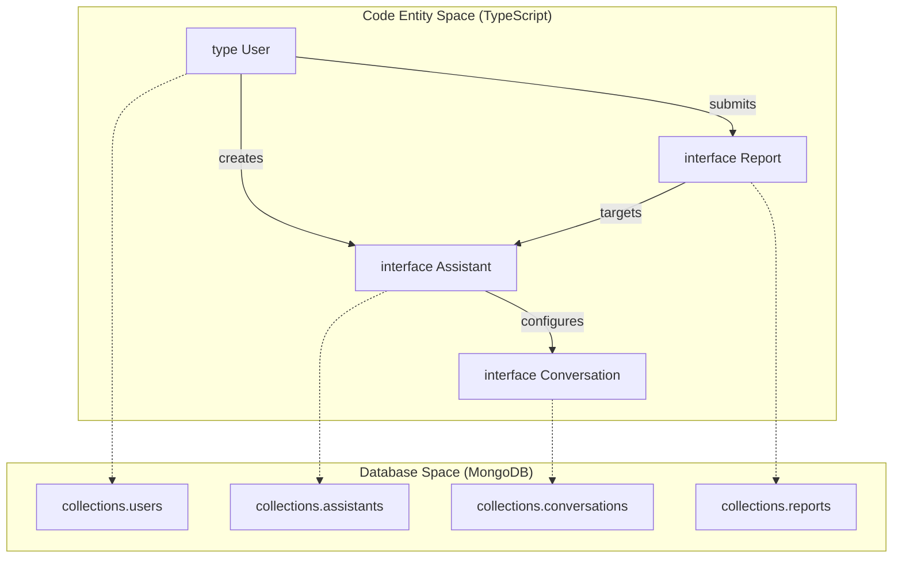
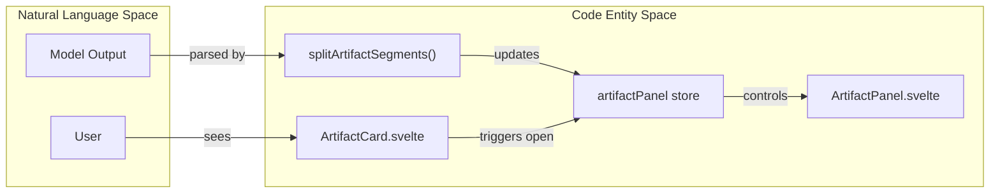

<!-- source: DeepWiki mcp.deepwiki.com · repo huggingface/chat-ui · page 6 Assistants · fetched 2026-10-26 -->

# Assistants

<details>
<summary>Relevant source files</summary>

The following files were used as context for generating this wiki page:

- [.devcontainer/Dockerfile](.devcontainer/Dockerfile)
- [.devcontainer/devcontainer.json](.devcontainer/devcontainer.json)
- [docker-compose.yml](docker-compose.yml)
- [scripts/artifact-real-eval.ts](scripts/artifact-real-eval.ts)
- [src/lib/components/chat/ArtifactCard.svelte](src/lib/components/chat/ArtifactCard.svelte)
- [src/lib/components/chat/ArtifactPanel.svelte](src/lib/components/chat/ArtifactPanel.svelte)
- [src/lib/jobs/refresh-conversation-stats.ts](src/lib/jobs/refresh-conversation-stats.ts)
- [src/lib/server/database.ts](src/lib/server/database.ts)
- [src/lib/server/textGeneration/artifacts.ts](src/lib/server/textGeneration/artifacts.ts)
- [src/lib/stores/artifactPanel.svelte.ts](src/lib/stores/artifactPanel.svelte.ts)
- [src/lib/types/Assistant.ts](src/lib/types/Assistant.ts)
- [src/lib/utils/artifactDiff.spec.ts](src/lib/utils/artifactDiff.spec.ts)
- [src/lib/utils/artifactDiff.ts](src/lib/utils/artifactDiff.ts)
- [src/lib/utils/artifacts.spec.ts](src/lib/utils/artifacts.spec.ts)
- [src/lib/utils/artifacts.ts](src/lib/utils/artifacts.ts)
- [src/routes/admin/stats/compute/+server.ts](src/routes/admin/stats/compute/+server.ts)

</details>


## Purpose and Scope

This document provides a high-level overview of the assistant system in `chat-ui`. Assistants are pre-configured AI personas that allow users to interact with specific models using customized prompts, parameters, and example inputs. They enable rapid access to specialized use cases without requiring users to manually configure settings for each conversation.

This page also introduces **Artifacts**, a specialized feature often utilized by assistants to generate substantial, self-contained content (like web apps or diagrams) rendered in a dedicated side panel.

For detailed information about assistant CRUD operations, UI components, and management features, see [Assistant Management](#6.1). For information about how models are configured and selected, see [Model Configuration and Discovery](#4.1). For details on how conversations are created and managed, see [Conversation System](#5).

## Overview

Assistants are reusable conversation templates that combine:
- A specific model selection (`modelId`) [[src/lib/types/Assistant.ts:13]]().
- A preprompt (system prompt) that defines the assistant's behavior [[src/lib/types/Assistant.ts:15]]().
- Optional example inputs to guide user interactions [[src/lib/types/Assistant.ts:14]]().
- Display metadata including name, description, and an avatar [[src/lib/types/Assistant.ts:9-12]]().
- User-defined generation parameters like temperature and top_p [[src/lib/types/Assistant.ts:19-24]]().

Users can create their own assistants or use assistants created by others. When starting a new conversation, users can select an assistant, which automatically configures the conversation with the assistant's settings.

## Assistant Data Model

### Core Schema

Assistants are stored in MongoDB in the `assistants` collection [[src/lib/server/database.ts:134]](). The `Assistant` interface defines the structure of these documents.

| Field | Type | Purpose |
|-------|------|---------|
| `_id` | `ObjectId` | Unique identifier for the assistant [[src/lib/types/Assistant.ts:7]](). |
| `createdById` | `User["_id"] \| string` | Reference to the user or session that created the assistant [[src/lib/types/Assistant.ts:8]](). |
| `name` | `string` | Display name of the assistant [[src/lib/types/Assistant.ts:11]](). |
| `description` | `string` | Description of the assistant's purpose [[src/lib/types/Assistant.ts:12]](). |
| `modelId` | `string` | The model ID this assistant is pinned to [[src/lib/types/Assistant.ts:13]](). |
| `preprompt` | `string` | System prompt defining behavior [[src/lib/types/Assistant.ts:15]](). |
| `generateSettings` | `object` | LLM parameters like `temperature`, `top_p`, `top_k` [[src/lib/types/Assistant.ts:19-24]](). |
| `userCount` | `number` | Total number of users who have added this assistant [[src/lib/types/Assistant.ts:16]](). |
| `last24HoursCount` | `number` | Usage metric for trending calculations [[src/lib/types/Assistant.ts:27]](). |

### Relationships

The following diagram bridges the natural language concepts to the specific database collections and TypeScript interfaces used in the codebase.



**Diagram: Assistant Entity Mapping**
Sources: [src/lib/server/database.ts:119-150](), [src/lib/types/Assistant.ts:1-28]()

## Assistant Integration Architecture

### Request and Logic Flow

When a conversation is initiated with an assistant, the system resolves the assistant's configuration before starting text generation. The `Database` class provides the `assistants` collection with a `SECONDARY_PREFERRED` read preference to optimize for read-heavy discovery workloads [[src/lib/server/database.ts:133-136]]().

```mermaid
graph TD
    [UserAction] -- "Select Assistant" --> [SvelteKitRoute]
    [SvelteKitRoute] -- "fetchAssistant" --> DB[("collections.assistants")]
    DB -- "Assistant Data" --> [PromptLogic]
    
    subgraph "Prompt Construction"
        [PromptLogic] -- "preprompt" --> [TemplateEngine]
        [TemplateEngine] -- "Rendered Prompt" --> [LLMRequest]
    end

    [LLMRequest] -- "modelId" --> [ModelRouter]
    [ModelRouter] -- "Inference" --> [ProviderAPI]
```

**Diagram: Assistant Integration Flow**
Sources: [src/lib/server/database.ts:134](), [src/lib/types/Assistant.ts:13-15]()

## Artifacts System

Assistants often utilize the **Artifacts** system to provide a richer interactive experience. Artifacts are substantial pieces of content (apps, documents, diagrams) that the model emits inside `<artifact>` tags [[src/lib/utils/artifacts.ts:4-6]]().

### Content Lifecycle and Rendering
1.  **Generation**: The model is instructed via `ARTIFACTS_SYSTEM_PROMPT` to emit specific XML-like tags [[src/lib/server/textGeneration/artifacts.ts:9-19]]().
2.  **Parsing**: The client-side `splitArtifactSegments` function separates prose from artifact operations during streaming [[src/lib/utils/artifacts.ts:170-176]]().
3.  **UI State**: The `artifactPanel` store manages whether the side panel is open and which version is being viewed [[src/lib/stores/artifactPanel.svelte.ts:16-40]]().
4.  **Display**: `ArtifactPanel.svelte` renders the content, supporting live previews for HTML/React and syntax highlighting for code [[src/lib/components/chat/ArtifactPanel.svelte:40-55]]().

### Artifact Operations
The system supports two primary operations:
-   **Create/Rewrite**: Emitting the full content within tags [[src/lib/utils/artifacts.ts:9]]().
-   **Update**: Using `<old_str>` and `<new_str>` pairs to apply targeted string replacements to previous versions, saving tokens [[src/lib/utils/artifacts.ts:10-13]]().



**Diagram: Artifact UI Pipeline**
Sources: [src/lib/utils/artifacts.ts:170](), [src/lib/stores/artifactPanel.svelte.ts:16](), [src/lib/components/chat/ArtifactCard.svelte:77-82]()

## Assistant Lifecycle

### Discovery and Selection
Assistants can be discovered via search or direct links. The database uses a `secondaryPreferred` read preference for the `assistants` collection to handle heavy read loads during discovery [[src/lib/server/database.ts:133-136]]().

### Statistics and Trending
The system tracks assistant popularity. While global conversation stats are computed periodically via `computeAllStats` [[src/lib/jobs/refresh-conversation-stats.ts:19-31]](), individual assistants track their own `userCount` and `last24HoursCount` to facilitate discovery and ranking [[src/lib/types/Assistant.ts:16-27]]().

### Reporting and Moderation
To maintain safety, users can report assistants. These reports are stored in the `reports` collection, which uses a `secondaryPreferred` read preference for efficient administrative review [[src/lib/server/database.ts:140-142]]().

## Assistant Management
For details on the UI implementation, CRUD operations, and administrative features, see the child page:
- **[Assistant Management](#6.1)**: Covers the Svelte components for creating assistants, pagination logic for the assistant gallery, and the reporting interface.

Sources: [src/lib/server/database.ts:134-150](), [src/lib/types/Assistant.ts:1-28](), [src/lib/utils/artifacts.ts:1-19](), [src/lib/server/textGeneration/artifacts.ts:9-54]()

---

