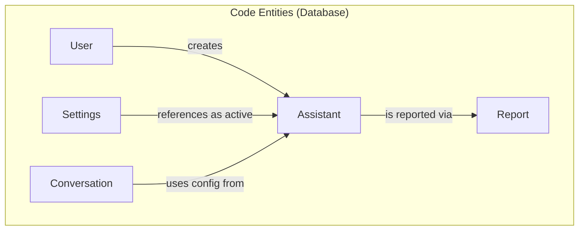
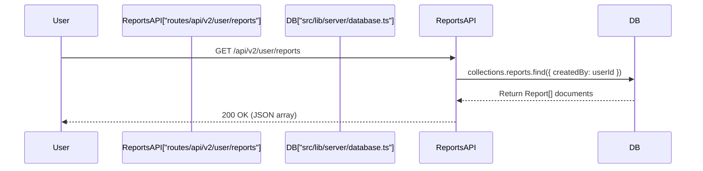
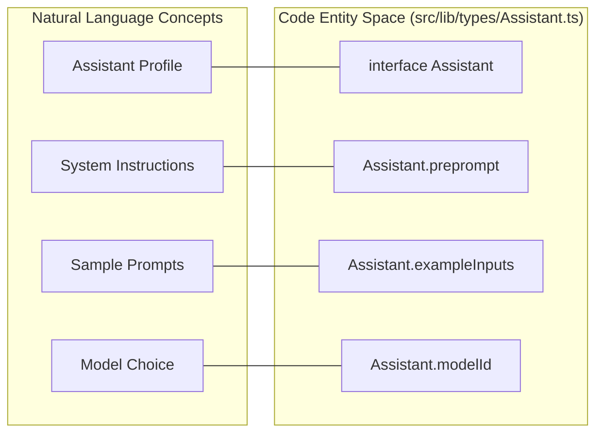

<!-- source: DeepWiki mcp.deepwiki.com · repo huggingface/chat-ui · page 6.1 Assistant Management · fetched 2026-10-26 -->

# Assistant Management

Relevant source files

The following files were used as context for generating this wiki page:

- [.devcontainer/Dockerfile](.devcontainer/Dockerfile)
- [.devcontainer/devcontainer.json](.devcontainer/devcontainer.json)
- [docker-compose.yml](docker-compose.yml)
- [src/lib/jobs/refresh-conversation-stats.ts](src/lib/jobs/refresh-conversation-stats.ts)
- [src/lib/migrations/routines/02-update-assistants-models.ts](src/lib/migrations/routines/02-update-assistants-models.ts)
- [src/lib/server/__tests__/conversation-stop-generating.spec.ts](src/lib/server/__tests__/conversation-stop-generating.spec.ts)
- [src/lib/server/api/__tests__/conversations-message.spec.ts](src/lib/server/api/__tests__/conversations-message.spec.ts)
- [src/lib/server/api/__tests__/conversations.spec.ts](src/lib/server/api/__tests__/conversations.spec.ts)
- [src/lib/server/api/__tests__/misc.spec.ts](src/lib/server/api/__tests__/misc.spec.ts)
- [src/lib/server/api/__tests__/user-reports.spec.ts](src/lib/server/api/__tests__/user-reports.spec.ts)
- [src/lib/server/api/__tests__/user.spec.ts](src/lib/server/api/__tests__/user.spec.ts)
- [src/lib/server/database.ts](src/lib/server/database.ts)
- [src/lib/types/Assistant.ts](src/lib/types/Assistant.ts)
- [src/routes/admin/stats/compute/+server.ts](src/routes/admin/stats/compute/+server.ts)
- [src/routes/login/callback/updateUser.spec.ts](src/routes/login/callback/updateUser.spec.ts)

## Purpose and Scope

This document covers the management aspects of the assistant system in chat-ui. Assistants are pre-configured AI agents with custom prompts, model selections, and example inputs that users can create and share. This page documents the CRUD operations for assistants, the UI components that enable assistant management, pagination and search functionality, the reporting system for inappropriate assistants, and how assistants integrate with the conversation system.

For an overview of the assistant system's purpose and capabilities, see **6. Assistants**. For information about how conversations are created and managed, see **5. Conversation System**.

---

## Assistant Data Model

Assistants are stored in the MongoDB `assistants` collection and follow a document-based schema. Each assistant document contains configuration for a customized AI agent.

### Core Schema

The `Assistant` interface defines the structure of assistant documents in the database.

| Field | Type | Description |
|-------|------|-------------|
| `_id` | `ObjectId` | Unique identifier for the assistant [src/lib/types/Assistant.ts:7]() |
| `name` | `string` | Display name of the assistant [src/lib/types/Assistant.ts:11]() |
| `modelId` | `string` | ID of the LLM model this assistant uses [src/lib/types/Assistant.ts:13]() |
| `preprompt` | `string` | System prompt that configures the assistant's behavior [src/lib/types/Assistant.ts:15]() |
| `description` | `string` | User-facing description of the assistant's purpose [src/lib/types/Assistant.ts:12]() |
| `exampleInputs` | `string[]` | Sample prompts to help users interact with the assistant [src/lib/types/Assistant.ts:14]() |
| `avatar` | `string` | Hash or URL for the assistant's avatar image [src/lib/types/Assistant.ts:10]() |
| `createdById` | `User["_id"] \| string` | Reference to the user or session who created it [src/lib/types/Assistant.ts:8]() |
| `createdByName` | `string` | Display name of the creator [src/lib/types/Assistant.ts:9]() |
| `userCount` | `number` | Total number of users who have used this assistant [src/lib/types/Assistant.ts:16]() |
| `last24HoursCount`| `number` | Usage count in the last 24 hours for trending [src/lib/types/Assistant.ts:27]() |
| `generateSettings`| `object` | Model parameters like `temperature` and `top_p` [src/lib/types/Assistant.ts:19-24]() |
| `review` | `ReviewStatus` | Status for moderation/review workflows [src/lib/types/Assistant.ts:17]() |

**Assistant Entity Relationship**

Sources: [src/lib/types/Assistant.ts:1-28](), [src/lib/server/database.ts:134-136]()

---

## CRUD Operations and Management

Assistant management operations are handled via SvelteKit server actions and API endpoints. The database uses a `secondaryPreferred` read preference for assistants to optimize for heavy read loads while tolerating slight replication lag [src/lib/server/database.ts:133-136]().

### Database Initialization and Indexes
The `Database` class handles the connection and ensures indexes are created for efficient assistant lookups.
- **Connection**: Managed via `MongoClient` [src/lib/server/database.ts:29]().
- **Collection Access**: The `getCollections()` method returns the `assistants` and `reports` collections [src/lib/server/database.ts:149-150]().
- **Index Creation**: The `initDatabase()` method creates indexes on fields like `searchTokens` and `last24HoursCount` to support search and trending features [src/lib/server/database.ts:170-224]().

### Usage Statistics
Assistant and conversation statistics are computed via a background job.
- **Job Trigger**: Can be manually triggered via `POST /admin/stats/compute` [src/routes/admin/stats/compute/+server.ts:8-17]().
- **Logic**: The `computeAllStats` function in `refresh-conversation-stats.ts` aggregates data across day, week, and month spans using MongoDB aggregation pipelines [src/lib/jobs/refresh-conversation-stats.ts:19-31]().
- **Aggregation Pipeline**: The pipeline uses `$facet` to calculate distinct counts for `userId` and `sessionId` simultaneously [src/lib/jobs/refresh-conversation-stats.ts:110-225]().
- **Concurrency**: Uses a semaphore lock (`Semaphores.CONVERSATION_STATS`) via `acquireLock` to prevent multiple instances from running simultaneously [src/lib/jobs/refresh-conversation-stats.ts:265-281]().

### Maintenance and Migrations
The system includes maintenance routines to keep assistant data consistent. For example, the migration script `02-update-assistants-models.ts` updates assistants that use deprecated models to the current default model using `bulkWrite` [src/lib/migrations/routines/02-update-assistants-models.ts:5-46]().

Sources: [src/lib/server/database.ts:133-150](), [src/lib/jobs/refresh-conversation-stats.ts:19-281](), [src/routes/admin/stats/compute/+server.ts:8-17](), [src/lib/migrations/routines/02-update-assistants-models.ts:5-46]()

---

## Reporting and User Reports API

### Reporting System
Users can flag assistants for review. Reports are stored in the `reports` collection, which also uses `secondaryPreferred` read preference for efficient querying by administrators [src/lib/server/database.ts:140-142]().

### User Reports API
The `GET /api/v2/user/reports` endpoint allows users to retrieve a list of reports they have created [src/lib/server/api/__tests__/user-reports.spec.ts:26-30]().
- **Authentication**: Returns an empty array for unauthenticated users [src/lib/server/api/__tests__/user-reports.spec.ts:31-38]().
- **Data Flow**: Queries the `reports` collection where `createdBy` matches the authenticated user's ID [src/lib/server/api/__tests__/user-reports.spec.ts:40-73]().

**Reporting Data Flow**

Sources: [src/lib/server/database.ts:140-142](), [src/lib/server/api/__tests__/user-reports.spec.ts:6-83]()

---

## Integration with Conversations

Assistants act as a configuration layer for conversations. When a user selects an assistant:
1. **Context Initialization**: The assistant's `preprompt` is used to set the initial system state [src/lib/types/Assistant.ts:15]().
2. **Model Routing**: The conversation is pinned to the assistant's `modelId` [src/lib/types/Assistant.ts:13]().
3. **Generation Parameters**: Settings like `temperature` or `top_p` defined in `Assistant.generateSettings` are passed to the LLM endpoint [src/lib/types/Assistant.ts:19-24]().
4. **Example Inputs**: Users are presented with `exampleInputs` as clickable suggestions to start the chat [src/lib/types/Assistant.ts:14]().

**Natural Language to Code Entity Space**

Sources: [src/lib/types/Assistant.ts:6-28](), [src/lib/server/database.ts:119-129]()

---

