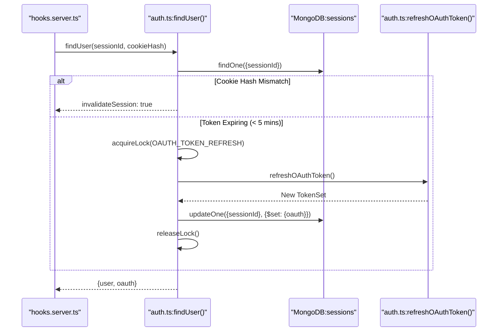

<!-- source: DeepWiki mcp.deepwiki.com · repo huggingface/chat-ui · page 7 Authentication and User Management · fetched 2026-10-26 -->

# Authentication and User Management

<details>
<summary>Relevant source files</summary>

The following files were used as context for generating this wiki page:

- [.env](.env)
- [chart/env/dev.yaml](chart/env/dev.yaml)
- [chart/env/prod.yaml](chart/env/prod.yaml)
- [src/hooks.server.ts](src/hooks.server.ts)
- [src/lib/server/__tests__/conversation-stop-generating.spec.ts](src/lib/server/__tests__/conversation-stop-generating.spec.ts)
- [src/lib/server/adminToken.ts](src/lib/server/adminToken.ts)
- [src/lib/server/api/__tests__/conversations-message.spec.ts](src/lib/server/api/__tests__/conversations-message.spec.ts)
- [src/lib/server/api/__tests__/conversations.spec.ts](src/lib/server/api/__tests__/conversations.spec.ts)
- [src/lib/server/api/__tests__/misc.spec.ts](src/lib/server/api/__tests__/misc.spec.ts)
- [src/lib/server/api/__tests__/user-reports.spec.ts](src/lib/server/api/__tests__/user-reports.spec.ts)
- [src/lib/server/api/__tests__/user.spec.ts](src/lib/server/api/__tests__/user.spec.ts)
- [src/lib/server/auth.ts](src/lib/server/auth.ts)
- [src/lib/types/User.ts](src/lib/types/User.ts)
- [src/lib/utils/auth.ts](src/lib/utils/auth.ts)
- [src/routes/.well-known/oauth-cimd/+server.ts](src/routes/.well-known/oauth-cimd/+server.ts)
- [src/routes/login/+server.ts](src/routes/login/+server.ts)
- [src/routes/login/callback/+server.ts](src/routes/login/callback/+server.ts)
- [src/routes/login/callback/updateUser.spec.ts](src/routes/login/callback/updateUser.spec.ts)
- [src/routes/login/callback/updateUser.ts](src/routes/login/callback/updateUser.ts)
- [src/routes/models/[...model]/+page.ts](src/routes/models/[...model]/+page.ts)
- [static/huggingchat/routes.chat.json](static/huggingchat/routes.chat.json)

</details>


This document provides a detailed overview of the authentication and user management system in `chat-ui`. It covers the OpenID Connect (OIDC) integration, session management, token refresh logic, and user data persistence in MongoDB.

## 1. System Overview

`chat-ui` implements authentication primarily using OpenID Connect (OIDC). The system is designed to handle both authenticated users and guest sessions. When authentication is enabled, it integrates with identity providers (like Hugging Face) to manage user profiles and secure access to LLM resources.

```mermaid
flowchart TD
    subgraph "Authentication System"
        OIDCProvider["OIDC Provider\n(e.g., Hugging Face)"]
        LoginRoute["/login [src/routes/login/+server.ts]"]
        CallbackRoute["/login/callback [src/routes/login/callback/+server.ts]"]
        UserDb[("MongoDB Users\n[collections.users]")]
        SessionDb[("MongoDB Sessions\n[collections.sessions]")]
    end

    User["User Browser"] -->|1. GET /login| LoginRoute
    LoginRoute -->|2. Redirects to| OIDCProvider
    OIDCProvider -->|3. Authentication| User
    OIDCProvider -->|4. Redirect with code| CallbackRoute
    CallbackRoute -->|5. updateUser()| UserDb
    CallbackRoute -->|6. insertOne()| SessionDb
    CallbackRoute -->|7. refreshSessionCookie()| User
    User -->|8. Request with Cookie| Hooks["hooks.server.ts"]
    Hooks -->|9. findUser()| SessionDb
```

Sources: [src/lib/server/auth.ts:1-58](), [src/routes/login/callback/+server.ts:34-142](), [src/routes/login/callback/updateUser.ts:19-215]()

## 2. User and Session Models

### 2.1 User Data Model
The `User` interface defines the structure of user records stored in the `users` collection. It includes identity claims from the OIDC provider and authorization flags.

```mermaid
classDiagram
    class "User [src/lib/types/User.ts]" {
        +_id: ObjectId
        +username?: string
        +name: string
        +email?: string
        +avatarUrl: string | undefined
        +hfUserId: string
        +isAdmin?: boolean
        +isEarlyAccess?: boolean
        +createdAt: Date
        +updatedAt: Date
    }
```

Sources: [src/lib/types/User.ts:1-14]()

### 2.2 Session Data Model
Sessions link a `sessionId` (stored as a SHA-256 hash in the DB) to a `userId`. They also store OAuth tokens and metadata for session coupling security.

```mermaid
classDiagram
    class "Session [src/lib/types/Session.ts]" {
        +_id: ObjectId
        +sessionId: string
        +userId: ObjectId
        +userAgent?: string
        +ip?: string
        +expiresAt: Date
        +coupledCookieHash?: string
        +oauth?: OAuthData
    }
    class "OAuthData" {
        +token: TokenData
        +refreshToken?: string
    }
    class "TokenData" {
        +value: string
        +expiresAt: Date
    }
    Session *-- OAuthData
    OAuthData *-- TokenData
```

Sources: [src/lib/server/auth.ts:120-216](), [src/routes/login/callback/updateUser.ts:140-153]()

## 3. Authentication Flow

### 3.1 OIDC Login and Callback
The login process uses the `openid-client` library. The `/login/callback` route performs the following critical steps:
1. **CSRF Validation**: Validates the `state` parameter against the `sessionId` using `validateAndParseCsrfToken` [src/routes/login/callback/+server.ts:56]().
2. **Token Exchange**: Exchanges the authorization code for an ID token and access token via `getOIDCUserData` [src/routes/login/callback/+server.ts:97]().
3. **Domain Filtering**: Checks `ALLOWED_USER_EMAILS` or `ALLOWED_USER_DOMAINS` if configured. It ensures the email is verified if returned [src/routes/login/callback/+server.ts:106-122]().
4. **User Sync**: Calls `updateUser` to sync OIDC claims with the local database [src/routes/login/callback/+server.ts:124]().

### 3.2 User Synchronization (`updateUser`)
The `updateUser` function handles the transition from a guest session to an authenticated user:
- **Session Migration**: It deletes the previous guest session and creates a new authenticated session [src/routes/login/callback/updateUser.ts:141-142]().
- **Data Migration**: Pre-existing conversations and settings associated with the guest `sessionId` are migrated to the new `userId` [src/routes/login/callback/updateUser.ts:185-214]().
- **Role Assignment**: Assigns `isAdmin` or `isEarlyAccess` based on organization membership defined in `HF_ORG_ADMIN` or `HF_ORG_EARLY_ACCESS` [src/routes/login/callback/updateUser.ts:97-101]().
- **Entra ID Support**: Specifically handles Microsoft Entra v1 tokens by mapping the `upn` claim to `preferred_username` if necessary [src/routes/login/callback/updateUser.ts:31-33]().

Sources: [src/routes/login/callback/updateUser.ts:19-215](), [src/routes/login/callback/+server.ts:34-142]()

## 4. Session Management and Security

### 4.1 Session Resolution (`findUser`)
The `findUser` function is called by the server hooks on every request to resolve the user identity. It performs cookie hash validation and handles OAuth token lifecycle.



Sources: [src/lib/server/auth.ts:120-216]()

### 4.2 OAuth Token Refresh
To prevent race conditions when multiple concurrent requests trigger a token refresh, the system uses a locking mechanism via `acquireLock` [src/lib/server/auth.ts:146](). 
- **Lock Key**: Uses a unique key per session: `${Semaphores.OAUTH_TOKEN_REFRESH}:${sessionId}` [src/lib/server/auth.ts:143]().
- **Wait Logic**: If a token is already being refreshed by another process, subsequent requests will wait for the lock to be released (up to 4 seconds) before re-fetching the updated session from the database [src/lib/server/auth.ts:189-203]().

### 4.3 CSRF and Security
- **SameSite Cookies**: Configurable via `COOKIE_SAMESITE`, defaulting to `lax` or `none` depending on the environment [src/lib/server/auth.ts:65-68]().
- **Cookie Coupling**: If `COUPLE_SESSION_WITH_COOKIE_NAME` is set, the session is cryptographically bound to an additional cookie. If the hash of this cookie changes, the session is invalidated [src/lib/server/auth.ts:135-137]().
- **CSRF Tokens**: Generated using the `sessionId` and an expiration timestamp, then signed to ensure integrity during the OAuth flow [src/lib/server/auth.ts:220-234]().

Sources: [src/lib/server/auth.ts:60-92](), [src/lib/server/auth.ts:135-216]()

## 5. Admin and CLI Management

### 5.1 Admin Token Manager
For CLI-based administration or local development, the `AdminTokenManager` allows elevating a session to admin status using a secret token.
- **Token Validation**: `checkToken(token, sessionId)` validates the provided token and adds the session ID to an internal memory list `adminSessions` [src/lib/server/adminToken.ts:20-30]().
- **Automatic Generation**: If no `ADMIN_TOKEN` is provided in the config, a random UUID is generated and logged to the console on startup [src/lib/server/adminToken.ts:7](), [src/lib/server/adminToken.ts:36-59]().

### 5.2 User Permissions
Permissions are handled via the `authCondition` utility, which ensures queries are scoped either to a `userId` (for logged-in users) or a `sessionId` (for guests) [src/lib/server/auth.ts:217-225]().

Sources: [src/lib/server/adminToken.ts:6-62](), [src/lib/server/auth.ts:217-225]()

## 6. OIDC Configuration Parameters

The `OIDConfig` object is parsed from environment variables and defines the provider interaction.

| Parameter | Source Variable | Description |
| :--- | :--- | :--- |
| `CLIENT_ID` | `OPENID_CLIENT_ID` | OAuth2 Client ID |
| `CLIENT_SECRET` | `OPENID_CLIENT_SECRET` | OAuth2 Client Secret |
| `PROVIDER_URL` | `OPENID_PROVIDER_URL` | Discovery URL for the OIDC provider |
| `SCOPES` | `OPENID_SCOPES` | Requested scopes (e.g., `openid profile email`) |
| `NAME_CLAIM` | `OPENID_NAME_CLAIM` | Claim key to use for the user's display name |
| `TOLERANCE` | `OPENID_TOLERANCE` | Clock skew tolerance for token validation |

Sources: [src/lib/server/auth.ts:42-56]()

---

