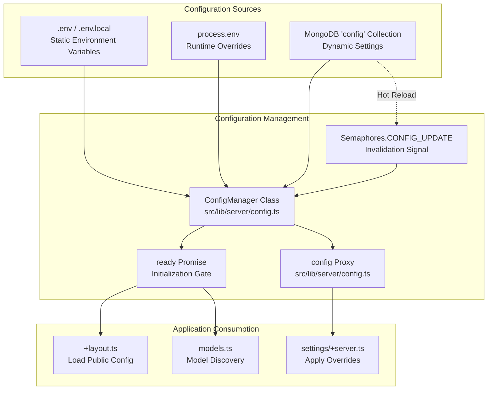
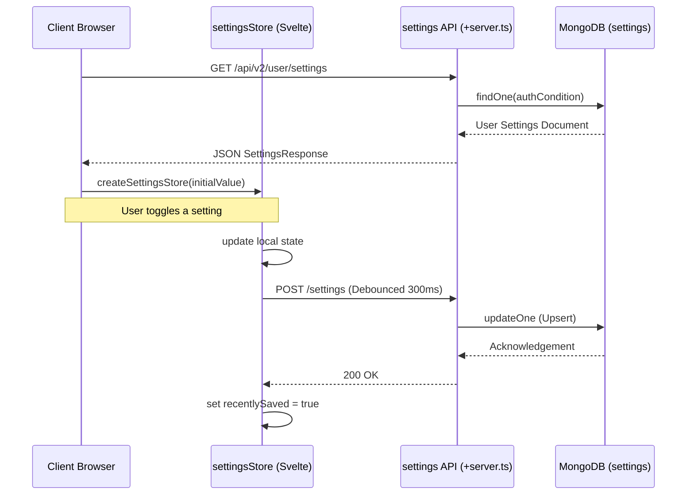

<!-- source: DeepWiki mcp.deepwiki.com · repo huggingface/chat-ui · page 8 Configuration · fetched 2026-10-26 -->

# Configuration

Relevant source files

The following files were used as context for generating this wiki page:

- [src/lib/components/Switch.svelte](src/lib/components/Switch.svelte)
- [src/lib/server/config.ts](src/lib/server/config.ts)
- [src/lib/stores/settings.ts](src/lib/stores/settings.ts)
- [src/lib/types/Settings.ts](src/lib/types/Settings.ts)
- [src/lib/utils/tree/addChildren.spec.ts](src/lib/utils/tree/addChildren.spec.ts)
- [src/lib/utils/tree/addSibling.spec.ts](src/lib/utils/tree/addSibling.spec.ts)
- [src/lib/utils/tree/buildSubtree.spec.ts](src/lib/utils/tree/buildSubtree.spec.ts)
- [src/lib/utils/tree/convertLegacyConversation.spec.ts](src/lib/utils/tree/convertLegacyConversation.spec.ts)
- [src/routes/+layout.ts](src/routes/+layout.ts)
- [src/routes/api/v2/user/settings/+server.ts](src/routes/api/v2/user/settings/+server.ts)
- [src/routes/settings/(nav)/+server.ts](src/routes/settings/(nav)/+server.ts)
- [src/routes/settings/(nav)/application/+page.svelte](src/routes/settings/(nav)/application/+page.svelte)

The configuration system in `chat-ui` provides a flexible, multi-layered approach to managing application settings. Configuration combines static environment variables, dynamic database-stored values via a `ConfigManager`, and user-specific settings stored in MongoDB to control LLM providers, authentication, models, feature flags, and deployment parameters.

For detailed documentation on specific environment variables and their purposes, see [Environment Configuration](#8.1). For database setup and schema configuration, see [Database Configuration](#8.2).

## Configuration Architecture

The configuration system operates through multiple layers. The `ConfigManager` (when enabled via `ENABLE_CONFIG_MANAGER`) handles the merging of environment variables and database-stored settings, providing a unified interface for the server via a `Proxy` object.

Title: Configuration System Flow

**Configuration Flow Diagram**: Environment variables and database values merge through the `ConfigManager`. The `config` Proxy allows the application to access settings as if they were standard object properties while the `ready` promise ensures initialization is complete before consumption.

Sources: [src/lib/server/config.ts:13-42](), [src/lib/server/config.ts:150-191](), [src/routes/+layout.ts:52-57]()

## User Settings and Overrides

In addition to global system configuration, `chat-ui` manages granular user-level settings. These are stored in the `settings` collection and allow users to customize their experience, including per-model overrides for capabilities like tools, reasoning, or multimodal support.

| Feature | Description | Code Entity |
|---------|-------------|-------------|
| **Schema Validation** | Zod schema ensuring settings adhere to types and defaults. | `settingsSchema` [src/routes/api/v2/user/settings/+server.ts:12-31]() |
| **Store Management** | Svelte store for reactive settings updates with debounced persistence. | `createSettingsStore` [src/lib/stores/settings.ts:41-83]() |
| **Model Overrides** | Per-model toggles for `tools`, `multimodal`, and `reasoning`. | `Settings` Interface [src/lib/types/Settings.ts:8-90]() |
| **UI Control** | Switches and selects for toggling features like Haptics or Streaming Mode. | `Switch.svelte` [src/lib/components/Switch.svelte:1-58]() |

Sources: [src/lib/types/Settings.ts:94-110](), [src/routes/settings/(nav)/application/+page.svelte:24-48](), [src/routes/api/v2/user/settings/+server.ts:85-119]()

## Core Configuration Categories

### LLM Provider & Router
Chat-ui is built around OpenAI-compatible APIs. The system uses environment variables to define the primary endpoint and how models are discovered.

| Variable | Purpose |
|----------|---------|
| `OPENAI_BASE_URL` | Base URL for the OpenAI-compatible provider. |
| `OPENAI_API_KEY` | Primary authentication token for the provider. |
| `DEFAULT_SETTINGS` | Default values for user settings, including the `activeModel`. |

Sources: [src/lib/types/Settings.ts:94-110](), [src/routes/settings/(nav)/application/+page.svelte:52-74]()

### Persistence & State
User preferences and application state are synchronized between the client store and the MongoDB backend.

| Variable / Function | Purpose |
|----------|---------|
| `useSettingsStore` | Accesses the reactive settings store in Svelte components. |
| `collections.settings` | The MongoDB collection where user-specific settings are persisted. |
| `streamingMode` | Configures UI output as "raw" or "smooth" via `resolveStreamingMode`. |

Sources: [src/lib/stores/settings.ts:37-39](), [src/routes/settings/(nav)/+server.ts:29-64](), [src/lib/types/Settings.ts:71-76]()

## Configuration Loading Sequence

The application initialization sequence ensures that configuration is stable before any functional logic executes. During the SvelteKit `load` function, both public configuration and user-specific settings are fetched to populate the UI.

Title: Settings Synchronization Sequence

**Synchronization Sequence**: User settings are fetched during the initial page load in `+layout.ts` and managed client-side by `createSettingsStore`. Changes are debounced and persisted back to the `settings` collection in MongoDB.

Sources: [src/routes/+layout.ts:52-104](), [src/lib/stores/settings.ts:47-83](), [src/routes/api/v2/user/settings/+server.ts:33-83]()

## Build-time vs Runtime Configuration

Some configuration is baked into the application during the build process, while others are read at runtime.

*   **Build-time**: Variables prefixed with `PUBLIC_` are accessible to the browser. The `getConfigManager` function processes these for client-side use.
*   **Runtime**: Private server-side variables are managed by the `ConfigProxy`. If `ENABLE_CONFIG_MANAGER` is true, the `ConfigManager` can hot-reload settings from the database without a process restart by checking `Semaphores.CONFIG_UPDATE`.

Sources: [src/lib/server/config.ts:44-56](), [src/lib/server/config.ts:125-146](), [src/routes/+layout.ts:100]()

---

