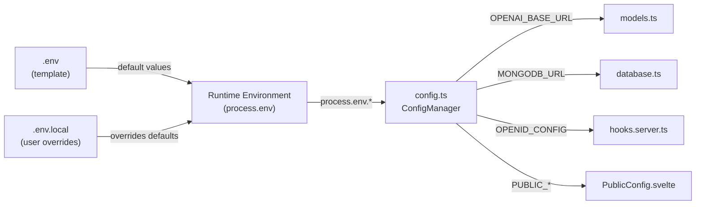
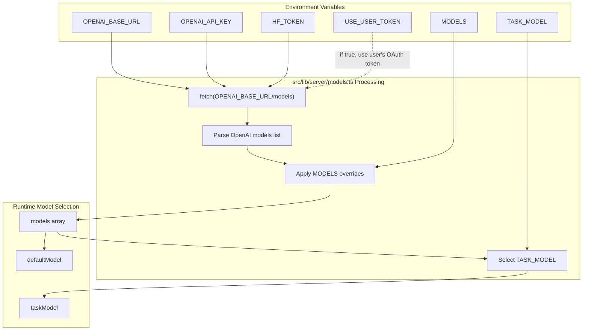
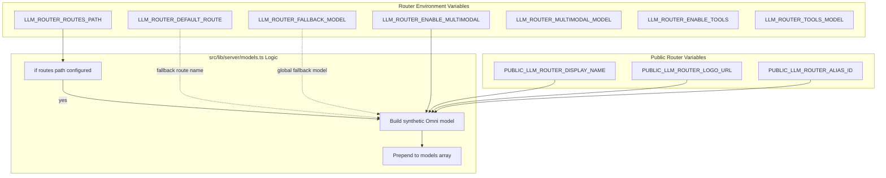

<!-- source: DeepWiki mcp.deepwiki.com · repo huggingface/chat-ui · page 8.1 Environment Configuration · fetched 2026-10-26 -->

# Environment Configuration

Relevant source files

The following files were used as context for generating this wiki page:

- [.env](.env)
- [chart/env/dev.yaml](chart/env/dev.yaml)
- [chart/env/prod.yaml](chart/env/prod.yaml)
- [docs/source/configuration/common-issues.md](docs/source/configuration/common-issues.md)
- [docs/source/configuration/llm-router.md](docs/source/configuration/llm-router.md)
- [docs/source/configuration/mcp-tools.md](docs/source/configuration/mcp-tools.md)
- [docs/source/configuration/overview.md](docs/source/configuration/overview.md)
- [docs/source/developing/architecture.md](docs/source/developing/architecture.md)
- [docs/source/index.md](docs/source/index.md)
- [scripts/updateLocalEnv.ts](scripts/updateLocalEnv.ts)
- [src/hooks.server.ts](src/hooks.server.ts)
- [src/lib/server/auth.ts](src/lib/server/auth.ts)
- [src/lib/server/config.ts](src/lib/server/config.ts)
- [src/lib/types/User.ts](src/lib/types/User.ts)
- [src/lib/utils/tree/addChildren.spec.ts](src/lib/utils/tree/addChildren.spec.ts)
- [src/lib/utils/tree/addSibling.spec.ts](src/lib/utils/tree/addSibling.spec.ts)
- [src/lib/utils/tree/buildSubtree.spec.ts](src/lib/utils/tree/buildSubtree.spec.ts)
- [src/lib/utils/tree/convertLegacyConversation.spec.ts](src/lib/utils/tree/convertLegacyConversation.spec.ts)
- [src/routes/login/callback/+server.ts](src/routes/login/callback/+server.ts)
- [src/routes/login/callback/updateUser.ts](src/routes/login/callback/updateUser.ts)
- [src/routes/logout/+server.ts](src/routes/logout/+server.ts)
- [static/huggingchat/routes.chat.json](static/huggingchat/routes.chat.json)

This document catalogs all environment variables used to configure `chat-ui` at runtime and build-time. These variables control LLM provider connections, authentication, database access, feature flags, and application appearance.

For database-specific configuration including MongoDB connection strings, collection schemas, and migrations, see [Database Configuration](#8.2). For how configuration values are loaded and managed dynamically, see [Configuration](#8).

## Environment Variable System

Chat-ui uses the SvelteKit environment variable pattern for configuration management. The repository includes [.env:1-173]() as a template file with comments and defaults. Users should create `.env.local` to override these values with environment-specific settings [docs/source/index.md:23-29]().

**Sources:** [.env:1-173](), [docs/source/index.md:23-29]()

The loading order is:
1. [.env:1-173]() provides defaults and documentation.
2. `.env.local` (not tracked in git) provides environment-specific overrides [docs/source/index.md:23-29]().
3. Container/deployment environment can override via `-e` flags (e.g., in Kubernetes `envVars`) [chart/env/prod.yaml:49-55]().
4. `src/lib/server/config.ts` loads and validates all values into typed objects, potentially using a database-backed `ConfigManager` if `ENABLE_CONFIG_MANAGER` is active [src/lib/server/config.ts:44-46]().

Variables prefixed with `PUBLIC_` are exposed to client-side code. All other variables remain server-side only [src/lib/server/config.ts:1-2]().

## Models and LLM Integration

The primary configuration for LLM connectivity determines which OpenAI-compatible API endpoint chat-ui will communicate with. Chat UI connects to any OpenAI-compatible API endpoint via `OPENAI_BASE_URL` [docs/source/index.md:5-11]().

**Sources:** [.env:4-15](), [docs/source/index.md:32-37]()

### Core LLM Variables

| Variable | Type | Purpose | Default |
|----------|------|---------|---------|
| `OPENAI_BASE_URL` | string | OpenAI-compatible base URL for model discovery and inference [.env:7]() | `https://router.huggingface.co/v1` |
| `OPENAI_API_KEY` | string | Authorization token for the provider (Bearer token) [.env:10]() | none |
| `USE_USER_TOKEN` | boolean | When `true`, uses the authenticated user's OAuth token for inference calls instead of `OPENAI_API_KEY` [.env:12]() | `false` |
| `TASK_MODEL` | string | Model ID/name for internal tasks (title generation, etc.). If unset, uses current conversation model [.env:62]() | none |
| `MODELS` | JSON5 array | Override array to modify model metadata fetched from `/models` endpoint [.env:57]() | `[]` |

**Sources:** [.env:4-62](), [docs/source/index.md:25-37]()

## LLM Router Configuration

The LLM Router system enables intelligent model selection through the "Omni" virtual model [docs/source/index.md:15](). It selects routes based on request heuristics like multimodal inputs or tool calling requirements [chart/env/prod.yaml:79-84]().

**Sources:** [.env:64-90](), [chart/env/prod.yaml:79-91]()

### Router Configuration Variables

| Variable | Type | Purpose | Default |
|----------|------|---------|---------|
| `LLM_ROUTER_ROUTES_PATH` | string | Path to routes policy JSON array. Required for router activation [.env:67]() | none |
| `LLM_ROUTER_DEFAULT_ROUTE` | string | Route name to use when no specific heuristic matches [.env:70]() | `default` |
| `LLM_ROUTER_FALLBACK_MODEL` | string | Model to use if all models in a selected route are unavailable [.env:72]() | none |
| `LLM_ROUTER_ENABLE_MULTIMODAL` | boolean | Enable multimodal (image) handling via router [.env:75]() | `false` |
| `LLM_ROUTER_MULTIMODAL_MODEL` | string | Model ID to use for image requests via router [.env:77]() | none |
| `LLM_ROUTER_ENABLE_TOOLS` | boolean | Enable tool calling support via router [.env:80]() | `false` |
| `LLM_ROUTER_TOOLS_MODEL` | string | Model ID to use for MCP tool calls via router [.env:82]() | none |

**Sources:** [.env:64-82](), [static/huggingchat/routes.chat.json:1-24]()

### Router UI Variables (Client-Visible)

| Variable | Type | Purpose | Default |
|----------|------|---------|---------|
| `PUBLIC_LLM_ROUTER_DISPLAY_NAME` | string | Display name shown in UI model selector [.env:86]() | `"Omni"` |
| `PUBLIC_LLM_ROUTER_LOGO_URL` | string | Optional logo URL for the router entry [.env:88]() | none |
| `PUBLIC_LLM_ROUTER_ALIAS_ID` | string | Virtual model ID used to identify the router [.env:90]() | `"omni"` |

**Sources:** [.env:84-90]()

## Authentication and Security

Authentication configuration controls OpenID Connect integration, session management, and request security. The `OIDConfig` object in `src/lib/server/auth.ts` parses these variables using Zod [src/lib/server/auth.ts:42-56]().

### OpenID Connect Variables

| Variable | Type | Purpose | Default |
|----------|------|---------|---------|
| `OPENID_CONFIG` | JSON | Parameters to enable OpenID login [.env:103]() | none |
| `OPENID_CLIENT_ID` | string | OAuth2 client ID. Set to `__CIMD__` for automatic creation [.env:44]() | none |
| `OPENID_CLIENT_SECRET` | string | OAuth2 client secret [.env:45]() | none |
| `OPENID_SCOPES` | string | Space-separated OAuth2 scopes [.env:49]() | `"openid profile inference-api read-mcp read-billing"` |

**Sources:** [.env:43-51](), [src/lib/server/auth.ts:42-56]()

### Access Control and Session Variables

| Variable | Type | Purpose | Default |
|----------|------|---------|---------|
| `ALLOWED_USER_EMAILS` | JSON array | Whitelist of email addresses permitted to log in [.env:105]() | `[]` |
| `ALLOWED_USER_DOMAINS` | JSON array | Whitelist of email domains permitted to log in [.env:107]() | `[]` |
| `AUTOMATIC_LOGIN` | boolean | If true, authentication is required on all routes [.env:51]() | `false` |
| `COOKIE_NAME` | string | Name of the cookie used to store the session [.env:112]() | `hf-chat` |
| `COOKIE_SAMESITE` | enum | SameSite attribute for cookies (`lax`, `strict`, `none`) [.env:117]() | none |
| `COOKIE_SECURE` | boolean | Set to true to only allow cookies over HTTPS [.env:118]() | none |
| `TRUSTED_EMAIL_HEADER` | string | Header to use to get the user email for trusted environments [.env:119]() | none |

**Sources:** [.env:101-120](), [src/lib/server/auth.ts:60-68]()

## Application Appearance and Behavior

Public-facing configuration variables control branding and client-side feature flags. These are accessible via the `ConfigManager` in the frontend [src/lib/server/config.ts:125-146]().

### Branding Variables

| Variable | Type | Purpose | Default |
|----------|------|---------|---------|
| `PUBLIC_APP_NAME` | string | Name used as title throughout the app [.env:23]() | `ChatUI` |
| `PUBLIC_APP_ASSETS` | string | Used to find logos & favicons in `static/$PUBLIC_APP_ASSETS` [.env:24]() | `chatui` |
| `PUBLIC_APP_DESCRIPTION` | string | Description used throughout the app [.env:25]() | `"Making the community's best AI chat models available to everyone."` |
| `PUBLIC_FEATURE_ANNOUNCEMENTS`| JSON array | Toasts shown on the home screen [.env:40]() | none |

**Sources:** [.env:22-40](), [chart/env/prod.yaml:67-73]()

### Feature Flags and Limits

| Variable | Type | Purpose | Default |
|----------|------|---------|---------|
| `LLM_SUMMARIZATION` | boolean | Generate conversation titles with LLMs [.env:126]() | `true` |
| `ALLOW_IFRAME` | boolean | Allow the app to be embedded in an iframe [.env:128]() | `true` |
| `ENABLE_DATA_EXPORT` | boolean | Enable user data export [.env:145]() | `true` |
| `USAGE_LIMITS` | JSON object | Defines per-user restrictions [.env:148]() | `{}` |

**Sources:** [.env:112-155]()

## Transcription and Tools

### Transcription (Whisper)

| Variable | Type | Purpose | Default |
|----------|------|---------|---------|
| `TRANSCRIPTION_MODEL` | string | Whisper model ID for voice-to-text [.env:96]() | none |
| `TRANSCRIPTION_BASE_URL` | string | Base URL for transcription API [.env:99]() | `https://router.huggingface.co/hf-inference/models` |

**Sources:** [.env:92-99]()

### Model Context Protocol (MCP)

| Variable | Type | Purpose | Default |
|----------|------|---------|---------|
| `MCP_SERVERS` | JSON array | List of base MCP servers (name and URL) [.env:135]() | none |
| `MCP_FORWARD_HF_USER_TOKEN` | boolean | Forward logged-in user's HF token to MCP servers [.env:137]() | none |
| `MCP_TOOL_TIMEOUT_MS` | integer | Timeout for MCP tool calls in milliseconds [.env:141]() | `120000` |
| `EXA_API_KEY` | string | API key for Exa MCP integration [.env:139]() | none |

**Sources:** [.env:134-144](), [chart/env/prod.yaml:86-88]()

## Deployment and Build Variables

These variables are used to identify the specific deployment environment or control server behavior.

| Variable | Type | Purpose | Default |
|----------|------|---------|---------|
| `METRICS_ENABLED` | boolean | Enable Prometheus metrics collection [chart/env/prod.yaml:62]() | `false` |
| `LOG_LEVEL` | string | Server-side logging level [chart/env/prod.yaml:63]() | `info` |
| `NODE_LOG_STRUCTURED_DATA` | boolean | Use JSON logging for production observability [chart/env/prod.yaml:64]() | `false` |
| `APP_BASE` | string | Subpath for the application (e.g. `/chat`) [chart/env/prod.yaml:57]() | none |

**Sources:** [chart/env/prod.yaml:49-65](), [.env:147-160]()

---

